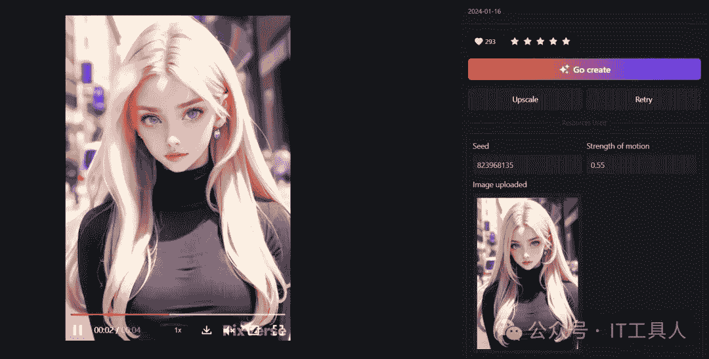
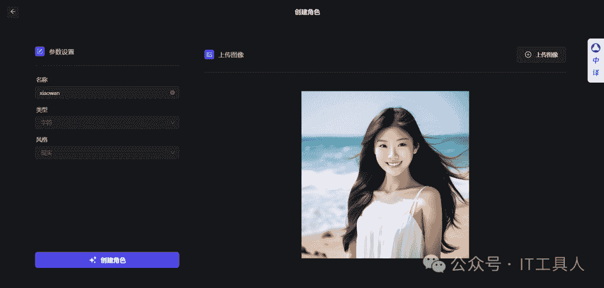
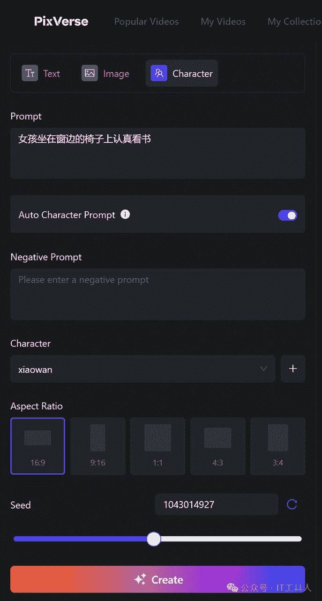
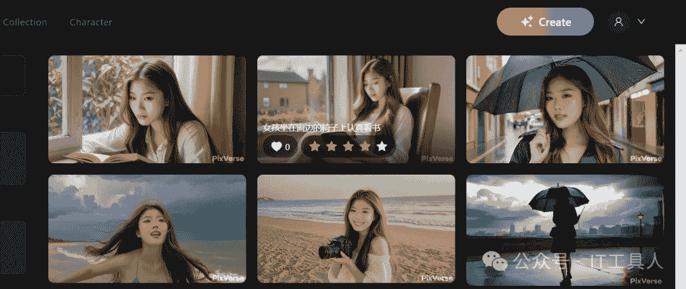

# 【PixVerse】一款免费无限制的AI生成视频工具（不同场景保持人物一致的实用功能教程）

> 来源：[https://geekbang.feishu.cn/docx/QypvdnZKuovtq1x8kjkc1gEDnwe](https://geekbang.feishu.cn/docx/QypvdnZKuovtq1x8kjkc1gEDnwe)

> 🤵作者： IT工具人

> 📃 作者介绍：14年互联网IT从业经验，做过程序员，现任AI产品经理。发现并分享能提升做事效率的工具，让创业或副业变得更简单。

> ⏰ 收录时间：2024-05-30 18:29:00 (UTC+8)

> 🔗 原文链接：  h[ttps://mp.weixin.q](https://mp.weixin.qq.com/s/jeb6FoWRIX2OEGUnqu50gw)q.com/s/jeb6FoWR...

欢迎关注👸号👆

当你发现AI可以生成视频之后，有没有想过用它来创造原创短视频，但是AI每次创造的短视频人物都会变，无法保持一致性，这该怎么控制呢？今天给大家带来一个很不错的解决方案。

今天工具主角是PixVerse，关注我的老铁们应该发现，这是2个月前我介绍的一个视频生成工具，这工具背后是我们中国的创业公司-爱诗科技。

当前，PixVerse依然是免费，最近PixVerse推出了角色一致性功能，即我们在生成视频时 场景可以 百 变，但可以 保持人物一致。在AI生成视频领域， 除了还没发布的Sora以及模仿生成视频Viggle， 当前生成的视频都是比较短（4秒），所以我们要做一个短视频，可能需要生成几次视频，然后再把视频拼接起来，这时如果 多个视频（场景）下人物的不一致 ，那这个视频看着就会很别扭。

那接下来，让我们一起看看PixVerse的角色一致性功能是怎么做，操作步骤也很简单。

**1、创建角色 **。进入官网，点击首页导航栏的Character，进入我的角色列表，点击

创建角色，然后导入 视频 的主 角 图片。页面中有列出图片样本，如果选择的图片脸部较小，将会报错提示脸的大小要超过200X200px。角色可以是真人也可以是动漫人物，我这里用的是AI生成的人物（这个是我的👸号御用人脸了），建议做短视频的创作者们，尽量用AI来生成一个人物，后期做短视频都可以用这个。

2、 **生成短视频 **。点击左上角的Create，进入短视频生成界面。这里我们可以看到有三种创建**短视频的功能，分别是**文本生成视频、图片生成视频、角色生成视频。进入第三个标签（ Character ），在这里操作如下：

（1）输入提示词，虽然页面是中文，但可以输入中文。

（2）打开 Auto Character Prompt ，这个打开之后生成的更逼真。

（3）输入反向提示词，就是生成的时候不希望出现什么，可以在这里描述。

（4）选择创建好的角色，选择第一步创建的角色的名称。

（5）选择视频的尺寸，比如横屏就选择16:9，竖屏选择9:16。

（6）Seed。这个是风格一致性，创建多个相同主体的时候可以填写一样的值。

（7）点击Create，稍等几分钟就可以了。

这个工具目前是免费的，所以可以是无忌惮的生成视频。可以多个视频一起生成，不用逐个排队。我在体验过程中生成的视频如下：

上传两个视频，各位看官们可以点评一下生成的效果。

[🎦 点击观看视频](https://mpvideo.qpic.cn/0bc3bqaamaaahiahsxyljftfadgdaygaabqa.f10002.mp4?dis_k=456961a18c120a9e74c36f2d6f142dc4&dis_t=1717064930&play_scene=10120&auth_info=Cuyr7I1KEAhmyuOW5A9zFhVgZEw1SlolOEpMEyFwLVw3XEBpE0JNZwQSbz8SLWQsHw==&auth_key=ab4edf945c0f3967f57e2face7cfc214&vid=wxv_3396333017718243329&format_id=10002&support_redirect=0&mmversion=false)

[🎦 点击观看视频](https://mpvideo.qpic.cn/0bc3miaakaaabmahvbalortfaywdavraabia.f10002.mp4?dis_k=396e49a627dbbb388c9d4250657365b8&dis_t=1717064930&play_scene=10120&auth_info=Cr2PsvBIGlwzmrGV7lJ8QU83ZhgyHlp2Pk1IQiB8KlA3AEJhE0VHM1FCPTwYcGt7RQ==&auth_key=824d85a4b76213a6f7b74c588afcdf36&vid=wxv_3396333877969993729&format_id=10002&support_redirect=0&mmversion=false)

视频详情

生成的结果可以看出， **PixVerse这个保持人物一致性的功能是真香，虽然有些细节没处理到**位，但总体还是很不错，如果是叙事类的内容，完全可以用PixVerse来生成视频。

写在最后，看了功能教程可能只能记住一两天，但是实践过的功能可以记住很久，所以强烈建议各位看官实践起来。

PixVerse官网地址： app.pixverse.ai。