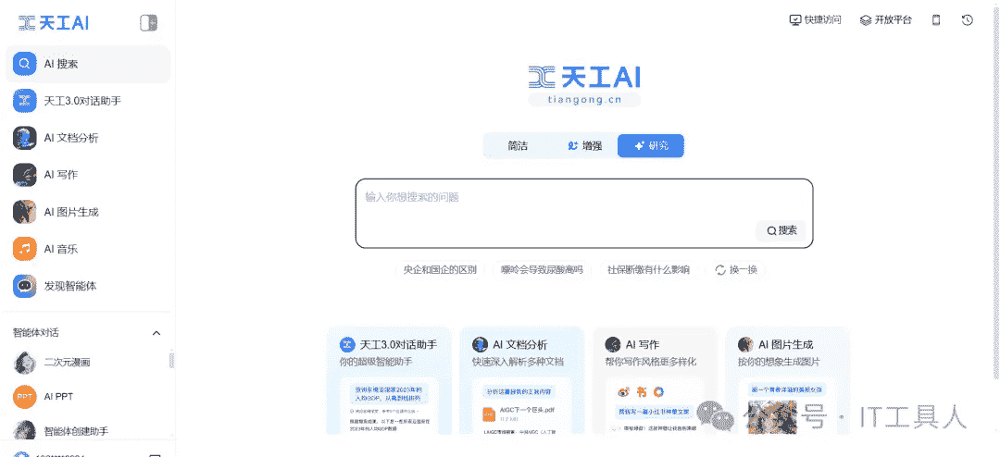
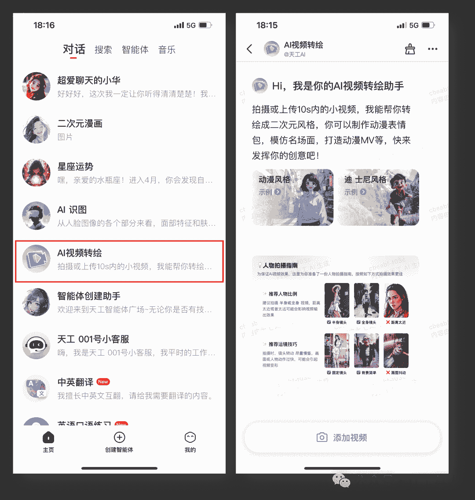
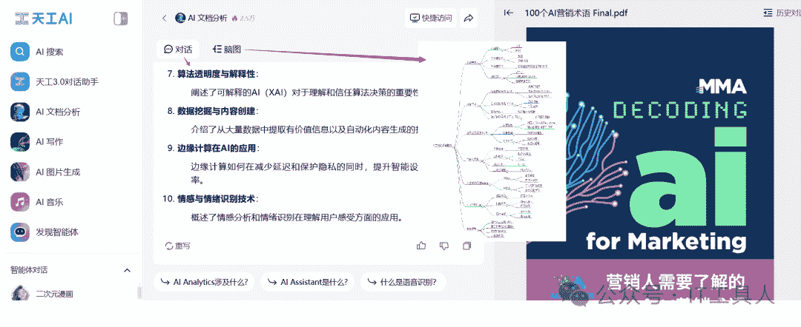
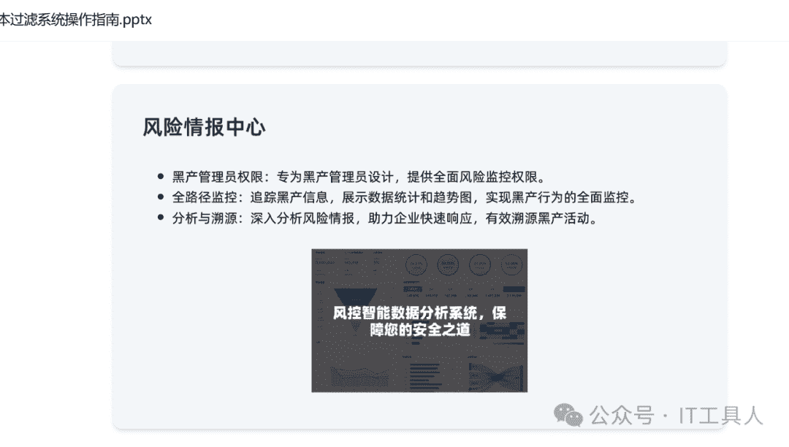
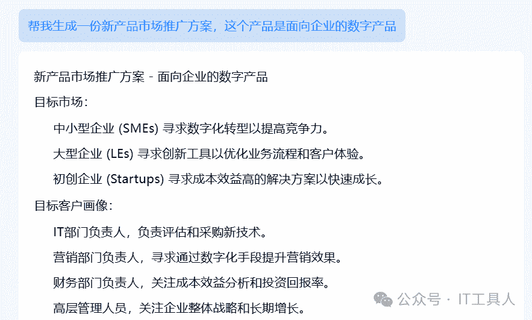
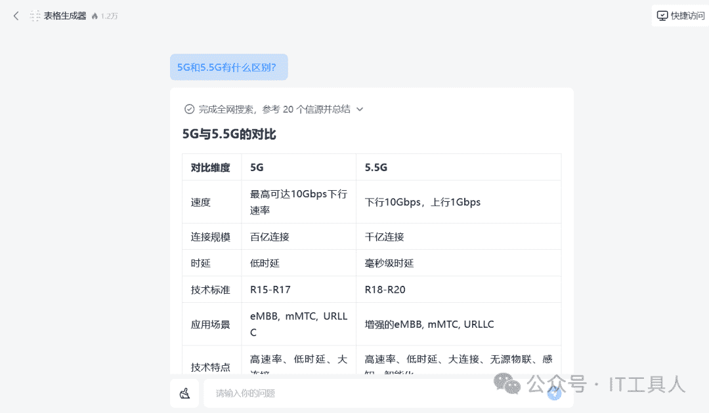
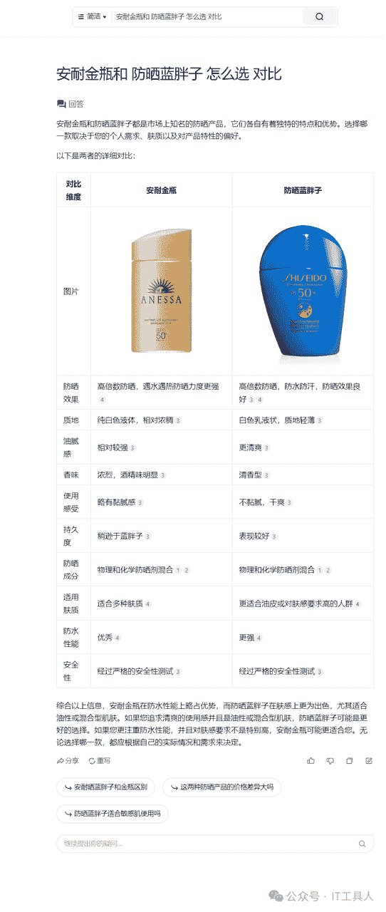

# 【天工AI】这款AI逆天了！能批量制作爆款短视频，1小时100条！

> 来源：[https://geekbang.feishu.cn/docx/TIp2doFXHo9ZYTx0r2ec0E82nhg](https://geekbang.feishu.cn/docx/TIp2doFXHo9ZYTx0r2ec0E82nhg)

> 🤵作者： IT工具人

> 📃 作者介绍：14年互联网IT从业经验，做过程序员，现任AI产品经理。发现并分享能提升做事效率的工具，让创业或副业变得更简单。

> ⏰ 收录时间：2024-05-30 18:34:41 (UTC+8)

> 🔗 原文链接：  h[ttps://mp.weixin.q](https://mp.weixin.qq.com/s/PwMza8SuRL-53EZ5GbW85w)q.com/s/PwMza8Su...

欢迎关注公众号👆

今天这篇干货有点多，强烈建议学习AI的朋友看完一遍，再去体验。

体验了这么多AI工具，有没有发现大部分工具还是功能比较单一，个别AI工具开始往全能型发展。

最近全能型的AI工具——天工AI，被大家挖掘出来。这工具真的太厉害，不得不给昆仑万维的开发团队点赞。

我是铁粉一直在用，总觉得从它身上可以找到新的AI项目。今天不藏私了，分享给大家~

它是AI界中，功能最全面的一款工具了，不服留言辩论。

天工AI

天工AI 支持在电脑端、手机端、小程序中使用，连这个也考虑得很全，是个干实事的开发团队。以下是各个入口，记一下就好了：

| 电脑端： www.tiangong.cn（很好记的域名，天工的全拼，然后cn是中国）。 |
| --- |

【小程序界面】

这个工具的应用场景非常多，比如AI搜索、视频转绘、AI制作PPT、文档分析、图片生成、AI音乐、AI写作、编程助理、AI识图等等，另外，还有智能体可以解决复杂任务。

今天的文章， 我们挑三个工作和创业的使用场景 中，使用频率更高的来逐一 介绍。

1、 **视 频转绘助力涨粉 **。

短视频是当下最大的流量池，自然也会吸引大量短视频的内容创作者，靠玩视频赚钱的人有很多。因此，我们可以用AI制造出一些好玩（博眼球）的画面，让我们的视频脱颖而出，提高视频的播放量，吸引粉丝关注。

用天工AI的视频转绘功能就是一个很好的点子，而且操作方式也比较简单，首先把视频中的某一部分剪出来，用天工进行视频转绘，转绘之后再用剪映拼接回去。

天工AI的视频转绘操作步骤是，进入转绘界面之后，上传待转绘视频，再选择风格，静待几分钟就出结果了。

当前支持转绘10秒以内的视频，如果需要转绘的视频比较长，可以剪成多段，再分段转绘，最后拼接回去。以下是我体验转绘的2个风格以及原视频对比。

[🎦 点击观看视频](https://mpvideo.qpic.cn/0bc3muaaiaaa6qabh5sobjtfazodarsqabaa.f10002.mp4?dis_k=ce8f453885b79e88550c7eee91e8d180&dis_t=1717065259&play_scene=10120&auth_info=TYHCnPdGUgchss7jnmxrSWkRHm1kTzhvYUFyNUFqUwdwLxdcV0kPaENqQkpoTnxzYw==&auth_key=5395a10a9adaa9433f3ec14b73c92a80&vid=wxv_3469555152460152835&format_id=10002&support_redirect=0&mmversion=false)

视频详情

2、 **产品经理的得力助手 **。

我是一名软件产品经理，日常工作中，主要是做需求调研、做PPT、写方案等。来看看我用天工AI的哪些功能，让它成为我的一名非常优秀的助手。

（1） **AI文档分析 **，调研时需要阅读一些不好理解的政策或行业文档等，此时把文档上传到天工AI的文档分析，就可以让它归纳总结，或提问文档内容，结果还能生成脑图。

（2） **AI做PPT **，对于写PPT的 人来说，这个真的太有用了。在【AI PPT】中，将上述的文档分析结果上传给天工AI，不到5秒的时间内容，天工AI就能生成一份结构清晰，内容详实，措辞专业精准的大纲，觉得大纲没啥问题，就可以点击生成PPT。到此，调研汇报PPT就轻松搞定了。

生成PPT内容合适，且自动插图

（3） **写文案 **，在写设计方案、建设方案、项目总结时，可以在AI写作中先找一下模板，先让我的“助手”帮我生成一份方案。当然这个方案生成不是一次就能生成好，需要进行多次交互才能生成一份内容丰实的文档。

如果你要 写小红书爆款文章 ，也可以用这里的模板。我看也不用报名写作了，这有何难，只要把想写的发过去就能生成文章了。

（4） **其他 **，如生成图片、表格生成器、脑图等都是我们写方案时可能会用到的功能。

3、 **多模态的AI搜索。**

AI搜索替代传统搜索已经是不争的事实了， 天工AI是国内第一家做AI搜索，用过之后，你会果断放弃百度等传统搜索引擎了。

马上6.18了，想要买东西，那就问问天工AI吧。趁着6.18大促，想给老婆买防晒霜，却不知安耐金瓶和防晒蓝胖子这两个要怎么选了。直接问天工AI ，它会直接生成对比表格，包含了两款产品各维度的产品信息对比，而且还是图文并茂的信息展示，这对我这种对产品并不了解的男性同志，简直太友好了。

天工AI搜索的体验过程，无广告、无虚假网站、无收费网页，在涉及到消费、购物的查询时，效率翻倍、值得信赖。

不仅如此，天工AI还有强大的智能体功能，能力和ChatGPT的GPTs，字节的coze不相上下。智能体的入门需要费点时间，但是熟练之后，你会发现天工AI无所不能，这个以后单独写一篇，敬请期待。

**看到这**里，或许你也发现了天工AI的强大，而且**还是 **免费 使用，它能一站式解决你在工作和生活中的问题。如你在使用过程中有遇到问题，不妨 留言 告诉我。