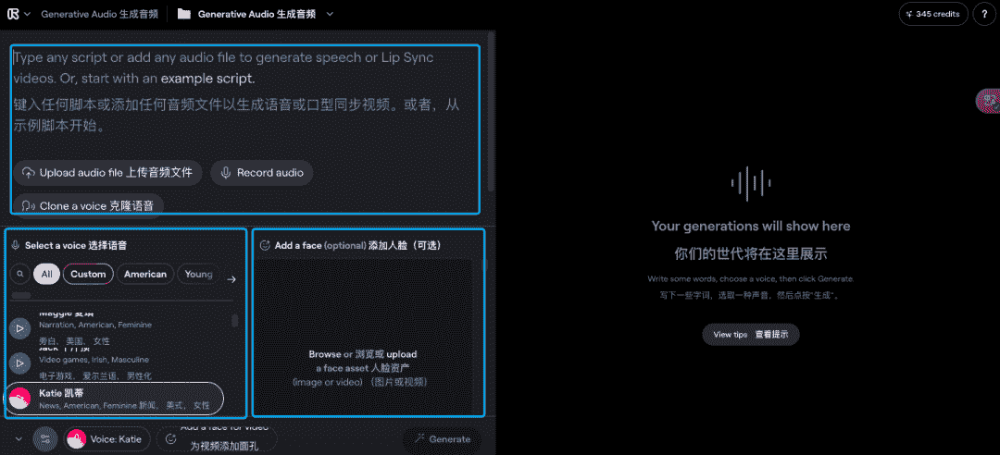

# 【RUNWAY】又一炸裂的功能「口型同步」

> 来源：[https://geekbang.feishu.cn/docx/Ed8Tdzr9soAJMLxgx5bcDCOinx1](https://geekbang.feishu.cn/docx/Ed8Tdzr9soAJMLxgx5bcDCOinx1)

> 👩 作者：赛博大表姐

> 📃 作者介绍：120万字小说作者，青岛AI企业家联盟导师，青岛市创业者协会人工智能专委会知识创业部副部长，自媒体创业者。

> ⏰ 收录时间：2024-05-31 15:53:35 (UTC+8)

> 🔗 原文链接： h[ttps://mp.weixin.q](https://mp.weixin.qq.com/s?__biz=MzkxMjY2NzgwOA==&mid=2247483910&idx=1&sn=e165a84641fb2b3e5c14f1c6606ca3c6&chksm=c10827c9f67faedf73c80a43fa08380c273badbff3283d49e76d9b27d98850d4ac09689ed4b0&token=1230547096&lang=zh_CN#rd)q.com/s?__biz=Mz...

欢迎关注公众号👆

今年被称为AI短视频元年，大家可以看到从央视到地方台，无处不在充斥着浓浓的AI味儿，甚至都用起了AI做新闻，可以说开创了一个新纪元。

尴尬归尴尬，毕竟AI短视频还没发展到可以和拍摄出来一样的效果，不过这显然是一个大趋势，现在整个Ai行业可谓是“度日如年”，从能用到好用，不过是迭代几个版本的事情。

不管是pika、stabelvideo、pixvers等视频大户，还是之前版本的runway，都无法解决一个问题，那就是口型同步，所以即便是有配音也看起来怪怪的。

但如今的runway不一样了，不仅有运动笔刷这个非常实用的功能，这次还更新了Lip Sync功能，让喜欢做AI电影的我们着实兴奋了一下下！

点击Try Lip Sync进来：

分为这么几个区域，上面大框里输入要让人物说出来的台词，左下选择人物语言，根据情节选择，这个地方让我想起了elevenlabs，很牛啊！

左下角上传要开口说话的人物图，这里需要注意的是，人物要正面照，且嘴巴最好是闭起来的。

我们来演示一下，我们以这张照片为例：

（这里PS一下：这是我正在做的一个AI短视频宣传片，用我的脸换脸做的图，咱也来当一把女主角

）

都设置好了以后，长这个样子：

点一下Generate运行：

[🎦 点击观看视频](https://mpvideo.qpic.cn/0bc3gaab4aaa6eagpwzinftfamgddyyaahqa.f10002.mp4?dis_k=1f396c005c839a4c5da324e8fc155fc1&dis_t=1717142012&play_scene=10120&auth_info=VqS9l1o8VEegioPNdyBkX3E/FVUWKSc1US4cTjkVejhwHB4oCGE7JWlDNWVWN15V&auth_key=0f13b32e449fe91e0e5b0c805b307939&vid=wxv_3428195415659626497&format_id=10002&support_redirect=0&mmversion=false)

视频详情

不行，中文太二了，都影响我的形象，换一个英文的试试：

[🎦 点击观看视频](https://mpvideo.qpic.cn/0b2ezaabkaaazuag75jitftfbsgdcxeaafia.f10002.mp4?dis_k=3b46a0a0d61e57fa65bd48cdc980140f&dis_t=1717142012&play_scene=10120&auth_info=AZKK5o9XblEfpoiDmXRyOVl/OEAAFi8iMlt5HRVmTns8cUobKlszPn1vQTUxVWUDUw==&auth_key=698cf2d9c079390eddba9b32cc237535&vid=wxv_3428196564764704769&format_id=10002&support_redirect=0&mmversion=false)

视频详情

还是英文的听着顺耳多了。

好了，今天就到这儿，我继续去忙了～都去试试吧！