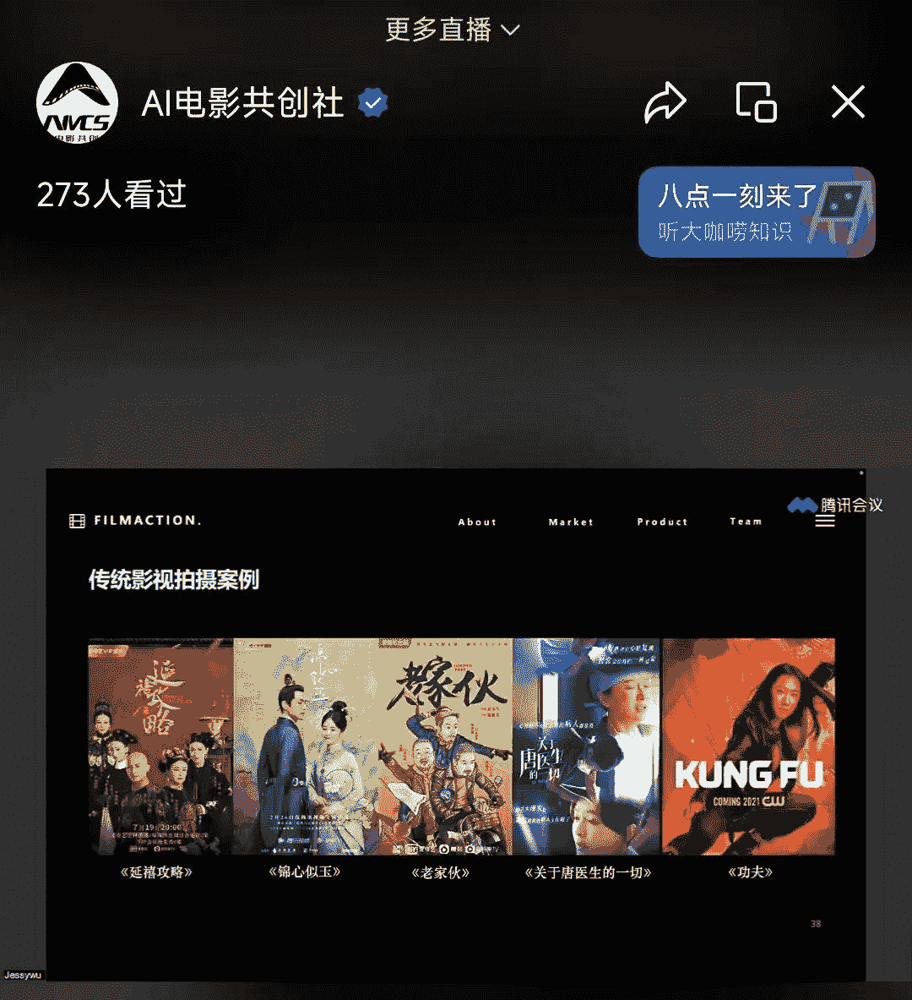
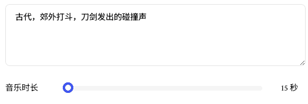
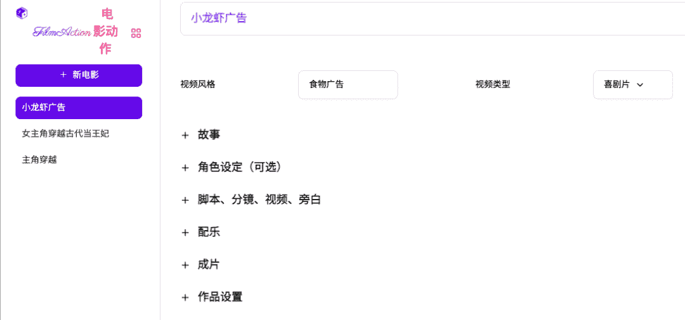
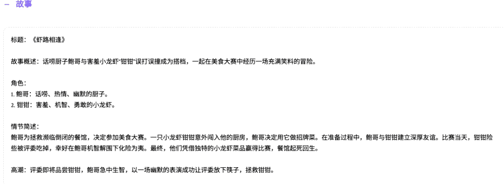
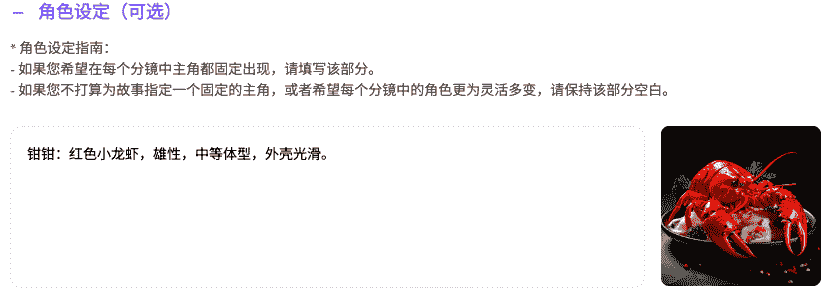
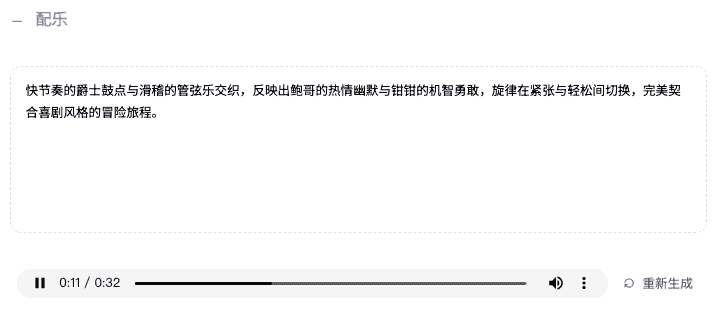
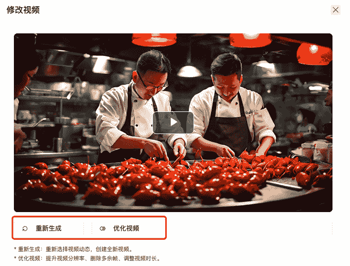
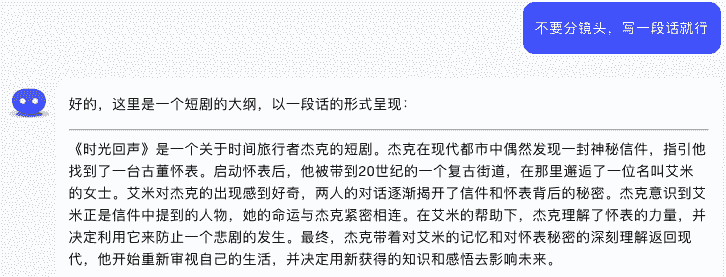
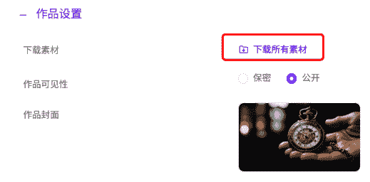

# 【FilmAction】国内首个「文生电影」平台FilmAction强势上线，影视行业的寒冬来了……

> 来源：[https://geekbang.feishu.cn/docx/UGkKdJ1QUo6RbKxgkHyc47KFnQg](https://geekbang.feishu.cn/docx/UGkKdJ1QUo6RbKxgkHyc47KFnQg)

> 👩 作者：赛博大表姐

> 📃 作者介绍：120万字小说作者，青岛AI企业家联盟导师，青岛市创业者协会人工智能专委会知识创业部副部长，自媒体创业者。

> ⏰ 收录时间：2024-05-31 16:22:51 (UTC+8)

> 🔗 原文链接： h[ttps://mp.weixin.q](https://mp.weixin.qq.com/s?__biz=MzkxMjY2NzgwOA==&mid=2247484461&idx=1&sn=d19f442bfbc3d754ecec1748824cdd4e&chksm=c10821e2f67fa8f4b783ac0be48da8732e9417ec8dc047835bb2e1253041d45dce6fdc218cce&token=1230547096&lang=zh_CN#rd)q.com/s?__biz=Mz...

欢迎关注👸号👆

前 几天在线下分享的时候我刚说过，以后AI电影的大趋势就是，扔进去一个剧本，出来一部电影不是梦。

刚说了不到一个周，就变成现实啦！！

国内首个AI电影生成平台 **FilmAction **，携手AI电影共创社，今天上线

主打一个电影级AI短视频生成，现在注册还送300电影币（相当于50元软妹币），这等大福利，快去冲！

很巧的是，我写了一半这篇文章，无聊闲逛的时候恰好看到了他们的发布会……就说有多巧吧。

给咱们国内首部文生电影网站一些排面，今天一起来测测。

**地址： **https://filmaction.ai/

界面很简约，目前已有功能是 电影创作、图片生成、视频生成和音乐生成 ，其他功能即将推出，也很让人期待呢。

咱们一个一个来看一下（搓手手，有点兴奋）：

**1、图片生成**

这个界面很简单，输入提示词，选择风格、比例，直接点生成就行。

风格有好多，对哪个感兴趣直接点就行，摄影写实风格、艺术风格、广告营销三个模块。

我给的提示词如下：

生出来的图如下，景深不错，细节也不错，就是觉得少了点传统中国古代的感觉，居然品出点蒸汽朋克的感觉

可能是提示词的原因……

**2、视频生成**

视频生成其实就是图生视频，需要注意的是，平台给出建议 ： 人物或动物特写、中景选择“稳定”或“平衡”模式；景物或人物远景选择“默认”或“动态”模式。

[🎦 点击观看视频](https://mpvideo.qpic.cn/0bc34aadcaaaaaaf44j7xvtfbygdghqaamia.f10002.mp4?dis_k=b7ebcac48183bc3998ff9dc45e300fd4&dis_t=1717143768&play_scene=10120&auth_info=Dufyg8dVOF1O26Hw/B15Z1JOKSIzXz1DS20QLDQ8Ak4zeUxjfFtlMiwSaEZUPG5dWA==&auth_key=8b4c8d77f310ac958dec3536fcd5e3b6&vid=wxv_3453441758485266441&format_id=10002&support_redirect=0&mmversion=false)

视频详情

来看看效果，嗯，怎么说呢。

意思是有了，就还是略显生硬，特别是面部表情，凤冠的吊坠也不动，有点不符合物理规律。

如果非得有品质上的要求，确实这个质量还有待提高，咱们得承认是吧？不过目前生成式视频普遍也都存在这个问题。

那句话怎么说的来着，先有再优嘛！给国货加油！

还没说完，虽说有瑕疵，不过有个很牛的功能我必须得介绍一下，就是「视频优化」！

**如果你对视频**其中的某几帧不满意， 可以删除！

还可以选择分辨率和时长，最长可以延长到8秒钟！

这是把生成视频和视频编辑合到一起了，厉害厉害

**3、音乐生成**

相当于集成了文生音乐，只不过最长只能到15秒钟。

输入提示词，生成一段15秒钟的音乐，我的提示词是这个：

感觉上挺匹配的，就是没有生成“刀剑发出的碰撞声”……

**4、电影创作**

最后我们再来看电影创作这个模块，也是我最期待的，所以放到最后。

我先说一下，整体上还是很惊喜的，毕竟以前我们要生成视频，只能一个一个抽卡，最后合成剪辑，配音配乐。

现在，我们只需要跟着一步步往下走，就能生成一部视觉效果还不错的短片，并且风格非常多样化，可以说这一下大大节省了我们做一部AI电影的效率。

在上面这个页面写好故事梗概，选择视频风格、视频类型和分镜数，直接点击运转电影机即可。

我准备尝试做一个食物的宣传片，进来以后是这样的：

我们只需要将一个个+号点开，让AI帮我们生成好，最终合成就可以了。

最绝的就是这个环节了，所有的脚本、图片、视频、旁白，都只需要点“一键生成”，等个几分钟，完整的脚本就呈现了。 绝 ！

这就是批量的文生图—图生视频的过程……

配乐也是一键生成的……

最后一键合成就可以了，我们看一下成品。

[🎦 点击观看视频](https://mpvideo.qpic.cn/0b2e4eacmaaaqeakmjj7kntfbyode3qqajqa.f10002.mp4?dis_k=f97d3b178b4835ebe35387dbab196b8a&dis_t=1717143768&play_scene=10120&auth_info=WuDBqvdVZAhK1fP2rB4rZFIdJSliCWsYF2ZDeTVvBRhnfk5qel85ZygcOkAEPzxeWA==&auth_key=c58a88f41089aaade7def5cfec1652bb&vid=wxv_3453512634119471109&format_id=10002&support_redirect=0&mmversion=false)

视频详情

台词就是胡说八道

可以改，但是我不想费脑子改了，这里可以根据视频内容更换为你想表达的内容。

提示一下每一句台词不要过长，否则一段视频结束的时候还没念完，就进行下一段了……

第四个画面有些诡异，如果大家对某个视频不满意，也可以点进去修改一下，重新生成，或者视频优化。

最后，再来一个小电影吧。剧情让Kimi帮忙写：

复制到filmaction里，一键生成各种文本、图片、视频、音频，最后合成。

需要注意的是，这一段我把旁白删除了，因为AI味儿有点重，感觉比较出戏，我觉得这块需要好好优化一下。

[🎦 点击观看视频](https://mpvideo.qpic.cn/0bc3huadgaaakealm7z7ijtfapodgm6qamya.f10002.mp4?dis_k=98db02c9c5958c0f8b005f47536fda17&dis_t=1717143768&play_scene=10120&auth_info=Dt+XhKJQbV4V1KDwr055aglKKCRpXz4cSjdGejg+VU0zL0k1KFwwMXcdaUYHb25QAw==&auth_key=5b61b1ef4f2fad7723c3e10791577d55&vid=wxv_3453534311490502657&format_id=10002&support_redirect=0&mmversion=false)

视频详情

视 频 效果还有待 改善，不过人物一致性还 挺厉害的…… 要知道用AI做视频最头疼之一，就是人物一致性的问题，虽说现在有很多方法可以保持，不过那也得一张一张去做啊。

这个可以批量文生图，而且出来的一致性还蛮高，的确是个亮点了。

**还有一个很牛的**功能，就是作品设置里这个 下载所有素材 ，直接把分镜视频、分镜图片、分镜脚本、分镜旁白、剧本、配音、配音给你整理好了，点一个大大的良心赞。

**5、总结**

肯定不完美，而且还有挺长一段路要走。

不过这次FilmAction发布，让我们又看到了国货的厉害，每一次进步、每一次不同，都足以让我们热泪盈眶。

AI，真的太好了。

加油啊！

“ 在这里，每个人都可以成为电影的导演，每个故事都能以电影的形式呈现。AI的力量让电影制作不再是高不可攀的艺术殿堂，而是触手可及的创意乐园。 ”