# 【AI视频工具合集】盘点那些好用的AI视频工具，最后一个炸裂！

> 来源：[https://geekbang.feishu.cn/docx/XlBrdrRNUoPpMLx3z4scFkPEnYf](https://geekbang.feishu.cn/docx/XlBrdrRNUoPpMLx3z4scFkPEnYf)

> 👩 作者：赛博大表姐

> 📃 作者介绍：120万字小说作者，青岛AI企业家联盟导师，青岛市创业者协会人工智能专委会知识创业部副部长，自媒体创业者。

> ⏰ 收录时间：2024-05-31 16:27:19 (UTC+8)

> 🔗 原文链接：h[ttps://mp.weixin.q](https://mp.weixin.qq.com/s?__biz=MzkxMjY2NzgwOA==&mid=2247484602&idx=1&sn=b5475123c96a297383697b790c382db4&chksm=c1082175f67fa86356e9daa3f266f5820943062464d9de1cad095a2b743553c12561c3999185&token=1230547096&lang=zh_CN#rd)q.com/s?__biz=Mz...

欢迎关注👸号👆

今年可以说是AI短视频的元年，年初OpenAI的Sora出现震惊海内外，炸翻全球。 央视总台 一周之内成立了 人工智能工作室，到现在短短3个月的时间，可以说发生了天翻地覆的变化。

各个地方台使出浑身解数，卯足了劲儿用AI短视频的方式宣传当地旅游，也让我们看到了一些神级大咖的表演，高手果然都在民间……

现在AI做的短视频已经开始进行商业交付，我知道的几万一条的都有，大概2、3分钟左右，而且很多都是名不见经传的个人工作室出品，所以说 在AI这个赛道上，人人平等，而且是 人人 都有机会。

工欲善其事，必先利其器。今天就来介绍一下国内外那些好用的AI短视频神器们。

这次先介绍国外篇～国外篇几乎都需要「🪜」哈～

**一、国外篇**

1、Pika

网址：https://pika.art/home

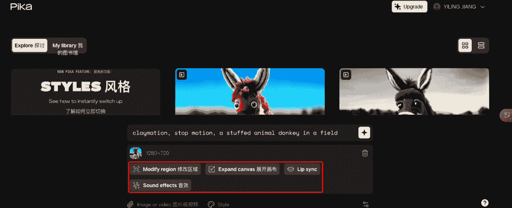

以前觉得它超级好用，现在工具多了，也不是那么非它不可了

Pika最好用的在于它的局部重绘功能、口型同步以及添加音效。

不过，虽然工具这么多，仍然是神级的存在之一。

2、Runway（Gen2）

网址：https://app.runwayml.com/

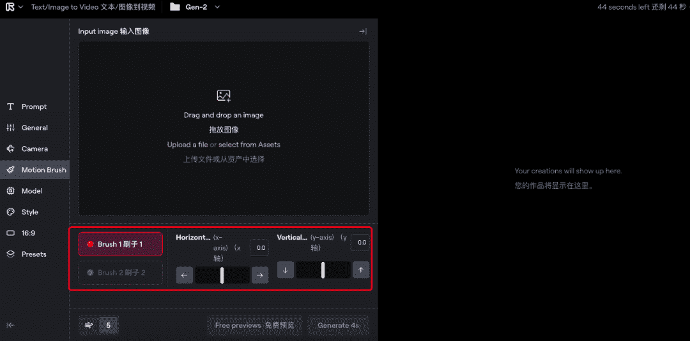

毫无疑问另一个神级的工具之一，目前也支持同步口型，但是它有一个无法超越的功能，就是运动笔刷～之所以之前开了三个月的会员，每个月15美金大贵贵的支出，就是因为它的运动笔刷啊～

3、StableVideo

地址：https://www.stablevideo.com/

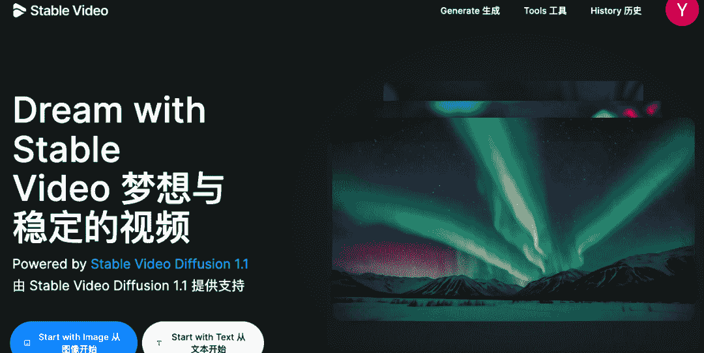

每天有40个免费点数，每次消耗10，总共每天免费做4个视频，效果和以上两个没什么可比性，不过能免费用，还要什么自行车呢。

4、Hiper

网址：https://haiper.ai/explore

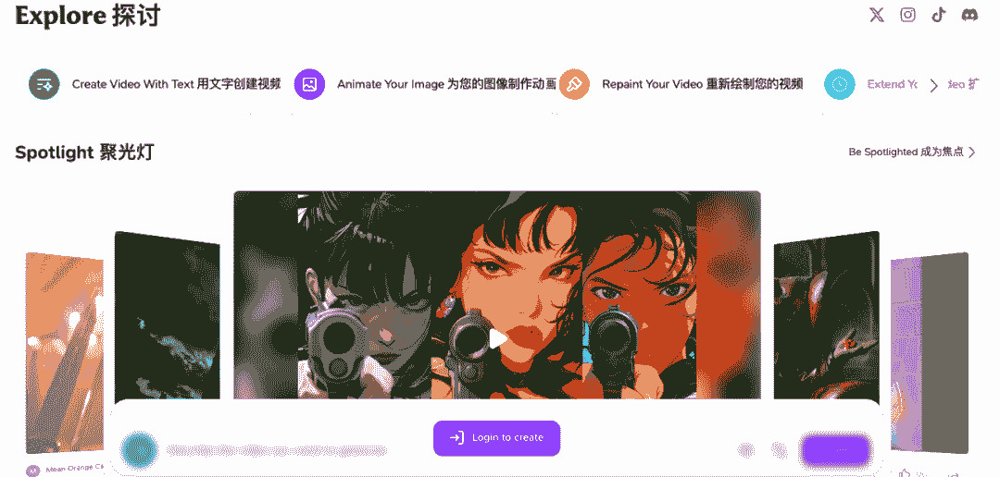

虽然是免费的，但是效果还……挺好的！

就是生成有点慢，需要等一等，总体上来说在免费的视频工具当中，算是非常有良心的了！

之前写过这个工具，传送门： 干掉Sora？横扫Runway和Pika？目前免费试用！（附教程）

5、Remaker

网址：https://remaker.ai/cn

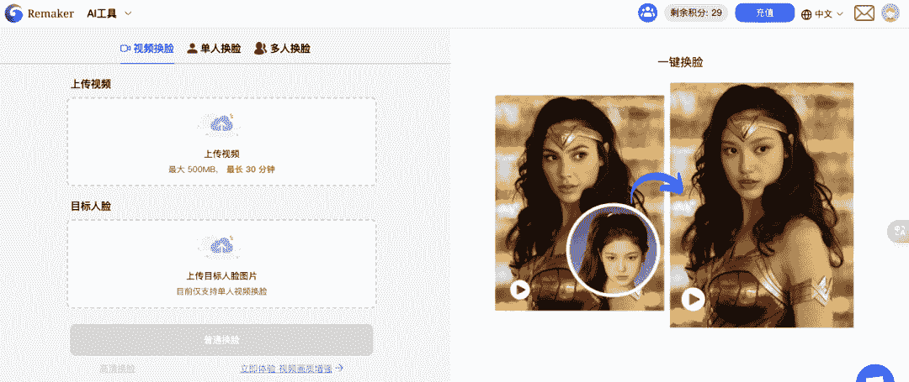

这是一款可以换脸的工具，可以图片换、也可以视频换，我觉得挺有意思的，所以安排在这里。

6、DeepFaceAI

网址：http://www.deepfakeai.cn/

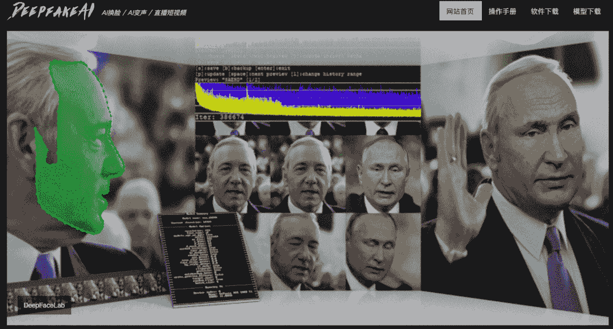

换脸、换声音、直播短视频，感觉以后电信欺诈 会越来越真实了……

具体使用方法略有些复杂，需要的大家自己去官网研究吧。

7、介绍一些Discord里面能用的好玩工具：

1）Viggle：只需要上传一张照片，可以将视频中的主体替换成任何你想替换的

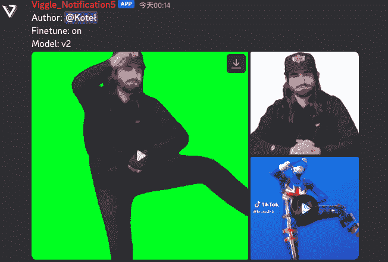

2）NeverEnds：免费生视频工具，我觉得不太好用。

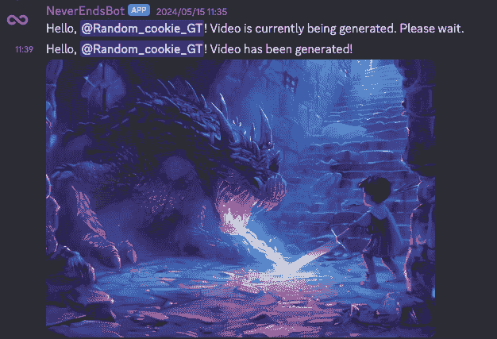

3）DomoAI：可以将一段视频变成卡通动画效果的，收费。

4） MorphVideo：效果比 NeverEnds好点，也是个免费的生视频工具。

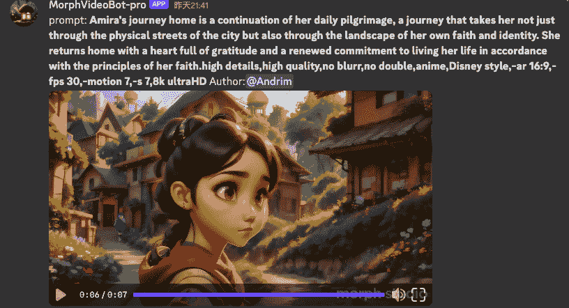

5）Moonvalley：去年SVD出来的时候，号称宇宙最强，但是效果……比 NeverEnds还不堪入目，感兴趣的可以都试试。

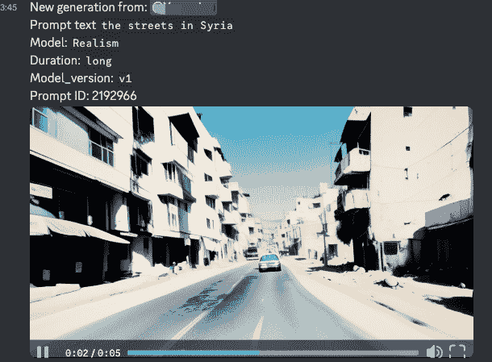

6）最后，Pika和PixVerse也可以在Discord中 使用，只不过版本不高， 效果 没有在官网使用得那么好，想要免费的用用也可以。

**二、国内篇**

1、Dreamina（即梦）

网址：https://dreamina.jianying.com/ai-tool/platform

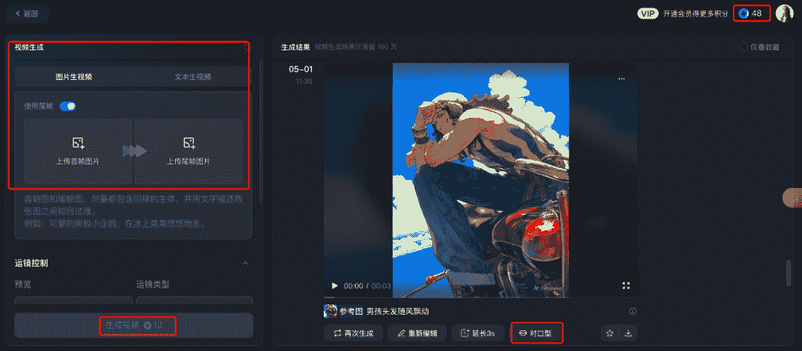

Dreamina最有特色的有这么几个，一个是支持首尾帧，也就是说传上去两张照片，尽可能含同一主体，比如说都有一匹马、一辆车、一个场景，这样生出来的视频更加有电影或者动画的效果。

第二个是对口型，但这个功能开通会员以后才行，会员一个月69元，可以获得505个积分，一个视频消耗12个积分，大概也就42个视频……如果不是因为这么贵，或许我对它的评价还会再高一些

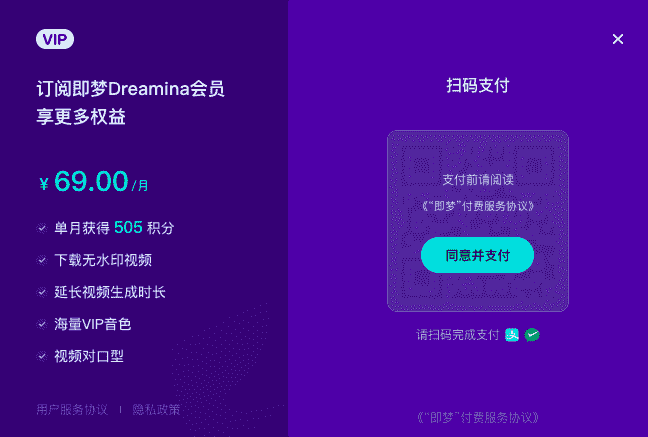

2、Magic Maker

h ttps://magicmaker.openxlab.org.cn/home

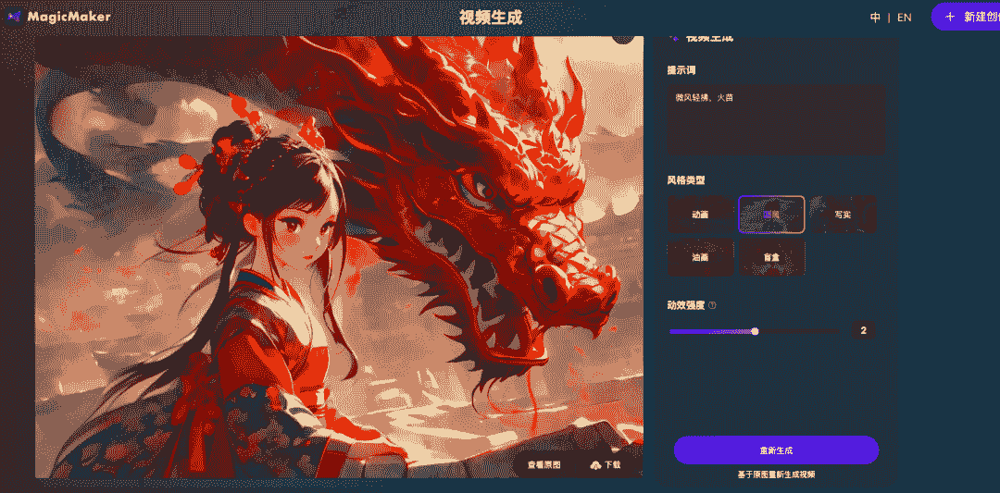

我个人私藏的一个不错的小网站，效果还不错，简单的一些运镜用它来做基本可以实现，而且是免费的，至今没看出来每天多少额度。

3、Pixverse

网址：https://app.pixverse.ai/login

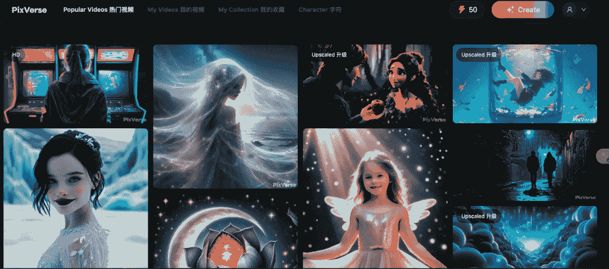

国产，但是要用google账户登陆，或者用Discord才能使用。虽如此，但我想说真的好用啊！

4、艺映AI

网址：https://app.artink.art/mx-img-video

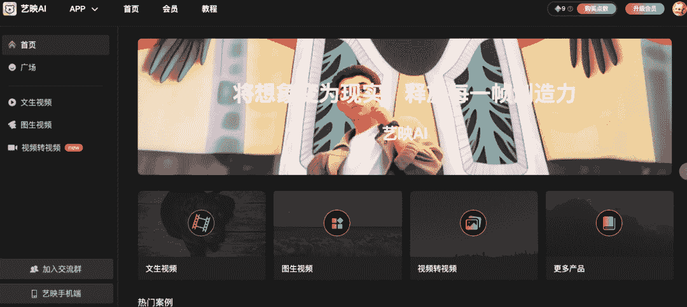

国内转绘方面比较厉害的工具，支持转绘成动画，以及可以像runway一样添加运动笔刷。

5、万彩动画大师

做教育的都可以去冲～可以非常简单地生成动画，是老师的好帮手，真的像它宣传所说，比做PPT还简单。

6、巨日禄

https://haiqushe.jurilu.com/#/ai_script

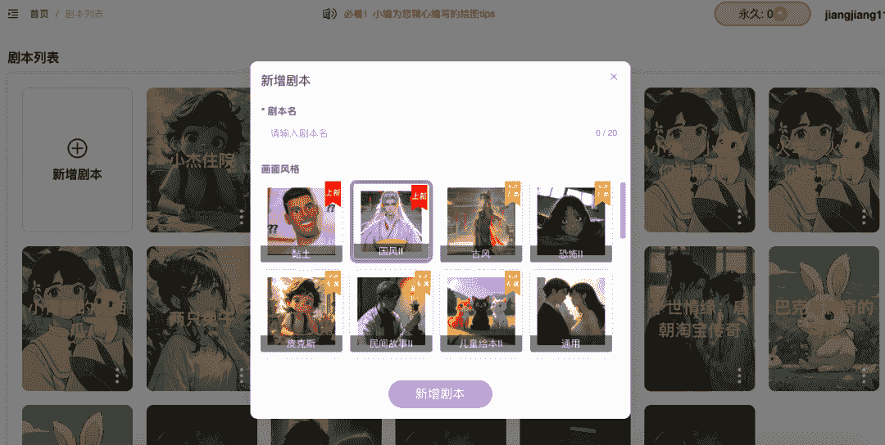

一键生成小说推文、动画绘本、寓言故事、唐诗动画等等……只有剧情需要自己做，其他的几乎不需要动脑子，全程自动操作，很厉害！

7、Filmaction

网址：https://filmaction.ai/dashboard/all

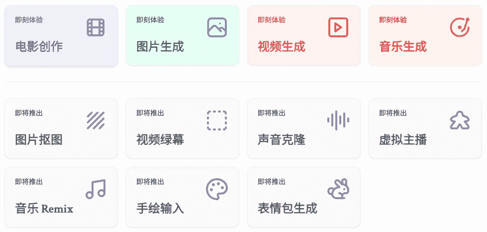

中[国第一个文生电影工具，这个我之前介绍过](http://mp.weixin.qq.com/s?__biz=MzkxMjY2NzgwOA==&mid=2247484461&idx=1&sn=d19f442bfbc3d754ecec1748824cdd4e&chksm=c10821e2f67fa8f4b783ac0be48da8732e9417ec8dc047835bb2e1253041d45dce6fdc218cce&scene=21#wechat_redirect)了，而且专门写了一篇文章，在这儿就不多做介绍，有需要的直接传送门： 国内首个「文生电影」平台FilmAction强势上线，影视行业的寒冬来了……

8、Pixweaver

网址：https://pw.shengshu-ai.com/

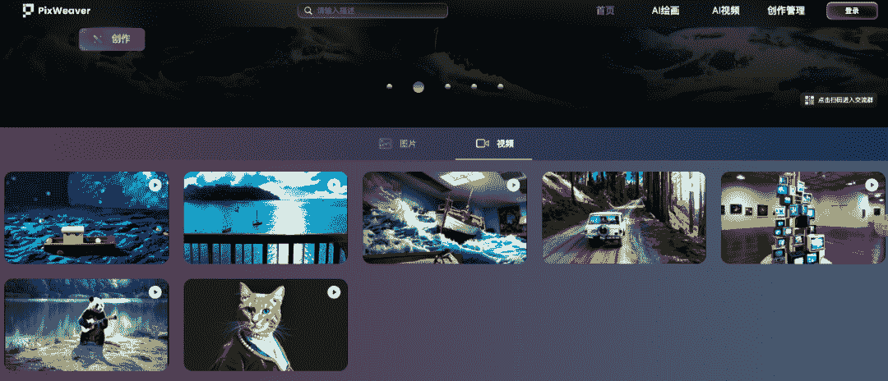

对于这个工具，可能很多人没听说过，我再说一个它另外的名字你可能就听过了：Vidu。

没错，这就是前些日子非常火爆的，国内首个可以生成16秒长视频的那个，不过现在还没正式上线，目前还在实验室中，相信不久后就能和我们见面了！

之前我单独写过一篇，传送门在这里： 国产Sora来了？清华团队发布视频大模型Vidu，多镜头、懂物理规律

[🎦 点击观看视频](https://mpvideo.qpic.cn/0bc324accaaazuanb7jmlftfbv6dehlqaiia.f10002.mp4?dis_k=9718e60cbc7649f8dd62ba1524842866&dis_t=1717144032&play_scene=10120&auth_info=cqDS971cbypJ8diLmwEIRWoSMRxSdTNDU0hhcTBRLE5PdVx0d1YyRSs4ET0zIB9/YA==&auth_key=d7f3eb9d353854e14aac3b9c5dd86792&vid=wxv_3433106057256484869&format_id=10002&support_redirect=0&mmversion=false)

视频详情