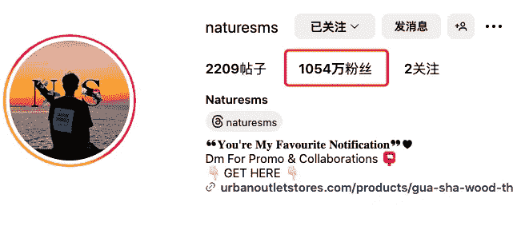
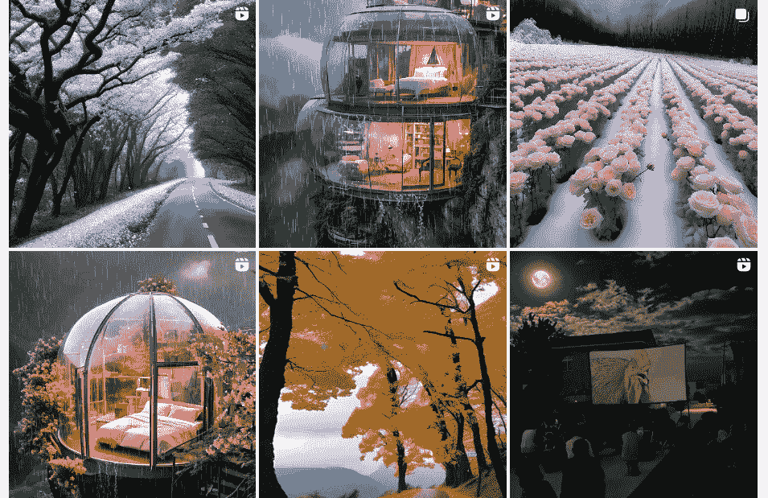
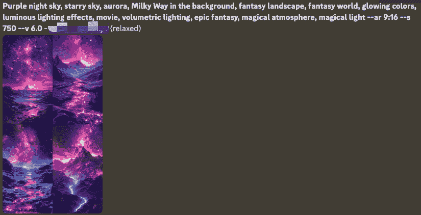
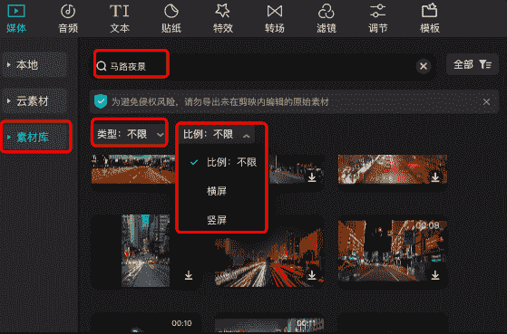
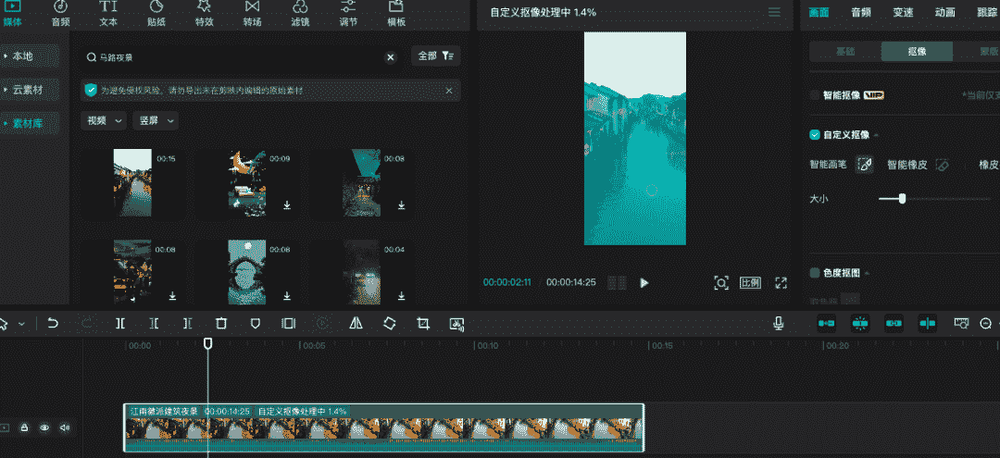
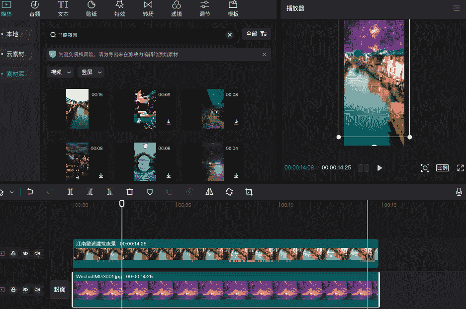
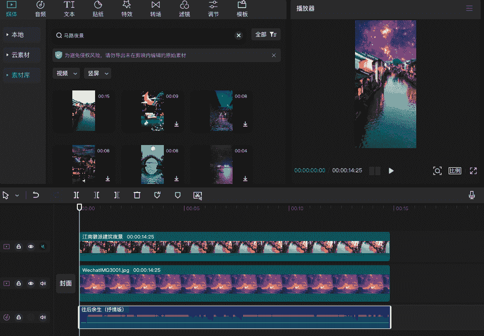

# 爆款拆解｜千万粉丝的爆火治愈系风景短视频长什么样？

> 来源：[https://geekbang.feishu.cn/docx/MWjJdsdC9oNIGcxp2HIcBF4Rntf](https://geekbang.feishu.cn/docx/MWjJdsdC9oNIGcxp2HIcBF4Rntf)

> 👩 作者：赛博大表姐

> 📃 作者介绍：120万字小说作者，青岛AI企业家联盟导师，青岛市创业者协会人工智能专委会知识创业部副部长，自媒体创业者。

> ⏰ 收录时间：2024-05-31 16:31:32 (UTC+8)

> 🔗 原文链接：h[ttps://mp.weixin.q](https://mp.weixin.qq.com/s?__biz=MzkxMjY2NzgwOA==&mid=2247484729&idx=1&sn=0566e55dfb3455ad7e694567d9eee2e1&chksm=c10820f6f67fa9e097ea4e3425c3537f1898fe75f03abddb029da63e036c96246d09881f651e&token=1230547096&lang=zh_CN#rd)q.com/s?__biz=Mz...

欢迎关注👸号👆

昨天的📕治愈系短视频制作方法引起轩然大波，粉丝们疯狂了～有人按照教程试验了一下，非常简单且易上手。

重点是，这类短视频流量大，是📕开通千人粉接蒲公英非常好的赛道。

今天再给大家带来一个干货，就是在INS上非常有名的爆火治愈系风景短视频，到底是如何做出来的？

这个博主非常有名，专做各种治愈系风景短视频，2209个帖子，1000多万粉丝，要知道在INS上有千万级粉丝，那真的太牛了……

这些视频也被搬运到了抖音、快手、📕等各个平台，经过深度去重二创以后，流量也高到惊人。

有需要的自己去看看，我就不放了。

那么这类短视频是怎么做出来的，我们能不能做呢？答案是肯定的。

而且很简单。步骤如下：

1.用AI生成一张好看的风景图片；

2.在剪映中选择合适的素材插入；

3.抠像；

4.插入音乐，合成。

风景图片我们可以用任何文生图的工具，国内国外的都行，具体的可以看我这篇： 合集｜我常用的6个AI绘图工具，国内国外都有！

我习惯用Midjourney，并且我想做一个竖版的天空图片，于是我输入这段提示词，让它把图片的比例调成9:16。

选择喜欢的照片，下载下来，第二步就来到了剪映。

电脑版和手机版都可以，根据自己的习惯来就行。剪映不会的自行去学习，就别问我了啊……

在素材库找一个喜欢的素材，比如：输入马路夜景，找一个竖屏的视频。

拖进下面的轨道里，点击右边画面—抠像—自定义抠像—智能画笔， 将需要保留的部分画出来，最后点击应用效果。

**我们做好的天空图片放进去**，这里需要注意的是，天空照片在下， 我们抠好的视频放在上面。

到了这一步，需要调一下整体的颜色了，让天空颜色和我们选择的视频颜色相匹配，不然就会像图片上那样，感觉有点不太一致。

视频调色你们自己去研究，我就不写了……

就当我们不需要调色，或者已经调好了，再选择背景音乐添加上，我们整体的视频就做好了，就是这么简单。

现在一起来看一下效果喽。

咋样，是不是很简单，学废了吗？

其实我做得还有点粗糙，只是给大家跑个DEMO出来，让大家知道这玩意儿并不难……可以说很简单。

需要注意的点：

1、天空颜色和视频颜色尽可能保持一致，不然会很突兀，不好看。

2、剪映VIP可以智能抠图，非VIP在抠图的时候注意抠干净一点，不然会比较出戏。

就这样，散会。