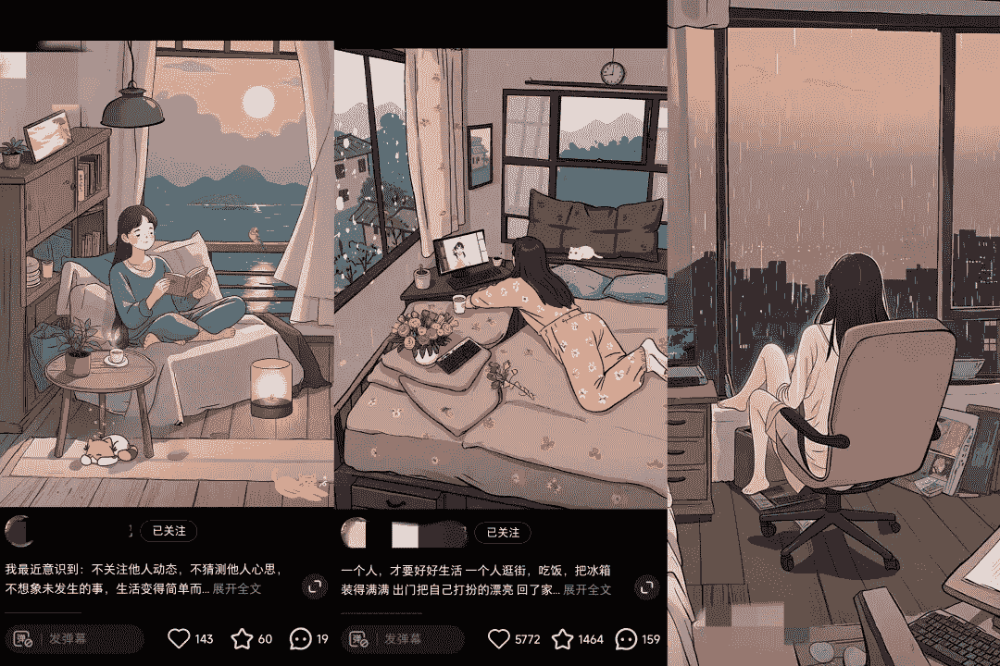
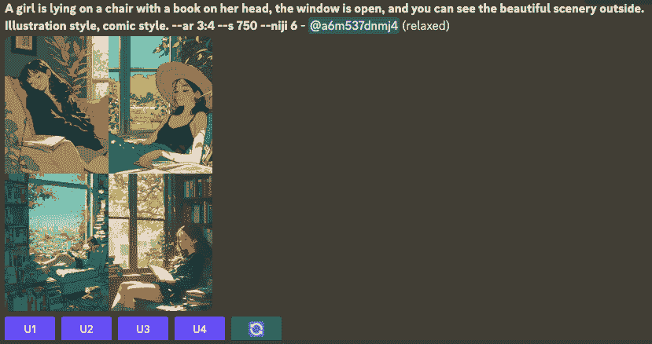
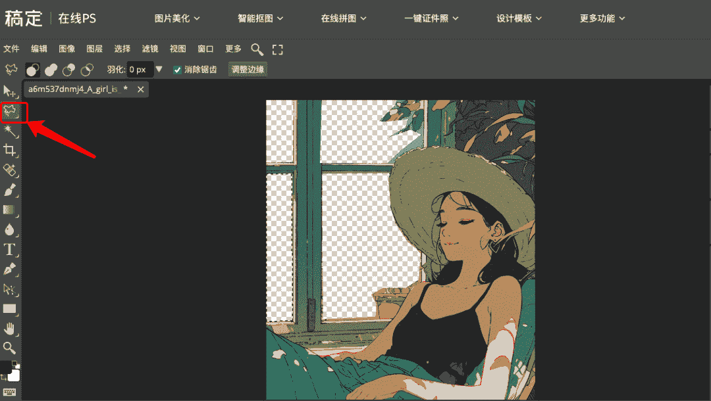
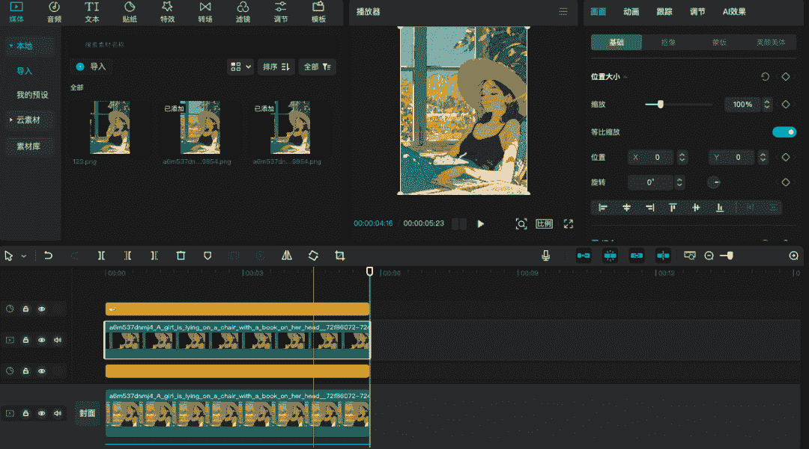
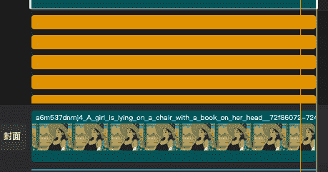

# 📕爆火的治愈视频怎么做出来的？

> 来源：[https://geekbang.feishu.cn/docx/HvDxd9w0bo9OBxxC5tEcEgFUnMd](https://geekbang.feishu.cn/docx/HvDxd9w0bo9OBxxC5tEcEgFUnMd)

> 👩 作者：赛博大表姐

> 📃 作者介绍：120万字小说作者，青岛AI企业家联盟导师，青岛市创业者协会人工智能专委会知识创业部副部长，自媒体创业者。

> ⏰ 收录时间：2024-05-31 16:40:07 (UTC+8)

> 🔗 原文链接：h[ttps://mp.weixin.q](https://mp.weixin.qq.com/s?__biz=MzkxMjY2NzgwOA==&mid=2247484711&idx=1&sn=d1b18dd01e0ea9a3fdf7080b33132cbb&chksm=c10820e8f67fa9fe602094b51bb6ad7b91fc161747d76a33745c88ccd2c5716f743dc5083fd7&token=1230547096&lang=zh_CN#rd)q.com/s?__biz=Mz...

欢迎关注👸号👆

今天又来上干货了……

📕上有一类账号很火，就是治愈系视频，比如这种：

可以自行去📕找找，我这儿放的截图，实际上是一个带有音乐的视频，挺治愈的，我个人都很喜欢。

以前我一直不知道这类视频是怎么做的，直到今天才发现……原来这么简单啊！！

话不多说，直接上教程。

首先得有一张很治愈的图，我习惯用Midjourney，因此我们输入这段提示词，出来这么一组画面。

中文提示词：  一个女孩躺在椅子上，头上盖着一本书，窗户打开，可以看见外面美丽的风景，插画风 格，漫画风格。

放大以后我感觉第二张不错，于是把它下载下来。

这一步比较关键了，找到一个在线抠图的工具，把窗户抠出来。

在线抠图：https://ps.gaoding.com/#/

直接把下载好的图拖进来，选择这个套索工具，沿着窗口把想要抠的部分抠出来，不需要太仔细，差不多就行。

接下来，我们来到剪映。

把 抠好的图放到上面 ， 原图放到下面 ， 中间插入雨滴效果 。

雨滴效果只有一小部分，所以我们要复制几个，把窗口给铺满。

接下来我们再找合适的背景音乐，动态插图，就完事儿啦！看看效果。

实在太简单了，没法说得再详细了， 不会的多看几遍教程就会了。

每天抽出20分钟做几个视频，往各个平台一发，这种流量目前好得很呢。