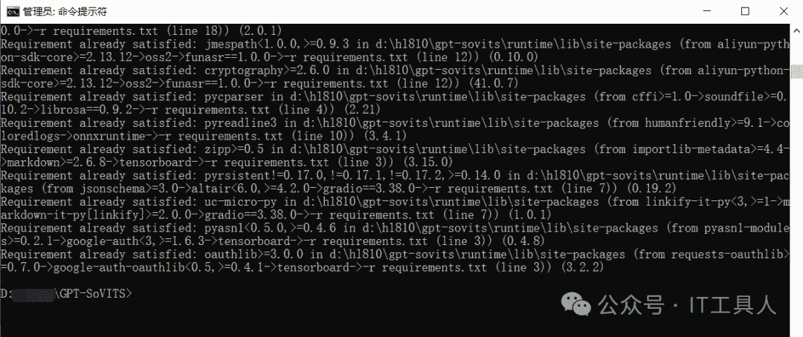
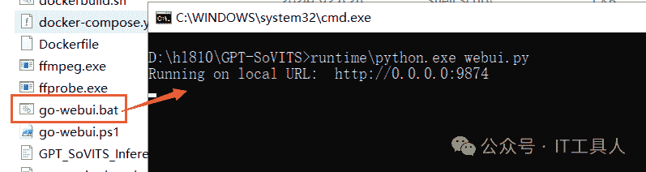
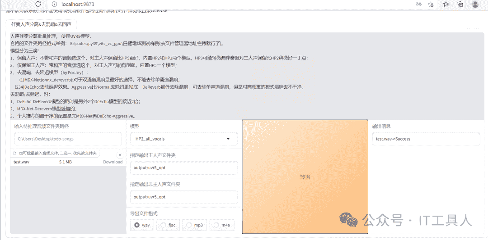
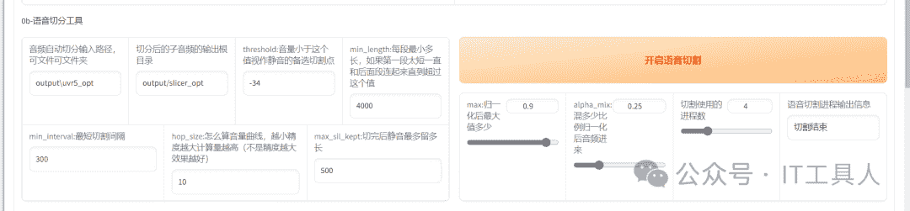
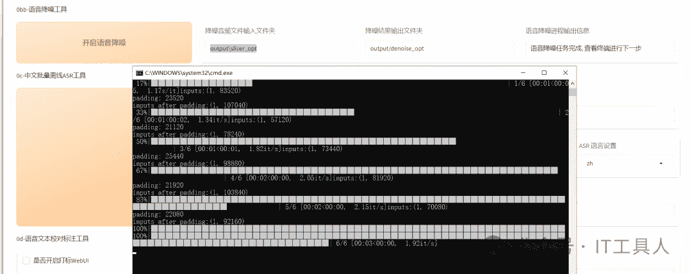
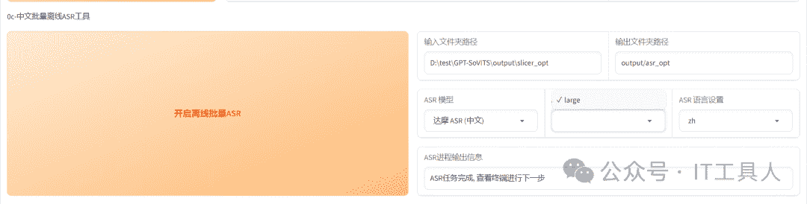
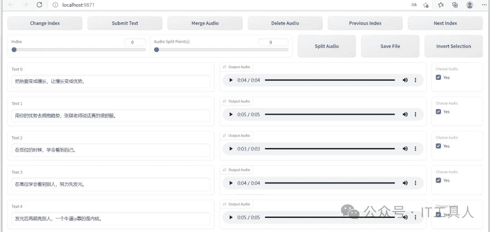
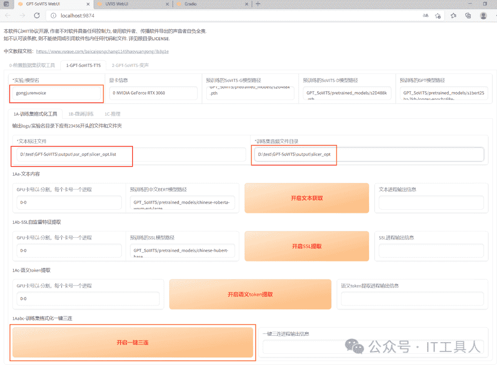
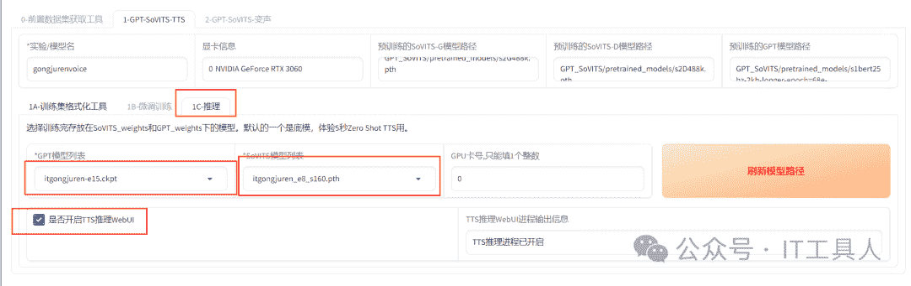
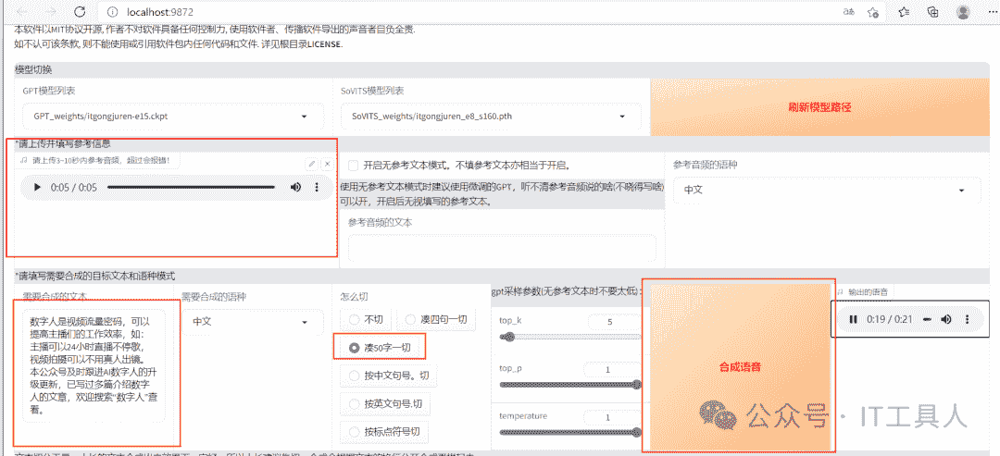

# 【GPT-SoVITS】超强的AI声音克隆神器，开源且可本地部署（附简易部署教程）

> 来源：[https://geekbang.feishu.cn/docx/LZ5Ad1pjNoQvdJxxdChcG9YHnZg](https://geekbang.feishu.cn/docx/LZ5Ad1pjNoQvdJxxdChcG9YHnZg)

> 🤵作者： IT工具人

> 📃 作者介绍：14年互联网IT从业经验，做过程序员，现任AI产品经理。发现并分享能提升做事效率的工具，让创业或副业变得更简单。

> ⏰ 收录时间：2024-05-31 10:53:08 (UTC+8)

> 🔗 原文链接： h[ttps://mp.weixin.q](https://mp.weixin.qq.com/s/xHTIWDA4MklqG5wUyilkRA)q.com/s/xHTIWDA4...

欢迎关注👸号👆

5秒的声音片段就可以克隆 一个人的声音， AI神器GPT-SoVITS已经到了如此 牛逼的境界 。

我在与网友 用🛰️语 音 聊天的时候，他说 通过我发的几个 语音就可以克隆我的声音， 我当时 就 警觉起来。 声音克隆 这个 技 术在AI中已经不新鲜了，只是考虑到 安 全的 问题 ， 克 隆自己的声音， 尽量在本地克隆 。

GPT-SoVITS 这个AI神器是开源 的，所以可以在本地部署。 对显卡要求也不高（至少4G显存），我这边测试的时候是采用3060，12G显存。二手的3060挺便宜的，建议入手3060以上，因为还有其他的大模型等着我们来体验。

5000元左右的配置

设备（也可以租算力服务器，很便宜）搞定之后，就可以开始下载、安装体验**了，操作还是比较简单，这里给**个简易教程。如果想详细了解参考github项目中的 GPT-SoVITS指南， 这算是官方文档，非常详细了 。

安装之前先确认python环境是否已安装，如果有问题，那...联系我吧，备注安装。

1、 **下载安装 ****。 从指南**里的百度网盘下载整合包，👸号回复关键词 声音克隆 。网盘的版本是1月份的版本，在github上下载最新的源码，手动覆盖，再执行以下更新：

打开cmd，进入GPT-Sovits文件夹，然后输入runtime\python -m pip install -r requirements.txt，回车看结果就行 。

2、 **启动 **。 默认目录是有版本号（如 GP T-Sovit s -beta0217 ），把后面的版本号去掉，然后 进入目录 GP T-Sovit s 。双击go-webui.bat，启动之后没报错就可以了。然后打开浏览器，输入http://localhost:9874，就可以看到操作界面了。

3、 **数据集处理 **。

（1）录音。在安静的环境录个音，生成mp3或wav格式。

（2）用自带的 UVR5处理音频。点击“ 是否开启UVR5-WebUI ”，等几秒会弹出自带的UVR5界面，然后上传音频（可以输入目录）、选择模型、导出格式选择wav，然后点击转换，右边提示success就可以了。

执行之后，在output\uvr5_opt可以看到结果

（3）语音切分工具。在 **输入路径 **输入output\uvr5_opt或具体的文件夹，然后点击开启语音切割，生成结果将在output/slicer_opt中展示。

（4）语音降噪。 如果声音很干净，这一步完全可以跳过去，不要执行 。把上一步的输出文件夹作为这一步的输入文件夹output\slicer_opt，然后点击开启语音降噪。这时候后台会有进度条，等到web界面提示任务完成时，可以看下后台是否有报错。输出结果是在output\denoise_opt。

（5）开启离线批量ASR。输入音频片段所在文件夹，如果没有降噪，是 output\slicer_opt目录，如果有降噪是 o utput\denoise_op t。因为这次是说中文的声音克隆，所以ASR模型选择达摩ASR，其他参数也采用默认的，最后点击开启离线批量ASR，等了3分钟左右，在output\asr_opt目录生成了slicer_opt.list文件。

（6）打标。输入正确的list文件路径，然后开启打标，3秒左右会弹出校对页面。这一步是调整，如果感觉内容还行，就可以跳过这一步。

4、 **训练 **。只要设置模型名称、文件标注文件（list后缀文件）、训练集音频文件目录（输出结果），然后点击一键三连。如果路径跟我一样的，可以照搬。

如果对合成声音结果不满意，可以进行微调。

5、 **推理 **。文本生成语音的步骤了，也是激动人心的时刻。选择1C-推理，选择GPT模型列表和SoVITS模型列表，这里是选择训练时生成的模型，有几个模型，e和s可以选择稍微大一点试试，作者是说不是越大越好。

勾选开启TTS推理 WebUI ， 3秒内弹出 语音合成页面。上传一段3-10秒的音频，这里是选择前面分割的音频。输入待合成的文本，选择凑50字一切，点击合成语音，大概1分钟左右就生成了。结果还是可以，与原音相似度比较高，可以直接用。

话说回来，一想起声音被克隆，不由得让我不寒而栗。难道现在语音都要少发了吗？所以这次👸号就不发生成的作品了。

最后再介绍一下这个牛逼的语音克隆工具，它是参考训练集的音频情感、音色、语速控制合成音频的情感、音色、语速。30秒的原音频训练就可以合成逼真的音频。而且 可以跨语种生成，即参考音频（训练集）和推理文本的语种为不同语种，如支持英文、日语等。

看了这篇文章并且实践成功之后，就可以看GPT-SoVITS指南，那是一个权威且完整的指南，感谢大神无私的奉献。

**GPT-SoVITS指南 **:

h ttps://www.yuque.com/b aicaigongchang1145haoyuangong/ib3g1e/xyyqrfwiu3e2bgyk。

github 地 址：

https://github.com/RVC-Boss/GPT-SoVITS。