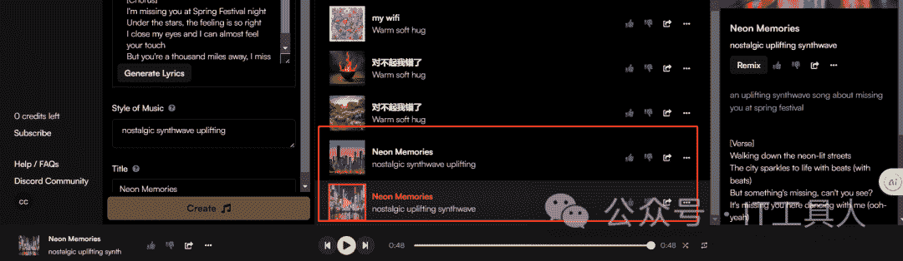
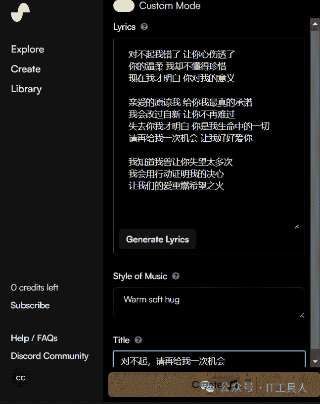
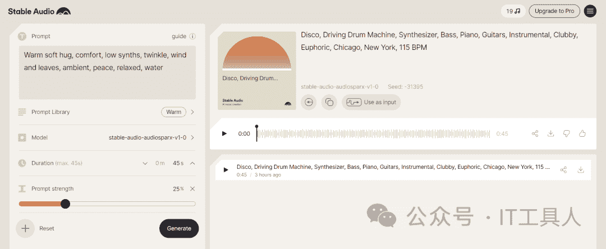

# 【SunoAI/StableAudio】惊奇，用AI创作的音乐又进步了（2个AI音乐工具教程）

> 来源：[https://geekbang.feishu.cn/docx/CstjdRVqCoTAxxxnzGQcDzd6ndP](https://geekbang.feishu.cn/docx/CstjdRVqCoTAxxxnzGQcDzd6ndP)

> 🤵作者： IT工具人

> 📃 作者介绍：14年互联网IT从业经验，做过程序员，现任AI产品经理。发现并分享能提升做事效率的工具，让创业或副业变得更简单。

> ⏰ 收录时间：2024-05-31 10:56:42 (UTC+8)

> 🔗 原文链接：h[ttps://mp.weixin.q](https://mp.weixin.qq.com/s/4kLi2JyG4gCnbJiqQ_ZKZQ)q.com/s/4kLi2JyG...

欢迎关注公众号👆

前面介绍的AI工具，大多是我们日常 工 作中经常用到的，如写作、绘图、修图、做视频等。今天我们来 聊聊一个可以帮助我们释放压力和紧张情绪，充实心灵的两个创作音乐AI工具——SunoAI和Stable Audio。

# **1、SunoAI创作教程 **

SunoAI提供 一个直观的界面，无论用户的音乐功底如何，都可以创作属于自己的歌曲，即使对音乐专业一窍不通也可以创作。 只需用户提供简短的描述或自己的歌词，输入到SunoAI，它就可以无缝生成伴奏旋律、和声和节拍，给用户呈现出一个完整的作品。

地址:https://app.suno.ai/

SunoAI可以根据我们的要求来编写歌曲，例如风格、歌词等。平台给了两种创作模式，一是非自定义模式，只需要输入创作要求，平台自动生成风格和歌词。二是自定义模式，可以自己编写歌词、指定音乐风格、音乐名称等。平台有三个版本，免费版是一天可以生成10首歌，每首歌最长1分20秒，可以延长60秒。

**（1）非自定义模式**

非自定义模式比较简单，在Song Description中输入关于生成音乐的描述，如： an uplifting synthwave song about missing you at spring festival（可以用中文来描述）

**等1分钟左右**， 即可生成两 首歌曲，你可以选择 一首最满意的歌曲进行 Remix （修改），如果写得还不错，可以“ Continue From This Clip ”延长60秒。 改 到满意之后，即可下载mp3或mp4格式的音视频，成为你的作品了。

**（2）自定义模式**

自定义模式是可以自行输入歌词，选择风格。这对于一些想用音乐表达情感的人来说是个福音，可以把想说的话编成一首歌，用于表白、道歉或者表达思念等，还可以用于编写童谣、文化传播，都是可以尝试。

与非自定义模式一样，生成之后也可以进行修改，延长60秒。

【这一段音频是我 用SunoAI 生成的】

SunoAI 生成的歌曲已经有数千首在互联网传播，照这速度发展下去，AI创作的数量会超过以前所有音乐家创作 的歌曲，音乐家们也可以用这个工具提升创作效率。 SunoAI目前生成英文歌曲是比较友好，但中文歌曲创作上还是有些不足，可能平台收集我们中文的音乐元素和训练数据比较少的原因，但相信SunoAI解决这类问题只是时间上的问题。

# 2、Stable Audio生成音乐

Stable Audio生成的音乐是没有歌词，是器乐，比如一段旋律金属乐，用于生成背景音乐，手机铃声等很合适。如果采用这个创作，从此可以告别某音短视频上的那些常见背景音乐，创建属于自己的背景音乐。

地址：https://stableaudio.com/

在Stable Audio上创建音乐，主要是有以下几个重要参数：

（1）填写提示词，如“Warm soft hug, comfort, low synths, twinkle, wind and leaves, ambient, peace, relaxed, water”。

（2）提示词库，如果前面提示词不知道怎么写，可以先选这个提示词库，选了之后，提示词会自动填充。

（3）模型选择，免费的版本现在只能选择一个模型，所以可以忽略这个。

（4）时间，最长45秒。

（5）提示词强度（ Prompt strength ），如果是免费版只能选择低于25。

**这两个AI音乐创作工具，就像 Copil**ot编程助手一样， 一方面可以提高音乐专业人士的效率，另外一方面可以让非专业人士进入音乐这个行业。 虽然他们现在还有这样那样的细节问题，但是再给工具们一点时间，它们会越来越出色，让我们一起花点时间学习了解吧。