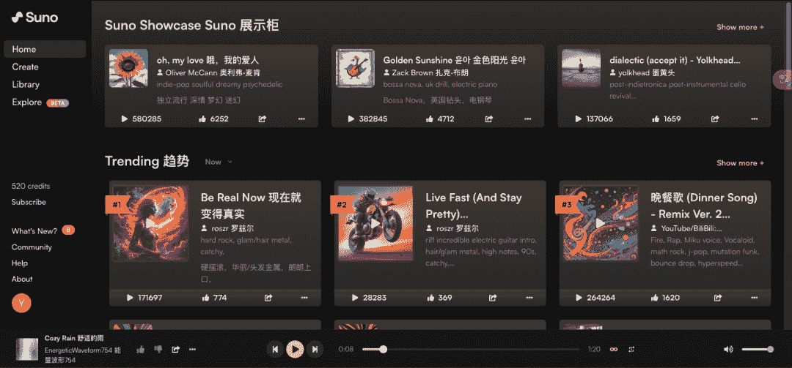
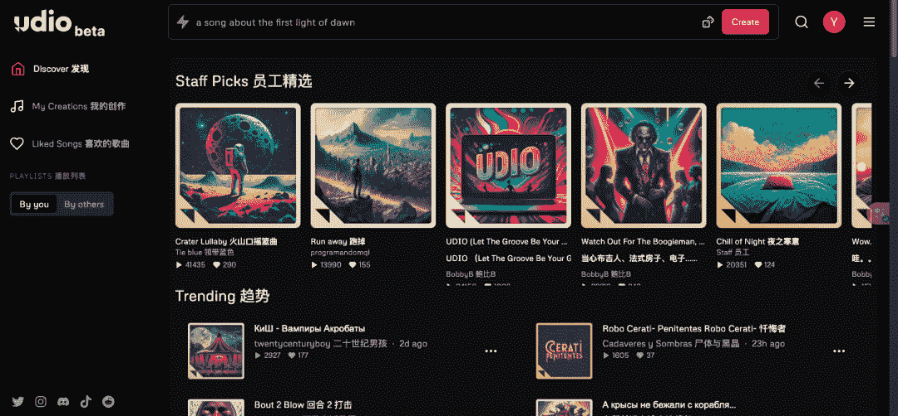
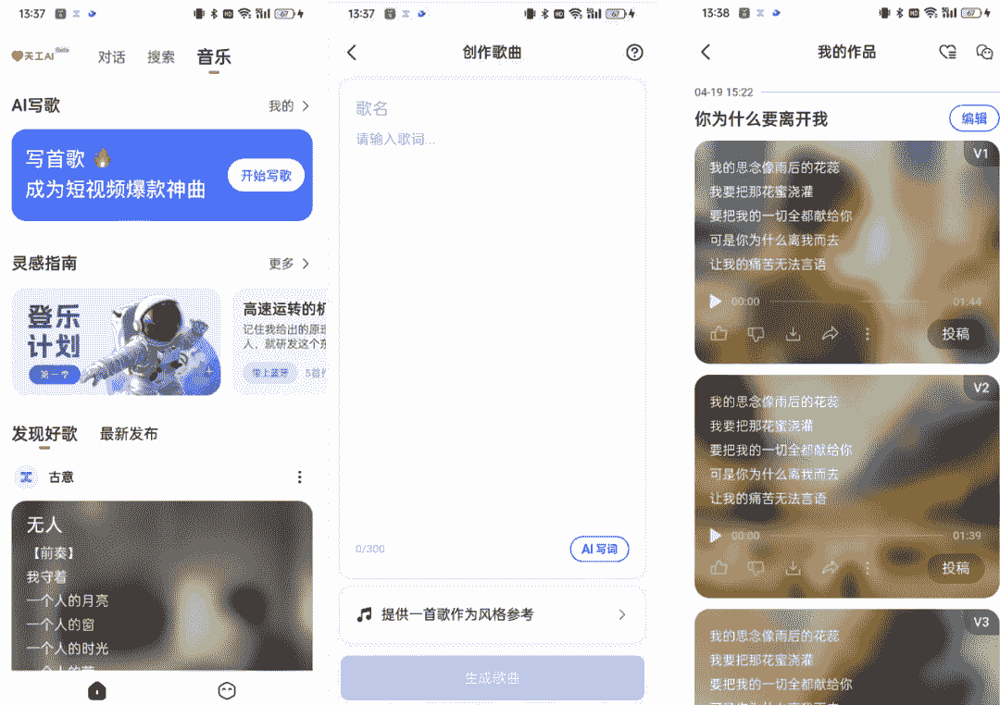
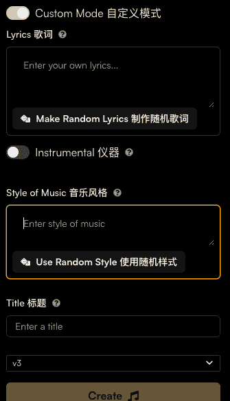
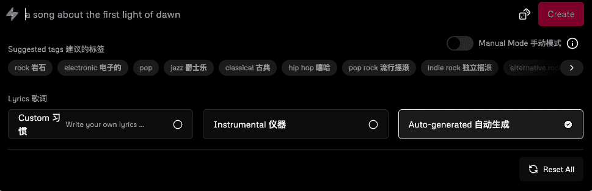
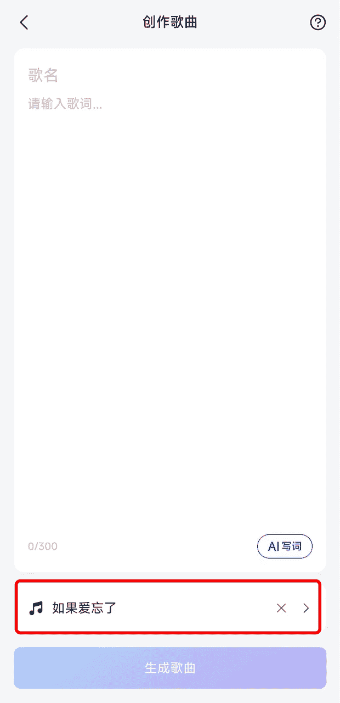
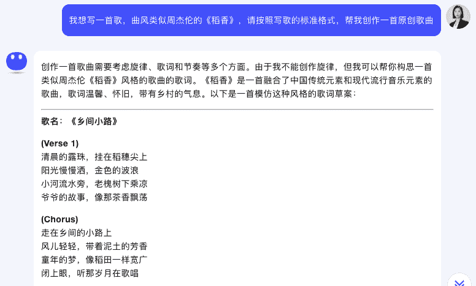
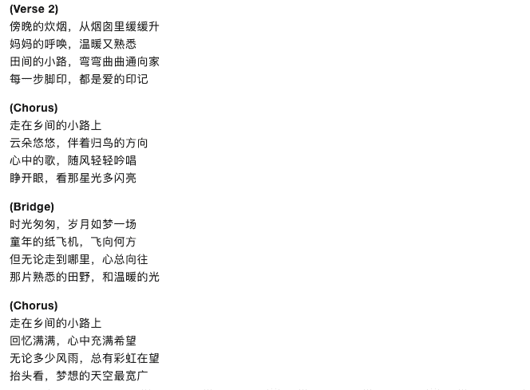
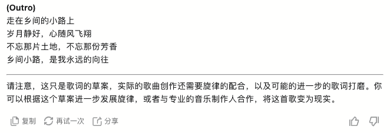

# AI行业已经进入“萝卜蹲”状态，卷完视频卷音乐

> 来源：[https://geekbang.feishu.cn/docx/VcYddTRUoot74vxmQeOclOB7nsg](https://geekbang.feishu.cn/docx/VcYddTRUoot74vxmQeOclOB7nsg)

> 👩 作者：赛博大表姐

> 📃 作者介绍：120万字小说作者，青岛AI企业家联盟导师，青岛市创业者协会人工智能专委会知识创业部副部长，自媒体创业者。

> ⏰ 收录时间：2024-05-31 16:46:27 (UTC+8)

> 🔗 原文链接： h[ttps://mp.weixin.q](https://mp.weixin.qq.com/s?__biz=MzkxMjY2NzgwOA==&mid=2247483939&idx=1&sn=c2eac55853d1832033e81307a4e35a12&chksm=c10827ecf67faefacc530b2885ec598c143e9ac3a6a3ed00a41651fc5bb4a353b9d79b68888b&token=1230547096&lang=zh_CN#rd)q.com/s?__biz=Mz...

欢迎关注公众号👆

趁着这两天勤快点，每天跟大家啦啦呱。

这篇文章也在我脑子里有一段时间了，前一阵子忙得脚不着地，根本没时间思考，今天跟大家聊聊文生音乐那些事儿。

其实每个人或多或少都会有点情怀，我年轻的时候就曾想过歌手梦，无奈咱身上没那艺术细（四声）菌（三声）啊！

三月底Suno V3的发布，让众多音盲（不是）兴奋了起来，当然包括我个人在内，因为只需要输入几句话，就能生成一段高质量的音乐，咱也能自己写歌了！

四月份，昆仑万维发布了天工SkyMusic生成音乐大模型，将文生音乐的高潮掀到了顶峰，经过各方面测试，天工音乐的数据其实并不比Suno差，值此无需借助科学上网，咱们国内也可以有自己的文生音乐大模型了。

当然除了这两个以外，还有很多文生音乐的工具，比如stable audio、udio等等，音乐这个赛道终于卷起来了！

我个人觉得，AI文生音乐帮我解决了最主要的三个方面：

1.作词；

2.作曲；

3.演唱。

先放一小段Demo，这是我用Suno作词作曲，然后用SVC进行换声的结果，一定程度上可以说是纯纯原创歌曲。

这首歌是80年代的blues风格，我感觉还不错，挺吸引人的，使用SVC换声的过程有些复杂，这篇文章咱们先不说。

虽然文生音乐已经够火了，但仍旧有一部分人还是很迷茫，今天咱们就一次性说清楚。

目前市面上常见的文生音乐平台：

1.Suno AI（suno.com）：目前是V3版本了，支持自定义生成演唱歌曲和纯音乐，可以一次性生成2分钟左右的高品质音乐，首推。

2.Stable Audio：Stability旗下产品，支持最长生成3分钟音频，并且可以支持根据音频生成音频。

3.Udio（www.udio.com)：新出的文生音乐工具，号称是Suno的最强竞品，界面功能都差不多，生成的音乐质量也还不错。

4.天工SkyMusic：国内目前唯一（应该是）免费的文生音乐工具，下载天工App可以使用。

上面这4个是目前比较火的，基本上可以代表文生音频的水平，其他的就不一一介绍了。

今天咱们对比三个：Suno、Udio、天工

1、界面

（Suno）

（Udio）

（天工）

前两个要借助科学上网，界面也差不多，看得出来是飙着来的，天工下载APP就可以用。

2、制作方面

Suno支持自定义模式，可以复制歌词，也可以随机制作歌词，支持生成纯音乐，需要手动输入音乐风格，当然也可以使用随机样式，总体来说很灵活。

Udio好在音乐风格会有一些提示，毕竟对于普通人来说，并不那么掌握所有的音乐风格，所以但从这方面来说，Udio比Suno做得略微细致一些。

天工虽然没有这些，但它支持参考曲目，这一点挺新颖的，也很有用，给生成的音乐提供了更精准的定向。

3、效果

我们以周杰伦的《稻香》为歌词，分别看看三个平台生出来的歌曲效果差别多少：

[🎦 点击观看视频](https://mpvideo.qpic.cn/0b2epeaboaaanmandfjjnjtfa6odc54qafya.f10002.mp4?dis_k=f1e7649e78e85eeb55fbe556d7997b2e&dis_t=1717145144&play_scene=10120&auth_info=X4bygLVXbgxK3aGlqUgjNl1HdClkWWsYR2AQKGhtVExiK0Zqe18zYygUaBMBaTQMVw==&auth_key=928a644f5119396fc3ce3eedbee4abeb&vid=wxv_3429622707195723777&format_id=10002&support_redirect=0&mmversion=false)

视频详情

Suno天工都非常不错，特别是天工，出乎我意料之外的好， 是我想要的风格， 不过天工音乐下载的话只能是视频格式，没有音频格式。

至于Udio……什么鬼啊，连中文的歌词也识别不出来吗，有点子失望。

接下来我们说歌词，大多数人还是想原创歌词的，其实这事儿不难，借助大模型就行，比如我们跟kimi说想要写一首歌，我跟它的对话如下：

怎么样，是不是很简单？从作词到作曲妥妥都是原创。

到这儿很多人还会问，怎么变现呢？这个我帮不了大家，但是我可以给点思路。

1、在小红书上做类似古诗、宋词的视频，用原创音乐配乐，以此来引流；

2、做MV，家里宝宝或者老人过生日，可以原创音乐做MV；

3、团体歌曲定制，挂在淘宝或者某鱼上售卖；

……其他的，发挥大家想象吧。