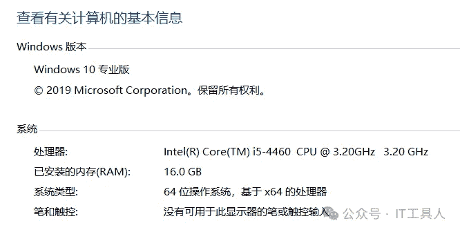
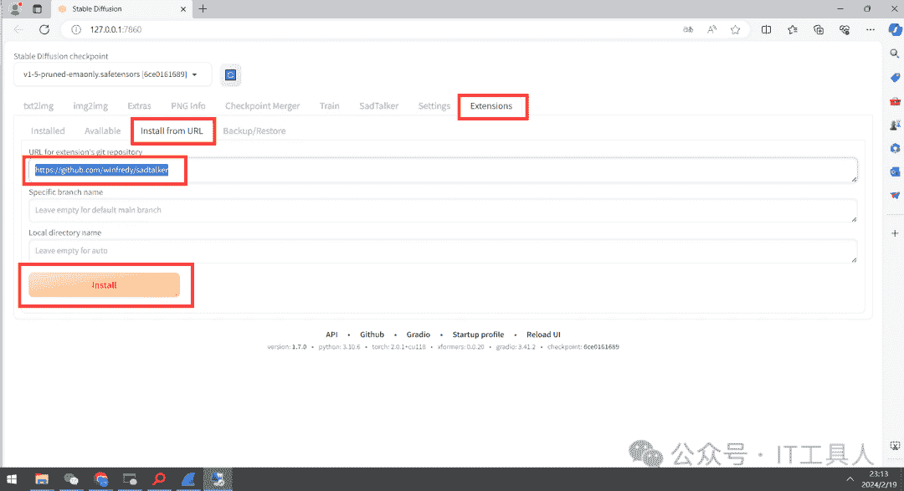
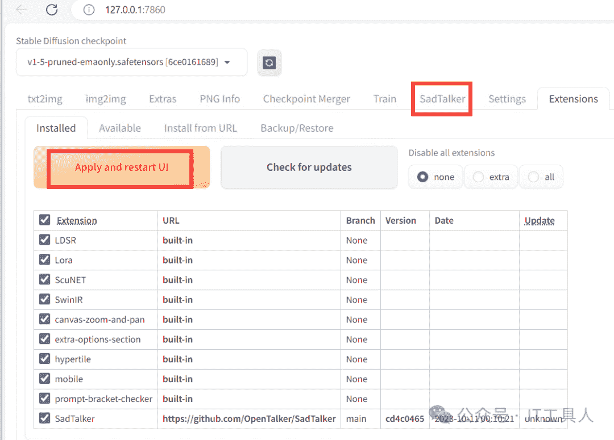
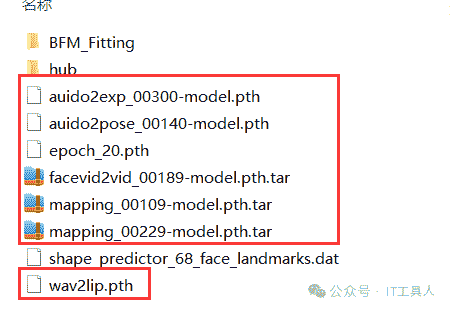
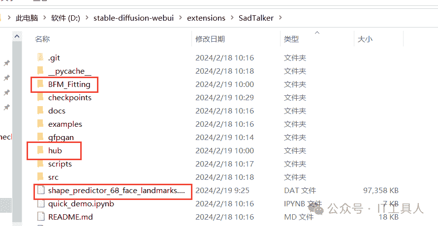
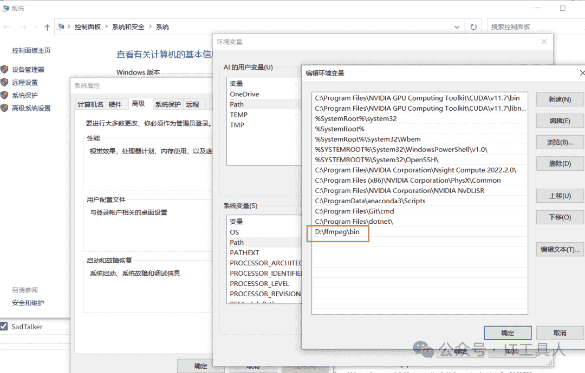
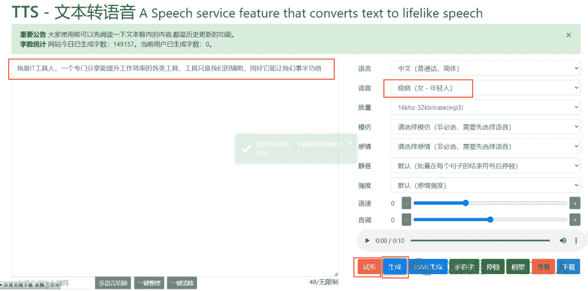
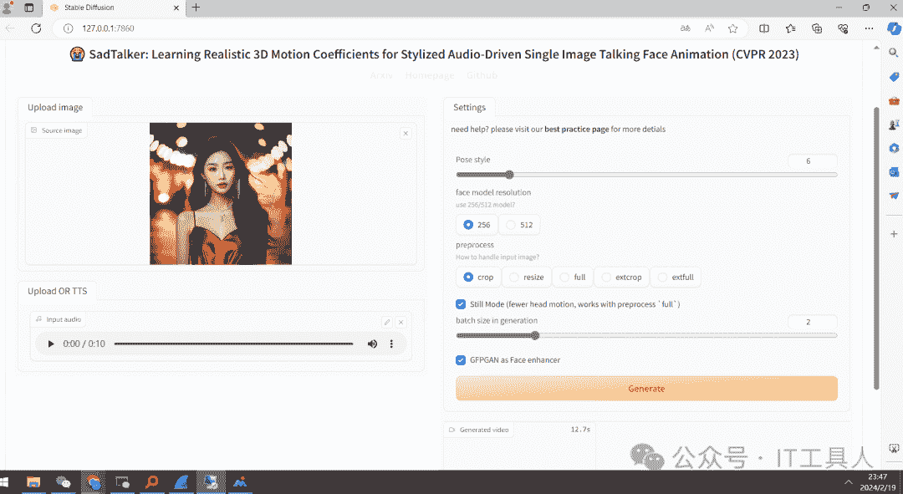

# 【SadTalker】本地部署一套生成数字人的AI工具，我的算力我做主

> 来源：[https://geekbang.feishu.cn/docx/NlvWd7OhFos0V2x0QTxcbhT1nGf](https://geekbang.feishu.cn/docx/NlvWd7OhFos0V2x0QTxcbhT1nGf)

> 🤵作者： IT工具人

> 📃 作者介绍：14年互联网IT从业经验，做过程序员，现任AI产品经理。发现并分享能提升做事效率的工具，让创业或副业变得更简单。

> ⏰ 收录时间：2024-05-31 11:15:04 (UTC+8)

> 🔗 原文链接：  h[ttps://mp.weixin.q](https://mp.weixin.qq.com/s/xC7NDm7K8p63UcnQvhPm🐧)q.com/s/xC7NDm7K...

欢迎关注👸号👆

去年 西安交通大学开源了SadTalker模型，图片+音频可以生成视频，也就是会说话、会唱歌的数字人。这是 Stable Diffusion的插件， 网上也有很多安装教程了，看了教程还是要自己亲自装一次才更熟悉，数字人的效果在文末。

|  |
| --- |

这是安装成功之后的界面

SadTalker会让照片的人像开口说话，我们称之为照片数字人，部署这套工具，需要准备哪些软硬件。

（1）一台有GPU的电脑主机，我用的是带有3060（12G显存）的，I5的CPU（很老），16G内存，装Windows 10专业版操作系统。

|  |
| --- |

（2）部署Stable Diffusion，这[个在前面的文章中有介绍，可以先看这篇（ 【](http://mp.weixin.qq.com/s?__biz=MzUzOTAzODI1Nw==&mid=2247484045&idx=1&sn=a721b49368ee000dfecb10479fdb8d5a&chksm=facfc5d3cdb84cc5b8d334ff6d7b8d5db619d59357b0d38e3a58c42499e0d93c8b8005a871fa&scene=21#wechat_redirect)保姆式教程】搭建属于自己的AI绘图工具——Stable Diffusion部署 ），这个建议部署起来，后面我们会介绍很多这个平台的插件，国内很多画图AI工具也是以这个为基础。

**（3）下载SadTa**lk**er模型**、ffmpeg软件。👸号回复 SadTalker 或 数字人 获取下载链接下载。

接下来开始安装，安装步骤也比较简单，按照下面步骤就可以。

**1、在Stable Diff**usion WebUI上 安装SadTalker插件 。在Extensions中，进入Install from URL选项卡，在URL栏中输入https://github.com/winfredy/sadtalker，然后点击Install。

Install成功之后，在Installed选项卡中，点击Apply and restart UI，稍等片刻，会 看到 SadTalker菜单。

|  |
| --- |

2、模型安装。 把我们下载的模型放在相应位置就可以了。

（1）把这些*.pth和*.pth.tar文件拷贝到stable-diffusion-webui\extensions\SadTalker\checkpoints目录，如果没有chekpoints目录，需要先创建目录。

|  |
| --- |

（2）把BFM_Fitting和hub以及dat文件拷贝到stable-diffusion-webui\extensions\SadTalker目录。

|  |
| --- |

3、安装ffmpeg，解压ffmpeg的压缩包，然后在环境变量Path中添加ffmpeg的bin路径。我在解压ffmpeg之后，放在了D盘，就可以这么设置。

|  |
| --- |

以上安装完成，接下来就可以试试能否正常生成数字人，在生成数字人之前，我们需要先生成一段语音或者歌声。

生成音频可以用TTS或克隆自己声音等方式，如果大家感兴趣，可以私信，到时专门出个如何克隆自己的声音。这里我们可以用一个在线tts生成音频http://www.ttsgpt.cn/。

|  |
| --- |

音频和图片都准备好了之后，就可以在WebUI界面上上传图片、音频，参数选择，这里说下preprocess参数，默认是只有一个头部，选择full、extfull等参数可以展示完整的人像。

|  |
| --- |

最后来看看效果，对嘴型还差点意思，这也是现在照片数字人正在努力改进的。如果你也想自己动手搭建，那就试试吧。

[🎦 点击观看视频](https://mpvideo.qpic.cn/0bc3emacqaaaimaffzothrsvai6dfarqakaa.f10002.mp4?dis_k=9e3ecf02f5b68f1190e80102a29303a7&dis_t=1717125296&play_scene=10120&auth_info=BZ2JkrFFGHUpxq6BkGR3aEAzDXs9a0VKZD4GY2tjU2s4UjFETEhFGkseIihmRmBSSg==&auth_key=2ffd0e39bf9937d803a9e86b7260c609&vid=wxv_3334739598501003265&format_id=10002&support_redirect=0&mmversion=false)

视频详情