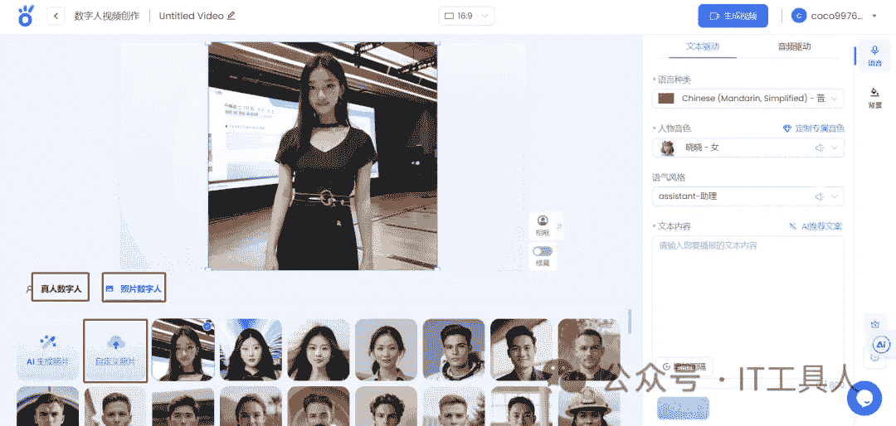

# 【kreadoai】揭秘AI数字人（内附:定制照片数字人制作方法，会电脑的人都会做了）

> 来源：[https://geekbang.feishu.cn/docx/I7wBdOhUZoRMZXx5eKwc2icnnkh](https://geekbang.feishu.cn/docx/I7wBdOhUZoRMZXx5eKwc2icnnkh)

> 🤵作者： IT工具人

> 📃 作者介绍：14年互联网IT从业经验，做过程序员，现任AI产品经理。发现并分享能提升做事效率的工具，让创业或副业变得更简单。

> ⏰ 收录时间：2024-05-31 11:20:38 (UTC+8)

> 🔗 原文链接：  h[ttps://mp.weixin.q](https://mp.weixin.qq.com/s/s-roK7SFh_aUiJXY_MsH-g)q.com/s/s-roK7SF...

欢迎关注👸号👆

最近刷短视频，经常刷到数字人的短视频，视频中人的动作或者表情看起来有点不大一样，那是数字人。 回顾过去的这一年，数字人发展迅速，做得越来越逼真，离替代真人更进一步了。 今天我们来了解一下什么是数字人，哪些行业会应用数字人，怎么制作数字人，数字人能否替代真人。

在数字世界中合成的人体结构，是我们说的数字人，也叫虚拟人、分身。视频或者直播中原来是真人出镜，现在由于真人比较忙（尴尬、不上镜等），所以采用数字人替代真人上镜。根据采用 技术的不同，数字人可分为 照片数字人、2D数字人、3D数字人 ，其中照片数字人是比较简单，3D数字人是最难、周期最长、成本也是最高。我们经常在短视频中看到的数字人是2D数字人和照片数字人。

数字人能做的事还是 比较多 ，以下几个行业会经常用到：

1、短视频。写好文案，在数字人平台生成视频，就可以在抖音、视频号、快手等短视频平台发布。

2、直播类。带货直播、教育辅导、情感问答等等，这个现在还比较难，平台会封禁，而且数字人因表情僵硬、口型不对等原因还不受欢迎。

3、游戏类。游戏中的NPC是具备独立思考、自主行动的数字人（也称为机器人），这里加的数字人是 模拟了现实， 让游戏变得更加具备可玩性。

4、广告设计。根据产品的特点选择相应的数字人，广告制作成本降低，效果更好。

5、电影制作。在电影中有些危险的镜头，或者不容易布景的场景可以用数字人来替代真人表演。

【照片数字人制作教程】

地址：https://kreadoai.com/

当前有些平台是可以 **免费定制照片数字人 **，如kreadoai，上传一张照片，然后选择语种、人物音色、语气风格、文案内容就可以生成视频了。这个平台比较友好，是中文的，也可以选择语种。以下是生成的照片数字人视频。

[🎦 点击观看视频](https://mpvideo.qpic.cn/0bc3cmabwaaaciam5oewafsvae6ddmjqagya.f10002.mp4?dis_k=35a74477ed0a8814a91f53be19594fd9&dis_t=1717125585&play_scene=10120&auth_info=WPnezO4xBwlm1JyGhl5BE0QYPQoqaWYbHDp9QGpkLB5lKx9gUT9aZgQMEC9wfFYpTg==&auth_key=90633c664516fbb993d29c982bd476e4&vid=wxv_3268058639458680833&format_id=10002&support_redirect=0&mmversion=false)

视频详情

2D数字人由于制作技术难度较高，而且制作周期长，所以费用比较高。制作流程是这样： 在平台 付 费 — > 拍 摄自 身视频 — >在平台生成数字人形象，如需用数字人发短视频时，在平台输入文案，选择音色等生成短视频，这种是按时间收费。还有一种方法是自己买一台带GPU的服务器搭建SD环境，制作2D数字人（如有需要可以私信我，因为是人肉回复，所以可能会有点慢）。3D数字人费用就更高了，这里就不详细阐述了，我们等它技术更成熟价格就下来了。

那么数字人会替代真人吗？当数字人做到以假乱真的时候是有可能替代真人，但以现在的技术水平，估计还要再等挺久，需要等到表情、情绪、动作互相能完美配合，那时候数字人就是我们的分身。另外，我们需要认识到现在的IT技术将不断被弱化，各大AI平台直接面对终端用户，用户只要会写文案就可以了，甚至文案都可以让GPTs来写。过去生成一条短视频和现在生成一条短视频，无论从技术、时间、成本上看，都有了极大的进步。因此 建议学习AI工具，让你能做更多的事 。