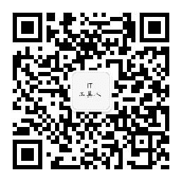
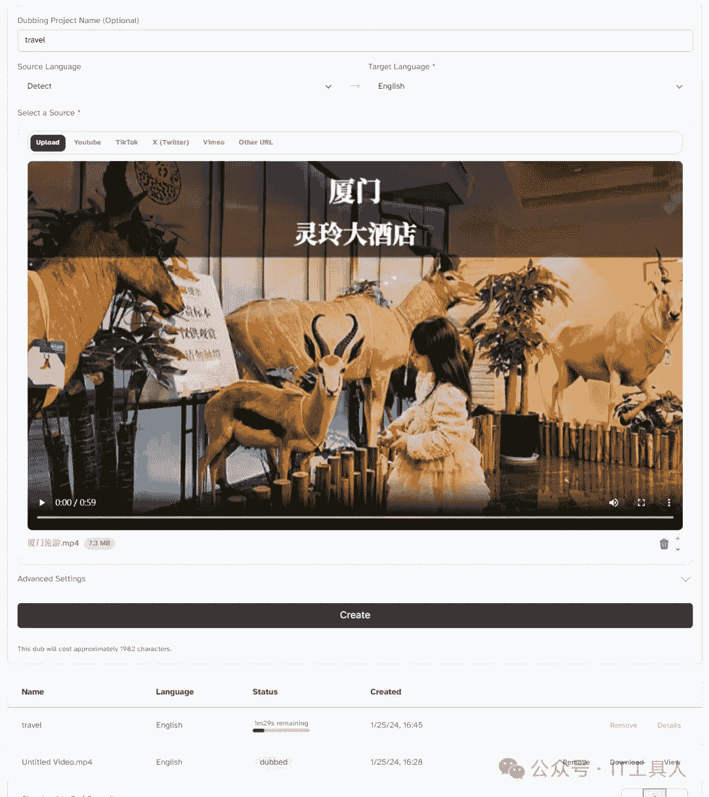
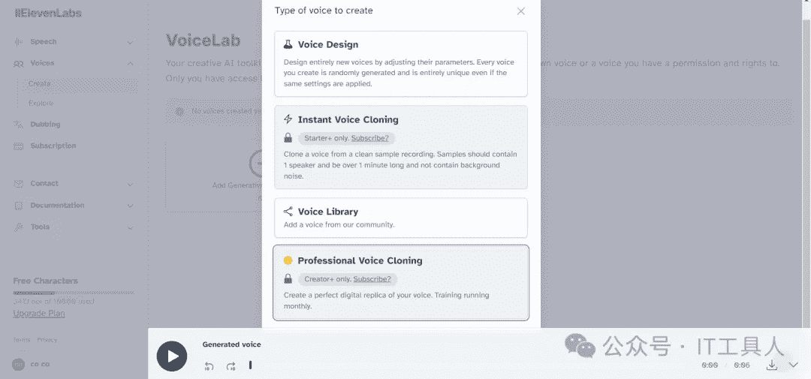
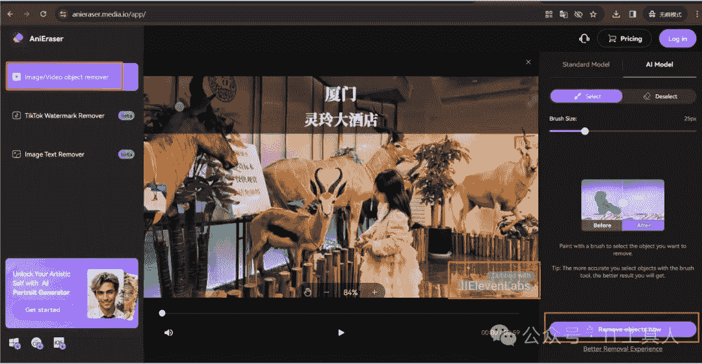
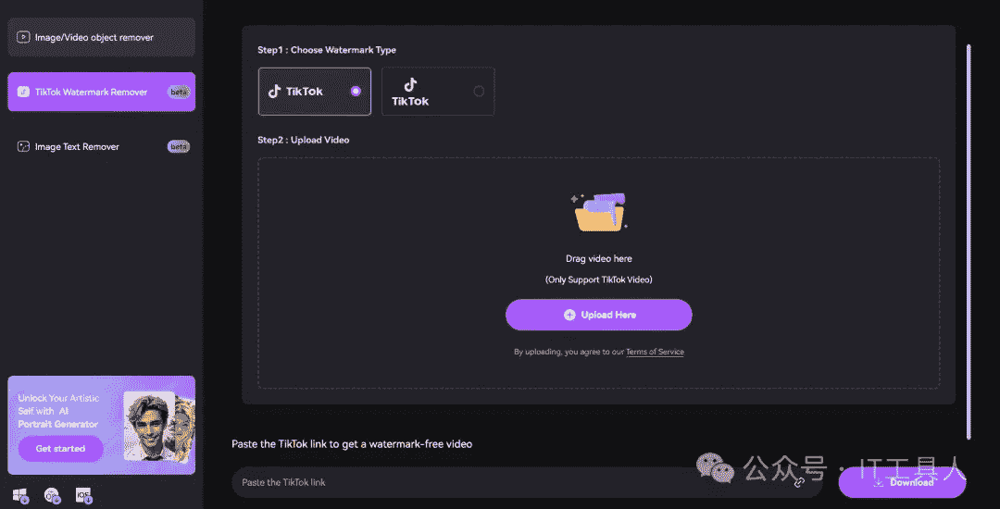
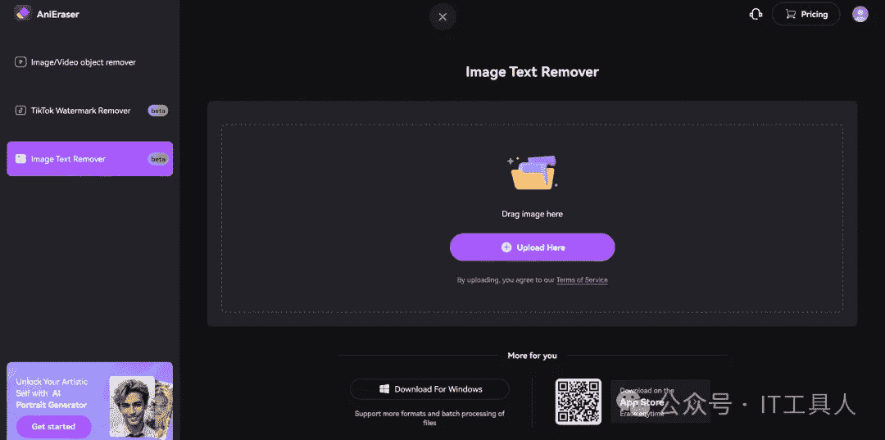

# tiktok跨境视频搬运全套流程（附：音频翻译、视频去水印的工具地址）

> 来源：[https://geekbang.feishu.cn/docx/Vo1AdOHQloh20HxEUsCcIvCQnYd](https://geekbang.feishu.cn/docx/Vo1AdOHQloh20HxEUsCcIvCQnYd)

> 🤵作者： IT工具人

> 📃 作者介绍：14年互联网IT从业经验，做过程序员，现任AI产品经理。发现并分享能提升做事效率的工具，让创业或副业变得更简单。

> ⏰ 收录时间：2024-05-31 11:29:31 (UTC+8)

> 🔗 原文链接：  h[ttps://mp.weixin.q](https://mp.weixin.qq.com/s/Y5XqlWJNmdIBQqhP6-kqYg)q.com/s/Y5XqlWJN...

欢迎关注👸号👆

今天介绍的是跨境视频搬运的一套流程以及所用到的工具（ 红色字体是工具地址 ）。跨境视频搬运，需要处理的素材有音频、水印，以及视频的混剪。

视频搬运有从抖音到tiktok，或者tiktok到抖音，除这两个平台外还有油管、视频号、快手等有短视频的平台都可以。当（中）短视频中有语音介绍，那在跨境搬运时，是需要能翻译，可以用ElevenLabs来翻译。视频可能有水印，可以用AniEraser自动去除水印。下面是视频处理的过程。

1、 **音频翻译 **。 ElevenLab s可以根据文本生成语音，或者把英文音频再用其他老外的音色转换一次，当然也能翻译视频中的音频，下面重点介绍视频中的音频翻译。

（1）打开 ElevenLab s，然后注册，有可能会要求绑定手机号码，记得在手机号码前面加+86。

工具地址： https:// elevenlabs.io/du bbing

（ 2 ） 上 传短视频，或者输入油管、TikTok、推特等URL地址也是可以。然后填下列几个值之后，点击创建等待就可以了。

1.  输 入项目名称。

1.  选 择源语言，可以按默认 Detect（探测 ） 。

1.  选择目标语言，往国外搬就选择英文或者其他非中文，往国内搬选择中文。

[🎦 点击观看视频](https://mpvideo.qpic.cn/0bc32yaa4aaawuadwnnsdvsvbvwdb3laadqa.f10002.mp4?dis_k=5001efe8f2cf73184b2cb9cfb3a42b1a&dis_t=1717125610&play_scene=10120&auth_info=U+m0p5pIEzgemcGQrBN4TBRHZzYdYGk3TWF/GDFDHnNuD1JCbEROV3xBTTlaMW92Hg==&auth_key=686c9f5393fff5adf25de65fab5c9e4e&vid=wxv_3298159413094039558&format_id=10002&support_redirect=0&mmversion=false)

视频详情

视频为本次实验效果展示，如有侵权可联系删除。

（3） ElevenLab s的文本生成音频中，可以选择官方给定的声音 ，也 可以 自己设计声 音 。 官方的声音主要是以美国为主，说中文的时候也像老外说中文。自己设计的声音有几种选择，免费版的是选择性别、年纪、国家（就5个）生成声音。收费版的可以生成自己的声音，炸裂吧。

|  |
| --- |

2、 **视频去水印 **。

视频生成之后，右下角有水印，可以通过 AniEraser自动清除水印。上传视频，然后用笔刷画出水印的位置，点击Remove objects now，等一分多钟就可以了。

工具地址：https://anieraser.media.io/

除此之外，还可以针对TikTok删水印，以及删除图片中的文字。

TikTok的水印删除，可以上传视频，也可以用URL链接。

图片的文字擦除，这在前面的文章有介绍过类似的工具。

看到这里，是不是感觉搬运视频也很简单，那就实践起来吧。所有的工具都是需要实际操作，才能为你所用。