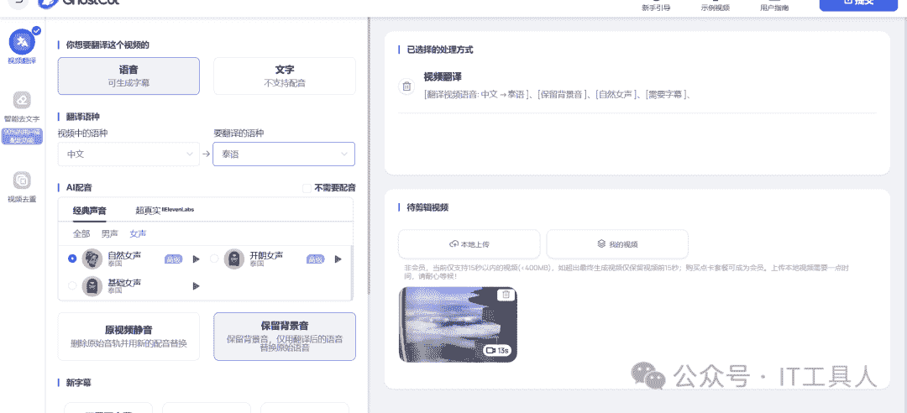
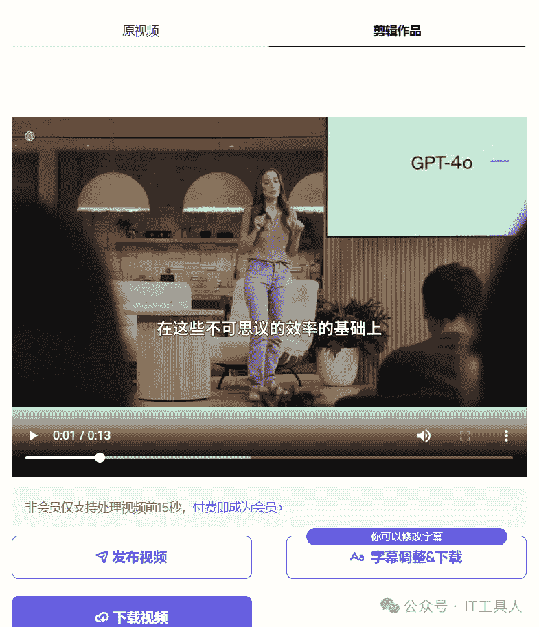
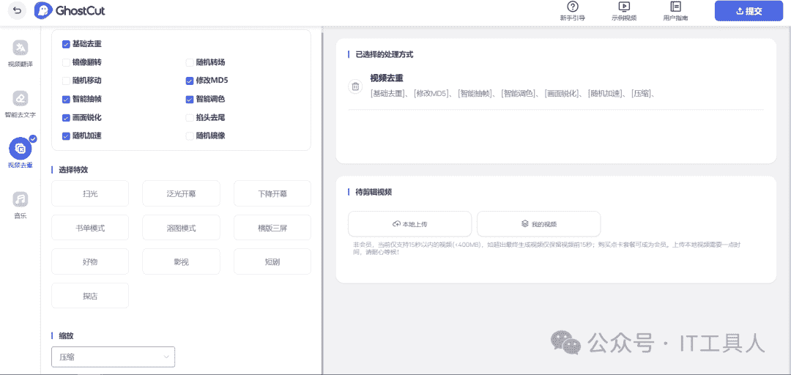
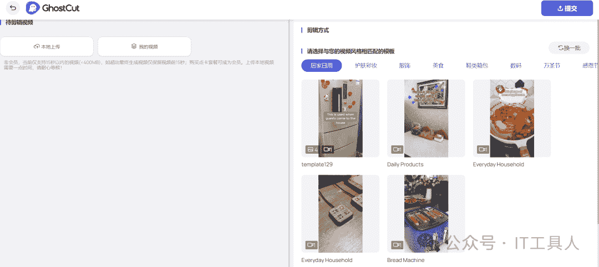
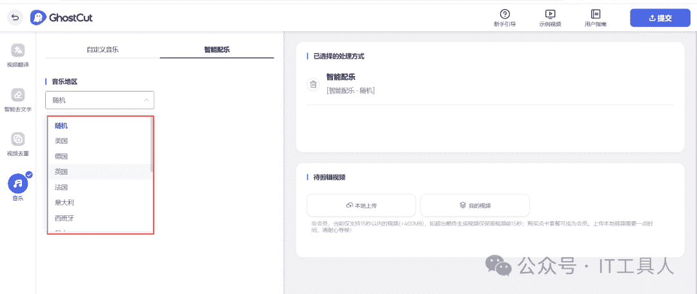

# 做短剧出海、TikTok视频搬运，用这个AI神器就够了！中文界面，可直接访问！

> 来源：[https://geekbang.feishu.cn/docx/O5iwdKfnwoPq3ExFsjLcl3yNnud](https://geekbang.feishu.cn/docx/O5iwdKfnwoPq3ExFsjLcl3yNnud)

> 🤵作者： IT工具人

> 📃 作者介绍：14年互联网IT从业经验，做过程序员，现任AI产品经理。发现并分享能提升做事效率的工具，让创业或副业变得更简单。

> ⏰ 收录时间：2024-05-31 11:38:58 (UTC+8)

> 🔗 原文链接：   h[ttps://mp.weixin.q](https://mp.weixin.qq.com/s/Hhh2i1Qx1jopYjRFoKj9jA)q.com/s/Hhh2i1Qx...

欢迎关注公众号👆

现在各AI 工具终于不再“ 简单” 了，告别 单一AI 功 能，而是向一个 大而全的功能平台 迈 进。

今天介绍一个视频处理的AI工具GhostCut（鬼手剪辑），**是一个大而**全的**视频处理工具，非常**适合**做 短剧出**海 、 海外的短视频搬运 、 跨境电商 等多个场景。

处理 视频 的 哪些问题呢？有视频翻译、去文字（字幕）、视频去重、短剧解说、去水印、智能配乐、视频擦除、视频混剪、一键多风格等。另外还有图片翻译和自动擦除工具。总之，它想告诉用户，视频处理用它就行了，一站式服务。

功能图

一个视频需要从国内平台搬运到国外平台，需要做视频翻译、去字幕、去字幕。有时候涉及版权问题，所以还需要工具做二创，还有根据当地特色重新配乐。我们来看看常用的几个功能吧。

# 1、 **视频翻译 **。 原语种支持13种，目标语种支持31种，做视频出海完全够用了。翻译之后，字幕和语音均会变成目标语言。

操作方式也很简单，选择语种、AI配音（也可以不配音）、新字母样式，上传视频然后点击右上角的提交按钮就可以了。

|  |
| --- |

提交之后，可以在工作台->我的作品中查看任务以及处理好的视频。

|  |
| --- |

# 2、 **去文字 **。 当做视频搬运、跨境电商视频时，屏幕中出现不和谐的文字或不必要的字幕时，可以采用去文字的方式。

|  |
| --- |

# 3、 **视频去重 **。 为了高度二创， 当采用别人的素材或重复使用自己的素材时，可以采用视频去重。（强烈建议采用自己的素材，避免产生版权纠纷）。

|  |
| --- |

# 4、 **短剧解说 **。 这个功能很有意思，就像我们看的电影或电视剧解说一样，可以一会采用解说的方式一会放出原视频独白。该功能分成四步，分别是 ①上传视频 → ②校对台词 → ③校对解说词 → ④合成成品

|  |
| --- |

# 5、 **一键多风格 **。 同一个视频，选择多个风格，然后一键生成多个目标视频。左侧是上传视频，右侧是选择生成的风格，可以多选。

# 6、 **智能配乐 **。因为各地区的习俗以及生活方式不同，所以生成的视频可能需要更换背景音乐，以符合当地的特色，此时可以选择智能配乐。

# **7、一键发布到TikTok **。 在工作台，用户可以进入内容分发，然后添加授权TikTok账号，然后在我的作品生成之后，可以点击发布视频就可以了。

这个AI 工具可以 免费试 用，试用结束之后需要买点数，但 收费也比较 便宜 ，1分钟的视频处理大概需要0.3元吧。

地址：cn.jollytoday.com