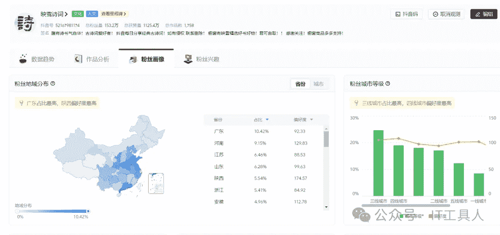
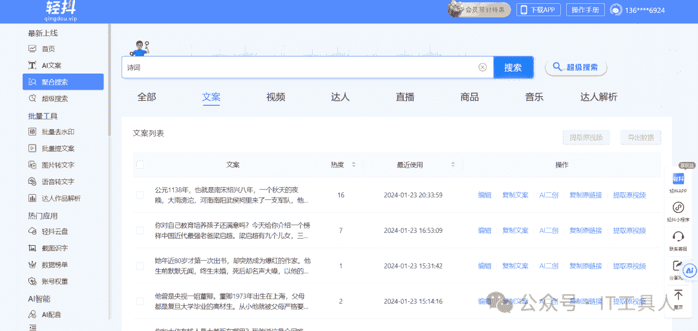

# 生成爆款短视频（中视频）的工具集合（附工具们的链接）

> 来源：[https://geekbang.feishu.cn/docx/PzxTdQy9PoyeuMxdhemci7pZnWe](https://geekbang.feishu.cn/docx/PzxTdQy9PoyeuMxdhemci7pZnWe)

> 🤵作者： IT工具人

> 📃 作者介绍：14年互联网IT从业经验，做过程序员，现任AI产品经理。发现并分享能提升做事效率的工具，让创业或副业变得更简单。

> ⏰ 收录时间：2024-05-31 11:43:16 (UTC+8)

> 🔗 原文链接：    h[ttps://mp.weixin.q](https://mp.weixin.qq.com/s/RS5Zjft4m5IKiJ_-ueaY8A)q.com/s/RS5Zjft4...

欢迎关注👸号👆

在做短视频时，我们需要选好题材方向，然后拍摄或写文案自动生成短视频，再剪辑短视频，这一流程下来，你可能会用到以下这些工具。

**1、 找对标账号 **。可以用抖音官方的 **热点宝、次幂数据、西瓜数据 **等，前者是免费的，后面两个功能部分功能是收费的。今天介绍一下热点宝的数据观测。

官方地址：https://douhot.douyin.com/

点开数据观测，可以搜索与你同行业排在前9名的作者做观测数据，也可以搜索已有的对标账号。可以看看数据趋势、作品分析、粉丝画像、粉丝兴趣，以及粉丝关注的同类账号有哪些。可以参考他们的风格进行学习模仿，再超越。

**2、选题 **。可以选择 **巨量算数、西瓜数据、次幂数据 **，这个也是抖音集团的巨量引擎产品。进入算数指数，然后选择你所关心的话题进行关键词搜索，此时搜索结果也将关联分析，包含搜索关联词与内容关联词。搜索关键词还有展示人群画像。

地址：https://trendinsight.oceanengine.com/

选择一个合适的关键词或关键词组合之后，在🛰️、头条、知乎、百度等平台搜索，可以选择相应的热门话题。

**3、找文案 **。可以选择 轻抖文案库、次幂数据、西瓜数据 。以轻抖文案为为例，输入关键词，找文案，然后就可以选择一篇热度高一点的复制出来。

地址：https://www.qingdou.vip/

**4、AI改文案 **。AI改文案是避免抄袭，上面说的轻抖中的文案有AI二创功能，就是AI改文案，不过我试了效果不理想。可以用ChatGPT，如果没有这个账号，国内也可以用文心一言、智谱ai等。

|  |
| --- |

5、 **视频剪辑 **。如果你是做露脸的短视频，那可能还需要提词器，可以用快提词。假设不用露脸，可以把文案复制[到剪映（手机和电脑版](http://mp.weixin.qq.com/s?__biz=MzUzOTAzODI1Nw==&mid=2247483851&idx=1&sn=6e35ff1fd6687797b862b38a1d6b8f6e&chksm=facfc695cdb84f8363f483cc9a1d8df3a8065187940be98c3cacbd6ad77520192937385a6981&scene=21#wechat_redirect)都有），选择图文生成视频（剪映自动生成短视频可以参考这篇， 即将爆火的AI工具 ），也可以自动配音。生成视频之后，还需要花点时间精雕细琢。

这套工具下来，可以让你在生成短视频过程中提高不少效率。但是要做好的短视频，需要多花点时间，每个步骤都需要仔细打磨。