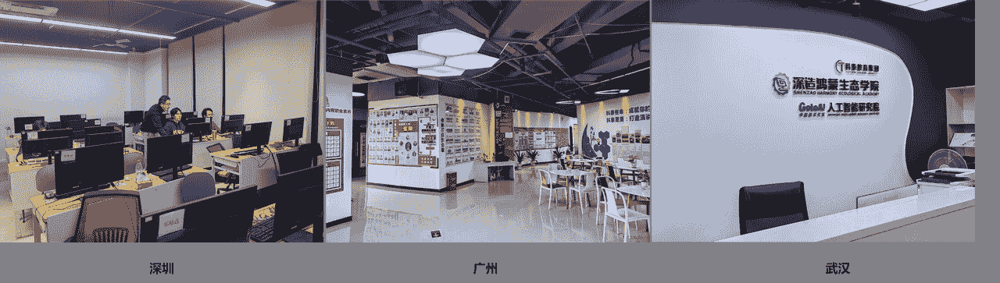
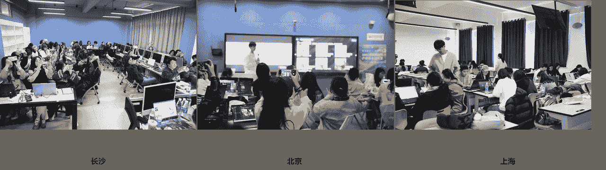

# 联系我们

> 来源：[https://gotoaiworld.feishu.cn/docx/GO5OdlQwkoequ2xaye4cR5r3n2b](https://gotoaiworld.feishu.cn/docx/GO5OdlQwkoequ2xaye4cR5r3n2b)

# 一、联系我们

> GotoAI中国技术社区成立于深圳南山高新区，最早以多名Microsoft 技术团队发起，由深圳，广州地区的AWS, Google, 腾讯，IBM, 阿里云，字节跳动等互联网大厂技术大伽共同组建的，由最初的10多人，发展到2024年年底接近2000多名技术人员。超过3000人注册。

**网站**：www.gotoai.world

**邮件**：steven.li@gotoai.world

**电话**：19328738175  400-862-1600

**扫码：**

# 二、社区全国分布

## 华南地区

**深圳**

深圳市南山区科苑路6号

科技园工业大厦2楼

**深圳**

深圳市光明区玉塘街道田寮路智衍创新大厦

武汉理工大学深圳研究院

**深圳**

深圳市福田区滨河大道

京基滨河时代大厦26楼

**深圳**

深圳市龙华区龙华街道和平路3~5号

深圳AGI云塔大厦19楼

**深圳**

深圳市南山区太子路51号太子广场21楼

大湾区创新中心

**深圳**

深圳市龙岗区坂田街道雅宝路1号

星河WORLD F栋2楼

**广州**

广州市天河区

粤港澳大湾区创新创业基地C栋2楼

**广州**

广州市海珠区琶洲模方

广州市海珠区琶洲大道68号华新中心18层

## 华北地区

**北京**

北京市海淀区

清河嘉园东区甲1号楼10层1045室

## 华中地区

**武汉**

武汉市

武汉市洪山区南李路28号湖北工业大学科研楼7楼

**武汉**

武汉市

武汉市东湖新技术开发区高新二路129号湖北第二师范学院实训中心

**长沙**

武汉市

长沙市开福区湘江北路一段369号

**株洲**

株洲市

## 华东地区

**上海**

上海市

上海市浦东新区金吉路778弄2幢110E室

**无锡**

无锡市

# 三、GotoAI 培训学院

