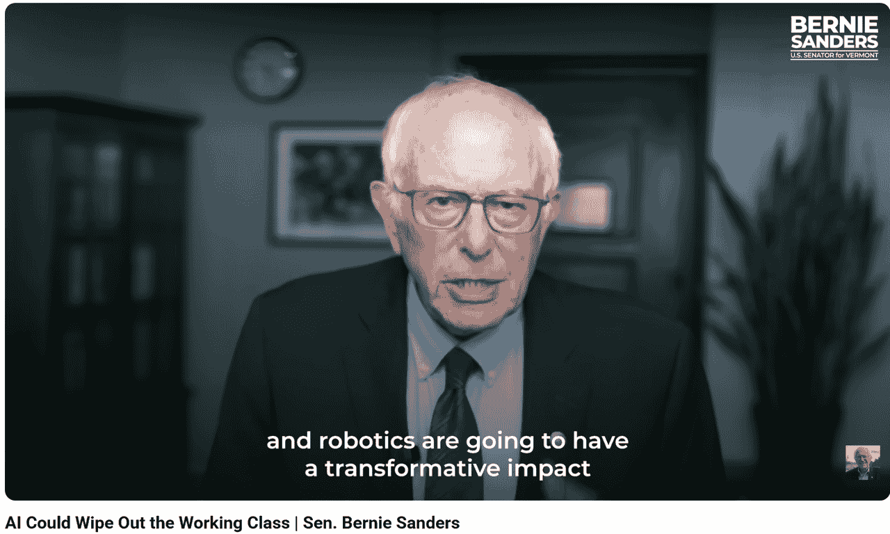
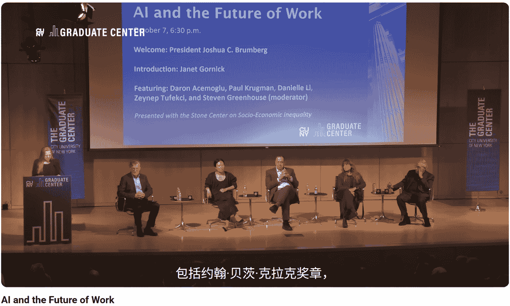
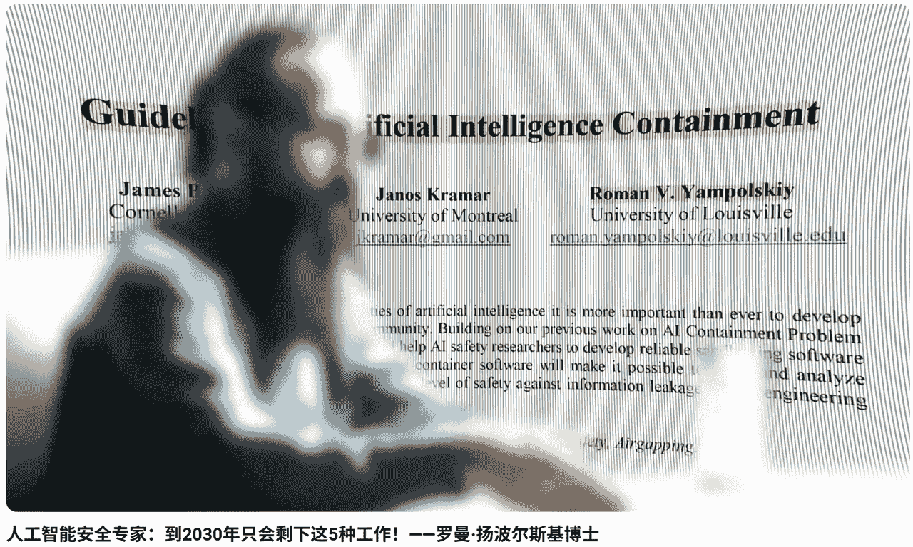
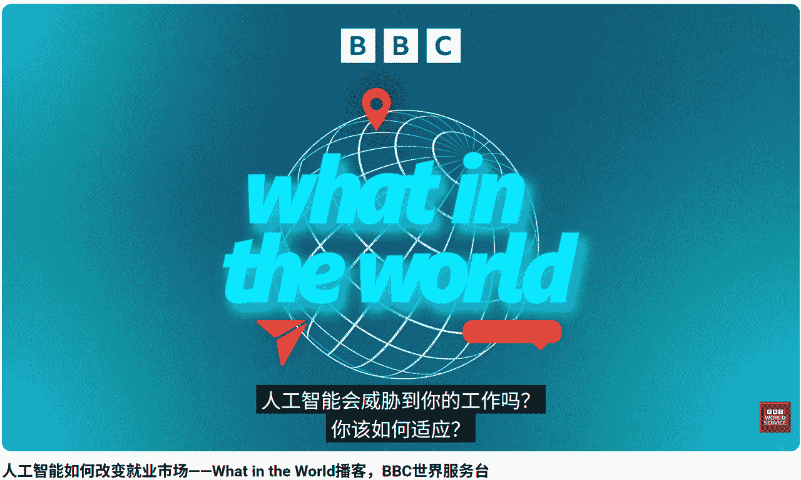

# AI到底会不会取代你？AI科技大伽会客厅

> 来源：[https://gotoaiworld.feishu.cn/docx/Ac6NdW02fo0AyqxXd16cUVoInkZ](https://gotoaiworld.feishu.cn/docx/Ac6NdW02fo0AyqxXd16cUVoInkZ)

# 人工智能教父：他们一直封杀我，但我在努力警告他们！

https://www.youtube.com/watch?v=giT0ytynSqg&t=3378s

[他曾是人工](https://www.youtube.com/watch?v=giT0ytynSqg)[智能的先驱](https://www.youtube.com/watch?v=giT0ytynSqg&t=131s)[，现在正在](https://www.youtube.com/watch?v=giT0ytynSqg&t=260s)[警告世界。](https://www.youtube.com/watch?v=giT0ytynSqg&t=426s)[人工智能教](https://www.youtube.com/watch?v=giT0ytynSqg&t=633s)[父 Geo](https://www.youtube.com/watch?v=giT0ytynSqg&t=732s)[ffrey](https://www.youtube.com/watch?v=giT0ytynSqg&t=865s)[ Hint](https://www.youtube.com/watch?v=giT0ytynSqg&t=972s)[on 打破](https://www.youtube.com/watch?v=giT0ytynSqg&t=1046s)[沉默，谈论无人](https://www.youtube.com/watch?v=giT0ytynSqg&t=1143s)准备的致命 AI 风险。

Geoffrey Hinton 是领先的计算机科学家和认知心理学家，被广泛称为“人工智能教父”，以表彰他在神经网络和深度学习方面的开创性工作。他于2018年获得图灵奖，这一奖项常被称为计算机界的诺贝尔奖。2023年，他离开谷歌，警告公众关于人工智能日益增长的危险。

他解释：

◽️ 为什么 AI 有 20% 的真实概率可能导致人类灭绝。

◽️ 为什么公开谈论 AI 让他被噤声。

◽️ 对自己帮助创造 AI 所感到的深深遗憾。

◽️ AI 当前对人类构成的 6 大致命威胁。

◽️ AI 在推进医疗、提升生产力和变革教育方面的潜力。

—

⏱ 时间轴：

00:00 介绍

02:11 为什么人们称你为人工智能教父？

04:20 警告 AI 的危险

07:06 我们应当关注的 AI 问题

10:33 欧洲 AI 法规

12:12 网络攻击风险

14:25 如何保护自己免受网络攻击

16:12 利用 AI 制造病毒

17:26 AI 与选举腐败

19:03 AI 如何制造信息茧房

22:48 规范新技术

24:31 法规是否阻碍了我们与中国竞争？

25:57 致命自主武器的威胁

28:33 这些 AI 威胁能否叠加？

30:15 限制 AI 接管

32:01 面对 AI 风险反思一生工作

33:45 学生因安全担忧离开 OpenAI

37:49 你对 AI 的未来感到乐观吗？

39:51 AI 引发失业的威胁

42:47 如果肌肉和智力被取代，还剩下什么？

44:38 广告

46:42 当前 AI 与超级智能的差异

52:37 接受 AI 的能力

54:29 AI 如何可能加大财富不平等

56:18 为什么 AI 优于人类？

59:01 AI 拥有超越人类的知识潜力

1:00:49 AI 能否复制人类的独特性？

1:03:57 机器会有情感吗？

1:11:12 在谷歌工作

1:14:55 为什么离开谷歌？

1:16:20 广告

1:18:15 人们应如何应对 AI？

1:19:36 令人印象深刻的家庭背景

1:21:13 回顾过去你会给的建议

1:22:27 关于 AI 安全的最终信息

1:25:48 对人类幸福的最大威胁是什么？

# AI Could Wipe Out the Working Class | Sen. Bernie Sanders

https://www.youtube.com/watch?v=dthbi4lzO58、

由亿万富翁开发的人工智能和机器人技术将使美国企业能够消灭数千万个体面薪资的工作岗位，降低劳动力成本并提升利润。  那些找不到工作因为根本不存在而找不到工作的工人阶级会怎样？  ---  参议员伯尼·桑德斯是佛蒙特州资深参议员。他是美国国会历史上任职时间最长的独立议员，也是参议院健康、教育、劳工和养老金委员会（HELP）的资深成员。

# AI and the Future of Work

https://www.youtube.com/watch?v=McYBgZrORi4

本次活动于2025年10月7日现场录制。人工智能正以惊人的速度发展，引发了人们对我们社会和日常生活在不远将来可能发生变化的极大焦虑。许多人最关心的：就业。专家小组将这些猜测拉近现实，探讨诸如：人工智能将取代哪些工作岗位？将创造哪些新工作岗位？人工智能将如何影响工作环境、工资、工会以及整体经济？特邀嘉宾达伦·阿西莫格鲁，诺贝尔奖得主，[麻省理工学院经济学教授;保罗·克鲁格](https://www.youtube.com/redirect?event=video_description&redir_token=QUFFLUhqbmtrOFdyVFFEQTRPNnVWYjUxZmNqVHJlamRjd3xBQ3Jtc0ttVzNmRDdiS2doRGV4b244ZzRwUFF6c0ZhbF9jQWNrTmo1dWc2bXBSM01YZ3NRdTkwRFd3X2hwa1k3R2RScFF4VC1vVWlkWE1DNl92SWNCRDBWZ1dkc294ZFVJVlV5YWxUVXJBZWNTRU1wYjIwd1Zn🐧&q=http%3A%2F%2Fwww.gc.cuny.edu%2Fpublic-programs&v=McYBgZrORi4)曼，诺贝尔奖得主，前《纽约时报》专栏作家，纽约市立大学研究生中心经济学研究教授;丹妮尔·李，麻省理工学院大卫·萨诺夫技术管理教授;以及普林斯顿大学社会学与公共事务教授、《纽约时报》专栏作家泽伊内普·图菲克奇。由前《纽约时报》劳工记者、《被打倒：美国劳工的过去、现在与未来》作者史蒂文·格林豪斯主持。  由斯通社会经济不平等中心呈现。  欲了解更多活动信息，请访问：http://www.gc.cuny.edu/public-programs

# 人工智能安全专家：到2030年只会剩下这5种工作！——罗曼·扬波尔斯基博士

[警告](https://www.youtube.com/playlist?list=PL22egh3ok4cOn47dd0tx_flR33QuVu9GW)： 人工智能可能终结人类，而我们完全没有做好准备。罗曼·扬波尔斯基博士揭示了 AI 将如何夺走 99% 的工作、为什么萨姆·阿尔特曼无视安全，以及我们如何正走向全球崩溃……甚至是第三次世界大战。

罗曼·扬波尔斯基博士是 AI 安全领域的领军人物，也是计算机科学与工程教授。他在 2010 年提出了“AI 安全”这一术语，并发表了 100 多篇关于 AI 危险性的论文。他还是《Considerations on the AI Endgame: Ethics, Risks and Computational Frameworks》等书籍的作者。

他解释了：

⬛ AI 如何可能释放致命病毒

⬛ 为什么这 5 种工作可能是仅存的职业

⬛ 超级智能将如何支配人类

⬛ 为什么“超级智能”可能在 2027 年触发全球崩溃

⬛ 为什么 AI 可能比核武器更可怕

⬛ 为什么我们几乎可以肯定生活在模拟中

如果你喜欢这一集，你可以在这里观看更多普通话版本的节目：

[ • 中文剧集  ](https://www.youtube.com/playlist?list=PL22egh3ok4cOn47dd0tx_flR33QuVu9GW)[

00:](https://www.youtube.com/watch?v=UclrVWafRAI)[00 开场](https://www.youtube.com/watch?v=UclrVWafRAI&t=148s)[

02:2](https://www.youtube.com/watch?v=UclrVWafRAI&t=275s)[8 如何阻](https://www.youtube.com/watch?v=UclrVWafRAI&t=297s)[止 AI ](https://www.youtube.com/watch?v=UclrVWafRAI&t=495s)[杀死所有人](https://www.youtube.com/watch?v=UclrVWafRAI&t=594s)[

04:3](https://www.youtube.com/watch?v=UclrVWafRAI&t=698s)[5 出事的](https://www.youtube.com/watch?v=UclrVWafRAI&t=867s)[概率有多大？

](https://www.youtube.com/watch?v=UclrVWafRAI&t=1129s)04:57 你从什么时候开始研究 AI 安全？

08:15 什么是 AI？

09:54 对 2027 年的预测

11:38 未来还会存在什么工作？

14:27 AI 真的能夺走所有工作吗？

18:49 当所有工作都被取代会发生什么？

20:32 有什么反对 AI 取代人的有力论据吗？

22:04 对 2030 年的预测

23:58 到 2045 年会发生什么？

25:37 我们是否会找到新的职业和生活方式？

28:51 现在有比 AI 安全更重要的事吗？

30:07 我们难道不能直接拔掉电源吗？

31:32 我们就这样顺其自然吗？

37:20 最可能导致人类灭绝的是什么？

39:45 没有人知道 AI 内部到底发生了什么

41:30 广告

42:32 对 OpenAI 和萨姆·阿尔特曼的看法

46:24 2100 年的世界会是什么样？

46:56 如何应对“AI 毁灭论”的叙事？

53:55 人们应该抗议吗？

56:10 我们是否生活在模拟中？

1:01:45 你有多确定我们身处模拟？

1:07:45 我们能永生吗？

1:12:20 比特币

1:14:03 这次对话之后我应该做什么改变？

1:15:07 你有宗教信仰吗？

1:17:11 这些对话会让人感觉更好吗？

1:20:10 你最强烈的批评者怎么说？

1:21:36 结束语

1:22:08 如果你只有一个按钮可按，你会选什么？

1:23:36 我们是否正走向大规模失业？

1:24:37 最重要的特质

# BBS-How AI is changing the job market - What in the World podcast, BBC World Service

https://www.youtube.com/watch?v=p_kF_SDB0-c

[First](https://www.youtube.com/watch?v=p_kF_SDB0-c)[ you’](https://www.youtube.com/watch?v=p_kF_SDB0-c&t=19s)[ve go](https://www.youtube.com/watch?v=p_kF_SDB0-c&t=75s)[t to ](https://www.youtube.com/watch?v=p_kF_SDB0-c&t=160s)[find ](https://www.youtube.com/watch?v=p_kF_SDB0-c&t=215s)[the a](https://www.youtube.com/watch?v=p_kF_SDB0-c&t=383s)[dvert](https://www.youtube.com/watch?v=p_kF_SDB0-c&t=490s)[s and](https://www.youtube.com/watch?v=p_kF_SDB0-c&t=580s)[ open](https://www.youtube.com/watch?v=p_kF_SDB0-c&t=740s)ings, then there’s the mental energy and time required to put in an application - and that’s before you get to the nerve wracking interviews. But some of us are finding that process even harder than normal - putting in loads of applications and never hearing back. Some recent studies suggest that AI is a contributing factor, with younger workers being replaced by AI in some industries.

Companies like Amazon and Duolingo have said using AI is going to lead to a reduction in their workforce.

We hear some of your experiences in the current job market. BBC business reporter in New York, Nathalie Jimenez, explains which sectors are most affected by the adoption of generative AI - and what you can do to try to adapt. Plus Varun Mayya, a YouTuber and the founder of generative AI company Aeos, tells us what the situation is like in India - and how AI is changing how his company operates.

00:00 Coming up

00:19 Intro

01:15 Jobs AI is taking over

02:40 Why it’s harder to find a job

03:35 People impacted by AI while job hunting

06:23 Big companies and AI

08:10 AI and job interviews

09:40 AI’s impact in India

12:20 Advice for the future