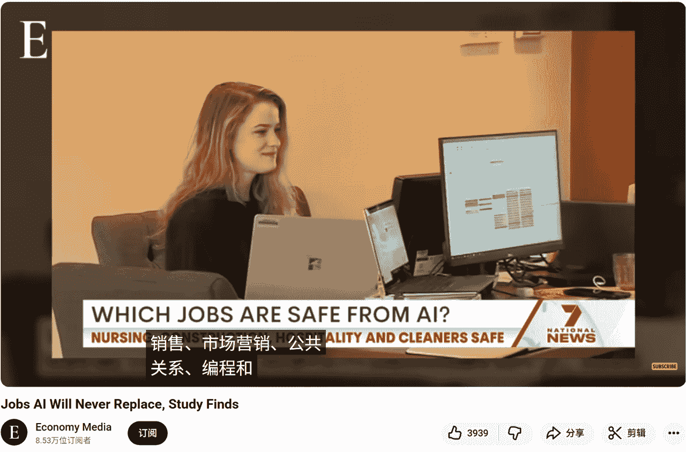
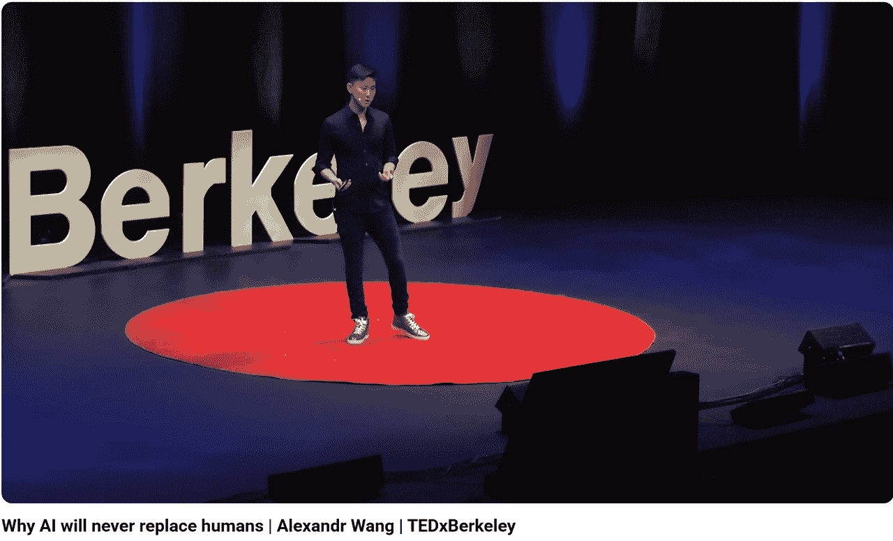

# AI到底会不会取代人类？全球媒体

> 来源：[https://gotoaiworld.feishu.cn/docx/OXx5drH8jo2M1uxSMoicz4fnnAe](https://gotoaiworld.feishu.cn/docx/OXx5drH8jo2M1uxSMoicz4fnnAe)

# [Economy Media](https://www.youtube.com/@EconomyMedia)

## Jobs AI Will Never Replace, Study Finds

https://www.youtube.com/watch?v=p1yCOdp2vs0

# [TEDx Talks](https://www.youtube.com/@TEDx)

## Why AI will never replace humans | Alexandr Wang | TEDxBerkeley

https://www.youtube.com/watch?v=iXCmoQDEoe4

