# 企业级AI应用案例中心

> 来源：[https://gotoaiworld.feishu.cn/docx/RXZgdMXKBo4oiCxaGwKcEIIEnqd](https://gotoaiworld.feishu.cn/docx/RXZgdMXKBo4oiCxaGwKcEIIEnqd)

# 一、优秀案例分享

## 中国航天集团

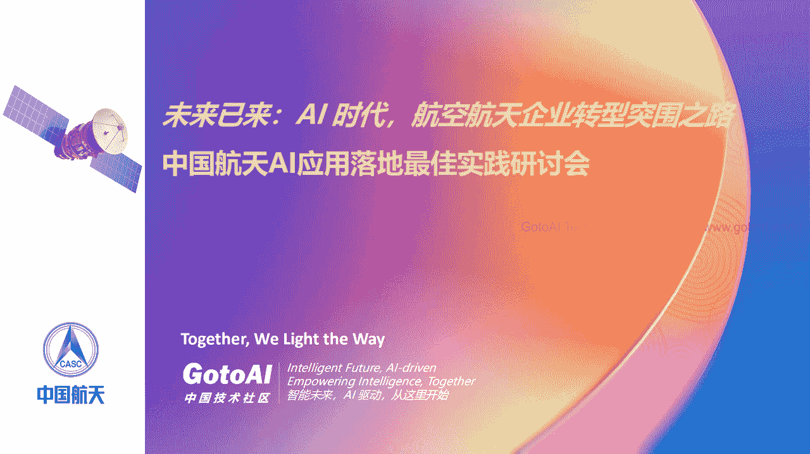

[培训讲义-中国航天科技集团AI解决方案和最佳实践研讨会V20250815_watermark (1).pdf](https://internal-api-drive-stream.feishu.cn/space/api/box/stream/download/all/XB5sbEqp2orF4AxVy07cH1TjnWd)

## 国内某头部汽车厂商

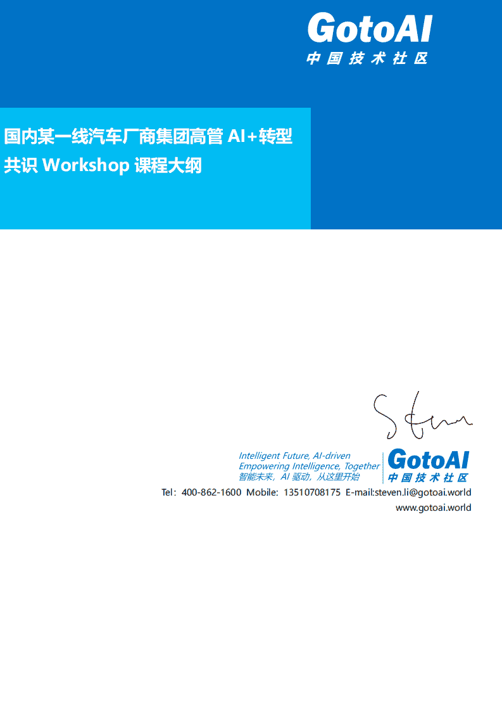

[某国内汽车巨头集团高管AI+转型共识Workshop课程大纲V1.0.pdf](https://internal-api-drive-stream.feishu.cn/space/api/box/stream/download/all/UmLMbeKyrojOtdxJAN8cQKlsndd)

# 二、微软企业级AI应用案例中心

> 微软作为全球AI领导者之一，发布了700个真实的Agent智能体、Microsoft Copilot应用案例

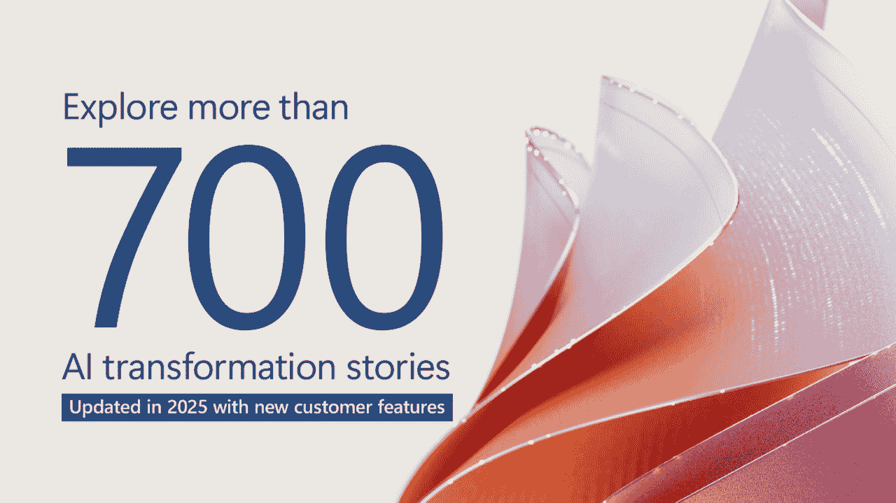

https://blogs.microsoft.com/blog/2025/04/22/https-blogs-microsoft-com-blog-2024-11-12-how-real-world-businesses-are-transforming-with-ai/

随[**着当今平台向 AI 的**](https://info.microsoft.com/ww-landing-business-opportunity-of-ai.html)转变势头不断增强，Microsoft[ 正在努](https://aka.ms/ai-study)力了解组织如何推动持久的业务价值。我们最近与 IDC 合作开展了一项名为《AI 的商业机会》的研究，以揭示有关商业价值的新见解，并帮助指导组织踏上 AI 转型之旅。 研究发现，组织在生成式 AI 上每投资 1 美元，平均即可获得 3.70 美元的回报，并揭示了有关 AI 重塑业务流程和推动跨行业变革的未来潜力的见解。

查看 IDC 和 Microsoft 值得关注的 5 大 AI 趋势

如今，超过 85% 的财富 500 强企业正在使用 Microsoft AI 解决方案来塑造他们的未来。在与各个行业和地区的大大小小的组织合作时，我们发现大多数转型计划都旨在实现以下四个业务成果之一：

1.  **丰富员工体验：**使用 AI 来简化或自动化重复、单调的任务，可以让您的员工专注于更复杂、更有创意并最终更有价值的工作。

1.  **重塑客户交互：**AI 可以创建更加个性化、量身定制的客户体验，让您的目标受众满意，同时减轻员工的负担。

1.  **重塑业务流程：**从营销到供应链运营再到财务，几乎任何业务流程都可以通过 AI 重新构想，AI 甚至使组织能够超越流程优化，发现令人兴奋的新增长机会。

1.  **弯曲创新曲线：**AI 通过加快创意流程和产品开发、缩短上市时间并使公司能够在通常拥挤的领域中脱颖而出，从而彻底改变创新。

在此博客中，我们收集了 700 多个我们最喜欢的真实示例，这些示例展示了组织如何利用 Mi**c**rosoft 经过验证的 AI 功能来推动影响并塑造当今平台向 AI 的转变。今天，我们在每个部分的开头添加了客户使用我们的 AI 功能的新案例。我们将定期更新此故事，提供更多信息。我们希望您能找到一两个可以激发您自己转型之旅的例子。

## **丰富员工体验**

生成式 AI 正在真正改变员工的生产力和福祉。我们的客户告诉我们，通过自动执行重复、单调的任务，员工可以腾出时间投入到更复杂、更具创造性的工作中。这种转变不仅使工作环境更具刺激性，而且提高了工作满意度。它激发创新，为更好的决策提供可作的见解，并支持个性化的培训和发展机会，所有这些都有助于更好地平衡工作与生活。世界各地的客户都报告说，使用这些 AI 解决方案后，员工的工作效率得到了显著提高：

**新故事：**

1.  [**阿伯丁市议会**](https://www.microsoft.com/en/customers/story/18987-aberdeen-city-council-microsoft-365-copilot)将 Microsoft 365 Copilot 作为 AI **驱**动的整体解决方案，可以帮助减轻任务负担，释放员工能力，以更迅速地管理居民的护理。 通过使用 Copilot，他们预计在节省时间和提高生产力方面可实现 241% 的投资回报率，每年估计可节省 300 万美元。

1.  [**allpay**](https://www.microsoft.com/en/customers/story/22158-allpay-github-copilot) 利用 GitHub Copilot 帮助工程师和开发人员更快、更轻松地编写代码，将生产力提高 10%，并[将](https://www.microsoft.com/en-gb/microsoft-365/sharepoint/collaboration)生产交付量提高 25%。他们还采用了 Microsoft Copilot 来帮助共享其 SharePoint 上的信息。

1.  [**Amey**](https://www.microsoft.com/en-us/microsoft-cloud/blog/2025/04/03/the-uks-opportunity-to-seize-growth-in-the-age-of-agentic-ai/) 使用 SharePoint 代理，允许员工通过其移动设备上的聊天界面即时检索答案。提供实时故障排除和多语言支持可降低风险，并使员工每天都能安全回家。

1.  [**ANS**](https://www.microsoft.com/en-us/worklab/agents-of-change) 使用 Microsoft Copilot 和代理来简化销售流程。卖家现在可以要求代理跨数据源收集和汇总信息，从以前的客户互动中获得有价值的见解，同时确保客户数据保护。这使卖家能够优先考虑他们的时间并专注于最关键的客户和机会——他们预测这将使 ANS 的成交率提高 6.25%。

1.  [**Architecht**](https://www.microsoft.com/en/customers/story/23209-architecht-azure-ai-bot-service) 使用 Azure OpenAI 服务和 GitHub Copilot 开发了 OBA Suite，这是一个基于微服务体系结构构建的基于云的平台。该平台还集成了先进的 AI 功能。借助低代码/无代码功能，UI/UX 原型设计只需 25 分钟，而不是两天。OBA Suite 通过 AI 驱动的助手和个性化服务增强用户体验。

1.  Arthur D. Little 使用 Azure OpenAI 服务开发了一种解决方案，以帮助顾问快速整理和理解复杂的文档格式，同时保持严格的数据机密性。这有助于顾问更快地准备客户会议，并将演示内容策划速度提高 50%。

1.  [**Arup**](https://cdn-dynmedia-1.microsoft.com/is/content/microsoftcorp/microsoft/final/en-us/mcaps/dau/documents/fy25/AgentsofChange.pdf) 使用 Microsoft 365 Copilot 来提高整个组织的生产力和效率。他们还使用 AI 来开发由其分析和 AI 团队构建的专有应用程序。

1.  [**Atera**](https://www.microsoft.com/en/customers/story/1662731177894407321-atera-professional-services-azure-en-israel) 将 Azure OpenAI 服务集成到其 AI 驱动的平台中，以提供 IT 活动的全方位视图，主动识别问题并提供即时解决方案。AI 引擎还允许最终用户在没有 IT 干预的情况下排除故障并自动解决工单，从而将 IT 专业人员的效率提高 10 倍。

1.  [**Atos**](https://www.microsoft.com/en/customers/story/1761681704321508161-atos-microsoft-365-copilot-professional-services-en-france) 采用 Microsoft 365 Copilot，通过减轻耗时任务的工作，让他们专注于工作中更重要的方面，最终培养创造力和效率，从而提高员工的幸福感。

1.  [**AT&T**](https://www.microsoft.com/en/customers/story/1637511309136244127-att-telecommunications-azure-openai-service) 使用 Azure OpenAI 服务来自动化 IT 任务，并为员工提供对基本人力资源请求的快速解答，从而提高效率、改善工作寿命并降低成本。

1.  [**AvePoint**](https://www.microsoft.com/en-us/microsoft-cloud/blog/2025/03/20/ai-for-everyone-transforming-business-at-every-stage-of-the-journey/) 利用 GitHub Copilot 来加速其开发生命周期，缩短新功能的上市时间，并确保持续创新。他们还使用 Azure AI 开发了 ChatAVPT，为员工提供实时信息和指导。

1.  [**Balfour Beatty**](https://cdn-dynmedia-1.microsoft.com/is/content/microsoftcorp/microsoft/final/en-us/mcaps/dau/documents/fy25/AgentsofChange.pdf) 使用 AI 代理来识别质量保证，特别是它如何测试其构建和安装的内容。AI 破译、推理和简化决策的能力特别有价值。他们认为这在质量控制和安全管理中都处于领先地位。

1.  [**BNY**](https://www.microsoft.com/en-us/microsoft-cloud/blog/2025/03/20/ai-for-everyone-transforming-business-at-every-stage-of-the-journey/) 使用 GitHub Copilot，超过 80% 的开发人员社区现在每天都依赖它，从而提高了代码开发的速度。他们还使用虚拟助手 Eliza 使员工能够创新、简化工作流程并为客户提供更高的价值，而 Microsoft 365 Copilot 则帮助转变运营和公司文化。

1.  不列颠哥伦比亚省投资管理公司 （BCI） 使用 Microsoft 365 Copilot 和 Azure 生态系统来提升员工体验并实现运营转型。通过自动化消除手动任务，他们将 84% 的 Copilot 用户的工作效率提高了 10% 到 20%，并将他们的工作满意度提高了 68%。该公司通过自动化节省了 2300 多个工时，将编写内部审计报告的时间减少了 30%，并节省了一个月的处理时间来分析 8000 条调查评论。

1.  Cancer Center.AI 在 Microsoft Azure 上开发了一个平台。该解决方案使医生能够将病理扫描数字化，依靠 AI 模型进行分析，并与其他医生远程协作。使用该解决方案后，医疗保健组织报告说，病理学家的工作效率更高，诊断过程更快，初始试点研究的诊断错误也减少了。

1.  [**Cognizant**](https://www.microsoft.com/en-us/worklab/agents-of-change) 使用 Copilot 来简化客户的季度业务审查 （QBR） 工作流程。他们现在使用 Copilot 来自动化研究、编译见解和构建演示文稿，每项任务可节省 90 分钟。这种效率使客户成功经理能够在所有评论中应用一致的方法，并腾出他们的日程安排，将更多时间花在更多客户身上。

1.  [**哥伦比亚司法系统**](https://news.microsoft.com/source/latam/features/ai/colombia-justice-system-copilot/?lang=en)启动了一项 Copilot 测试计划，以协助处理积压率、每天进行转录、总结听证会并起草各种司法文件。Copilot 还有助于审查语法和措辞、比较裁决草案和管理内部数据。

1.  [**Daiichi Sankyo**](https://www.microsoft.com/en/customers/story/19578-daiichi-sankyo-azure) 使用 Azure OpenAI 服务和 Azure AI 搜索在一个月内开发了自己的名为 DS-GAI 的内部生成式 AI 系统。在一项全公司范围的调查中，超过 80% 的受访者表示 DS-GAI 提高了他们的工作效率和准确性。它还开发了 Copilot Chat 并推出了 Microsoft 365 Copilot。

1.  [**美国奶农 （DFA）**](https://www.microsoft.com/en/customers/story/19922-dairy-farmers-of-america-microsoft-365-copilot) 使用 Microsoft 365 Copilot 帮助员工节省时间并更好地与客户建立联系。员工报告说，他们在日常任务上节省了大量时间，有些甚至每月节省了 20 小时。

1.  素攀武里府 Uthong 的可持续旅游管理局指定区域 （DASTA） 使用 Microsoft Copilot 仔细检查提案、简化工作流程并减少冗余任务。他们还使用 AI 生成成功图像，使决策者能够看到影响并将复杂的项目管理转化为有利于当地社区的战略成就。

1.  [**DWF**](https://www.microsoft.com/en/customers/story/22427-dwf-microsoft-365-copilot) 部署了 Microsoft 365 Copilot 来体验各种生产力和质量改进，以更好地支持其客户体验。

1.  [**Enerjisa**](https://www.microsoft.com/en/customers/story/1762150085964970175-enerjisa-uretim-microsoft-copilot-energy-en-turkiye)[**Üretim**](https://www.microsoft.com/en/customers/story/1762150085964970175-enerjisa-uretim-microsoft-copilot-energy-en-turkiye) 使用 Microsoft 365 Copilot 来简化会议摘要、重新格式化文档和编译报告。Copilot 显着减少了管理工作并增加了精神带宽，使员工能够专注于更具战略性和更充实的活动，而不是花费六个小时开会。

1.  [**ESW**](https://www.microsoft.com/en/customers/story/1777343160210162671-eshopworld-azure-other-unsegmented-en-ireland) 使用 GitHub Copilot 将工作效率提高了 25%，使开发人员能够专注于代码的更高级别组件，最终让他们感到更有成就感。

1.  [**安永**](https://news.microsoft.com/en-nz/2025/03/14/ai-the-ey-way-inside-the-organisations-holistic-people-centred-ai-transformation/)[正在大洋洲地区部署 Microsoft 365](https://www.ey.com/en_gl/newsroom/2024/06/ey-transforms-global-sales-operation-by-equipping-workforce-with-microsoft-client-management-tools-and-ai-capabilities) Copilot 和 Microsoft Dynamics 365 以及 Copilot for Sales，以提高生产力和协作，简化流程并更快地获得有意义的见解。他们还使用集成到日常运营中的 Agentic AI 来重新构想增长流程并丰富客户体验。

1.  [**安永**](https://www.microsoft.com/en-us/worklab/agents-of-change)[Global Tax Pra](https://www.microsoft.com/en-us/microsoft-copilot/microsoft-copilot-studio)ctice 在 Copilot Studio 中建立了一个税务和法律研究代理，提供对 2100 万份文档的即时访问，包括 EY 出版物、内部专业知识和模板。代理可以快速理解用户的问题和意图，在几秒钟内找到最相关的信息。它根据不同国家/地区的需求量身定制，以公司的精选内容和源材料的直接链接为基础提供全面的答案。现在，税务专业人士可以更高效地找到见解，并为客户提供更丰富、更明智的建议。

1.  [**Flagstone**](https://www.microsoft.com/en/customers/story/1757917432379027584-flagstoneim-microsoft-365-banking-and-capital-markets-en-united-kingdom) 正在探索用于代码开发和审查的 GitHub Copilot，探索用于节省时间和提高工作效率的 Microsoft 365 Copilot，以及用于在其企业数据上运行高级 AI 模型的 Azure OpenAI 服务。

1.  Florida Crystals Corporation 使用 Microsoft 365 Copilot 通过会议生成的内容、索引和搜索来提高流程效率。他们还在探索 Microsoft Copilot Studio 来自动化和改进工业控制系统，以提高整体生产力并降低成本。

1.  [**Floww**](https://www.microsoft.com/en/customers/story/1773116194448771349-floww-microsoft-copilot-for-microsoft-365-banking-and-capital-markets-en-united-kingdom) 使用 Microsoft 365 Copilot 来整理数据并在不同资源之间轻松协作，从而节省了 10% 到 20% 的时间，从而更好、更快地与客户进行沟通。

1.  [**FM**](https://www.microsoft.com/en-us/microsoft-cloud/blog/2025/03/20/ai-for-everyone-transforming-business-at-every-stage-of-the-journey/) 推出了 Microsoft Copilot，以提高从电子邮件管理到风险评估的各个方面的工作效率。工程师还使用 AI 驱动的工具分析全球数千个位置，识别其他人可能错过的危险，并在灾难发生之前推荐预防措施。

1.  Grant Thornton Australia 使用 Microsoft 365 Copilot 帮助员工更快地完成工作 - 从起草演示文稿到研究税务问题。Copilot 每周节省两到三个小时。

1.  [**Globo**](https://www.microsoft.com/en/customers/story/23483-globo-microsoft-365-copilot) 采用了 Microsoft 365 Copilot，每月为每位员工节省两个小时，但它也带来了更大的运营自主性和精确性，培养了一种与公司业务目标相一致的人工智能和自动化创新文化和素养。

1.  Hargreaves Lansdown 采用 Microsoft 365 Copilot 来支持辅助功能和工作效率，每天为患有阅读障碍的员工节省大约 4 小时。

1.  Head Start Homes 与 ONGC Systems 合作集成 Microsoft 365 Copilot。AI 助手帮助起草内容，实现虚拟团队的协作，促进招聘并完成重复性任务。Copilot 将领导团队的生产力提高了 30% 或更多，使员工能够更加专注于客户服务并帮助更多客户成为房主。

1.  [**HEINEKEN**](https://www.microsoft.com/en/customers/story/1685696409285197342-heineken-consumer-goods-azure-ai) 使用 Azure AI 开发了一个语音机器人，以帮助其现场销售代表记录每个[零售地点的状态，提出技术问题并](https://azure.microsoft.com/en-us/products/cognitive-services/speech-services/)触发 HEINEKEN 端的任何必要流程。得益于 Azure AI Speech，该应用程序还支持多语言，让代表可以用希腊语或英语说话。该领域的其他 AI 项目包括使用 Azure AI Document Intelligence 在多个领域进行智能文档处理，包括销售代表。

1.  [**HoMie**](https://news.microsoft.com/source/asia/features/an-australian-designer-of-street-fashion-is-an-early-adopter-of-generative-ai/) 使用 Copilot 可以更高效地创建产品，从而将更多时间和金钱用于社会影响计划。

1.  [**HP**](https://www.microsoft.com/en/customers/story/1770317375595733395-hp-github-professional-services-en-united-states) 将 GitHub Copilot 整合到其软件开发工作流程中，开发人员很快发现，他们编码速度更快，解决问题更快，而不会陷入乏味的代码基架和语法中。自从采用 GitHub Copilot 以来，他们的开发人员感到受到了更多支持，并且能够更好地协作，从而报告了工作效率的大幅提高。

1.  [**Intertech**](https://www.microsoft.com/en/customers/story/1709299867574522716-intertech-azure-professional-services-en-turkiye) 使用 GitHub Copilot 和 Azure OpenAI 服务来支持 DenizBank 的 IT 运营。该团队在编码准确性、增强协作、提高软件质量和细致文档方面取得了长足的进步。他们还将每日电子邮件削减了 50%。

1.  [**Jersey Business**](https://www.microsoft.com/en/customers/story/18701-jersey-business-microsoft-copilot-for-microsoft-365) 使用 Microsoft 365 Copilot 来提高团队工作效率，缩短了申请时间，节省了 40 分钟，使团队可以腾出更多时间与 Jersey 业务领导者面对面交流。

1.  [**均胜电子**](https://www.microsoft.com/zh-cn/customers/story/1791859496343328428-joyson-microsoft-copilot-for-microsoft-365-discrete-manufacturing-zh-china)利用 Microsoft 365 Copilot 帮助员工在多个工作流程（如会议记录、邮件处理和文档转换）中实现效率飞跃。

1.  [**Kodak Alaris**](https://www.microsoft.com/en/customers/story/1739745344311781322-kodakalaris-dynamics-365-discrete-manufacturing-en-united-states) 在 Dynamics 365 Customer Insights 中使用 Microsoft Copilot 来简化任务并节省时间。Copilot 为常见电子邮件、活动邀请、时事通讯和活动建议文本。

1.  [**KPMG**](https://www.microsoft.com/en-us/worklab/agents-of-change) 使用 Microsoft AI 开发了一个 Team Member Onboarding 代理，用于指导新员工，提供模板和历史参考以加快入职速度并将后续呼叫减少 20%。

1.  Kwong Cheong Thye （KCT） 使用 Microsoft Copilot 来自动化销售分析和采购计划;通过这样做，啤酒厂在这些任务上节省了大量时间，有效地将效率提高了一倍。这种转型释放了宝贵的资源，使他们能够专注于客户关系和收入增长。

1.  [**KRAFTON**](https://www.microsoft.com/ko-kr/customers/story/19277-krafton-microsoft-365) 使用 Microsoft 365 Copilot 和 Azure OpenAI 服务来改变他们的工作方式，您可以使用它来与世界各地的出版商和合作伙伴进行交流，包括电子邮件、文档和会议记录。他们还 将其用于实时翻译，使沟通更清晰，并将其用于 Excel、解释和提取数据以进行报告。

1.  [**KT**](https://www.microsoft.com/ko-kr/customers/story/19276-kt-onedrive) 采用 Microsoft 365 Copilot 来提高工作效率。 员工可以使用 AI 快速组织重要日程、汇总电子邮件线程和搜索内部文档，新员工也提高了对工作的理解。数据分析和信息可访问性得到了改进，使现有文档成为真正的知识资产。

1.  [**Leviatan Group**](https://www.microsoft.com/en/customers/story/18899-leviatan-design-srl-d-microsoft-365) 使用 Microsoft 365 Copilot 来优化现有工作流程，并从其关键业务平台中获得更多收益。这使他们能够在几秒钟内访问关键信息。持续改进团队也在使用 Copilot Studio 进行创新。

1.  [**Linklaters**](https://cdn-dynmedia-1.microsoft.com/is/content/microsoftcorp/microsoft/final/en-us/mcaps/dau/documents/fy25/AgentsofChange.pdf) 使用 GenAI 开发了一个名为 Laila 的聊天机器人，员工使用带有文件功能的聊天。他们正在为 Laila 构建更多代理自助服务功能，例如“与 HR 聊天”，他们使用 Azure AI Foundry 在 HR 策略文档上对其进行了训练。

1.  [**LTIMindtree**](https://www.microsoft.com/en-us/microsoft-cloud/blog/2025/02/06/unleashing-the-power-of-ai-in-india/) 使用 Microsoft Security Copilot 创建用于调查、威胁情报和事件响应的统一命令中心，使他们能够构建下一代安全运营中心 （SOC）。因此，他们发现员工的整体效率提高了 30%，花在电子邮件和日常任务分配上的时间减少了 20%。

1.  [**Lumen**](https://www.microsoft.com/en-us/worklab/agents-of-change) 使用 Microsoft Copilot 总结过去的销售互动，并生成最近的新闻、业务挑战、更广泛的行业趋势、见解和后续步骤的建议。传统上，每个卖家最多需要四个小时才能完成这一过程。到 2024 年，Lumen 将这一时间缩短到仅 15 分钟，预计每年可节省 5000 万美元的时间。

1.  [**Malteser**](https://www.microsoft.com/en/customers/story/23067-malteser-microsoft-365) 推出了 Microsoft 365 Copilot，为员工节省了大量时间。工作人员提示 AI 助手简化管理工作、评估新项目、自动化重复流程并快速回答问题。通过委派任务，员工有更多的时间和精力投入到高影响力的工作中。他们可以腾出时间来指导自己的团队、与同事合作、改进服务项目并创新解决方案，从而帮助世界各地的人们。

1.  成员 1st Federal Credit Union 采用了 Microsoft Fabric，这是一个完整的数据分析平台，具有 AI 驱动功能，可与基于 Azure 服务构建的 M1-360 解决方案无缝融合。M1-360 使信用合作社能够获得有价值的数据洞察，以便做出更明智的决策，并帮助改进营销活动，为会员提供他们最需要的服务。

1.  [**Moveworks**](https://www.microsoft.com/en/customers/story/1615006373510337084-moveworks-professional-services-azure-openai-service) 使用 Azure OpenAI 服务帮助其对话式 AI 平台在几秒钟内为企业和政府机构员工提供支持，提供快速、个性化的响应，以他们的母语最大限度地减少对工作流的干扰。

1.  [**MultiChoice**](https://www.microsoft.com/en/customers/story/1761800262933786065-multichoice-microsoft-copilot-media-and-entertainment-en-south-africa) 将 Microsoft Copilot 用于其 IT 项目管理办公室 （PMO），以自动化会议记录、加快项目时间表并确保清晰公正的沟通。该团队现在可以做出更明智的决策，并节省时间来执行更具战略性和主动性的风险管理。

1.  [**Newman's Own**](https://www.microsoft.com/en/customers/story/23048-newmans-own-microsoft-365-copilot) 正在使用 Microsoft 365 Copilot 来提高员工工作效率并降低成本。他们每月节省了 70 小时总结行业新闻，每月又节省了 50 小时准备营销简报。这对员工敬业度和保留率产生了巨大影响。

1.  NTT Communications 实施了 Microsoft Security Copilot，以更快地提升更多样化的人才库的技能，同时帮助高级分析师更高效地工作。它们具有自动识别、预防、检测、响应和恢复功能，在不增加人工成本的情况下提高安全运营效率。

1.  [**OPAP**](https://www.microsoft.com/en/customers/story/1763927195672636703-opap-microsoft-365-gaming-en-greece) 集成了 Microsoft 365 Copilot 来转变其日常工作流程，将 Copilot 用于各种任务——从总结电子邮件到收集数据和提高运营效率。

1.  [**PageGroup**](https://www.microsoft.com/en/customers/story/1696226224176623241-page-professional-services-azure-en-united-kingdom) 使用 Azure OpenAI 服务开发工具，帮助顾问创建招聘启事和广告，从而为顾问节省高达 75% 的时间。

1.  [**Perplexity.AI**](https://www.microsoft.com/en/customers/story/1701944358715641785-perplexity-ai-azure-partner-professional-services-usa) 使用 [Azure AI Studio](https://azure.microsoft.com/en-us/blog/build-next-generation-ai-powered-applications-on-microsoft-azure/) 和 Azure OpenAI 服务帮助他们在数小时内试用大型语言模型和原型。它还支持更快的上市时间，作为其精简员工的力量倍增器，提供支持数百万用户的规模，并以经济高效的价格提供安全性和可靠性。

1.  Persistent Systems 开发了 ContractAssIst，这是一个使用生成式 AI 和 Microsoft 365 Copilot 构建的 AI 驱动的代理，可将谈判期间的电子邮件减少 95%，并将导航和谈判时间缩短 70%。

1.  [**PNB**](https://www.microsoft.com/en/customers/story/19148-permodalan-nasional-berhad-microsoft-365-copilot) 推出了基于 Azure OpenAI 服务构建并集成到 Teams 中的 PNB SuperApp，以帮助员工进行查询并确保遵守内部准则。员工还使用 Microsoft 365 Copilot 来简化工作流程、节省时间并提高工作效率。

1.  [**公共投资公司 （PIC）**](https://www.microsoft.com/en/customers/story/23192-public-investment-corporation-pic-azure) 采用 Microsoft 365 Copilot 来帮助员工完成手动工作任务。PIC 可以在 6 个月而不是 12 个月内评估和批准投资。员工工作效率更高，满意度更高。例如，准备演示文稿需要两个小时而不是两天，而创建调查需要两个小时而不是一个月。

1.  [**Rajah & Tann**](https://news.microsoft.com/en-sg/2025/02/26/ai-adoption-in-law-firms-across-asia-overcoming-wariness-to-reap-the-benefits/)使[用Microsof](https://www.microsoft.com/en/customers/story/1765414330609650283-rajahtann-microsoft-365-copilot-professional-services-en-singapore)t Copilot进行日常工作。使用 Microsoft Teams 和 Copilot，公司员工可以在 2 到 3 小时内发布会议记录，而不是 1 到 2 天。他们还使用 Azure OpenAI 服务开发了一个 AI 驱动的助手“Ask HR”，以自主解决常见的员工 HR 查询。

1.  [**Région Sud**](https://www.microsoft.com/en/customers/story/23393-region-sud-microsoft-365-copilot) 使用 Azure OpenAI 服务开发了一个名为“Allo Region”的聊天机器人，以帮助呼叫代理更有效地响应公民的查询。他们还自动验证了求职者技能培训补助金所需的文件。员工还使用 Microsoft 365 Copilot 来提供笔记、报告撰写和电子邮件处理。

1.  [**Roquette**](https://www.microsoft.com/en/customers/story/1744347882634056119-roquette-azure-openai-service-retailers-en-france) 使用 Azure OpenAI 服务开发了一个名为 RoqGPT 的聊天机器人，以帮助员工提供相关的审计跟踪和风险识别。这使他们能够在安全的环境中处理这些信息，这对他们的业务线至关重要。

1.  [**Sanlam**](https://www.microsoft.com/en/customers/story/1743938628089055931-sanlam-azure-devops-insurance-en-south-africa) 工程师使用 GitHub Copilot，它可以随时随地提供建议、代码优化、重构为现代语言和生成单元测试数据集。工程师节省了高达 30% 的时间，同时还提高了代码质量。

1.  [**Sandvik**](https://www.microsoft.com/en/customers/story/22965-sandvik-azure-open-ai-service) 创建了使用 Azure OpenAI 服务和 Azure AI 搜索构建的制造 Copilot，以便轻松访问多年的产品文档。通过使用它，员工将生产力提高了 30%，增强了客户支持并加快了培训过程。

1.  Siemens Digital Industries Software 使用 Microsoft Azure OpenAI 服务和 Azure AI Foundry 为其行业领先的产品生命周期管理 （PLM） 解决方案 Teamcenter 创建了 Microsoft Teams 应用程序，该解决方案使用自然语言处理进行实时问题报告。该应用程序可以翻译任何语言的非正式语音数据，自动创建汇总问题报告，并在 Teamcenter 中将其发送给相应的设计、工程或制造专家 — 使用他们需要的特定语言。

1.  Silverlake Group 推出了 CatgWorkz，这是一种专为满足金融机构需求而构建的解决方案。在 Azure 和 AI 的支持下，CatgWorkz 的无缝集成功能使组织能够自动执行高达 80% 的日常任务，以降低成本并提高生产力。

1.  Simmons & Simmons使用Microsoft 365 Copilot来实现增量生产力和效率提升。他们还推出了 PercyAI，这是一款面向法律专业人士的 Azure Powered AI Chat，旨在支持更复杂的任务，包括对更长、更详细的文档进行取证分析。

1.  [**新加坡民防部队 （SCDF）**](https://news.microsoft.com/en-sg/2025/02/17/from-brewing-soya-sauce-to-fighting-fires-how-ai-is-transforming-singapore/) 创建了 Power Platform 应用程序，以自动化排班和管理数千名前线人员的餐饮服务，以减少浪费。在紧急服务的重要新闻中，使用 Microsoft AI，他们的消防员也将能够预测火灾风险。Copilot 还通过汇总电子邮件、审查演示文稿和帮助撰写提案来减少 SCDF 人员的行政工作，从而腾出时间履行维护新加坡安全的重要职责。

1.  [**Softcat**](https://www.microsoft.com/en/customers/story/19912-softcat-microsoft-365-copilot) 使用 Microsoft 365 Copilot 来节省大量时间并提高质量。销售团队报告称，销售节省了 20% 的管理时间。

1.  [**萨默塞特郡议会**](https://www.microsoft.com/en/customers/story/22699-somerset-council-microsoft-365-copilot)使用 Microsoft 365 Copilot 来提高性能。员工每月节省 10 小时，87% 的用户报告了积极的好处。这些效率使员工能够将时间再投入到要求更高的活动中。

1.  [**Square Enix**](https://www.microsoft.com/en/customers/story/21034-square-enix-co-ltd-azure-ai-search) 采用 Azure OpenAI 服务开发了一个集成了 Slack 的聊天机器人“Hisui-chan”，为游戏开发人员提供了有关游戏引擎问题的即时答案。

1.  [**Sunrise**](https://www.microsoft.com/en/customers/story/1757809975190587443-sunrise-outlook-telecommunications-en-switzerland) 采用 Microsoft 365 Copilot 来降低其员工的数字债务风险，并将其视为在竞争中领先一步的另一个机会。Copilot 消除了繁琐的任务，使员工能够完成更多他们喜欢的任务。

1.  [**Taylor Wimpey**](https://cdn-dynmedia-1.microsoft.com/is/content/microsoftcorp/microsoft/final/en-us/mcaps/dau/documents/fy25/AgentsofChange.pdf) 使用 AI 分析客户调查结果，以进一步了解影响净推荐值 （NPS） 的主题。他们还使用 Copilot 代理进行入职和知识检索。他们的目标是让团队在 Copilot Studio 中创建自己的代理，而无需每次都进行全面的 IT 项目。

1.  Textron Aviation 使用 Azure OpenAI 服务和 Microsoft Cloud for Manufacturing 部署 TAMI，以帮助一线技术人员快速解析 60,000 页的维护文档，以便快速访问技术维护说明。这有助于他们将故障排除时间从 20 分钟缩短到 1 到 2 分钟，从而减少飞机的维护时间。

1.  [**The Rider Firm**](https://www.microsoft.com/en/customers/story/19643-the-rider-firm-microsoft-365-business) 使用 Microsoft 365 Copilot 来管理任务和跟踪详细信息，否则这些细节会被隐藏在电子邮件和聊天中。借助 Excel 中的 Copilot，他们可以将库存数据直接组织到他们的电子商务列表中，并且艰巨的任务现在更易于管理，让员工可以专注于更具战略性的工作。

1.  [**Three Crowns**](https://www.microsoft.com/en-us/worklab/agents-of-change) 在其法律和业务服务团队中推出了 Microsoft Copilot，因为他们确信他们的数据将保持安全，第三方无法访问，并且永远不会用于公开培训。该公司现在使用简单的自然语言搜索来有效地访问 Outlook、Teams 聊天和会议回顾中的信息。为律师节省的时间使他们能够更有效地为客户提供价值。

1.  [**Toshiba**](https://www.microsoft.com/en/customers/story/23123-toshiba-corporation-microsoft-viva-insights) 为 10,000 名员工部署了 Microsoft 365 Copilot，以优化他们的使用和效率。此外，还对 Microsoft 365 和 Microsoft Viva Insights 日志进行了组合和分析，以促进进一步利用。确认每位员工每月可节省 5.6 小时。Copilot 还确定了需要改进的流程领域，例如采购和相关文档搜索。

1.  [**UBS**](https://www.microsoft.com/en/customers/story/22961-ubs-ag-azure-ai-search) 使用 Azure OpenAI 服务和 Azure AI 搜索构建了法律 AI 助手 （LAIA），以帮助员工更快、更轻松地查找信息，从而提高他们的工作效率。

1.  [**Unifonic**](https://www.microsoft.com/en-us/worklab/agents-of-change) 使用 Copilot 全面提高效率。其销售团队可以快速分析跨平台的对话，在几分钟而不是几小时内提取见解。Copilot 还简化了提案、电子邮件活动和社交媒体的内容创建，推动了 20% 的销售推广增加。在整个组织范围内，Copilot 将研究、文档和摘要时间缩短了 40%。

1.  [**Volvo Group**](https://www.microsoft.com/en/customers/story/1703814256939529124-volvo-group-automotive-azure-ai-services) 使用 Azure AI 服务和 Azure AI Document Intelligence 开发了一种解决方案，以简化文档处理并实现从图像中提取数据和翻译的目标。该解决方案为 Volvo Group 节省了 10,000 多个手动小时。

1.  [**Wells Fargo**](https://www.microsoft.com/en-us/worklab/agents-of-change) 为 4,000 个分支机构的 35,000 名银行家构建了一个 Microsoft Teams 应用程序/代理，该应用程序/代理集成了最先进的大型语言模型。该代理提供对 1,700 个内部程序的即时指导，因此员工无需从同事那里获得支持即可快速找到他们需要的信息。现在，75% 的搜索是通过代理进行的，将响应时间从 10 分钟缩短到仅 30 秒。此外，Wells Fargo 还构建了一个 AI 虚拟助手工具，使 Treasury 销售团队能够在前端主动推动与客户的相关对话。富国银行 （Wells Fargo） 还在其企业和投资银行中应用人工智能，预计代理人和生成式人工智能将改变他们的端到端流程：人工智能将用于简化前台、承销商和运营之间的互动，而 Copilot 驱动的仪表板将帮助多个团队跟踪贷款状态，让相关团队成员积极参与整个交易生命周期。

1.  [**Würth Group**](https://www.microsoft.com/en/customers/story/1756857946254477192-wuerth-it-gmbh-microsoft-365-discrete-manufacturing-en-germany) 使用 Microsoft 365 Copilot 供 IT 团队使用，以提高效率并减轻员工的日常任务和多语言通信。

1.  [**WTW**](https://www.microsoft.com/en/customers/story/1703669067334366976-wtw-insurance-microsoft-security-copilot) 将安全实践和原则嵌入到其所做的一切工作中，以提高其生产力和安全优势。他们相信 Security Copilot 将大大加快其内部威胁搜寻团队开发和理解事件的方式。

1.  [**XP 公司**](https://www.microsoft.com/en/customers/story/20560-xp-microsoft-365)使用 Microsoft 365 Copilot 自动执行任务，通过节省 9,000 多个小时来提高工作效率，将审计团队的效率提高 30%。Copilot 还通过为残障员工提供实时转录，增强了工作中的包容性和可访问性。

1.  [**YAMASHITA**](https://www.microsoft.com/en/customers/story/23040-yamashita-ltd-azure) 采用 Microsoft Fabric 作为其新的数据平台，被基于 AI 的直观数据可视化和分析功能所吸引，以实现数据民主化。

---

1.  Access Holdings Plc 采用了 Microsoft 365 Copilot，将生成式 AI 集成到日常工具中，因此，编写代码现在只需 2 小时而不是 8 小时，聊天机器人在 10 天内启动，而不是三个月，演示文稿准备在 45 分钟内而不是 6 小时。

1.  [**Acentra Health**](https://www.microsoft.com/en/customers/story/19280-acentra-health-azure) 使用 Azure OpenAI 服务创建了 MedScribe。该解决方案节省了 11000 个护理小时和近 800000 美元。它还帮助每位护士每天处理 20 到 30 封信件，同时实现 MedScribe 生成的信件的 99% 批准率。

1.  [**Adobe**](https://news.microsoft.com/2024/03/26/adobe-and-microsoft-partner-to-bring-new-generative-ai-capabilities-to-marketers-as-they-work-in-microsoft-365-applications/) 正在将 Adobe Experience Cloud 工作流程和洞察与 Microsoft 365 Copilot 连接起来，以提供生成式 AI 驱动的功能，使营销人员能够提高协作、效率和创造力。

1.  [**Amadeus**](https://customers.microsoft.com/en-us/story/1749403583645228440-amadeus-microsoft-365-professional-services-en-france) 通过汇总电子邮件线程、聊天记录或转录文本，并汇总来自不同来源的信息，使其团队能够将时间和技能集中在 Microsoft 365 Copilot 的增值任务上。

1.  [**ANZ**](https://news.microsoft.com/en-au/features/anz-launches-first-of-its-kind-ai-immersion-centre-in-partnership-with-microsoft/) 已投资 Microsoft 365 Copilot、GitHub Copilot 和 Microsoft Edge 中的 Copilot，以提高其员工的工作效率和创新能力。

1.  [**朝日欧洲与国际（AEI）**](https://customers.microsoft.com/en-us/story/1794442287816192713-asahi-europe-and-international-microsoft-copilot-for-microsoft-365-consumer-goods-en-czechia)已经采用了Microsoft 365 Copilot，可能为员工节省了15%的以前用于管理任务的时间。

1.  [**Aurigo**](https://www.microsoft.com/en-in/aifirstmovers/aurigo) 使用 GitHub Copilot 使开发人员能够专注于代码的逻辑和架构，从而能够更高效地创建功能原型。

1.  [**埃森哲**](https://news.microsoft.com/2024/11/14/accenture-microsoft-and-avanade-help-enterprises-reinvent-business-functions-and-industries-with-generative-ai-and-copilot/)[和](https://news.microsoft.com/2024/11/14/accenture-microsoft-and-avanade-help-enterprises-reinvent-business-functions-and-industries-with-generative-ai-and-copilot/)[**埃维诺**](https://news.microsoft.com/2024/11/14/accenture-microsoft-and-avanade-help-enterprises-reinvent-business-functions-and-industries-with-generative-ai-and-copilot/)在 Microsoft 的支持下启动了 Copilot 业务转型实践，并共同投资于新功能、解决方案和培训，以帮助组织安全、负责任地利用生成式和代理式 AI 和 Copilot 技术重塑其业务功能。

1.  [**AXA**](https://customers.microsoft.com/en-us/story/1760377839901581759-axa-gie-azure-insurance-en-france) 开发了 AXA Secure GPT，这是一个由 Azure OpenAI 服务提供支持的平台，使员工能够利用生成式 AI 的强大功能，同时实现最高级别的数据安全和负责任地使用该工具。

1.  [**Axon Enterprise**](https://customers.microsoft.com/en-us/story/1827945851075596388-axon-azure-openai-service-national-government-en-united-states) 使用 Azure OpenAI 服务开发了一种名为 Draft One 的新 AI 工具，使报告时间减少了 82%，从而使警官能够更多地参与社区。

1.  [**Aztec Group**](https://customers.microsoft.com/en-gb/story/1815128464686923048-aztec-group-microsoft-365-copilot-banking-and-capital-markets-en-united-kingdom) 通过与 300 名员工一起试用 Microsoft 365 Copilot，发现“无限”用例和更广泛部署的计划，提高了工作效率和客户体验。

1.  Bader Sultan & Bros. Co. W.L.L.实施 Microsoft 365 Copilot 以提高员工工作效率并加快客户响应时间。

1.  [**Bancolombia**](https://www.microsoft.com/en-us/microsoft-cloud/blog/2024/10/17/colombia-and-brazil-embrace-the-potential-of-cloud-and-ai-solutions-to-drive-growth-and-tackle-social-challenges/) 正在使用 GitHub Copilot 为其技术团队提供支持，将代码生成量提高了 30%，将自动化应用程序更改提高到平均每年 18,000 次，每天进行 42 次高效部署。

1.  Bank of Queensland Group 正在使用 Microsoft 365 Copilot，70% 的用户每周可节省两个半到五个小时。

1.  **B**aptist Care Community Services 正在使用 Microsoft 365 Copilot 为员工节省应对劳动力短缺挑战的时间，使他们能够将更多精力放在他们所关心的人身上。

1.  [**巴恩斯利委员会**](https://ukstories.microsoft.com/features/barnsley-council-releasing-the-potential-with-microsoft-copilot/)因其实施 Microsoft 365 Copilot 而被公认为“2023 年度双委员会”，该 Copilot 实现了运营现代化并减少了管理任务，从而提高了工作满意度并增强了创造力。

1.  [**Bennett， Coleman & Co. **](https://www.microsoft.com/en-in/aifirstmovers/bccl-timesgroup)Ltd./The Times Group在人力资源、销售、财务和并购方面引入了Microsoft 365 Copilot，以自动化日常任务，简化工作流程并增强团队工作效率。

1.  [**Birlasoft**](https://www.microsoft.com/en-in/aifirstmovers/birlasoft) 部署了 Microsoft 365 Copilot，并构建了一个机器人来处理 94% 的策略相关查询和 10 个应用程序，以提高运营效率。

1.  [**BlackRock**](https://news.microsoft.com/source/features/digital-transformation/how-blackrocks-flight-crew-helped-copilot-for-microsoft-365-take-off) 购买了超过 24,000 个 Microsoft 365 Copilot 许可证，涵盖所有员工、职能和地点，帮助改善 Copilot 体验，包括共同开发新特性和功能。

1.  [**Brandix**](https://www.microsoft.com/en-in/aifirstmovers/brandix-apparel) 采用 Microsoft 365 Copilot 套件来提高管理人员的工作效率并简化作。

1.  [**布里斯班天主教教育**](https://news.microsoft.com/en-au/features/brisbane-catholic-education-to-deploy-microsoft-365-copilot-to-12500-educators-and-support-staff-in-largest-rollout-for-k-12-globally/)为 12,500 名教育工作者提供 Microsoft 365 Copilot，并使用 Microsoft Copilot Studio 创建生成式 AI 工具，帮助教育工作者将天主教传统和价值观融入课堂。

1.  [**英国心脏基金会**](https://customers.microsoft.com/en-us/story/1824902121184173261-british-heart-foundation-microsoft-copilot-nonprofit-en-united-kingdom)正在测试 Microsoft 365 Copilot，在其初始测试中，用户估计 Microsoft 365 Copilot 每天最多可以为他们节省 30 分钟。

1.  [**白金汉郡议会**](https://customers.microsoft.com/en-us/story/1820202403198385865-buckinghamshire-council-microsoft-365-copilot-government-en-united-kingdom)部署了 Microsoft 365 Copilot，员工报告了生产力的提高、质量的增强和时间的节省，使不同的团队能够事半功倍。

1.  [**C3IT**](https://www.microsoft.com/en-in/aifirstmovers/c3it-saxon) 在开发 Copilot PM Assist 时使用 Microsoft 365 Copilot 来帮助项目经理将准备项目文档的速度提高 30%，并将创建项目启动演示文稿的时间缩短 60%。

1.  Cactus Communications 利用 Microsoft 365 Copilot 来自动化日常任务，并在人工监督下增强内容生成，以实现 15% 到 20% 的效率。

1.  [**Campari Group**](https://news.microsoft.com/it-it/2024/10/23/microsoft-ceo-satya-nadella-showcases-transformative-power-of-artificial-intelligence-for-italys-growth-at-microsoft-ai-tour-in-rome/?msockid=1033af7595936fd71c19bd9c94546e18) 采用 Microsoft 365 Copilot 来帮助员工将其集成到他们的工作流程中，从而通过支持日常活动（如电子邮件管理、会议准备、内容创建和技能获取）每周节省约两个小时的时间。

1.  Canadian Tire Corporation 将其数据从本地系统迁移到 Microsoft Azure，并使用 Azure OpenAI 服务构建数字助理，现在 3,000 多名公司员工使用其 ChatCTC 数字助理每天节省 30 到 60 分钟。

1.  [**Capita**](https://customers.microsoft.com/en-us/story/1798374461640442079-capita-group-github-copilot-professional-services-en-united-kingdom) 正在使用 GitHub Copilot 来提高生产力，并提高开发人员满意度、招聘和保留率。

1.  [**Cathay**](https://customers.microsoft.com/en-us/story/1837606451567673137-cathaypacific-microsoft-365-copilot-travel-and-transportation-en-hong-kong-sar) 利用 Microsoft 365 Copilot 来简化会议并更有效地管理信息，从而减少耗时的任务并培养创造力。

1.  [**CDW**](https://customers.microsoft.com/en-us/story/1828282129545930288-cdw-corporation-microsoft-viva-learning-consumer-goods-en-united-states) 使用 Microsoft 365 Copilot 提高了 88% 用户的工作质量，使 77% 的用户能够更快地完成任务，并提高了 85% 用户的工作效率。

1.  [**奇美医疗中心**](https://news.microsoft.com/source/asia/features/taiwan-hospital-deploys-ai-copilots-to-lighten-workloads-for-doctors-nurses-and-pharmacists/)正在通过基于 Azure OpenAI 服务构建的生成式 AI 助手减轻医生、护士和药剂师的工作量。

1.  [**Clifford Chance**](https://customers.microsoft.com/en-us/story/1837667199713758792-clifford-chance-mcrosoft-365-copilot-professional-services-en-united-kingdom) 采用 Microsoft 365 Copilot 来简化任务、自动化流程并增强协作。律师使用它来起草和管理电子邮件并确保合规性，使他们能够专注于复杂的法律工作并提高生产力。

1.  [**Crediclub**](https://www.microsoft.com/en/customers/story/20355-crediclub-azure-cosmos-db) 每月节省 96% 的审计费用，并使用 Azure AI 每小时分析 150 次会议，从而为 800 名销售顾问和 150 名分公司经理腾出时间与客户直接互动。

1.  [**DLA Piper**](https://customers.microsoft.com/en-us/story/1832762432689198259-dlapiper-microsoft-365-copilot-professional-services-en-united-states) 选择 Microsoft 365 Copilot 来提高运营和管理团队的工作效率，每周节省多达 36 小时的内容生成和数据分析时间。

1.  [**Eaton**](https://customers.microsoft.com/en-us/story/1837633288515694884-eaton-microsoft-365-copilot-discrete-manufacturing-en-united-states) 采用 Microsoft 365 Copilot 自动创建 1,000 个标准作程序，以简化客户服务作并改善跨团队的数据访问，从而将创建时间从 1 小时缩短到 10 分钟。

1.  [**eClinicalWorks**](https://www.microsoft.com/en/customers/story/20380-eclinicalworks-azure-ai-services) 使用 Azure AI 服务和 Azure AI Document Intelligence 开发了一种工具，可帮助医护人员每年扫描、排序和匹配数千份传真，以将传真数据与当前患者文件进行匹配。

1.  [**北爱尔兰教育局 （EANI**](https://www.microsoft.com/en/customers/story/20323-eani-microsoft-copilot)[**）**](https://www.microsoft.com/en/customers/story/20323-eani-microsoft-copilot) 引入了 Microsoft 365 Copilot 以减少管理工作，使教师能够专注于学生。与 Microsoft 的合作伙伴关系确保安全和合乎道德的 AI 使用，而教师培训则侧重于及时写作和有效采用工具。

1.  [**E.ON**](https://customers.microsoft.com/en-gb/story/1790435165492425096-eon-se-microsoft-copilot-for-microsoft-365-energy-en-germany) 专注于德国的能源转型，利用 Microsoft 365 Copilot 实时管理复杂的电网，从而提高其员工的生产力和效率。

1.  [**Embee**](https://www.microsoft.com/en-in/aifirstmovers/embee-software) 采用 Microsoft Copilot Studio 开发定制的插件，以帮助重新定义生产力和效率。使用 GitHub Copilot 进行代码验证和测试自动化，他们的开发人员的工作效率提高了 30%。

1.  Enerijisa Uretim 采用 Microsoft 365 Copilot 来简化会议摘要、重新格式化文档和编译报告，使员工能够专注于更具战略性和成就感的活动，而不是花费 6 个小时开会。

1.  [**EPAM**](https://customers.microsoft.com/en-us/story/1795477416065405316-epam-systems-microsoft-copilot-for-microsoft-365-professional-services-en-hungary) 正在部署 Microsoft 365 Copilot 来整合信息并生成内容和文档。

1.  Farm Credit Canada 实施了 Microsoft 365 Copilot，为 78% 的用户节省了日常任务的时间，其中 30% 的用户每周节省了 30 到 60 分钟，35% 的用户每周节省了一个多小时，使员工能够专注于更多增值任务。

1.  [**Finastra**](https://www.microsoft.com/en/customers/story/18732-finastra-microsoft-viva-engage) 使用 Microsoft 365 Copilot 来自动执行任务、增强内容创建、改进分析和个性化客户交互，员工表示节省了 20% 到 50% 的时间。

1.  Four Agency Worldwide 使用 Microsoft 365 Copilot 为创意工作产生想法并支持繁重的行政流程、数据分析和报告生成，从而提高了员工的工作效率，使员工能够专注于外展工作，减少做文书工作的时间。

1.  Goodwill of Orange County 使用 Azure AI 功能开发了一个 AI 驱动的应用程序，以帮助更多人（包括有发育、智力和身体残疾的人）在空缺的电子商务职位上工作。

1.  [**Harvey**](https://customers.microsoft.com/en-us/story/1835026746816257326-harvey-azure-openai-service-other-en-united-states) 使用 Azure OpenAI 服务来简化数百家律师事务所和法律团队的日常任务，一位公司律师表示，他每周节省了 10 个小时的工作时间。

1.  [**HCLTech**](https://www.microsoft.com/en-in/aifirstmovers/hcltech) 使用 Microsoft 365 Copilot 和 GitHub Copilot 开发了 TeamSight，这是一个帮助加速工程、跟踪进度和微调 KPI 的平台。

1.  [**霍尼韦尔**](https://www.microsoft.com/en-us/microsoft-365/blog/2024/09/16/microsoft-365-copilot-wave-2-pages-python-in-excel-and-agents/)员工每周节省 92 分钟 — 即每年节省 74 小时！免责声明：统计数据来自霍尼韦尔对 5,000 名员工的内部调查，其中 611 名员工做出了回应。

1.  [**Indegene**](https://www.microsoft.com/en-in/aifirstmovers/indegene) 利用 Microsoft 365 Copilot 显著缩短了时间，提高了整体效率，并提高了科学内容编写和编码等任务的工作效率。

1.  [**Infosys**](https://www.microsoft.com/en-in/aifirstmovers/infosys) 使用 GitHub Copilot 显著加快了功能或错误修复的开发速度，并发现代码质量要好得多。

1.  [**InMobi**](https://www.microsoft.com/en-in/aifirstmovers/inmobi) 采用 Azure AI 和 Microsoft 365 Copilot 来简化员工的业务工作流程。通过将 GitHub Copilot 集成到工程中，他们使用其 15-20 ML 模型每秒生成 50 到 6000 万次预测。

1.  使用 Copilot 的 [**Insight**](https://customers.microsoft.com/en-us/story/1821284073143161043-insight-enterprises-inc-surface-laptop-professional-services-en-united-states) 员工每周通过数据摘要和内容创建提高了 4 个小时的工作效率。

1.  [**Joos**](https://customers.microsoft.com/en-us/story/1759309014350031747-joos-microsoft-copilot-consumer-goods-en-united-kingdom) 使用 Microsoft 365 Copilot，通过简化会议、优化演示和改善通信，通过全球协作来发展其品牌。

1.  [**Kantar**](https://customers.microsoft.com/en-us/story/1744468024452864249-kantar-windows-11-professional-services-en-united-kingdom) 正在利用 Microsoft 365 Copilot 的强大功能，减少成本高昂、耗时的 IT 流程并提高员工的工作效率。

1.  [**KMS Lighthouse**](https://customers.microsoft.com/en-us/story/1838588977497742792-kmslh-azure-openai-service-professional-services-en-israel) 通过 Microsoft Teams 和 Dynamics 365 集成增强了其知识管理平台，使用户能够利用 KMS Lighthouse，而无需切换应用程序。借助 Azure OpenAI 服务，公司可以在 KMS Lighthouse 应用程序中更快地创建相关内容。

1.  [**毕马威澳大利亚**](https://customers.microsoft.com/en-us/story/1749522406496386350-kpmg-microsoft-365-copilot-professional-services-en-united-states)正在使用 Microsoft Azure OpenAI Service、Azure AI Search 和 Microsoft Copilot 365 对数十个客户源文档执行高级文本分析，以识别完全或部分合规性或不合规性，而所需时间仅为手动评估所需时间的一小部分。

1.  [**LambdaTest**](https://www.microsoft.com/en-in/aifirstmovers/lambdatest) 将 GitHub Copilot 集成到其工作流程中，开发时间显著缩短了 30%。

1.  [**LGT**](https://customers.microsoft.com/en-us/story/1825162116194410361-lgt-excel-banking-and-capital-markets-en-liechtenstein) 推出 Microsoft Copilot LGT 以提高效率，即使在试点阶段，用户也平均每周可节省一个小时。

1.  [**Localiza&Co**](https://customers.microsoft.com/en-us/story/1837976425667863739-localiza-microsoft-365-copilot-automotive-en-brazil) 是拉丁美洲移动出行行业的领导者，它实施了 Microsoft 365 Copilot 来自动化流程并提高效率，并为每个员工每月减少了 8.3 个工作时间。

1.  [**乐天酒店及度假村**](https://customers.microsoft.com/en-us/story/1804624062321190625-lotte-hotels-and-resorts-azure-ai-studio-travel-and-transportation-en-korea)一直在创造一种新的工作文化，让员工能够更高效地工作，并通过采用Microsoft Power Platform实现自动化，专注于工作的性质。

1.  [**LTIMindtree**](https://www.microsoft.com/en-in/aifirstmovers/ltimindtree) 引入了 Copilot 声明代理，以解决高级领导层和售前/过渡团队在 RFP 和 RFI 方面面临的挑战。他们还使用 GitHub Copilot 来提高开发速度并提高测试覆盖率。

1.  [**马 aden**](https://www.microsoft.com/en/customers/story/21514-maaden-microsoft-365-copilot) 使用 Microsoft 365 Copilot 来提高生产力，每月最多可节省 2,200 小时。起草电子邮件、创建文档和数据分析等任务变得更加高效，帮助 马 aden 实现了其增长目标。

1.  [**MAIRE**](https://customers.microsoft.com/en-gb/story/1782421038868081701-maire-microsoft-teams-energy-en-italy) 正在利用 Microsoft 365 Copilot 自动执行日常任务，每月节省 800 多个工作时间，让工程师和专业人员腾出时间进行战略活动，同时通过减少碳足迹来支持 MAIRE 的绿色能源转型。

1.  [**麦当劳中国**](https://customers.microsoft.com/en-us/story/1749886282579475320-mcdonalds-china-azure-retailers-en-china)选择 Microsoft Azure AI、GitHub Copilot 和 Azure AI 搜索来转变其运营方式，从而显著提高了 AI 的采用率、消费量和留存率，从每月 2,000 笔员工交易增加到 30,000 笔。

1.  营销组织 [**mci group**](https://www.microsoft.com/en/customers/story/21168-mci-group-microsoft-365-copilot) 使用 Microsoft 365 Copilot 来增强 AI 和其他技术进步的使用，以提高员工效率。

1.  [**麦克奈特基金会**](https://customers.microsoft.com/en-us/story/1812248324658189027-mcknight-microsoft-copilot-for-microsoft-365-nonprofit-en-united-states)为所有员工采用了 Microsoft 365 Copilot，从而节省了时间、提高了工作效率并腾出空间来专注于战略优先事项。

1.  [**Medigold Health**](https://customers.microsoft.com/en-us/story/1834508996209335697-medigold-health-azure-ai-services-health-provider-en-united-kingdom) 使用 Azure OpenAI 服务显著减少临床医生在咨询和管理时间期间编写报告所花费的时间。

1.  [**米其林**](https://www.microsoft.com/en/customers/story/20836-michelin-azure-open-ai-service)部署了 Microsoft 365 Copilot 和基于 Azure OpenAI 服务的生成式 AI 内部聊天机器人，称为“Aurora”，旨在帮助员工优化工作和团队绩效，将工作效率提高十倍。

1.  [**Morula Health**](https://customers.microsoft.com/en-us/story/1759306888687672662-morulahealth-microsoft-365-business-premium-health-provider-en-united-kigdom) 正在使用 Microsoft 365 Copilot 来提高生产力、简化医学写作任务并确保数据安全，从而最终提高效率和客户满意度。

1.  [**Motor Oil Group**](https://customers.microsoft.com/en-us/story/1770472924267393932-motor-oil-group-microsoft-365-energy-en-greece) 通过将 Microsoft 365 Copilot 集成到其工作流程中，使员工只需几分钟即可完成过去需要数周才能完成的任务，从而显著提高了效率。

1.  [**Mphasis**](https://www.microsoft.com/en-in/aifirstmovers/mphasis) 在财务、人力资源、法律、营销和 IT 部门使用 Microsoft 365 Copilot 来提高运营流程中的生产力和独创性。

1.  [**Nagel-Group**](https://customers.microsoft.com/en-us/story/1792966154673709027-nagel-group-azure-openai-service-travel-and-transportation-en-germany) 使用 Azure OpenAI 服务帮助员工快速访问信息，从而节省时间、提高效率和透明度，并带来更高质量的整体答案。

1.  [**澳大利亚国民银行**](https://www.microsoft.com/en/customers/story/1781804873110601091-national-australia-bank-microsoft-edge-banking-and-capital-markets-en-australia)正在利用 Microsoft 365 Copilot 进行日常生产力和数据分析以及见解，并利用 Microsoft Security Copilot 快速分析数百万个安全事件日志，使工程师能够专注于更重要的领域。

1.  [**NFL 球员协会**](https://customers.microsoft.com/en-us/story/1800598946211744899-nflpa-azure-ai-services-nonprofit-en-united-states)将 Azure AI 服务和 Azure 应用服务集成到其视频审查流程中，将审查时间缩短了 73%，通过一致的规则实施显著提高了效率并增强了球员安全。

1.  [**Noventiq**](https://www.microsoft.com/en-in/aifirstmovers/noventiq-services-india) 利用 Microsoft 365 Copilot 来提高运营效率。在实施后的 4 周内，他们在日常任务上节省了 989 小时，提高了工作效率，估计价值为 989K 印度卢比。

1.  [**Nykaa**](https://www.microsoft.com/en-in/aifirstmovers/nykaa) 使用 GitHub Copilot 来加快开发周期。通过自动执行重复性任务（如代码完成），开发人员将工作效率提高了 20%，从而显著节省了成本并加快了功能发布速度。

1.  O2 Czech Republic 使用 Microsoft 365 Copilot 提高了工作效率并简化了会议，彻底改变了信息共享方式，并使自动化成为日常工作的一部分。

1.  [**Onepoint**](https://customers.microsoft.com/en-us/story/1744450394922857891-onepoint-github-copilot-professional-services-en-france) 开发了一个基于 Azure OpenAI 服务的安全对话代理，可在所有业务线中将工作效率提高 10% 到 15%。

1.  [**Orange Group**](https://customers.microsoft.com/en-us/story/1774095788906881160-orange-azure-openai-service-telecommunications-en-france) 在业务职能部门拥有 40 多个 Azure OpenAI 服务和 GitHub Copilot 用例，以支持员工完成日常任务，使他们能够专注于更高附加值的活动。

1.  牛津大学医院 NHS 基金会信托基金实施了 Microsoft 365 Copilot，通过每周节省一到两个小时或在几秒钟内完成简单的格式化任务来提高员工报告工作效率，从而使更多资源能够提供一线服务。

1.  [**PA Consulting**](https://customers.microsoft.com/en-us/story/1790507377097905834-paconsulting-dynamics-365-sales-professional-services-en-united-kingdom) 使用 Microsoft 365 Copilot 实现了销售运营转型，因此其员工可以将更多时间投入到对客户影响最大的活动中，并最大限度地发挥他们提供的战略价值。

1.  [**Paytm**](https://www.microsoft.com/en-in/aifirstmovers/paytm) 在推出 Code Armor 时使用了 GitHub Copilot，该解决方案用于缩短保护云帐户所需的时间，效率提高了 95% 以上，也显著提高了生产力。

1.  [**Petrobras**](https://customers.microsoft.com/en-us/story/1758695276753608190-petrobras-azure-openai-service-energy-en-brazil) 使用 Azure OpenAI 服务创建了 ChatPetrobras，该服务正在简化工作流、减少手动任务并为其 110,000 名员工总结报告。

1.  Petrochemical Industries Company 使用 Microsoft 365 Copilot 实现工作流程自动化，将时间从数周缩短到数天，将数小时缩短到几秒钟。

1.  [**PGP Glass**](https://www.microsoft.com/en-in/aifirstmovers/pgpglass) 在内部引入了 Microsoft 365 Copilot，以帮助完成重复性任务。该团队估计，每天的工作效率可以提高 30 到 40 分钟，使员工能够更专注于优先事项和战略任务。

1.  [**Physics Wallah**](https://www.microsoft.com/en-in/aifirstmovers/physicswallah) 使用 RAG+Azure OpenAI 服务体系结构创建了 Gyan Guru，这是一个超个性化的对话式学习伴侣，旨在满足每个学生的独特需求。

1.  [**PIMCO**](https://customers.microsoft.com/en-us/story/1834023197365666109-pimco-azure-ai-search-banking-and-capital-markets-en-united-states) 使用 Azure AI Studio 构建了 ChatGWM，这是一个综合平台，能够在一个位置提出问题、接收回复和验证答案，因此团队可以花更多时间与客户互动并进行更深入的对话。

1.  PKSHA Technology 在 Microsoft 365 Copilot 的帮助下，通过提高会议准备、数据分析和构思的效率，优化他们在关键工作上的时间。

1.  [**Providence**](https://news.nuance.com/2024-03-08-Providence-and-Microsoft-Enable-AI-Innovation-at-Scale-to-Improve-the-Future-of-Care) 与 Nuance 和 Microsoft 合作，加速生成式 AI 驱动的应用程序的开发和采用，帮助提高护理质量和可及性，并减少医生的管理工作量。

1.  Raiffeisen Bank International 使用 Azure OpenAI 服务构建了自己的 ChatGPT，以自动执行重复性任务，例如记录情报，并更快地汇总法律、法规和银行文档。

1.  RTI International 采用 Microsoft 365 Copilot 来尽可能提高生产力，使员工能够专注于他们的专业领域，为客户提供更好的科学解决方案。

1.  [**SACE**](https://customers.microsoft.com/en-us/story/1833614171187901763-sace-microsoft-viva-suite-insurance-en-italy) 是一家意大利金融和保险公司，正在使用 Microsoft 365 Copilot 和 Viva 来提高生产力并释放员工潜力，同时增强整体幸福感 - 实施前 9 个月的生产力改进数据显示，生产力提高了 23%。

1.  [**S**](https://www.microsoft.com/en/customers/story/20648-sanabil-investments-microsoft-365-copilot)anabil Investments 部署了 Microsoft 365 Copilot，以帮助员工减少花在手动日常任务上的时间，这些任务将注意力从更具战略性和更有价值的工作中转移开来。在两个月内，大约 70% 的员工经常使用 Copilot。

1.  [**山特维克可乐满**](https://customers.microsoft.com/en-us/story/1785448033474736158-sandvik-coromant-microsoft-copilot-for-sales-discrete-manufacturing-en-sweden)正在使用 Microsoft 365 Copilot for Sales 来提高效率和准确性，将每笔交易至少缩短一分钟，使销售人员和客户经理能够集中精力利用其专业知识，通过分析、创造力和适应性来响应客户需求。

1.  [**Sasfin Bank**](https://customers.microsoft.com/en-us/story/1735001154382665808-sasfin-bank-azure-banking-en-south-africa) 在 Microsoft Azure 上构建了一个解决方案，该解决方案集中了 20,000 个文档来分析合同条款并提供实时快照，从猜测转变为数据驱动的决策。

1.  [**Scottish Water**](https://customers.microsoft.com/en-us/story/1758915282906956032-scottishwater-microsoft-copilot-energy-en-united-kingdom) 实施了 Microsoft 365 Copilot，将日常任务减少到最低限度，从而为员工腾出时间来处理更有意义的任务。

1.  [**Sensei**](https://www.microsoft.com/en/customers/story/20297-sensei-microsoft-365) 推出了 Microsoft 365 以减少内部应用程序的数量并更好地连接系统以简化协作，并使用 Microsoft 365 Copilot 来提高效率。

1.  Shriners Children's 开发了一个 AI 平台，使临床医生能够在单个位置轻松安全地导航患者数据，从而增强患者护理并提高其医疗保健服务的效率。

1.  [**Siemens**](https://news.microsoft.com/2024/10/24/siemens-and-microsoft-scale-industrial-ai/) 正在利用 Azure OpenAI 服务来提高效率、减少停机时间并解决劳动力短缺问题。

1.  [**Sikshana 基金会**](https://news.microsoft.com/source/asia/features/indias-schoolteachers-are-drafting-better-lesson-plans-faster-thanks-to-a-copilot/)正在与 Microsoft 印度研究院合作，为教师引入 AI 副驾驶，将备课时间从一个小时或更长时间缩短到几分钟。

1.  [**Sirion的**](https://www.microsoft.com/en-in/aifirstmovers/sirion)Redline Agent 由 Azure OpenAI 提供支持，通过代理提供精确的上下文感知编辑，该代理会生成基于企业手册的特定问题的外科红线。

1.  [**Softchoice**](https://customers.microsoft.com/en-us/story/1798509188103498351-softchoice-microsoft-copilot-for-microsoft-365-consumer-goods-en-united-states) 员工正在亲身体验 Microsoft 365 Copilot 如何改变日常工作流程，将总结技术会议的时间减少 97%，将花在内容创建上的时间减少多达 70%，从而将生产力提高。

1.  [**SPAR**](https://news.microsoft.com/en-xm/2024/03/06/accelerating-retail-transformation-by-enhancing-operations-and-empowering-employees/?msockid=38bb29c18240664d2bb73df28337677c) 使用 Microsoft 365 Copilot 来简化任务，使员工中有 67% 的活跃用户群，节省了大约 715 小时，相当于 89 个工作日或四名全职员工的产出。此外，93% 的 Copilot 用户表示工作效率有所提高，88% 的用户认为有能力更快地完成任务。

1.  [**Syensqo**](https://customers.microsoft.com/en-us/story/1823424868741213189-syensqo-azure-open-ai-service-other-en-belgium) 利用 Microsoft 的 Azure OpenAI 服务在三个月内开发了一个自定义 AI 聊天机器人，从而改善了他们的内部数据管理、决策和整体效率。

1.  [**Synechron**](https://www.microsoft.com/en-in/aifirstmovers/synechron) 使用 Azure OpenAI 服务开发 Synechron Nexus Chat，以便在人力资源、财务、营销和法律的全球团队中实现安全的企业级多语言功能。使用该解决方案后，Teams 的工作效率提高了 35%。

1.  [**Tata Elxsi**](https://www.microsoft.com/en-in/aifirstmovers/tataelxsi) 将 GitHub Copilot 集成到其视频分发平台和测试流程中。这提高了代码生成的质量，减少了工作量并加快了其产品和解决方案的交付速度，从而为最终客户提供无缝的视频体验。

1.  [**Teladoc Health**](https://customers.microsoft.com/en-gb/story/1805001416118108722-teladochealth-power-apps-health-provider-en-united-states) 使用 Microsoft 365 Copilot 彻底改变其远程医疗运营，自动执行日常任务，提高效率并提高生产力。

1.  [**Telstra**](https://customers.microsoft.com/en-us/story/1740058425924206437-telstra-telecommunications-azure-openai-service) 基于 Microsoft Azure OpenAI 服务开发了两个尖端的生成式 AI 工具：90% 的员工正在使用 One Sentence Summary 工具，这导致后续客户联系减少了 20%，84% 的客户服务代理正在使用 Ask Telstra 解决方案。

1.  [**Thinkbridge**](https://www.microsoft.com/en-in/aifirstmovers/thinkbridge-software) 使用 Azure OpenAI 服务、GitHub Copilot 等在招聘人员日常使用的现有应用程序门户中创建了一个完全集成的基于 AI 的“数字招聘程序”。

1.  [**Top Ledger**](https://www.microsoft.com/en-in/aifirstmovers/top-ledger) **是一个尖端**的区块链分析平台，它利用 Azure OpenAI 服务来训练一个专为理解 Solana 区块链数据而定制的模型，从而加速查询创建并促进对去中心化协议的更好理解。

1.  [**Topsoe**](https://customers.microsoft.com/en-us/story/1759333055842391656-topsoe-azure-openai-service-discrete-manufacturing-en-denmark) 在 7 个月内在办公室员工中实现了 85% 的 AI 采用率，显著提高了生产力和业务流程。

1.  [**托尔法恩县自治市议会**](https://customers.microsoft.com/en-us/story/1812576965312816472-torfaen-microsoft-copilot-for-microsoft-365-national-government-en-united-kingdom)利用 Microsoft 365 Copilot 来简化后台流程，从而为企业和儿童服务团队节省了大量时间并提高了工作效率，并计划进一步推出。

1.  [**Trace3**](https://www.microsoft.com/en/customers/story/1790119689031635867-trace3-microsoft-365-professional-services-en-united-states) 利用 Microsoft 365 Copilot 来简化和增强整个企业和客户的流程，例如将人力资源招聘经理回复申请人的时间缩短到几天而不是几周内。

1.  [**Trilegal**](https://www.microsoft.com/en-in/aifirstmovers/trilegal) 一直在大力投资企业级定制的 AI 驱动文档管理解决方案 （DMS）。这是律师事务所交付能力的核心。DMS 提供与其律师的关键任务相关的端到端特性和功能，并帮助他们专注于价值链的战略和高端部分。AI 驱动型 DMS 利用 Azure OpenAI 服务和 Azure AI 服务。

1.  [**TVS Next**](https://www.microsoft.com/en-in/aifirstmovers/tvs-next) 使用 Azure OpenAI 服务和 Microsoft Copilot 开发了 NexAA，它与 HR 系统无缝连接，以提高员工参与度、促进创新并促进持续学习。

1.  [**Unilever**](https://youtu.be/Iqzqp69QCKI?si=wN9v8MyFvGYnbllC) 正在通过 Copilot 重塑其营销流程，节省简报任务的时间，自动提取相关的市场数据、内容和洞察，以加快营销活动的启动。

1.  [**Uniper SE**](https://www.microsoft.com/en/customers/story/1802017730982552224-uniper-se-microsoft-copilot-for-microsoft-365-energy-en-germany) 实施了 Microsoft 365 Copilot，以减少花在手动和重复性任务上的时间，并帮助工人专注于更紧迫的工作，例如开发增强的解决方案以加快能源转型。

1.  [**香港大学**](https://www.microsoft.com/en/customers/story/21598-the-university-of-hong-kong-microsoft-365-copilot)采用 Microsoft 365 Copilot，通过自动化管理任务和提供智能协助来提高工作效率，使教师能够更专注于教学。

1.  [**牛津大学**](https://ukstories.microsoft.com/features/university-of-oxfords-it-department-embraces-copilot-to-future-proof-education-with-ai/)采用 Microsoft 365 Copilot 来帮助 IT 部门在总结文档、创建内容、支持会议或管理任务时节省时间。

1.  [**Unum Group**](https://customers.microsoft.com/en-us/story/1772120481217819586-unumgroup-azure-insurance-en-united-states) 构建了一个自定义 AI 应用程序，以 Azure OpenAI 服务以 95% 的准确率搜索 1.3TB 的数据。

1.  [**Urban Company**](https://www.microsoft.com/en-in/aifirstmovers/urban-company) 利用 Azure OpenAI 服务使用聊天机器人解决 85% 到 90% 的查询，将满意度提高了 5%，审核/决策准确率超过 80%。

1.  [**Virgin Atlantic**](https://ukstories.microsoft.com/features/how-virgin-atlantic-is-flying-higher-with-copilot/) 采用了 Microsoft 365 Copilot 和 GitHub Copilot，并看到了真正的商业优势，包括提高生产力，实现新的工作方式。

1.  [**Visier**](https://www.microsoft.com/en/customers/story/1770536569687978092-visier-solutions-azure-openai-service-professional-services-en-canada) 构建了一个生成式 AI 助手，该助手利用 Azure AI 和 Azure OpenAI 服务为 50,000 多名客户提供劳动力分析和可作的见解。

1.  Virtual Dental Care 开发了一个 AI 应用程序 Smart Scan，它利用 Microsoft Azure 将学校移动牙科诊所的文书工作减少了 75%，并使牙医能够将更多时间投入到患者护理中。

1.  [**Wipro**](https://www.microsoft.com/en-in/aifirstmovers/wipro) 使用 GitHub Copilot 帮助开发人员更快、更轻松地编写代码。他们还使用 Azure OpenAI 服务扩展其生成式 AI 解决方案，以促进整个组织的大规模 AI 转型。

1.  Zakladni Skola As Hlavkova 采用 Microsoft 365 Copilot，在处理行政文档方面提高了 60%，将备课时间从几小时缩短到几分钟，提高了包容性，并加强了与学生和家长的沟通。

## **重塑客户交互**

我们已经看到了生成式 AI 如何自动创建内容，确保准备好新鲜且引人入胜的材料，这是一个很好的例子。它通过处理数字来个性化客户体验，从而提高转化率。它使运营更加顺畅，帮助团队更快地启动营销活动。此外，它还推动创新，打造让客户满意的体验，同时减轻员工的负担。对于希望重塑客户互动、保持领先地位并推动创新和效率的组织来说，采用生成式 AI 是关键。

**新故事：**

1.  [**17Life**](https://news.microsoft.com/zh-tw/17life-azure/) 使用 Azure OpenAI Service 快速生成、分类和集成大量产品标签，同时也能准确解读消费者的搜索意图，通过智能标签比对为客户提供最合适的产品建议。这大大降低了标签机制的人力和时间成本，加快了产品上线时间，进一步提高了精准的个性化推荐，有效提升了消费者的购物体验和客户粘附力，并成功利用人工智能提升了平台服务和竞争力。

1.  [**荷兰银行**](https://www.microsoft.com/en/customers/story/19754-abn-amro-bank-microsoft-copilot-studio)迁移到 Microsoft Copilot Studio，以帮助为客户和员工开发两个 AI 助手。“Anna”是面向客户的 AI 代理，现在每年支持超过 200 万次文本对话和 150 万次语音对话，实现与多个 AI 代理交互的自动化 50% 以上。员工代理“Abby”可以更轻松地访问各种 IT 相关资源和其他内部资源。

1.  [**Accenture**](https://www.microsoft.com/en-us/worklab/agents-of-change) 为其客户构建了一个自主代理，以自动化和简化逾期付款，从[而加快收款速度并提高利润。该](https://www.microsoft.com/en-us/microsoft-copilot/microsoft-copilot-studio)代理内置于 Copilot Studio 中，可解释客户数据、自动跟进并帮助收集人员采取下一步最佳行动。埃森哲的客户有可能更快地收回未偿债务，最终将销售周转天数（衡量销售后收款平均天数的关键指标）降低多达 20%。

1.  [**Agape Source**](https://www.microsoft.com/en/customers/story/1741983097193425795-agape-source-microsoft-365-nonprofit-en-united-states) 使用 Microsoft Copilot 作为生成式 AI 网络聊天助手，帮助来自 19 个国家/地区的员工和志愿者支持客户进行沟通、翻译和查找资源。

1.  [**爱茉莉太平洋集团**](https://news.microsoft.com/source/asia/features/meet-your-ai-beauty-counselor-k-beauty-giant-amorepacific-builds-an-ai-app-for-personalized-advice/)在其在线爱茉莉商城中使用生成式 AI 来推动产品搜索、推荐和皮肤诊断。现在，他们使用 Azure AI 堆栈开发了一款名为 AI Beauty Counselor （AIBC） 的应用程序，该应用程序将根据消费者之前的购买情况提供超个性化的建议和推荐。

1.  [**阿拉帕霍图书馆**](https://www.microsoft.com/en/customers/story/1780503635998577611-arapahoe-libraries-copilot-for-microsoft-365-nonprofit-en-united-states)采用 Microsoft 365 Copilot 来节省管理任务的时间、促进协作并保护顾客的隐私。AI 驱动的助手使员工能够找到创造性的解决方案，为现在和未来的访客提供服务。

1.  [**Arla Foods**](https://www.microsoft.com/en/customers/story/21768-arla-foods-azure-open-ai-service) 将 Azure OpenAI 服务集成到 Arla 的数字生态系统中，帮助他们使用 GPT 提供快速、创新的内容管理。他们可以将近 6500 个食谱的集合聚集到与客户的热门搜索趋势相一致的主题文章中。

1.  Bank Rakyat Indonesia （BRI） 通过 Azure OpenAI 服务将 ChatGPT 技术添加到其聊天机器人 Sabrina，使其能够理解各种印度尼西亚区域语言，例如爪哇语、巽他语、巴东语等。Sabrina 现在也已与 BRImo 集成，使客户能够更轻松地访问各种 BRImo 功能。AI 驱动的搜索引擎正在彻底改变客户服务和 BRI 呼叫中心代理寻找客户服务管理的方式，并有效缩短回答客户问题和投诉的时间。

1.  [**BBC**](https://www.microsoft.com/en/customers/story/754836-bbc-media-entertainment-azure) 使用 Azure AI 开发了一个自定义的数字语音助手，该助手可以捕获其品牌标识，并帮助与众多受众建立新的对话关系。

1.  [**Berlitz**](https://www.microsoft.com/en/customers/story/1650519804730300378-berlitz-language-azure-ai-speech-usa) 使用 Azure AI 服务和 Azure AI 语音提供新产品，使公司能够为数以万计的新客户提供语言培训。通过降低开发成本，他们能够加快上市速度，使团队能够再投资于产品创新的其他领域并改善客户支持。

1.  Beth Israel Lahey Health （BILH） 采用 Azure OpenAI 服务开发解决方案，以快速、准确地实时访问 3,800 多个重症监护指导文档。ChatPPGD 在对主治人员的文档回复中显示出 98% 的准确率，聊天代理每周处理超过 800 次查询，提高了提供出色患者护理的效率和合规性。

1.  [**Blip**](https://www.microsoft.com/en/customers/story/21343-blip-azure-open-ai-service) 选择 Azure OpenAI 服务来改善客户体验。它根据每个客户的对话历史建议个性化的回复。它可以快速、更准确地为客户提供支持，每月处理超过 10 亿条消息。

1.  [**Cdiscount**](https://www.microsoft.com/en/customers/story/1785788806559352474-cdiscount-azure-openai-service-retailers-en-france)[ 正在抓住生成式 AI 的潜力](https://azure.microsoft.com/en-us/products/ai-services/openai-service/)，并将其现有的、久经考验的内部模型与 Azure OpenAI 服务相结合，以提高其在线参考的性能。在对 2200 万个产品表进行重新分类后，他们现在拥有 30% 的转化率。他们还部署了一个聊天机器人，该机器人的客户满意度达到了 70%。

1.  [**City of Hope**](https://www.microsoft.com/en/customers/story/23397-city-of-hope-azure-open-ai-service) 使用 Azure OpenAI 服务构建了一个负责任的大型语言模型 （LLM） 平台，为医生及其患者提供宝贵的时间。该解决方案处理和汇总了数百页患者的病史文档。对于医生来说，它减少了审查文档的时间和负担，并使他们能够提供更快、更个性化的患者护理。

1.  [**基洛纳市**](https://www.microsoft.com/en/customers/story/1641166525350342888-city-of-kelowna-government-azure-open-ai-service)利用 Zammo.ai 解决方案与 Azure OpenAI 服务的本机互作来创建数字友好型 311 信息服务，该服务全天 24 小时可用，可以为各种问题提供准确答案，从而减少公民和政府雇员对重复性工作的需求。

1.  [**Coats Digital**](https://www.microsoft.com/en/customers/story/1710544856389676066-coatsdigital-azure-manufacturing-en-united-states) 使用 Azure AI 服务开发了一种解决方案，在 Docs 中开发了一个面向客户的虚拟助手，该助手使用公司广泛目录中最适用的培训材料或文档进行响应。通过了解用户意图，Docs 提供了高度相关的结果，与传统关键字搜索相比，这是一项巨大的改进，可改善客户体验。

1.  [**Commerce.AI**](https://www.microsoft.com/en/customers/story/1653848287801805901-commerce-ai-partner-professional-services-azure-openai-service) 采用 A[zure OpenA](https://azure.microsoft.com/products/cognitive-services/)I 服务和 Azure 认知服务为其客户开发有用的解决方案。这些技术已经开始推动其客户的生产力提高 30% 到 50%。

1.  [**CP AXTRA**](https://www.microsoft.com/en/customers/story/1767477780302809137-cpaxtra-microsoft-copilot-for-microsoft-365-consumer-goods-en-thailand) 在营销、财务和战略方面利用 Microsoft 365 Copilot 来协助完成日常工作任务。他们继续专注于其价值链，并利用 AI 来提高客户生命周期价值。

1.  [**Datadog**](https://www.microsoft.com/en/customers/story/1658486964887528100-datadog_professionalservices_azure) 与所有主要 Azure 服务集成，包括 Azure OpenAI 服务。现在，客户可以更好地优化成本、排查问题并监控其 AI 驱动的应用程序的性能。该集成不需要额外的设置，它为 Azure OpenAI 服务提供相同的全面可见性，使其客户能够保护即时可视化。

1.  [**DeepBrain AI**](https://www.microsoft.com/en/customers/story/1657407824531643938-deepbrain-ai-azure-unitedstates) 虚拟形象和解决方案使用 Azure OpenAI [服务来利用高效处理数据的计算](https://azure.microsoft.com/en-us/products/cognitive-services/speech-services/)功能。使用 Azure 认知服务语音功能，他们开发了最先进的 NLP 模型，并通过将此解决方案集成到其 AI 基础结构中，他们能够执行语言翻译并创建具有卓越语言理解和翻译功能的 AI 虚拟形象。

1.  [**Dotdigital**](https://www.microsoft.com/en/customers/story/1696260864197179412-dotdigital-professional-services-azure-en-united-kingdom) 使用 Microsoft Copilot 和 Azure OpenAI 服务来创新其客户体验和数据平台，以满足品牌和消费者的需求，他们希望无论身在何处都能获得无缝、相关、即时的连接。它使他们能够快速获得灵感，专注于重要的事情，提高参与度并为营销活动提供新的想法。

1.  [**DTEK 的 YANSO**](https://www.microsoft.com/en/customers/story/23193-dtek-azure-ai-search) 实施了由 Azure OpenAI 服务和 Azure AI 搜索提供支持的 AI 驱动的助手，以帮助 YASNO 代理更快地检索信息。AI 支持的建议每天处理 300 多个客户查询，可帮助座席平均在 3.5 分钟而不是 4.5 分钟内回复每个查询。预计 AI 助手将自动处理 80% 的查询。

1.  [**Eneco**](https://www.microsoft.com/en/customers/story/22686-eneco-microsoft-copilot-studio) 使用 Copilot Studio 开发了一种新的 AI 驱动代理。多语言 AI 代理在短短三个月内就部署在公司网站上，包括与 Eneco 的实时聊天平台集成。AI 代理每月处理 24000 次聊天，可以处理 70% 以上的客户对话，而无需移交给实时客户服务代表。

1.  [**EY**](https://www.microsoft.com/en/customers/story/22560-ey-global-azure-open-ai-service) 使用 Azure OpenAI 服务开发了 EY Competitive Edge，以促进特定于行业的数据查询和快速、高度相关的情报，以帮助客户做出关键业务决策。

1.  [**Fractal**](https://www.microsoft.com/en/customers/story/1798075568757336532-fractal-azure-ai-studio-retailers-en-india)[ 是 Microsoft AI](https://azure.microsoft.com/en-us/products/ai-services/openai-service) 产品/服务的领先采用[者，包括 Az](https://copilot.microsoft.com/)ure OpenAI 服务、Microsoft Copilot 和 Microsoft Cloud for Retail。Fractal 创建 AI 驱动的解决方案，帮助零售商解决从供应链管理、制造到营销等各个职能领域的问题。

1.  [**浩亭**](https://www.microsoft.com/en/customers/story/22743-harting-cloud-for-manufacturing)实施了由 Azure OpenAI 服务和 Microsoft Cloud for Manufacturing 提供支持的 AI 驱动型助手，与 Siemens NX 和 Simcenter 互作，后者是 Siemens Xcelerator 产品组合的一部分，用于快速设计和仿真。AI 解决方案将配置时间从 15 到 20 分钟缩短到仅 1 分钟，显著提高了效率并快速创建了自定义原型。

1.  [**Hevolus**](https://www.microsoft.com/en/customers/story/20672-hevolus-innovation-azure) 使用 Azure OpenAI 服务和 Azure AI 服务开发了 XRCopilot，以提升身临其境的购买周期购物体验，并且他们已经看到其客户的转化率显著提高。

1.  INSPIRE Environmental 使用 Azure AI 创建了一个解决方案，使其能够更快、更高效地分析和解释海底图像，从而降低成本并缩短客户的周转时间。

1.  Intermountain Health 在 Azure 上拥有其 AI 基础设施，支持开发和部署负责任的 AI 产品，同时帮助确保一致的患者结果的可见性、安全性和可扩展性。在 Arize AI 和 Azure OpenAI 服务的帮助下，他们的 DTS 护理人员每个季度为每个 AI 产品节省了 40 小时，在使用 Microsoft 365 和 Microsoft Copilot 时，仅去年一年，他们就节省了 4,300 小时的工作时间。

1.  [**IWG**](https://www.microsoft.com/en/customers/story/23070-international-workplace-group-iwg-microsoft-fabric) 使用 Microsoft Fabric 及其实时智能功能构建了一个解决方案，以统一来自各种来源的数据。使用实时洞察，IWG 可以快速更改营销活动并检测欺诈。

1.  [**日本航空公司 （JAL）**](https://news.microsoft.com/source/asia/features/japan-airlines-new-ai-app-will-make-it-easier-for-cabin-attendants-to-report-inflight-events-with-microsofts-phi-4-small-language-model/) 使用 Azure AI Foundry 和 Microsoft 的 Phi-4 小语言模型 （SLM） 开发了 JAL-AI 报告，使客舱乘务员能够通过键入关键短语并选中一系列在线或离线框来生成有关机上事件的交接报告。该应用程序可以将报告时间从一小时缩短到 20 分钟，让服务员将更多时间花在客户服务上，而不是做行政工作。

1.  [**JLL**](https://www.microsoft.com/en/customers/story/23210-jones-lang-lasalle-azure-databricks) 与 Databricks 合作实施 Azure AI 服务，以压缩和大众化数据。借助仲量联行的解决方案和专业知识，客户现在可以使用特定于其投资的数据发现实现业务目标的新方法，从而降低成本、提高可持续性并做出更好的决策。

1.  [**KPMG**](https://www.microsoft.com/en/customers/story/1772711772972978046-kpmg-llp-azure-service-fabric-professional-services-en-united-states) 使用 Copilot 和 Azure OpenAI 服务帮助客户在数小时内生成基于代理的交互式建模、演示文稿等，而这在过去需要数天或数周才能完成。他们还在 Fabric 中的 Power BI 中使用 Copilot 来生成叙述并加快可视化的开发。

1.  [**KPMG**](https://www.microsoft.com/en-us/worklab/agents-of-change) 使用 Microsoft AI 开发 Comply AI。代理人帮助识别相关义务，以自然语言生成义务声明，评估控制有效性并重新起草控制描述。一家领先的电信公司和毕马威客户使用 Comply AI 来提高合规性成熟度、问责制和信任度，使控制和风险描述提高了 70%，合规计划时间缩短了 18 个月，持续合规工作减少了 50%。

1.  [**Ville de Laval**](https://www.microsoft.com/en/customers/story/1409585222396616040-laval-gov-azure-canada) 将 Azure AI 和机器学习注入其 311 非紧急热线。该系统使用虚拟代理来加快公民与代理的互动，并自行回答更基本的查询。Ville de Laval 预计，在运营的第一年就能收回成本。

1.  [**Mobiliar**](https://news.microsoft.com/de-ch/2025/01/30/mobiliar-leverages-microsoft-ai-and-cloud-to-enhance-customer-service/) 使用适用于 Mobi-ChatGPT 的 Azure OpenAI 服务（一种 AI 解决方案）和云技术来简化流程并增强客户体验。

1.  MONETA Money Bank 与 NTT Czech Republic 合作开发了 Tom，这是一款由 Feedyou 平台和 Azure AI 提供支持的语音机器人，可以流利地使用复杂的捷克语进行交谈。Tom 与 150 万客户互动，收集问题并执行简单的任务，将呼叫中心的运营成本降低 10%，同时提高客户满意度。

1.  [**蒙哥马利县**](https://www.microsoft.com/en/customers/story/23066-montgomery-county-azure-open-ai-service)与 Microsoft 和 Zammo.ai 合作，使用 Azure OpenAI 服务扩展其聊天机器人Microsoft。在 10 个多月的时间里，他们开发了 Monty 2.0，它能够以 140 种语言对 3000 个主题进行多轮次对话。它促进了 20,000 次选民对话，实现了 50% 的客户满意度。现在，选民可以个性化、即时地访问有关公共服务的主题。

1.  [**纳斯达克**](https://www.microsoft.com/en-us/microsoft-cloud/blog/2025/03/20/ai-for-everyone-transforming-business-at-every-stage-of-the-journey/)使用 GitHub Copilot 进行编码、单元测试和代码审查。他们还使用 AI 驱动的工具来帮助自动化文档生成、翻译和通信，从而为工程师和商业领袖节省时间。为了增强客户体验，他们开发了 Nasdaq Boardvantage®，使企业和董事会成员能够自动化文档管理，客户每年可以节省 100 多个小时的手动工作。

1.  [**Nationwide**](https://ukstories.microsoft.com/features/copilot-not-autopilot-how-nationwide-is-boosting-award-winning-customer-service-with-data-and-ai/) 在 Azure OpenAI 服务中使用 GPT-4 来支持客户查询。通过生成信件，平均响应时间从 45 分钟缩短到 10 到 15 分钟，效率提高了约 66%。

1.  [**National Grid**](https://www.microsoft.com/en/customers/story/18782-national-grid-azure) 部署了 Azure AI 和 Microsoft Copilot，以改善其组织的客户体验和 NPS 分数，并支持其净零目标雄心。

1.  [**NC Dinos**](https://www.microsoft.com/en/customers/story/1444543738602986229-nc-dinos-media-entertainment-azure-en-korea) 使用两个展台，它们使用 Azure AI 服务来支持名为“查找我的球员相似”的游戏服务，以及一个聊天机器人，该聊天机器人回答体育迷的问题并提供优质体验。

1.  [**NFU Mutual**](https://www.microsoft.com/en/customers/story/22718-nfu-mutual-dynamics-365-customer-service) 使用 Dynamics 365 和 Copilot for Sales 来记录每一次客户互动，从而在很短的时间内提供 360 度客户视图，从而提供更卓越的服务。借助无缝嵌入 Outlook 并连接到 CRM 的 Copilot for Sales，响应时间缩短了，会员和员工满意度飙升，减少了手动管理时间，为建立更有意义的客户关系留下了空间。

1.  Pegasus Airlines 实施了 Azure OpenAI 服务和 Azure AI 服务，将生成式 AI 聊天机器人集成到其虚拟旅行助手、客户支持、人力资源和代理平台中，以提供快速解答和自动化流程。他们将其虚拟助手的客户满意度提高了一倍，并通过 AI 驱动的虚拟助手将员工满意度提高了 20%。

1.  [**PLDT**](https://www.microsoft.com/en/customers/story/1686305052830906008-pldthome-telecommunications-azure-en-philippines) 部署了合作伙伴 WIZ 的产品 Talkbot Pro。AI 来协助收款团队提供超个性化的客户体验。该解决方案安全地驻留在 ePLDT 的 Azure Stack Hub 上，可确保数据合规性和主权。因此，该公司提高了效率，增加了收款收入并简化了后端运营

1.  [**Rabobank**](https://www.microsoft.com/en/customers/story/1571328090497733071-rabobank-banking-power-platform) 使用 Copilot Studio 开发了一个虚拟代理，以提供友好、高效的客户服务，使银行能够简化运营、降低成本并为客户创造更具凝聚力的体验。

1.  [**RepsMate**](https://www.microsoft.com/en/customers/story/1723224354510754315-repsmate-azure-openai-service-professionalservice-en-romania) 使用 Azure OpenAI 服务开发了一个 AI 助手，以帮助客户服务代理了解客户需求和行为。该技术使客户能够将监督团队的规模减半，提高代理效率并提高客户满意度。

1.  [**RHB Bank**](https://news.microsoft.com/source/asia/features/empowering-industries-in-malaysia-to-put-ai-in-action/) 使用 Azure OpenAI 服务来简化流程并促进跨职能创新，同时保持最高级别的安全性。使用 AI 使 RHB 员工能够更轻松地快速准确地搜索信息，确保客户获得更加无缝和高效的银行体验。

1.  [**Space and Time**](https://www.microsoft.com/en/customers/story/1729595843821189195-space-and-time-microsoft-azure-open-ai-united-states) 使用 Azure OpenAI 服务开发了一个聊天机器人来查看区块链数据，以快速允许用户提供结果或生成查询，从而节省用户时间。最终，这使客户能够找到训练 AI 模型所需的数据，并确保恶意行为者没有篡改信息。

1.  SVERIGES Television AB （SVT） 使用 Azure AI 服务转录其视频内容并生成隐藏字幕，以提高客户覆盖率和包容性。

1.  [**Sweco**](https://www.microsoft.com/en/customers/story/1767395222127336377-swecogroup-azure-ai-services-professional-services-en-sweden) 使用 Azure AI Studio 快速开发了一个名为 SwecoGPT 的数字助理，以自动创建和分析文档，并增强企业全球网络的搜索功能。顾问现在可以快速找到关键项目信息并报告提高生产力以及增加客户价值的能力。

1.  [**T-Mobile**](https://www.microsoft.com/en/customers/story/23087-t-mobile-usa-microsoft-copilot-studio) 使用 Power Platform 和 Copilot Studio 开发了一个代理，该代理可以连接 20 多个设备制造商的网站，并即时自动收集产品信息。PromoGenius 应用程序与 AI 代理相结合，支持所有 T-Mobile 零售店和呼叫中心，以产生真正的业务影响并改善零售运营，包括客户服务代表 （CSR） 的新工具。

1.  Telefônica Brasil 实施了 Microsoft Azure OpenAI 服务，以增强其数字呼叫中心助手和聊天机器人。通过通过其 I.Ajuda 计划为客户服务代理提供 AI 驱动的洞察，他们将个人客户的平均处理时间缩短了 9%。

1.  TMBThanachart （ttb） 使用 Azure OpenAI 服务开发了一个虚拟助手“Yindee”，以泰语或英语回答问题，从而帮助客户创造更好的体验。Yindee 将使用 ttb 联络服务中心的客户数量减少了 10%，并获得了 80% 的满意度评分。

1.  [**UniSuper**](https://news.microsoft.com/source/asia/features/super-thinking-how-unisuper-is-using-microsoft-365-copilot-to-deliver-faster-and-better-outcomes-for-members/) 使用 Microsoft 365 Copilot 来提高运营效率，并有助于提供个性化的退休结果。Copilot 通过让 AI 总结每次对话的关键细节，使财务顾问能够为每次客户互动节省 30 分钟。预计每年将为顾问节省 1,700 小时，并将他们可以提供建议的会员数量增加 7%。

1.  [**Veradigm**](https://www.microsoft.com/en/customers/story/1752451948864129472-veradigm-azure-openai-service-health-provider-en-united-states) 在 Zammo.ai 软件解决方案中使用 Azure AI 搜索、Azure OpenAI 服务等来开发 Billerbot。这个自助聊天机器人经过编程，可以处理有关医疗术语、流程和计费的基本查询，转移 5% 的客户账单查询并更快地支持客户问题。

1.  [**WeTransact**](https://www.microsoft.com/en/customers/story/19451-wetransact-azure-open-ai-service) 使用 Azure OpenAI 服务和 Azure 为其解决方案提供支持，帮助 ISV 将 Microsoft AppSource 和 Azure Marketplace 上发布 SaaS 解决方案的时间缩短了 75%，使数百万潜在客户能够更快地访问其解决方案。

---

1.  [**Absa**](https://customers.microsoft.com/en-us/story/1783172439597920946-absa-github-copilot-banking-and-capital-markets-en-south-africa) 采用 Microsoft Copilot 来简化各种业务流程，每天节省数小时的管理任务。

1.  [**阿布扎比政府服务**](https://news.microsoft.com/source/emea/features/tamm-app-abu-dhabi-government-services/?msockid=2e52af3ab2f0603d1b56bb9eb345616d)部门使用 Tamm 应用程序消除了政府工作人员与需要服务的公民、居民和企业之间[的障碍。TAMM 平台由 Mi](https://www.g42.ai/resources/news/g42s-core42-launches-compass-20)crosoft Azure OpenAI 服务和 G42 Compass 2.0 提供支持。

1.  Aditya Birla Capital Limited 正在集成 Azure OpenAI 服务并为客户构建各种解决方案，包括销售推销助手、服务辅助和智能搜索，以及用于呼入电话的审计合规辅助和 Gen AI 驱动的语音机器人，以提高生产力并提供统一的客户体验。

1.  Aditya Birla Capital 在 Microsoft Azure 上构建了 SimpliFi 聊天机器人，通过智能搜索和主动推动以最小的延迟和高可扩展性来简化金融服务信息和产品。

1.  [**Adobe**](https://customers.microsoft.com/en-us/story/1754582924902623921-adobe-inc-azure-retailers-en-united-states) 利用 Microsoft Azure 来简化客户体验，利用互联云服务的强大功能，并创造推动跨行业 AI 转型的协同效应。

1.  [**Acentra Health**](https://customers.microsoft.com/en-us/story/1828343452663470824-acentra-azure-openai-service-health-provider-en-united-states) 开发了 Medscribe，这是一个 Web 应用程序，它使用 Azure OpenAI 服务在安全、符合 HIPPA 标准的飞地中生成草稿信件，在 24 小时内响应客户对医疗保健服务的上诉，将每封上诉信所花费的时间减少了 50%。

1.  [**AIA**](https://www.microsoft.com/en/customers/story/21062-aia-group-dynamics-365-customer-service) 正在使用 Dynamics 365 Customer Service 中的 Copilot，通过自动执行耗时的任务（例如起草客户电子邮件和总结冗长的聊天和案例历史记录），让客户服务代表能够在更短的时间内处理更多案例。

1.  [**印度航空公司**](https://customers.microsoft.com/en-us/story/1836108400811529412-airindia-azure-ai-search-travel-and-transportation-en-india)利用 Azure OpenAI 服务开发了一个虚拟助手，该助手以完全自动化的方式处理了近 400 万个客户查询，显著增强了客户体验并避免了数百万美元的客户支持成本。

1.  [**阿拉斯加航空公司**](https://news.microsoft.com/source/features/digital-transformation/how-alaska-airlines-uses-technology-to-ensure-its-passengers-have-a-seamless-journey-from-ticket-purchase-to-baggage-pickup)正在使用 Microsoft Azure、Microsoft Defender 和 GitHub 来确保其乘客从购票到领取行李的无缝旅程，并开始利用 Azure OpenAI 服务为其客户服务和联络中心释放更多业务价值。

1.  [**Ally Financial**](https://customers.microsoft.com/en-us/story/1715820133841482699-ally-azure-banking-en-united-states) 正在使用 Azure OpenAI 服务来减少其客户服务助理的手动任务，从而腾出时间与客户互动。

1.  [**Atlan**](https://www.microsoft.com/en-in/aifirstmovers/atlan) 使用 Azure OpenAI 服务帮助数据团队自动化文档、汇总世系，并使用户能够使用自然语言查询数据。数据团队报告称，完成任务的时间减少了 60% 以上。

1.  [**August.ai**](https://www.microsoft.com/en-in/aifirstmovers/august-ai) 开发了由 Azure OpenAI 服务提供支持的 August，其性能比传统症状检查器高出 25%，使其成为最可靠的症状分析工具。

1.  [**Avasoft**](https://www.microsoft.com/en-in/aifirstmovers/avasoft) 利用 Azure OpenAI 服务创建了 SuperInsight，这是一种高级工具，可弥合业务用户与其数据之间的差距。它使用户能够轻松获得可作的见解，无需分析师或技术专业知识。

1.  [**Aydem Energy**](https://www.microsoft.com/en/customers/story/20845-aydem-energy-azure-open-ai-service) 和 Microsoft 合作伙伴 Softtech 使用 Azure OpenAI 服务为 WhatsApp 创建了 AI 助手，为客户提供实时更新并处理电表读数、账单检查和索赔。

1.  [**Ayna**](https://www.microsoft.com/en-in/aifirstmovers/ayna) 使用 Azure OpenAI 服务和 Azure 基础结构来训练扩散模型，使品牌能够在几分钟内为其客户生成目录照片拍摄和 AI TryOn 体验，而无需设置照相馆。

1.  [**BMW Group**](https://customers.microsoft.com/en-gb/story/1818713195387957010-bmwgroup-azure-automotive-en-germany) 使用 Azure 上的 MyBMW 应用优化了将 1300 万活跃用户连接到其车辆的客户体验，该应用支持每天 4.5 亿个请求和 3.2TB 的数据处理。

1.  [**Boyner**](https://customers.microsoft.com/en-us/story/1777364400660400778-boyner-azure-retailers-en-turkiye) 使用 Microsoft Azure 将其电子商务绩效提高了两倍，客户满意度、参与度、转化率和收入都有所提高。

1.  [**Bradesco Bank**](https://customers.microsoft.com/en-us/story/1825988149746373274-bradesco-azure-ai-services-banking-and-capital-markets-en-brazil) 将 Azure OpenAI 服务集成到其虚拟助手 BIA 中，从而将响应时间从几天缩短到几小时，将运营效率和客户保留率提高了 89%。

1.  Capgemini Mexico 集成了 GitHub Copilot 以支持可扩展的 AI 实施，从而改善了客户体验并提高了效率。

1.  [**Capitec Bank**](https://customers.microsoft.com/en-us/story/1825642148546862376-capitec-bank-power-bi-banking-and-capital-markets-en-south-africa) 使用 Azure OpenAI 服务和 Microsoft 365 Copilot，使其 AI 驱动的聊天机器人能够帮助客户服务顾问更高效地访问产品信息，每周为员工节省大量时间。

1.  [**Cdiscount**](https://www.microsoft.com/en/customers/story/1785788806559352474-cdiscount-azure-openai-service-retailers-en-france) 正在利用 GitHub Copilot 和 Azure OpenAI 服务来提高开发人员的效率、优化产品表分类并提高客户满意度。

1.  [**Cemex**](https://www.microsoft.com/en-us/microsoft-cloud/blog/2024/10/08/how-mexico-is-pioneering-ai-innovation-for-a-global-future/) 使用 Azure OpenAI 服务推出了 Technical Xpert，这是一种 AI 工具，销售代理使用它来提供对全面产品和客户解决方案信息的即时访问，从而将搜索时间显著缩短了 80%。

1.  [**Chanel**](https://customers.microsoft.com/en-us/story/1771914030592960432-chanel-azure-data-factory-retailers-en-france) 通过利用 Microsoft Fabric 和 Azure OpenAI 服务进行实时翻译和质量监控，提升了他们的客户体验并提高了员工效率。

1.  [**布宜诺斯艾利斯的**](https://www.microsoft.com/en/customers/story/21596-government-of-the-city-of-buenos-aires-azure-open-ai-service)[**Cit**](https://www.microsoft.com/en/customers/story/21596-government-of-the-city-of-buenos-aires-azure-open-ai-service)[ y](https://www.microsoft.com/en/customers/story/21596-government-of-the-city-of-buenos-aires-azure-open-ai-service) 使用 Azure OpenAI 服务开发了带有 ChatGPT 的 Boti，以管理多个服务渠道并为居民和游客提供个性化关键服务。该聊天机器人集中数据，支持自然语言交互和扩展以处理高需求，每月管理 200 万次查询，无需人工干预，将运营负担减轻 50%，改善公民体验并提高效率。

1.  [**伯灵顿市**](https://www.microsoft.com/en/customers/story/18754-city-of-burlington-microsoft-power-platform)创建了两个 AI 驱动的解决方案：使用 Microsoft Power Platform 的 MyFiles 系统来获得建筑许可，以及使用 Microsoft Copilot Studio 的 24/7 全天候客户支持助手 CoBy。

1.  [**马德里市**](https://customers.microsoft.com/en-us/story/1831036907720807463-esmadrid-azure-openai-service-national-government-en-spain)使用 Microsoft Azure OpenAI 服务创建了一个 AI 虚拟助手，以 95 多种语言为游客提供准确、实时的信息和个性化响应。

1.  [**ClearBank**](https://ukstories.microsoft.com/features/clearbank-harnessing-ai-to-reduce-payment-recovery-time-80-per-cent/) 使用 Microsoft Azure 的 AI 功能来训练其系统应用支付方案规则、评估索赔以及更快地验证或拒绝索赔。这将付款恢复过程所需的时间缩短了 80%。

1.  [**ClearTax**](https://www.microsoft.com/en-in/aifirstmovers/cleartax) 利用集成到 WhatsApp 中的 Azure OpenAI 支持的生成式 AI 代理来解决多个痛点并更好地为印度纳税人服务，使 75% 的人能够首次报税，解锁 3 亿印度卢比的退税，并改善获得信贷的机会。

1.  [**Cognizant**](https://www.microsoft.com/en-in/aifirstmovers/cognizant) 将 Microsoft 生成式 AI 技术与其 TriZetto 平台结合使用，帮助付款人和提供商减少隐性成本，并为数百万美国人提供更好的患者治疗效果。

1.  [**Cognizant**](https://customers.microsoft.com/en-us/story/1719466218077596326-cognizant-azureai-software-en-india) 通过 Microsoft Azure 机器学习使绩效管理更加有效和有意义，以帮助各行各业的客户设想、构建和运行创新的数字企业。

1.  [**Coles Group**](https://customers.microsoft.com/en-us/story/1769790334604179311-coles-group-azure-machine-learning-retailers-en-australia) 利用 Microsoft Azure 来增强其数字业务并提高客户参与度，在不中断工作负载的情况下，将新应用程序部署到其商店的速度提高了六倍。

1.  [**迪拜商业银行**](https://customers.microsoft.com/en-us/story/1794733067648840156-commercial-bank-of-dubai-azure-banking-and-capital-markets-en-united-arab-emirates)使用 Microsoft Azure 升级其应用程序基础结构，从而提高交易安全性和速度，因此个人客户现在可以在大约两分钟内开立账户并开始办理银行业务。

1.  [**Congruent**](https://www.microsoft.com/en-in/aifirstmovers/congruent?msockid=2e52af3ab2f0603d1b56bb9eb345616d) 使用 Azure OpenAI 服务来简化退休计划，为客户节省高达 4 倍的费用。他们还在开发中实施了 Github Copilot，节省了 40% 的成本。

1.  [**致力于在马来西亚培育初**](https://customers.microsoft.com/en-us/story/1832767714677750676-cradle-azure-openai-service-other-unsegmented-en-malaysia)创企业的 Cradle Fund 推出了一款人工智能驱动的聊天机器人，以促进用户互动并提高公众参与度。用户参与度翻了两番，而解决时间从两天缩短到点击几下。Cradle 还将客户服务成本降低了 35%，国际互动增加了 40%，日均访问量增加了 10 倍。

1.  Cricket Australia 正在探索 AI，通过更丰富、个性化的内容彻底改变球迷互动，以继续改善人们的比赛体验。

1.  [**Datamatics**](https://www.microsoft.com/en-in/aifirstmovers/datamatics) 为 GenA 的智能自动化平台提供支持，将文档处理准确性提高 90% 以上，实现流程自动化以将生产力提高 60%，并分析业务绩效从而改善客户体验。

1.  [**de Alliantie**](https://www.microsoft.com/en/customers/story/21403-de-alliantie-azure-open-ai-service) 使用 Azure OpenAI 服务构建了一个生成式 AI 聊天机器人，以消化其在线知识库中的信息，以便员工可以在几秒钟内获得准确的答案。另一个基于 Azure AI 的解决方案转录和汇总呼叫，然后按主题对呼叫进行分类。

1.  [**Doctolib**](https://customers.microsoft.com/en-us/story/1833973787621467669-doctolib-azure-openai-service-health-provider-en-france) 是法国领先的电子健康公司，它利用 Microsoft 技术开发 AI 驱动的医疗助手，并在 Azure 上集成 Azure OpenAI 服务和 Mistral Large。

1.  [**Docusign**](https://customers.microsoft.com/en-us/story/1837822642507786660-docusign-azure-logic-apps-other-en-united-states) 使用 Azure AI 开发其智能协议管理 （IAM） 平台，该平台支持数百万个工作流，通过高级 AI 驱动的分析缩短合同处理时间并提高客户满意度。

1.  [**迪拜电力和水务局**](https://customers.microsoft.com/en-us/story/1803548215767581643-dewa-azure-ai-services-government-en-united-arab-emirates)通过集成多个 Microsoft AI 解决方案，将任务完成时间从几天缩短到几小时，并实现了 98% 的客户满意率，从而显著提高了生产力和客户满意度。

1.  [**Elcome**](https://customers.microsoft.com/en-us/story/1824718946474231481-elcome-microsoft-365-copilot-consumer-goods-en-united-arab-emirates) 使用 Microsoft 365 Copilot 来改善客户体验，将响应时间从 24 小时缩短到 8 小时。

1.  [**Elunic**](https://customers.microsoft.com/en-us/story/1817720705929928929-elunic-azure-openai-service-other-en-germany) 开发了 Shopfloor。基于 Azure OpenAI 服务的 GPT 提高了客户的工作效率，每个请求节省了 15 分钟。

1.  [**Ema**](https://www.microsoft.com/en-in/aifirstmovers/ema) 提供专门的 AI 代理或员工来处理企业客户支持、销售和营销以及员工体验。在客户支持下，Ema 在 80%+ 的工单解决率下实现了 98% 的准确率，而在提案撰写方面，Ema 的 RFP 编写速度提高了 70%。

1.  [**Engagely.ai**](https://www.microsoft.com/en-in/aifirstmovers/engagely) 使用 Azure OpenAI 服务提供解决方案，使用任何媒体（语音、聊天或电子邮件）和任何渠道提供即时、自然的语言支持，以确保客户满意度。客户的 CSAT 增加了 80%。

1.  Estée Lauder Companies 正在利用 Azure OpenAI 服务建立更紧密的消费者联系，并通过本地相关性加快上市速度。

1.  [**Exela**](https://www.microsoft.com/en-in/aifirstmovers/exela) 使用 Azure OpenAI 服务增强了其业务流程自动化堆栈，使其客户能够推动个性化参与、优化工作流自动化并降低成本。

1.  [**联邦银行**](https://www.microsoft.com/en-in/aifirstmovers/federal-bank)采用 Microsoft Copilot 来帮助员工更智能地工作，确保始终关注客户及其需求。

1.  First National Bank （FNB） 正在使用 Microsoft Copilot for Sales 帮助银行家以 13 种南非母语创建专业、周到的电子邮件，以增强客户互动、简化通信，并加强其对创新和客户服务的承诺。

1.  Flora Food Group 迁移到 Microsoft Fabric，以便为其客户提供更详细、更及时的见解，从而提高服务交付和客户满意度。

1.  [**Fluid AI**](https://www.microsoft.com/en-in/aifirstmovers/fluid-ai) 使用 Azure OpenAI 服务重新定义客户和银行的联系方式，跨多个渠道提供更智能、更快速、更人性化的支持。90% 的查询是自主处理的，而客户服务量增加了 3 到 4 倍，客户满意度提高了 30%。

1.  [**Groupama**](https://customers.microsoft.com/en-us/story/1741559204804365124-groupama-azure-openai-service-banking-en-france) 使用 Azure OpenAI 服务部署了一个虚拟助手，该服务提供可靠、经过验证和可验证的信息，成功率高达 80%。

1.  [**Gupshup**](https://www.microsoft.com/en-in/aifirstmovers/gupshup) 利用 Azure OpenAI 服务为 Gupshup 的 ACE LLM 和 AI 代理提供支持，这些代理旨在处理咨询销售和支持。一家汽车经销商的人工代理工作量减少了 60%，一家数字银行能够自动化 75% 的传入查询。

1.  [**Haceb**](https://news.microsoft.com/es-xl/wilson-hacebs-technical-assistant-that-uses-artificial-intelligence-to-revolutionize-customer-service/) 使用生成式 AI 创建了一个虚拟技术支持助手，帮助现场技术人员更快、更高效地排除故障、诊断和解决产品问题。

1.  [**Hero FinCorp**](https://www.microsoft.com/en-in/aifirstmovers/hero-fincorp) 利用 Azure OpenAI 服务通过 H.Ai 机器人管理 50,000 多个多语言客户查询，通过提高生产力和降低成本来提高效率。

1.  [**Hero MotoCorp**](https://www.microsoft.com/en-in/aifirstmovers/heromotocorp) 使用 Azure OpenAI 服务来增强客户体验。机器人通过提供车辆服务时间表和零件详细信息来积极吸引客户，从而改变了售后体验。

1.  [**Hexaware**](https://www.microsoft.com/en-in/aifirstmovers/hexaware) 利用 AI 的力量开发了 tensai® GPT，以支持航空业在管理复杂系统方面实现更高水平的效率、准确性和成本效益，最终确保更顺畅的运营并提高客户满意度。

1.  Holland America Line 使用 Microsoft Copilot Studio 开发了一个虚拟代理，该代理充当其网站上的数字礼宾服务，以支持新老客户和旅行顾问，该代理实现了很高的解决率，目前每周处理数千次对话。

1.  [**IndiGo**](https://www.microsoft.com/en-in/aifirstmovers/indigo) 整合了 Azure OpenAI 服务的 GPT-4 和 GPT-4 Turbo 模型来开发 6Eskai 平台，为客户提供轻松的对话服务。

1.  [**国际应用科学大学 （IU）**](https://customers.microsoft.com/en-us/story/1782343682836979145-iu-internationale-hochschule-gmbh-azure-openai-service-higher-education-en-germany) 采用 Azure OpenAI 服务，通过个性化学习助手彻底改变学习方式，该学习助手可以像人类一样与每个学生互动。

1.  [**Investec**](https://customers.microsoft.com/en-us/story/1777785808385732889-investec-microsoft-teams-banking-and-capital-markets-en-united-kingdom) 正在使用 Microsoft 365 Copilot for Sales 来增强银行的客户关系，估计每年可节省大约 200 小时，最终提高销售效率并提供个性化、无缝的客户体验。

1.  [**Jato Dynamics**](https://customers.microsoft.com/en-us/story/1832880073951334987-jato-dynamics-azure-open-ai-service-automotive-en-united-kingdom) 使用 Azure OpenAI 服务自动生成内容，帮助经销商每月节省大约 32 小时。

1.  [**肯尼亚红十字会**](https://customers.microsoft.com/en-us/story/1838122771592262367-redcross-azure-ai-services-nonprofit-en-kenya)与 Pathways Technologies 合作，在 Azure AI 中开发了心理健康聊天机器人。

1.  [**LALIGA**](https://customers.microsoft.com/en-us/story/1834923084335117944-laliga-azure-arc-media-and-entertainment-en-spain) 通过 Azure Arc 提供无缝的球迷体验和 AI 见解，使用 Azure 中的 AI 来优化比赛安排和其他关键作。

1.  [**罗格朗**](https://customers.microsoft.com/en-us/story/1833247205652391288-legrand-cloud-for-manufacturing-discrete-manufacturing-en-france)使用 Azure OpenAI 服务将生成产品数据的时间缩短了 60%，并通过快速、准确的信息改善了客户支持交互。

1.  [**LimeChat**](https://www.microsoft.com/en-in/aifirstmovers/limechat) 将机器人与 Azure OpenAI API 功能集成，以有效处理复杂查询，从而增强客户体验并将收入增加 100%。

1.  [**Linum**](https://startups.microsoft.com/blog/linum-unlocking-visual-storytelling-with-ai/) 正在使用 Microsoft Azure 更快、更高效地训练其文本到视频模型，而不会损失性能或浪费资源。

1.  Lloyds Banking Group 使用 Microsoft Power Apps 和 Azure AI 服务开发了 Branch Translation 应用程序，旨在改善与非英语客户的沟通，并通过创新增强服务交付，获得员工和客户的积极反馈。

1.  [**Locabuzz**](https://www.microsoft.com/en-in/aifirstmovers/locobuzz) 将 Azure OpenAI 服务与 Locobuzz CX 平台结合使用。响应辅助功能在遵守品牌指南和语气的同时立即生成详细的响应，减少花在工单分析上的时间并提高客户满意度。

1.  Lumen Technologies 通过战略性地使用 Microsoft 365 Copilot 来重新定义客户成功和销售流程，从而提高全球通信行业的生产力、销售和客户服务。

1.  [**Magicpin**](https://www.microsoft.com/en-in/aifirstmovers/magicpin) 使用 Azure OpenAI 服务的实时模型构建了一个音频对话机器人，该机器人通过电话与乘客交谈并帮助做出主动决策。客户支持聊天机器人代理帮助解决了 60% 的工单。

1.  [**Mahindra Group**](https://www.microsoft.com/en-in/aifirstmovers/mahindra-n-mahindra) 通过两个创新计划利用 AI 的力量，包括用于贷款申请营销和验证的 Multiagent AI 系统，使用该系统大规模创建超个性化的客户通信，从而提高客户参与度。

1.  [**MakeMyTrip**](https://www.microsoft.com/en-in/aifirstmovers/makemytrip) 增强了其旅行机器人 Myra，其 AI 驱动的工作流程能够自主管理和优化多方面的旅行查询，以创建全面的旅行行程，确保更高水平的客户体验。

1.  Mars Science & Diagnostics使用Azure AI目录构建生成式AI应用程序，以提高准确性并快速提取数据洞察，帮助患有危急、未诊断病症的宠物更快地获得他们需要的护理。

1.  [**Mastek**](https://www.microsoft.com/en-in/aifirstmovers/mastek) 将 Microsoft 365 Copilot、Azure OpenAI Service、Copilot for Sales 和 Teams AI 集成到其日常工作实践中。他们将工作效率提高了 45%，并将响应或交付时间延长了 55%，从而带来了更好的客户体验。

1.  [**麦肯锡公司**](https://blogs.microsoft.com/blog/2024/10/21/new-autonomous-agents-scale-your-team-like-never-before/)正在创建一个代理，通过将交货时间减少90%和行政工作减少30%来减少客户入职流程。

1.  [**Meesho**](https://customers.microsoft.com/en-us/story/1747191591416935394-meesho-azure-retail-en-india) 利用 Microsoft 的 Azure OpenAI 服务和 GitHub Copilot 来增强客户服务和软件开发，从而将客户满意度得分提高了 25%，并将客户服务查询的流量增加了 40%。

1.  Milpark Education 集成了 Microsoft Copilot 和 Copilot Studio，在短短四个月内，提高了学生支持的效率和准确性，将平均解决时间缩短了 50%，将升级时间缩短了 30% 以上。

1.  [**Myntra**](https://www.microsoft.com/en-in/aifirstmovers/myntra) 开发了由 Microsoft 的 Azure OpenAI 服务和 ChatGPT 3.5 提供支持的 MyFashionGPT，允许购物者通过输入与自然对话非常相似的文本来搜索服装。

1.  [**美国国家篮球协会**](https://customers.microsoft.com/en-us/story/1835590701993611997-nba-azure-openai-service-media-and-entertainment-en-united-states)正在使用 Azure OpenAI 服务来加快上市时间，帮助球迷通过个性化的本地化见解与联盟建立联系，以增强球迷体验。

1.  [**NC Fusion**](https://customers.microsoft.com/en-us/story/1749530601364196664-nc-fusion-microsoft-dataverse-nonprofit-en-united-states) 选择了全面的 Microsoft 解决方案，使营销参与活动更轻松，并准确地定位最佳受众细分。

1.  [**Nurix**](https://www.microsoft.com/en-in/aifirstmovers/nurix-ai) 使用 Azure OpenAI 实现无缝且直观的客户交互、个性化参与和企业级可伸缩性。

1.  Medgate 是 Otto Group 的远程医疗子公司，开发了由 Azure OpenAI 服务提供支持的医疗 Copilot，该服务汇总咨询、支持分诊并提供实时翻译。

1.  [**Orbital Witness**](https://customers.microsoft.com/en-us/story/1827391161519296074-orbitalwitness-azure-professional-services-en-united-kingdom) 在 Azure OpenAI 服务中使用大型语言模型 （LLM） 来构建其创新的 AI 代理应用程序 Orbital Copilot，这可以为法律团队节省 70% 的进行财产尽职调查所需的时间。

1.  [**OYO**](https://www.microsoft.com/en-in/aifirstmovers/oyorooms) 的应用程序被世界各地的客人使用，以获得顺畅的预订体验;OYO 战略性地部署了 Azure OpenAI 服务 AI 堆栈，将 Azure OpenAI 服务和 Azure AI 服务集成到预订后系统中，以提高验证预订的准确性等。

1.  [**太平洋燃气和电力**](https://customers.microsoft.com/en-us/story/1709539049606899869-pacific-gas-and-electric-microsoft-power-apps-energy-usa)公司使用Microsoft Copilot Studio构建了一个聊天机器人，每年在帮助台支持上节省110万美元。

1.  [**Parloa**](https://customers.microsoft.com/en-us/story/1837624667267994535-parloa-azure-openai-service-professional-services-en-germany) 采用“语音优先”的方法，创建了一个企业级 AI 代理管理平台，以自动化电话、聊天和消息传递应用程序之间的客户交互。

1.  [**Pockyt**](https://startups.microsoft.com/blog/pockyt-doubles-developer-productivity-metrics-using-github-copilot/) 正在使用 GitHub Copilot，并预计随着他们继续调整 AI 和微调其软件开发生命周期，中长期生产力将提高 500%。

1.  [**Rebel Foods**](https://www.microsoft.com/en-in/aifirstmovers/rebel-foods) 将 Azure OpenAI 服务用于其订购平台 EatSure 来处理当前订单量，适应未来的业务需求，并提供一致的个性化客户体验。

1.  [**Square Yards**](https://www.microsoft.com/en-in/aifirstmovers/squareyards) 将先进的生成式 AI 技术与对 SEO 友好的自动描述、图像标记和增强、虚拟游览创建和 2D 到 3D 平面图转换相结合，用于房地产列表。

1.  [**南非税务局**](https://www.microsoft.com/en-us/microsoft-cloud/blog/2025/03/03/ai-in-south-africa-empowering-innovation-transforming-industries-and-unlocking-potential/)部署了一个与 Azure 云服务集成并启用了 Azure OpenAI 服务的聊天机器人。该系统根据个人记录提供个性化指导，迄今为止已生成大约 300,000 个量身定制的回复。

1.  [**南澳大利亚州教育部**](https://www.microsoft.com/en/customers/story/1751701319789621671-south-australia-department-of-education-azure-ai-content-safety-higher-education-en-australia)推出了一个人工智能驱动的教育聊天机器人，以帮助保护学生免受有害内容的侵害，同时将负责任的人工智能引入课堂。

1.  [**South London 和 Maudlsey **](https://ukstories.microsoft.com/features/less-time-on-admin-means-more-quality-time-with-my-patients/)NHS Foundation Trust 使用 Microsoft 365 Copilot 自动执行日常任务，并花更多时间治疗患者。

1.  [**Staffbase**](https://www.microsoft.com/en/customers/story/21061-staffbase-azure-open-ai-service) 为其客户提供 Staffbase Companion，帮助其通过快速内容生成、摘要、翻译和未来功能来增强内部沟通，并保持对数据保护的信心。

1.  [**Sync Labs**](https://startups.microsoft.com/blog/empowering-sync-labs-ai-driven-video-editing-revolution-how-microsoft-for-startups-and-azure-gpu-clusters-accelerate-innovation/) 正在使用 Microsoft Azure 创建 AI 驱动的解决方案，从而将收入显著增加 30 倍，并将其客户群扩大 100 倍。

1.  [**Syndigo**](https://customers.microsoft.com/en-us/story/1812266855486401339-syndigo-azure-professional-services-en-united-states) 正在使用 Azure 将其客户的数字商务速度提高 40% 以上，并扩大其客户群。

1.  [**TatvaCare**](https://www.microsoft.com/en-in/aifirstmovers/tatvacare) 利用 Azure OpenAI 服务的功能，将 AI 主导的聊天机器人 AskAI 集成到其 MyTatva 应用程序中。AskAI 有效地处理患者的询问并提供每日提示，以鼓励选择更健康的生活方式。

1.  [**领先的数字产**](https://www.microsoft.com/en-in/aifirstmovers/tavant)品和解决方案提供商 Tavant 开发了 Agentic AI 解决方案来推进现场服务管理，该解决方案将解决时间缩短了 40%，首次修复率提高了 42%，并直接导致客户满意度提高了 90%。

1.  [**Tekion**](https://www.microsoft.com/en/customers/story/21405-tekion-corp-azure) 构建了 Automative Retail Cloud，这是一个统一的云原生平台，它使用生成式 AI 来分析通信、提取见解并为销售代理提供特定于客户的建议。

1.  [**Telkomsel**](https://customers.microsoft.com/en-us/story/1739790055278570755-telkomsel-azure-openai-service-telecommunications-en-indonesia) 使用 Azure OpenAI 服务创建了一个虚拟助手，使客户自助交互从 19% 跃升至 45%，呼叫量从每天 8,000 个呼叫下降到 1,000 个呼叫。

1.  [**Titan Eye Plus**](https://www.microsoft.com/en-in/aifirstmovers/titan) 将 Azure OpenAI 服务与其集成的互联数字平台相结合，致力于成为真正的“实时智能”企业，并打造眼镜零售的新标准。

1.  [**托伦斯大学**](https://news.microsoft.com/en-au/features/torrens-university-leverages-generative-ai-to-uplift-its-online-learning-experience-saving-20000-hours-and-2-4-million-in-time-and-resources/)选择使用 Azure OpenAI 服务来提升其在线学习体验，节省了 20,000 小时和 240 万美元的时间和资源。

1.  [**Trusting Social**](https://customers.microsoft.com/en-us/story/1751482919190212988-trustingsocial-azure-banking-and-capital-markets-en-vietnam) 集成了 Microsoft Azure 服务，以启动 AI 驱动的代理，这些代理正在改变银行的运作方式并改变客户的银行体验。

1.  [**Ubona**](https://www.microsoft.com/en-in/aifirstmovers/ubona) 使用 Azure OpenAI 服务和大型语言模型 （LLM） 来提供可缩放的智能自动化，从而增强客户交互，同时提供强大的数据见解和运营效率。

1.  [**UBS**](https://www.microsoft.com/en/customers/story/19796-ubs-azure) 正在使用 Azure AI 解决方案（包括 Azure AI 搜索和 Azure OpenAI 服务）来支持“智能助手”，以简化内容访问并向客户顾问提供实时信息，从而提高效率和客户参与度。

1.  [**加州大学伯克利**](https://www.microsoft.com/en-us/education/blog/2024/09/uc-berkeley-enhances-computer-science-education-with-azure-openai-service/)分校使用 Azure OpenAI 服务部署了一个自定义 AI 聊天机器人，该机器人支持学生学习并帮助学生完成复杂的课程作业。

1.  [**悉尼大学**](https://customers.microsoft.com/en-us/story/1785425602161769458-university-of-sydney-azure-openai-service-higher-education-en-united-states)创建了一个由 Azure OpenAI 服务提供支持的自助式 AI 平台，使教师能够构建自定义聊天机器人，以增强学生入职、反馈、职业模拟等。

1.  [**Upstox**](https://www.microsoft.com/en-in/aifirstmovers/upstox) 利用 Azure OpenAI 服务为 Copilot 提供支持，旨在提供即时、上下文感知的响应，从而最大限度地减少延迟并增强整体用户体验。

1.  [**Ushur**](https://www.microsoft.com/en-in/aifirstmovers/ushur-technologies) 使用 Microsoft Azure AI 服务快速解决客户问题，并统一他们跨所有渠道的交互。

1.  Van Lanschot Kempen 正在使用 Microsoft 365 Copilot 来减少日常任务所需的时间，从而腾出时间投资于关键的个人联系。

1.  [**Virbe**](https://www.microsoft.com/en/customers/story/20457-virbe-azure-open-ai-service) 使企业能够通过 AI 驱动的虚拟形象与客户互动，借助 Azure OpenAI 服务和 Azure AI 搜索等 Azure AI 服务，Virbe 增强了其 AI 虚拟形象并简化了与企业客户的互动，客户的潜在客户数量增加了 10 倍。

1.  [**Virgin Money**](https://www.microsoft.com/en/customers/story/1795836141096013038-virgin-money-dynamics-365-customer-service-banking-and-capital-markets-en-united-kingdom) 使用 Copilot Studio 构建了一个屡获殊荣的虚拟助手，以帮助客户建立对其数字产品和服务的信心。

1.  [**VOCALLS**](https://customers.microsoft.com/en-us/story/1725778377710136622-vocalls-azure-telecommunications-en-czechia) 每年自动化超过 5000 万次交互，除了应答电话增加 120% 外，平均处理时间减少了 78%。

1.  [**Vodafone Group**](https://customers.microsoft.com/en-gb/story/1770174778560829849-vodafone-group-azure-telecommunications-en-united-kingdom) 正在利用 Microsoft 的 AI 解决方案，包括 Azure AI Studio、OpenAI Service、Copilot 和 AI Search，通过数字渠道实现 70% 的客户查询解决率，并将通话时间缩短至少一分钟。

1.  [**Vue.ai 的**](https://www.microsoft.com/en-in/aifirstmovers/vue-ai-mad-street-den)平台与 Azure AI 服务和 Azure OpenAI 服务集成，提供了一个 AI 编排平台，可简化 AI 在企业中的采用和扩展。

1.  [**Walmart**](https://blogs.microsoft.com/blog/2024/01/09/walmart-unveils-new-generative-ai-powered-capabilities-for-shoppers-and-associates/) 正在使用 Azure OpenAI 服务为客户提供有用且直观的浏览体验，旨在提供购物者正在寻找的个性化商品的精选列表。

1.  Weights & Biases创建了一个在Microsoft Azure上运行的平台，允许开发人员保留记录，记录成功和失败，并自动执行手动任务。

1.  [**Welcome Account**](https://www.microsoft.com/en/customers/story/21221-welcome-account-azure-open-ai-service) 创建了一个基于 Azure OpenAI 服务的带有对话代理的银行应用程序，以帮助人们管理其财务和管理程序。这个多语种代理每天已经帮助了不少于 1000 名难民。

1.  [**Whatfix**](https://www.microsoft.com/en-in/aifirstmovers/whatfix) 利用 Azure OpenAI 服务来简化关键和时间敏感型客户迁移过程，确保从旧平台版本平稳过渡到新平台版本，同时将中断降至最低。

1.  [**WNS**](https://www.microsoft.com/en-in/aifirstmovers/wns) 将 Azure OpenAI 服务集成到其套件产品中，以帮助提高客户流程的效率、有效性和生产力。

1.  [**World2Meet**](https://customers.microsoft.com/en-us/story/1785340736965832631-w2m-azure-ai-speech-travel-and-transportation-en-spain) 通过由 Microsoft Azure 提供支持的新虚拟助手提供更好的客户服务和运营。

1.  [**Writesonic**](https://www.microsoft.com/en-in/aifirstmovers/writesonic) 使用 Azure OpenAI 服务来增强其内容创建，将 Writesonic 推向了前所未有的 AI 驱动型生产力和个性化用户参与领域。

1.  [**Xavier College**](https://customers.microsoft.com/en-us/story/1805346719014513003-xavier-college-dynamics-365-customer-insights-higher-education-en-australia) 正在 Microsoft Dynamics 365 和 Microsoft Azure 上对其学生信息系统进行现代化改造，以解锁强大的见解，促进创新和数据驱动的决策。

1.  [**Yes Bank**](https://www.microsoft.com/en-in/aifirstmovers/yes-bank) 开发了由 Azure OpenAI 服务提供支持的 RM Assist 聊天机器人 （Ask Genie），使客户关系经理能够即时、准确地响应客户查询。

1.  Zavarovalnica Triglav 实施了 Microsoft Dynamics 365 和 Azure OpenAI 服务，通过自动响应和客户查询的智能重新路由来简化其运营。

1.  [**苏黎世保险集团**](https://customers.microsoft.com/en-us/story/1835402038421112318-zurich-azure-openai-service-insurance-en-switzerland)使用 Azure OpenAI 服务开发高级 AI 应用程序，从而实现更准确、更高效的风险评估评估，加快承保流程，缩短周转时间并提高客户满意度。

## **重塑业务流程**

转变运营方式是生成式 AI 鼓励创新和提高各种业务职能效率的另一种方式。在营销中，它可以创建个性化内容以真正吸引不同的受众。对于供应链管理，它可以预测市场趋势，以便公司可以优化其库存水平。人力资源部门可以加快招聘流程，而金融服务部门可以将其用于欺诈检测和风险评估。借助生成式 AI，公司不仅可以改进其当前的流程，还可以发现令人兴奋的新增长机会。

**新故事：**

1.  [**Aegea**](https://www.microsoft.com/en/customers/story/1800989144516637330-aegea-saneamento-azure-ai-services-other-en-brazil) 正在使用 AI 工具、云和数据湖来分析音频和文本新闻，以识别可能影响公司运营和形象的感受、地点和人员。

1.  [**ACWA Power**](https://www.microsoft.com/en/customers/story/22211-acwa-power-azure) 迁移到 Microsoft Azure，开始使用 Azure AI 服务、Azure IoT Hub、Azure Data Lake 和 Microsoft Fabric，从而提高了可扩展性并实现了实时数据和预测性维护。因此，他们降低了维护成本，提高了效率，并提高了工厂工人的安全性。实时洞察和预测分析支持主动维护，减少停机时间并优化整个运营中的资源。

1.  [**AGMC**](https://www.microsoft.com/en/customers/story/1673383839776405740-agmc-automotive-azure-en-united-arab-emirates) 与 Pulses.ai 合作，使用 Azure AI 创建 Sphere 360 解决方案，以转变其物流和运营。如今，员工可以在其服务中心快速定位和移动车辆，最终提高客户满意度。

1.  [**Alstom**](https://www.microsoft.com/en/customers/story/1779144753409953376-alstom-azure-openai-service-travel-and-transportation-en-france) 正在使用 GitHub Copilot 以经济高效且可持续的方式生成工程资产。[其他副驾驶在价值链的所有阶段进](https://azure.microsoft.com/en-us/products/ai-services/openai-service)行集成，大大减少了各种任务所需的时间。他们还使用 Azure OpenAI 服务进行内容生成、翻译和文档智能，以提高效率，帮助团队保持目标和预算。

1.  Animal Supply Company 与 Neudesic 合作，使用其在 Azure 和 Azure AI 上运行的文档智能平台 （DIP） 解决方案来转变发票处理体验，随着发票变得更加精确，每年可节省超过 500,000 美元的成本。低价值工作的减少还解放了 ASC 50% 的发票专家，使他们能够专注于解决异常情况并与供应商建立更牢固的关系。

1.  ASC Technologies 使用 Azure OpenAI 服务开发合规性记录服务，该服务可无缝工作，使客户能够验证行业和国家/地区特定的法规，并分析客户通信以更好地为他们服务，从而降低合规性风险。

1.  [**ANS**](https://www.microsoft.com/en-us/worklab/agents-of-change) 正在与 Copilot 和代理商一起简化销售流程，并看到了巨大的好处。卖家现在可以要求代理跨数据源收集和汇总信息，从以前的客户互动中获得有价值的见解，同时确保客户数据保护。随着 Copilot 和代理商减轻负担，卖家现在可以优先考虑他们的时间，专注于最关键的客户和机会——他们预测这将使 ANS 的成交率提高 6.25%。

1.  [**Banco Inter**](https://www.microsoft.com/en/customers/story/1802451863854093400-inter-azure-ai-services-banking-and-capital-markets-en-brazil) 使用 Azure AI 服务来自动分析更新包并优化流程。实施后，他们能够将分析时间缩短 70%，提高生产力并提高团队满意度，从而推动整个公司的数字化转型。

1.  [**BDO Colombia**](https://www.microsoft.com/en/customers/story/22433-bdo-colombia-microsoft-copilot-studio) 使用 Microsoft Copilot Studio 和 Power Platform 开发了 BeTIC 2.0，这是一个虚拟助手，可集中和自动化关键的薪资和财务流程。BeTIC 2.0 将运营工作量减少了 50%，并优化了 78% 的内部流程，从而改善了员工和客户的体验。

1.  [**BRANDLEX AI**](https://news.microsoft.com/es-xl/como-la-ia-esta-transformando-el-sector-legal-en-chile-la-historia-de-brandlex-ai/) 使用 Azure OpenAI 服务和 Microsoft Azure 云服务开发了一个平台，该平台提供 24/7 全天候虚拟法律信息和实时验证、准确的建议。该平台以比传统法律咨询更低的成本为智利大型和跨国公司提供服务。

1.  [**Bridgestone**](https://www.microsoft.com/en/customers/story/23047-bridgestone-emea-microsoft-fabric) 在 Azure AI 中实施了 Microsoft Cloud for Manufacturing、Microsoft Fabric 和 Factory Operations Agent，以统一数据、增强预测性维护，并通过自然语言查询为员工提供可作的见解。使用 Microsoft 解决方案，Bridgestone 减少了生产停机时间，提高了工人的工作效率和运营效率。

1.  [**Burke**](https://www.microsoft.com/en-us/worklab/agents-of-change) 使用 Copilot 来转变其研究过程的每个阶段，从起草调查问卷和讨论指南到分析非结构化数据和创建报告。过去需要几天才能完成的任务现在只需几个小时。团队可以快速收集信息，加深行业知识，专注于战略咨询，以前所未有的速度提供建议。通过简化从问卷草稿到报告创建的所有内容，他们能够更有效地提供见解，帮助客户做出影响其业务战略的及时、明智的决策。

1.  [**CallMiner**](https://www.microsoft.com/en/customers/story/1657472830189903034-callminer_professionalservices_azure) 使用 Azure AI 服务来改进其平台，为组织提供对 Azure AI 语音的访问权限，从而为企业提供更全面的分析和见解，从而更深入地了解客户和企业之间跨各种渠道和大规模的交互。

1.  Canopius 管理代理有限公司使用 Microsoft Copilot 将数据放置在他们需要的位置，以便在不同的地区进行作。他们还在探索 GitHub Copilot、Copilot for Security 和 Microsoft 365 Copilot。

1.  [**C. H. Robinson**](https://www.microsoft.com/en/customers/story/19575-ch-robinson-azure-ai-studio) 使用 Azure AI Studio 和 Azure OpenAI 服务构建生成式 AI 工具，以自动执行电子邮件客户请求，从而将上市时间从数小时缩短到几秒钟。它还使他们的工作效率再提高 15%，并改善了他们的客户服务。

1.  [**可口可乐公司**](https://www.microsoft.com/en/customers/story/22668-coca-cola-company-azure-ai-and-machine-learning)使用 Azure 的开放生态系统和 Azure AI Foundry 的全球语音服务基础结构为其标志性的圣诞老人生成了一个自定义模型，以便以 26 种语言与超过 100 万人实时交谈，并具有亚毫秒级的性能结果。在短短 60 天内，可口可乐发起了一项活动，吸引了全球 4 个地区 43 个市场的消费者，同时集成了 15 项服务，成功地标志着未来 AI 驱动的活动可能性的开始。

1.  [**高贵林学区**](https://www.microsoft.com/en/customers/story/19399-school-district-no-43-coquitlam-microsoft-copilot)采用 Microsoft Copilot，使他们能够获得数据见解、简化管理任务，并使教育工作者能够将重点转移到更高价值的工作上，例如支持学生和增强学习体验。

1.  [**Crestar Fans**](https://www.microsoft.com/en-us/worklab/agents-of-change) 在 [Copilot Studio](https://www.microsoft.com/en-us/microsoft-copilot/microsoft-copilot-studio) 中建立了一个代理，并在所有现有文档上对其进行培训，以确保他们的销售和客户服务团队在为客户生成安装报价时使用一致的定价。

1.  [**Cube RM**](https://www.microsoft.com/en/customers/story/1701145862385074059-cuberm-azure-partner-professional-services-en-greece) 将 Azure OpenAI 服务与其投标管理软件结合使用，帮助其客户根据其产品组合在数千个投标中发现最相关的投标，从而减少了错失的机会，并为客户带来了 10% 的平均收入增长。

1.  [**DataRobot**](https://www.microsoft.com/en/customers/story/1701277959463876710-datarobot-forddirect-azure-generative-ai-usa) 将其解决方案与 Azure OpenAI 服务集成，以帮助客户可靠、安全地访问数据，从而改善组织运营、发展和优化业务的方式。

1.  Degrees of Change 使用 AI Builder、Azure OpenAI 服务和 Power Automate with Fabric 开发了一种工具，可帮助员工更快、更有效地做出招聘和决策，而无需花费数小时处理原始数据。Power Apps 中的 Copilot 还可以帮助他们的公民开发人员以最少的培训构建更多技术功能。

1.  [**DiBanka**](https://www.microsoft.com/en/customers/story/1800997609031912803-dibanka-azure-ai-custom-vision-banking-and-capital-markets-en-colombia) [使用 Azure Open](https://azure.microsoft.com/en-us/products/ai-services/ai-custom-vision)AI 服务将认知智能集成到应用程序中。他们使用 Azure AI Face 和 Custom Vision 创建、实施和改进自己的图像分类器，以将标签应用于图像。它根据成员的视觉特征对其成员进行生命证明检测和面部识别。

1.  [**Dow**](https://www.microsoft.com/en-us/worklab/agents-of-change) 使用 [Copilot Studio](https://www.microsoft.com/en-us/microsoft-copilot/microsoft-copilot-studio) 构建了一个代理来处理 PDF 发票，构建数据以进行分析，而另一个代理则允许员工通过自然语言查询标记异常情况。几周内，员工就利用代理来标记以前可能被忽视的差异，例如本应为 5000 美元的 30,000 美元附加费。一旦该系统完全扩展到全球所有运输模式，陶氏预计物流费率和计费的准确性将提高，这在第一年将节省数百万美元。

1.  [**ECE Group**](https://www.microsoft.com/en/customers/story/22734-ece-group-azure-data-factory) 将其本地数据仓库迁移到 Microsoft Fabric。实现代码是使用 Azure OpenAI 服务生成的，最多可减少 50% 的工作量，手动优化代码将使项目多花 300 到 400 天。

1.  [**ECS Federal**](https://www.microsoft.com/en/customers/story/1696991983571554024-ecs-federal-ai-builder-united-states) 使用 Power Automate 中的 AI Builder，通过强制使用承包商绩效评估报告系统 （CPARS） 来自动处理项目绩效，从而从这些绩效评估中获得有意义的见解。

1.  Eletrobras Furnas 使用 Azure AI 来改进预测性设备维护，预测可能导致监管机构处罚的潜在故障。

1.  [**Epiq**](https://www.microsoft.com/en/customers/story/23132-epiq-global-microsoft-power-platform) 使用 Copilot Studio 开发 AI 代理来解决有关集体诉讼的常见问题，例如资格和如何提出索赔。一名 AI 代理成功处理了近 50,000 条消息，帮助 Epiq 处理了最大的集体诉讼案件之一。他们还开发了“Launchpad”，这是一种入职解决方案，每月可节省 2,000 小时的工作时间，每年可节省超过 500 美元。

1.  [**Fujitsu**](https://www.microsoft.com/en/customers/story/21885-fujitsu-azure-ai-foundry)[ 使用 Azure AI ](https://techcommunity.microsoft.com/blog/azure-ai-services-blog/introducing-azure-ai-agent-service/4298357)Foundry 中的 Azure AI 代理服务开发了一个智能、可扩展的 AI 代理，用于销售自动化，将工作效率提高了 67%，使其团队能够专注于客户参与。

1.  [**HCLTech**](https://www.microsoft.com/en-us/worklab/agents-of-change) 使用 Copilot Studio 构建了一个名为 Super Assistant 的代理，该代理可以自动执行日常任务，通过 24/7 支持增强客户服务，并促进组织内的顺畅沟通和协作。当 HR 工单进来时，代理会将其分配给一个特殊的 HR 解析器代理。然后，解析器代理与员工互动，连接到后端系统并努力寻找解决方案，并在必要时将其移交给人类员工。HCLTech 预计新流程的案例解决速度将提高 40%，并允许公司重新部署 30% 的支持人员。

1.  Heritage Grocers Group 采用了 Lucid Data Hub，这是 Adastra 的一种解决方案，它使用 Microsoft Fabric 进行深度分析、经济高效的数据处理和 AI 驱动的见解。两家公司合作在两个月内构建了新的解决方案，提高了数据采集速度，使商店总数达到 115 家，并通过自动数据排序高效处理了 1.3TB 的 POS 数据，同时至少节省了 500,000 美元。

1.  [**Hero AI**](https://www.microsoft.com/en/customers/story/22803-hero-ai-azure-open-ai-service) 利用 Azure AI Foundry 和 Azure OpenAI 服务开发各种 AI 模型和工具，以转变医疗保健和医疗保健结果。他们的解决方案使患者等待时间缩短了 55%，急诊室容量增加了 200 小时，显著提高了运营效率和患者护理。

1.  Hitachi Solutions 采用 Microsoft Fabric 来利用 Copilot for Power BI 来增强报告生成并简化数据管理，从而改进数据共享、治理和实时洞察。自动化手动流程提高了效率并增强了资源规划和管理。

1.  [**Husch Blackwell**](https://www.microsoft.com/en/customers/story/23240-husch-blackwell-microsoft-copilot) 采用 Microsoft Copilot 快速扫描和汇总大型文档或在线数据库，以帮助其员工加快研究和分析速度。律师使用 AI 从成绩单中搜索特定信息和引文，或在大型文档中突出显示该文本，从而节省了 8,800 小时，并使他们能够花更多时间与客户互动。

1.  [**Iceland Foods**](https://www.microsoft.com/en/customers/story/23073-iceland-foods-microsoft-fabric) 选择了 Microsoft [Fabric 和 Fabric](https://azure.microsoft.com/en-us/products/ai-services/openai-service) Real-Time Intelligence，与 Azure AI Foundry（包括 Azure OpenAI 服务）互作，使公司能够将 AI 驱动的分析用于监管报告、风险评估和客户见解。

1.  Intertape Polymer Group （IPG） 与 Sight Machine 合作开发了 Factory Copilot，它使用 Azure OpenAI 服务，通过基于聊天的设置为员工提供制造工厂数据分析和见解。工厂经理现在可以根据实时分析的实时数据更快地做出决策。

1.  [**Konica Minolta**](https://www.microsoft.com/ja-jp/customers/story/18738-konica-minolta-azure-open-ai-service) 使用 Azure OpenAI 服务开发了一个内部技术信息搜索应用程序和一个名为 EDISON 的研究支持工具，该工具支持汇总和共享实验记录，并将其发布在面向生物研究人员的杂志中。

1.  [**KT Corp**](https://www.microsoft.com/en-us/worklab/agents-of-change) 实施了 Copilot 来快速生成与 KT 的声音和目标一致的内容，最大限度地减少错误并缩短写作时间。KT 还使用 Copilot 来自动化日常任务，例如格式化、保持语言一致性、数据输入、校对、交叉引用和合规性检查。KT 估计，这种 AI 支持每年将返还数千个小时，这将转化为数百万美元的节省。

1.  [**Kyndryl**](https://www.microsoft.com/en-us/worklab/agents-of-change) 选择 Copilot 作为其首选 AI 工具，使用它的 20,000 名员工的反应非常热烈：60% 的人认为 Copilot 提高了他们的创造力，超过一半的人表示工作效率提高了 10 小时或更长时间。为了帮助自己的员工快速准确地响应他们的 IT 请求，Kyndryl 构建了一个连接到其当前工单系统和后端数据的代理。

1.  [**Kry**](https://www.microsoft.com/en/customers/story/1693712644049090392-kry-azure-open-ai-service-sweden) 利用 Azure OpenAI 服务开发各种 AI 应用程序，以帮助分析来自临床笔记和医疗记录的大量非结构化数据，从而减轻临床医生的管理负担。这些应用程序有助于扩大有限的医疗保健资源并提高患者护理的整体质量。

1.  [**Law&Company**](https://www.microsoft.com/ko-kr/customers/story/20335-law-and-company-azure-functions) 使用 GitHub Copilot 开发了韩国第一个法律 AI 助手“Super Royer”。助手可以进行法律信息研究，分析汇总法律工作相关文件，起草法律文件，并提供基于文档的对话能力。它大大减少了花在法律工作上的时间，让律师可以专注于有价值的工作，比如更多地思考法律逻辑和与客户沟通。

1.  [**LS ELECTRIC**](https://www.microsoft.com/en/customers/story/1787232539191932705-ls-electric-microsoft-cloud-for-manufacturing-discrete-manufacturing-en-korea) 与 Sight Machines、Microsoft Cloud for Manufacturing 和 Microsoft Copilot 合作开发了一种解决方案，该解决方案将非结构化数据标准化以优化运营。Copilot 允许工厂工人接收控制更改建议以提高电源效率，使工人能够采取数据驱动的行动来提高产品收益和运营绩效。

1.  Majid Al Futtaim Retail 使用了 Azure Synapse Analytics、Power BI 和 Azure OpenAI 服务。Majid Al Futtaim Retail 集中数据、自动报告和集成的高级 AI 可实现更好的定位和反馈分析。该公司每年节省 100 万美元，将反馈处理时间从 7 天缩短到 3 小时，并改进了地理定位，并通过 AI 驱动的解决方案提高了效率。

1.  Mike Morse 律师事务所使用 Microsoft 365 Copilot 和 Microsoft Copilot 以及 CoCounsel 起草插件，根据公司的数据和值得信赖的 Thomson Reuters 法律数据库服务编写投诉和其他文档。

1.  [**Law 部长**](https://www.microsoft.com/en/customers/story/22620-minster-law-azure)希望利用 [Azure OpenAI 服务](https://azure.microsoft.com/en-gb/products/ai-services/openai-service?msockid=248e940e734b6376052e811c724d62ad)来帮助处理其非结构化的旧文件数据并自动执行修订活动。他们还看到了使用 Microsoft Security Copilot 的好处，并相信 Microsoft 365 Copilot 可以帮助简化数据安全性。

1.  [**Mitie**](https://www.microsoft.com/en/customers/story/22354-mitie-azure) 采用 Microsoft Fabric 来处理整个数据生命周期，使 Azure AI 和机器学习功能能够提供预测性见解并优化运营。这提高了数据效率，增强了预测性服务并增强了可持续性，同时为其客户和社区提供卓越的服务。

1.  [**三井公司。**](https://www.microsoft.com/en/customers/story/20703-mitsui-and-co-ltd-microsoft-365-e5)利用生成式 AI 简化 Mitsui 安全运营中心 （SOC） 的工作。Microsoft Security Copilot 提供高效的支持，通过详细分析处理大量警报，以评估整体系统状态并提高准确性。

1.  [**NTT Data**](https://www.youtube.com/watch?v=pKrWV0s1acY) 使用 Microsoft Fabric 和 Azure AI 代理服务以简单可靠的方式开发 AI 代理。AI 数据代理查看 HR 和前台运营以提高效率。

1.  Obeikan Investment Group （OIG） 开发了一个名为 O3ai 的“智能工厂”软件平台。该平台使用 Azure OpenAI 服务、Azure 机器学习和 Microsoft Copilot 来消化和解释来自工厂车间的所有数据，从而实时为作员提供见解，Obeikan 的包装客户中有 20% 到 25% 采用了 O3ai。

1.  [**俄勒冈州立大学**](https://www.microsoft.com/en/customers/story/1747330384796486050-oregon-state-university-microsoft-security-copilot-higher-education-en-united-states)正在使用 Microsoft Copilot for Security 来提升其主动安全措施、提高自动化程度、降低运营成本并提高运营效率，所有这些都是希望将其事件票证计数降至零。

1.  [**和平公园基金会**](https://www.microsoft.com/en/customers/story/21341-peace-parks-foundation-power-bi)正在使用 Azure 和 Microsoft Copilot 开发一个模型，以更好地跟踪环境变化和气候变化对人兽冲突的影响。

1.  [**PointClickCare**](https://www.microsoft.com/en/customers/story/19828-pointclickcare-windows-server) 使用 [Azure OpenAI 服务](https://azure.microsoft.com/en-us/products/ai-services/openai-service)来改进对实时数据和文档流程的访问。提供商可以保持联系并更好地协调患者护理，而用户可以依靠最新的患者信息在正确的时间提供正确的护理。

1.  PTT Global Chemical （GC） 使用 Microsoft Copilot 将会议记录和分配作项转变为会议记录和分配作项，将过去需要数小时的工作简化为几分钟。他们还使用 Azure OpenAI 服务开发了“AskMeGC”来查看新闻和市场报告以执行市场分析。这些工具正在帮助他们达成交易并与新客户达成业务。

1.  [**QNET**](https://www.microsoft.com/en/customers/story/1797704796946869974-qnet-microsoft-copilot-for-security-retailers-en-hong-kong-sar) 正在使用 Microsoft Copilot for Security 来帮助分析数据涌入，以更快地识别安全威胁。用户报告说，无论他们的专业水平如何，安全团队都可以节省高达 40% 的时间，并将效率提高 60%。

1.  Renting Columbia 采用 Azure AI 服务开发虚拟助手，使用机器学习来自动化流程并确定其在该国租用的 35,000 多辆汽车的车队的服务和维护需求。他们能够将服务订单的分析时间缩短 92%。它从长达 4 小时的过程变成了几秒钟的自动过程。

1.  [**Rolls-Royce**](https://www.microsoft.com/en/customers/story/23201-rolls-royce-azure-databricks) 使用 Microsoft Cloud for Manufacturing，通过生成式 AI 和机器学习提高发动机设计、涡轮机生产和发动机运行状况监控的效率。他们将机器使用率提高了 30%，废品率显著减少。该公司还将故障解决速度从几天缩短到近乎实时。它每年检测并防止大约 400 次计划外维护事件，节省数百万美元的维修费用。

1.  [**ServiceTitan**](https://www.microsoft.com/en/customers/story/1777780179509111168-servicetitan-azure-machine-learning-national-government-en-united-states) 使用 Azure AI 为其 Titan Intelligence 套件构建了一个名为“Second Chance Leads”的生成式 AI 工具，该工具可评估未审查和被拒绝的销售线索，以发现错失的机会。

1.  [**SolutionHealth**](https://www.microsoft.com/en/customers/story/22439-solutionhealth-azure) 使用 Microsoft Dragon Copilot 和 DAX Copilot 与 Dragon Medical One 的功能，直接在其 Epic EHR 中自动捕获和轻松编辑详细、结构化的患者笔记。临床医生在就诊期间花费的记录时间平均减少了 56%，并且可以将更多的注意力集中在他们面前的患者身上，从而改善护理服务并减轻他们的文档负担。

1.  [**Standard Bank**](https://www.microsoft.com/en/customers/story/1721508916179227001-standard-bank-of-south-africa-banking-power-platform-south-africa) 使用 Microsoft Copilot Studio 和 AI Builder 开发了一个名为 Karabo 的技术服务台机器人，以回答与 IT 支持相关的内部问题。

1.  [**Syensqo.AI**](https://www.microsoft.com/en/customers/story/18989-syensqo-azure-open-ai-service) 开发了 SyGPT，这是一个由 Azure OpenAI 服务提供支持的聊天机器人，使用不同的数据源来回答问题，以增强数据访问和运营效率。

1.  [**Syneos Health**](https://www.microsoft.com/en/customers/story/22558-syneos-health-azure-open-ai-service) 使用 Azure 创建了一个数据平台，该平台结合了 Azure OpenAI 服务来构建自己的生成式 AI 应用，以增强其数据分析能力，从而改进从临床试验到商业化的流程的每个步骤。迄今为止，他们已将网站激活周期缩短了 10% 以上。

1.  [**Tata Projects**](https://www.microsoft.com/en/customers/story/22708-tata-projects-microsoft-security-copilot) 实施了 Microsoft Security Copilot 来提高敏感客户数据的安全性，并使用 Azure OpenAI 服务帮助其客户采用生成式 AI。

1.  [**Team Rubicon**](https://www.microsoft.com/en/customers/story/1718724737952044088-team-rubicon-dynamics-365-customer-insights-copilot-united-states) 在 Dynamics 365 Customer Insights 中使用 Microsoft Copilot 来收集有价值的数据和对其志愿者和捐助者的见解，从而制定更具战略性和强大的沟通和参与策略。这些见解使他们能够快速、有效和高效地采取行动，在灾难和危机之前、期间和之后为社区提供支持。

1.  [**Trade Ledger**](https://www.microsoft.com/en/customers/story/22495-tradeledger-github-copilot) 使用 GitHub Copilot 开发创新的商业银行解决方案。他们正在开发基于 Azure OpenAI 服务和 Copilot 技术的贸易和营运资金 Copilot 原型，该原型可以分析客户现金流，根据银行的风险承受能力评估客户信息，并提供信贷专家或运营代理。

1.  [**Vodafone**](https://www.microsoft.com/en-us/worklab/agents-of-change) 部署了一个在 [Copilot Studio](https://www.microsoft.com/en-us/microsoft-copilot/microsoft-copilot-studio) 中构建的代理，该代理利用公司庞大的内部知识库来提取法律问题、产品规格等的答案。在发布后的 5 天内，销售人员就经常使用该代理，Vodafone 预测，每个销售人员最终将能够将他们每周回复的 RFP 数量增加一倍或三倍。

---

1.  [**Accelleron**](https://customers.microsoft.com/en-us/story/1813700096910640854-accelleron-microsoft-dataverse-discrete-manufacturing-en-switzerland) 使用 Microsoft Power Platform 来支持众多业务应用程序，并简化了服务代理和员工的流程，从而在 30 分钟内即可完成新代理的加入，而其他解决方案则需要两天时间。

1.  [**Accenture**](https://www.microsoft.com/en/customers/story/1786976982328092426-accenture-azure-professional-services-en-united-states) 开发了一款 AI 驱动的财务顾问，它利用 Microsoft Azure 上的 RISE with SAP 来增强其基础结构并集成财务数据。

1.  [**Acuity**](https://www.microsoft.com/en-in/aifirstmovers/acuity-knowledge-partners) 利用包括 OpenAI GPT、自然语言处理和光学字符识别在内的 Azure 技术自动生成高质量的信用报告，从而在信用报告编写过程中节省高达 25% 的时间。

1.  [**AGS Health**](https://www.microsoft.com/en-in/aifirstmovers/agshealth) 使用 Azure OpenAI 服务和 Azure Whisper 将冗长的付款人通话即时转换为文本并创建索赔更正列表，从而将审核时间缩短了 50%，并提高了客户的质量结果。

1.  [**AI Magix**](https://www.microsoft.com/en-in/aifirstmovers/ai-magix) 将 Azure OpenAI 服务和机器学习用于其 Inspection One 平台，以实现汽车检查的自动化，将吞吐量提高 60%，实现 85% 的缺陷检测准确率，并将劣质成本降低 45%，确保符合严格的质量标准。

1.  Apollo Hospitals Group 将 Azure OpenAI 服务集成到其临床文档审核流程中，以自动化并提高效率和准确性，从而最大限度地减少 ERM 文档的时间和错误。

1.  [**Atomicwork**](https://www.microsoft.com/en-in/aifirstmovers/atomicwork) 直接在 Microsoft Teams 平台中集成了 Azure OpenAI 服务和 AI 驱动的 IT 服务管理，以帮助改善员工支持体验，并将重复的支持票证减少 50% 到 60%。

1.  [**Atomicwork**](https://startups.microsoft.com/blog/reimagining-employee-services-how-atomicwork-is-transforming-the-digital-workplace-with-ai-automation/) 利用 Azure OpenAI 服务将三种强大的功能结合在一起：对话助手、现代服务管理系统和工作流自动化平台。

1.  [**昆士兰银行**](https://www.microsoft.com/en/customers/story/20729-bank-of-queensland-azure)正在通过 Azure、Microsoft 365 和 Microsoft 365 Copilot 实现运营现代化，使用 AI 优化业务流程，例如创建营销内容、构建报告和计划以及起草人力资源内容。

1.  [**Blink Ops**](https://startups.microsoft.com/blog/ai-startup-showcase-blink-the-worlds-first-security-automation-copilot/) 完全采用生成式 AI 构建了世界上第一个具有 8000 多个自动化工作流程的安全自动化 Copilot，可通过提示帮助任何安全/IT 任务。

1.  [**BrowserStack**](https://www.microsoft.com/en-in/aifirstmovers/browserstack)在其软件测试平台中利用 Azure OpenAI 服务显著提高了自动化和效率，将 QA 周期时间缩短了多达 70 年，维护开销减少了 60% 以上。

1.  [**Chalhoub Group**](https://customers.microsoft.com/en-us/story/1792657160796124295-chalhoubgroup-microsoft-fabric-retailers-en-united-arab-emirates) 正在使用 Microsoft Fabric 实现其数据分析的现代化，并将其数据源简化为一个平台，从而提高敏捷性、增强分析并加快流程。

1.  [**Cineplex**](https://customers.microsoft.com/en-us/story/1751257654493783966-cineplex-telecommunications-power-automate-en-canada) 正在为财务、宾客服务和其他部门开发创新的自动化解决方案，每年为公司节省超过 30,000 小时的手动处理时间。

1.  [**ClearBank**](https://customers.microsoft.com/en-us/story/1790114264617229624-clearbank-azure-api-management-banking-and-capital-markets-en-united-kingdom) 将其服务迁移到 Microsoft Azure 以获得可扩展性和效率，每月系统发布量增加了 183%，同时获得了可扩展性和效率。

1.  [**Coforge**](https://www.microsoft.com/en-in/aifirstmovers/coforge) 引入了 Azure OpenAI 服务和 Copilot 生态系统，以更好地支持资产和财富管理公司的财务顾问快速访问全面的基金信息和绩效数据，从而消除耗时的搜索并将工作效率提高 30%。

1.  [**Cyient**](https://www.microsoft.com/en-in/aifirstmovers/cyient) 使用 Azure OpenAI 服务、AI 搜索、Azure Kubernetes 服务和 Azure 机器学习，使客户能够聚合来自各种系统和应用程序的数据。

1.  Danske Statsbaner 在 Microsoft AI 解决方案的帮助下将生产力提高了 30%。

1.  [**Darwinbox**](https://www.microsoft.com/en-in/aifirstmovers/darwinbox) 利用生成式 AI 使企业能够自动化日常 HR 流程并进行 AI 驱动的工作评估。

1.  [**Dentsu**](https://customers.microsoft.com/en-us/story/1837649623806233713-dentsu-azure-kubernetes-service-telecommunications-en-united-kingdom) 实施了 Microsoft Azure AI Foundry 和 Azure OpenAI Service 来构建支持媒体洞察的预测分析副驾驶，将分析时间缩短了 80%，将获得洞察的总时间缩短了 90%，从而降低了分析成本。

1.  [**Discover Dollar**](https://www.microsoft.com/en-in/aifirstmovers/discover-dollar-technologies) 使用 Azure AI 服务帮助企业识别隐藏在合同、发票和付款记录中的超额付款和收入流失。迄今为止，为客户节省了超过 10 亿美元。

1.  [**Disprz**](https://www.microsoft.com/en-in/aifirstmovers/disprz) 为学习和发展管理员开发了一个生成式 AI 内容创建和转换引擎，以使用 Advance Learning 创建引人入胜的个性化培训，并使学习材料更易于访问。

1.  [**Document360**](https://www.microsoft.com/en/customers/story/20669-kovai-limited-biztalk360-azure) 为公司创建了一个 AI 驱动的知识库和服务平台，用于创建、管理和发布在线文档，包括产品手册、SOP 和 Wiki。

1.  [**陶氏**](https://customers.microsoft.com/en-us/story/1837593617349762065-dow-microsoft-365-copilot-chemicals-and-agrochemicals-en-united-states)实施了 Microsoft 365 Copilot，为团队提供 AI 驱动的见解，并通过跨部门自动执行任务来简化基本工作流程，从而在第一年节省了数百万美元的运输作费用。

1.  [**Eastman**](https://www.microsoft.com/en/customers/story/1802842951607118817-eastman-microsoft-defender-other-en-united-states) 实施了 Microsoft Copilot for Security，实现了加速技能提升、分步响应指导和更快威胁修复的好处。

1.  [**Eduvos**](https://www.microsoft.com/en/customers/story/1706422185795423548-eduvos-azure-higher-education-en-south-africa) 正在使用 Microsoft Azure 和 Dynamics 365 简化学生注册体验，将时间从 90 天缩短到几乎即时，并将相关成本缩短 90%。

1.  Emirates Global Aluminum （EGA） 使用 Azure Local 来支持其数字制造平台，包括支持使用 AI 的安全关键型应用程序。通过其混合 Azure 环境，EGA 将 AI 响应时间提高了 10 到 13 倍，并为 AI 图像和视频用例节省了 86% 的成本。

1.  [**Evalueserve**](https://www.microsoft.com/en-in/aifirstmovers/evalueserve) 使用生成式 AI 和客户自然语言处理或 NLP 来有效地处理和汇总大型数据集，使其具有相关性和可访问性。用户的决策速度提高了 20% 到 40%。

1.  [**Fast Shop**](https://customers.microsoft.com/en-us/story/1816233578469159840-fast-shop-azure-analysis-services-retailers-en-brazil) 迁移到 Microsoft Azure，创造了一种访问数据的自助式文化，消除了延迟，降低了成本，提高了领导层对数据的满意度，同时提供了更高的报告敏捷性。

1.  [**Firstsource**](https://www.microsoft.com/en-in/aifirstmovers/firstsource) 将 Azure OpenAI 服务用于其 FirstSenseAI 平台，以自动分析和处理福利说明，以改善医疗保险的覆盖范围和计费。

1.  Florida Crystals 在 Microsoft 产品（包括 Microsoft 365 Copilot）中采用了增值解决方案，以减少电信费用并实现工业流程控制的自动化。

1.  Gamer Logistics 和 AizenFlow 创建了一个 AI 驱动的软件平台，可简化货运经纪流程，将复杂的任务和时间密集型流程从 24 小时大幅减少到仅 15 分钟。

1.  [**Genpact**](https://www.microsoft.com/en-in/aifirstmovers/genpact) 使用 Microsoft Azure OpenAI Service 来部署 Scout，这是一个全面的平台，可实现无缝数据处理、高级语言功能和更高的运营效率。

1.  [**GEP**](https://www.microsoft.com/en-in/aifirstmovers/gep) 使用 Microsoft Azure OpenAI 服务为名为 GEP Quantum 的创新数字采购和供应链平台提供支持，该平台显示生产力提高了 25% 到 50%。

1.  [**GHD**](https://news.microsoft.com/en-au/features/ghds-productivity-surge-how-ai-is-reinventing-the-rfp-process-in-construction-and-engineering/) 正在使用 Microsoft 365 Copilot 重塑建筑和工程领域的 RFP 流程。

1.  [**GovDash**](https://startups.microsoft.com/blog/govdash-modernizing-government-contract-workflows-ai/) 是一个 SaaS 平台，它利用人工智能来简化使用 Azure OpenAI 服务的政府承包公司的整个业务开发生命周期。

1.  [**Grupo Bimbo**](https://www.microsoft.com/en-us/microsoft-cloud/blog/2024/10/08/how-mexico-is-pioneering-ai-innovation-for-a-global-future/) 正在部署 Microsoft 的工业 AI 技术，以实现其制造流程的现代化，优化生产并减少停机时间，从而显著节省成本，并推动全球创新。

1.  Hellenic Cadastre 构建了一个系统，用于读取和分类财产合同、应用法律规则，并使用 Azure OpenAI 服务提供评估以供审批。如今，房产交易评估只需不到 10 分钟，而不是几小时，每次评估的成本从 15 欧元降低到 0.11 欧元。该系统还增强了财产所有者的法律安全，并通过使交易能够更快地完成来促进希腊经济。

1.  [**Icertis**](https://www.microsoft.com/en-in/aifirstmovers/icertis) 利用 Microsoft Azure OpenAI 服务和 Microsoft Copilot 开发 Icertis Copilots，以自动化合同驱动流程、加快合同审查并优化谈判价值。Icertis Copilots 查明业务协议中的潜在风险，以帮助团队专注于影响更大的任务和战略计划。

1.  [**ICICI Lombard**](https://www.microsoft.com/en-in/aifirstmovers/icici-lombard) 使用 Microsoft Azure OpenAI 服务为索赔裁决员开发了 Copilot，以提供已提交文档中健康索赔的全面摘要。该解决方案将索赔裁决员处理单个健康索赔的时间缩短了 50% 以上。

1.  [**Insight Canada**](https://www.microsoft.com/en/customers/story/1797709165933196148-insight-canada-microsoft-copilot-for-microsoft-365-other-en-united-states) 实施了 Microsoft 365 Copilot 来简化业务运营，在销售、财务和人力资源等职能部门实现了 93% 的生产力提升。

1.  Intesa Sanpaolo Group 通过支持 AI 的 Microsoft Sentinel 和 Microsoft Copilot for Security 增强了其网络安全，从而加快了威胁检测速度、提高了工作效率并降低了存储成本。

1.  [**Kaya**](https://customers.microsoft.com/en-us/story/1816212812226771892-kaya-power-bi-professional-services-en-india) 部署了 Microsoft Dynamics 365 和 Power BI 的自定义实施，以实现其供应链的现代化，从而提高可见性、改进规划并简化部门间运营。

1.  Kotak Mutual Fund 使用 Microsoft Azure OpenAI 服务和 Azure AI 搜索来处理大量电子邮件、提供个性化回复并简化流程，从而节省两个人力月的重复性任务并改善客户/投资者体验。

1.  [**印度的 KPMG**](https://www.microsoft.com/en-in/aifirstmovers/kpmg) 利用 Azure OpenAI 服务来开发 IKE。GAI 平台，允许 IT 团队和业务所有者使用预构建的工具探索和构建定制的应用程序或代理，以增强客户体验、提高生产力并降低成本并缩短上市时间。

1.  [**Larsen&Toubro**](https://www.microsoft.com/en-in/aifirstmovers/larsentoubro)开发了一个定制的Poly-LLM框架和一个复合AI方法，由Azure OpenAI服务支持，以提供安全、可扩展的基础设施，以改善项目成本估算和实时跟踪，从而实现高效的资源分配和生产力提升。

1.  初创公司 [**legal-i**](https://www.microsoft.com/en/customers/story/21393-legal-i-azure-open-ai-service) 正在使用 AI 分析非结构化数据，并帮助昂贵的保险专家更快地做出更好的决策，从而将医疗保健和保险流程加快 80%，并提高结果的准确性。

1.  [**联想**](https://customers.microsoft.com/en-us/story/1837788400819593167-lenovo-dynamics-365-customer-service-discrete-manufacturing-en-united-states)利用 Dynamics 365 Customer Service 通过简化重复性任务来快速管理客户查询，将座席工作效率提高了 15%，将处理时间缩短了 20%，并达到了创纪录的客户满意度。

1.  Lionbridge Technologies， LLC 正在使用 Microsoft Azure 和 Azure OpenAI 服务来加快交付时间并提高质量，从而将项目周转时间缩短多达 30%。

1.  [**LTIMindtree**](https://customers.microsoft.com/en-us/story/1829828630587553613-ltimindtree-microsoft-sentinel-professional-services-en-india) 集成了 Microsoft Copilot for Security，提供自动化事件响应、集成威胁情报和高级威胁分析。

1.  Mania de Churrasco 使用 Microsoft Azure、Power Platform 和 Microsoft 365 在其运营中实现了高效率、安全性和可扩展性，此外还提高了其数据智能，间接参与了 20% 的销售额同比增长。

1.  [**Moneyview**](https://www.microsoft.com/en-in/aifirstmovers/moneyview) 集成了 Azure OpenAI 服务模型以简化工作流，将运营效率提高了 35%，并将团队工作效率提高了 30%。

1.  [**MOZAIQ**](https://www.microsoft.com/en-in/aifirstmovers/mozaiq-ai) 使用 Azure AI Document Intelligence 通过快速创新其产品、根据客户增长进行扩展并管理交付成本来自动化端到端抵押贷款履行处理。

1.  [**Narayana Health**](https://www.microsoft.com/en-in/aifirstmovers/narayanahealth) 在 Azure OpenAI 服务上开发了一个由 GPT-4 模型提供支持的机器人，用于自动提取和编码医疗记录，以帮助管理保险索赔。这确保了准确性、一致性和效率，与手动编码相比，减少了 40% 的编码错误。

1.  [**希腊国家银行**](https://customers.microsoft.com/en-us/story/1774373123930343901-nbg-azure-banking-and-capital-markets-en-greece)构建了 Azure 支持的文档 AI 解决方案来转变其文档处理，将银行的准确率提高到 90%。

1.  [**Needl.ai**](https://www.microsoft.com/en-in/aifirstmovers/needlai) 使用 GitHub Copilot 和 Azure OpenAI 服务开发了一个 AI 助手，该助手可以在一个目标中分析来自多个来源的数据，提供自动组织的智能更新，从而将工作效率提高了 40%。

1.  [**Nest Bank**](https://customers.microsoft.com/en-gb/story/1782799284354734628-nestbank-azure-databricks-ai-banking-and-capital-markets-en-poland) 通过集成 Microsoft 365 Copilot 和 Azure OpenAI 服务彻底改变了其运营，使销售额翻了一番，并将每日交易量从 60,000 笔增加到 80,000 笔，展示了生成式 AI 对金融领域的变革性影响。

1.  [**Netradyne**](https://www.microsoft.com/en-in/aifirstmovers/netradyne) 利用 Azure OpenAI 服务为 Safety Assistance Manager 提供支持，使其能够集成到车队仪表板中，使管理人员能够在几秒钟内检索驾驶员性能数据，从而提高决策和运营效率。

1.  [**Network Rail**](https://customers.microsoft.com/en-us/story/1796987311720019561-network-rail-azure-databricks-travel-and-transportation-en-united-kingdom) 使用 Microsoft Azure 对其数据分析解决方案进行了现代化改造，帮助工程师以比以前快 50% 的速度理解数据，并提高效率、乘客体验和安全性，同时节省成本。

1.  [**Neutrinos**](https://www.microsoft.com/en-in/aifirstmovers/neutrinos) 将 Neutrinos AI Hub 与 Azure AI Foundry 集成，使保险公司能够在统一框架内利用高级 AI 功能，创建上下文驱动的工作流，减少 70% 的手动数据处理工作，并将索赔裁决时间增加 40%。

1.  [**Newgen**](https://www.microsoft.com/en-in/aifirstmovers/newgen) 利用适用于 NewgenONE Marvin 的 Azure OpenAI 服务来加快应用程序开发并简化内容管理，从而实现动态、个性化和多语言的客户通信。

1.  [**NoBroker**](https://www.microsoft.com/en-in/aifirstmovers/nobroker) 使用 Azure OpenAI 服务创建了 ConvoZen，以便从各种语言的对话中高效转录和见解，自动执行 90% 的质量审核，将代理效率提高 30%，并将违规跟踪增强 16 倍。

1.  [**Nsure**](https://www.microsoft.com/en/customers/story/1728829430186194098-nsure-power-platform-insurance-usa) 开发了一个 AI 驱动的代理，该代理使用 Copilot Studio 和 Power Automate，将手动处理时间缩短了 60%，同时将相关成本降低了 50%。

1.  [**Oncoclínics **](https://www.microsoft.com/en/customers/story/1800238731998879113-oncoclinicas-azure-ai-services-health-provider-en-brazil)实施了 Microsoft Azure OpenAI 服务，通过执行所有图像处理和存储的 Web 门户和移动应用程序来转变其整个数据生态系统。

1.  [**Operation Smile**](https://customers.microsoft.com/en-us/story/1835242622798889710-operationsmile-azure-openai-service-nonprofit-en-united-states) 使用 Azure OpenAI Service、Fabric 和 Power Apps 来消除手动数据输入，从而将翻译错误减少了约 90%，并将完成报告所需的时间从 4 到 5 小时缩短到仅 15 到 20 分钟。

1.  Pacifico Seguros 已采用 Microsoft Copilot for Security 来优化其安全运营，并更高效地预测和消除威胁。

1.  [**Parexel**](https://customers.microsoft.com/en-us/story/1799912172105528685-parexel-azure-data-lake-analytics-health-provider-en-united-states) 采用了 Azure Databricks 和 Microsoft Power BI，将数据工程工具成本降低了 85%，员工效率提高了 30%，数据产品交付的上市时间缩短了 70%。

1.  [**Paysafe**](https://customers.microsoft.com/en-us/story/1781698642929941032-paysafe-microsoft-copilot-for-microsoft-365-banking-and-capital-markets-en-bulgaria) 使用 Microsoft 365 Copilot 来简化会议、信息管理和文档创建，解决语言障碍，消除耗时的任务，并在此过程中提高创造力。

1.  [**Persistent**](https://www.microsoft.com/en-in/aifirstmovers/persistent) 使用 Azure OpenAI 服务和 Microsoft Power Platform 创建了 SmartQMS，用于一个统一的交互式平台，使其工程师能够无缝访问知识库、流程资产、解决方案加速器、工具和知识产权。

1.  [**Pincode**](https://www.microsoft.com/en-in/aifirstmovers/pincode-phonepe) 正在使用 Azure OpenAI 服务简化目录载入和实时库存管理，从而转变线下超市的超本地商务。

1.  [**PGG Wrightson**](https://news.microsoft.com/en-nz/2024/09/23/pgg-wrightson-makes-counting-sheep-a-dream-with-microsoft-azure-power-apps-and-ai-powered-drones/) 与 Inde 合作，使用 SkyCount™ AI 驱动的无人机来清点牲畜，这在以前需要一周时间。结果在几分钟内即可获得，并且比任何人工计数都更准确——首次计数约为 97%。

1.  [**Planted**](https://customers.microsoft.com/en-gb/story/1797319592906573606-planted-foods-ag-dynamics-365-business-central-other-en-switzerland) 正在集成 Azure OpenAI 服务，以更高效地管理日常任务，并促进搜索创新流程开发的信息。

1.  [**Presidio**](https://customers.microsoft.com/en-us/story/1828672699218736809-presidio-azure-openai-service-other-en-united-states) 使用 Microsoft 365 Copilot 为员工平均每月节省 1,200 小时，并创造了 70 个新的商机，从而显著提高了生产力。

1.  Prowess Selling Skills Pvt. Ltd. 公司利用 Azure OpenAI 服务创建基于 AI 的解决方案，帮助零售商识别模式、了解供需因果关系并增强决策流程，以便更快、更明智地采取行动。

1.  [**Qatar Charity**](https://customers.microsoft.com/en-us/story/1825206333142790059-qatar-charity-azure-ai-services-nonprofit-en-qatar) 使用 Copilot Studio 提高了其呼叫中心的效率，将平均处理时间缩短了 30%，将客户满意度提高了 25%，并将 IT 维护成本降低了 40%。

1.  [**Radical Health**](https://www.microsoft.com/en-in/aifirstmovers/radical-health) 将 Azure OpenAI 服务和 Azure AI 服务与电子病历系统 （EMR） 集成，以实现自动转录、临床笔记生成、预测分析和通过可自定义机器人进行患者参与等功能。

1.  [**RazorSign**](https://www.microsoft.com/en-in/aifirstmovers/razorsign-practiceleague) 创建了由 Azure OpenAI 服务提供支持的 SensAI，用于进行初步合同审查，以识别偏差、加快谈判速度并缩短周期时间。

1.  [**Rezo.ai**](https://www.microsoft.com/en-in/aifirstmovers/rezo-ai) 将 Azure OpenAI 服务与 Azure 计算和认知服务结合使用，使其客户能够实现可伸缩性、节省成本并提供卓越的客户满意度。

1.  [**Saarthi AI**](https://www.microsoft.com/en-in/aifirstmovers/bodh-ai-saarthi) 开发了 Agentic AI 平台来帮助进行债务催收流程。该平台帮助将每个账户的收款成本降低了 60% 到 90%，并将拖欠率降低了 15% 到 30%。

1.  [**Saphyre**](https://customers.microsoft.com/en-us/story/1747047183590598802-saphyre-azure-banking-and-capital-markets-en-united-states) 使用 Microsoft Azure 和 AI 提供基于云的智能解决方案，该解决方案可以自动化和简化围绕客户和交易对手生命周期管理的金融交易工作流程，从而将手动工作减少 75%。

1.  [**SeAir Eximpedia**](https://www.microsoft.com/en-in/aifirstmovers/seair-exim-solutions) 使用 Azure OpenAI 服务对超过五亿条供应商记录进行标准化。在短短两周内，500,000 个独特的供应商详细信息被识别和组织起来，准确率达到 99%。

1.  [**ShepHertz**](https://www.microsoft.com/en-in/aifirstmovers/shephertz) 使用 Azure OpenAI 服务、GitHub Copilot 和 Microsoft Security Copilot TalentAnywhere.ai 开发，以优化求职者与工作匹配和企业招聘流程，从而提高安置精度和运营效率。

1.  SHUEISHA Inc. 公司正在使用 Microsoft Security Copilot 实现更快的事件响应，从而提高网络安全人员的信心和有效性。

1.  [**Smarten Spaces**](https://www.microsoft.com/en-in/aifirstmovers/smarten-spaces) 开发了基于 Microsoft Azure OpenAI 服务构建的 Sia（空间交互式助手），以帮助组织更好地了解工作场所的利用率，将管理空间的运营成本降低 30% 到 40%。

1.  [**StarKist Foods**](https://customers.microsoft.com/en-us/story/1835335026854319278-starkist-machine-learning-services-ai-other-en-united-states) 使用 Azure 有效地将生产和需求流程与财务流程相结合，将规划周期从 16 小时缩短到不到 1 小时。

1.  [**瑞士国际航空公司**](https://customers.microsoft.com/en-gb/story/1799824484108434730-swiss-azure-travel-and-transportation-en-switzerland)使用 Microsoft Azure 进行迁移和现代化改造，实现了高达 30% 的成本节省、平台稳定性的显著提高以及安全可见性的增强。

1.  Tata Capital Limited 利用 Azure OpenAI 服务和 Azure AI Document Intelligence 等解决方案，自动生成了信用评估票据中各个部分。

1.  Tata Consultancy Services 是一家 IT 服务、咨询和业务解决方案组织，它将 GitHub Copilot 注入其软件工程流程，以研究重新构想传统软件开发生命周期的潜力。

1.  [**Tech Mahindra**](https://www.microsoft.com/en-in/aifirstmovers/techm) 使用 Microsoft 365 Copilot 开发了 agentX，将生产力提高了 70%。通过使用 GitHub Copilot，他们能够以更快的速度生成更高质量的代码并缩短部署时间。

1.  [**雅诗兰黛公司**](https://news.microsoft.com/source/features/digital-transformation/estee-lauder-uses-ai-to-reimagine-trend-forecasting-and-consumer-marketing)转向 [Microsoft 365 ](https://www.microsoft.com/en-us/microsoft-copilot/microsoft-copilot-studio)Co[pilot、Copil](https://azure.microsoft.com/en-us/products/ai-services/ai-search/)ot Studio、Azure OpenAI 服务和 Azure AI 搜索来收集数据、识别趋势、构建营销资产、为研究提供信息并更快地进入市场。

1.  [**Thoucentric**](https://www.microsoft.com/en-in/aifirstmovers/thoucentric) 使用 Microsoft Azure OpenAI Service 构建解决方案，支持创建智能销售和查询聊天机器人，从而增强外展和客户参与度。

1.  [**蒂森克虏伯**](https://news.microsoft.com/source/emea/features/how-ai-is-helping-siemens-and-thyssenkrupp-bridge-skilling-gaps-in-manufacturing/)正在使用基于 Azure OpenAI 服务构建的 Siemens Industrial Copilot 来解决熟练劳动力缺口，同时彻底改变其编程和作机器的方式。

1.  [**Triomics**](https://www.microsoft.com/en-in/aifirstmovers/triomics) 为其平台利用了多项 Azure AI（和 OpenAI）服务，使肿瘤学家及其团队能够在一分钟内自动查看数百项正在进行的临床试验的完整患者记录。

1.  [**S. AutoForce**](https://www.microsoft.com/en/customers/story/20600-us-venture-microsoft-365-copilot-for-finance) 实施了 Dynamics 365 Supply Chain Management 来集中仓库数据、连接流程并提高运营效率，同时使用 Microsoft Copilot for Finance 自动进行月度对账。

1.  [**UST**](https://www.microsoft.com/en-in/aifirstmovers/ustglobal) 开发了一种由基于 Azure OpenAI 服务的基础模型提供支持的 AI 解决方案，用于处理和解释复杂的患者信息。

1.  [**Vue.ai**](https://www.microsoft.com/en-in/aifirstmovers/vue-ai-mad-street-den) 的平台与 Azure AI 服务和 Azure OpenAI 服务集成，提供了一个 AI 编排平台，可简化 AI 在企业中的采用和扩展。Vue.ai 的平台与 Azure AI 服务和 Azure OpenAI 服务集成，提供了一个 AI 编排平台，可简化 AI 在企业中的采用和扩展。

1.  [**WinZo**](https://www.microsoft.com/en-in/aifirstmovers/winzo) 使用 GitHub Copilot 来加速开发，快速自动化基础设施设置，并在新的地理位置无缝上线。

1.  [**Xceedance**](https://www.microsoft.com/en-in/aifirstmovers/xceedance) 使用 Azure OpenAI 服务重新定义和简化保险行业内的数据提取和解释过程。

1.  [**ZEISS Group**](https://customers.microsoft.com/en-us/story/1703082544077596378-zeiss-group-microsoft-fabric-germany) 使用 Microsoft Fabric 创建安全可信的数据供应链，该供应链可以在一系列业务部门之间轻松共享。

1.  [**ZF Group**](https://customers.microsoft.com/en-us/story/1815861561509835507-zf-power-apps-automotive-en-germany) 在 Power Platform 上拥有超过 25,000 个应用和 37,000 个独特的活跃用户，从而提高制造效率。

1.  [**Zomato**](https://www.microsoft.com/en-in/aifirstmovers/zomato) 使用 Azure OpenAI 服务创建了一个 Copilot，以帮助他们以经济高效的方式更好、更快且通常地运行作。

1.  [**Zycus**](https://www.microsoft.com/en-in/aifirstmovers/zycus) 利用 Azure OpenAI 服务来解决供应商发现和风险管理、自主采购和接收管理问题。

## **打破创新曲线**

生成式 AI 通过加快创意流程和产品开发来彻底改变创新。它帮助公司提出新想法、设计原型并快速迭代，从而缩短进入市场所需的时间。在汽车行业，它正在设计更高效的车辆，而在制药行业，它正在制造新的药物分子，从而缩短了几年的研发时间。在教育领域，它改变了学生学习和实现目标的方式。以下是公司如何采用生成式 AI 来塑造创新未来的更多示例。

**新故事：**

1.  [**Age UK**](https://www.microsoft.com/en/customers/story/1777919811736226727-age-uk-azure-ai-services-nonprofit-en-united-kingdom) 开发了一种 AI 驱动的工具，该工具使用 Azure AI 服务文本转语音功能构建，以扩展其人与人之间的电话友谊服务。该工具转录应用程序已经评估了 23,000 个电话，为员工节省了 9,500 小时。节省的时间后，员工可以专注于为现有匹配提供服务，并引入更多需要朋友的老年人。

1.  [**AgriConnect**](https://news.microsoft.com/source/asia/2025/02/27/harvesting-hope-with-agriconnect-how-ai-is-uplifting-filipino-farmers/) 是一款人工智能驱动的应用程序，不仅可以帮助菲律宾农民应对常见的农业挑战或自然灾害。AgriConnect 基于 Microsoft AI，将复杂的农业数据转换为简单、直观的警告系统，指导农民做出明智的决策。它帮助农民优化资源，减少有害农药的使用，提高作物对气候变化的适应能力，并最终提高盈利能力。

1.  Amref Health Africa 正在开发一种 AI 驱动的工具，以使用 Azure AI 预测肯尼亚的营养不良。该解决方案将提供特定于位置的预测，以通知非营利组织、合作组织和政府机构。

1.  [**Artificial**](https://www.microsoft.com/en/customers/story/21715-artificial-linux-on-azure) 开发了基于 Azure、Azure OpenAI 服务和 Azure AI 搜索的原型机器人，以指导客户使用特定 Python 方言进行编码，以便在其特定应用程序域中工作。通过使用 Artificial 平台和工具，客户可以加速药物发现。

1.  [**Avex Group**](https://www.microsoft.com/en/customers/story/1518108403768741675-avex-digital-media-entertainment-azure-en-japan) 与 NAKED 合作开发了 HUMANOID DJ，使用 Azure OpenAI 服务来分析观众的情绪，并连接到设备、数据和网络，以转换自身和空间方面，从而创作出只能在该地点和时间体验的音乐。

1.  [**Babson College**](https://www.microsoft.com/en/customers/story/19924-babson-college-azure-open-ai-service) 利用 Microsoft Copilot、Azure AI 和 Microsoft 365 开发预测模型，以识别在财务、情感和学术挑战中苦苦挣扎的学生。此外，还开发了一个数学机器人来改善 STEM 课程和统计数据的学习成果。

1.  [**拜耳**](https://www.microsoft.com/en-us/worklab/agents-of-change)使用 Copilot 构建了一个代理，允许他们的作物科学研究人员和科学家使用自然语言搜索该工具。以前可能需要几天才能找到信息，现在每个研究人员每周可以为研发团队节省3到6小时。

1.  [**Be My Eye**](https://www.microsoft.com/en-us/microsoft-cloud/blog/2025/04/03/the-uks-opportunity-to-seize-growth-in-the-age-of-agentic-ai/) 使用 AI 开发了 Be My AI，该工具通过提供 AI 驱动的屏幕内容描述来帮助盲人和低视力人士独立浏览他们的数字世界。它还包括一个交互式聊天机器人，允许用户询问有关描述的后续问题，以获得更加动态和个性化的体验

1.  [**Beiersdorf**](https://www.microsoft.com/en/customers/story/1552642769228088273-Beiersdorf-consumer-goods-azure-cognitive-search) 使用 Azure AI 服务，以便其研究人员可以利用文档摘要、语义搜索、文档标记和光学字符识别等功能快速提取关键信息，从而使他们能够花更少的时间进行搜索，将更多时间花在行业领先的产品开发上。

1.  [**建国大学**](https://news.microsoft.com/source/asia/2025/02/24/binus-university-partners-with-microsoft-integrates-ai-on-campus-to-deliver-world-class-education/?msockid=1b4951d50cb9695d221244e50dd9680d)将 Microsoft AI 技术集成到大学的运营活动和学习系统中。 借助 Microsoft Azure 机器学习技术，BINUS 现在可以预测每个校区（包括雅加达以外的校区）的学生入学情况，准确性更高，预测准确率高达 90%。 他们现在还可以向 DPI 添加摘要，旨在提供学生主要成就的简要概述。如果手动完成，创建这些摘要的过程将花费大量时间。在基于 Azure OpenAI 服务的生成式 AI 的帮助下，现在可以自动、高效地创建摘要，同时保持 信息准确性。

1.  [**CARE**](https://www.microsoft.com/en/customers/story/1782023295346525585-care-power-bi-nonprofit-en-united-states) 与 Valorem 合作，使用 Azure OpenAI 服务构建了情绪分析解决方案，以加深对其在高风险国家/地区的应急准备情况的了解。该工具可以大规模评估员工调查回复，因此领导层现在可以使用该工具提供的见解来为决策提供信息，并为任何危机做好准备。

1.  [**华测国际有限公司 （CTI）**](https://www.microsoft.com/en/customers/story/1800083927641955886-chinesetest-azure-ai-speech-higher-education-en-china) 与 Microsoft Research Asia 和 Azure AI Speech 合作，将 AI 与中文教育相结合，开发面部识别和智能评估等高级工具，以创建 Learn Pronunciation to HSK 应用程序，为学习者提供即时反馈。

1.  [**CIPIO.ai**](https://www.microsoft.com/en/customers/story/1633492927843310178-cipio-professional-services-azure-openai-service) 使用 Azure OpenAI 服务帮助公司与其客户、粉丝、追随者等社区建立联系，以推动真实的用户生成内容 （UGC）。CIPIO.ai 的 UGC 解决方案使品牌能够发现内容和内容创建者，真实地与社区互动，激活社区并与社区协作，执行新内容，向内容创建者付费，并大规模分析其品牌社区的影响。客户反馈表明，CIPIO.ai 驱动的 UGC 优于其他品牌内容，支持品牌在其付费广告活动、社交媒体营销和买家旅程的每个阶段使用真实内容。

1.  [**教育部 （DepEd**](https://news.microsoft.com/source/asia/2025/02/26/deped-and-microsoft-drive-ai-adoption-in-philippine-education/)[**）**](https://news.microsoft.com/source/asia/2025/02/26/deped-and-microsoft-drive-ai-adoption-in-philippine-education/) 正在使全国各地的教师能够将 Microsoft 365 Copilot 集成到他们的工作流程中，为学生提供更具交互性和吸引力的学习体验，同时提高效率和生产力。

1.  [**弗莱堡教育基金会**](https://www.microsoft.com/en/customers/story/22705-educational-foundation-freiburg-azure-ai-foundry)开发了 Horizon，这是一个利用 Azure AI Foundry 生态系统的自定义 Web 应用程序和学习空间，使学生和教师能够创造性地使用 AI，调查该技术的道德影响并为未来做好准备。

1.  [**Hamyang 县**](https://news.microsoft.com/source/asia/features/ai%eb%a5%bc-%eb%b0%b0%ec%9a%b0%eb%8a%94-%eb%86%8d%ec%97%85-%ec%a0%84%eb%ac%b8%ea%b0%80-%ec%8a%a4%eb%a7%88%ed%8a%b8%ed%95%9c-%ec%98%81%eb%86%8d%ec%9d%bc%ec%a7%80-%ec%8b%9c%ec%9e%91/?lang=ko)将 AI 和数字技术相结合，为农民提供更安全、更高效的工作环境和更复杂的数据分析。更多的农民学习人工智能技能将进一步提高生产力和可持续性。Microsoft Copilot 帮助农民以更有条理的方式收集和管理农业日志，并提供数据驱动的决策。

1.  [**HelloTalk**](https://www.microsoft.com/en/customers/story/1615006392710416983-hellotalk-azure-ai-education-china) 使用 Azure AI 服务来支持 HelloTalk 的功能，使语言学习者能够获得更有效的沉浸式体验，从而促进文化之间的更好理解。这些工具包括 Voicerooms 和直播流中的实时语音转文本和字幕、Moments 帖子中的文本转语音以及 Moments 帖子和课程对话中的聊天和发音评估。这些服务使语言学习者更容易理解对话的上下文，掌握所说的内容的含义，提高他们的口语技能并增强他们的整体语言学习体验。

1.  [**HyperCinema**](https://www.microsoft.com/en/customers/story/22498-hypercinema-international-ltd-azure-open-ai-service) 开发了基于 Azure AI 基础设施构建的 HyperEngine，在 Azure OpenAI 服务上运行最新的 GPT 系列模型，以最少的错误制作高质量的创意内容，使来宾能够运行迷你照片拍摄。该公司每天通过其 HyperEngine 放置 50000 张图像和 6000 个 30-45 秒的视频，以实时提供自动化和超个性化的面对面讲故事体验。

1.  [**ICG**](https://www.microsoft.com/en-us/worklab/agents-of-change) 将 Microsoft Copilot 集成到其复杂的施工模拟流程中，以根据各个制造站的需求率分析起重机周期时间。Copilot 揭示了即使是经验丰富的工程师也认为有价值的见解。Copilot 还帮助进行市场研究，确定最佳市场利基并计算公司可获得的可用市场，以及为团队设定级联目标并规划买家的旅程。在这种支持下，ICG 最终能够从按小时计费的咨询模式转变为基于价值的定价，将毛利率提高了 20%。

1.  Impact Observatory 使用 Microsoft AI for Earth 制作地图的速度比卫星收集图像的速度更快。随着灵活性的提高和成本的节省，他们现在花更多时间与科学家和地理空间行业领导者共享数据，以帮助指导思维和规划的系统性变革，从而保护我们的地球。

1.  [**Inflection AI**](https://www.microsoft.com/en/customers/story/1666598146786087377-inflection-ai-partner-professional-services-azure-ai-infrastructure) 开发了 Pi，这是一个与大型语言模型配合使用的聊天机器人，可以帮助人们安排他们的日子并为他们提供建议，同时匹配他们对越来越多的主题的知识和兴趣。为了加快开发时间、减少停机时间并更好地成为善解人意的个人智能领域的领导者，他们使用 Azure AI 技术来提供所需的可靠性和稳定性。

1.  [**国际管理发展学院 （IMD**](https://www.microsoft.com/en/customers/story/22740-international-institute-for-management-development-imd-microsoft-365)[**）**](https://www.microsoft.com/en/customers/story/22740-international-institute-for-management-development-imd-microsoft-365) 使用 Microsoft Azure、Microsoft 365 Copilot 和 Microsoft Copilot Studio 推出了 AI 支持的工具，例如聊天机器人、个性化学习路径和可扩展的教育平台。

1.  [**ITER**](https://news.microsoft.com/source/emea/features/nuclear-fusion-delivering-on-the-promise-of-carbon-free-power-with-the-help-of-ai/) 使用 Azure OpenAI 服务开发了一个聊天机器人，以改进员工在包含 100 多万个文档的数据库中的搜索。使用 GitHub Copilot，软件开发变得触手可及，从而实现复杂的模拟以提高安全性和作。ITER 与 Microsoft 合作伙伴 Witivio 合作，通过代理功能在知识平台和 Microsoft 365 Copilot 之间建立链接。他们链接到他们的知识平台，翻译了数百个首字母缩略词，从而在建造核电站时提高了效率。

1.  [**IWill Therapy**](https://www.microsoft.com/en/customers/story/1742331877394146486-iwilltherapy-azure-openai-service-health-provider-en-india)[ 和 ](https://www.microsoft.com/en/customers/story/1742331877394146486-iwilltherapy-azure-openai-service-health-provider-en-india)[**IWill CARE**](https://www.microsoft.com/en/customers/story/1742331877394146486-iwilltherapy-azure-openai-service-health-provider-en-india) 使用统一的 Azure AI Studio 平台中包含的尖端产品和服务创建了一个名为 IWill GITA 的印地语聊天机器人，将最新的大型语言模型整合到 Azure OpenAI 服务中，并集成了 Azure AI 内容安全筛选器。IWill 的可扩展和 AI 驱动的机器人现在提供认知行为疗法，为印度各地的人们带来心理健康访问和类似治疗师的对话。

1.  [**Kilimo**](https://www.microsoft.com/en/customers/story/22911-kilimo-azure-virtual-network) 使用 Azure 收集和分析气象数据、土壤湿度水平和卫星图像。然后，他们使用 Azure AI 和机器学习来准确告诉农民他们需要灌溉多少，这样他们就可以在最大限度地节水的同时获得优质农产品的最佳点。Kilimo 能够使用 Azure 虚拟网络在其各种资源之间安全地通信。

1.  [**LALIGA**](https://www.microsoft.com/en/customers/story/1655714713994650971-laliga-media-and-entertainment-microsoft-azure) 部署了 Mediacoach，旨在从放置在体育场周边的固定摄像机收集和分析比赛期间的数据。在 Azure AI 和机器学习处理功能的帮助下分析数据。LALIGA 可以提高每场比赛内和周围的故事讲述水平。凭借使每场 90 分钟的比赛成为 360 度球迷体验的能力，该联盟正在彻底改变球迷的参与度，并改变足球迷接触和消费这项运动的方式。

1.  [**Laerdal Medical**](https://www.microsoft.com/en/customers/story/1606701483174950905-Laerdal-medical-health-provider-azure) 使用 Azure AI 来增强其 3D 虚拟培训模拟器，旨在提供沉浸式体验，模拟患者和提供者之间的真实互动。Azure AI 使 Laerdal 能够将为虚拟患者和提供者创建语音所花费的时间从两个月减少到 24 小时以内。

1.  [**Lexmark**](https://www.microsoft.com/en/customers/story/1755056065057326115-lexmark-international-inc-azure-compute-other-en-united-states) 使用 Azure AI 翻译器开发了 Lexmark 翻译助手，以帮助美国各地的学区与说多种语言的学生家庭成员进行交流。该解决方案可以扫描、打印和翻译，从而节省大量时间和金钱。

1.  [**麦考瑞大学**](https://news.microsoft.com/source/asia/2025/03/24/macquarie-university-students-exam-scores-up-by-nearly-10-per-cent-thanks-to-new-ai-powered-chatbot/)开发了 Virtual Peer，这是一个 AI 驱动的聊天机器人，旨在为学生提供 24/7 的学术和管理查询实时支持。在考试前两周使用聊天机器人的学生平均得分高出近 5 分——提高了 9.45%——聊天机器人的净推荐值达到了 92 分。

1.  [**迈阿密戴德学院 （MDC**](https://www.microsoft.com/en/customers/story/23284-miami-dade-college-microsoft-365-copilot)[）](https://www.microsoft.com/en/customers/story/23284-miami-dade-college-microsoft-365-copilot) 采用 Microsoft 365 Copilot，因为它具有 AI 驱动的自动化、与 Microsoft 工具的无缝集成以及支持其推进教育的雄心的能力。自部署 Copilot 以来，MDC 的学生通过率提高了 15%，课程辍学率下降了 12%，并为教职员工节省了大量时间，使他们能够更加专注于学生的成功和指导。

1.  [**Maryvit School**](https://www.microsoft.com/en/customers/story/22963-maryvit-school-education-center-azure-open-ai-service) 与 PowerSchool 合作实施了 PowerBuddy，这是一个由 Microsoft Azure OpenAI 服务提供支持的 AI 助手。它生成课程计划和个性化学习活动，同时保持学生的专注。教师透露，98% 的人认为 PowerBuddy 节省了课程创建时间，50% 的人表示每节课或评估节省了 20 分钟或更多时间。

1.  [**Mondra**](https://ukstories.microsoft.com/features/mondra-launches-ai-assistant-sherpa-to-power-grocers-towards-net-zero/) 使用 Azure OpenAI 服务开发了 Sherpa，这是一个聊天机器人，旨在帮助零售商计算在制造自有品牌和品牌产品时产生的二氧化碳量，直至成分级别。通过就如何减少碳排放做出数据驱动的决策，它将从根本上提高零售食品行业实现其净零目标的能力。

1.  [**Nagase Brothers**](https://www.microsoft.com/en/customers/story/20211-nagase-corporation-azure) 开发了一个英语写作训练营，该训练营利用 Azure OpenAI 服务，保证 99.9% 的可用性，并且在全球 10 个地区没有安全问题。90% 的学生受访者表示他们希望继续使用该工具。

1.  [**美国国家橄榄球联盟球员协会**](https://www.microsoft.com/en/customers/story/1800598946211744899-nflpa-azure-ai-services-nonprofit-en-united-states)与 Xoriant 合作开发了一个全面的解决方案，利用 Azure OpenAI 服务来分析 32 支球队的镜头，以确保健康、安全并防止在休赛期违反规则。该解决方案可帮助员工将研究镜头的时间减少多达 73%，从而为员工腾出时间并提高玩家的安全性。

1.  [**国立云林科技大学**](https://news.microsoft.com/zh-tw/yuntech-azure/)使用 Azure OpenAI Service 开发了智能客服机器人，并将其部署在大学门户上，帮助学生快速查询校务信息，还将 20 多年的书面数据转换为矢量化数据，并开发了许多增值应用程序。

1.  国家 Zakat 基金会 （NZF） 构建了一个名为 Zaki 的聊天机器人，使用 Copilot Studio 集成到他们的网站中，以回答捐赠者的问题。他们还使用 Power Platform 开发了一个 AI 提升的解决方案，用于评估援助申请和对紧急案例进行分类。Microsoft Dynamics 365 和统一的数据模型简化了报告，实现了协作并个性化了捐赠者外展。NZF 已将援助支付的等待时间缩短了 80%，工作人员相信进一步的自动化将使当天申请审查和资金分配成为可能。这种大规模的响应能力帮助了更多的人，并阻止了他们陷入贫困。

1.  [**Neuroblast**](https://www.microsoft.com/en/customers/story/22830-neuroblast-azure) 使用通过 Microsoft Azure、Azure IoT Hub 和 Azure OpenAI 服务开发的交互式设备，为神经退行性疾病提供可访问的移动康复后服务。Microsoft 365 Copilot 还可以帮助他们轻松地为各种机构、计划和会议起草演示文稿和文档。

1.  [**Novartis**](https://www.microsoft.com/en-us/worklab/agents-of-change) 使用 Microsoft Copilot 作为其综合方法的一个组件，以简化报告流程、组织数据、跟踪时间表和关键作并生成更新。这使他们有时间专注于更高价值的活动，例如分析结果和制定未来研究的战略。在最近对 3,400 名用户的调查中，有 40,000 名员工使用 Copilot，90% 的受访者表示工作效率有所提高，87% 的受访者表示任务完成速度更快，76% 的受访者产生了更多创造性的解决方案，81% 的受访者观察到工作质量有所提高。

1.  Opportunity International 与 AIS Partners 和 Artefact 合作，基于 Azure OpenAI 服务开发了一种基于 Microsoft Azure 的 AI 解决方案，称为 Ulangizi AI，可以立即准确地回答马拉维农民的问题。聊天机器人解决方案利用存储在 Azure 数据库中的马拉维农业部信息，并通过文本和语音提供英语和奇切瓦语的权威信息。

1.  [**Pangea Data**](https://www.microsoft.com/en/customers/story/1698113064434230412-pangaeadata-azure-openai-service-us) 使用 [Azure Open](https://onlinelibrary.wiley.com/doi/full/10.1002/jcsm.13299)AI 服务开发了一个可扩展的 AI 驱动的产品平台，以对数据集进行去标识化处理，以查找难以诊断的患者，并与医疗保健和制药行业合作大规模治疗他们。通过与两家全球制药公司和英国国家医疗服务体系 （NHS） 合作，他们发现用于治疗和试验的未确诊和编码错误的恶病质癌症患者增加了 6 倍 （200,000），从而改善了患者的预后，将 NHS 的治疗成本减半（节省了 10 亿英镑），并为制药赞助商增加了六倍的收入。

1.  [**马来西亚国家石油**](https://news.microsoft.com/source/asia/features/empowering-industries-in-malaysia-to-put-ai-in-action/)公司正在利用 AI 来解决能源三难困境，即增强能源安全、优化运营并加速向清洁能源过渡。

1.  Project Gutenberg 使用 Microsoft AI 解决方案大规模创建有声读物，使更广泛的成员社区更容易访问其收藏，包括视力障碍人士和世界各地可能无法访问传统图书馆的人。

1.  [**Relativity**](https://www.microsoft.com/en/customers/story/1723743698890283553-troutman-relativity-professional-services-azure-openai) 在 Azure OpenAI 服务的基础上开发了 Relativity aiR for Review，以直接在 RelativityOne 中提供简化的体验。该解决方案可帮助律师组织数据并加快早期案件知识和一次性审查流程。除了调查、合同审查、数据泄露响应和许多其他在法律和道德上具有影响力的用例等密集型任务外，它还支持电子取证的各个方面。

1.  [**南澳大利亚州教育部使用**](https://www.microsoft.com/en/customers/story/1751701319789621671-south-australia-department-of-education-azure-ai-content-safety-higher-education-en-australia) Azure OpenAI 服务为学生和教师推出了 EdChat。它还实施了 Azure AI Content Safety，以采用高级模型来识别和缓解有害和有风险的内容。一项试验证明了 EdChat 在安全增强教育体验方面的有效性，从而使其得到更广泛的采用。

1.  [**Srisuvit School**](https://news.microsoft.com/th-th/2025/03/18/a-math-teachers-journey-to-transform-learning-th/) 使用 Microsoft Copilot 帮助学生理解数学问题并更快地解决问题。它还帮助教师激励和培养下一代思想家、创新者和领导者。

1.  [**SURA 组学科学中心**](https://news.microsoft.com/es-xl/sura-transforma-la-salud-de-los-colombianos-con-ciencia-e-inteligencia-artificial-generativa/)使用 Azure AI 和 Microsoft Cloud 来处理患者特定数据，并向专家获取可作的见解，专家可以将其与患者的医疗记录相关联，以帮助他们做出明智的决策来帮助他们的治疗。 这不仅有利于 患者的个体健康，而且有利于分析整个人群，以推进科学研究并更好地为公共卫生决策提供信息。

1.  [**斯威本科技大学**](https://news.microsoft.com/source/asia/features/inside-swinburne-university-of-technologys-journey-to-smarter-ai-driven-insights/)正在使用生成式 AI 来分析来自数千份调查回复的学生反馈，以提取关键主题和情绪，使教育工作者更容易根据学生的反馈采取行动。

1.  Telefónica España 整合了 Azure AI 和机器学习，以利用大数据和自动化进行网络优化。改进的网络性能和客户体验实现了大幅节省运营成本并提高了运营效率。

1.  [**淡马锡理工学院**](https://www.microsoft.com/en/customers/story/22964-temasek-polytechnic-microsoft-copilot-studio)将 Microsoft Copilot Studio 引入其课程，为学生提供更多实践经验，在教职员工和学生中培养公民开发者文化，简化管理任务并减少工作量以节省时间。它还推出了新加坡第一个低代码/无代码商业低代码应用程序开发专家文凭。

1.  [**曼彻斯特大学**](https://www.microsoft.com/en/customers/story/19241-university-of-manchester-microsoft-copilot)向三个用户队列推出了 Microsoft 365 Copilot，他们发现会议期间的管理负担减少了 98%，总体而言，他们计算出成本节省了 48%。他们还在评估 Copilot for Security 的潜在用途。

1.  [**奥斯陆大学的**](https://www.microsoft.com/en/customers/story/22441-university-of-oslo-azure) UiO 团队结合使用 Azure OpenAI 服务、本地存储和 Web 应用程序的本地托管来构建合规的 AI 环境，以安全地创建、自定义、测试模型并将其集成到独特的 GPT UiO 服务中。由于高度的隐私和个性化体验，该大学的学生和教职员工积极使用 GPT UiO 进行研究、写作、创建演示文稿和试验 AI。

1.  [**USA Surfing**](https://www.microsoft.com/en/customers/story/1606719824701463630-USA-Surfing-Media-and-Entertainment-Azure-Computer-Vision) 使用高级视觉、动作识别、动作检测、容器化和基于图形的多模型 Azure AI 和 Azure 机器学习体系结构开发了一种解决方案。使用 Motion Insights 框架，用户可以将冲浪视频上传到简单的 Web 界面，然后 Azure 托管的后端利用新的 Archon 平台生成 AI 生成的见解和分析，以提高性能并减少伤害。

1.  [**Veritone**](https://www.microsoft.com/en/customers/story/1595576394972854750-veritone-partner-professional-services-azure) 使用专有和第三方 AI 引擎，包括来自 Azure AI 服务的自定义神经语音 （CNV） 来支持其平台 aiWARE™，以使用基于音频的训练数据创建类似人类的 AI 语音。Veritone 正在与 The Bert Show 和 iHeartMedia 播客合作，使用人才认可的合成语音来节省时间，并将他们的音频内容扩展到新的受众。

1.  [**Vitra.ai**](https://www.microsoft.com/en/customers/story/1514388404994802868-vitra-professional-services-azure) 将 Azure AI 服务与自己的客户自然语言处理模型 （NLP） 结合使用，以协助解决语音识别和翻译的复杂难题。该解决方案使他们能够将 CSAT 分数提高到 23%，将标点符号位置提高 30%，并通过将总支出减少 22% 立即节省成本。

1.  [**Wedel Software**](https://www.microsoft.com/en/customers/story/1614991556089505103-wedel-software-telecommunications-azure-emea) 提供 AI 音频广告解决方案 Adthos Platform，它具有 40 多种 AI 语音，包括 Azure AI 的神经文本转语音产品和直接发布功能。该公司还使用 Azure AI 的自定义神经语音将新人才添加到 AI 语音选项列表中，并帮助品牌快速交付音频广告并将其扩展到市场。

1.  [**威奇托公立学校**](https://www.microsoft.com/en/customers/story/1701081907918320989-wichita-public-schools-azure-k12-edu-en-united-states)使用 Microsoft Copilot 为其 50,000 名学生和 5,600 名教师和管理人员提供支持。Copilot 能够查找带有内容源链接的信息，但它也使教育工作者能够在阅读级别和学生需要的语言访问该信息，并提供所需的数据保护。

1.  Základní škola Aš Hlávkova 采用了 Microsoft 365 Copilot，并在处理行政文档方面取得了 60% 的改进，将备课时间从几小时缩短到几分钟，提高了包容性，并加强了与学生和家长的沟通。

---

1.  巴拉马蒂的农业发展信托基金 （ADT） 正在使用 AI 分析水、天气、养分、pH 值数据等，以提高印度的农作物产量。

1.  [**印度航空公司**](https://customers.microsoft.com/en-us/story/1750059518785857549-airindia-microsoft-teams-travel-and-transportation-en-india)已将 Microsoft 365 Copilot 整合到多个部门，解锁了运营见解的新领域，不仅提供有关飞行准点率和运营障碍的关键数据，还支持主动协作决策。

1.  Agnostic Intelligence 部署了 Azure OpenAI 服务来消除耗时的任务，为用户节省高达 80% 的时间，并使 IT 经理能够专注于创新和质量保证。

1.  [**Albert Heijn**](https://customers.microsoft.com/en-us/story/1739352737304784739-albertheijn-azure-open-ai-service-retailers-en-netherlands) 将 Azure OpenAI 服务用于从客户个性化到需求预测和食物浪费项目的所有方面，使其客户能够更轻松地改变他们的生活方式。

1.  [**Amgen**](https://customers.microsoft.com/en-us/story/1770157430043720426-amgen-inc-microsoft-copilot-for-microsoft-365-health-provider-en-united-states) 正在使用 Microsoft 365 Copilot 来提高生产力，并有可能加快药物开发并支持其业务流程的进步。

1.  [**APEC**](https://www.microsoft.com/en-us/microsoft-cloud/blog/2024/10/08/how-mexico-is-pioneering-ai-innovation-for-a-global-future/) 利用 Microsoft Azure 和深度神经网络算法开发了一款应用程序，使医疗保健提供者能够捕获视网膜图像，从而将识别早产儿视网膜病变 （RoP） 的准确率提高到 90%。

1.  [**ASOS**](https://customers.microsoft.com/en-us/story/1731404546482708710-asos-retailer-azure-ai-studio) 正在使用 Azure AI Studio 帮助客户通过真实的购物见解、个性化对话、自然主义甚至幽默来发现新外观，从而活跃购物之旅。

1.  [**奥本大学**](https://customers.microsoft.com/en-us/story/1792296600814885165-auburn-microsoft-sentinel-higher-education-en-united-states)正在整合 Microsoft Copilot 来提高 AI 素养、可访问性和协作，旨在通过以 AI 为中心的工具为其整个学术社区扩大教育和经济机会。

1.  [**B3**](https://news.microsoft.com/source/latam/features/ai/brazil-b3-investment-copilot/?lang=en) 使用 Azure OpenAI 服务推出了一个 AI 助手，每天帮助 10,000 名用户回答巴西人关于如何开始投资的问题。

1.  Basecamp Research 旨在构建世界上最大的国家生物多样性数据库，并应用 AI 和机器学习来推进生物科学。

1.  [**拜耳**](https://customers.microsoft.com/en-us/story/1703594261178267318-bayer-microsoft-copilot-germany)正在使用 Microsoft Copilot 为养活不断增长的全球人口做出贡献，并帮助人们过上更健康、无病的生活。

1.  [**Beatoven**](https://www.microsoft.com/en-in/aifirstmovers/beatoven-ai) 使用 Azure OpenAI 服务开发了一个平台，以帮助视听故事讲述者为其内容创建原创的免版税背景音乐。

1.  [**Blinkit**](https://www.microsoft.com/en-in/aifirstmovers/blinkit) 使用生成式 AI 创建具有丰富数据和媒体的数千种食谱，丰富目录，并根据用户的口味、行为和饮食偏好提供个性化食谱。这些配方是使用 Azure OpenAI 服务为精选产品列表生成的。

1.  [**BluSmart**](https://www.microsoft.com/en-in/aifirstmovers/blusmart-mobility) 求助于 GitHub Copilot 来彻底改变他们的软件开发工作流程，以提供编码帮助和快速开发，使开发人员的效率提高了 20% 到 30%。

1.  [**BMW AG**](https://customers.microsoft.com/en-us/story/1836503929316061467-bmw-azure-app-service-automotive-en-germany) 实施了 Azure AI 来开发移动数据记录器副驾驶，以加快数据管理速度，帮助工程师将见解的交付时间从几天缩短到几小时，有时甚至几分钟。

1.  [**Botminds AI**](https://www.microsoft.com/en-in/aifirstmovers/botminds) 利用 Azure OpenAI 服务的强大功能彻底改变了文档和 PDF 中嵌入的非结构化内容的处理方式。简化的流程使观察功能解决方案所需的时间减少了 90%。

1.  [**Brembo**](https://news.microsoft.com/it-it/2024/10/23/microsoft-ceo-satya-nadella-showcases-transformative-power-of-artificial-intelligence-for-italys-growth-at-microsoft-ai-tour-in-rome/?msockid=1033af7595936fd71c19bd9c94546e18) 利用 Azure OpenAI 服务开发了 ALCHEMIX，这是一种为其刹车片生成创新化合物的解决方案，将新化合物的开发时间从几天大幅缩短到几分钟。

1.  [**Canary Speech**](https://customers.microsoft.com/en-us/story/1771607059660027073-canary-speech-azure-ai-services-health-provider-en-united-states) 现在可以在短短两个月内训练新的发声模型，并使用 Microsoft Azure 每月处理数百万个事务。

1.  [**凯德集团**](https://customers.microsoft.com/en-us/story/1750108992835776308-capitaland-azure-other-en-singapore)简化了内部流程，将效率提高到每年节省 10,000 多个工日，并部署了 Azure OpenAI 服务来为其住宿业务构建第一个 AI 酒店聊天机器人。

1.  [**Cassidy**](https://customers.microsoft.com/en-us/story/1817800430022189544-cassidy-azure-openai-service-other-en-united-states) 正在使用 Azure OpenAI 服务来提高各个行业的效率，为 10,000 多家公司提供支持。

1.  [**Classplus**](https://www.microsoft.com/en-in/aifirstmovers/classplus) 使用 Azure OpenAI 服务开发了 Samadhan AI，这是一款面向学生的超个性化且高效的学习伴侣，帮助他们自信地准备竞争性考试。

1.  [**可口可乐**](https://news.microsoft.com/2024/04/23/the-coca-cola-company-and-microsoft-announce-five-year-strategic-partnership-to-accelerate-cloud-and-generative-ai-initiatives/)正在实施 Azure OpenAI 服务，以跨各种业务功能开发创新的生成式 AI 用例，包括测试 Microsoft 365 Copilot 如何帮助提高工作场所的工作效率。

1.  [**Dashoon**](https://www.microsoft.com/en-in/aifirstmovers/dashtoon) 使用生成式 AI 创建了一个平台，使讲故事的人能够轻松快速地创建引人入胜的内容，每天生成 50K 图像。

1.  [**Denso**](https://customers.microsoft.com/en-us/story/1822762543599961678-denso-corporation-azure-open-ai-service-automotive-en-japan) 正在使用 Azure OpenAI 服务作为大脑开发“类人”机器人，以帮助机器人和人类通过对话协同工作。

1.  [**Drumbeat.AI**](https://www.youtube.com/watch?v=wZy3uZojw6I) 正在使用 Microsoft AI 服务来预测、识别和治疗农村和偏远社区的耳部疾病，帮助防止澳大利亚原住民社区的听力损失。

1.  Dynamic Health Systems 在 Microsoft Cloud 上为医疗保健技术创建了 VitruCare365® 平台，以实现动机性护理计划。它基于 Microsoft Azure、FHIR（快速医疗保健互作性资源）和 Dynamics 365 构建，为每位患者提供由 Azure OpenAI 服务提供支持的个性化应用程序，并作为临床医生每天使用的 Microsoft 365 工具的扩展进行部署。

1.  [**eFishery**](https://news.microsoft.com/source/asia/features/to-keep-fish-and-shrimp-healthy-farmers-in-indonesia-now-have-a-copilot-to-help/) 正在使用 Azure OpenAI 服务为农民获取有关鱼虾养殖的数据和见解，包括更精确的喂养和水质监测。

1.  [**EkStep**](https://www.microsoft.com/en-in/aifirstmovers/jankibaat-peopleplus-ekstep) 的 Jan Ki Baat 利用 AI 驱动的语音机器人来促进个人和组织之间的自然对话，为决策者提供可作的、数据驱动的见解。

1.  [**eSanjeevani**](https://www.microsoft.com/en-in/aifirstmovers/esanjeevani) 使用 Azure OpenAI 服务为大众（尤其是穷人和服务不足的人）提供优质医疗保健，从而重塑印度的医疗保健生态系统。

1.  城市可以使用 [**Esri 的**](https://www.microsoft.com/en/customers/story/20670-environmental-systems-research-institute-azure-virtual-machines)[ ArcGIS 地理空间平台](https://www.microsoft.com/en/customers/story/20670-environmental-systems-research-institute-azure-virtual-machines)创建环境数字孪生体，以模拟强降雨并应用热点分析来突出显示洪水。将 Azure AI 添加到地理空间数字孪生体中，将揭示不可能的数据量的见解。

1.  [**EY**](https://customers.microsoft.com/en-us/story/1790845375817388896-ey-power-apps-professional-services-en-united-states) 开发了一款应用程序，可在 SAP 中自动匹配和清算收款，从而将自动清算付款和 95% 的匹配付款从 30% 提高到 80%，估计全球每年可节省 230,000 小时的时间。

1.  [**EY**](https://customers.microsoft.com/en-us/story/1836366161136561849-ey-azure-ai-studio-professional-services-en-united-states) 与 Microsoft 合作，使 Azure AI Foundry 对所有人更具包容性，为全球 20% 的神经多样性劳动力提供服务。

1.  [**FIDO**](https://news.microsoft.com/source/features/sustainability/ai-tool-uses-sound-to-pinpoint-leaky-pipes-saving-precious-drinking-water/) 正在使用 Azure OpenAI 服务开发一种 AI 工具，该工具使用声音来精确定位泄漏的管道，从而节省宝贵的饮用水。

1.  [**Frammer AI**](https://www.microsoft.com/en-in/aifirstmovers/frammer) 利用 Azure OpenAI 服务提供最先进的 AI 模型，这些模型可以提升内容以大规模交付高质量的短视频，从而转化为更高的参与度，并最终增加内容创建者的收入。

1.  [**Foyer**](https://www.microsoft.com/en-in/aifirstmovers/foyer) 使用 Azure OpenAI 服务部署了 Azure OpenAI 服务 GPT-3.5 和 GPT-4 系列模型，并在服务和事件报告方面体验到了更好的可靠性，并减少了罕见的中断。

1.  [**佐治亚理工学院**](https://customers.microsoft.com/en-us/story/1800038623596257192-gatech-azure-ai-studio-higher-education-en-united-states)正在使用 Azure OpenAI 服务来增强电动汽车 （EV） 充电基础设施，实现快速数据分类和预测建模，突出了联网充电器相对于非联网充电器的可靠性。

1.  [**GigXR**](https://customers.microsoft.com/en-us/story/1749166093660637548-gigxr-azure-ai-speech-other-en-united-states) 开发了一种解决方案，使用 Microsoft Azure OpenAI 服务和其他 Azure 服务为特定 AI 患者创建智能。

1.  数字就业机构 [**Gojob**](https://www.microsoft.com/en/customers/story/20838-gojob-azure-open-ai-service) 开发了基于 Azure OpenAI 服务的虚拟助手 Aglae，可在 15 分钟内对候选人进行资格预审，使招聘人员能够实现创纪录的就业安置率。

1.  [**GoTo Group**](https://news.microsoft.com/id-id/2024/09/10/goto-group-collaborates-with-microsoft-to-boost-engineering-productivity-with-github-copilot/) 通过采用 GitHub Copilot，显著提高了其工程团队的生产力和代码质量，每周节省了 7 个多小时，并实现了 30% 的代码接受率。

1.  [**GovTech**](https://customers.microsoft.com/en-us/story/1758740373423665704-govtech-azure-openai-service-professional-services-en-singapore) 使用 Microsoft Azure OpenAI 服务创建了 LaunchPad，激发了 400 多个想法和 20 个原型，为政府利用生成式 AI 的力量奠定了基础。

1.  [**H&R Block**](https://customers.microsoft.com/en-us/story/1771647415089854527-hrblock-azure-ai-studio-professional-services-en-united-states)正在使用Azure AI Studio和Azure OpenAI服务构建一个新的解决方案，提供实时、可靠的税务申报帮助。

1.  [**Haut.AI**](https://news.microsoft.com/source/features/digital-transformation/from-bioscience-to-skin-care-startups-are-harnessing-ai-to-solve-problems-big-and-small/) 为护肤公司和零售商提供在 Microsoft AI 的帮助下开发的基于 AI 的可定制皮肤诊断工具。

1.  [**Helfie**](https://startups.microsoft.com/blog/are-you-ok-helfie-ai-aims-to-make-preventive-healthcare-accessible-to-all/) 正在构建一种解决方案，以满足医疗保健提供商的需求，这些提供商可以使用应用程序为患者提供应用程序，以便更快、更准确地获得所需的护理。

1.  HeritageWatch.AI 使用 AI 来检测洪水或地震等灾害对世界各地遗址造成的变化。

1.  [**Hitachi**](https://news.microsoft.com/2024/06/03/hitachi-and-microsoft-enter-milestone-agreement-to-accelerate-business-and-social-innovation-with-generative-ai/) 将实施 Azure OpenAI Service、Microsoft 365 Copilot 和 GitHub Copilot，为能源、移动和其他行业创建创新解决方案。

1.  [**Icertis**](https://customers.microsoft.com/en-us/story/1723797353687211986-icertis-professional-services-azure-openai) 正在提供基于 AI 的工具，这些工具将识别合约语言，然后构建算法以根据合约内容自动选择正确的方法。

1.  [**Iconem**](https://unlocked.microsoft.com/vatican/) 利用 AI 生成的图像来处理和分析大量摄影测量数据，这些数据用于创建圣彼得大教堂的 3D 数字孪生，使参观者能够从世界任何地方探索每一个错综复杂的细节。

1.  [**Innominds**](https://www.microsoft.com/en-in/aifirstmovers/innominds-software) 利用 Azure OpenAI 服务开发了 AMRx® 平台，这是一种无培养、基于 AI/ML 的尿路感染 （UTI） 诊断工具，可在 5 分钟内提供精确诊断，从而降低成本。

1.  [**居里研究所**](https://news.microsoft.com/source/emea/features/a-new-copilot-tool-will-give-institut-curie-researchers-more-time-to-focus-on-cancer/)和 Microsoft 合作伙伴 Witivio 开发了 Copilot for Researcher，这是一个可以帮助研究人员完成工作中的一些管理任务的代理，以便他们有更多时间花在对抗癌症的实际新想法上。

1.  [**ITC**](https://www.microsoft.com/en-in/aifirstmovers/itc) 开发了 ITCMAARS，为农民提供一系列农业解决方案。Krishi Mitra 是一款由生成式 AI 提供支持的农民 Copilot，它允许农民简单地提出他们的问题，并生成有用的回答。

1.  [**伊藤忠商**](https://customers.microsoft.com/en-us/story/1784680492304822753-itouch-corporation-microsoft-fabric-professional-services-en-japan)事正在使用 Azure OpenAI 服务和 Azure AI Studio 将其数据分析仪表板发展为一项服务，该服务通过自动创建基于证据的产品提案来提供即时建议。

1.  IU 国际应用科学大学 （IU） 正在利用 Azure OpenAI 服务的强大功能来开发 Syntea，这是一种集成到 Microsoft Teams 和 Microsoft 365 Copilot 中的 AI 虚拟形象，使学习更加个性化、自主和灵活。

1.  [**Khan Academy**](https://news.microsoft.com/source/features/ai/khan-academy-and-microsoft-partner-to-expand-access-to-ai-tools/) 与 Microsoft 合作，为数百万教育工作者提供节省时间和课程增强的 AI 工具。

1.  [**Kheiron Medical Technologie**](https://ukstories.microsoft.com/features/12-more-breast-cancers-detected-with-potential-workload-savings-of-30-in-the-uks-first-prospective-evaluation-of-breast-screening-ai/)s、NHS Grampian、阿伯丁大学使用名为 Mia 的 AI 乳腺筛查解决方案和 Azure 云服务，帮助医生发现乳腺癌检测率提高了 12%，工作量减少了高达 30%。

1.  [**KissanAI**](https://www.microsoft.com/en-in/aifirstmovers/kissanai) 利用 Azure OpenAI 服务、认知服务和语音服务开发了一个基于语音的 Copilot，覆盖了 100,000 名农民，提供有关农业相关主题的实时建议。

1.  [**汉莎航空集团**](https://www.microsoft.com/en-us/microsoft-cloud/blog/2024/11/07/german-ingenuity-meets-the-power-of-ai-to-shape-the-future-of-industries/)开发了一款名为 Digital Hangar 的动画 3D 虚拟形象，通过与自然语言虚拟形象的交流，帮助引导乘客从最初的旅行灵感到航班预订。

1.  [**ManageArtworks**](https://www.microsoft.com/en-in/aifirstmovers/manage-artworks) 利用 Azure OpenAI 服务消除了分类和验证打包和标记内容的瓶颈。这使得检查包装标签合规性的时间缩短了 80%。

1.  [**Mia Labs**](https://customers.microsoft.com/en-us/story/1835031712819389839-mia-labs-microsoft-defender-for-cloud-automotive-en-united-states) 实施了 Azure OpenAI 服务来生成和保护其对话式 AI 虚拟助手 Mia，该助手提供来自投资者的快速支持，以及适用于 AI 工作负载的复杂安全态势和威胁防护功能。

1.  Mitsubishi Heavy Industries 正在使用 Azure OpenAI 服务来帮助加速发电厂的数字创新。

1.  [**Molslinjen**](https://customers.microsoft.com/en-us/story/1814943470387755703-molslinjen-azure-service-fabric-travel-and-transportation-en-denmark) 创建了一个 AI 分析工具箱，减少了燃料排放，提高了客户满意度，并带来了数百万的额外收入。

1.  [**NASA**](https://blogs.microsoft.com/blog/2024/11/14/from-questions-to-discoveries-nasas-new-earth-copilot-brings-microsoft-ai-capabilities-to-democratize-access-to-complex-data/) 创建了 Earth Copilot，以改变人们与地球数据的交互方式。

1.  [**New Sun Road**](https://www.youtube.com/watch?v=y8jkj2rT8jo) 将 AI 实施到能源系统的本地控制器中，以平衡供应、存储和使用需求。这优化了负载，以加速可再生能源的部署，为社区提供当地的清洁电力。

1.  [**诺和诺德**](https://customers.microsoft.com/en-us/story/1822396525953324537-novo-azure-openai-service-health-provider-en-denmark)最近发布了用于心血管疾病高级风险检测的预测 AI 模型的初步结果，其中包括一种比最佳临床标准更能预测患者心血管风险的算法。

1.  [**OnFinance AI**](https://www.microsoft.com/en-in/aifirstmovers/onfinance) 使用 Azure OpenAI 服务开发了 NeoGPT，以管理大量精心清理的数据。他们能够通过地理冗余和应用强化学习 （RLHF） 高效地将微调作业的运行速度提高 10 倍，以确保 85% 的护栏合规性。

1.  [**Ontada**](https://customers.microsoft.com/en-us/story/1837647984192425990-mckesson-azure-openai-service-health-provider-en-united-states) 实施了 Azure AI 和 Azure OpenAI 服务，以针对 39 种癌症类型的近 100 个关键肿瘤学数据元素，现在访问了大约 70% 的以前未分析或未使用的信息，从而加速了其生命科学产品开发，将上市时间从几个月缩短到仅一周。

1.  作为与 Microsoft 合作的一部分，西北太平洋国家实验室 （PNNL） 正在测试一种新型电池材料，该材料是在几周而不是几年内发现的。

1.  [**Paige.AI 公司**](https://customers.microsoft.com/en-us/story/1731604994973070357-paigeai-azure-healthcare-en-united-states)正在使用 AI 和 Microsoft Azure 通过来自数百万张图像的数据来加速癌症诊断。

1.  [**Parity**](https://news.microsoft.com/source/features/ai/how-world-class-athletes-are-turning-to-the-power-of-ai-and-data-2/) 正在帮助女运动员使用数据和人工智能来帮助改善她们的福祉、表现和职业生涯。

1.  [**Petbarn**](https://news.microsoft.com/en-au/features/petbarn-creates-first-of-its-kind-generative-ai-solution-to-make-pet-care-easier-for-australian-owners/) 使用 Azure OpenAI 服务、Azure AI 搜索和 Azure 应用服务创建了“PetAI”，为澳大利亚宠物主人提供高度个性化的建议和产品推荐。

1.  [**Pets at Home**](https://news.microsoft.com/source/emea/features/with-copilot-agents-pets-at-home-unleashes-an-ai-revolution/) 创建了一个代理来帮助其零售欺诈检测团队调查可疑交易。

1.  [**Plan Heal**](https://news.microsoft.com/source/features/digital-transformation/from-bioscience-to-skin-care-startups-are-harnessing-ai-to-solve-problems-big-and-small/) 正在使用 Microsoft AI 创建解决方案，使患者能够监控和报告健康指标，以便护理提供者可以更好地为他们服务。

1.  Project Guacamaya 正在使用每日卫星图像和为亚马逊生态系统量身定制的各种 AI 模型来帮助防止森林砍伐，从而在风险地区更快地采取行动。

1.  [**Properstar**](https://www.microsoft.com/en/customers/story/19986-properstar-azure-open-ai-service) 开发了一种解决方案来简化非结构化房地产数据的分析，并创建一个动态的、人工智能驱动的过滤系统，以提供更细致的搜索结果。

1.  [**RadarFit**](https://news.microsoft.com/source/latam/features/ai/brazil-radarfit-wellness-app/?lang=en) 正在使用生成式 AI 和独特的游戏化策略来鼓励巴西的健康习惯，并制定了一项全面的健康和保健计划，旨在帮助公司降低慢性病发病率。

1.  [**国立博物馆**](https://unlocked.microsoft.com/rijksmuseum/)正在利用 Copilot 的强大功能，通过与 Microsoft 合作来改善和扩展盲人和低视力社区成员的艺术体验，从而大规模地提供艺术访问。

1.  [**皇家国家盲人研究所**](https://customers.microsoft.com/en-gb/story/1820447052778490032-rnib-azure-ai-services-nonprofit-en-united-kingdom)正在使用 Azure AI 服务开发基于 AI 的解决方案，该解决方案可快速准确地将字母转换为盲文、音频和大字体格式。

1.  [**Sarvam AI**](https://www.microsoft.com/en-in/aifirstmovers/sarvamai) 使用 Azure OpenAI 服务和 GitHub Copilot 在生成式 AI 的整个堆栈（例如 Azure OpenAI 服务上的 GPT-4 模型）中进行创新，以便在 GenAI 应用程序中的不同设计选择之间提供扎实的比较。

1.  [**施耐德电气**](https://customers.microsoft.com/en-us/story/1745242950134216820-schneider-electric-azure-machine-learning-discrete-manufacturing-en-france)提供提高生产力和能源效率的解决方案，并正在使用一整套 AI 工具来加速自身和客户的创新。

1.  [**SEDUC**](https://www.microsoft.com/en/customers/story/20134-seduc-azure-open-ai-service) 正在使用 Microsoft 365 Copilot 执行管理任务（例如生成法律文件和处理行政查询），并已扩展到包括学生和教师的 AI 使用，包括个性化学习，以满足个别学生的需求并帮助他们从大流行期间的学习损失中恢复过来。

1.  [**SPAR ICS**](https://customers.microsoft.com/en-ca/story/1724583469377234521-spar-ics-retailer-cloud-for-retail) 创建了一个屡获殊荣的 AI 需求预测系统，实现了 90% 的库存预测准确率。

1.  [**SustainCERT**](https://www.youtube.com/watch?v=y8jkj2rT8jo) 部署了 GenAI 和机器学习，用于自动数据验证、从文档中提取并加速审计流程，以验证碳信用额度的影响和可信度。

1.  [**铃木汽车公司**](https://customers.microsoft.com/en-us/story/1752392067274688790-suzuki-motor-corporation-azure-automotive-en-japan)正在采用 Azure OpenAI 服务来实现数据安全，并通过五个多用途应用推动全公司范围内的使用。

1.  Tecnológico de Monterrey 创建了一个基于 Azure OpenAI 服务构建的生成式 AI 驱动的生态系统，其目标是根据学生的需求个性化教育、改进学习过程、提高教师的创造力并节省繁琐任务的时间。

1.  [**TomTom**](https://customers.microsoft.com/en-us/story/1723808815413508250-tomtom-azure-netherlands) 正在使用 Azure OpenAI 服务、Azure Cosmos DB 和 Azure Kubernetes 服务来彻底改变驾驶员体验。

1.  [**丰田**](https://news.microsoft.com/source/asia/features/toyota-is-deploying-ai-agents-to-harness-the-collective-wisdom-of-engineers-and-innovate-faster/)正在部署 AI 代理，以利用工程师的集体智慧，并在名为“O-Beya”（日语中的“big room”）的系统中更快地进行创新。“O-Beya”系统目前有九个 AI 代理——从振动剂到油耗剂。

1.  [**联合利华**](https://customers.microsoft.com/en-us/story/1805371430718336282-unilever-azure-consumer-goods-en-united-kingdom)正在与 Microsoft 合作，寻找新的数字功能来推动产品创新向前发展，从解开我们皮肤微生物组的秘密到减少数十亿美元企业的碳足迹。

1.  [**Unity**](https://customers.microsoft.com/en-us/story/1769469533256482338-unity-technologies-azure-open-ai-service-gaming-en-united-states) 使用 Microsoft Azure OpenAI 服务构建了 Muse Chat，这是一个 AI 助手，可以指导创作者解决常见问题并帮助解决问题，从而简化游戏开发。

1.  印度尼西亚的 Universitas Terbuka 使用 Microsoft Azure OpenAI 服务和 Azure AI Foundry 构建了一个 AI 导师，该导师可提供准确、符合课程的回答并简化学生评估。该导师目前支持 500 个班级和大约 100,000 名学生。

1.  [**南佛罗里达大学**](https://customers.microsoft.com/en-us/story/1761232956003920370-usf-microsoft-copilot-higher-education-en-united-states)正在使用 Microsoft 365 Copilot 来减轻重复、耗时任务的负担，以便教职员工可以将这些时间花在创造性地解决问题、进行批判性研究、与同龄人和学生建立更牢固的关系上，并利用他们的专业知识开辟新的创新路径。

1.  [**Utilidata**](https://www.youtube.com/watch?v=y8jkj2rT8jo) 为电网构建了第一个分布式 AI 和加速计算平台，允许灵活转型和动态基础设施，以提高电气化和脱碳率。

1.  [**Visma**](https://customers.microsoft.com/en-us/story/1774868194783832907-visma-visual-studio-professional-services-en-norway) 与 GitHub Copilot、Microsoft Azure DevOps 和 Microsoft Visual Studio 一起开发新代码的速度提高了 50%，有助于提高客户保留率、加快上市时间并增加收入。

1.  Wallenius Wilhelmsen 正在实施 Microsoft 365 Copilot，并使用 Microsoft Viva 来推动可持续采用、简化流程、支持更好的决策，并培养创新和包容性文化。

1.  [**Wipro**](https://customers.microsoft.com/en-us/story/1749551971490840608-wipro-microsoft-365-professional-services-en-india) 致力于通过在 AI 上投资 10 亿美元，并使用 Microsoft Copilot 对 200,000 名员工进行生成式 AI 原则培训，从而更快地为客户提供价值并改善整个业务的成果。

1.  [**World Traveler**](https://news.microsoft.com/source/emea/features/uniting-the-world-in-the-classroom-how-ai-breaks-barriers-in-a-belgian-school/) 正在使用 AI（包括 Microsoft Reading Progress 和 Microsoft Immersive Reader）来帮助教师通过个性化的学习体验来接触全球和教育多元化的学生。

1.  韩国初创公司 Wrtn Technologies 通过一个“超级应用程序”让 ATI 更贴近人们，它编译了一系列 AI 用例和服务，但针对韩国用户进行了本地化，以便将 AI 集成到他们的日常生活中。

# 三、IDC 的 2024 年 AI 机会研究：值得关注的五大 AI 趋势

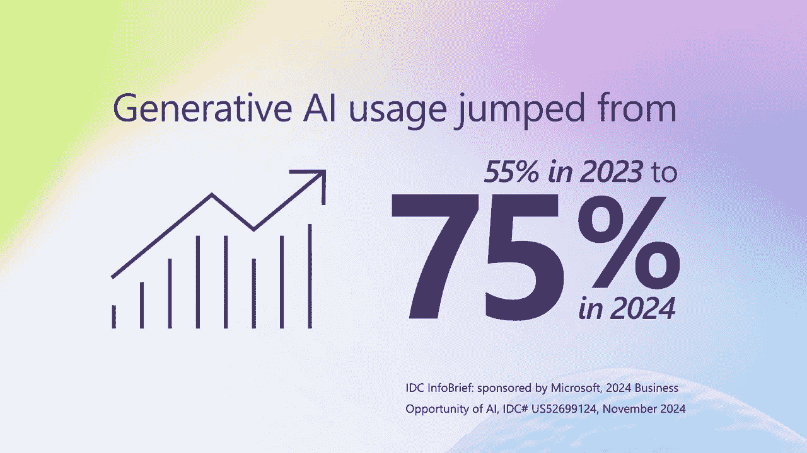

2024 年 12 月 9 日更新：Microsoft 在过去一年中帮助培训和认证的人数已更新为 2300 万，其中包括整个 Microsoft 的计划。

到 2024 年，生成式 AI 成为每个行业业务成果的关[**键驱动力。新一代 A**](https://protect.checkpoint.com/v2/___https:/aka.ms/AIcustomersBlog___.YzJ1OndlY29tbXVuaWNhdGlvbnM6YzpvOjI0ZmFhZWY0OGM5YjcwMTU4OWNlY2JmYmNjZTI4MGZjOjY6MjI2YzoyYzY5NTMwNmZmNTM4YmZiYTIzOGE2ZDdhMjU3N2JjYWNhYWMwMDgyZDUwYmIxMjI2YmM1YTUwZjVmNThkNzMwOnA6RjpG)I 已经对我们的世界产生了难以置信的影响，但随着公司和行业继续为每个角色和职能开发新的用例，它们的可能性才刚刚触及。

为了帮助指导组织完成 AI 转型之旅，Microsoft 最近[**通过 IDC**](https://protect.checkpoint.com/v2/___https:/info.microsoft.com/ww-landing-business-opportunity-of-ai.html___.YzJ1OndlY29tbXVuaWNhdGlvbnM6YzpvOjAxZWUwM2NlMzljZjdjMTA0YjIwYWViMmQ1MGYxYmU0OjY6YzEzMzo1Y2E2ZTI1ZTgyNzNiMjQ0ZDhjOTJhMmRjNjA1YzRhNWIwNGU4MjcwZmRjNDc0YjBmZjFkNDhmZDg4MDNjM2YwOnA6VDpG) 委托进行了一项新研究，即 AI 的商机。IDC 的调查结果显示，当组织真正致力于并投资 AI 时，投资回报率 （ROI） 潜力会显著增长。

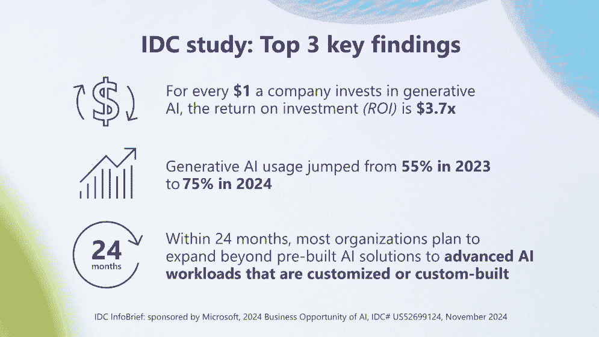

据 IDC 称，该研究的结果反映了随着 AI 在各行各业的发展势头而出现的一个[转折点。随着世](https://protect.checkpoint.com/v2/___https:/news.microsoft.com/source/asia/features/taiwan-hospital-deploys-ai-copilots-to-lighten-workloads-for-doctors-nurses-and-pharmacists___.YzJ1OndlY29tbXVuaWNhdGlvbnM6YzpvOjAxZWUwM2NlMzljZjdjMTA0YjIwYWViMmQ1MGYxYmU0OjY6OGVkMTo5YmJiOGY1MDE3Y2M4ZjIwYWIyNTU5OTgzN2M2ZDJiYzZlZDg4NDM4OGRhYjdhZjQ4MWMyMDVkZmFkZjIxYzljOnA6VDpG)界各地的公司深入使用 AI，Microsoft 客户继续部署创新的新解决方案，并发[现 Cop](https://protect.checkpoint.com/v2/___https:/news.microsoft.com/source/asia/features/coles-deepens-its-relationship-with-shoppers-using-ai-to-understand-the-customer-experience-and-improve-efficiency-in-store___.YzJ1OndlY29tbXVuaWNhdGlvbnM6YzpvOjAxZWUwM2NlMzljZjdjMTA0YjIwYWViMmQ1MGYxYmU0OjY6YjM3ODplZDFmODU5OTM4ODRhMTJiYTVjNmFmNDU5N2U0OTBjZGY0ZDExMWVmZTA5YjVmM2U2ZTI1YTNiOTM3YzBlY2Y1OnA6VDpG)ilot 等工具如何改变他们的日常工作。在电信领域，Lumen Technologies 估计 Copilot 平均每周为卖家节省 4 小时，相当于每年 5000 万美元。在医疗保健领域，奇美医疗中心的医生现在只需 15 分钟而不是一个小时撰写医疗报告，护士可以在 5 分钟内记录患者信息。药剂师现在能够将他们每天看病的病人数量增加一倍。在零售业，AI 模型帮助 Coles 非常准确地预测了 20000 个库存单位流向 850 家商店的情况，每天生成 16 亿次预测。

## IDC 2024 年 AI 的 5 大趋势

IDC 的调查结果与 Microsoft 在我们与各行各业的公司合作部署 AI 时所看到的情况一致。我们重点介绍了 200 多个热门 AI 客户案例，以展示 AI 如何在当今推动影响。以下是我们在 IDC 研究中看到的主要趋势，以及这些趋势对当今使用 AI 的组织的影响。

**#1 提高生产力已成为筹码。**员工生产力是公司试图通过 AI 实现的第一大业务成果。研究表明，92% 的受访 AI 用户正在使用 AI 来提高生产力，43% 的人表示生产力用例提供了最大的投资回报率。虽然生产力是首要目标，但紧随其后的生成式 AI 用例包括客户参与、营收增长、成本管理和产品或服务创新，近一半的受访公司预计 AI 将在未来 24 个月内对所有这些领域产生重大影响。

> **客户快照：**

> 在全球营销和广告公司 dentsu，员工每天使用 Copilot 可以节省 15 到 30 分钟的时间来完成总结聊天记录、生成演示文稿和构建执行摘要等任务。

> **“Copilot 改变了我们向客户提供创意概念的方式，实现了实时协作。敏捷**性、安全性和独特性至关重要，但我们的目标是在整个公司范围内从上到下引领这一转型。

> — Takuya Kodama，dentsu 业务战略经理

#2 公司正在被更先进的 AI 解决方案所吸引。 在接下来的 24 个月里，更多的公司希望构建直接针对行业需求和业务流程量身定制的定制 AI 解决方案，包括定制副驾驶和 AI 代理。这表明，随着公司意识到开箱即用用例的价值并扩展到更高级的场景，AI 流畅度越来越成熟。

> **客户快照：**

> 西门子开发了西门子工业 Copilot，它缓解了不同行业的数十家客户因复杂性增加和劳动力短缺而带来的挑战。

> **“在充分**认识到 GenAI 的转型潜力后，重要的是要记住，生产没有'撤消'按钮。将 AI 成熟为工业级质量需要勤奋和努力。西门子工程工业 Copilot 显著减轻了客户的工作量，并解决了工业自动化中技能短缺和日益复杂的紧迫挑战。这种 AI 驱动的解决方案改变了我们行业的游戏规则，已有 50 多家客户使用它来提高效率并解决劳动力短缺问题。

> — Boris Scharinger，Siemens Digital Industries AI 战略分析师

#3 生成式 AI 的采用和价值在各行各业都在增长。尽管生成式 AI 的采用率相对较新，但它的采用正在迅速扩大——75% 的受访者表示目前的使用率高于 2023 年的 55%。生成式AI的投资回报率在金融服务中最高，其次是媒体和电信，移动性，零售和消费包装商品，能源，制造，医疗保健和教育。总体而言，生成式 AI 在各行各业中产生了更高的投资回报率。

> **客户快照：**

> Providence 利用 AI 来扩展和增强患者护理，简化流程和工作流程，并提高护理人员的效率。

> **“无论我们是**与处于这项技术前沿的组织（如 Microsoft）合作，通过 Azure OpenAI 服务构建定制解决方案，推进临床研究以帮助癌症患者更快地接受个性化和精确的治疗，还是'按下简单按钮'并采用 Microsoft 365 Copilot 或 DAX Copilot 等成熟技术，我们都成功地保持在这场技术革命的最前沿。例如，使用 DAX Copilot 的医生每次就诊平均节省 5.33 分钟，80% 的医生报告说在使用 DAX Copilot 后认知负担减轻。

> — Sarah Vaezy，Providence 执行副总裁兼首席战略和数字官

#4 AI 领导者正在获得更大的回报并加速创新。虽然使用生成式 AI 的公司平均投资回报率为 3.7 美元，但使用生成式 AI 的顶级领导者正在实现更高的回报，平均投资回报率为 10.3 美元。除了提高商业价值外，领导者还加快了构建和实施新解决方案的步伐——29% 的领导者在不到 3 个月的时间内实施了 AI，而落后者的公司只有 6%。

> **客户快照：**

> Södra 是一家国际林业集团，将 52,000 名所有者的林产品加工成面向国际市场的可再生气候智能型产品。每天，Södra 都会收集和解释气候影响数据，以便为价值链的每个部分做出数千项决策。

> **“**借助 Microsoft 的创新 AI 技术，我们的业务专家和数据科学家能够帮助我们提高可持续性，同时显著提高收入。”

> — Cristian Brolin，Södra 首席数字官

#[**5 展望未来：技能培训仍然是一项首要**](https://protect.checkpoint.com/v2/___https:/www.microsoft.com/en-us/worklab/work-trend-index/ai-at-work-is-here-now-comes-the-hard-part___.YzJ1OndlY29tbXVuaWNhdGlvbnM6YzpvOjAxZWUwM2NlMzljZjdjMTA0YjIwYWViMmQ1MGYxYmU0OjY6OTVmMzpmYWVjMDJkZmE4ODNlNDYwNDZlN2UzY2ZlNDY3NDQ3YjJjNTIxODgwYTk1YTljNjQ4ZDE0YTgzNDE1MzRkMjlhOnA6VDpG)挑战。30% 的受访者表示内部缺乏专门的 AI 技能，26% 的受访者表示他们缺乏具备学习和使用 AI 所需技能的员工。这与 Microsoft 和 LinkedIn 2024 年工作趋势指数年度报告的调查结果相吻合，该报告发现 55% 的企业领导者担心是否有足够的技能人才来填补职位空缺。

这就是为什么在过去一年中，我们帮助 200 多个国家/地区的 2300 多万人培训和认证了数字技能。我们致力于与政府、教育机构、行业和民间社会合作，帮助数百万人学习使用 AI。

> **客户快照：**

> 南佛罗里达大学 （USF） 正在与 Microsoft 合作，利用 AI 简化流程并增强大学运营各个方面的创新。

> **“我们**让学生有机会利用 AI 作为未来劳动力的一部分来创造令人惊叹的事情。我们对生成式 AI 的关注不仅提高了运营效率，还使我们的社区能够解锁新的创造力和影响力，进一步将 USF 定位为 AI 采用的领导者，其中包括成为全国首批成立专门研究 AI、网络安全和计算的学院的大学之一。

> — 南佛罗里达大学首席信息官兼数字体验副总裁Sidney Fernandes

## **AI 日益增长的经济影响**

虽然今天的公司在很大程度上实施了开箱即用的生成式 AI 解决方案并看到了可观的投资回报率，但超过一半的受访者预计在未来 24 个月内构建自定义行业和业务线应用程序，这表明今天的 ROI 正在迅速成为明天的竞争优势。

IDC 人工智能和数据研究副总裁/总经理 Ritu Jyoti 表示：“我们正处于自主代理开发的转折点，并开始从仅使用支持知识发现和内容生成的现成助手和副驾驶演变为自定义 AI 代理，以在数字世界中执行复杂的多步骤工作流程。“通过负责任的技术使用和工作场所转型，IDC 预测，到 2030 年，采用 AI 的企业支出将产生 19.9 万亿美元的累计全球经济影响，并在 2030 年推动全球 GDP 的 3.5%。

[IDC 的《AI 的商业机会](https://protect.checkpoint.com/v2/___https:/info.microsoft.com/ww-landing-business-opportunity-of-ai.html___.YzJ1OndlY29tbXVuaWNhdGlvbnM6YzpvOjAxZWUwM2NlMzljZjdjMTA0YjIwYWViMmQ1MGYxYmU0OjY6YzEzMzo1Y2E2ZTI1ZTgyNzNiMjQ0ZDhjOTJhMmRjNjA1YzRhNWIwNGU4MjcwZmRjNDc0YjBmZjFkNDhmZDg4MDNjM2YwOnA6VDpG)》研究的主要发现包括：

+   生成式 AI 的使用率从 2023 年的 55% 跃升至 2024 年的 75%。

+   公司在生成式 AI 上每投资 1 美元，投资回报率为 3.7 倍。

+   使用生成式 AI 的顶级领导者正在实现 10.3 美元的投资回报率。

+   平均而言，AI 部署只需不到 8 个月，组织在 13 个月内即可实现价值。

+   在 24 个月内，大多数组织计划从预构建的 AI 解决方案扩展到自定义或定制的高级 AI 工作负载。

+   生成式AI的投资回报率在金融服务中最高，其次是媒体和电信，移动性，零售和消费包装商品，能源，制造，医疗保健和教育。

+   43% 的受访者表示，生产力用例提供了最大的投资回报率。

+   如今，组织通过 AI 获利的主要方式是通过生产力用例。在接下来的 24 个月里，将更加关注功能和行业用例。

+   实施 AI 的最大障碍是缺乏技术和日常 AI 技能。

## 了解如何为您的 AI 之旅提供动力

IDC 的研究包括全球 4,000 多名商业领袖和 AI 决策者，还确定了组织在实施 AI 时面临的主要障碍。随着企业集成新的解决方案，他们需要考虑重要的考虑因素，例如数据隐私、负责任的使用以及对技术和技能的投资需求。

无论你处于云和 AI 转型之旅的哪个阶段，Microsoft 都可以提供帮助。要[详细了解各行各业的客户如](https://protect.checkpoint.com/v2/___https:/www.microsoft.com/en-us/ai___.YzJ1OndlY29tbXVuaWNhdGlvbnM6YzpvOjAxZWUwM2NlMzljZjdjMTA0YjIwYWViMmQ1MGYxYmU0OjY6ZjM1NjozOTM5MGNkNGM4NzA1YTEzNDdkMTkzZWMzNzNiNjczODk4MjM1MTNkYTQwYThmZTNiNGNlN2FmZjJmY2E5NTE2OnA6VDpG)何利用 Microsoft 塑造其 AI 转型，请访问 Microsoft 的 AI in Action 页面。有关如何开始 AI 转型之旅的更多信息，请访问 Microsoft AI。

IDC 信息简报：由 Microsoft 赞助，2024 年 AI 商机，IDC# US52699124,2024 年 11 月

[IDC 的 2024 年 AI 机会研究：值得关注的五大 AI](https://blogs.microsoft.com/blog/2024/11/12/idcs-2024-ai-opportunity-study-top-five-ai-trends-to-watch/) 趋势 - Microsoft 官方博客

# 四、微软《AI 战略路线图》

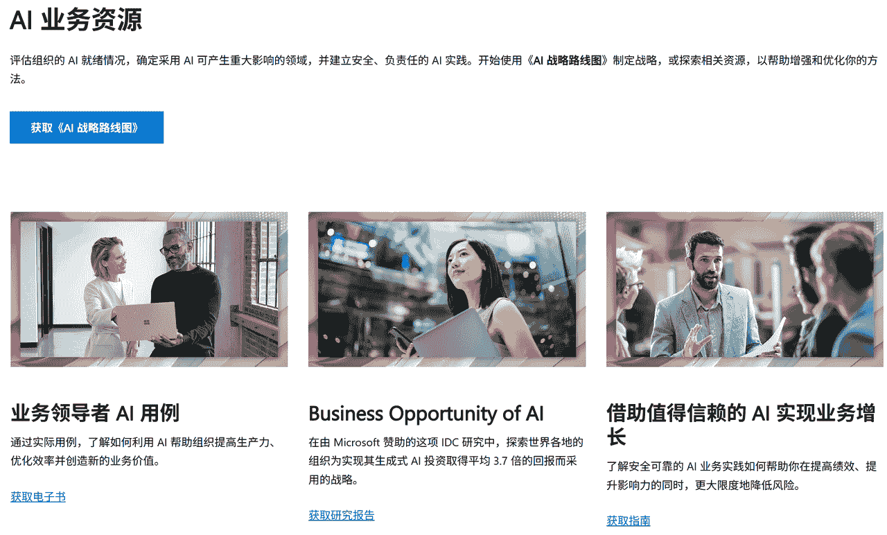

https://info.microsoft.com/ww-thankyou-ai-business-resources.html?LCID=ZH-CN

## 1.微软《AI 战略路线图》

[微软AI 战略路线图.pdf](https://internal-api-drive-stream.feishu.cn/space/api/box/stream/download/all/LIIfbQLk1oSy6axytQKcBIuJnZb)

## 2.借助值得信赖的 AI ，实现业务增长,企业领导者如何自信地规划 AI 转型

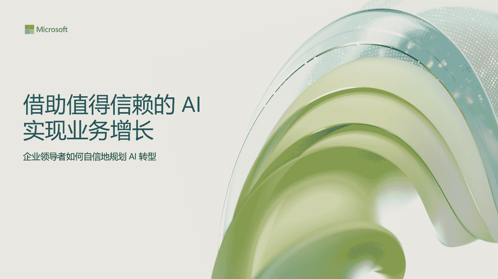

[企业领导者如何自信地规划 AI 转型.pdf](https://internal-api-drive-stream.feishu.cn/space/api/box/stream/download/all/CbpSb7s8so0mwWxlgPoctoIUnJb)

## 3.2024 Business Opportunity of AI

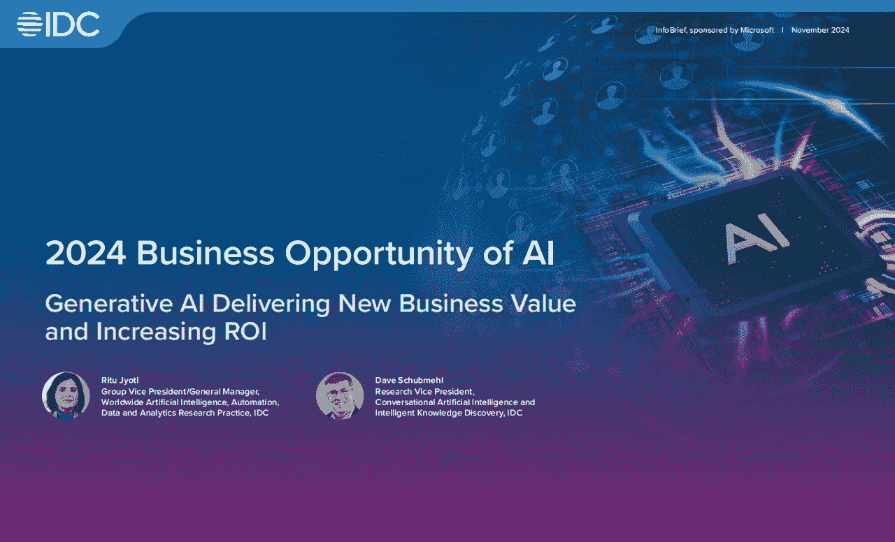

[2024 Business Opportunity of AI.pdf](https://internal-api-drive-stream.feishu.cn/space/api/box/stream/download/all/PvjEbXFY5olCYBxAsqWcSUbAnDe)

## 4.业务领导者 AI 用例： 借助 AI 实现价值

[业务领导者 AI 用例.pdf](https://internal-api-drive-stream.feishu.cn/space/api/box/stream/download/all/LxzHbCrd5opLAOxj2l7clKrNnCb)

## 5.AI 决策简报：Microsoft 和 AI 领导者关于应对生成式 AI 平台转变的洞见

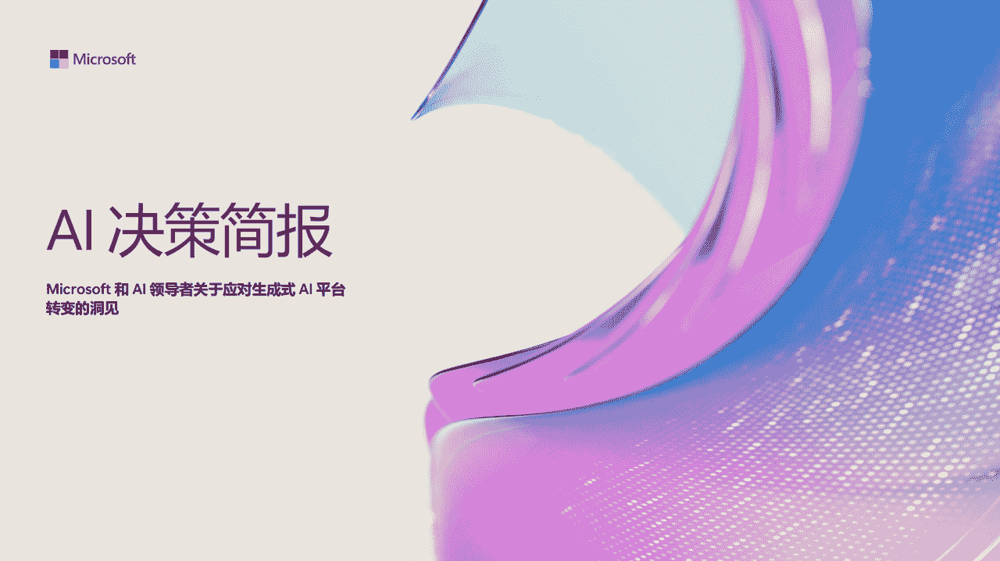

[AI 决策简报.pdf](https://internal-api-drive-stream.feishu.cn/space/api/box/stream/download/all/Uovnb3nnzoJfPexjjWtc8skvnae)

## 6.AI-powered success

AI-powered success—with more than 1,000 stories of customer transformation and innovation

## 7.Drive your business forward with proven AI use cases

通过经过验证的 AI 用例推动业务向前发展，探索现实世界中的用例，帮助你在 AI 时代加速实现业务目标。

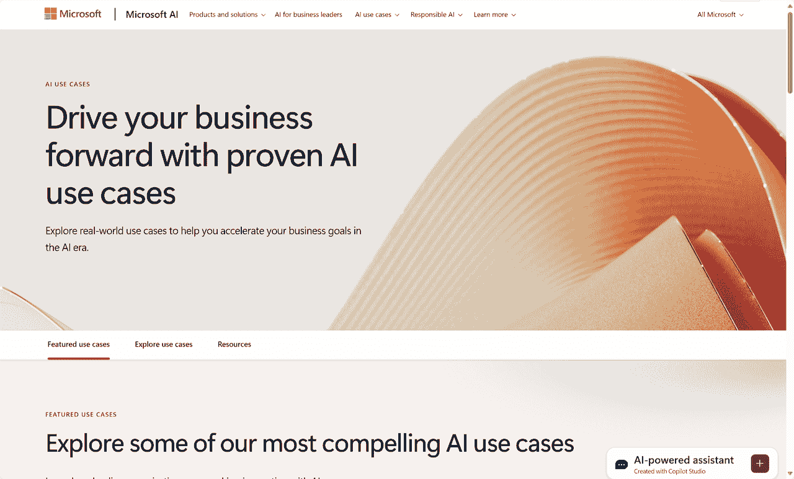

## 8.微软AI 解决方案业务指南

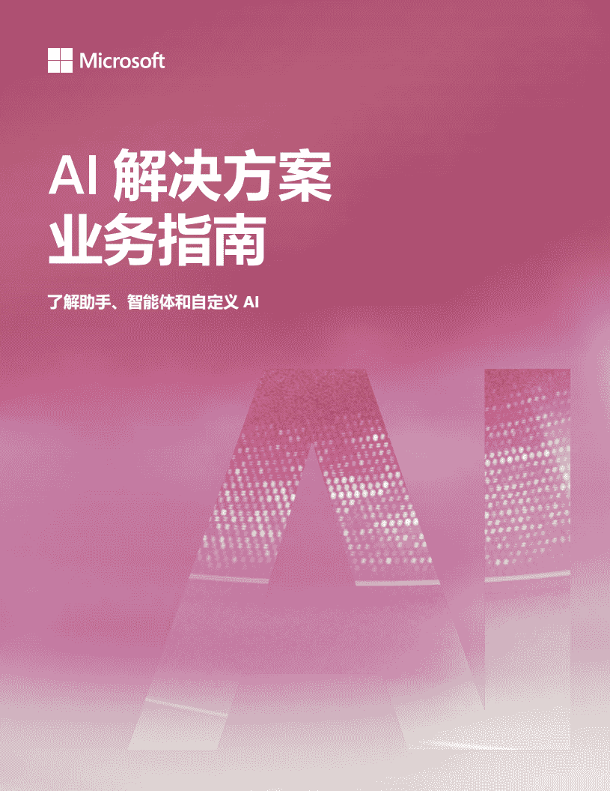

[微软AI 解决方案业务指南.pdf](https://internal-api-drive-stream.feishu.cn/space/api/box/stream/download/all/L0QJbinlyoMSV4xG6eZcN6zxn2H)

# 五、AWS 企业级AI应用案例中心

## 1.AWS 沙利文 2024年中国生成式AI行业最佳应用实践指南

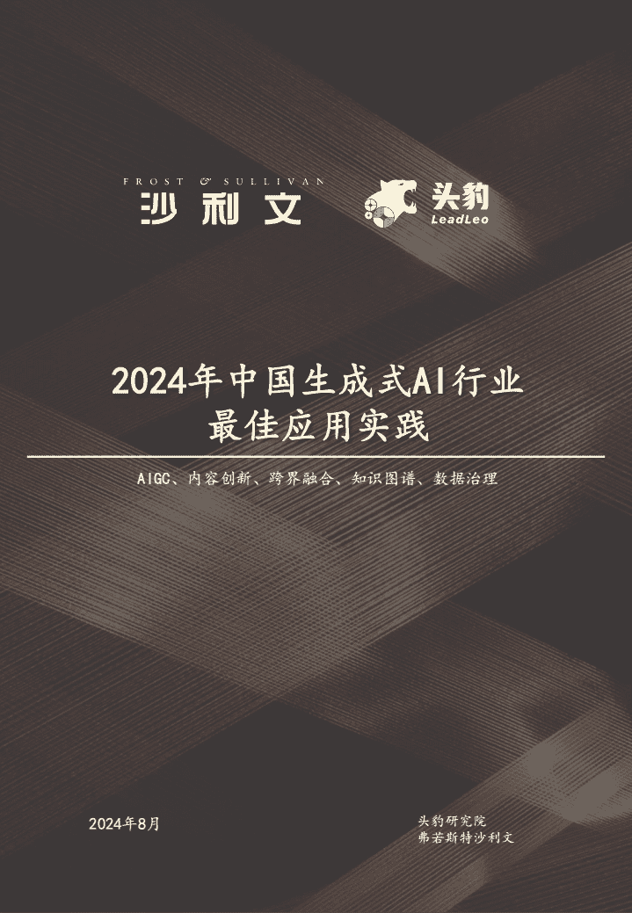

[AWS 沙利文 2024年中国生成式AI行业最佳应用实践指南.pdf](https://internal-api-drive-stream.feishu.cn/space/api/box/stream/download/all/Euyrb7kFgoRo8ox8QVScYweinnc)

## 2.AWS 技术白皮书

## 3.AWS ReInvent

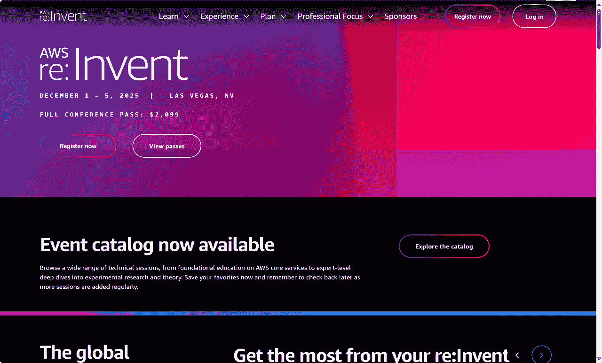

# 六、Gartner 报告

# **七、国内项目案例中心**

##