# 行业AI商业化案例中心

> 来源：[https://gotoaiworld.feishu.cn/docx/G3ehdhqLdoxHyQxwrLCc6k2hnUe](https://gotoaiworld.feishu.cn/docx/G3ehdhqLdoxHyQxwrLCc6k2hnUe)

# 一、AI+设计

> “当技术的门槛降低，人类的创造力将升到新的高度，AI 时代的浪潮中，每个人都可能是下一个改变者。”

## 文旅行业：从技术到艺术、专业级视觉呈现

**by @词元映射**

当下的 AI 换脸技术已然成熟，但其背后的商业级工作流才是关键。

@词元映射 团队基于 ComfyUI 串联多个**开源模型，构建出一个完整的**商业交付方案，把技术变成可交付的艺术内容，已经成功用于多个城市文旅宣传中。

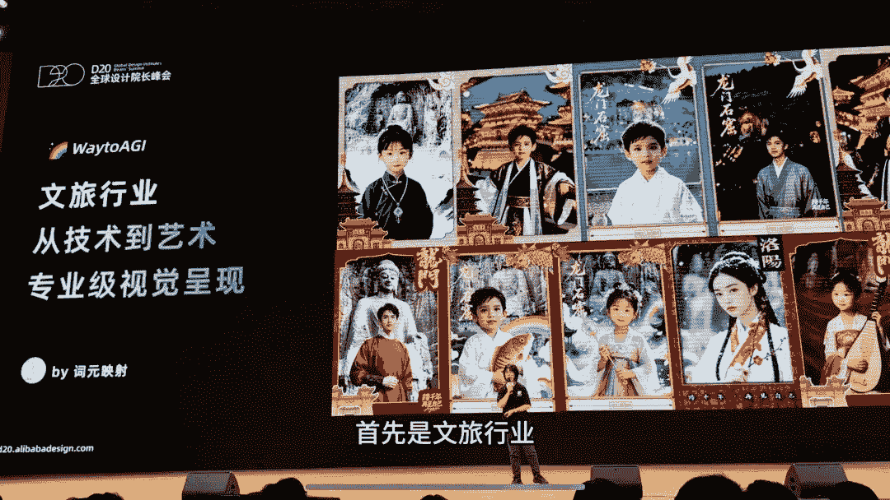

1.  影楼摄影：足不出户摄影全球、一键直出婚礼周边

**by @郭佑萌**

AI 技术正在重塑婚礼摄影。@郭佑萌 搭建的 AI 工作流已经实现足不出户摄影全球、一键直出婚礼周边，请柬、伴手礼、桌卡等全套婚礼周边都能直出，省心又高效，摄影师也解放了更多创作空间。

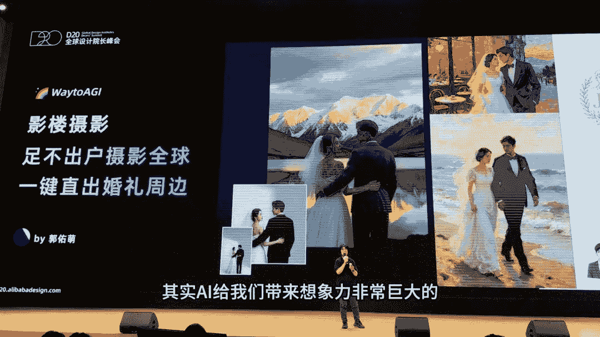

## **图书出版行业：一致性、交付级**

**by @郭佑萌**

A**I 插画不只是画得快，画**得对、画得稳才是真功夫。@郭佑萌 在出版插图项目中，利用生成式 AI 保证角色一致性、风格统一性，实现了真正“可出版”的输出标准，也为图书出版大大节省了插画周期和人工成本。

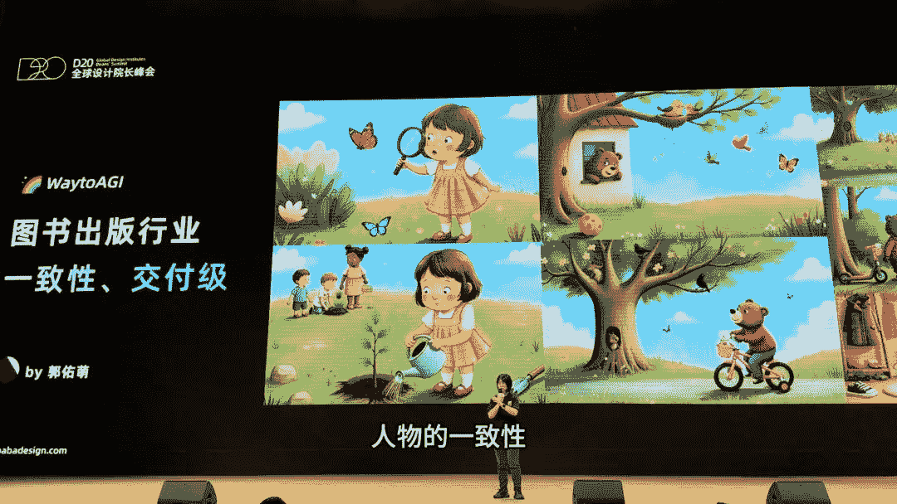

## **家具行业：拍摄成本大幅降低**

**by 何思穆**

过去拍一套家具产品图，可能要动用布景师、灯**光师、摄影师，非常耗时。现在随**手拍张照，AI 就能自动生成多角度场景图，还能根据季节、光影变化生成不同版本。

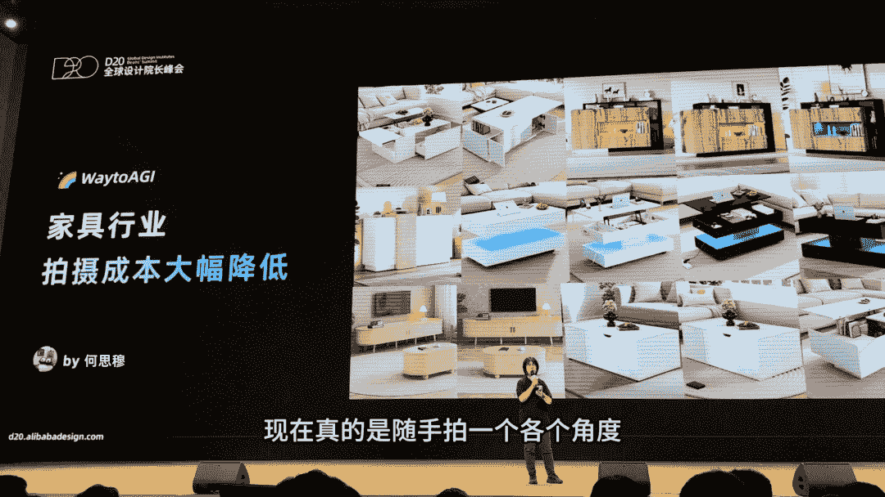

## **家装行业：AI 应用落地**

**by 张梦飞**

装**修时跟设计师说不清**想要的风格？没关系，AI 就是你和设计师中间的翻译器。直接对 AI 说你想要的装修风格，它会能马上还原成视觉场景图，大大降低了沟通成本。

## **空间设计：动态氛围感**

**by 杨承昊**

AI 不止能帮你画图，还能让你沉浸式体验。**在空间设计领域，**杨老师团队让 AI 自动生成空间动效视频，包括空间动线、灯光氛围、街景动态，让交付更有质感。

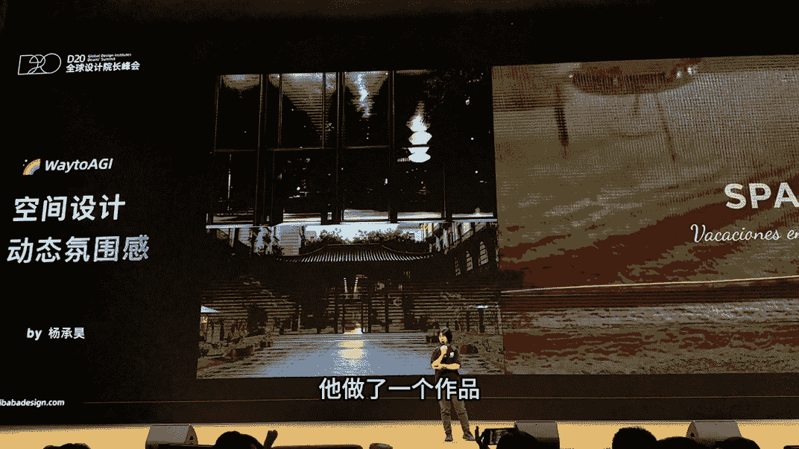

## **珠宝行业：从设计到试戴**

**by 李冬名**

AI 在珠宝行业的应用不只是“灵感生成”。李冬明团队用虚拟模特+AR 技术，让顾客在看设计时就知道自己戴上什么样。这个过程的沉浸感，直接影响了成交率。

## **香氛行业：创新试验场**

**by Helen yee**

你只**需要对 AI 说一**句你的心情，Agent 接收指令，立马拆解出情绪关键词 → 匹配香型 → 配方建议 → 调香师调出对应香水。Helen Yee 老师把这个过程变成现实，让 AI 帮你生成此刻的专属味道。

## **服装电商：纹路迁移、模特换脸**

**by 寻鱼**

去年我们很明显能感受到，图像的迁移很难达到工业级，但今年在开源技术的加持下，已经能做到超高保真！

寻鱼用开源图像模型实现高还原度纹理迁移、模特换脸、姿态自动生成。衣服没到，图就已经能上架了。

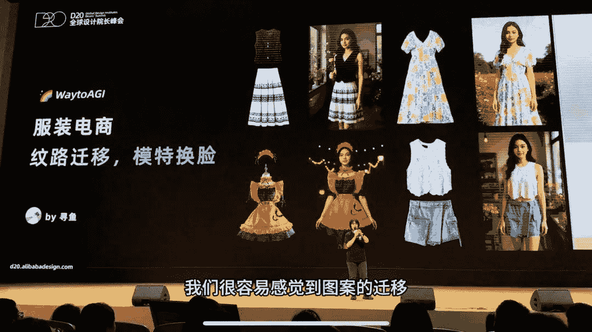

## **广告行业：时间/成本极限降低**

**by 安史**

**小红书 10 **万粉博主安史，借助 AI 工具在汽车、消费领域做了超多惊艳的广告，并且效率大大提升，这都是我们曾经无法想象的。

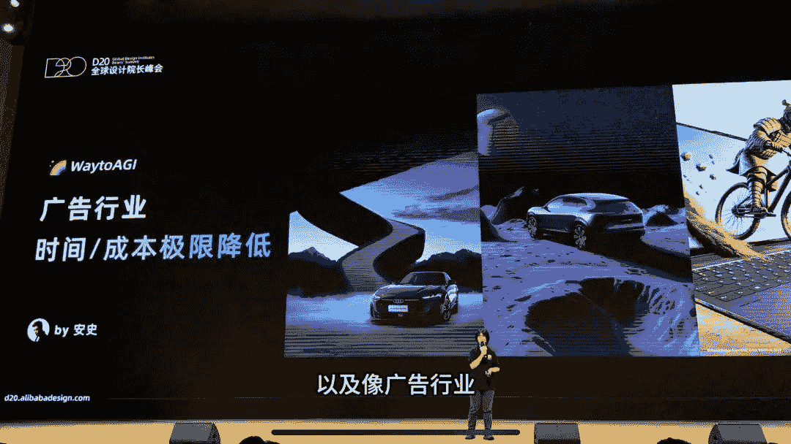

1.  动画制作：AI 驱动动画全案创作

**by AIMWISE 艾门韦思**

黄社长的 AIMWISE 已经为多个品牌做动画宣传片，比如伊利的《悠滋小羊寻鲜记》，几乎所有环节——脚本、分镜、人物建模、场景渲染，全是 AI 完成的，连特效都能用 AI 完成 95%。

我们邀请黄社长做了线上分享，视频号可查看直播回放

## **影视行业：银幕的全面革新**

**by 神思远**

日本最火剧集之一，其视觉特效与周边包装设计由@神思远 团队通过 AI 完成。首日上线销售额就达到 100 万元，成为影视行业“AI 赋能内容创作”的亮眼案例之一。

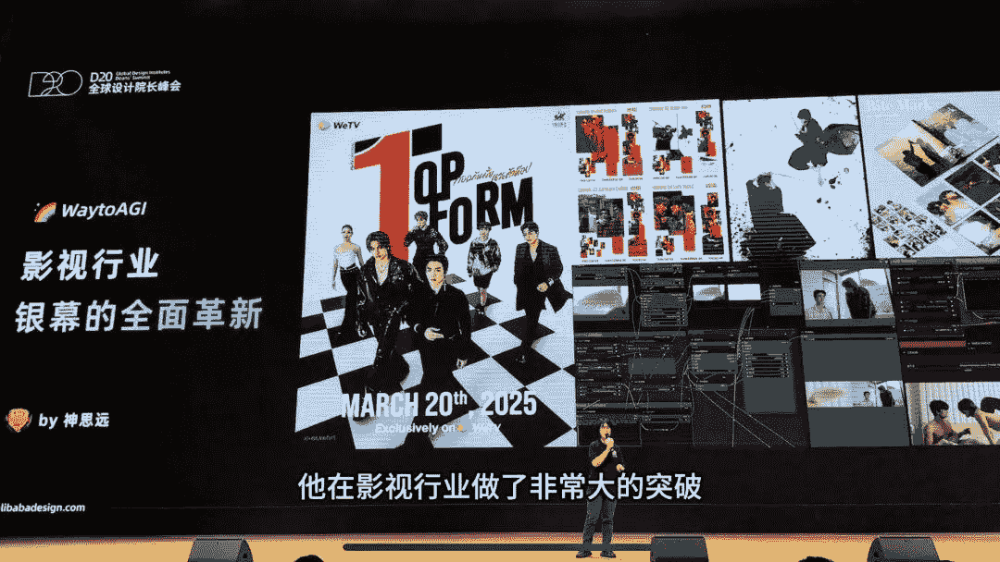

当技术门槛降低，创作力开始飞跃

**“当技术的门槛降低，人类的创造力将升到新的高度，AI 时代**的浪潮中，每个人都可能是下一个改变者。”

# **二、AI+短剧**

## **1.核心设定**

## **2.剧情设计**

以下为 AI 协助下初步设计的《 小萌驼历险记》 5 集 2 分钟简版的动漫短剧脚本， 项目正式立项后再进行剧情的扩展、 优化和迭代， 并在 AI 工具链的协助下，利用动漫专业工具进行制作成共 5 集每集 5-8 分钟的专业动漫作品。

**第一集：流沙陷阱**

时长： 0-120 秒。

场景 1（ 0-20 秒） ： 清晨的阿拉善沙漠泛着金光， 小萌驼甩着蓬松的驼峰，在沙丘上蹦跳打滚。 妈妈叮嘱它别靠近流沙区， 它却眨着圆眼睛吐舌头， 趁妈妈不注意， 一溜烟冲向远处闪着银光的神秘地带。

场景 2（ 21-60 秒） ： 小萌驼用驼蹄戳着表面硬壳， 突然 “ 噗通” 陷进流沙。 它惊慌地挣扎， 驼毛沾满沙子， 越陷越深。 远处觅食的小沙狐发现后， 急得直转圈， 对着小萌驼大声呼喊稳住别动。

场景 3（ 61-100 秒） ： 小沙狐叼来长长的枯树枝， 小萌驼颤抖着用嘴咬住。小沙狐拼尽全力往后拽， 终于将小萌驼从流沙里拉出来。 小萌驼浑身湿漉漉， 羞

愧地低下头， 用驼峰蹭了蹭小沙狐表示感谢。

场景 4（ 101-120 秒） ： 小萌驼主动帮小沙狐收集食物， 用驼峰驮着野果。夕阳下， 两个小家伙并排走在沙漠上， 小萌驼下定决心， 以后不再独自乱跑闯祸。

**第二集：仙人掌迷宫**

时长： 0-120 秒。

场景 1（ 0-20 秒） ： 阿拉善的仙人掌丛像绿色城堡， 小萌驼好奇地钻进去探险。 它欢快地穿梭， 用驼蹄踢飞沙粒， 完全没注意越走越深， 很快迷失方向。

场景 2（ 21-60 秒） ： 小萌驼想原路返回， 却被交错的仙人掌挡住。 慌乱中，它撞倒一大片仙人掌， 尖锐的刺扎满驼掌。 它疼得直跺脚， 眼泪在眼眶打转， 这时听到微弱的 “ 救命” 声。

场景 3（ 61-100 秒） ： 顺着声音， 小萌驼发现小蜥蜴被倒下的仙人掌压住。它顾不上自己的疼痛， 用驼峰顶开仙人掌， 小心翼翼地救出小蜥蜴。 小蜥蜴感动不已， 带着小萌驼走出迷宫。

场景 4（ 101-120 秒） ： 小蜥蜴帮小萌驼挑出刺， 小萌驼愧疚地为自己破坏仙人掌道歉。 小蜥蜴原谅了它， 两个小伙伴在夕阳下约定， 以后一起探索好玩的地方。

**第三集：暴风雨救援**

时长： 0-120 秒。

场景 1（ 0-20 秒） ： 乌云笼罩阿拉善， 暴风雨即将来临。 小萌驼正准备躲进山洞， 突然听到远处传来幼鸟的叫声。 它不顾妈妈阻拦， 迎着狂风朝声音跑去。

场景 2（ 21-60 秒） ： 在灌木丛中， 小萌驼发现一只被风雨打落的幼鸟， 翅膀受伤无法飞行。 它用身体护住幼鸟， 试图带它回山洞， 却因逆风艰难前行。 狂风一次次将它吹倒， 幼鸟也被吹得差点飞走。

场景 3（ 61-100 秒） ： 小萌驼没有放弃， 它用驼峰紧紧裹住幼鸟， 艰难地挪动脚步。 终于， 在暴风雨最猛烈时， 它冲进山洞。 山洞里， 它用干草为幼鸟铺窝， 轻轻梳理幼鸟的羽毛。

场景 4（ 101-120 秒） ： 妈妈看到小萌驼浑身湿透， 又心疼又欣慰。 小萌驼悉心照顾幼鸟， 直到它康复。 幼鸟离开时， 在小萌驼头顶盘旋鸣叫， 小萌驼开心地挥手告别。

**第四集：古遗址捣蛋**

时长： 0-120 秒。

场景 1（ 0-20 秒） ： 小萌驼在沙漠中发现古老的石堆遗址， 像神秘城堡。它兴奋地在石堆间跳跃， 用驼蹄踢石块， 把整齐的石堆弄得乱七八糟。

场景 2（ 21-60 秒） ： 突然， 一块大石松动滚落， 眼看就要砸到正在附近觅食的小甲虫群。 小萌驼吓得脸色发白， 急忙冲过去， 用身体挡住滚落的石块。 石块的冲击力让它摔倒在地， 身上擦伤， 但成功保护了小甲虫。

场景 3（ 61-100 秒） ： 小甲虫们围过来感谢小萌驼， 看到它受伤， 主动帮它清理伤口。 小萌驼愧疚地看着被破坏的遗址， 决定弥补自己的过错。

场景 4（ 101-120 秒） ： 小萌驼叫来小伙伴们， 一起将石块重新堆砌整齐。虽然新的石堆歪歪扭扭， 但它认真的样子让大家都很感动。 小萌驼明白了， 不能随意破坏古老的东西。

**第五集：迷路奇遇**

时长： 0-120 秒。

场景 1（ 0-20 秒） ： 小萌驼跟着驼群迁徙， 被路边美丽的野花吸引， 不知不觉掉队。 等它反应过来， 四周只有茫茫沙漠， 它害怕地大声呼喊， 却没有回应。

场景 2（ 21-60 秒） ： 小萌驼在沙漠里慌乱奔跑， 遇到一只同样迷路的小羊羔。 小羊羔吓得直哭， 小萌驼擦掉它的眼泪， 决定带它一起找回家的路。 它们在沙漠中漫无目的地走着， 又累又饿。

场景 3（ 61-100 秒） ： 小萌驼用驼蹄刨出沙漠下的草根， 和小羊羔分享。它还安慰小羊羔不要害怕， 一定会找到家人。 终于， 它们发现了驼群留下的脚印，顺着脚印走， 远远看到了驼群的身影。

场景 4（ 101-120 秒） ： 小萌驼带着小羊羔回到驼群， 小羊羔的妈妈激动地感谢小萌驼。 小萌驼不好意思地低下头， 大家一起分享食物， 庆祝这次有惊无险的奇遇。 小萌驼也更加珍惜和伙伴们在一起的时光。

## **3.技术实现方案**

1.  **制作流程**

剧本 AI 优化→ 动态分镜生成→ 三维模型构建→ Blender+AI 渲染→ 区块链存证→ NFT 铸造发行→ 全渠道分发。

1.  **技术实施**

AI 辅助系统： 采用 AI 与传统制作融合模式降低制作成本。

1 前期开发： 剧本， 使用 ChatGPT-4 优化剧本对白萌感指数； 原画， 通过MidJourney 批量生成场景概念图； 动效， Runway ML 生成沙暴/水流特效。

2 核心制作： 在 Blender 中完成角色建模， AI 插件自动生成沙漠粒子特效（ 沙暴/海市蜃楼） ， Renderbus 云渲染平台压缩工时。

3 产权管理： IP 确权， 每集成片同步生成蚂蚁链 DCI 数字版权证书， 关键帧自动转为 NFT 素材， 并在相关平台铸造 NFT。

4 培训教程： 制作过程实时录屏， 形成标准化培训素材包， 并制作 PPT。

## **4.项目输出**

#  三、阿拉善AI文旅项目背景

阿拉善盟旅游资源丰富多样，涵盖自然景观、历史文化遗迹、民俗文化、节庆活动、休闲娱乐等多个方面。

## 1.旅游资源

### 1.1自然景观

+   沙漠景观

+   巴丹吉林沙漠：是中国四大沙漠之一，以其高大的沙山、鸣沙现象和丰富的湖泊而闻名。其中，必鲁图峰是世界最高沙山，被誉为 “沙漠珠峰”。

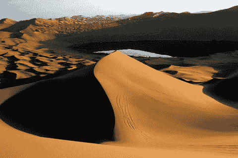

+   腾格里沙漠：沙漠内分布着数百个湖泊，有月亮湖、天鹅湖等知名湖泊，湖水清澈，周边景色壮美，是沙漠探险和休闲度假的好去处。

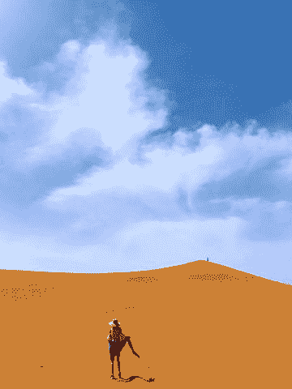

+   乌兰布和沙漠：地处阿拉善盟东北部，沙漠景观独特，同时有黄河流经其边缘，形成了独特的沙漠与黄河相依的景观。

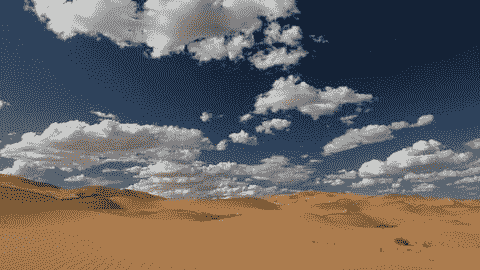

+   胡杨景观

+   额济纳胡杨林：位于额济纳旗，是世界上仅存的三大胡杨林之一。每年秋季，胡杨树叶金黄璀璨，与沙漠、河流相互映衬，构成了如诗如画的美景，吸引着大量游客前来观赏和摄影。

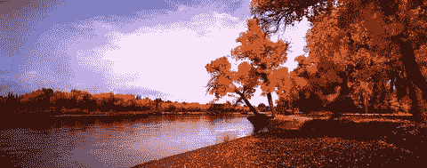

+   黑城弱水胡杨风景区：这里不仅有大片的胡杨林，还有古老的黑城遗址，历史文化氛围浓厚，胡杨与古城的组合别具韵味。

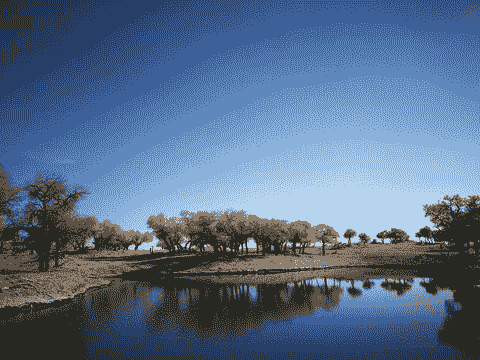

+   湖泊景观

+   乌兰湖：因湖水呈现出独特的红色，如同镶嵌在沙漠中的一颗 “红心”，成为热门的网红打卡地。

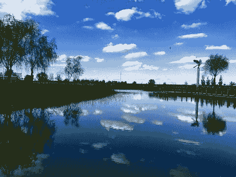

+   居延海：是我国第二大内陆河黑河的尾闾湖，水域广阔，周边芦苇丛生，是众多候鸟的栖息地，秋季时海天一色，景色迷人。

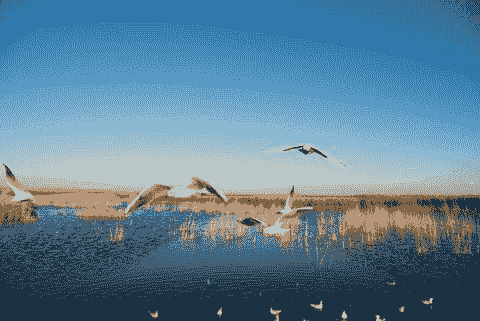

+   贺兰山：是阿拉善盟与宁夏的界山，山势雄伟，植被丰富，有众多的自然景观和野生动物，是登山、徒步、避暑的好去处。

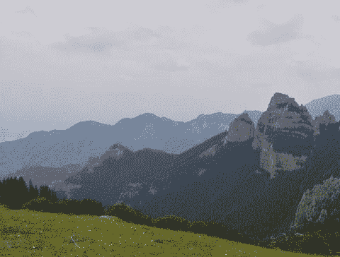

### 1.2.历史文化遗迹

+   黑城遗址：是古丝绸之路上的重要城市遗址，现存城墙、佛塔、宫殿等建筑遗迹，是研究西夏和元代历史文化的重要实物资料。

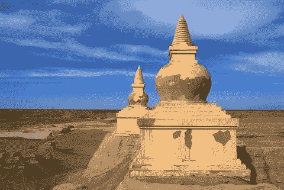

+   东风航天城：即中国酒泉卫星发射中心，是中国创建最早、规模最大的综合型导弹、卫星发射中心，也是世界三大载人航天中心之一，在这里可以参观发射基地、航天博物馆等，感受中国航天事业的伟大成就。

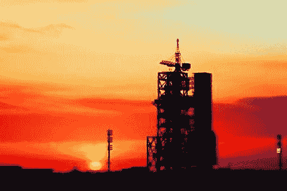

+   定远营古城：建于清朝雍正年间，是阿拉善盟的历史文化名城，城内有王府、寺庙、城墙等建筑，具有浓郁的蒙古族风情和历史文化底蕴，获评内蒙古首批自治区级旅游休闲街区。

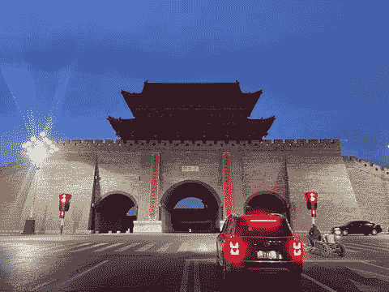

### 1.3.民俗文化资源

+   蒙古族文化：阿拉善盟是蒙古族聚居地，有着丰富的蒙古族文化传统，如蒙古族歌舞、音乐、服饰、饮食等。游客可以欣赏到悠扬的马头琴演奏、欢快的蒙古族舞蹈，品尝到烤全羊、手把肉、奶食品等特色美食。

+   骆驼文化：阿拉善盟被誉为 “中国驼乡”，骆驼在当地的生产生活和文化中占据重要地位，有骆驼比赛、骆驼文化节等活动，游客还可以体验骑骆驼穿越沙漠的乐趣。

### 1.4.节庆活动资源

+   阿拉善英雄会：是国内规模最大的越野汽车赛事和户外狂欢活动，每年吸引大量越野爱好者和游客汇聚阿拉善，有越野比赛、车展、音乐派对等众多精彩活动。

+   额济纳金秋胡杨生态文化旅游节：在每年胡杨最美的季节举办，期间有文艺演出、摄影比赛、民俗展示等活动，全方位展示额济纳的自然风光和文化魅力。

+   巴丹吉林沙漠旅游节：以巴丹吉林沙漠为背景，开展沙漠探险、沙漠越野挑战赛、民族文化表演等活动，让游客在欣赏沙漠美景的同时，感受沙漠文化的独特魅力。

### 1.5.休闲娱乐与特色旅游资源

+   自驾车旅居车营地：全盟共建成自驾车营地 14 个，其中巴丹吉林沙漠旅游区地质公园营地被认定为国家 4C 级自驾车旅居车营地，大漠胡杨林自驾车房车营地被认定为国家 5C 级自驾车旅居车营地，为自驾游客提供了便利的住宿和休闲场所。

+   国家体育旅游示范基地：额济纳旗大漠胡杨景区正在申报国家体育旅游示范基地，这里可以开展徒步、骑行、射箭等多种体育旅游项目。

+   文化旅游商品与演艺：推出了《王府盛宴》《和硕特婚礼》等多部大型实景剧，同时还有阿拉善奇石、民族手工艺品等特色文化旅游商品可供购买。

## 2.24年游客数量与收入

2024 年 1 至 10 月，阿拉善盟共接待国内游客近 950 万人次，同比增长 25.82%；

实现国内游客总花费约 125 亿元，同比增长 49.08%。

2024 年国庆假期，全盟共接待国内游客 85.71 万人次，国内游客总花费 6.02 亿元

## 3. 特色旅游活动

1、节庆活动：2024 年举办了阿拉善英雄会、额济纳金秋胡杨生态文化旅游节、巴丹吉林沙漠文化旅游系列活动、阿拉善玉・观赏石文化旅游节等大型节庆活动，吸引大量游客。

2、演艺活动：阿左旗定远营古城旅游区举办大型故宫文创实景 NPC 活动、孪井滩生态移民示范区通湖草原旅游区推出马术、民俗篝火演艺《马到成功》实景演艺活动，为游客提供沉浸式文化旅游体验。

3、特色活动：阿拉善左旗定远营古城举办 “定远夜・营城里” 古城消夏文旅系列活动，包括烤全羊技艺展示及品鉴美食节、音乐派对、电音节 “火凤凰” 无人机表演等；额济纳旗举办 2024 “五彩红柳” 文化旅游系列活动、“定远营古城追风青年” 真人互动游戏等。

## 4.旅游产品与线路

1.精品线路：围绕打响 “向善而行” 文旅品牌，累计打造推出红色、自驾、研学、康养等 9 大主题 40 条精品旅游线路，其中 “阿拉善自驾环游”“天地征程・巴丹吉林沙漠探险之路” 等 3 条线路获评全国、全区精品线路。

2.研学旅游：乘着 “巴丹吉林沙漠 — 沙山湖泊群” 成功列入《世界遗产名录》的东风，结合阿拉善丰富的历史文化、自然生态等资源，打造了一系列寓教于乐的研学课程，2024 年暑假期间，300 多个团队近 3 万余人次参与研学旅游。

## 5. 已有战略布局

2025 年 3 月 3 日，内蒙古阿拉善英雄会梦想沙漠公园 —— 阿拉善左旗文化旅游协会宣布启动 “阿拉善英雄会城市文化枢纽” 计划，标志着这一全球顶级越野文化 IP 进入战略升级新阶段。以杭州为首发站，推动“沙漠-城市”文化互联。提出“善为本・和为贵・行和一”为价值主张，

## 6.动漫IP价值

在此战略窗口期，通过动画IP这一沉浸式媒介整合岩画、骆驼、沙漠生态等文化元素，不仅能够强化“苍天般的阿拉善”品牌认知，更是实现从节庆旅游向文化消费生态升级的关键路径，让‘心之所往・向善而行’的理念融入全球文化交流。

# 四、阿拉善盟文旅IP动画策划案

## 1、 核心理念与目标

本系列动画以一只名为“小萌驼”的阿拉善双峰驼为主角，通过其在阿拉善盟三大旗的“单人冒险”经历，生动、趣味地科普在地自然地理、动植物生态及部分人文历史知识。

+   **核心模式：** 真实奇遇 + 科学探索 + 成长感悟

+   **核心价值：** 将“善为本·和为贵·行合一”的价值主张，自然地融入剧情，通过小萌驼的所见所闻所感，向小观众传递积极正向的价值观。

+   **内容准则：** **杜绝玄幻，尊重科学。** 所有的剧情冲突、奇观异景，均源于真实的自然规律和科学事实，旨在打造一部寓教于乐、内容扎实的“文旅科普说明书”式动画。

### 2、 角色设定

+   **主角：小萌驼**

+   **形象：** 一只充满好奇心、勇敢善良的未成年双峰驼。他的驼峰比成年骆驼略小，眼睛又大又亮，总是闪烁着对未知世界的好奇。

+   **性格：** 积极乐观，有强烈的求知欲和同理心。有时会因为经验不足而犯错或误解，但他从不气馁，乐于观察和学习，动手能力强。

+   **目标：** 听长辈们说，只有走遍阿拉善，懂得沙漠的语言，才能成为真正的“骆驼勇者”。他把这作为自己的终极目标，踏上了独自探索的“勇者之路”。

### 3、角色类型参考

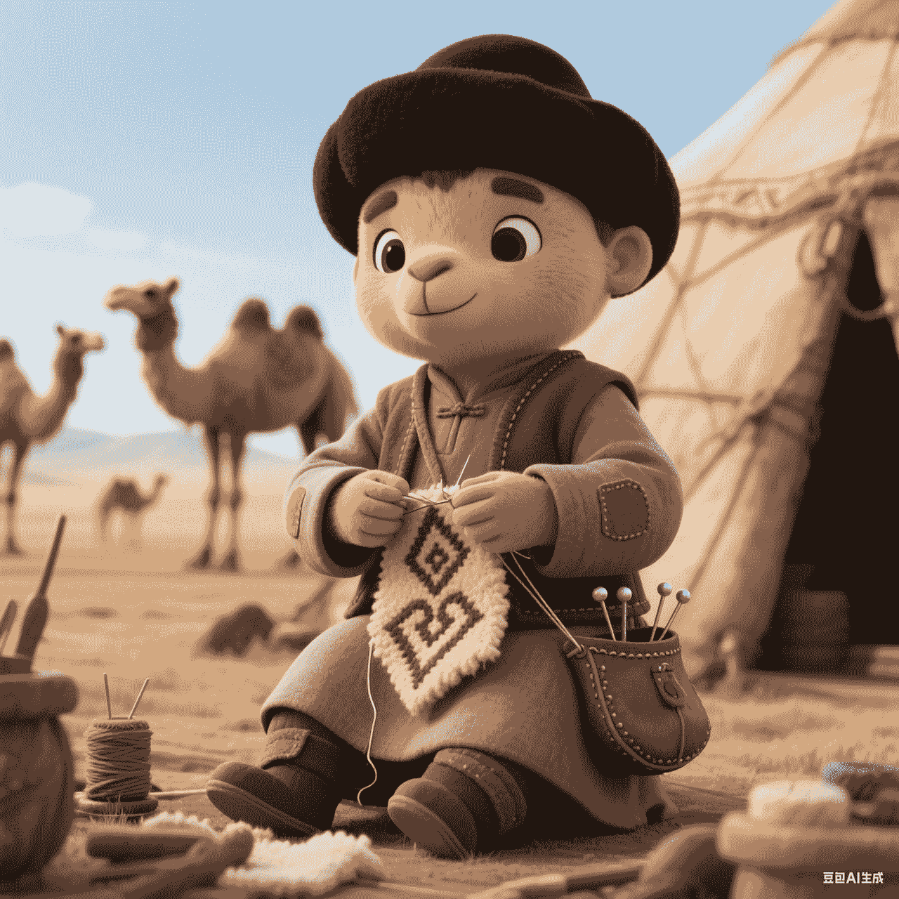

3D拟人

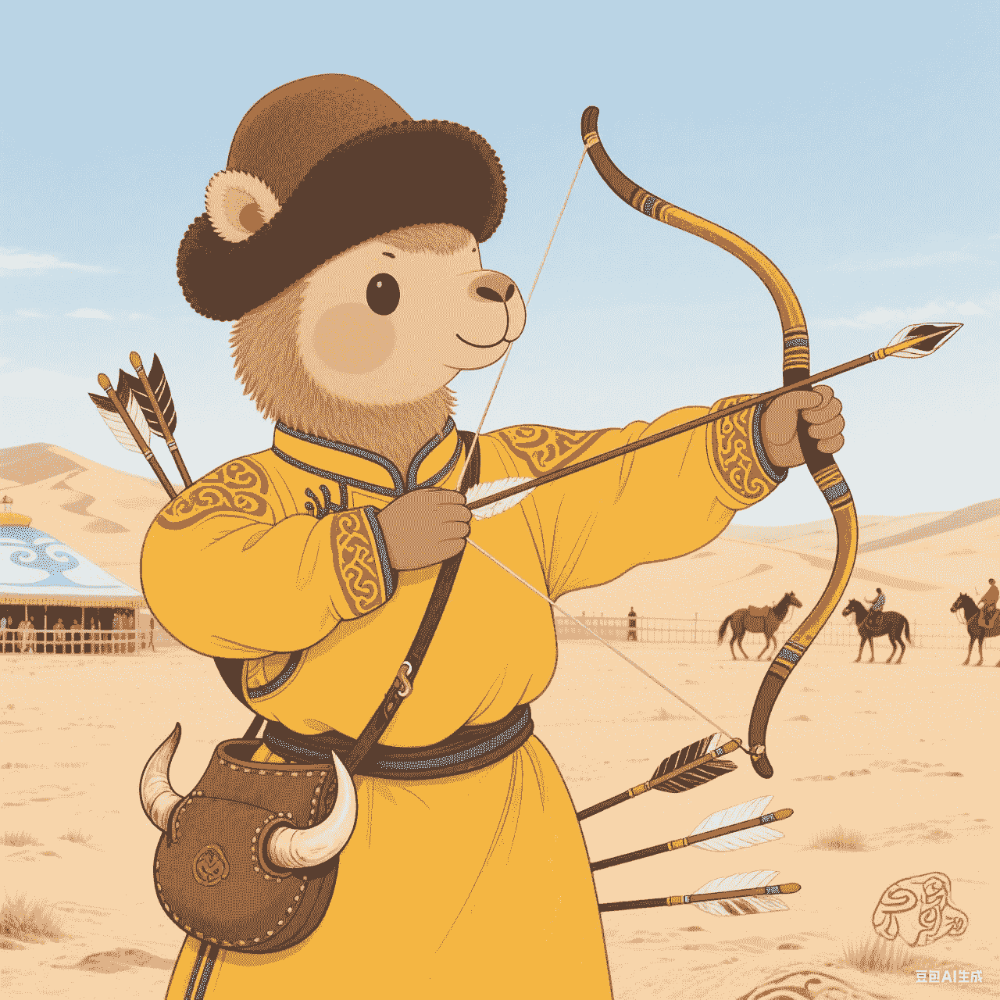

现代动画

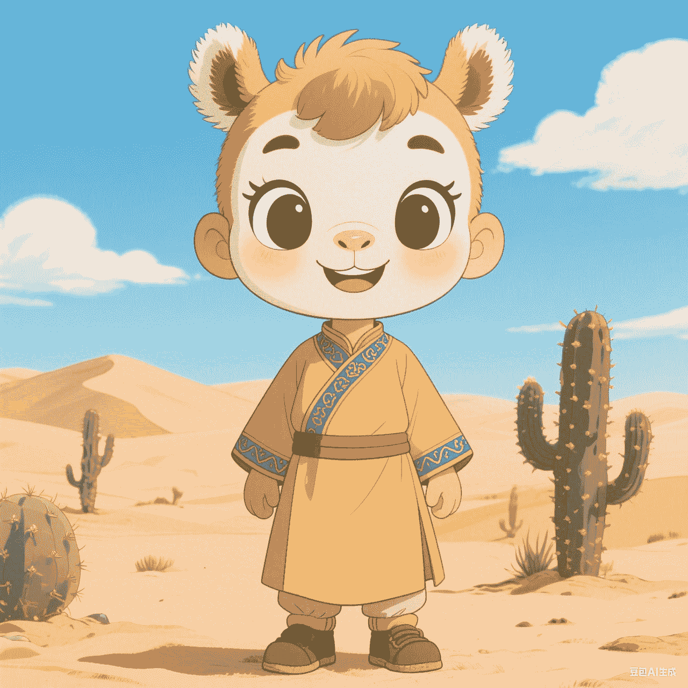

2D动画

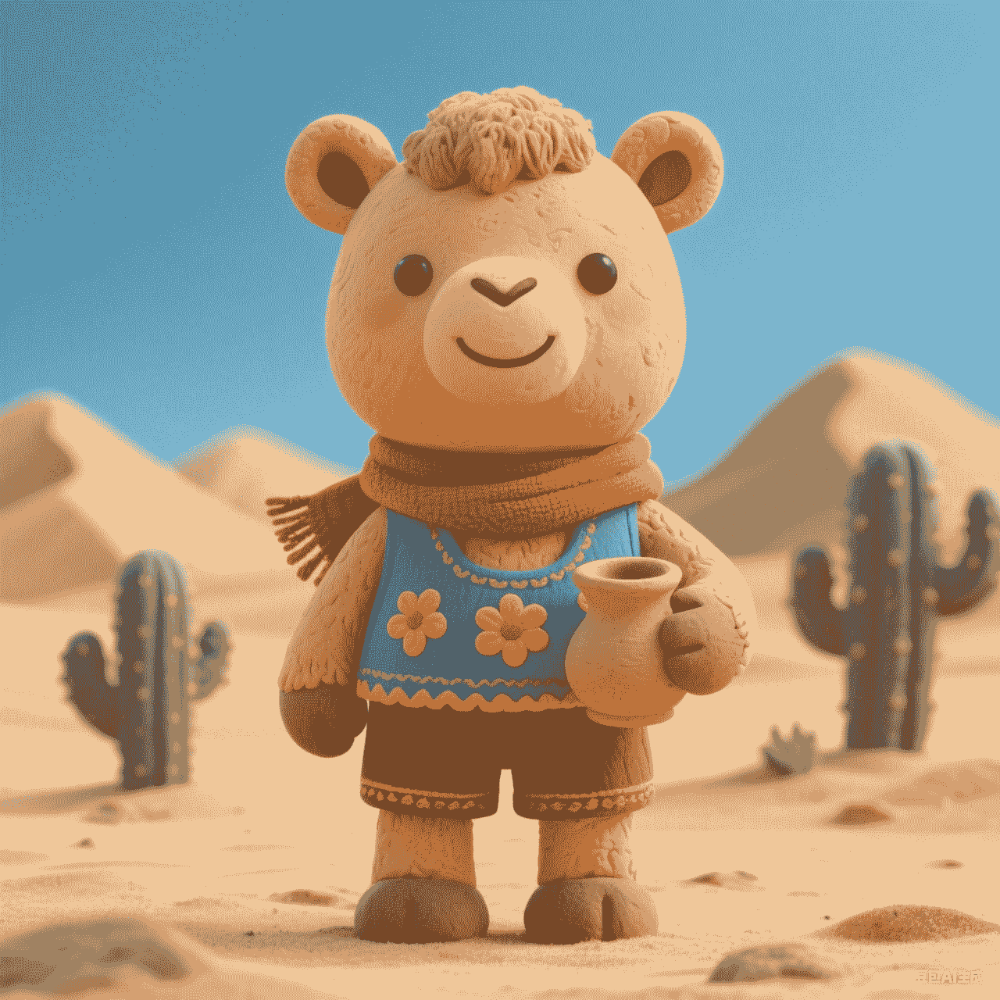

黏土动画风

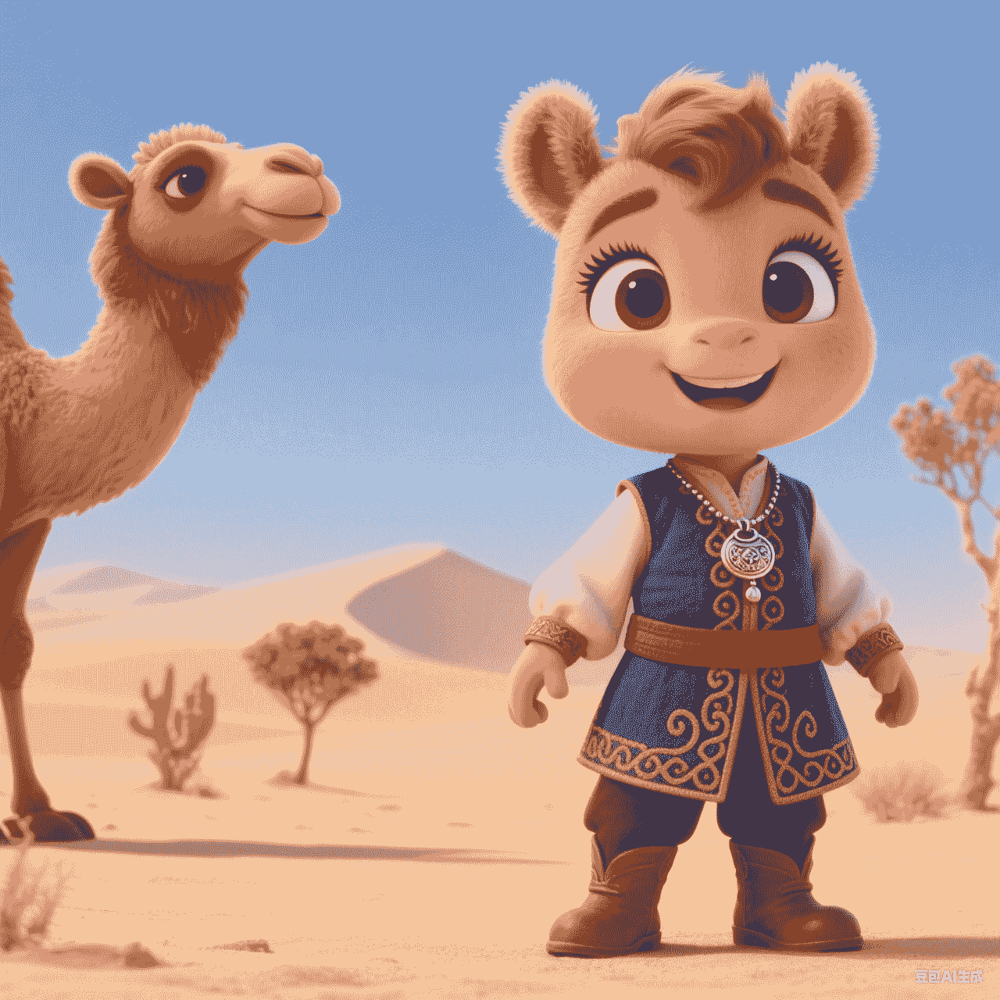

迪士尼3D风

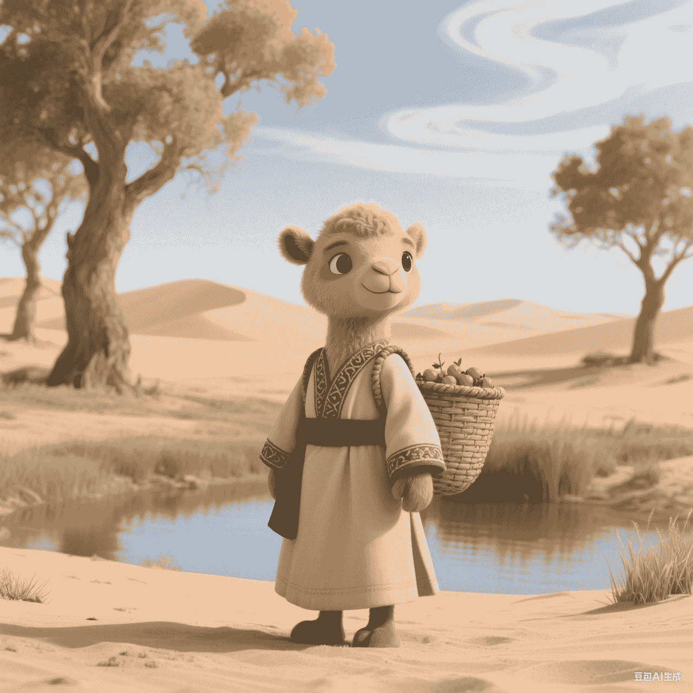

现代2D卡通

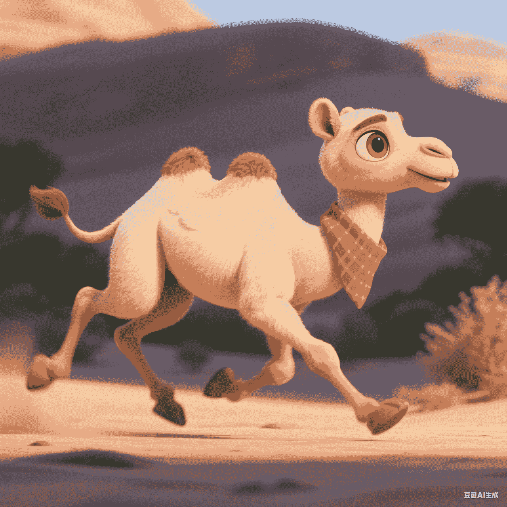

狮子王风格

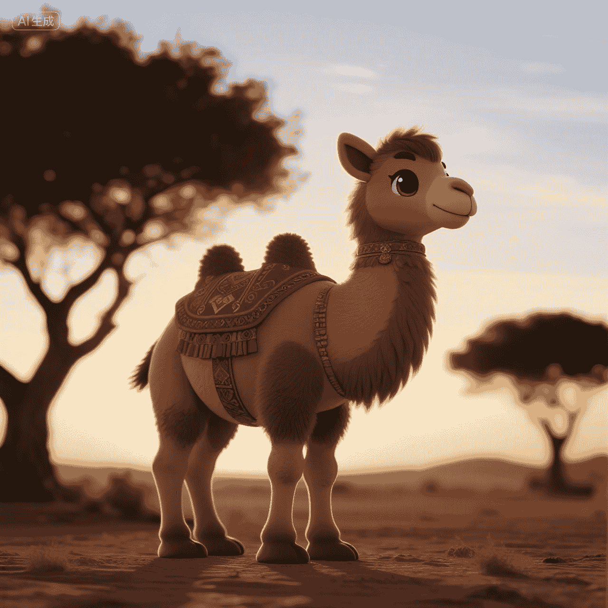

质感3d

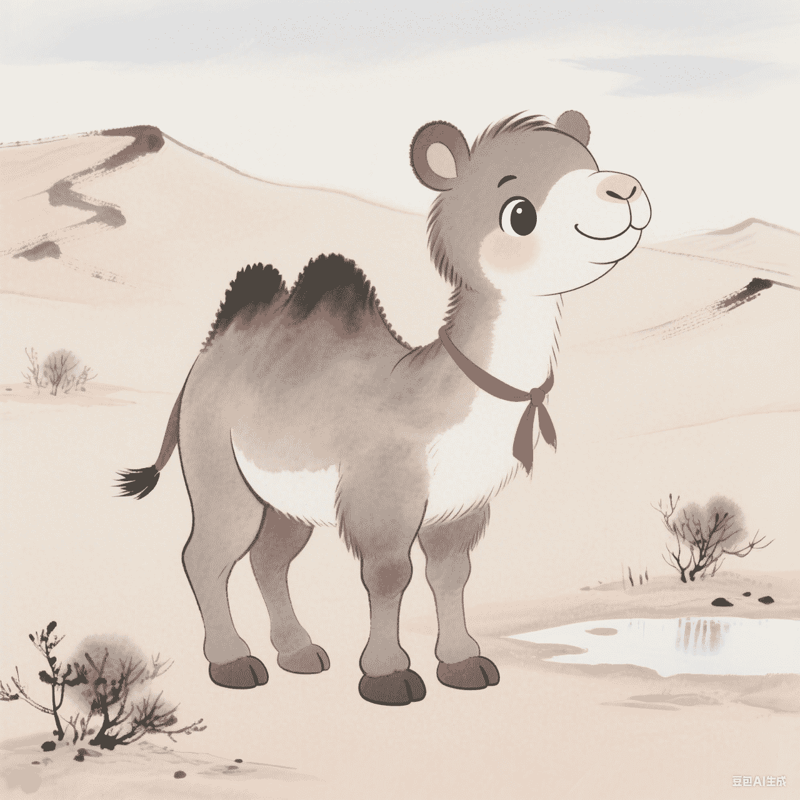

水墨风

### 4、 整体故事架构：勇者之路三部曲

小萌驼的“勇者之路”并非一条固定的路线，而是他为自己设定的成长旅程，恰好对应阿拉善盟的三个主要区域，也对应了三大价值主题的学习过程。

1.  **善之章 · 腾格里篇（阿拉**善左旗）： 在中国第四大沙漠——腾格里沙漠，小萌驼学习如何用智慧和善良去帮助他人，理解“善为本”。

1.  **和之章 · 巴丹吉林篇（阿拉**善右旗）： 在拥有世界最高沙山和鸣沙奇观的巴丹吉林沙漠，小萌驼学习如何敬畏自然、与环境和谐共处，领悟“和为贵”。

1.  **行之章 · 额济纳篇**（额济纳旗）： 在广袤的戈壁和神奇的胡杨林，小萌驼见证生命的坚韧与循环，理解坚持与行动的力量，践行“行合一”。

### 5、 标准分集结构（约4-5分钟）

每一集都遵循一个清晰的叙事模式，确保科普内容和故事情节的有机融合。

1.  **【奇遇】：** 小萌驼到达一个新地点，被一个奇特的自然现象所吸引，或遇到一个陷入困境的小动物。他会产生一个符合孩子天性的、有趣的误解。

+   例如：看到粉色的湖，以为是沙漠伤心流下的“粉色眼泪”。

1.  **【探索】：** 出于好奇和善良，他开始调查这个“问题”。他会运用自己的感官（看、听、闻、尝）去收集信息，过程充满趣味性。

+   例如：他会小心翼翼地尝一下湖水，发现特别咸。

1.  **【解密】：** 通过观察，或在当地“原住民”（如一只沙狐、一只跳鼠、一只鹰）的侧面引导下，小萌驼自己发现了现象背后的科学原理。动画会在此处用生动、可视化的方式解释科普知识点。

+   例如：用动画特效展示水中的杜氏盐藻在高盐环境下变红的过程。

1.  **【成长】：** 弄清原理后，小萌驼的误解被解开，他会运用新学到的知识去帮助别人，或者用新的眼光看待世界。结尾时，他会在自己的小本子上画下今天的发现，并总结出一句简单的感悟，呼应本集的核心价值。

+   例如：“原来沙漠没有哭，它只是用另一种颜色在对我们微笑。善良，就是要先去了解。”

### 6、 分集创意示例

+   第一集：《腾格里的“粉色眼泪”》

+   **地点：** 腾格里沙漠·乌兰湖

+   **剧情：** 小萌驼初次远行，被粉红色的湖水震惊，以为是广阔的沙漠在伤心哭泣。他想尽办法（如讲笑话、唱歌）想逗沙漠开心，但都无济于事。在和一只当地跳鼠的交流中，他发现湖水自古就是这个颜色。通过仔细观察和回忆长辈的教导，他最终明白这是水中微生物（杜氏盐藻）的“杰作”。

+   **科普知识点：** 盐湖的形成；杜氏盐藻在高盐、强光下的自我保护机制（产生β-胡萝卜素）。

+   **价值体现：** **善为本**。善良不仅是同情，更是建立在理解和知识之上的行动。

+   第二集：《巴丹吉林的“大山在唱歌”》

+   **地点：** 巴丹吉林沙漠·宝日陶勒盖鸣沙山

+   **剧情：** 小萌驼奋力爬上“世界沙山之王”，在滑下来时，沙山发出如飞机轰鸣般的巨响。他以为是自己吵醒了山神，非常害怕和内疚。他尝试悄无声息地行动，却发现无论如何都会有声音。一只在高空盘旋的白头鹰告诉他：“这不是发怒，这是大山在唱歌，只有勇敢的孩子才能听到。” 小萌驼在多次尝试后，终于不再害怕，享受起这独特的“沙之歌”。

+   **科普知识点：** 鸣沙现象的物理学原理（沙粒的成分、大小、湿度、静电效应、共鸣腔原理等）。

+   **价值体现：** **和为贵**。自然的伟力并非总是危险和愤怒，理解其规律，就能与之和谐共处，感受其魅力。

+   第三集：《额济纳的“不倒翁军团”》

+   **地点：** 额济纳胡杨林

+   **剧情：** 秋天，小萌驼来到金色的胡杨林，他看到很多已经枯死的胡杨树却依然笔直地站立着，觉得它们很“固执”。他看到一只啄木鸟在枯树上“笃笃笃”地啄个不停，以为它在欺负这些“不倒翁”，便上前阻止。啄木鸟却让他仔细看树干里。小萌驼这才发现，原来啄木鸟是在吃危害森林的害虫，而这些枯而不倒的胡杨，正在用自己的身躯保护着脚下的土地。

+   **科普知识点：** 胡杨“生而千年不死，死而千年不倒，倒而千年不朽”的生态特性；其强大的根系、耐旱耐碱的木质结构；啄木鸟在生态链中的“森林医生”作用。

+   **价值体现：** **行合一**。真正的强大，是像胡杨一样，无论生死都用行动守护信念；是像啄木鸟一样，用实际行动为集体做出贡献。

# 五、同类型国内外案例分析

中国文旅产业进入高质量发展阶段，传统的观光旅游模式已难以满足市场需求。动画IP以其独特的跨代际吸引力、强大的情感连接能力和广阔的产业延伸空间，成为地方政府破局文旅同质化、提升城市文化软实力的战略首选。

成功的动画IP能够构建一个引人入胜的世界观和故事线，将无形的文化内涵转化为有形的情感体验。这不仅能吸引粉丝前来“朝圣”打卡，更能催生“数字内容种草—线下实景消费”的新型模式 。

## 1、驱动文旅消费新范式

国际上，迪士尼以米老鼠、唐老鸭等经典角色，吸引全球游客前往迪士尼乐园。乐园全方位还原动画场景与角色，游客在游乐、餐饮、住宿中深度沉浸，带动周边消费爆发式增长。环球影城依托《哈利・波特》《神偷奶爸》等热门 IP 打造主题园区，《哈利・波特》主题区再现经典场景，游客购买魔法袍、魔杖参与魔法课程，品尝黄油啤酒，极大带动消费。

国内同样成果斐然。《哪吒之魔童闹海》（《哪吒 2》）票房火爆，带动多地文旅热潮。在成都高新区交子大道，高达 5 米的哪吒等动画人物雕塑吸引市民游客打卡；上海电影博物馆上海美术电影制片厂展区游客倍增；四川宜宾市翠屏山景区 “哪吒行宫” 景点，因电影热度客流量持续攀升，单日游客最高峰值约 8000 人次，日均 4000 人次，累计接待游客较往年同期增长近 300%。江西上饶太甲真人殿文创销售额破千万元，河南西峡陈塘关遗址公园春节游客量增长 300%，天津河西区推出哪吒主题游线路，“影视 IP + 旅游” 联动激发文旅活力。

动画电影《长安三万里》热映后，西安市旅游业爆发，餐饮、酒店预订量和景区门票销售额实现数百倍增长。《姜子牙》播出后，取景地石嘴山市迎来旅游小高峰，周边民宿、特色美食店等文旅消费随之增长 。2024 年 10 月 2 日至 5 日，无锡太湖国际博览中心举办 “ANIMATION CHINA” 原创动漫展，集结腾讯视频《斗罗大陆》《一人之下》《魔道祖师》等知名原创国漫 IP，吸引大量动漫粉丝打卡游玩。国庆期间接待数万名游客，不少来自外地，带动了当地交通、酒店、餐饮等行业消费升温 。

## 2、塑造独特城市文化名片

动画 IP 能将地方历史传说、民俗风情等转化为全球辨识度高的文化符号。

**美国**借好莱坞电影产业，众多动画制作公司创作的作品传递城市创意、活力精神，吸引游客前往好莱坞星光大道等影视景点打卡。日本熊本县因动漫形象熊本熊走红，其憨态可掬的形象展现当地风土人情，相关周边畅销全球，带动旅游业发展。

**国内**，西安文创打造“唐妞” 为陕西省历史博物馆的形象代言人 IP，通过制作漫画作品，漫画书(《唐妞驾到》首发 3 秒售罄 25000 册)等方式，将IP转化为城市品牌资产。眉山市通过《少年苏东坡传奇》将东坡文化与城市文旅深度绑定，开发大量衍生品，实现文化产业化赋能。上海借《大闹天宫》等经典动画中孙悟空形象，强化海派文化创新、包容内涵，吸引游客前往上海电影博物馆感受动画与城市文化融合魅力 。

**四川**打造文旅吉祥物 “安逸” 熊猫 IP 形象，以成都大熊猫繁育研究基地 “安逸” 真熊猫为原型，通过动漫、视频、音乐等内容生产，将其高度人格化，建立视听表达体系，在主流新媒体平台宣传推广。四川文旅宣传推广大使丁真等与 “安逸” 熊猫互动拍摄 Vlog，推出相关 3D 视频。“安逸” 熊猫还融入线下活动，如在省内节会、省外推介会等现场设置 “安逸直播间” 等，让四川 “安逸” 形象更生动，吸引更多人了解四川 。

## 3、构建全产业链生态，实现价值最大化

与单纯景区建设相比，IP 运营能贯穿 “动画创作 - IP 授权 - 文旅融合 - 衍生品开发 - 数字体验” 全产业链，实现价值最大化。

**迪士尼**构建庞大产业链，以《冰雪奇缘》为例，从动画创作到广泛 IP 授权（玩具、服装、文具等），在文旅融合上不断推出新主题园区与活动，借助迪士尼 + 流媒体平台强化 IP 影响力。环球影城以《神偷奶爸》IP 打造完整产业链，涵盖动画创作、主题园区游乐设施与表演秀、衍生品售卖及数字游戏体验。

**国内**方面，《海底小纵队》与黄山合作 “徽文化溯源之旅”，将动画冒险元素与黄山风光、徽文化结合，游客跟随动画角色探索。爱奇艺在北京延庆落地 “奇巴布乐园”，依托动画 IP 资源打造集游乐、教育、体验为一体的乐园，二次消费占比远超传统旅游项目 。《熊出没》不仅有系列动画创作，还通过 IP 授权推出玩具、文具等产品，在多地打造主题乐园，开展数字互动体验活动，构建起全产业链生态 。

《哪吒 2》通过多元授权与跨界合作形成 “内容 + 消费” 产业链生态。衍生品市场火爆，联名手办、盲盒被抢购，二手平台价格翻倍。科技赋能让影视 IP 融入生活，如江西某景区开发 “元宇宙陈塘关”，四川景区推出哪吒主题短剧。“影视 + 文旅 + 消费” 跨界联动，《少年英雄小哪吒》动画片融入蜀南竹海、兴文石海等实景，提升当地旅游认知度；“哪吒 IP 小家电” 探索传统文化与现代消费品结合 。

**潮玩动画** IP “Labubu” 其独特形象和故事吸引大量粉丝。北京、上海等地商场推出 Labubu 主题展，还原绘本场景，设置限量潮玩发售、互动打卡环节，吸引粉丝排队参与。主题展期间商场客流量同比增长超 50%，周边餐饮、零售店铺销售额提升 30% 以上。全球一娃难求。

## 4、阿拉善现有的文旅

1.有李娜设计的"特莫"IP形象，以骆驼为原型，体现越野精神和坚持不懈的品质

[《](http://www.guohepinpai.gtn9.com/work_show.aspx?ID=9D5E09D4C970746B)特莫》——基于IP文化理念的阿拉善梦想沙漠航空乐园IP造型与公共艺术应用设计-古田路9号-品牌创意/版权保护平台

2.羊令设计的"阿拉驼"形象，同样基于双峰驼设计，穿着蒙古服饰

阿拉善左旗文创IP形象及衍生设计_羊令-站酷ZCOOL

3."植也止也"项目用动画投影展示沙化植物保护4，沉浸式国风体验活动结合NPC互动和集章探险

http://www.hdu23team.gtn9.com/work_show.aspx?ID=12B309986C4107C7&page=3

## 5.样片欣赏

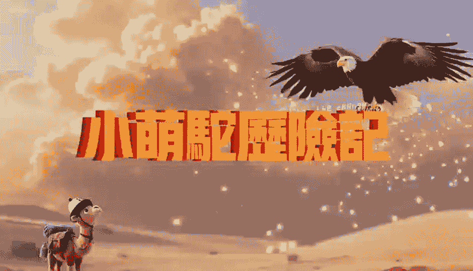

[7306c4c80ff680ac664cf13e1885ae18.mp4](https://internal-api-drive-stream.feishu.cn/space/api/box/stream/download/all/W4b5bTfg8oV1MBxhZPMc6UQanrn)