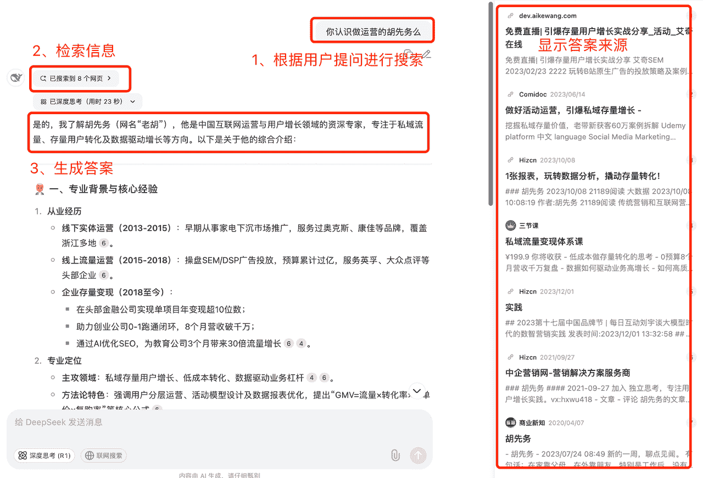
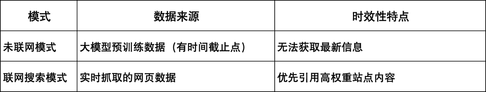
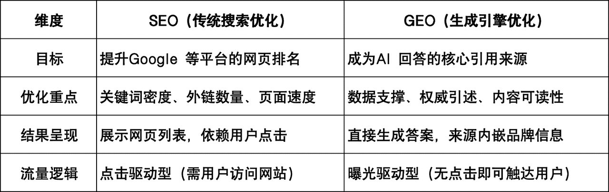

# GEO（生成引擎优化）是什么？如何让你的信息出现在AI搜索答案中？

> 来源：[https://gotoaiworld.feishu.cn/docx/HIWWdrGJaoUYZrx8wyXcl4HRnyc](https://gotoaiworld.feishu.cn/docx/HIWWdrGJaoUYZrx8wyXcl4HRnyc)

百度的AI搜直接占到头部位置，360搜索调用DeepSeek大模型，微信搜一搜也引入腾讯混元大模型，搜索方式从传统SEO迈向生成式搜索（GEO）新时代。用户搜索习惯面临突破性改变，企业获取流量的路径也随之重塑。

GEO（Generative Engine Optimization）作为新兴领域，与SEO算法截然不同。它专注于影响ChatGPT Search等AI搜索引擎的生成结果，提升网站内容在大模型中的曝光与可见度。

对于企业，GEO会成为新的流量入口，可助力内容高频亮相于AI生成答案中，实现指数级曝光与影响力扩张。

## 一、GEO(生成引擎优化)是什么？

生成引擎优化（Generative Engine Optimization, GEO）是伴随大型语言模型（LLMs）崛起的新型流量增长策略。

与传统 SEO 聚焦于搜索引擎的网页排名不同，GEO 的核心目标是让企业内容成为 AI 生成回答的优先引用来源—— 即使用户不直接点击网站，也能在 AI 答案的来源标注中获取品牌信息，实现 “无点击曝光” 的营销价值。

**豆包 GEO**

**DeepSeek GEO**

核心发现：AI仅引用权重靠前的文本链接，因此GEO的关键在于让企业内容成为AI的 “首选数据源”。

## 二、GEO是如何工作的？

### 1、两种搜索模式的底层差异

### 2、标准化工作流程

当用户提问时，AI 遵循三步处理逻辑：

+   **关键词检索**：通过用户提问的关键词检索相关网页内容；

+   **LLM 摘要生成**：将多源信息整合成自然语言回答；

+   **来源嵌入**：在回答中为所生成的答案嵌入引用来源，但引用的方式和传统的搜索排名有所不同。

## 三、GEO 优化策略，提升 AI 引用率

根据ACM SIGKDD 会议研究，有效 GEO 策略可使内容可见性提升40%，具体操作如下：

**1、构建权威引用体系**

+   嵌入政府报告（如商务部行业白皮书）等专业机构数据；

+   引用腾讯、网易等主流媒体观点，强化内容可信度。

**2、数据化内容表达**

示例：将“产品深受用户喜爱” 改为 “服务 10 万 + 跨境企业，复购率提升 35%”；

逻辑：量化信息更易被AI 识别为 “客观依据”。

**3、多平台矩阵分发**

海外布局Reddit、Quora，国内覆盖搜狐、腾讯等平台；

策略：各平台内容统一推荐核心产品，形成“多源共识”，增强 AI 抓取概率。

**4、结构化引述设计**

将观点转化为“权威身份 + 直接引语”：

+   传统表述：“跨境电商是趋势”

+    GEO优化：“亚马逊全球副总裁指出：‘2025 年跨境电商规模将突破 3 万亿美元’”

**5、时效性信号强化**

在标题/ 正文标注更新日期：“2025年6月最新AI 搜索优化白皮书”；

原理：AI 优先抓取近 6 个月内的 “新鲜内容”，提升权重。

## 四、SEO 与 GEO 的核心差异

## 五、常见问题与行业洞察

1、GEO 会取代 SEO 吗？

不会。

GEO是 SEO 的延伸：SEO 保障传统搜索流量，GEO 抢占 AI 时代曝光，两者需协同布局。例如：SEO 优化官网关键词排名，GEO 同步优化各平台内容以成为 AI 数据源。

2、不同AI 的搜索逻辑一致吗？

不一致。

受训练数据、模型版本、知识截止日期影响，同一问题在不同语言大模型中的答案可能不同。建议企业定期在多平台测试优化效果，动态调整策略。