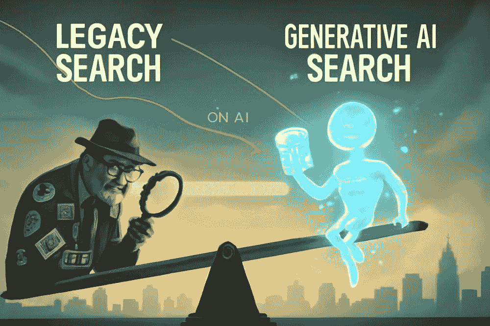
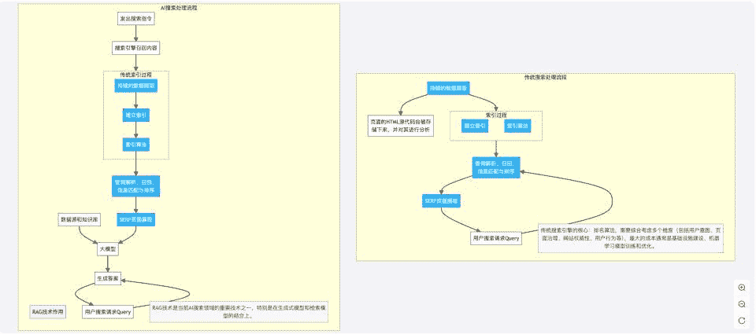

# 大模型背后的隐秘生意：企业们花重金布局的AI搜索，水有多深？

> 来源：[https://gotoaiworld.feishu.cn/docx/AtJpdZYyBo8gfVxwOJWccowtn4c](https://gotoaiworld.feishu.cn/docx/AtJpdZYyBo8gfVxwOJWccowtn4c)

"我们做了这么多品牌相关的内容，怎么才能在大模型的回答中被展示出来？"

近期，这个问题成为很多企业老板给营销部门定下的KPI，也就是“怎么做GEO”。

十多年前，老板们曾最关心的是“怎么做SEO”。这个微妙的变化，折射出一个现象：搜索引擎的“权力中心”正逐步从传统的网页索引向生成式AI模型迁移。

Similarweb显示， 2025 年 7 月 `chatgpt.com` 的月访问量约 57 亿、环比增加6%，全球网站排名升至第 5。OpenAI 于 8 月 7 日在官方博客披露“近 7 亿人每周使用 ChatGPT”； 日均处理超 25 亿条 prompts。

AI 搜索新秀 Perplexity的使用数据也在加速攀升，Perplexity CEO 6 月 5 日称其 5 月查询量 7.8 亿、月增速 20%+， 7月 24 日，Fortune进一步报道称，Perplexity已“接近 10 亿次/月查询”。

与此同时，传统搜索对网站的输送流量继续断崖式下滑：Authoritas 的研究指出，当 Google 结果页出现 AI Overview 时，新闻站的点击量最高可被稀释 79%；GrowthSRC 对20万关键词的监测也显示，Google首位自然结果的平均CTR（点击率）同比再降32%。

这些数据变化的背后，是用户习惯的转变：从"搜索-筛选-点击集合页面"的传统路径，变成了"提问-获得答案"的直接对话。

这意味着，企业的营销策略也从“如何让用户找到我们"转变为“如何让AI记住我们并主动推荐我们"。

生成式AI搜索正在颠覆品牌获取流量的旧秩序，但关键不只在技术适配，更在于彻底更新营销思维；执行看似简单，却暗藏高昂的试错成本。

为厘清机遇与陷阱，我们向GEO的企业负责人、AI搜索引擎技术提供方等业内人士，深入了解了这场变革中的机遇与风险，并试图通过这篇文章，进行系统化解读呈现。

GEO优化和SEO优化的逻辑是否一致？

企业砸钱买GEO服务，真的有效果吗？

模型公司和平台方会像曾经默许SEO产业一样，为GEO开绿灯吗？

市场上涌现的GEO服务机构报价无统一标准，收费是否合理？

## 一、GEO并不是下一个SEO

传统搜索引擎和AI搜索引擎在工作原理和用户体验上存在本质性差异，这种差异决定了SEO和GEO是两套完全不同的游戏规则。

前者有章可循，后者则变数无穷。

传统搜索引擎（Google、Bing 等）像一盘棋，棋盘、棋子和走法都写在《规则手册》里。它们依赖关键词匹配和 PageRank 等可公开研究的算法，把网页按相关度、权威性、外链与用户体验等因素加权排序，再交给用户自行点击浏览。

SEO 之所以能发展成数百亿美元的产业，正因这套规则虽复杂却足够透明：只要洞悉算法偏好、优化内容与链接结构，就能可预测地影响排名。

AI 搜索的世界则更像与一位才思跳跃的学者对谈，问题抛出后，系统直接生成答案或摘要，而非列出一串链接。

它的判断基于大模型的语义理解与 RAG 流程，决策路径深埋于参数空间，外界难以复盘——哪条证据被引用、哪条被忽略，很少循既定轨迹。这种“知识生成”范式让 GEO（Generative‑Engine Optimization）的可控性骤降，传统 SEO 中行之有效的关键词堆砌不仅失灵，甚至会降低内容被模型采信的概率。

图：AI搜索和传统搜索工作原理的不同

尽管 AI 搜索充满不确定，但并非毫无脉络：普林斯顿团队在第30届ACM SIGKDD（知识发现与数据挖掘国际会议）上发表了一项开创性研究，这个研究通过实验识别出九种可提升可见度的 GEO 策略，最高可带来 40% 的曝光增益；而 SEO 时代强调的 E‑E‑A‑T（经验、专业、权威、可信）原则在 GEO 里依旧适用，高质量、原创且真正解决用户问题的内容仍是模型最青睐的素材。

图：影响内容可见性的九种因素

但有一个重要的反转：传统SEO中屡试不爽的关键词堆砌（Keyword Stuffing）策略，在GEO中不仅无效，甚至可能适得其反。

研究数据显示，过度的关键词堆砌会显著降低内容被AI引用的概率，这进一步证明了GEO与SEO在底层逻辑上的根本性差异。

总结来看，SEO和GEO最根本性的不同在于实现“权威”和“可信”的路径。

从“链接为王”到“引用为王”：SEO的核心是反向链接（Backlinks）。一个网站被越多高权重网站链接，其权威性越高。但在GEO中，AI更看重“引用”（Citation）和“出处”（Provenance）。

从“关键词优化”到“语义实体优化”：SEO围绕关键词进行内容布局，而GEO则需要围绕“实体”（Entity）和“知识图谱”（Knowledge Graph）来组织信息。AI不是在识别关键词，而是在理解一个“概念”。

因此，在维基百科、百度百科等知识库中拥有清晰、准确、全面的词条相当于为AI提供一份关于你品牌的、机器可读的“简历”，比关键词堆砌更重要。

因此，最终的结论是，沿着SEO的经验，找不到GEO的新大陆。

## 二、企业花钱做GEO，效果能保证吗？

关键词堆砌等 SEO 套路不但失灵，过度使用还会被模型贬值。

这种不确定性催生了新需求：越来越多企业担心在 AI 搜索里“被消失”，纷纷寻找 GEO 服务来提升品牌可见度，市场随之涌现三类玩家——从传统 SEO 转型的老牌公司、把内容营销延伸至 GEO 的机构，以及一开始就专攻 AI 搜索的新创团队。

全球范围内领域会更加细分。在监测与分析工具领域，BrightEdge推出了Generative Parser，专门监测品牌在AI搜索结果中的表现，还能够追踪品牌在ChatGPT、Bard等平台中的提及频率和情感倾向。

Conductor开发了AI Content Optimization平台，专门帮助企业优化内容以提高在AI搜索中的可见性。

总部位于柏林的Flow Agency，2024年就宣布从“Flow SEO”改名为“Flow Agency”，主推 GEO 咨询。官方声明写得很直白：目标是“让品牌出现在 ChatGPT、Perplexity、Gemini 的答案里”。

那么，GEO 服务一般都有哪些做法？腾讯科技近期与两家国内GEO公司负责人进行了深入沟通，归纳出以下关键做法：

知识图谱构建：帮助企业梳理核心信息，建立品牌、产品、创始人等的实体关系，并提交到各类知识库平台。

权威内容合作：利用媒体或学术资源，帮助品牌内容出现在高权重网站或出版物上，以获得AI的“引用”。

结构化数据部署：在企业官网上部署AI可读的结构化数据，让AI能更精准地抓取和理解信息。

内容优化与生成：利用AI工具，围绕特定主题生成大量语义丰富的内容，以期在AI的知识库中占据一席之地。

多平台覆盖策略：同时优化DeepSeek、Kimi、豆包、千问、元宝等多个主流AI平台的收录效果。

同时，腾讯科技注意到，不少公司还特地提出一套自己的“GEO方法论”，并增加自研的工具，比如提示词策略工具、GEO内容创建智能体，来强调自身GEO方法的科学性和独特性，还有企业根据中国市场的特点，推出针对于📕、抖音等短视频或社交属性平台的“用户共鸣指数”。

但是，如果采用了以上方法，GEO真的能做到100%可控、可量化吗？

对此，为AI提供搜索引擎技术的博查AI公司的CTO翁柔莹对我们表示：

“首先，关于“是否可控”这一问题，目前的结论只能说是“部分可控”。业内已经有一些经过验证的方法论：通过在内容中嵌入可识别的引用标记、补充结构化数据等手段，可以在一定程度上提升品牌在大模型检索结果中的“出现率”和“引用率”。

对应的测评体系也已初步成型，例如监测引用比例、模型收录概率等指标。但归根结底，GEO 依赖的大模型依然是黑盒系统——我们只能在数据层面把现象量化，而无法真正“控制”模型的内部决策过程。

量化 GEO 成效的难点，很大程度上取决于模型与应用本身的内容偏好。以 DeepSeek 为例，它更青睐社区内容；而豆包则天然倾向于优先呈现自有生态内的素材。由于各模型的“内容口味”不同，统一的评估体系几乎不存在。实际操作中，需要针对每个模型制定专门的测评维度和优化策略，再根据模型反馈持续迭代。

这意味着 GEO 工作注定是多模型、多指标并行的精细化过程，而无法用单一方法论“一招通吃”。

## 三、GEO服务收费混乱

从翁柔莹的解答中可以看出，某些方式确实都有可能提高企业品牌被大模型引用的概率。

这也让GEO服务有了合理的存在价值，但是如何定价、如何评估效果，现在还没有统一的标准。

对比SEO来看，根据Backlinko的行业研究显示，2025 年全球SEO的平均月费落在1000–2500 美元区间；若采用小时计费，普遍在50–100美元/小时，顶尖机构比自由职业者大约高出30%。进一步拆分，美国、西欧的企业级SEO大多集中在3000–7500美元/月，复杂或高度竞争行业能飙升到2万美元以上。

GEO（Generative Engine Optimization）定价逻辑偏向“能力阶梯”，因此市面上几乎只见高阶月度包或一次性项目报价，很少按小时计费。

Creative Click Media 把GEO标成“几百到数千美元/月”，侧重内容打底与`Schema`标注（简单理解为给网页上的关键信息贴“标签”）；高级套餐再加AI语料投喂、监测等功能；

Perrill 明确写出“起步价6000美元/月”，在此基础上按行业竞争度与可监测指标阶梯加价；

业内咨询机构的公开报价普遍在 3000–20000美元/月（Flow、Omnius 等），并常与 KPI（如 ChatGPT Top-3 引用率、Perplexity citation rank）绑定阶段奖励或扣罚——这类“部分按效果”模式，也是 SEO 历史上少见的新尝试；

另一老牌 SEO 工具商 BrightEdge 则推出 “AI Catalyst”，声称能够实时监测 Google AI Overview、ChatGPT 引用占比，并按引用量、实体覆盖度计费；

而 WebFX则把GEO打包进原本的SEO价格体系，月费梯度从 3000 到 2 万美元不等，仍以页面数量和关键词数量核价。

腾讯科技和多家国内的GEO服务商沟通后发现，收费模式普遍以月度服务费或项目制为主，定价没有统一标准，需要按照不同企业的情况单独报价。还有一些新的计费模式，比如说按照语义范围定价模型来定价。

对此，GEO服务商对腾讯科技的解释是，每个核心提示词都可以延展出多个相似提示词，形成完整的语义覆盖，每个项目的语义覆盖难度不一样，所以定价也会不同。

除了定价模式缺乏统一标准，效果验证是目前最大的难题。服务商多以“成功案例”或“特定问题下的AI回答截图”作为证明，但这往往缺乏稳定性和可复制性。由于AI的“黑盒”特性，没人能保证在所有相关查询中都稳定地被引用。

为了提高对于优化效果的可信度，甚至有服务商提出，“快速验证机制：承诺5天内见效，否则退款”。

## 四、平台博弈GEO灰产

从用户视角来看，SEO 更像“雇一支外包运营团队”；GEO 则像“购买 AI-可见度黑盒里的一张入场券”，需要更高的前置投入去买能力、买方法论，也承担指标尚未标准化的风险。

另外，市场上也充斥着不少低价、低质的服务。这类服务通常的套路是，购买一个"AI优化套餐"，价格仅仅为几十元，拿到一个文件包，用户需要自己手动发布1000多篇文章，这1000多篇文章还有可能是服务商用AI批量低成本生产出来的，结果完全无法追溯和评估。

与此同时，灰产也在滋长。比如，在开发者社区里流传着一组“影子Prompt”脚本：把指令写进白字白底或 `HTML` 注释，诱导 LLM 在回答时优先引用目标网址。这种“隐形注入”技术已被学术界证明可以绕过人类审核。

AI搜索平台并未坐视 GEO 野蛮生长。Google 在 2024 年 3 月更新 Spam Policy，首次把“规模化AI生成内容、无增值页面”明确定义为垃圾内容，可直接手动处罚。

OpenAI 也在今年春季把“自动检测与人工复核”写进 Usage Policies，针对可疑`URL`建立黑名单并下调权重。Perplexity 的做法则是引入“Focus/Choose Sources”模式，让用户或系统可以限定可信源范围；对发生版权纠纷的网站，平台会在内部权限层面降级引用。

即使对于正常的GEO策略，大模型企业的态度也是“谨慎的开放”，博查AI CTO翁柔莹说：“大模型会谨慎鼓励企业在大模型企业的生态内发布一些内容，比如豆包可能会倾向于收录抖音或头条的内容。但是，GEO和大模型的底层逻辑是冲突的。大模型希望给用户提供准确的内容，而GEO本质是向商业化负责的。它们的底层逻辑不一致，所以大模型企业对GEO不会有完全开放的态度。”

但是千万不能轻信“低价铺量”的方法。翁柔莹特别提示说：“铺量的方法，可能会包含有重复关键词的堆砌，这很容易导致你的账号内容被收录的概率变低。另外，千万不要去伪造数据。如果被大模型验证出数据是假的，这个机构的一系列账号可能都会被大模型拉黑。”

平台的态度很明确，AI搜索的趋势也非常清晰：正在从“抓可读文本”迈向“抓可信事实”。可查证性、授权链路以及提示注入风险成了新的稽核指标。

换言之，想靠黑帽GEO弯道超车的可能性越来越低。

## 五、品牌方的GEO焦虑

在生成式 AI 全面渗透搜索和问答场景的当下，最让品牌方焦虑的其实并不是算法多难懂，而是“我说的话 AI 是否能听得懂”。化解这种焦虑的第一步，是把自有平台打造成机器可读的“单一事实来源”。

具体来说，官网应系统部署`Schema.org`标记（网页结构化标签）；内部白皮书、案例研究则要写成带数字的结论句，并注明权威出处。生成式模型最偏爱这种既有数据又有论证的段落形态——它们天然乐于引用可验证的事实，而非堆叠关键词的广告语。

有了“可读”资产，接下来是“可见”。企业最好围绕二三十个核心业务问题，按月在 ChatGPT、Perplexity、Gemini 等平台主动检索，记录品牌在答案中出现的次数与位置。业内把这种指标称为 Citation Rank 或 Position-Adjusted Word Count——它比传统蓝色链接排名更能反映 AI 语境里的曝光度。

如果缺乏技术栈，可以采购 BrightEdge、Flow Agency 之类SaaS工具，但务必在合同里写清“数据可复现”条款，避免被一张好看的截图糊弄。

正如前文提到，很多服务商会兜售“隐形注入”“72 小时收录”等捷径：把 `prompt` 写进隐藏文字里诱导模型引用。这些黑帽手段短期或许生效，却极易触发平台封禁，甚至带来版权和合规风险。与其试图驯服一个黑盒，不如把钱花在真正独特、可信、可验证的内容上，让 AI 主动把你当作引用样本。毕竟，在生成式搜索的世界里，最稀缺的是可靠事实与清晰叙事，而不是又一套能够被逆向的算法秘籍。

投入层面也需要冷静，腾讯科技征询了行业专家，以下几条避坑建议可以考虑：

先问数据口径：让服务商展示自家监测工具如何抓取 ChatGPT/Perplexity 的 citation rank，是否可 `API` 复现，避免截图“自嗨”。

SEO与GEO预算配比：SEO 与 GEO 并非完全互斥。可用 60 % 预算跑传统 SEO 保底流量，用40%押注GEO争取AI搜索红利。

签“效果附加”条款：要求 GEO 服务在指定周期内提升品牌引用数或覆盖模型数量，否则减免 10–20 % 费用；这样既保护投入，也能倒逼服务商固化指标体系。

警惕超低价：当前GEO合理门槛往往不低于3000美元/月。低于此价多半是模板化 `prompt` 注入或简单内容拼贴，极易被平台治理而前功尽弃。

整体来说，因为大模型的技术特点，GEO更应该被看作贯穿产品、研发、市场的长期工程，而非一次可外包的营销速成班——它关乎品牌如何在AI时代定义自己、表达自己，并最终成为未来语义网络里的一个关键坐标点。

## 参考资料：

《第一批用 DeepSeek 推荐的人，已上当》（The First Users Recommended by DeepSeek Have Been Fooled）真故研究室https://m.36kr.com/p/3255103733575685?utm_source=chatgpt.com

《生成式引擎优化 (GEO)：2025 年须知》（Generative Engine Optimization (GEO): What to Know in 2025） Ryan Young. 2024-12-12. Walker Sands Blog. Generative Engine Optimization (GEO): What to Know in 2025 | Walker Sands

《生成式引擎优化》（GEO: Generative Engine Optimization）

Pranjal Aggarwal, Vishvak Murahari, Tanmay Rajpurohit 等. 2024-08-24. GEO: Generative Engine Optimization - Princeton University

《ChatGPT 搜索激增：预测到 2025 年市场份额达 1%》（ChatGPT’s Search Surge: 1% Market Share Predicted by 2025）Search Engine Land 编辑部searchengineland.com

《Semrush .Trends 联合 Statista 报告：AI 搜索如何改变网络》（New Report From .Trends & Statista Reveals How AI Search Is Changing the Web）Natalia Zhukova. 2024-12-02. Fresh Research Reveals How AI Search is Changing the Web

《什么是生成式引擎优化 (GEO)，它如何影响 SEO？》（What Is Generative Engine Optimization (GEO) & How Does It Impact SEO?） Wil Reynolds, Cori Shirk, Jason Stinnett. 2024-08-28. Seer Interactive Insights. What is Generative Engine Optimization (GEO) & how does it impact SEO?

《2025 年 GEO 顶级趋势》（Top Generative Engine Optimization (GEO) Trends）Pragati Gupta. 2025-05-16. writesonic.com

《Perplexity AI 统计 2025：用户与收入数据》（Perplexity AI Statistics 2025: Users & Revenue Data）Naveen Kumar. 2025-05-20. DemandSage. demandsage.com

《隐形提示，显性威胁：大型语言模型外部资源中的恶意字体注入》（Invisible Prompts, Visible Threats: Malicious Font Injection in External Resources for Large Language Models）Junjie Xiong, Changjia Zhu, Shuhang Lin 等. 2025-05-22. arXiv（University of South Florida 等）. [2505.16957] Invisible Prompts, Visible Threats: Malicious Font Injection in External Resources for Large Language Models

《为何 2020 年代的 SEO KPI 无法适用于 2024 年的 GenAI 数据稀缺时代》（Why 2020s SEO KPIs Won’t Work in 2024 in a GenAI & Data-Scarce World）Seer Interactive 团队. 2024-10（约）. Seer Interactive Insights. Why 2020's SEO KPIs won't work in 2024 in a GenAI & Data Scarce world
