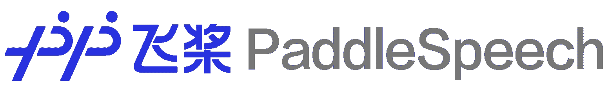

# PaddleSpeech

> 来源：[https://gotoaiworld.feishu.cn/docx/S0bWdc8MOoexLdxPQbzcXa5GnoJ](https://gotoaiworld.feishu.cn/docx/S0bWdc8MOoexLdxPQbzcXa5GnoJ)

https://github.com/PaddlePaddle/PaddleSpeech?tab=readme-ov-file

([简体中文](https://github.com/PaddlePaddle/PaddleSpeech/blob/develop/README_cn.md)|English)



## [Quick Start](https://github.com/PaddlePaddle/PaddleSpeech?tab=readme-ov-file#quick-start) | [Documents](https://github.com/PaddlePaddle/PaddleSpeech?tab=readme-ov-file#documents) | [Models List](https://github.com/PaddlePaddle/PaddleSpeech?tab=readme-ov-file#model-list) | [AIStudio](https://gitee.com/paddlepaddle/PaddleSpeech) Courses | NAACL2022 Best Demo Award Paper | Gitee

---

PaddleSpeech is an open-source [toolkit](https://github.com/PaddlePaddle/Paddle) on PaddlePaddle platform for a variety of critical tasks in speech and audio, with the state-of-art and influential models.

[PaddleSpeech](https://arxiv.org/abs/2205.12007) won the NAACL2022 Best Demo Award, please check out our paper on Arxiv.

## Features

Via the easy-to-use, efficient, flexible and scalable implementation, our vision is to empower both industrial application and academic research, including training, inference & testing modules, and deployment process. To be more specific, this toolkit features at:

+ 📦 Ease of Use: low [barrier](https://github.com/PaddlePaddle/PaddleSpeech?tab=readme-ov-file#quick-start) to [install](https://github.com/PaddlePaddle/PaddleSpeech?tab=readme-ov-file#quick-start-server), CLI, Server, and Streaming Server is available to quick-start your journey.
+ 🏆 Align to the State-of-the-Art: we provide high-speed and ultra-lightweight models, and also cutting-edge technology.
+ 🏆 Streaming ASR and TTS System: we provide production ready streaming asr and streaming tts system.
+ 💯 Rule-based Chinese frontend: our frontend contains Text Normalization and Grapheme-to-Phoneme (G2P, including Polyphone and Tone Sandhi). Moreover, we use self-defined linguistic rules to adapt Chinese context.
+ 📦 Varieties of Functions that Vitalize both Industrial and Academia:
+ 🛎️ Implementation of critical audio tasks: this toolkit contains audio functions like Automatic Speech Recognition, Text-to-Speech Synthesis, Speaker Verification, KeyWord Spotting, Audio Classification, and Speech Translation, etc.
+ 🔬 Integration of mainstream models and datasets: the toolkit implements modules that participate in the whole [pipeline](https://github.com/PaddlePaddle/PaddleSpeech?tab=readme-ov-file#model-list) of the speech tasks, and uses mainstream datasets like LibriSpeech, LJSpeech, AIShell, CSMSC, etc. See also model list for more details.
+ 🧩 Cascaded models application: as an extension of the typical traditional audio tasks, we combine the workflows of the aforementioned tasks with other fields like Natural language processing (NLP) and Computer Vision (CV).

### Speech Recognition

### Speech Translation (English to Chinese)

### Text-to-Speech

For more synthesized audios, please refer to PaddleSpeech Text-to-Speech samples.

### Punctuation Restoration

## Recent Update

+ 🎉 2025.09.01: Add Whisper large v3 and turbo model.
+ [🤗 2025.08.11](https://github.com/PaddlePaddle/PaddleSpeech/blob/develop/examples/tal_cs/asr1): Add code-switch online model and server demo.
+ [👑 2023.05.31](https://github.com/PaddlePaddle/PaddleSpeech/blob/develop/examples/librispeech/asr5): Add WavLM ASR-en, WavLM fine-tuning for ASR on LibriSpeech.
+ [🎉 2023.05.18](https://github.com/PaddlePaddle/PaddleSpeech/tree/develop/examples/aishell/asr1): Add Squeezeformer, Squeezeformer training for ASR on Aishell.
+ [👑 2023.05.04](https://github.com/PaddlePaddle/PaddleSpeech/blob/develop/examples/librispeech/asr4): Add HuBERT ASR-en, HuBERT fine-tuning for ASR on LibriSpeech.
+ [⚡ 2023.04.28](https://github.com/PaddlePaddle/PaddleSpeech/pull/3214): Fix 0-d tensor, with the upgrade of `paddlepaddle==2.5`, the problem of modifying 0-d tensor has been solved.
+ 👑 2023.04.25: Add AMP for U2 conformer.
+ [🔥 2023.04.06](https://github.com/PaddlePaddle/PaddleSpeech/blob/develop/demos/streaming_asr_server): Add subtitle file (`.srt` format) generation example.
+ 🔥 [2023.03.14](https://github.com/PaddlePaddle/PaddleSpeech/blob/develop/examples/opencpop/svs1): [Add](https://github.com/PaddlePaddle/PaddleSpeech/blob/develop/examples/opencpop/voc1) SVS (Singing [Voice Synthesis](https://github.com/PaddlePaddle/PaddleSpeech/blob/develop/examples/opencpop/voc5)) examples with Opencpop dataset, including DiffSinger、PWGAN and HiFiGAN, the effect is continuously optimized.
+ [👑 2023.03.09](https://github.com/PaddlePaddle/PaddleSpeech/blob/develop/examples/aishell/asr3): Add Wav2vec2ASR-zh.
+ [🎉 2023.03.07](https://github.com/PaddlePaddle/PaddleSpeech/blob/develop/demos/TTSArmLinux): Add TTS ARM Linux C++ Demo (with C++ Chinese Text Frontend).
+ 🔥 2023.03.03 Add Voice Conversion StarGANv2-VC synthesize pipeline.
+ [🎉 2023.02.16](https://github.com/PaddlePaddle/PaddleSpeech/blob/develop/examples/canton/tts3): Add Cantonese TTS.
+ 🔥 2023.01.10: Add code-switch asr CLI and Demos.
+ 👑 2023.01.06: Add code-switch asr tal_cs recipe.
+ [🎉 2022.12.02](https://github.com/PaddlePaddle/PaddleSpeech/blob/develop/examples/csmsc/tts3_rhy): Add end-to-end Prosody Prediction pipeline (including using prosody labels in Acoustic Model).
+ 🎉 2022.11.30: Add TTS Android Demo.
+ 🤗 [2022.11.28](https://aistudio.baidu.com/aistudio/modelsoverview): PP-TTS and PP-ASR demos are available in AIStudio and official website of paddlepaddle.
+ 👑 2022.11.18: Add Whisper CLI and Demos, support multi language recognition and translation.
+ 🔥 2022.11.18: Add Wav2vec2 CLI and Demos, Support ASR and Feature Extraction.
+ 🎉 2022.11.17: Add male voice for TTS.
+ [🔥 2022.11.07](https://github.com/PaddlePaddle/PaddleSpeech/blob/develop/runtime/examples/u2pp_ol/wenetspeech): Add U2/U2++ C++ High Performance Streaming ASR Deployment.
+ 👑 2022.11.01: Add Adversarial Loss for Chinese English mixed TTS.
+ 🔥 2022.10.26: Add Prosody Prediction for TTS.
+ [🎉 2022.10.21](https://github.com/PaddlePaddle/PaddleSpeech/discussions/2538): Add SSML for TTS Chinese Text Frontend.
+ [👑 2022.10.11](https://github.com/PaddlePaddle/PaddleSpeech/blob/develop/examples/librispeech/asr3): Add Wav2vec2ASR-en, wav2vec2.0 fine-tuning for ASR on LibriSpeech.
+ 🔥 [2022.09.26](https://arxiv.org/abs/2211.03545): Add Voice Cloning, TTS finetune, and ERNIE-SAT in PaddleSpeech Web Demo.
+ ⚡ 2022.09.09: Add [AISHELL-3 Voice Cloning](https://github.com/PaddlePaddle/PaddleSpeech/blob/develop/examples/aishell3/vc2) example with ECAPA-TDNN speaker encoder.
+ [⚡ 2022.08.25](https://github.com/PaddlePaddle/PaddleSpeech/blob/develop/examples/other/tts_finetune/tts3): Release TTS finetune example.
+ 🔥 [2022.08.22](https://arxiv.org/abs/2211.03545): Add [ERNIE-SAT models](https://github.com/PaddlePaddle/PaddleSpeech/blob/develop/examples/vctk/ernie_sat): [ERNIE-SAT-vctk](https://github.com/PaddlePaddle/PaddleSpeech/blob/develop/examples/aishell3_vctk/ernie_sat)、ERNIE-SAT-aishell3、ERNIE-SAT-zh_en.
+ 🔥 [2022.08.15](https://github.com/GitYCC/g2pW): Add g2pW into TTS Chinese Text Frontend.
+ 🔥 2022.08.09: Release Chinese English mixed TTS.
+ ⚡ 2022.08.03: Add ONNXRuntime infer for TTS CLI.
+ [🎉 2022.07.18](https://github.com/PaddlePaddle/PaddleSpeech/blob/develop/examples/csmsc/vits): Release [VITS](https://github.com/PaddlePaddle/PaddleSpeech/blob/develop/examples/aishell3/vits): VITS-csmsc、VITS-aishell3、[VITS-VC](https://github.com/PaddlePaddle/PaddleSpeech/blob/develop/examples/aishell3/vits-vc).
+ 🎉 2022.06.22: All TTS models support ONNX format.
+ 🍀 2022.06.17: Add PaddleSpeech Web Demo.


## Release Notes

+   [👑 2022](https://github.com/PaddlePaddle/PaddleSpeech/blob/develop/docs/source/asr/PPASR.md).[05.13:](https://github.com/PaddlePaddle/PaddleSpeech/blob/develop/docs/source/tts/PPTTS.md) [Releas](https://github.com/PaddlePaddle/PaddleSpeech/blob/develop/docs/source/vpr/PPVPR.md)e PP-ASR、PP-TTS、PP-VPR.

+   👏🏻 2022.05.06: PaddleSpeech Streaming Server is available for Streaming ASR with Punctuation Restoration and Token Timestamp and Text-to-Speech.

+   👏🏻 2022.05.06: PaddleSpeech Server is available for Audio Classification, Automatic Speech Recognition and Text-to-Speech, Speaker Verification and Punctuation Restoration.

+   👏🏻 2022.03.28: PaddleSpeech CLI is available for Speaker Verification.

+   👏🏻 2021.12.10: PaddleSpeech CLI is available for Audio Classification, Automatic Speech Recognition, Speech Translation (English to Chinese) and Text-to-Speech.

## Community

+   Scan the QR code below with your Wechat, you can access to official technical exchange group and get the bonus ( more than 20GB learning materials, such as papers, codes and videos ) and the live link of the lessons. Look forward to your participation.

## Installation

We strongly recommend our users to install `PaddleSpeech` in Linux with `python>=3.8`.

### Dependency Introduction

+   `gcc >= 4.8.5`

+   `paddlepaddle`

+   `python >= 3.8`

+   OS support: Linux(recommend), Windows, Mac OSX

`Pa[ddleSpeech d](https://www.paddlepaddle.org.cn/en)epends` on `paddlepaddle`. For installation, please refer to the official website of `paddlepaddle` and choose according to your own machine. Here is an example of the cpu version.

`pip install paddlepaddle -i https://mirror.baidu.com/pypi/simple`

You can also specify the version of `paddlepaddle` or install the develop version.

```
# install 2.4.1 version. Note, 2.4.1 is just an example, please follow the minimum dependency of paddlepaddle for your selection
pip install paddlepaddle==2.4.1 -i https://mirror.baidu.com/pypi/simple
```

```
# install develop version
pip install paddlepaddle==0.0.0 -f https://www.paddlepaddle.org.cn/whl/linux/cpu-mkl/develop.html
```

There are two quick installation methods for `PaddleSpeech`, one is pip installation, and the other is source code compilation (recommended).

### pip install

`pip install pytest-runner`

`pip install paddlespeech`

### source code compilation

`git clone https://github.com/PaddlePaddle/PaddleSpeech.git`

`cd PaddleSpeech`

`pip install pytest-runner`

`pip install .`

If you need to install in editable mode, you need to use `--use-pep517`. The command is as follows:

`pip install -e . --use-pep517`

For more installation problems, such as `conda` environment, `librosa`-dependent, `gcc` problems, `kaldi` installation, etc., you can refer to this installation document. If you encounter problems during installation, you can leave a message on #2150 and find related problems

## Quick Start

Developers can have a try of our models with `PaddleSpeech` Command Line or Python. Change `--input` to test your own audio/text and support 16k wav format audio.

You can also quickly experience it in AI Studio 👉🏻 PaddleSpeech API Demo

Test audio sample download

`wget -c https://paddlespeech.cdn.bcebos.com/PaddleAudio/zh.wav`

`wget -c https://paddlespeech.cdn.bcebos.com/PaddleAudio/en.wav`

### Automatic Speech Recognition

（Click to expand）Open Source Speech Recognition

command line experience

`paddlespeech asr --lang zh --input zh.wav`

Python API experience

```
>>> from paddlespeech.cli.asr.infer import ASRExecutor
>>> asr = ASRExecutor()

>>> result = asr(audio_file="zh.wav")

>>> print(result)
```

我认为跑步最重要的就是给我带来了身体健康

### Text-to-Speech

Open Source Speech Synthesis

Output 24k sample rate wav format audio

command line experience

`paddlespeech tts --input "你好，欢迎使用百度飞桨深度学习框架！" --output output.wav`

Python API experience

```
>>> from paddlespeech.cli.tts.infer import TTSExecutor
>>> tts = TTSExecutor()

>>> tts(text="今天天气十分不错。", output="output.wav")
```

+   Y[ou can e](https://huggingface.co/spaces/KPatrick/PaddleSpeechTTS)xperience in Huggingface Spaces TTS Demo

### Audio Classification

An open-domain sound classification tool

Sound classification model based on 527 categories of AudioSet dataset

command line experience

`paddlespeech cls --input zh.wav`

Python API experience

```
>>> from paddlespeech.cli.cls.infer import CLSExecutor
>>> cls = CLSExecutor()

>>> result = cls(audio_file="zh.wav")

>>> print(result)
```

Speech 0.9027186632156372

### Voiceprint Extraction

Industrial-grade voiceprint extraction tool

command line experience

`paddlespeech vector --task spk --input zh.wav`

Python API experience

```
>>> from paddlespeech.cli.vector import VectorExecutor
>>> vec = VectorExecutor()

>>> result = vec(audio_file="zh.wav")

>>> print(result) # 187维向量
```

```
[ -0.19083306   9.474295   -14.122263    -2.0916545    0.048487294.9295826    1.4780062    0.3733844   10.695862     3.2697146-4.48199     -0.6617882   -9.170393   -11.1568775   -1.2358263 ...]
```

### Punctuation Restoration

Quick recovery of text punctuation, works with ASR models

command line experience

`paddlespeech text --task punc --input 今天的天气真不错啊你下午有空吗我想约你一起去吃饭`

Python API experience

```
>>> from paddlespeech.cli.text.infer import TextExecutor
>>> text_punc = TextExecutor()

>>> result = text_punc(text="今天的天气真不错啊你下午有空吗我想约你一起去吃饭")
```

今天的天气真不错啊！你下午有空吗？我想约你一起去吃饭。

### Speech Translation

End-to-end English to Chinese Speech Translation Tool

Use pre-compiled `kaldi` related tools, only support experience in Ubuntu system

command line experience

`paddlespeech st --input en.wav`

Python API experience

```
>>> from paddlespeech.cli.st.infer import STExecutor
>>> st = STExecutor()

>>> result = st(audio_file="en.wav")
```

```
['我 在 这栋 建筑 的 古老 门上 敲门 。']
```

## Quick Start Server

Developers can have a try of our speech server with `PaddleSpeech` Server Command Line.

You can try it quickly in AI Studio 👉🏻 PaddleSpeech API Demo

Start server

`paddlespeech_server start --config_file ./demos/speech_server/conf/application.yaml`

Access Speech Recognition Services

`paddlespeech_client asr --server_ip 127.0.0.1 --port 8090 --input input_16k.wav`

Access Text to Speech Services

`paddlespeech_client tts --server_ip 127.0.0.1 --port 8090 --input "您好，欢迎使用百度飞桨语音合成服务。" --output output.wav`

Access Audio Classification Services

`paddlespeech_client cls --server_ip 127.0.0.1 --port 8090 --input input.wav`

For more information about server command lines, please see: speech server demos

## Quick Start Streaming Server

[Developers ca](https://github.com/PaddlePaddle/PaddleSpeech/blob/develop/demos/streaming_asr_server/README.md)n hav[e a try of st](https://github.com/PaddlePaddle/PaddleSpeech/blob/develop/demos/streaming_tts_server/README.md)reaming asr and streaming tts server.

Start Streaming Speech Recognition Server

```
paddlespeech_server start --config_file ./demos/streaming_asr_server/conf/application.yaml
```

Access Streaming Speech Recognition Services

```
paddlespeech_client asr_online --server_ip 127.0.0.1 --port 8090 --input input_16k.wav
```

Start Streaming Text to Speech Server

```
paddlespeech_server start --config_file ./demos/streaming_tts_server/conf/tts_online_application.yaml
```

Access Streaming Text to Speech Services

```
paddlespeech_client tts_online --server_ip 127.0.0.1 --port 8092 --protocol http --input &quot;您好，欢迎使用百度飞桨语音合成服务。&quot; --output output.wav
```

[For more info](https://github.com/PaddlePaddle/PaddleSpeech/blob/develop/demos/streaming_asr_server/README.md)rmati[on please see](https://github.com/PaddlePaddle/PaddleSpeech/blob/develop/demos/streaming_tts_server/README.md): streaming asr and streaming tts

## Model List


# PaddleSpeech

PaddleSpeech supports a series of most [popular models](https://github.com/PaddlePaddle/PaddleSpeech/blob/develop/docs/source/released_model.md). They are summarized in released models and attached with available pretrained models.

Speech-to-Text contains Acoustic Model, Language Model, and Speech Translation, with the following details:

Text-to-Speech in PaddleSpeech mainly contains three modules: Text Frontend, Acoustic Model and Vocoder. Acoustic Model and Vocoder models are listed as follow:

+ Audio Classification
+ Keyword Spotting
+ Speaker Verification
+ Speaker Diarization
+ Punctuation Restoration

## Documents

Normally, [Speech SoTA](https://paperswithcode.com/area/speech), [Audio SoTA](https://paperswithcode.com/area/audio) and [Music SoTA](https://paperswithcode.com/area/music) give you an overview of the hot academic topics in the related area. To focus on the tasks in PaddleSpeech, you will find the following guidelines are helpful to grasp the core ideas.

+ [Installation](https://github.com/PaddlePaddle/PaddleSpeech/blob/develop/docs/source/install.md)
+ [Quick Start](https://github.com/PaddlePaddle/PaddleSpeech?tab=readme-ov-file#quickstart)
+ [Some Demos](https://github.com/PaddlePaddle/PaddleSpeech/blob/develop/demos/README.md)
+ Tutorials
+ Automatic Speech Recognition
+ [Introduction](https://github.com/PaddlePaddle/PaddleSpeech/blob/develop/docs/source/asr/models_introduction.md)
+ Data Preparation
+ [Ngram LM](https://github.com/PaddlePaddle/PaddleSpeech/blob/develop/docs/source/asr/ngram_lm.md)
+ [Text-to-Speech](https://github.com/PaddlePaddle/PaddleSpeech/blob/develop/docs/source/tts/quick_start.md)
+ [Introduction](https://github.com/PaddlePaddle/PaddleSpeech/blob/develop/docs/source/tts/models_introduction.md)
+ [Advanced Usage](https://github.com/PaddlePaddle/PaddleSpeech/blob/develop/docs/source/tts/advanced_usage.md)
+ Chinese Rule Based Text Frontend
+ Test Audio Samples
+ Speaker Verification
+ [Audio Searching](https://github.com/PaddlePaddle/PaddleSpeech/blob/develop/demos/audio_searching/README.md)
+ Speaker Verification
+ Audio Classification
+ Speech Translation
+ [Speech Server](https://github.com/PaddlePaddle/PaddleSpeech/blob/develop/demos/speech_server/README.md)
+ [Released Models](https://github.com/PaddlePaddle/PaddleSpeech/blob/develop/docs/source/released_model.md)
+ [Speech-to-Text](https://github.com/PaddlePaddle/PaddleSpeech?tab=readme-ov-file#SpeechToText)
+ [Text-to-Speech](https://github.com/PaddlePaddle/PaddleSpeech?tab=readme-ov-file#TextToSpeech)
+ Audio Classification
+ Speaker Verification
+ Speaker Diarization
+ Punctuation Restoration
+ [Community](https://github.com/PaddlePaddle/PaddleSpeech?tab=readme-ov-file#Community)
+ Welcome to contribute
+ [License](https://github.com/PaddlePaddle/PaddleSpeech?tab=readme-ov-file#License)

The Text-to-Speech module [is originally called Parakeet](https://github.com/PaddlePaddle/Parakeet), and now merged with this repository. If you are interested in academic research about this task, please see TTS research overview. Also, this document is a good guideline for the pipeline components.

## ⭐ Examples

+ [PaddleBoBo](https://github.com/JiehangXie/PaddleBoBo): Use PaddleSpeech TTS to generate virtual human voice.


+ PaddleSpeech Demo Video

+ [VTuberTalk](https://github.com/jerryuhoo/VTuberTalk): Use PaddleSpeech TTS and ASR to clone voice from videos.

## Citation

To cite PaddleSpeech for research, please use the following format.

```
@inproceedings{zhang2022paddlespeech,
    title = {PaddleSpeech: An Easy-to-Use All-in-One Speech Toolkit},
    author = {Hui Zhang, Tian Yuan, Junkun Chen, Xintong Li, Renjie Zheng, Yuxin Huang, Xiaojie Chen, Enlei Gong, Zeyu Chen, Xiaoguang Hu, dianhai yu, Yanjun Ma, Liang Huang},
    booktitle = {Proceedings of the 2022 Conference of the North American Chapter of the Association for Computational Linguistics: Human Language Technologies: Demonstrations},
    year = {2022},
    publisher = {Association for Computational Linguistics},
}

@InProceedings{pmlr-v162-bai22d,
  title = {{A}$^3${T}: Alignment-Aware Acoustic and Text Pretraining for Speech Synthesis and Editing},
  author = {Bai, He and Zheng, Renjie and Chen, Junkun and Ma, Mingbo and Li, Xintong and Huang, Liang},
  booktitle = {Proceedings of the 39th International Conference on Machine Learning},
  pages = {1399--1411},
  year = {2022},
  volume = {162},
  series = {Proceedings of Machine Learning Research},
  month = {17--23 Jul},
  publisher = {PMLR},
  pdf = {https://proceedings.mlr.press/v162/bai22d/bai22d.pdf},
  url = {https://proceedings.mlr.press/v162/bai22d.html},
}

@inproceedings{zheng2021fused,
  title={Fused acoustic and text encoding for multimodal bilingual pretraining and speech translation},
  author={Zheng, Renjie and Chen, Junkun and Ma, Mingbo and Huang, Liang},
  booktitle={International Conference on Machine Learning},
  pages={12736--12746},
  year={2021},
  organization={PMLR}
}
```

## Contribute to PaddleSpeech

You are warmly welcome to [submit questions](https://github.com/PaddlePaddle/PaddleSpeech/discussions) in discussions and [bug reports](https://github.com/PaddlePaddle/PaddleSpeech/issues) in issues! Also, we highly appreciate if you are willing to contribute to this project!

(简体中文|[English](https://github.com/PaddlePaddle/PaddleSpeech/blob/develop/README.md))

https://github.com/PaddlePaddle/PaddleSpeech/raw/develop/docs/images/PaddleSpeech_logo.png

[安装](https://github.com/PaddlePaddle/PaddleSpeech/blob/develop/README_cn.md#%E5%AE%89%E8%A3%85)| [快速开始](https://github.com/PaddlePaddle/PaddleSpeech/blob/develop/README_cn.md#%E5%BF%AB%E9%80%9F%E5%BC%80%E5%A7%8B)| [教程文档](https://github.com/PaddlePaddle/PaddleSpeech/blob/develop/README_cn.md#%E6%95%99%E7%A8%8B%E6%96%87%E6%A1%A3)| [模型列表](https://github.com/PaddlePaddle/PaddleSpeech/blob/develop/README_cn.md#%E6%A8%A1%E5%9E%8B%E5%88%97%E8%A1%A8)| [AIStudio 课程](https://aistudio.baidu.com/aistudio/course/introduce/25130)| [NAACL2022 论文](https://arxiv.org/abs/2205.12007)| [Gitee](https://gitee.com/paddlepaddle/PaddleSpeech)

---

## 中文文档

[PaddleSpeech](https://github.com/PaddlePaddle/Paddle) 是基于飞桨 PaddlePaddle 的语音方向的开源模型库，用于语音和音频中的各种关键任务的开发，包含大量基于深度学习前沿和有影响力的模型，一些典型的应用示例如下：

[PaddleSpeech](https://arxiv.org/abs/2205.12007) 荣获 NAACL2022 Best Demo Award, 请访问 Arxiv 论文。

### 效果展示

#### 语音识别

#### 语音翻译 (英译中)

#### 语音合成

更多合成音频，可以参考 PaddleSpeech 语音合成音频示例。

#### 标点恢复

### 特性

本项目采用了易用、高效、灵活以及可扩展的实现，旨在为工业应用、学术研究提供更好的支持，实现的功能包含训练、推断以及测试模块，以及部署过程，主要包括

+ [📦 易用性](https://github.com/PaddlePaddle/PaddleSpeech/blob/develop/README_cn.md#quick-start): 安装门槛低，可使用 `CLI` 快速开始。

+ 🏆 对标 SoTA: 提供了高速、轻量级模型，且借鉴了最前沿的技术。

+ 🏆 流式 ASR 和 TTS 系统：工业级的端到端流式识别、流式合成系统。

+ 💯 基于规则的中文前端: 我们的前端包含文本正则化和字音转换（`G2P`）。此外，我们使用自定义语言规则来适应中文语境。

+ 多种工业界以及学术界主流功能支持:

+ 🛎️ 典型音频任务: 本工具包提供了音频任务如音频分类、语音翻译、自动语音识别、文本转语音、语音合成、声纹识别、`KWS`等任务的实现。

+ 🔬 [主流模型](https://github.com/PaddlePaddle/PaddleSpeech/blob/develop/README_cn.md#model-list)及数据集: 本工具包实现了参与整条语音任务流水线的各个模块，并且采用了主流数据集如 LibriSpeech、LJSpeech、AIShell、CSMSC，详情请见 模型列表。

+ 🧩 级联模型应用: 作为传统语音任务的扩展，我们结合了自然语言处理、计算机视觉等任务，实现更接近实际需求的产业级应用。

### 近期更新

+ 🎉 2025.09.01: 新增 Whisper large v3 与 turbo 模型.

+ 🤗 2025.08.11: 新增 流式中英混合 `tal_cs` 识别模型.

+ [👑 2023.05.31](https://github.com/PaddlePaddle/PaddleSpeech/blob/develop/examples/librispeech/asr5): 新增 WavLM ASR-en, 基于WavLM的英语识别微调，使用LibriSpeech数据集

+ [🎉 2023.05.18:](https://github.com/PaddlePaddle/PaddleSpeech/tree/develop/examples/aishell/asr1) 新增 Squeezeformer, 使用Squeezeformer进行训练，使用Aishell数据集


+ [👑 2023.05.04:](https://github.com/PaddlePaddle/PaddleSpeech/blob/develop/examples/librispeech/asr4) 新增 HuBERT ASR-en, 基于HuBERT的英语识别微调，使用LibriSpeech数据集
+ [⚡ 2023.04.28:](https://github.com/PaddlePaddle/PaddleSpeech/pull/3214) 修正 `0-d` tensor, 配合PaddlePaddle2.5升级修改了`0-d` tensor的问题。
+ 👑 2023.04.25: 新增 U2 conformer 的 AMP 训练.
+ [👑 2023.04.06:](https://github.com/PaddlePaddle/PaddleSpeech/blob/develop/demos/streaming_asr_server) 新增 srt格式字幕生成功能。
+ 🔥 2023.03.14: 新增基于 Opencpop 数据集的 SVS (歌唱合成) 示例，包含 DiffSinger、PWGAN 和 HiFiGAN，效果持续优化中。
+ [👑 2023.03.09:](https://github.com/PaddlePaddle/PaddleSpeech/blob/develop/examples/aishell/asr3)新增 Wav2vec2ASR-zh。
+ [🎉 2023.03.07: 新增 TTS](https://github.com/PaddlePaddle/PaddleSpeech/blob/develop/demos/TTSArmLinux) ARM Linux C++ 部署示例 (包含 C++ 中文文本前端模块)。
+ 🔥 2023.03.03: 新增声音转换模型 StarGANv2-VC 合成流程。
+ [🎉 2023.02.16:](https://github.com/PaddlePaddle/PaddleSpeech/blob/develop/examples/canton/tts3) 新增粤语语音合成。
+ 🔥 2023.01.10: 新增中英混合 ASR `CLI` 和 Demos。
+ 👑 2023.01.06: 新增 ASR 中英混合 `tal_cs` 训练推理流程。
+ [🎉 2022.12.02:](https://github.com/PaddlePaddle/PaddleSpeech/blob/develop/examples/csmsc/tts3_rhy) 新增端到端韵律预测全流程 (包含在声学模型中使用韵律标签)。
+ 🎉 2022.11.30: 新增 TTS Android 部署示例。
+ 🤗 2022.11.28: PP-TTS and PP-ASR 示例可在 AIStudio 和飞桨官网体验！
+ 👑 2022.11.18: 新增 Whisper `CLI` 和 Demos, 支持多种语言的识别与翻译。
+ 🔥 2022.11.18: 新增 Wav2vec2 `CLI` 和 Demos, 支持 ASR 和特征提取。
+ [🎉 2022.11.17:](https://github.com/PaddlePaddle/PaddleSpeech/pull/2660) TTS 新增高质量男性音色。
+ 🔥 2022.11.07: 新增 U2/U2++ 高性能流式 ASR C++ 部署。
+ 👑 2022.11.01: 中英文混合 TTS 新增 Adversarial Loss 模块。
+ [🔥 2022.10.26:](https://github.com/PaddlePaddle/PaddleSpeech/blob/develop/develop/examples/other/rhy) TTS 新增韵律预测功能。
+ [🎉 2022.10.21:](https://github.com/PaddlePaddle/PaddleSpeech/discussions/2538) TTS 中文文本前端新增 SSML 功能。
+ [👑 2022.10.11:](https://github.com/PaddlePaddle/PaddleSpeech/blob/develop/examples/librispeech/asr3)新增 Wav2vec2ASR-en, 在 LibriSpeech 上针对 ASR 任务对 wav2vec2.0 的 finetuning。
+ 🔥 2022.09.26: 新增 Voice Cloning, TTS finetune 和 ERNIE-SAT 到 PaddleSpeech 网页应用。
+ [⚡ 2022.09.09:](https://github.com/PaddlePaddle/PaddleSpeech/blob/develop/examples/aishell3/vc2) 新增基于 ECAPA-TDNN 声纹模型的 AISHELL-3 Voice Cloning 示例。
+ [⚡ 2022.08.25:](https://github.com/PaddlePaddle/PaddleSpeech/blob/develop/examples/other/tts_finetune/tts3) 发布 TTS finetune 示例。
+ [🔥 2022.08.22:](https://arxiv.org/abs/2211.03545) 新增 ERNIE-SAT 模型: [ERNIE-SAT-vctk](https://github.com/PaddlePaddle/PaddleSpeech/blob/develop/examples/vctk/ernie_sat)、ERNIE-SAT-aishell3、ERNIE-SAT-zh_en。
+ [🔥 2022.08.15:](https://github.com/GitYCC/g2pW) 将 `g2pW` 引入 TTS 中文文本前端。
+ [🔥 2022.08.09:](https://github.com/PaddlePaddle/PaddleSpeech/blob/develop/examples/zh_en_tts/tts3) 发布中英文混合 TTS。
+ ⚡ 2022.08.03: TTS `CLI` 新增 `ONNXRuntime` 推理方式。
+ [🎉 2022.07.18:](https://github.com/PaddlePaddle/PaddleSpeech/blob/develop/examples/csmsc/vits) 发布 VITS 模型: VITS-csmsc、VITS-aishell3、VITS-VC。
+ 🎉 2022.06.22: 所有 TTS 模型支持了 ONNX 格式。
+ 🍀 2022.06.17: 新增 PaddleSpeech 网页应用。
+ [👑 2022.05.13:](https://github.com/PaddlePaddle/PaddleSpeech/blob/develop/docs/source/asr/PPASR_cn.md) PaddleSpeech 发布 PP-ASR 流式语音识别系统、PP-TTS 流式语音合成系统、PP-VPR 全链路声纹识别系统
+ 👏🏻 2022.05.06: PaddleSpeech Streaming Server 上线！覆盖了语音识别（标点恢复、时间戳）和语音合成。
+ 👏🏻 2022.05.06: PaddleSpeech Server 上线！覆盖了声音分类、语音识别、语音合成、声纹识别，标点恢复。
+ 👏🏻 2022.03.28: PaddleSpeech `CLI` 覆盖声音分类、语音识别、语音翻译（英译中）、语音合成和声纹验证。
+ 👏🏻 2021.12.10: PaddleSpeech `CLI` 支持语音分类, 语音识别, 语音翻译（英译中）和语音合成。
