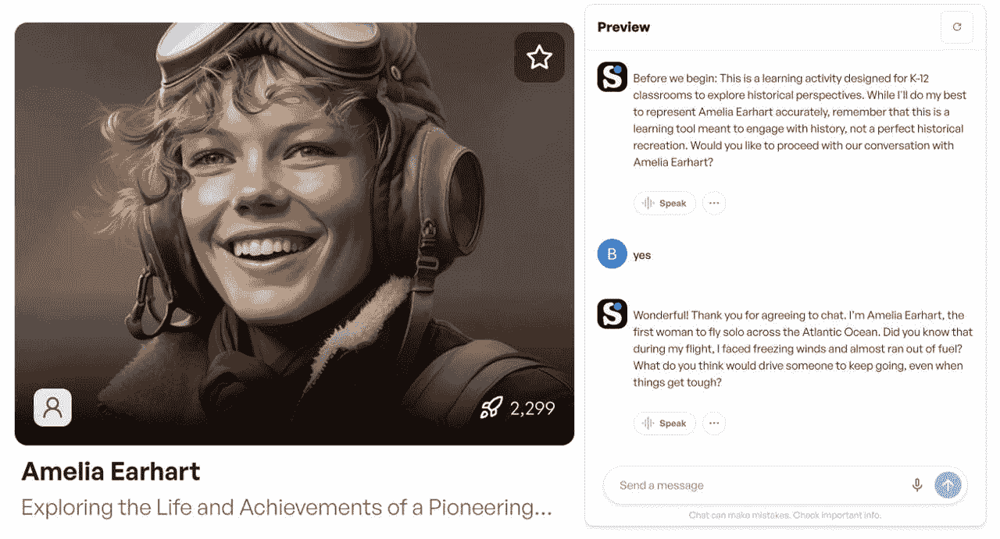
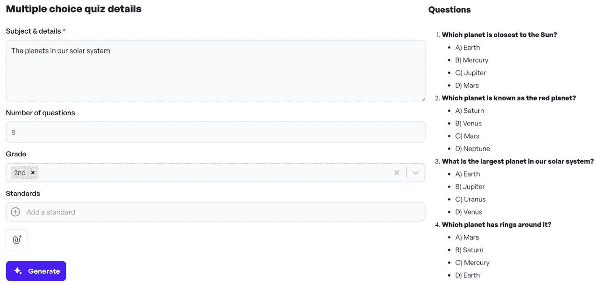
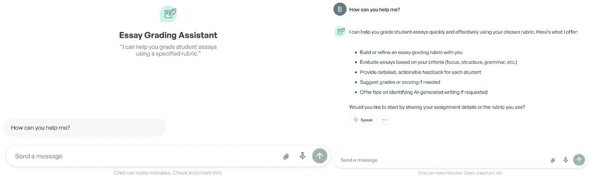

# AI Hub for Education-Stanford

> 来源：[https://gotoaiworld.feishu.cn/docx/EGKNdE5oHocAZPxISpucSZ4PnJe](https://gotoaiworld.feishu.cn/docx/EGKNdE5oHocAZPxISpucSZ4PnJe)

# How K-12 Educators Are Actually Engaging with AI: Early Findings from an EdTech Platform

08/05/2025

https://scale.stanford.edu/research-in-action/how-k12-educators-engaging-with-ai

By [Benjamin Leiva](https://scale.stanford.edu/people/benjamin-leiva), [Ana T. Ribeiro](https://scale.stanford.edu/people/ana-trindade-ribeiro), [Chris Agnew](https://scale.stanford.edu/people/chris-agnew), and [Susanna Loeb](https://scale.stanford.edu/people/susanna-loeb)

This is the first of a series of research briefs aimed at understanding how people use AI-powered educational tools.

Sinc[e t](https://scale.stanford.edu/research-in-action/how-k12-educators-engaging-with-ai#note1)he release of user-facing generative artificial intelligence (AI) tools like ChatGPT in 2022, AI adoption has quickly permeated many sectors, including education.(1) New EdTech platforms are constantly emerging, often designed to help teachers with tasks ranging from lesson planning to worksheet generation to assessment grading. The emergence of these new technologies spark both excitement and concern, not only in teachers and students, but also among parents and policymakers. Yet, we know little about what tools teachers are using, how much they are using these tools, and what implications this use has for student learning. This brief, the first in a series, begins to fill the knowledge gap by analyzing teacher usage data from a popular EdTech platform identifying three key findings from the user’s behavior:

1.  While some teachers try the platform only once, over 40% become “Regular” or “Power Users”

1.  Teachers tend to use the platform on weekday mornings

1.  Teachers regularly use all three sets of SchoolAI tools. Power users of SchoolAI are particularly heavy users of Teacher Chatbot Assistants

#### The Data

[We partn](https://schoolai.com/)ered wit**h S**choo[lAI](https://scale.stanford.edu/research-in-action/how-k12-educators-engaging-with-ai#note2), an AI-powered educational platform designed to support K-12 learning. As of July 2025, SchoolAI reports a presence in more than one million classrooms in over 80 countries. From September of 2023 through November of 2024, 59,650 US-based teachers interacted with the SchoolAI platform. This analysis follows the over 9,000 teachers who began using the platform for the first time between 08/01 and 09/15 at the start of the 2024-25 school year. We track the activity of this cohort of teachers on the platform up to Sunday, November 24th to draw insights into teachers’ interests and use of different AI tools over time.(2)

**Figure 1** maps out new users by week across our full dataset. We see that the number of new teachers grew substantially during this time, especially during the beginning of the 2024-25 school year. We chose the cohort of teachers starting at the beginning of that school year to follow patterns of use while school is in session.

<https://chart-studio.plotly.com/~benjaleivas/13/.embed?showlink=false&modebar=false>

**T**he SchoolAI platform tracks every teacher action on the pl[atf](https://scale.stanford.edu/research-in-action/how-k12-educators-engaging-with-ai#note3)orm—from logging in to using specific features. We categorize teacher actions by participation in three SchoolAI features(3):

+   Student Chatbots – student-facing learning spaces, designed by teachers through prompts. Teachers can define key elements of these, such as its title and cover image, the instructions it should follow, an audience description (e.g., subject and grade level) or attach files for additional context.

Student Chatbot example: Amelia Earhart learning space – interface and output.

+   Teacher Productivity Tools – teacher-facing tools that generate structured, customizable outputs, such as lesson plans, quizzes, or individualized education program documents.

Teacher Productivity Tool example: multiple choice quiz generator – interface and output.

+   Teacher Chatbot Assistants – more flexible teacher-facing tools that support a range of tasks, acting as brainstorming partners, subject matter experts, or administrative helpers (e.g., for grading essays or organizing field trips).

Teacher Chatbot Assistant example: essay grader – interface and output.

Some of these tools create resources for direct student use (like chatbots or quizzes), while others streamline behind-the-scenes teacher tasks such as grading or lesson planning.

We [cha](https://scale.stanford.edu/research-in-action/how-k12-educators-engaging-with-ai#note4)racteri**zed teacher**s based on ho**w many days t****hey were ac**tive(4) on SchoolAI across a fixed 90 day window. Our sample allowed us to observe teachers who joined at the start of the 2024-25 school year. We classified teachers into four categories of engagement: Single-Day Users, Trial Users (2-7 days), Regular Users (8-49 days), and Power Users (50+ days). With these four engagement groups in place, we set out to answer a set of questions about how teachers are using SchoolAI’s platform.

#### What We Set Out To Learn

1.  **Takeup**: How many teachers joined and what share of them became one-time, trial, regular, or power users? And how does teacher engagement change after initial use?

1.  **Timing**: When do teachers use the platform, and do their usage patterns shift as they become more experienced users?

1.  **Focus**: What do teachers use on the platform and do different types of users favor different platform features? Do teacher’s preferences on the platform change the longer they use it?

#### Finding #1: While Some Teachers Try The Platform Only Once, Over 40% Become “Regular” or “Power Users”

**9,081 teachers joined SchoolA**I for the first time from August 1st through September 15th, 2024.

**Figure 2** details their use: 16% were Single-Day Users meaning they only use the platform onc**e**, 43% were Trial Users in that they return to the platform but for less than a non-consecutive week, 41% were Regular Users using the platform for up to 49 days, and 1% (88 teachers) used the platform for 50 days or more during the 90 day period.

<https://chart-studio.plotly.com/~benjaleivas/16/.embed?showlink=false&modebar=false>

We can also look at the variatio**n in tea**cher** en**gagement in more detail. Figure 3 tracks the percentage of users who return to the platform for their 2nd day of use, 3rd day, 4th day, and so on, regardless of when these usage days actually occur. We find that many teachers stop using the platform after only initial engagement — about one in three drop off by their third day. However, the rate of disengagement slows down over time, leveling out as a smaller group of teachers continues to use the platform more consistently.

<https://chart-studio.plotly.com/~benjaleivas/18/.embed?showlink=false&modebar=false>

Of the 9,000 teachers who adopted SchoolAI in the first weeks of the fall 2024 school year, just over 50% used the platform for five or more days.

Determining where this attrition rate falls in the distribution of use for EdTech or general-purpose AI products is difficult, given that platform retention data is rarely shared. However, a s[tud](https://scale.stanford.edu/research-in-action/how-k12-educators-engaging-with-ai#note5)y published in May 2024 by the Reuters Institute at Oxford Univ[ers](https://scale.stanford.edu/research-in-action/how-k12-educators-engaging-with-ai#note6)ity found that 69% of US survey respondents who used ChatGPT, which is used for both professional and personal purposes, reported having used it more than “once or twice.”(5) One software industry usage benchmark finds that companies retain an average of 30% of users after the first three months.(6)

Beyond **the tota**l number of days of engagement, teachers’ timing and cadence of engagement is important. A teacher may use the platform for seven days straight and never return, suggesting initial but not sustained interest, or they may use it once a week for seven weeks in a row, indicating a pattern of continued interest. Figure 4 shows how many teachers are active each week and whether they return week after week.

<https://chart-studio.plotly.com/~benjaleivas/20/.embed?showlink=false&modebar=false>

A**f**ter o**ur sampling period ends in mid-September, about one-thi**rd of users use the platform in any given week. This pattern provides evidence that while many teachers use the platform for only a few days, this use is spread out over time, indicating sustained interest over an extended period. Approximately 60% of users each week also used the platform in the prior week while 40% returned after at least a week of non-use. This pattern suggests important week-to-week variation of users, which is likely indicative of teachers using the platform on an as-needed basis rather than as a daily routine.

#### Finding #2: Teachers Tend to Use the Platform On Weekday Mornings

Unders[tan](https://scale.stanford.edu/research-in-action/how-k12-educators-engaging-with-ai#note7)ding when teachers use the platform throughout the week reveals useful insights about how educational technology fits into teachers' daily schedules and workflow patterns, particularly given their well-known heavy workload.(7)

**Figure 5** **s**hows the days and times of day when teachers use SchoolAI. Notably, the vast majority of teacher use occurs during the school day. Workday evenings and weekends show little to no teacher activity — behavior that generally holds for Single-Day, Trial, Regular, and Power Users.

<https://chart-studio.plotly.com/~benjaleivas/22/.embed?showlink=false&modebar=false>

Ex**amining **Regular and Power Users more closely shows consistency across these user groups. Figure 6 illustrates teachers’ usage patterns throughout each day of the week, over the full sample and for every user’s active day count.

<https://chart-studio.plotly.com/~benjaleivas/190/.embed?showlink=false&modebar=false>

**Mo**re experienced users follow the same overall pattern of teachers using SchoolAI early during workdays. As we follow Regular Users and Power Users across their platform journeys using the slider bar, we see some variation in normalized usage times and days—especially as sample sizes shrink—but these patterns still align with the overall behavior. These findings suggest that teachers mainly use SchoolAI during work hours, regardless of their experience level or purpose. Usage earlier in the day among Regular and Power Users may reflect their preference for different features—a topic we explore next.

#### Finding #3: Teachers Regularly Use All Three Sets of SchoolAI Tools. Power Users of SchoolAI Are Particularly Heavy Users of Teacher Chatbot Assistants

SchoolAI has multiple offerings on its platform. Teachers can create their own student-facing chatbots with a written prompt specifying the topic and grade level or choose from chatbots already developed by other teachers. For teacher support, they can use multiple productivity tools or AI assistants to reduce their workload. Users can also access reference materials to better understand the platform or to read about other user experiences.

As described above, we categorized teacher use across six platform features:

+   Student Chatbots - a collection of teacher-designed AI tools to support student learning

+   Teacher Productivity Tools - pre-built tools that simplify the creation of lesson plans, assessments, and other materials

+   Teacher Chatbot Assistants - open-ended chat-based tools to support teacher practice

+   Reference Materials - documentation and courses for professional development and continual learning on AI

+   Homepage/Authentication - the registration, sign-in process, and landing page activity

+   **Other** - activities we were not able to classify in any of the above categories

**Figure 7** s**hows** how our sample of teachers allocate their platform time to these features. We find that Teacher Productivity Tools account for 37% of overall teacher time on the platform, followed by Teacher Chatbot Assistants with 27% and Student-facing Chatbots with 23%, while Reference Materials – such as user guidelines, AI training, or blog posts – show little time investment from teachers.

<https://chart-studio.plotly.com/~benjaleivas/39/.embed?showlink=false&modebar=false>

The **use of tools varies across our** c**ategorie**s of users. Figure 8 shows how teachers at different engagement levels divide their time across the platform's various features — several patterns emerge.

<https://chart-studio.plotly.com/~benjaleivas/41/.embed?showlink=false&modebar=false>

**As teachers use the platform more, an increasingly larg**er share of use goes to teacher support tools while Student Chatbots see a smaller share of use. Lighter users focus more on direct student applications (e.g., creating and refining chatbots for their classrooms) while heavier users spend more time on teacher support features.

Second, **te**achers who use the platform more tend to spend the most time with Teacher Chatbot Assistants. This use dominates power users' time on the platform, accounting for over 50% of their activity. Teacher Productivity Tools show an increasing share of engagement levels from lighter to regular users, peaking at just under 40% of teachers’ time.

Logically, we also see that more frequent users spend a smaller share of time reviewing additional resources and on homepage and authentication activities.

The analysis above is a static snapshot of how different teacher **types al**locate their time—but does not directly show how use unfolds over time. Figure 9 examines this evolution by tracking how both Regular and Power users' time allocation changes as they spend more days using SchoolAI.

<https://chart-studio.plotly.com/~benjaleivas/43/.embed?showlink=false&modebar=false>

The main takeaway from observing both types o**f** user journeys on the platform is that Power Users differ from Regular Users from the beginning. Power Users, from their first day, prefer teacher-support features by allocating over 70% of their time into Teacher Productivity Tools and Chatbot Assistants. By their 50th day their use of teacher-support features increase to over 80%. These patterns persist until the sample size becomes too small to make any relevant conclusions (approximately day 70 and beyond). In contrast, Regular Users show less use of Teacher Chatbot Assistants over their first 10 days, spending most of their time using Teacher Productivity Tools and about a quarter of their time on Student Chatbots. Regular users show a distinct trend over time, trading Student Chatbot use for Teacher Chatbot Assistant use. By day 15, Regular user behavior looks more similar to Power User behavior on day one — Student Chatbot use being just under 20% and teacher support tool use reaching almost 70%.

#### Conclusion and Next Steps

Furthering the landscape mapping portion of our research agenda, this post is the first in a series sharing what we are learning about the use of AI-powered platforms in K12 contexts. In analyzing over 9,000 teachers' engagement with the SchoolAI platform, we found:

1.  For the fall 2024 semester, between the start of school and November 24th, just over 40% of sampled teachers became Regular or Power Users (using the platform 8 days or more).

1.  The most popular time for teachers to use the platform is during the school day and specifically the first half of the day.

1.  Teachers utilize all three types of tools - Teacher Productivity Tools, Teacher Chatbot Assistants and Student Chatbots. Heavier users spend more time on teacher support tools (Productivity Tools and Chatbot Assistants). Power users of the platform heavily leverage Teacher Chatbot Assistants.

Our analysis focused on days active and continuous time spent on the platform as measures of engagement and as a proxy for teacher value. This approach does not capture the full picture of how teachers interact with different features. Different tools require varying levels of user attention and engagement. A teacher using a Teacher Chatbot Assistant to plan a field trip involves different cognitive demands and interaction patterns than someone using a Teacher Productivity Tool to generate a student quiz. Truly understanding teacher behavior will require additional and more nuanced engagement measurements accounting for tool complexity and purpose.

Up until now, most understanding of AI use by teachers has been survey based. Our findings offer insights into how educators actually engage with AI-powered platforms. This analysis provides an early signal on what teachers do and do not value in AI products for education. Stay tuned for additional posts that go deeper into teacher and student use of AI tools in K12.

**Tech specs for users between Augus**t and November 2024 (the sample window):

+   Free users of SchoolAI were working off of OpenAI’s ChatGPT 4o-mini

+   P[aid](https://scale.stanford.edu/research-in-action/how-k12-educators-engaging-with-ai#note8) users of SchoolAI were working off of OpenAI’s ChatGPT 4o(8)

---

(1) According to a national survey of K-12 teachers, one quarter of them have used AI tools specifically for instructional planning and teaching purposes during the 2023-24 school year (Kaufman et al., 2025).

(2) We chose to analyze this cohort of teachers because they all joined in the same relevant window of time, which provided us a large enough sample size to draw more robust insights from.

(3) SchoolAI feature images were chosen for explanatory purposes and don’t necessarily reflect their full functionality.

(4) We used an N-day retention approach. We acknowledge that there is more than one way of measuring engagement, like focusing on how intensively active each teacher during the days they access the platform, but for the purpose and scope of this research brief we will focus on the extensive margin (i.e., how many days they log on) rather than on the intensive margin (i.e., how many things they do when they log on).

(5) What does the public in six countries think of generative AI in news? (Univ. of Oxford & Reuters Institute, 2024).

(6) SaaS churn and user retention rates: 2025 global benchmarks (Pendo Blog, 2025).

(7) How teachers manage their workload (Pew Research Center, 2024).

(8) The data set we analyzed did not include differentiation between free and paid users.

AI Hub for Education

Research in Action