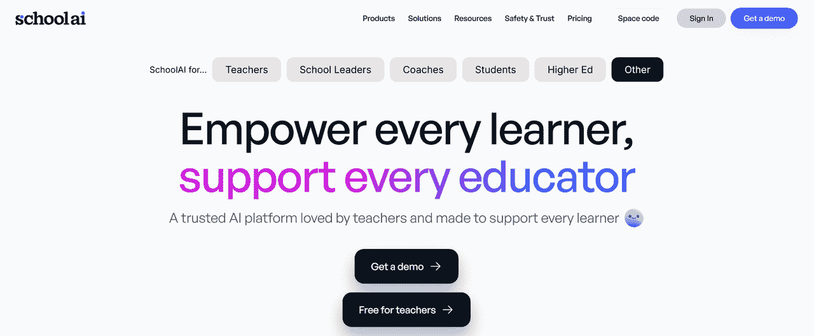

# Empower every learner,support every educator

> 来源：[https://gotoaiworld.feishu.cn/docx/Jkl4de0Fuo6xYNx6aAIcd5bRnYd](https://gotoaiworld.feishu.cn/docx/Jkl4de0Fuo6xYNx6aAIcd5bRnYd)

# Schoolai

https://schoolai.com/

SchoolAI for…

[Teachers](https://schoolai.com/teachers)

[School Leaders](https://schoolai.com/school-leaders)

[Coaches](https://schoolai.com/coaches)

[Students](https://schoolai.com/students)

[Higher Ed](https://schoolai.com/higher-education)

[Other](https://schoolai.com/)

# A powerful learning assistant

Dot, our AI assistant, guides students through interactive workspaces, adapting to how they learn and ensuring they understand key concepts before moving on.

