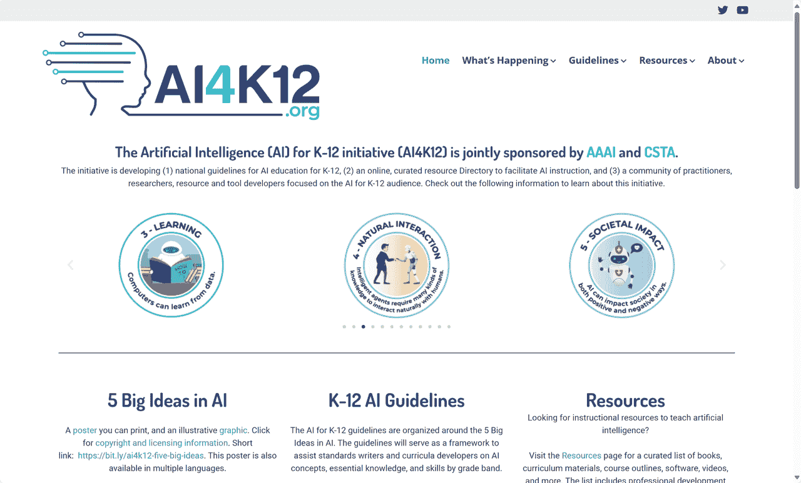
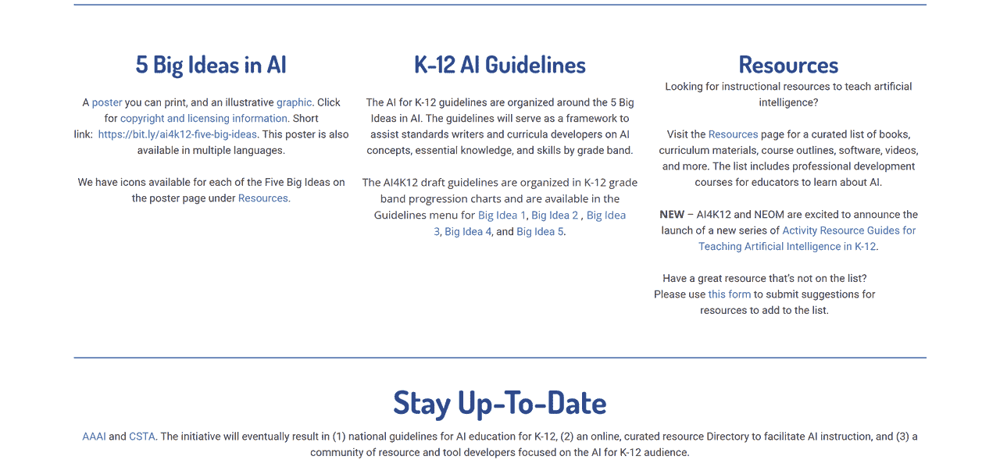
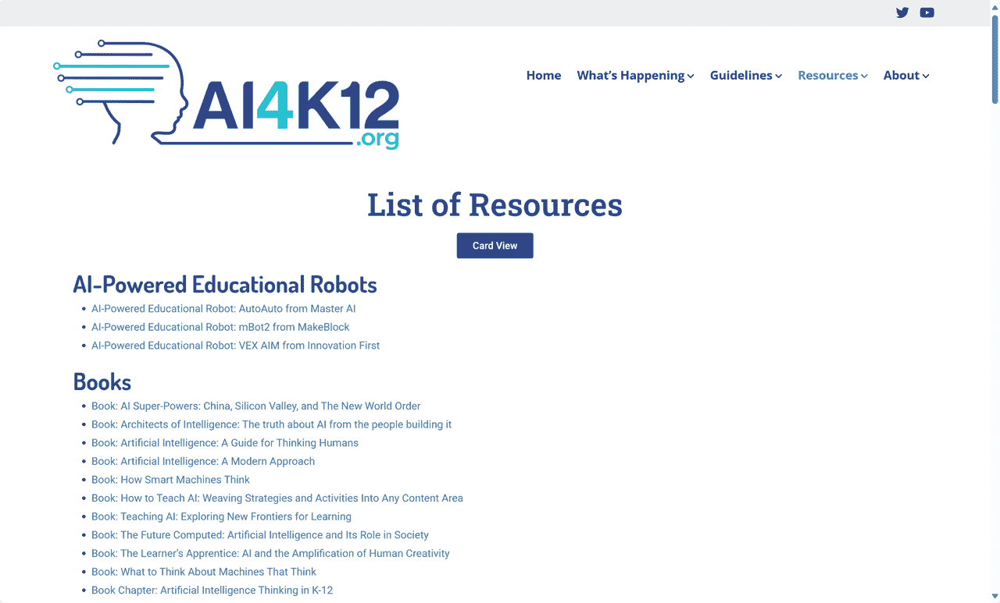
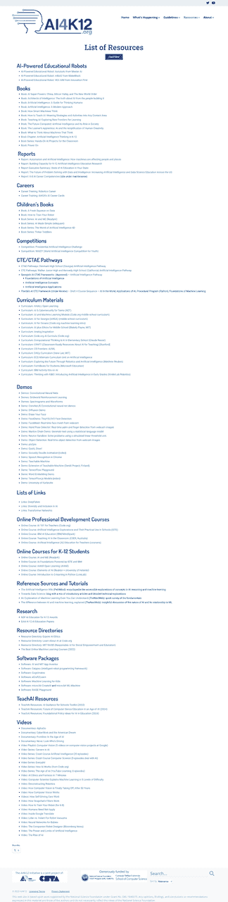

#  AI4K12

> 来源：[https://gotoaiworld.feishu.cn/docx/P6NIdUvxroLPUUx50pLcTZkJnUd](https://gotoaiworld.feishu.cn/docx/P6NIdUvxroLPUUx50pLcTZkJnUd)

### The Artificial Intelligence (AI) for K-12 init[iati](https://aaai.org/)ve (A[I4K1](https://csteachers.org/)2) is jointly sponsored by AAAI and CSTA.

The initiative is developing (1) national guidelines for AI education for K-12, (2) an online, curated resource Directory to facilitate AI instruction, and (3) a community of practitioners, researchers, resource and tool developers focused on the AI for K-12 audience. Check out the following information to learn about this initiative.

https://ai4k12.org/

Stay Up-To-Date

[AAAI](https://aaai.org/) and [CSTA](https://csteachers.org/). The initiative will eventually result in (1) national guidelines for AI education for K-12, (2) an online, curated resource Directory to facilitate AI instruction, and (3) a community of resource and tool developers focused on the AI for K-12 audience.

# Announcements

+   2/[24/24-2](https://eaai-conf.github.io/year/eaai-24.html#eaai-24)/25/24 AI4K12 will be chairing the special track for Resources for Teaching AI in K-12 at EAAI-24.

+   12/4/2023: “AI education a[nd AI i](https://new.nsf.gov/science-matters/ai-education-ai-education)n education” article discusses AI4K12.

+   6/7/2023: “Advisory Group Promote[s ‘5 Bi](https://www.govtech.com/education/k-12/advisory-group-promotes-5-big-ideas-in-ai-for-k-12-schools)g Ideas in AI’ for K-12 Schools” article written about AI4K12 initiative.

+   2[/6/2021: State](https://ai4k12.org/wp-content/uploads/2021/02/AI4K12-workshop-PR-2021-02-05.pdf)s Plan to Teach Artificial Intelligence in K-12 press release.

+   1[/17/2021: “A](https://github.com/touretzkyds/ai4k12/raw/master/documents/Touretzky_Gardner-McCune_AI-Thinking_2021.pdf)rtificial Intelligence Thinking in K-12” book chapter released.

+   11/19/2020: Big Idea #3 “Learni[ng” draft gui](https://docs.google.com/forms/d/e/1FAIpQLScSVs8iWZc1Wms5G1r4CVl4fgDeVQ7v8e8e5b2IAd2FqVdJQA/viewform)delines released for public comment, please fill out this feedback form.

+   5/28/2020: Big Idea #1 “Perception” draft guide[lines release](https://docs.google.com/forms/d/e/1FAIpQLSdkNvTSgOcbAWPpP3g9sUbmuGl1UwPZpnGjwW3i-fUJnhYkDg/viewform)d for public comment, please fill out this feedback from.

+   4/16/2019: “Five Big Ideas in AI” poster and graphic released.

+   3/5/2019: NSF funding awarded for the AI for K-12 initiative.

+   7[/9/2018: ](https://www.csteachers.org/general/custom.asp?page=2018Conference)120 people attended the “AI for K-12” breakfast at CSTA 2018.

+   [5/15/2018: AA](https://aaai.org/Pressroom/Releases/release-18-0515.php)AI press release announcing the AI for K-12 initiative.

# Activity Resource Guides for Teaching Artificial Intelligence in K-12

https://ai4k12.org/activities/

# List of Resources

https://ai4k12.org/resources/list-of-resources/

## AI-Powered Educational Robots

+   [A](https://ai4k12.org/autoauto-from-master-ai/)I-Powered Educational Robot: AutoAuto from Master AI

+   [AI-Powered Educational Robot: ](https://ai4k12.org/mbot2-from-makeblock/)mBot2 from MakeBlock

+   [A](https://ai4k12.org/vex-aim-coding-robot/)I-Powered Educational Robot: VEX AIM from Innovation First

## Books

+   [B](https://ai4k12.org/book-ai-super-powers-china-silicon-valley-and-the-new-world-order/)ook: AI Super-Powers: China, Silicon Valley, and The New World Order

+   [Book: Architects of Intelligence: The tr](https://ai4k12.org/book-architects-of-intelligence-the-truth-about-ai-from-the-people-building-it/)uth about AI from the people building it

+   [B](https://ai4k12.org/artificial-intelligence-a-guide-for-thinking-humans/)ook: Artificial Intelligence: A Guide for Thinking Humans

+   [Book: Artificial Intelligenc](https://ai4k12.org/book-artificial-intelligence-a-modern-approach/)e: A Modern Approach

+   Book: How Smart Machines Think

+   [Book: How to Teach AI: Weaving Strateg](https://ai4k12.org/how-to-teach-ai-weaving-strategies-and-activities-into-any-content-area/)ies and Activities Into Any Content Area

+   [B](https://ai4k12.org/teaching-ai-exploring-new-frontiers-for-learning/)ook: Teaching AI: Exploring New Frontiers for Learning

+   [Book: The Future Computed: Artific](https://ai4k12.org/the-future-computed-artificial-intelligence-and-its-role-in-society/)ial Intelligence and Its Role in Society

+   [Book: The Learner’s Apprentice: AI a](https://ai4k12.org/the-learners-apprentice-ai-and-the-amplification-of-human-creativity/)nd the Amplification of Human Creativity

+   [Book: What to Think About](https://ai4k12.org/what-to-think-about-machines-that-think/) Machines That Think

+   [B](https://ai4k12.org/artificial-intelligence-thinking-in-k-12/)ook Chapter: Artificial Intelligence Thinking in K-12

+   [Book Series: Hands-On AI Projec](https://ai4k12.org/hands-on-ai-projects-for-the-classroom/)ts for the Classroom

+   [Book: Power On](https://ai4k12.org/power-on/)

##  Reports

+   [Re](https://ai4k12.org/report-automation-and-artificial-intelligence-how-machines-are-affecting-people-and-places/)port: Automation and Artificial Intelligence: How machines are affecting people and places

+   [Report: Building Capacity for K-12 Ar](https://ai4k12.org/building-capacity-for-k-12-artificialintelligence-education-research/)tificial Intelligence Education Research

+   [R](https://ai4k12.org/executive-summarythe-state-of-k-12-ai-education-in-your-state-workshop/)eport Executive Summary: State of AI Education in Your State

+   [Rep](https://ai4k12.org/the-future-of-problem-solving-with-data-and-intelligence-increasing-artificial-intelligence-and-data-science-education-across-the-us/)ort: The Future of Problem Solving with Data and Intelligence: Increasing Artificial Intelligence and Data Science Education Across the US

+   Report: K-8 AI Career Competencies (site under maintenance)

## Careers

+   Career Training: Robotics Career

+   [Career Training: AI4](https://ai4k12.org/ai4gas-ai-career-cards/)GA’s AI Career Cards

## Children’s Books

+   Book: A Fresh Squeeze on Data

+   Book: How to Train Your Robot

+   Book Series: AI and ME (ReadyAI)

+   [Book Series: AI Ma](https://ai4k12.org/ai-made-simple-edsquare/)de Simple (edsquare)

+   [B](https://ai4k12.org/the-world-of-artificial-intelligence-4d/)ook Series: The World of Artificial Intelligence 4D

+   Book Series: Tinker Toddlers

## Competitions

+   [C](https://ai4k12.org/presidential-artificial-intelligence-challenge/)ompetition: Presidential Artificial Intelligence Challenge

+   [Competition: WAICY (World Artifi](https://ai4k12.org/waicy-world-artificial-intelligence-competition-for-youth/)cial Intelligence Competition for Youth)

## CTE/CTAE Pathways

+   [CTAE Pathways: Denmark High School (](https://ai4k12.org/denmark-high-school-georgia-artificial-intelligence-pathway/)Georgia) Artificial Intelligence Pathway

+   [CT](https://ai4k12.org/walker-junior-high-and-kennedy-high-school-california-artificial-intelligence-pathway/)E Pathways: Walker Junior High and Kennedy High School (California) Artificial Intelligence Pathway

+   Georgia’s AI CTAE Frameworks  (Approved) – Artificial Intelligence Pathway

+   Foundations of Artificial Intelligence

+   Artificial Intelligence Concepts

+   Artificial Intelligence Applications

+   Florida’s AI CTE Framework (Under Review) – Draft 4 Course Sequence – AI in the World, Applications of AI, Procedural Program (Python), Foundations of Machine Learning

## Curriculum Materials

+   Curriculum: AI4ALL Open Learning

+   [Curriculum: AI & Cybersecu](https://ai4k12.org/ai-cybersecurity-for-teens-act/)rity for Teens (ACT)

+   [Curriculum: AI and Machine Learning Mo](https://ai4k12.org/ai-and-machine-learning-module/)dule (Code.org middle school curriculum)

+   [C](https://ai4k12.org/ai-for-georgia-ai4ga/)urriculum: AI for Georgia (AI4GA) (middle school curriculum)

+   [C](https://ai4k12.org/ai-for-oceans/)urriculum: AI for Oceans (Code.org machine learning intro)

+   [C](https://ai4k12.org/ai-plus-ethics-for-middle-school/)urriculum: AI plus Ethics for Middle School (Blakely Payne, MIT)

+   Curriculum: Analog Inspiration

+   [Curriculum: Code.org AI ](https://ai4k12.org/code-org-ai-curricula/)Curricula (Code.org)

+   [Curriculum: Computational Thinking &](https://ai4k12.org/computational-thinking-ai-in-elementary-school/) AI in Elementary School (Claude Reuter)

+   [Curriculum: CRAFT (Classroom-Ready Res](https://ai4k12.org/craft-classroom-ready-resources-about-ai-for-teaching/)ources About AI for Teaching) [Stanford]

+   Curriculum: CS Frontiers: AI/ML

+   [Curriculum: DAILy Curricu](https://ai4k12.org/daily-curriculum/)lum (Irene Lee, MIT)

+   [C](https://ai4k12.org/ecs-alternate-curriculum-unit-on-artificial-intelligence/)urriculum: ECS Alternate Curriculum Unit on Artificial Intelligence

+   [Cu](https://ai4k12.org/exploring-the-future-through-robotics-and-artificial-intelligence/)rriculum: Exploring the Future Through Robotics and Artificial Intelligence (Matthew Reuben)

+   [C](https://ai4k12.org/farmbeats-for-students/)urriculum: FarmBeats for Students (Microsoft Education)

+   Curriculum: IBM Activity Kits on AI

+   [Cu](https://ai4k12.org/thinking-with-kibo-introducing-artificial-intelligence-in-early-grades/)rriculum: Thinking with KIBO: Introducing Artificial Intelligence in Early Grades (KinderLab Robotics)

## Demos

+   Demos: Convolutional Neural Nets

+   [Demos: Gridworld Re](https://ai4k12.org/gridworld-reinforcement-learning/)inforcement Learning

+   Demos: Spectrograms and Waveforms

+   [Demo: ConvNetJS Convolutio](https://ai4k12.org/convnetjs/)nal neural net demos

+   Demo: Diffusion Demo

+   Demo: Erase Your Face

+   [Demo: FaceDemo: TinyY](https://ai4k12.org/facedemo-tinyyolov2-face-detection/)OLOV2 Face Detection

+   [Demo: FaceMesh: Real-time f](https://ai4k12.org/facemesh/)ace mesh from webcam

+   [Demo: Hand Pose Detector: Real-time palm](https://ai4k12.org/hand-pose-detector/) and finger detection from webcam images

+   [Demo: Markov Chain Demo: Generate](https://ai4k12.org/markov-chain-demo/) text using a statistical language model

+   [Demo: Neuron Sandbox: Solve problems ](https://ai4k12.org/neuron-sandbox/)using a simulated linear threshold unit.

+   [D](https://ai4k12.org/object-detection/)emo: Object Detection: Real-time object detection from webcam images

+   [Demo: pix2pix](https://ai4k12.org/pix2pix/)

+   Demo: Quick, Draw!

+   D[emo: ](https://www.youtube.com/watch?v=mq2jK5X9JNY)Scroobly Doodle Animation (video)

+   Demo: Speech Recognition in Chrome

+   Demo: Teachable Machine

+   [D](https://ai4k12.org/extension-of-teachable-machine/)emo: Extension of Teachable Machine (GenAI Project, Finland)

+   Demo: TensorFlow Playground

+   Demo: Word Embedding Demo

+   D[emo: ](https://www.youtube.com/watch?v=c3aZeMZ0cvs)TensorFlow.js Models (video)

+   Demo: University of Karlsruhe

**Lists of Links**

+   Links: DeepFakes

+   [Links: Diversity](https://ai4k12.org/diversity-and-inclusion-in-ai/) and Inclusion in AI

+   Links: Transformer Networks

## Online Professional Development Courses

+   [Online Course: AI 101 for](https://ai4k12.org/ai-101-for-teachers/) Teachers (Code.org)

+   [On](https://ai4k12.org/online-course-artificial-intelligence-explorations-and-their-practical-use-in-schools/)line Course: Artificial Intelligence Explorations and Their Practical Use in Schools (ISTE)

+   [Online Course: IBM AI Educa](https://ai4k12.org/ibm-ai-education/)tion (IBM/MindSpark)

+   [O](https://ai4k12.org/teaching-ai-in-the-classroom/)nline Course: Teaching AI in the Classroom (CSER, Australia)

+   [Online Course: Artificial Intelligenc](https://ai4k12.org/artificial-intelligence-ai-education-for-teachers/)e (AI) Education for Teachers (coursera)

## Online Courses for K-12 Students

+   Online Course: AI and ME (ReadyAI)

+   [O](https://ai4k12.org/ai-foundations-powered-by-iste-and-ibm/)nline Course: AI Foundations Powered by ISTE and IBM

+   [Online Course: AI4All Op](https://ai4k12.org/ai4all-open-learning/)en Learning (AI4All)

+   [O](https://ai4k12.org/elements-of-ai/)nline Course: Elements of AI (Reaktor + University of Helsinki)

+   [O](https://ai4k12.org/introduction-to-q-learning-in-python/)nline Course: Introduction to Q-learning in Python (LoisLab)

## Reference Sources and Tutorials

+   The Artificial Intelligence Wiki (PathMind): encyclopedia-like accessible explanations of concepts in AI reasoning and machine learning

+   Towards Data Science: blog with a mix of introductory articles and detailed technical explorations

+   [A](https://ai4k12.org/an-explanation-of-machine-learning-even-you-can-understand/)n Explanation of Machine Learning Even You Can Understand (TheNextWeb): quick survey of the fundamentals

+   [T](https://ai4k12.org/the-difference-between-ai-and-machine-learning-explained/)he difference between AI and machine learning, explained (TheNextWeb): insightful discussion of the nature of AI and its relationship to ML

## Research

+   NSF AI Education for K-12 Awards

+   EAAI K-12 AI Education Papers

## Resource Directories

+   [Resource Directo](https://ai4k12.org/explore-ai-ethics/)ry: Expore AI Ethics

+   [Resource Directory: Learn ](https://ai4k12.org/learn-about-ai-at-code-org/)About AI at Code.org

+   [Resource Directory: MIT RAISE (Responsible ](https://ai4k12.org/raise-playground/)AI for Social Empowerment and Education)

+   [The Best Online Machine Lea](https://ai4k12.org/the-best-online-machine-learning-courses-2022/)rning Courses (2022)

## Software Packages

+   Software: AI and MIT App Inventor

+   [S](https://ai4k12.org/calypso/)oftware: Calypso (intelligent robot programming framework)

+   Software: Cognimates

+   Software: eCraft2Learn

+   Software: Machine Learning for Kids

+   Software: micro:bit CreateAI and micro:bit ML-Machine

+   Software: RAISE Playground

## TeachAI Resources

+   [T](https://ai4k12.org/ai-guidance-for-schools-toolkit/)eachAI Resources: AI Guidance for Schools Toolkit (2023)

+   [TeachAI Resources: Future of Computer](https://ai4k12.org/future-of-computer-sience-education-in-an-age-of-ai-2024/) Sience Education in an Age of AI (2024)

+   [T](https://ai4k12.org/foundational-policy-ideas-for-ai-in-education-2024/)eachAI Resources: Foundational Policy Ideas for AI in Education (2024)

## Videos

+   Documentary: AlphaGo

+   [Documentary: CyberWork an](https://ai4k12.org/cyberwork-and-the-american-dream/)d the American Dream

+   [Documentary: Frontli](https://ai4k12.org/frontline-in-the-age-of-ai/)ne: In the Age of AI

+   [Documentary: Nova](https://ai4k12.org/nova-look-whos-driving/): Look Who’s Driving

+   [Video Playlist: Computer Vision (5 video](https://ai4k12.org/playlist-computer-vision/)s on computer vision projects at Google)

+   Video Series: Careers in AI

+   [V](https://ai4k12.org/crash-course-artificial-intelligence/)ideo Series: Crash Course Artificial Intelligence (20 episodes)

+   [V](https://ai4k12.org/crash-course-computer-science/)ideo Series: Crash Course Computer Science (5 episodes deal with AI)

+   Video Series: EverydAI

+   [Video Series: How AI W](https://ai4k12.org/how-ai-works/)orks (from Code.org)

+   [V](https://ai4k12.org/the-age-of-ai/)ideo Series: The Age of AI (YouTube Learning; 8 episodes)

+   [Video: AI Ethics and F](https://ai4k12.org/ai-ethics-and-fairness-in-7-minutes/)airness in 7 Minutes

+   [Video: Computer Scientist Explains Ma](https://ai4k12.org/computer-scientist-explains-machine-learning-in-5-levels-of-difficulty/)chine Learning in 5 Levels of Difficulty

+   Video: Deconstructing Robotics

+   [V](https://ai4k12.org/how-computer-vision-is-finally-taking-off-after-50-years/)ideo: How Computer Vision is Finally Taking Off, After 50 Years

+   Video: How Computer Vision Works

+   Videos: How Self-Driving Cars Work

+   Video: How Snapchat’s Filters Work

+   [Video: How to Train ](https://ai4k12.org/how-to-train-your-robot-2/)Your Robot (for K-8)

+   Video: Humans Need Not Apply

+   Video: Inside Google Translate

+   [Video: Lidar vs. Vsl](https://ai4k12.org/lidar-vs-vslam-for-robot-vacuums/)am For Robot Vacuums

+   Video: Neural Networks for Babies

+   [V](https://ai4k12.org/the-companion-robot-designer/)ideo: The Companion Robot Designer (Bloomberg News)

+   [V](https://ai4k12.org/the-power-and-limits-of-artificial-intelligence/)ideo: The Power and Limits of Artificial Intelligence

+   Video: The Rise of AI

