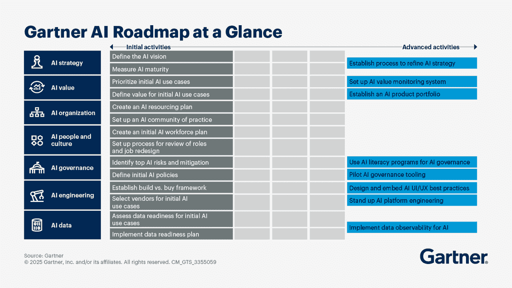
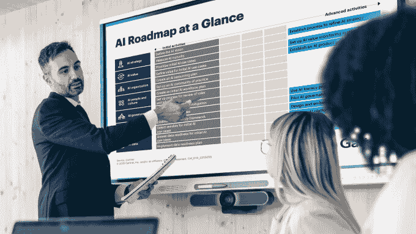
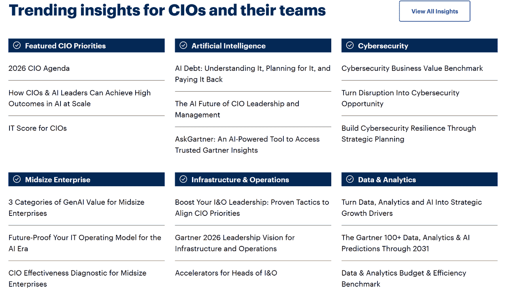

# Gartner-Chief Information Officer

> 来源：[https://gotoaiworld.feishu.cn/docx/MSxlduY5BoNHD4xXJabcsFBSn4O](https://gotoaiworld.feishu.cn/docx/MSxlduY5BoNHD4xXJabcsFBSn4O)

## The CIO’s Guide to Building an AI Roadmap That Drives Value

https://www.gartner.com/en/articles/ai-roadmap

You need an AI roadmap to turn the idea of AI into a concrete sequence of steps to deliver AI business value at scale. Here’s how to build it.

By [Leinar Ramos](https://www.gartner.com/en/experts/leinar-ramos), [Anthony Mullen](https://www.gartner.com/en/experts/anthony-mullen) and Pieter den Hamer | November 13, 2025

https://www.gartner.com/en/articles/ai-roadmap

## Gartner AI roadmap targets 7 key workstreams

Unlocking the full potential of artificial intelligence requires more than deploying technologies; it demands strategic alignment and cultural and operational readiness. Prioritize your actions across seven AI workstreams.

### Developing your own AI roadmap is crucial for success

There is no one-size-fits-all AI roadmap; you need to create an AI roadmap that works for your organization. The menu of potential activities is extensive, and you shouldn't attempt them all; rather, select those that are critical to your AI strategy and use cases — and then sequence them properly, from initial to advanced.

### AI roadmap workstream No. 1: AI strategy

Approach goal setting with a succinct statement of the choices that your organization will make in order to win. This starts by defining your AI ambitions — that is the strategic impact that you hope to create with AI, in alignment with the business strategy. The initial AI strategy informs the adoption goals for the roadmap and the priorities for the use-case portfolio. Among more advanced activities are establishing a process to refine the strategy, including the measurement of its success.

### AI roadmap workstream No. 2: AI value

[AI value](https://www.gartner.com/en/articles/ai-value) is directly realized via a portfolio of AI initiatives. You will typically start by prioritizing a set of initial use cases, running pilots, and tracking and demonstrating their business value. More advanced activities include creating a portfolio of AI products, where the focus is not on delivering one-off projects, but on ongoing value creation that continuously evolves with customer needs and changing technology.

Learn how a Gartner Executive Partner can help. As a client, you can work directly with an EP mentor to build your custom AI roadmap.

### AI roadmap workstream No. 3: AI organization

As AI scales, your organization will need to evolve too. At the start, you need a resourcing plan that responds to the needs of your initial AI use cases and strategy, including whether you will seek to fill key capability gaps internally or externally. On the internal side, organizations typically start by establishing a community of practice that brings together stakeholders interested in AI and/or dedicated AI teams to focus on a limited set of high-priority activities. This can then evolve into a target operating model designed to further scale AI in the organization. On the external side, organizations often initially form a limited number of external partnerships and later formalize a process to manage these relationships.

### AI roadmap workstream No. 4: AI people and culture

Prioritize human readiness by ensuring your teams can keep up with evolving technology by cultivating new skills and managing change. Employees will need to be upskilled, some jobs will need to be redesigned and the culture will need to adapt. The first typical step is to create a workforce plan that identifies the talent implications of AI, the current talent gaps and how they will be addressed. This generally evolves into a process to continuously review roles, a change management plan and a protocol for evaluating the impact of AI in the workforce.

### AI roadmap workstream No. 5: AI governance

AI comes with many risks that need to be governed from the outset. The typical journey starts with identifying the key AI risks and establishing the initial principles, policies and enforcement processes to manage and mitigate those risks, including ethical AI issues. AI leaders can then look to formalize an AI governance structure that defines decision rights and establish a broader AI governance operating model. More advanced activities include piloting governance tooling and setting up AI literacy programs to educate employees more broadly on AI governance. Sustainable AI success hinges on coordinated ethics, governance and compliance across the organization.

### AI roadmap workstream No. 6: AI engineering

You need a solid technical foundation to ensure your organization’s AI is both reliable and scalable. Initially, organizations need to define build versus buy criteria for their use cases, set up a sandbox environment to experiment, and start identifying design patterns and reference architecture to promote reusability. They also need to carefully select vendors to support initial use cases, then evolve this to a more cohesive AI vendor strategy. More advanced activities focus on establishing a ModelOps practice, including AI observability, UI/UX and FinOps best practices, as well as standing up AI platform engineering.

### AI roadmap workstream No. 7: AI data

Data is a vital component of the [vast majority](https://www.gartner.com/en/articles/ai-ready-data) of AI use cases. However, AI-ready data requires a different set of capabilities than traditional data management. AI leaders typically start by understanding their data readiness for the initial set of AI use cases, identifying key requirements and implementing a plan to prepare their data. Then, they seek broader buy-in for the longer-term investments required to evolve their data capabilities for AI and adapt their data governance, including data quality and metadata practices. AI also requires capabilities to visualize and analyze data, as well as data observability to monitor data in production.

Pinpoint high-impact AI opportunities with Gartner’s AI Use Case Insights for IT Leaders. Discover, evaluate, and prioritize AI opportunities to accelerate IT transformation and demonstrate value to the business.

#### Are you a CIO or IT leader at a midsize enterprise?

See how your peers are navigating AI adoption, vendor decisions and evolving business demands — with tools tailored to your role:

+ Explore our resources for midsize enterprises

+ Check out a curated list of Gartner’s most popular research being utilized by your peers

### AI roadmap FAQs

#### What is an AI roadmap?

An artificial intelligence roadmap is a plan that outlines the steps an organization will take to implement and scale AI technologies effectively. It serves as a guiding framework to help organizations align their AI initiatives with business objectives, manage resources and prioritize activities.

# Gartner AI Roadmap

There is no one-size-fits-all AI roadmap; no “five steps to creating an AI roadmap.” Rather, you must select the most relevant actions to further your organization’s specific AI strategy and AI maturity — and then sequence them properly, from initial to advanced, considering the dependencies between them.

## What are the components of the Gartner AI Roadmap?

The Gartner AI Roadmap divides critical AI-related activities into seven workstreams so CIOs and other AI leaders can select the right priorities to further their organization’s AI ambitions. It organizes and details key activities into seven workstreams and sequences them from initial to more advanced, providing a full description of each activity and associated Gartner resources to execute them. The workstreams are: AI strategy, AI value, AI organization, AI people and culture, AI governance, AI engineering and AI data.

## Trending insights for CIOs and their teams

https://www.gartner.com/en/chief-information-officer

https://www.gartner.com/en/chief-information-officer
