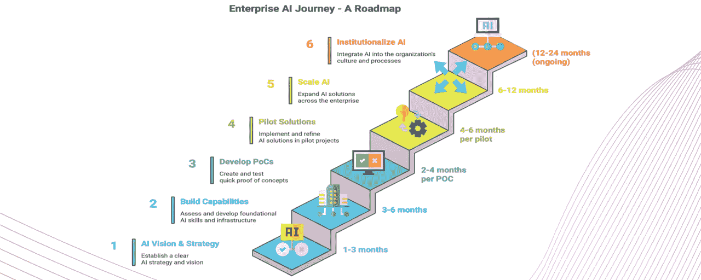

# Building an Enterprise AI Roadmap That Delivers Business Value

> 来源：[https://gotoaiworld.feishu.cn/docx/YFcHdqjQKoezI8xqa0ScN5fFnzb](https://gotoaiworld.feishu.cn/docx/YFcHdqjQKoezI8xqa0ScN5fFnzb)

`https://isometrik.ai/blog/enterprise-ai-roadmap/`

Building an enterprise AI roadmap isn’t just about adopting the latest technology. It’s about creating a strategic framework that aligns AI initiatives with business outcomes.

Organizations that develop a structured enterprise AI roadmap are 80% more likely to succeed compared to those without formal planning. This guide walks you through creating an actionable roadmap that transforms your business operations and drives measurable results.

## Why Your Business Needs an Enterprise AI Roadmap

An enterprise AI roadmap serves as your strategic blueprint for AI adoption. Without one, businesses risk scattered initiatives that drain resources without delivering value. Recent data shows that 65% of organizations now use generative AI regularly, yet many struggle to move beyond experimental phases.

A well-designed roadmap addresses four critical business needs. First, it aligns AI investments with revenue goals and operational efficiency targets. Second, it sequences initiatives based on feasibility and impact. Third, it establishes governance frameworks that ensure responsible AI deployment. Fourth, it creates measurable milestones that prove business value to stakeholders.

The cost of not having a roadmap is substantial. Companies without strategic planning report 37% success rates in AI projects compared to 80% for those with structured approaches. This gap translates to wasted resources, missed opportunities, and competitive disadvantages in markets where AI adoption accelerates daily.

### Key Benefits of a Strategic AI Roadmap:

+ Reduces deployment time from 6-12 months to 12-16 weeks with focused planning

+ Aligns cross-functional teams around shared AI objectives

+ Prioritizes high-impact use cases that deliver quick wins

+ Establishes clear governance and compliance frameworks

+ Creates accountability through defined metrics and KPIs

+ Minimizes risk through phased, tested implementations

+ Builds organizational confidence in AI capabilities

## Core Components of an Effective Enterprise AI Roadmap

Your enterprise AI roadmap must integrate multiple strategic layers. The foundation starts with business alignment where you identify problems AI can solve profitably. This isn’t about implementing AI for its own sake but selecting use cases that improve margins, reduce costs, or enhance customer experiences.

The second component involves technology assessment and selection. You need to evaluate existing infrastructure, identify gaps, and determine whether to build custom solutions or leverage pre-built AI agents. Organizations choosing production-ready solutions often accelerate deployment by 60-70% compared to building from scratch.

Third comes organizational readiness planning. This includes skills assessment, training requirements, change management strategies, and leadership buy-in. Without adequate attention to human factors, even the most sophisticated AI initiatives fail to gain traction.

Data strategy forms the fourth pillar of your roadmap. You must address data quality, accessibility, security, and compliance requirements. Organizations report that 62% cite data challenges as their primary AI implementation obstacle. Your roadmap should specify how you’ll overcome these barriers through data governance policies and technical solutions.

## Mapping Your AI Implementation Phases

The implementation journey follows distinct phases that build on each other.

Phase one focuses on discovery and assessment where you audit current capabilities and identify opportunities. This phase typically takes 4-6 weeks and involves stakeholder interviews, process mapping, and technical evaluations.

Phase two centers on strategy development and use case prioritization. You’ll evaluate potential AI applications using frameworks that balance business impact against implementation complexity. Smart organizations start with use cases offering 20-30% efficiency gains that can be achieved within 3-4 months.

### Strategic Implementation Sequence:

+ Quarter 1: Discovery, assessment, and strategy finalization with executive alignment

+ Quarter 2: Pilot program launch with 2-3 high-impact use cases

+ Quarter 3: Iteration based on pilot results and preparation for scaling

+ Quarter 4: Broader rollout across departments with ongoing optimization

+ Year 2: Advanced use cases, integration deepening, and innovation expansion

Phase three involves pilot execution where you test AI solutions in controlled environments. This phase provides critical learning opportunities before full-scale deployment. Organizations leveraging custom AI solutions with proven frameworks often complete pilots in 12-16 weeks versus 6-12 months for completely custom builds.

Phase four focuses on scaling successful pilots across the enterprise. This requires robust change management, comprehensive training programs, and technical infrastructure that supports increased usage. Companies successfully navigating this phase report that 84% of their AI use cases reach full production within six months.

## Overcoming Common Enterprise AI Roadmap Challenges

Implementation roadblocks appear consistently across organizations. The skills gap represents a significant challenge with 40% of companies reporting inadequate AI expertise. Your roadmap must include talent strategies addressing whether to upskill existing teams, hire specialists, or partner with AI solution providers.

Legacy system integration poses another major hurdle. Approximately 60% of enterprises struggle connecting AI solutions with existing technology stacks. Your roadmap should specify integration approaches, API requirements, and data pipeline architectures that bridge old and new systems seamlessly.

Governance and compliance concerns intensify as AI usage expands. Your roadmap needs clear policies around data privacy, algorithmic transparency, bias mitigation, and regulatory compliance. These frameworks protect your organization while building stakeholder trust in AI initiatives.

Cultural resistance often undermines technical excellence. Leaders must communicate AI’s role as augmentation rather than replacement. Organizations with transparent communication strategies report 50% higher adoption rates among frontline employees who ultimately determine AI initiative success.

## Measuring ROI and Success Metrics

Defining success metrics upfront separates effective roadmaps from wishful thinking. Your measurement framework should capture both tangible and intangible benefits across short and long-term horizons. Recent surveys show 74% of organizations see positive ROI from AI investments when they establish clear metrics from day one.

Tangible metrics include cost reduction percentages, revenue increases, time savings, and productivity improvements. Companies implementing AI solutions report 20-55% productivity enhancements in targeted processes. These numbers provide concrete evidence for continued investment and expansion.

Intangible benefits matter equally for long-term success. Customer satisfaction improvements, employee engagement increases, and competitive positioning gains build cumulative value over time. Your roadmap should specify how you’ll measure these softer outcomes through surveys, benchmarking studies, and market analysis.

### Essential KPIs for AI Roadmap Success:

# Enterprise AI Roadmap for 2025

## Key Metrics for AI Initiatives
+ Time-to-value: Weeks from implementation to measurable business impact
+ Adoption rate: Percentage of intended users actively engaging with AI tools
+ Accuracy metrics: Performance benchmarks specific to each use case
+ Cost savings: Direct reductions in operational expenses or resource requirements
+ Revenue impact: Increases attributable to AI-enhanced processes or products
+ User satisfaction: Feedback scores from employees and customers
+ Scalability indicators: Ability to expand successful pilots across the organization

Create dashboards that track these metrics in real-time. Transparency around performance builds organizational confidence and enables rapid course corrections when initiatives underperform. Organizations updating stakeholders monthly report 45% better executive support compared to those with quarterly or less frequent communications.

## Building Your Enterprise AI Roadmap for 2025 and Beyond

Starting your enterprise AI roadmap requires balancing ambition with pragmatism. Begin by assembling a cross-functional team including business leaders, IT specialists, data scientists, and end users. This diverse group ensures your roadmap addresses technical feasibility alongside business viability and user adoption.

Next, conduct a thorough assessment of your current state. Inventory existing AI initiatives, evaluate data readiness, assess technical infrastructure, and gauge organizational appetite for change. This baseline informs realistic timelines and resource requirements for your roadmap phases.

Partner strategically to accelerate your journey. Organizations leveraging pre-built AI agents and production-ready solutions compress deployment timelines significantly. Solutions offering 12-16 week implementations versus traditional 6-12 month cycles provide faster time-to-value and reduced risk through proven architectures.

Remember that your roadmap is a living document requiring regular updates. Market conditions shift, technologies evolve, and business priorities change. Schedule quarterly reviews to assess progress, celebrate wins, address obstacles, and adjust plans based on learning.

Organizations treating roadmaps as iterative strategies rather than static plans report 35% higher satisfaction with AI outcomes. The future belongs to organizations that act decisively on AI opportunities.

Your enterprise AI roadmap transforms abstract possibilities into concrete business advantages. Start with clear vision, execute with discipline, measure with precision, and iterate with purpose. The competitive advantages you build today compound into sustained market leadership tomorrow.

`https://isometrik.ai/blog/enterprise-ai-roadmap/`
