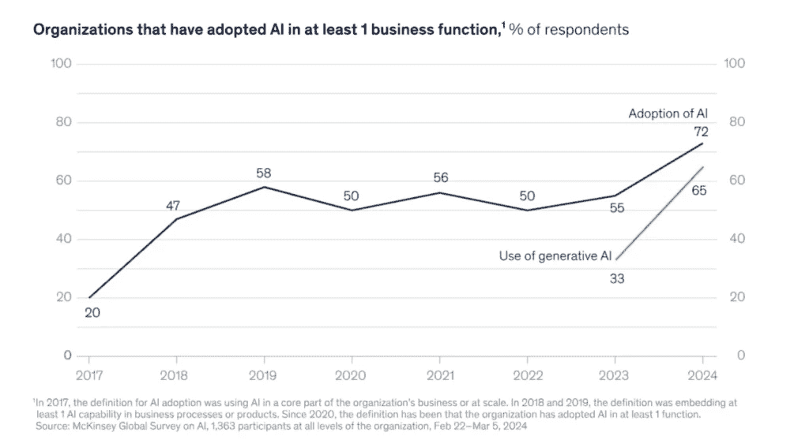
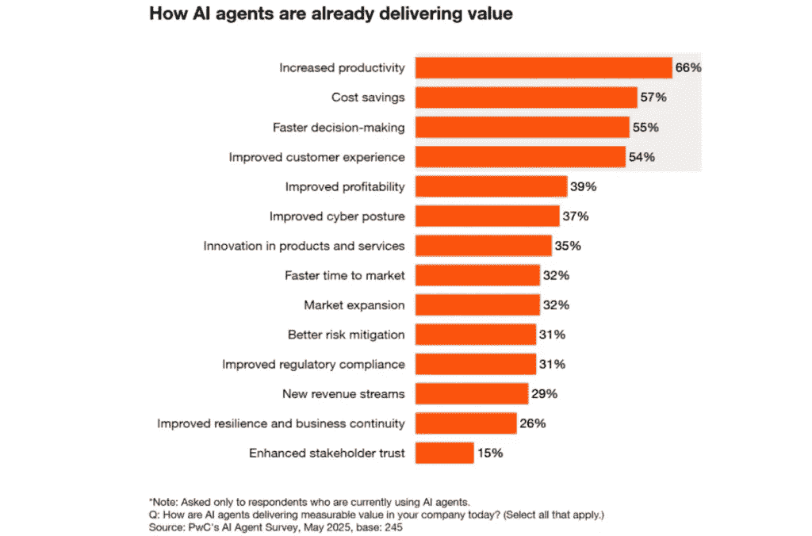
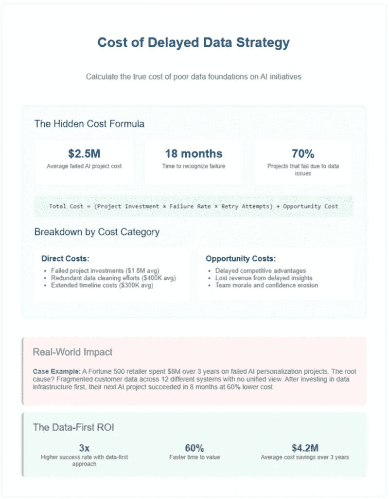

# rtslabs-Enterprise AI Roadmap: The Complete 2026 Guide

> 来源：[https://gotoaiworld.feishu.cn/docx/Z1xpdsofNotSrUxZ60acVZPFnJy](https://gotoaiworld.feishu.cn/docx/Z1xpdsofNotSrUxZ60acVZPFnJy)

https://rtslabs.com/enterprise-ai-roadmap/

Enterprise AI Roadmap: The Complete 2026 Guide

Enterprises are investing heavily in AI, yet leadership teams keep facing the same questions:

Which use cases matter?

Is our data ready?

What should we build first?

How do we scale responsibly?

Without a roadmap, even well-funded AI programs stall under unclear priorities, fragmented systems, and governance gaps. Many companies still struggle to convert AI investment into measurable results. As of 2024, only about 72% of organizations globally claimed some form of AI adoption, but a much smaller fraction reports real value creation (State of AI Adoption by McKinsey).

A well-designed enterprise AI roadmap gives leaders clarity, mapping opportunities to KPIs, outlining foundational requirements, and reducing the risk of costly missteps.

Enterprise AI adoption has increased dramatically during the past year

## What Is an Enterprise AI Roadmap?

An Enterprise AI Roadmap is a structured, strategic plan detailing how a company will adopt, scale, govern, and extract value from AI across business functions.

A traditional IT roadmap focuses on software upgrades or infrastructure. However, an AI roadmap ties AI investments directly to business outcomes, embeds governance from the start, and charts a path from proof-of-concept to production-grade deployment.

Some key differentiators that set an AI-based enterprise roadmap apart from traditional roadmaps include:

+ Business-outcome focus: AI use cases are evaluated based on ROI potential, not just technical novelty.

+ Data & infrastructure readiness: Assesses whether data pipelines, storage, integration, and compliance systems are ready for AI.

+ Governance and risk management: Incorporates policies for ethics, bias, traceability, and ongoing compliance, which are essential for responsible AI at scale.

+ Phased execution plan: Lays out a realistic 12–18 month timeline covering pilot, scale-up, and monitoring phases.

## How Far Most Enterprises Have Come With AI

To design an effective enterprise AI roadmap, it’s essential to ground expectations in reality. Industry data reveals that while adoption is widespread, meaningful, scalable AI maturity remains rare:

### Organizations have moved beyond the ‘pilot phase’ in 2024-25

Nearly every enterprise has embedded AI into at least one critical workflow. 96% of IT leaders say AI is now integrated into core business processes, a strong signal that AI has shifted from “innovation advantage” to “mandatory capability.” (Global Survey Report by Cloudera)

### Implementation remains isolated or partial

[McKinsey’s State of AI ](https://www.mckinsey.com/capabilities/quantumblack/our-insights/the-state-of-ai-2024)in Early 2024 report states that Global AI adoption reaches 72%, up from ~50% in previous years. Adoption surged in just one year, driven by enterprise pressure to modernize and stay competitive.

However, fewer than 10% of organizations have scaled AI agents beyond pilot. Despite high usage, true scaling remains rare. Most enterprises still deploy AI in isolated pockets rather than end-to-end processes.

### Embedded AI to truly bring bottom-line impact

Workflow redesign emerges as the #1 factor linked to measurable AI ROI. Enterprises see bottom-line impact only when AI is embedded directly into processes. And, not when used as standalone models or tools.

“More than three-quarters of respondents now say that their organizations use AI in at least one business function.”

~[2026 McKinsey & C](https://www.mckinsey.com/~/media/mckinsey/business%20functions/quantumblack/our%20insights/the%20state%20of%20ai/2025/the-state-of-ai-how-organizations-are-rewiring-to-capture-value_final.pdf)ompany global survey

### AI adoption without governance is the biggest enterprise risk

PwC’s 2026 AI Agent Survey finds that only 34% of enterprises say their AI programs produce a measurable financial impact, and less than 20% have mature governance frameworks in place to manage AI responsibly.

AI is not far from going mainstream. But scaling and value extraction remain uncommon. Most efforts are still limited to pilots or fragmented deployments. That gap is the reason why an Enterprise AI Roadmap is crucial, i.e., to guide transformation beyond experimentation and into sustainable, measurable business impact.

## Why Enterprise AI Roadmap Matters

Most enterprises already believe in AI’s potential. But belief alone doesn’t translate into value. What separates organizations that experiment with AI from those that scale it and produce measurable ROI is a structured, intentional roadmap.

A roadmap aligns teams around business priorities, clarifies technical requirements, builds governance foundations, and charts a phased path from pilot to production.

Without a roadmap, AI initiatives tend to fragment. Business units chase their own use cases, data teams sink time into unresolved quality issues, and vendors drop in and out with point solutions that never integrate.

Only a third of enterprises report measurable financial ROI from AI, despite wide adoption, and the leading reason cited was the lack of an enterprise-wide strategy guiding these investments.

A well-structured enterprise AI roadmap prevents this drift. It forces clarity around what to build, why it matters, how it integrates, who owns it, and how it scales. It reduces risk by

+ Establishing governance and compliance guardrails early

+ Improves cross-team alignment

+ Accelerates time-to-value by eliminating rework, duplicate efforts, and technical blind spots.

Most importantly, a roadmap shifts AI from a technology conversation to a business performance conversation. It ties AI initiatives directly to P&L impact, whether that’s reducing operational costs, improving forecasting accuracy, automating decisions, or enhancing customer experience.

## Core Components of an Enterprise AI Roadmap

While every organization’s journey differs, the foundations of a mature enterprise roadmap are consistent. These components determine whether AI remains a series of disconnected experiments or becomes a scalable enterprise capability.

### Business Objectives & Use-Case Prioritization

Every roadmap begins with a fundamental question: Which business outcomes should AI improve?

The most successful AI programs tie use cases directly to measurable P&L drivers like reduced operating cost, improved forecast accuracy, churn reduction, faster cycle times, and higher revenue per customer.

Value Drivers are significant in any AI enterprise roadmap

We approach this stage through structured AI Opportunity Mapping workshops to identify high-ROI use cases based on feasibility, data readiness, and measurable business value. Instead of focusing on trendy AI ideas, the roadmap targets use cases that deliver sustained operational or financial impact.

### Data Readiness & Infrastructure Assessment

No AI roadmap succeeds without data maturity. This step evaluates the current state of enterprise data across five levels, from Level 0, which stands for “unavailable or siloed data,” to Level 4 for “real-time, governed, production-ready data ecosystems.

We use a Data Readiness Scorecard that evaluates:

+ Data availability and completeness

+ Quality, lineage, and consistency

+ Integration across ERP, CRM, product, and operational systems

+ Governance and access controls

+ Real-time or batch accessibility

+ Security and compliance posture

70% of AI failures originate from unresolved data issues (Turning Data into Wisdom), making data readiness the most critical phase of the roadmap. A roadmap ensures these gaps are identified early, preventing AI teams from building on brittle or incomplete foundations.

Most AI projects fail due to data issues

## Technology & Architecture Blueprint

This stage defines the technical ecosystem required to support scalable AI, including cloud environments, pipelines, security, `MLOps` tools, observability systems, model registries, and deployment pathways.

Enterprises often over-focus on [models](https://www.gartner.com/en/newsroom/press-releases/2025-06-25-gartner-predicts-over-40-percent-of-agentic-ai-projects-will-be-canceled-by-end-of-2027)and under-focus on architecture. Gartner warns that over 50% of enterprise AI initiatives fail to reach production through 2027 because foundational architecture is missing. A roadmap outlines the full stack and prevents the common pitfall of “tech sprawl”, i.e., when multiple disconnected tools are acquired before a strategy.

## People, Skills & Operating Model

AI is not only a technical transformation. Rather, it is an operational and cultural one. A mature roadmap defines the operating model needed to support production AI, which clearly defines who owns the models, who manages pipelines, how teams collaborate, and which roles must evolve or be added.

This may include:

+   Establishing an AI Center of Excellence (`CoE`)

+   Redefining responsibilities among data engineering, ML engineering, and business teams

+   Reskilling teams for prompt engineering, model monitoring, and data stewardship

+   Identifying capability gaps that require hiring or partnering

In PwC’s 2026 survey, 38% of respondents said that skill gaps were among the top 3 barriers preventing enterprises from scaling AI agents, ranking above funding and tooling.

## Governance, Risk & Compliance (GRC)

As AI moves into decision-making roles, governance becomes non-negotiable. Enterprises must manage fairness, transparency, data privacy, security, and model risk, especially in regulated industries.

A robust roadmap outlines governance mechanisms such as:

+   Data access controls and audit trails

+   Model explainability and fairness checks like `SHAP`, `LIME`, or counterfactuals

+   Bias monitoring

+   Drift detection and incident response

+   Policy frameworks that align with regulations like GDPR, HIPAA, and emerging AI Acts

Enterprises that don’t have mature AI governance leave themselves most exposed to compliance and reputational risk. RTS Labs embeds governance early in the roadmap, ensuring models are compliant by design.

### Fact Box: Why These Components Matter

## Enterprise AI Readiness Threshold (Proprietary RTS Framework)

Most enterprises adopt AI before they’re truly ready for it, and that’s why the majority of AI initiatives fail to scale. RTS Labs’ work with mid-market and enterprise clients shows that successful AI programs cross five critical readiness thresholds before building or deploying anything.

Organizations that skip these thresholds see higher costs, longer timelines, and inconsistent results. Companies with strong strategic alignment, clean data foundations, and defined governance structures are more likely to scale AI effectively and achieve measurable ROI.

The Enterprise AI Readiness Threshold™ helps leaders measure where they stand today and what must be strengthened before committing to large AI investments. Think of it as the “pre-deployment checklist” that reduces risk and accelerates value.

The 5 Thresholds Enterprises Must Cross Before Deploying AI at Scale include:

### Strategic Alignment Threshold

AI succeeds only when business and technical teams agree on why AI is being deployed. This threshold evaluates whether business units have defined outcomes, KPIs, and value metrics tied to AI initiatives. Without alignment, AI becomes a patchwork of disconnected pilots.

Key questions you must ask at this threshold:

+   Do business leaders agree on the problems AI should solve?

+   Are KPIs tied to cost, revenue, risk, or customer outcomes?

+   Is there executive sponsorship and budget continuity?

### Data Maturity Threshold

AI’s [performance](https://www.gartner.com/en/newsroom/press-releases/2025-02-26-lack-of-ai-ready-data-puts-ai-projects-at-risk) depends entirely on the quality, completeness, and accessibility of enterprise data. We evaluate data maturity across availability, lineage, integration, accuracy, latency, security, and governance. Gartner predicts that 60% of agentic AI projects will fall through in 2026 due to a lack of AI-ready data. Unless data maturity reaches a minimum viable threshold, AI models deliver inaccurate insights or fail.

Key questions to ask:

+   Are critical datasets unified and governed?

+   Do pipelines support real-time or near–real-time operations?

+   Are data models and lineage documented?

### Infrastructure Threshold

Enterprises need modern, scalable infrastructure before deploying AI, including cloud environments, data platforms, `MLOps` pipelines, monitoring systems, and security layers.

Infrastructure readiness ensures models can be trained, deployed, monitored, and scaled reliably, without costly reengineering during production.

Key questions to ask:

+   Is there a unified data platform?

+   Do we have `CI/CD` for ML models?

+   Are monitoring, drift detection, and model registries in place?

### Team Capability Threshold

AI transformation requires ML engineers, data engineers, product leaders, domain SMEs, and governance experts aligned under a shared operating model. This threshold assesses whether the teams have the skills and capacity to support an AI program and where augmentation or training is needed.

Key questions to ask here:

+   Do we have ML engineering capacity to operationalize models?

+   Is there an AI Center of Excellence (`CoE`)?

+   Do teams understand model governance, explainability, and risk controls?

### Governance Threshold

AI introduces new risks like bias, hallucinations, drift, privacy violations, compliance failures, and opaque decision-making. We treat governance as a non-negotiable threshold, not an afterthought.

McKinsey’s State of AI survey finds that only 28% of the AI-led organizations have their CEOs taking care of AI governance. Governance readiness ensures models are explainable, auditable, compliant, and aligned with organizational ethics.

Key questions to ask:

+   Do we have model risk and bias monitoring?

+   Are audit trails and decision logs available?

+   Are policies aligned with GDPR, HIPAA, SOC 2, AI Act, etc.?

## Step-by-Step AI Roadmap for Enterprises

A successful enterprise AI roadmap is executed in structured phases over 12–18 months. Each phase builds on the previous one, reducing risk, strengthening foundations, and moving the organization closer to production-grade, scalable AI.

### Phase 1: Discovery & Alignment (Weeks 1–8)

This phase establishes the strategic direction. It begins with stakeholder interviews across business, data, product, and IT teams to understand priorities, constraints, and pain points. We use rapid opportunity workshops to map AI initiatives against business outcomes like cost savings, revenue uplift, productivity gains, or risk reduction.

During this phase, leaders define strategic goals, success metrics, integration boundaries, change management expectations, and the executive sponsorship model. This alignment prevents fragmented or duplicative AI projects later in the roadmap.

### Phase 2: Use Case Selection & Business Case Modeling (Weeks 6–12)

Not every use case should be pursued. This phase scores potential AI initiatives along feasibility, data readiness, business value, risk, and timeline. We apply “T-shirt sizing” (S/M/L/XL) to estimate effort and cost quickly while identifying near-term value accelerators.

Enterprises often discover that the majority of early use cases are either technically premature or lack measurable impact. A roadmap filters these out, ensuring resources focus on high-ROI initiatives.

Outputs such as prioritized use-case portfolio, feasibility assessment, value-to-effort matrix, expected ROI model, and high-level implementation roadmap ensure leadership invests in the right sequence, reducing early-stage waste.

### Phase 3: Data & Infrastructure Foundations (Months 3–6)

Phase 3 is the most critical and time-consuming. During this phase, the teams are busy modernizing data pipelines, establishing governance, and setting up MLOps environments. Enterprises create unified data sources, integrate ERP/CRM/product systems, and design secure, scalable cloud infrastructure.

Here, we focus on building or modernizing data lakes/warehouses, integrating systems for unified data access, establishing MLOps pipelines (CI/CD for ML), implementing identity, risk, and access control, and creating feature stores and lineage-based governance. By the end of this phase, the organization has a stable foundation ready for modeling and automation.

### Phase 4: Pilot Prototypes & Proof of Concepts (Months 6–12)

This phase validates technical feasibility and business impact. Instead of large, expensive pilots, we use rapid prototyping for building functional models in 4–8 weeks. These prototypes are injected into actual workflows to test accuracy, performance, and usability.

Successful pilots are measured on clear KPIs like prediction accuracy, cycle time reduction, cost savings, user adoption, and integration speed. This phase de-risks full deployment and produces evidence for scaling decisions.

Teams must focus on deliverables, such as working AI models, architecture validation, data pipeline stress tests, user feedback loops, governance controls for scale, and a production readiness plan.

### Phase 5: Deployment, Scale & Continuous Optimization (Months 12–18)

Once pilots prove value, models move into production with continuous monitoring, retraining, and performance optimization. The roadmap guides how models evolve, how new use cases enter the pipeline, and how governance keeps systems compliant.

This phase includes:

+ Deployment into production systems
+ Model monitoring & drift detection
+ Ongoing retraining schedules
+ Cost governance & observability
+ User enablement & CoE support
+ Multi-use-case expansion strategy

## Common Roadmap Mistakes Enterprises Make

Even with growing AI adoption, most enterprises struggle to scale AI beyond initial pilots, not because of a lack of ambition, but because of structural mistakes made early in the roadmap process. These missteps create bottlenecks that slow momentum, inflate costs, and undermine confidence across leadership teams.

Understanding these pitfalls is essential to designing a roadmap that actually delivers impact.

### Starting with the technology, not the problems

Many organizations jump into buying tools, experimenting with vendors, or building models before defining the business outcomes AI must support. Few enterprises link AI initiatives to P&L-level metrics, which is a major reason why scaling fails. AI without business alignment quickly becomes a patchwork of disconnected pilots.

### Over-scoping early projects

Another frequent misstep is over-scoping early projects. Companies often attempt to deploy AI across multiple systems or business units simultaneously, leading to inflated timelines, integration complexity, and failure to reach measurable outcomes. AI projects stall because teams try to “boil the ocean” instead of pursuing focused, high-impact use cases first.

### Not having a model-ops plan

Enterprises invest heavily in model development but overlook the processes required to monitor, retrain, and manage models post-deployment. AI models degrade or drift out of compliance within a year when MLOps pipelines are not in place, creating hidden risks. This is especially critical in regulated industries, where explainability and auditability are non-negotiable.

### Relying on siloed teams

Siloed execution also derails roadmaps. Data teams, business teams, and compliance groups often operate in isolation, leading to misaligned priorities and fragmented ownership.

### Ignoring data contracts and lineage

Finally, many enterprises underestimate the importance of data contracts, lineage, and governance. AI systems depend on clean, consistent, and traceable data, yet most organizations lack standards around data quality and access controls. Without governance, even well-designed AI solutions become unreliable or risky.

## Sample Use Cases That Fit a Mature Enterprise AI Roadmap

Mature AI roadmaps focus on use cases that cut across multiple systems, touch core business workflows, and can be scaled across business units. Below are examples of the types of initiatives enterprises typically launch once they have reached AI readiness.

### Predictive Maintenance (Manufacturing, Logistics, Energy)

Predictive maintenance models analyze IoT sensor data, machine telemetry, and historical failure patterns to anticipate equipment breakdowns before they occur. This enables proactive repairs, reduced downtime, and extended asset life.

We frequently deploy predictive models for clients with distributed equipment or fleets, integrating telemetry data with cloud ML pipelines to deliver real-time health monitoring and automated alerts.

### Intelligent Process Automation (Finance, Supply Chain, Insurance)

Enterprises use AI to automate decision-heavy workflows such as credit evaluation, claims processing, demand planning, or quality inspections. Intelligent automation incorporates reasoning, anomaly detection, and business rules.

We build autonomous workflows combining RPA, ML, and decision engines for finance and supply chain teams, especially where accuracy, auditability, and real-time insights are required.

### Personalized Customer Experience (Retail, SaaS, Banking)

Advanced personalization models leverage behavioral, transactional, and contextual data to deliver dynamic recommendations, personalized messaging, churn forecasts, and next-best-action decisions.

RTS Labs has built AI-driven personalization engines for SaaS and e-commerce clients, enabling real-time segmentation and dynamic content delivery across digital channels.

### AI for Finance & Forecasting (Enterprise FP&A, Operations)

AI models synthesize historical usage, macroeconomic indicators, sales pipelines, and operational signals to forecast revenue, costs, demand, and cash flow more accurately. RTS Labs implements forecasting models for mid-market and enterprise finance teams, integrating ERP and CRM data with AI agents that support planning, budgeting, and variance analysis.

### Compliance Monitoring & Risk Intelligence (Financial Services, Healthcare, Public Sector)

Compliance AI monitors transactions, logs, user behavior, and operational workflows to identify violations, fraud, policy breaches, or anomalies. With regulators increasing scrutiny around AI, governance-by-design automation is becoming essential.

### Enterprise Use Case Fit Matrix

## How RTS Labs Develops Enterprise AI Roadmaps

Most consulting firms deliver AI strategy decks. RTS Labs builds AI roadmaps that actually ship into production. The difference lies in how the roadmap is created. We combine enterprise-grade rigor with hands-on technical execution, helping organizations move from AI exploration to scalable deployment with far less risk.

RTS Labs doesn’t work like rational advisor firms. It embeds engineers, data scientists, and solution architects directly into the roadmap process so that every recommendation is grounded in technical feasibility and aligned with the organization’s data realities. As a result, enterprises waste less time on unscalable ideas and more time accelerating high-impact use cases.

## Business-First Approach

The process begins with a business-first lens, mapping AI initiatives to financial outcomes such as cost reduction, cycle-time compression, and revenue uplift. We then evaluate data maturity using a diagnostic scorecard, highlighting where integration, quality, or governance gaps could undermine deployment.

This dual analysis allows leadership to focus on use cases that can succeed now, while sequencing more advanced initiatives in later phases.

## Proven Methodology: Strategy → Pilot → Scale

Where RTS Labs stands out most is in its methodology. Instead of long advisory cycles, the team builds working prototypes early, pressure-testing architecture, data pipelines, and governance controls before large budgets are committed. This reduces uncertainty and accelerates time-to-value.

## Integrated Engineering + Data + AI Teams

The company’s cross-functional delivery model is another differentiator. Data engineers, ML engineers, and software developers work alongside business stakeholders to design deployable systems for a seamless transition from strategy to execution, something most consulting firms cannot offer without external integrations or vendor dependencies.

## Transparency in Timeline & Budget

T[hese strengths](https://rtslabs.com/case-studies/innovation-that-drives-business-growth) show up repeatedly in RTS Labs’ outcomes. In one engagement with a national credit services provider, RTS Labs implemented predictive scoring and anomaly detection pipelines that improved portfolio risk insights and cut manual review time.

In another [case](https://rtslabs.com/case-studies/streamlining-success-with-salesforce-solutions), the team unified multi-system data flows like Salesforce, Marketo, Five9, and Geopointe, enabling a logistics-focused company to scale operations and break sales records.

## Ability to Actually Ship Production-Grade AI

Because RTS Labs combines strategic clarity with engineering depth, enterprises gain a roadmap that is not just directional but executable, governed, and aligned with real-world constraints. The result is an AI roadmap that reduces risk, accelerates value capture, and positions the organization to scale AI confidently across the next 12–18 months.

## The Road to Enterprise AI Starts With a Real Roadmap

Enterprise AI is entering a new maturity curve, one where experimentation is no longer enough and scalable, governed, high-ROI AI systems are becoming a competitive necessity. As adoption accelerates, the winners will be those with a clear roadmap: one that aligns AI with business value, strengthens data foundations, and builds the organizational maturity needed to deploy responsibly at scale.

Ready to build an AI roadmap that actually delivers? RTS Labs can help you assess readiness, identify high-impact use cases, and execute a phased roadmap tailored to your enterprise. Let’s design it together. Talk to our AI Experts Now

## FAQs

### How long does it typically take an enterprise to build and deploy a full AI roadmap?

Most large organizations require 12–18 months to define, validate, and operationalize an enterprise AI roadmap. Timelines depend heavily on data maturity, integration complexity, and the number of use cases selected for early deployment.

### What’s the biggest reason enterprise AI roadmaps fail?

The most common failure point is misalignment between business owners and technical teams. Many enterprises select use cases based on technical excitement instead of measurable P&L impact. Without business-driven prioritization and defined KPIs, even technically successful AI deployments fail to generate meaningful ROI.

### How does an AI roadmap help enterprises manage risk and regulatory exposure?

A roadmap standardizes governance across the lifecycle to outline bias controls, audit trails, data lineage, access roles, and model refresh cycles, and manage compliance with frameworks like SOX, GDPR, HIPAA, and emerging AI regulatory standards (e.g., EU AI Act). This reduces exposure from model drift, opaque decisioning, or improper data usage.

### How does RTS Labs accelerate roadmap execution compared to traditional consultants?

RTS Labs uses an engineering-first delivery model, combining strategy + architecture + machine learning + MLOps under one roof. Instead of handing off a slide deck, RTS teams prototype, validate, and deploy AI components during the roadmap period, enabling faster time-to-value and reducing the typical 3–6 month “gap” between strategy and build.

### Can RTS Labs work with enterprises that already have internal data science or AI teams?

Yes. RTS Labs frequently partners with internal DS/AI teams as an extension layer, helping with architecture, engineering, advanced modeling, automation, and scaling workloads. Many enterprises use RTS Labs to accelerate difficult components like data engineering, multi-cloud integration, or model operationalization, while keeping decision-making internal.
