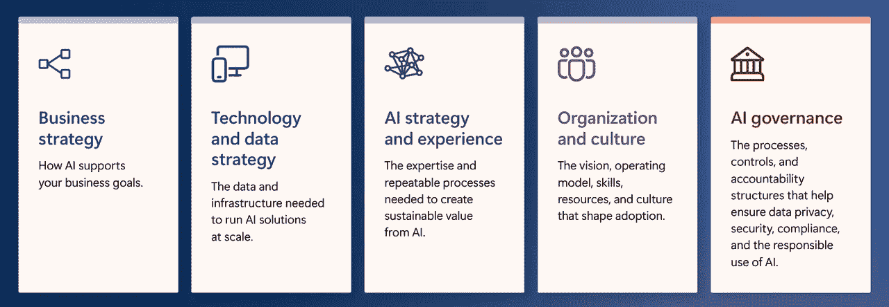
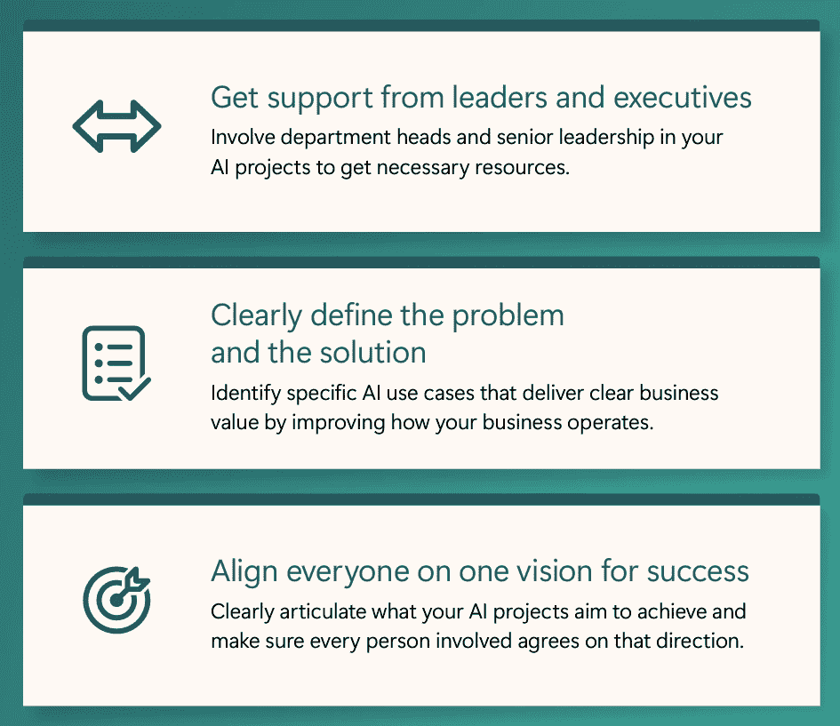

# Microsoft- The AI Strategy Roadmap

> 来源：[https://gotoaiworld.feishu.cn/docx/CYSJd9YtOo3m0pxqq3NcbNynnDe](https://gotoaiworld.feishu.cn/docx/CYSJd9YtOo3m0pxqq3NcbNynnDe)

A strategic approach to assessing your AI readiness

What can we learn from organizations that are creating value with AI?

AI has come a long way since John McCarthy coined the term in 1956.(1) Once an academic concept, it’s now a transformative force—shaping industries and empowering organizations to drive meaningful change. Today, we’re navigating a full-scale platform shift powered by AI and accelerated by adoption at scale. But while AI technology is advancing rapidly, the real differentiator lies in how leaders and organizations prepare to harness it.

The AI Strategy Roadmap—updated with new insights and best practices—shares what Microsoft has learned about effective AI implementation for creating sustainable value. Its actionable guidance is designed to help you focus on the steps that are most likely to drive results. Here are some of the questions we sought to answer with this research:

What are the characteristics of organizations that realize value from AI at scale?

What do leaders need to think about from a technology, business, and organizational perspective to enable them to meet their goals?

What is the roadmap to success with AI? (Spoiler alert—there’s no single AI roadmap.)

What is the top priority of most AI initiatives, and how does that change as organizations realize value?

What is the single most predictive factor for success with AI?

AI Strategy Roadmap

Optimize your AI implementation roadmap for impact and scale

[Get started](https://info.microsoft.com/ww-landing-ai-strategy-roadmap-navigating-the-stages-of-ai-value-creation.html)

Whether you’re just starting to build [your AI roadm](https://www.microsoft.com/en-us/worklab/work-trend-index/2025-the-year-the-frontier-firm-is-born)ap or striving to become a Frontier Firm—an AI-first business that challenges norms with bold innovation—The AI Strategy Roadmap offers clear, evidence-based guidance. From early exploration to organization-wide transformation, it’s designed to help you move forward with confidence and use AI to drive innovation with tangible business benefits.

Refreshed roadmap for AI implementation at scale

The AI Strategy Roadmap reflects our ongoing commitment to helping organizations unlock real business value with AI. Building on our foundational research and informed by more than 100 interviews with business and IT leaders, this refreshed guide offers a practical AI implementation roadmap for adopting and scaling AI across your organization.(2)

It’s not (just) about the technology

AI technology is evolving at a remarkable pace, and the pace of innovation is humbling. Yet the ability to realize value from AI depends as much on strategic, organizational, and cultural factors as it does on technology.

The AI Strategy Roadmap offers deep insights into the five drivers that contribute to an organization’s ability to deliver value with AI:

Business strategy

Technology and data strategy

AI strategy and experience

Organization and culture

AI governance

Together, these strategic levers provide a practical lens for understanding an organization’s current state and charting a path forward. When developed in tandem, they empower teams to accelerate AI progress and proactively manage risk.

There’s no single AI roadmap for success

Microsoft Cloud

[Learn more ↗](https://www.microsoft.com/en-us/microsoft-cloud)

Given the diversity among organizations in terms of size, age, region, industry, and other attributes, there is no “one size fits all” AI roadmap. Successful AI strategy shouldn’t be pursued in isolation, but instead aligned with the overall business strategy of your organization. The AI Strategy Roadmap includes guidance to help you map your AI strategy and identify the highest-impact actions based on your organization’s stage of readiness and unique needs.

Active leadership buy-in is essential and plays a key role in driving AI readiness. When leaders are engaged, AI becomes a core part of strategic planning, performance outcomes, and the organization’s long-term vision.

> Success looks different from one organization to the next—and what it looks like may change over time depending on your unique business challenges and objectives.

A clear vision is essential—but leaders also emphasize the need to build technical capabilities and repeatable processes. Early momentum often focuses on AI strategy and experience, as learning about and ideating on potential AI use cases helps translate vision into execution.

To turn AI into real business value, organizations need the right technology foundation and high-quality data. When those elements are aligned to strategic goals, teams can move from experimentation to scalable impact—quickly, responsibly, and with measurable results.

> Gaining trust that your AI solutions will work effectively is an ongoing process. Most companies continually validate the accuracy of their AI outputs.

As AI implementation progresses, the priority often shifts to organization and culture. This reflects the fact that, by now, some of the critical groundwork needed to deploy AI projects is in place, and enablement is the next priority. This includes steps such as identifying AI experts, defining an operating model, and, most importantly, securing the leadership vision and support needed to deliver sustainable value.

Senior leadership’s vision and support are—by far—the strongest drivers of success

A leader-driven AI strategy is most strongly associated with AI value creation. We saw that, as organizations reach the more advanced stages of AI adoption, they become more likely to add a chief AI officer (CAIO) to their executive team.

According to decision makers from leading organizations, true alignment goes beyond excitement for advancing technologies. It requires executive sponsorship and a unified vision of success—one that clearly communicates project goals and brings teams together around a shared business imperative.

Achieve more in the age of AI

The AI Strategy Roadmap lays out actionable steps you can take to build momentum toward your goals, based on your organization’s stage of AI readiness. Whether you’re just starting out or working to become a Frontier Firm, we hope the insights we’ve shared help you lay the foundation for sustainable AI innovation, accelerate your organization’s time to value, and help you achieve more in the age of AI.

Fo[r](https://info.microsoft.com/ww-landing-ai-strategy-roadmap-navigating-the-stages-of-ai-value-creation.html) a practical AI implementation roadmap to help accelerate your path to value with AI, download The AI Strategy Roadmap: Navigating the stages of AI value creation.

Assess your AI readiness