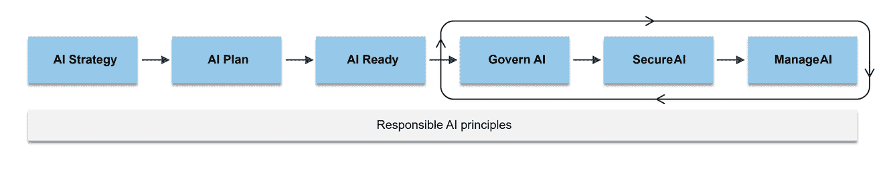

# Microsoft AI adoption

> 来源：[https://gotoaiworld.feishu.cn/docx/DTg4d3tOQoeEm6xwpLnc2pBDnBe](https://gotoaiworld.feishu.cn/docx/DTg4d3tOQoeEm6xwpLnc2pBDnBe)

# AI adoption

https://learn.microsoft.com/en-us/azure/cloud-adoption-framework/scenarios/ai/

The Cloud Adoption Framework (CAF) provides a structured process for adopting AI solutions in Azure. This framework outlines clear steps, many of which apply to Microsoft Copilot adoption.

The CAF AI adoption process supports organiza[tions ra](https://www.microsoft.com/startups)nging from large enterprises to startups. You learn how to identify AI use cases, select appropriate AI solutions, and build effective AI workloads. The guidance also covers operational processes required for governance, management, and security of AI implementations.

Figure 1. How to use the AI adoption guidance.

## AI checklists

Use these AI checklists as a practical roadmap for adopting and managing AI. The enterprise checklist equips your organization to scale AI effectively. The startup checklist helps you quickly move toward production while adopting governance, management, and security best practices.

## Next step

---

## Additional resources

Documentation

+   [Set up a WSL dev](https://learn.microsoft.com/en-us/windows/wsl/setup/environment?source=recommendations)elopment environment

+   Set up a WSL development environment using best practices from this set-by-step guide. Learn how to run Ubuntu, Visual Studio Code or Visual Studio, Git, Windows Credential Manager, MongoDB, MySQL, Docker remote containers and more.

+   What is Windows Subsystem for Linux

+   Learn about the Windows Subsystem for Linux, including the different versions and ways you can use them. Microsoft Loves Linux.

+   [Exchange Server e](https://learn.microsoft.com/en-us/exchange/plan-and-deploy/deployment-ref/editions-and-versions?source=recommendations)ditions and versions

+   Summary: Learn about the different versions of Exchange Server.

Show 4 more

Training

Learning path

[Copilot Foundation](https://learn.microsoft.com/en-us/training/paths/copilot-foundations/?source=recommendations)s AI-3018 - Training

Learn about generative AI and how to use copilots with Copilot Studio and Microsoft Foundry. (AI-3018)

Certification

[M](https://learn.microsoft.com/en-us/credentials/certifications/azure-ai-fundamentals/?source=recommendations)icrosoft Certified: Azure AI Fundamentals - Certifications

Demonstrate fundamental AI concepts related to the development of software and services of Microsoft Azure to create AI solutions.

Events

Microsoft AI Tour

Dec 17, 12 AM - May 27, 12 AM

Take your business to the AI frontier with the Microsoft AI Tour

Free to join. Request to attend

https://learn.microsoft.com/en-us/azure/cloud-adoption-framework/scenarios/ai/