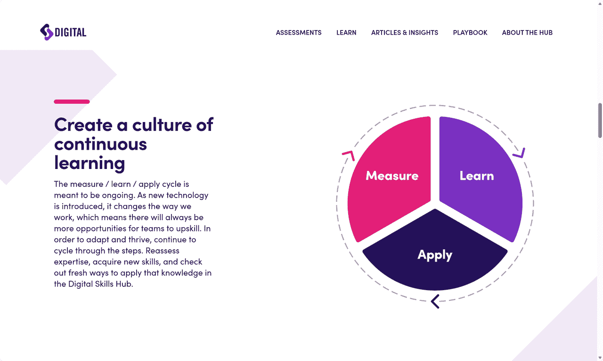

# Generative-AI-Adoption-Framework

> 来源：[https://gotoaiworld.feishu.cn/docx/YXtRdHP3YoWcQ1xYLXocTexnnwf](https://gotoaiworld.feishu.cn/docx/YXtRdHP3YoWcQ1xYLXocTexnnwf)

Generative AI Adoption Framework

The skills hub is[ a pilo](https://www.digitalsupercluster.ca/)t project by DIGITAL, Canada's Global Innovation Cluster for digital technologies – an independent, not-for-profit that grows grows Canadian businesses through the development, adoption and deployment of Canadian-made technologies and by working with industry to develop a digitally skilled workforce to positively impact lives across our country.

Headquartered in Vancouver, B.C., we acknowledge we are on the unceded and ancestral territories of the Xʷməθkʷəy̓əm (Musqueam), Sḵwx̱wú7mesh (Squamish), and Sel̓íl̓witulh (Tsleil-Waututh) Nations. As a pan-Canadian organization, DIGITAL additionally operates on the ancestral and unceded territory of the Inuit, Métis, and First Nations peoples who share and steward these lands. We are committed to continuous learning and contributing to meaningful reconciliation as we live, work and play on this land.

https://hubpilot.digitalsupercluster.ca/

https://hubpilot.digitalsupercluster.ca/

