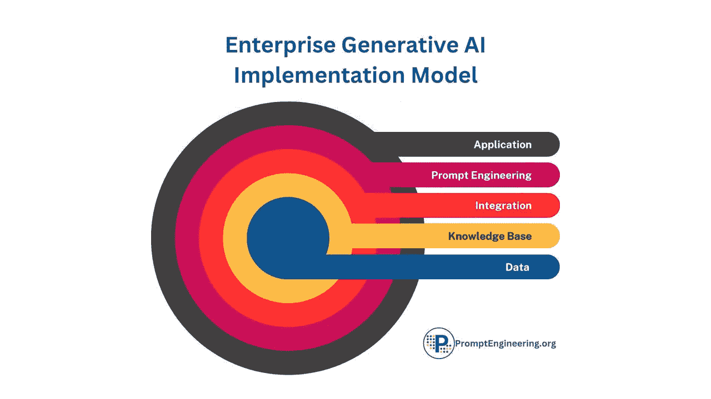
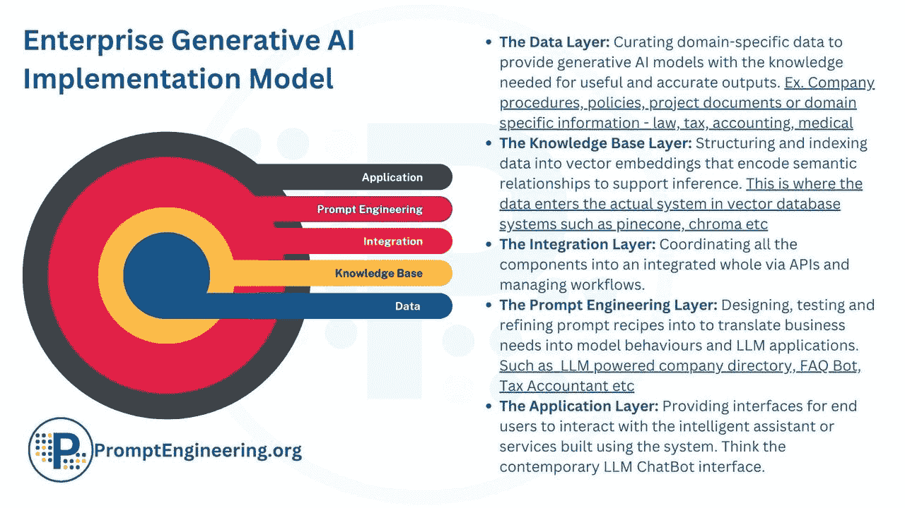
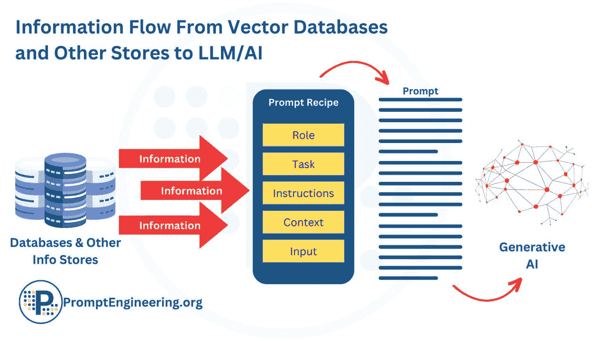

# Promptengineering.org-A Strategic Framework for Enterprise Adoption of Generative AI

> 来源：[https://gotoaiworld.feishu.cn/docx/FLmpd74E4o0M6PxQSF9cnyQvnVd](https://gotoaiworld.feishu.cn/docx/FLmpd74E4o0M6PxQSF9cnyQvnVd)

A Strategic Framework for Enterprise Adoption of Generative AI

https://promptengineering.org/enterprise-generative-ai-implementation-model/

# A Strategic Framework for Enterprise Adoption of Generative AIFeatured Post

[Lesson](https://promptengineering.org/tag/lesson/)

Empower your organization or business with AI through this comprehensive framework and blueprint.

## TLDR:

This article outlines a layered model for strategically adopting generative AI within enterprises. The core components include:

+   Data layer - Curating high-quality, domain-specific datasets to provide the knowledge base for generative models.

+   Knowledge base layer - Structuring and indexing data for efficient querying by models during inference.

+   Integration layer - Unifying diverse services into a cohesive, modular AI platform.

+   Prompt engineering layer - Creating and optimizing interactions between humans and AI models.

+   Application layer – Providing interfaces for end users to interact with the intelligent assistant or services.

Together these layers enable businesses to leverage generative AI as a flexible tool tailored to enhance workflows across operations. The model demystifies implementation, providing a valuable framework for integrating these powerful capabilities into existing systems. With thoughtful adoption, enterprises can realize substantial gains in productivity, personalization, innovation, insights and new opportunities.

## Realizing the Business Potential of Generative AI

Integrating generative AI into operations and workflows can deliver tremendous value and competitive advantages for enterprises across sectors. Organizations stand to realize manifold benefits by strategically adopting these rapidly-evolving technologies.

Firstly, generative AI can unlock higher-order business opportunities that were simply impossible without AI capabilities. By automating complex tasks or revealing insights from vast datasets, new product offerings and revenue streams can emerge.

Secondly, generative models like large language models can significantly enhance productivity by automating repetitive, manual workflows. This frees up employees across teams to focus on more strategic initiatives that drive growth.

Rapid, personalized content generation at scale is another key advantage. Marketing teams can leverage AI to create customized communications and accelerate content production. This agility and personalizationbuild stronger customer connections.

Generative AI also accelerates innovation cycles, particularly in knowledge-intensive domains like pharmaceuticals and materials science. Companies can speed R&D and reduce time-to-market for new innovations.

Additionally, intelligent analytics of enterprise data enables more informed, data-driven decision making. Generative models can process vast amounts of information and reveal insights humans may miss.

Finally, the flexibility to fine-tune solutions to specific organizational needs gives enterprises an adaptable technology advantage. AI can be trained to handle niche workflows and complement specialized knowledge workers.

With prudent adoption, generative AI delivers manifold dividends spanning increased efficiency, deeper personalization, accelerated innovation, data-driven insights, new opportunities, and future-proof advantages.

## A High-Level View of Enterprise-Generative AI

The following sections present a simplified, high-level model for implementing Generative AI within an enterprise. While abstracted, it aims to comprehensively encompass the core components and activities required in a real-world organizational deployment.

The model is structured and ordered to provide executives, managers, and other business stakeholders with an understandable overview of how the parts fit together into a cohesive generative AI stack. Overly technical details are purposely omitted to focus on the big picture.

By outlining the key layers, this model clarifies how crucial functions like data curation, knowledge indexing, prompt optimization, and orchestration combine to enable customizable, scalable AI solutions tailored to business needs.

The goal is to demystify generative AI and illustrate how enterprises can strategically leverage AI models like large language models as nimble tools to boost productivity, insight, and efficiency across workflows - with prompt engineering playing a central role in responsibly guiding model behaviours.

While simplified, this high-level view provides a valuable framework for leaders to grasp generative AI's immense potential and make informed decisions about adoption within their organization. Understanding the core components facilitates prudent investment and planning to extract maximum business value.

## The Data Layer - The Basis of Knowledge for Generative AI

The data layer provides the critical knowledge base that generative AI models need to produce useful and accurate outputs for highly custom use cases.

Enterprises looking to build Generative AI into their existing systems and workflows must carefully curate a high-quality dataset that encompasses all the key information required for their business, domain and use cases.

For example, an accounting software company would need to incorporate datasets covering financial reporting standards, tax codes, accounting principles, and industry best practices. This highly specialised content enables the generative model to create financial analyses, reports, and recommendations that adhere to accounting rules and regulations.

Or, if you are a system for a specialised domain such as contract law, this could include all collected legislation, statutes, cases, precedents, and even best practices and standards.

Structuring the data also requires developing a taxonomy and ontology that organizes concepts and their relationships in a way the AI can understand. This allows the system to infer connections and logically reason about accounting topics when generating text or completing tasks.

On top of the knowledge base, the data layer should include mechanisms for continuously updating the model's training data. This allows it to stay current with the latest accounting standards and tax law changes. Real-world usage data and feedback from subject matter/domain experts can also be incorporated to refine the model's performance.

Continuous updates may be automated after the initial corpus has been vectorised, or they may be done manually when needed or during specific periods. Finally, strong data governance and ethics safeguards must be implemented to ensure customer privacy, data security, and adherence to regulations like Sarbanes-Oxley.

Overall, curating high-quality, domain-specific data is the fuel that takes a generative AI from producing generic outputs to generating tailored, intelligent solutions.

### Building Knowledge Through Data Curation

Curating high-quality domain knowledge takes substantial time and resources, but delivers tremendous value. Prompt engineers work closely with subject matter experts across the business to deeply understand needs and identify relevant structured and unstructured data sources.

They carefully collect, clean, organize and tag data, ensuring it is formatted for AI consumption. Prompt engineers centralize unstructured data into unified data lakes to maximize insights. They also implement robust data governance including privacy, security, access controls and compliance.

By deeply interfacing with business stakeholders and meticulously curating knowledge, prompt engineers construct a rich data foundation enabling generative models to produce tailored, high-quality outputs. Data curation and centralization is a critical first step in the Generative AI stack.

## The Knowledge Base Layer: Connecting Data to Models

Sitting on top of the curated data layer is the knowledge base layer, which structures and indexes information so it can be efficiently queried by the generative AI model during inference. A key technology powering the knowledge base is vector embeddings and indexes.

Vector embeddings convert text and other unstructured data into mathematical representations that encode semantic relationships between concepts. This allows generative models to "understand" connections between data points and topics within its domain.

These vector representations are stored and indexed in vector databases, optimized for ultra-fast similarity searches. When a user prompts the generative model during inference, the system can query the vector knowledge base to find the most relevant data needed to construct its response.

For example, if a user asks about a specific accounting regulation, the system can rapidly match that question vector to vectors of accounting rules and retrieve the most relevant information to include in the prompt. This completed prompt is then sent to the LLM.

The vector knowledge base essentially serves as a dynamic long-term memory that continuously grows as new data is added. This allows generative models to go beyond their pre-trained parameters and incorporate external knowledge when generating intelligent, high-quality responses tailored to the user's context.

Together, the data layer and knowledge base layer provide the foundation of knowledge for safe, useful, and contextually-relevant generative AI.

### Designing and Strategizing the Knowledge Base

Constructing the knowledge base starts with foundational decisions around design and strategy. Several key questions need to be addressed:

+   What level of security and privacy is required? This informs whether proprietary or open-source databases are used.

+   How much are vendor cloud services trusted with data? This dictates if databases are local or cloud-based.

+   Should data clusters reside in separate vector databases? Segmentation may optimize performance.

+   Which approaches are best for organizing knowledge - vector embeddings or vector indexing? Different strategies suit different needs.

+   What update policies are optimal for new knowledge integration? Frequent incremental updates or batched overhauls.

Thoughtful knowledge base design enables tailoring to enterprise needs around security, performance, extensibility and more. Proprietary systems offer greater ease of deployment and management, while open source can be more flexible for data security concerns. Cloud vendors provide scalable infrastructure but local systems increase security.

By analyzing requirements and strategically architecting the knowledge base foundation, prompt engineers balance tradeoffs and maximize the value generative AI can deliver.

## The Integration Layer: Unifying Components into a Cohesive Platform

Sitting above the knowledge base is the integration layer, which brings together diverse components and services into a unified, cohesive AI platform. This layer handles integrating and routing requests and data between services, automating and optimizing system performance.

The integration layer provides a single entry point for developers, through APIs and SDKs. This allows them to easily tap into generative capabilities like text, code, image and audio generation without needing to assemble all the underlying components themselves.

Behind the scenes, the integration layer dynamically routes prompts and requests to the optimal generative model, whether that is a large pre-trained LLM or a fine-tuned custom model. It also manages rate limiting, and caching frequently used model outputs to reduce repetitive computations.

Additionally, the integration layer can chain together different plugins, tools and 3rd party APIs as needed to handle a particular user request. For example, it may ping a weather API to get local temperature data to include in a generated response.

By coordinating the interconnected components of the generative stack through robust integration, this layer enables the system to function as one intelligent, seamless AI assistant capable of completing sophisticated workflows from end to end.

Rather than building extensive custom functionality from scratch, the focus is on unifying capabilities through integration. Common services integrated include:

+   Cost and resource monitoring/optimization APIs to manage spend and other resources.

+   Logging and reporting tools for telemetry and analytics.

+   Caching services like Redis to reduce repetitive computations.

+   Prompt security scanning APIs to validate appropriateness.

The integration layer combines these and other services into a seamless platform. Prompt engineering insights ensure the integration design optimizes AI performance, cost, and reliability. While leveraging third-party capabilities, prompt engineers customize the integration to the specific use case or industry.

With thoughtful integration architecture, enterprises can tap into diverse services while maintaining control, security, and efficiency. The integration enables generative AI to draw on a wide range of capabilities, likely exceeding what companies can develop independently.

### Flexible Integration for Scaling and Diverse Budgets

The integration layer can be implemented through solutions at different budgetary levels based on business needs and technical capabilities:

+   Full Custom Development - Building extensive custom integrations from scratch maximizes control and customization but requires more time and development resources.

+   Low-Code Automation - Services like Zapier and Integromat enable connecting apps and stitching together workflows through GUI-based visual programming. This provides quick integration with less customization.

+   Hybrid Approach - Many integrate low-code tools for common connections while developing custom Python scripts or using off-the-shelf applications and code snippets for unique logic and optimizations. This balances automation with customization.

+   API-Based Integration - Many essential services provide APIs that can be tapped directly. API integration is lightweight and reusable across applications.

+   Open Source Libraries - Leveraging open-source connectors and integration libraries accelerates development. Popular options include Langchain, Langsmith etc.

The optimal integration solution balances factors like budget, speed, control and capabilities. Prompt engineers can deliver robust integration on varying budgets through thoughtful design and combining the most appropriate tools and techniques

## The Prompt Engineering Layer: Creating  & Optimizing Interactions with Generative AI

Sitting on top of the integration layer is the prompt engineering layer, where the generative AI capabilities come together into LLM workflows, apps and services. This layer provides interfaces and tools for prompt engineers and developers to build customized solutions.

T[he primar](https://promptengineering.org/what-are-large-language-model-llm-agents/)y method is through prompt engineering concepts such as AI Agents, Prompt Chaining and Generative AI Networks (GAINs). This can be done via graphical node-based interfaces where users can string together workflows using prebuilt blocks and modules.

This empowers a broader range of developers and business users to build precisely tailored solutions, using generative AI as a nimble tool rather than a complex system requiring separate AI/development expertise. It brings the power of large language models to the fingertips of enterprise teams.

[W](https://promptengineering.org/what-are-large-language-model-llm-agents/)hat Are Large Language Model (LLM) Agents and Autonomous Agents

[Large](https://promptengineering.org/what-are-large-language-model-llm-agents/) language models are rapidly transcending their origins as text generators, evolving into autonomous, goal-driven agents with remarkable reasoning capacities. Welcome to the new frontier of LLM agents.

Prompt EngineeringSunil Ramlochan

Generative AI Networks (GAINs)

[GAIN is a Prompt Engineering technique to solve ](https://promptengineering.org/the-evolution-of-artificial-intelligence-evaluating-the-promises-and-limitations-of-c/)complex challenges beyond the capabilities of single agents.

Prompt EngineeringSunil Ramlochan

GAINs & Agents allow engineers to construct sophisticated LLM-powered apps through visual design instead of needing to code. The interfaces include options to connect to data sources, run models, and integrate plugins or API services as needed for any use case.

For more advanced customization, this layer may support developing plugins and scripts that can tap into lower-level services. This allows for injecting unique logic while leveraging the heavy lifting of the generative models themselves.

Once constructed, LLM apps can be deployed as chatbots, custom web apps, or within enterprise software through the platform's APIs. Usage telemetry and monitoring help optimize app performance and user experience.

Prompt engineers design, test, and optimize prompts to translate business needs into effective interactions with large language models. Prompt engineering is a key discipline in generative AI focused on systematically guiding AI systems towards intended behaviours and outputs.

What is Prompt Engineering?

[Le](https://promptengineering.org/what-is-prompt-engineering/)arn What is Prompt Engineering and how it is shaping our interactions with Generative AI.

Prompt EngineeringSunil Ramlochan

Prompt engineers employ various techniques such as prompt templates, few-shot learning, chaining, demonstrations, and debiasing to craft prompts that elicit useful responses from the underlying models. They continuously evaluate prompt performance and refine prompts based on telemetry to maintain an up-to-date prompt library optimized for different workflows.

The prompt library serves as a knowledge base encapsulating recipes for diverse applications, reducing repetition and fostering prompt sharing within an organization. Prompt engineers also categorize prompts based on factors like tone, domain, output type, and parameters to support discoverability and reusability.

At runtime, the prompt engineering layer constructs prompts dynamically by filling parameterized templates or recipes with user context. This adapts prompts in real time while maintaining a consistent structure. The layer also manages chaining prompts together for complex conversations.

By optimizing interactions between humans and AI, the prompt engineering layer ensures generative models deliver maximum business value. It acts as the critical interface for translating various business needs into prompts that unlock the capabilities of large language models.

## The Application Layer: User Interfaces for AI

The topmost layer of the generative AI stack is the application layer, which provides the interfaces for end users to interact with the intelligent assistant or services built using the system.

By default, users can access the AI capabilities through a conversational chatbot interface. This natural language interface allows them to give prompts and receive generated responses, enabling easy access to the knowledge and capabilities powered by the layers below.

For custom applications, developers can build custom user interfaces that connect to the generative AI system via its APIs. These apps can have more specialized designs tailored to specific workflows, while still leveraging the AI to generate text, images, code and more.

For example, an expense reporting app could provide forms and inputs for users to describe their expenses, with the AI in the background automatically generating formatted reports adhering to accounting practices.

Third-party platforms like Vercel, Steamship, Streamlit and Modal can be used to quickly build web apps powered by generative AI. The application layer makes the AI system modular and extensible for diverse use cases.

Overall, the application layer focuses on optimizing the human experience and usability of the generative AI. Smooth user interfaces combined with monitoring of user feedback allow for continuously improving how your users interact with and benefit from AI.

## The Critical Role of Prompt Engineers in Enterprise AI Implementations

A prompt engineer plays an invaluable role in guiding successful enterprise adoption of generative AI. As prompt engineering is the key layer in translating business needs into effective AI interactions, dedicated prompt engineering expertise accelerates implementation and impact.

Prompt engineers deeply collaborate with business stakeholders to understand use cases and challenges. They craft optimized prompts and datasets tailored to the organization's specialized domain and workflows.

With their cross-disciplinary knowledge spanning both business and AI, prompt engineers serve as a bridge between teams. They educate colleagues on capabilities while gathering feedback to refine solutions.

For pilots and initial implementations, prompt engineers concentrate on optimizing core interactive experiences. This focuses impact where adoption matters most while avoiding over-engineering unused features.

As deployments scale, prompt engineers establish robust prompt management systems and tools to maintain high response quality across applications. They drive continuous improvement while monitoring for biases or harmful behaviours.

Dedicated prompt engineering mastery, whether via internal talent or external partners, is highly recommended when implementing enterprise generative AI. Prompt engineering ensures the AI solution remains aligned with the organization's needs amid evolving use cases.

## Takeaway

In summary, this high-level model outlines the core components needed to build an enterprise-grade generative AI stack. It provides a simplified yet comprehensive view of how the layers fit together into an end-to-end system, from curating the knowledge base to delivering tailored applications.

While an abstraction, the model elucidates the key activities in each layer, from data curation to prompt engineering to user interfaces. It makes clear how critical prompt optimization is in bridging business needs and AI model capabilities.

For leaders, this overview demystifies how generative AI can be strategically adopted and governed within organizations. It facilitates prudent planning and investment to extract maximum value. While simplified, these layers provide a valuable framework for conceptualizing the integration of generative AI across operations.

https://promptengineering.org/enterprise-generative-ai-implementation-model/