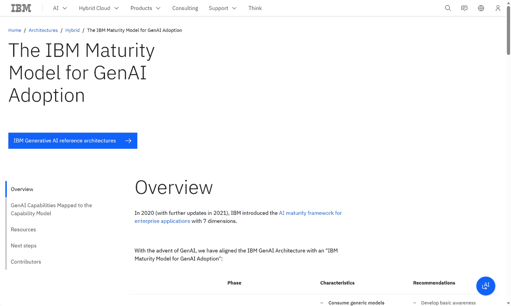

# The IBM Maturity Model for GenAI Adoption

> 来源：[https://gotoaiworld.feishu.cn/docx/HR5edEzDFo0Lp0xzqOpcPFI2nDg](https://gotoaiworld.feishu.cn/docx/HR5edEzDFo0Lp0xzqOpcPFI2nDg)

https://www.ibm.com/architectures/hybrid/genai-adoption-maturity-model

# IBM生成式人工智能（GenAI）采用成熟度模型总结

## 一、模型背景

IBM曾于2020年推出适用于企业应用的AI成熟度框架（2021年更新），包含7个维度。随着生成式人工智能（GenAI）的兴起，IBM将其GenAI架构与“GenAI采用成熟度模型”对齐，形成一套分阶段的发展指引体系。

## 二、核心阶段划分（5个阶段）

该模型按企业GenAI应用成熟度分为5个阶段，每个阶段均明确核心特征与对应建议：

| 阶段 | 核心特征 | 关键建议 |
| --- | --- | --- |
| 1 | 使用通用模型，方式不可预测且被动，仅局部推进，对GenAI认知有限 | 培养基础认知，启动试点项目 |
| 2 | 在主流GenAI环境使用定制化模型，流程不一致，初步形成文档，开始重视数据质量 | 制定集中化战略，开展基础培训，评估数据标准 |
| 3 | 基于GenAI环境利用企业全域数据，建立跨组织标准与治理机制，聚焦伦理问题 | 加强协作，应对GenAI相关挑战，搭建持续反馈机制 |
| 4 | 规模化运行和推理GenAI模型，实现计算/成本优化，进行主动指标追踪与定量评估，数据驱动决策 | 运用高级分析，关联业务目标，构建稳健的风险管理体系 |
| 5 | 跨环境安全构建和使用模型，实现成本最优，持续优化模型，具备主动应对能力，反馈循环成熟 | 鼓励创新，联合专家协作，审视并完善治理框架 |

## 三、各阶段GenAI能力与治理成熟度对应

### 1. 阶段1

+   GenAI能力：具备基础硬件和平台等GenAI资源，实现数据初步存储与管理的基础数据管理能力

+   治理成熟度：无AI生命周期治理机制

### 2. 阶段2

+   GenAI能力：拥有基础模型导入和数据导入功能的模型中心，具备GenAI相关基础IT运维支持能力，开始微调基础模型的GenAI应用开发起步

+   治理成熟度：出台部分AI政策，为AI生命周期提供指导

### 3. 阶段3

+   GenAI能力：提供模型API服务部署的模型托管、模型访问策略管理，支持针对特定需求的模型定制（含提示工程、模型微调等基础定制）

+   治理成熟度：建立通用指标体系，规范AI生命周期

### 4. 阶段4

+   GenAI能力：具备模型治理（应对偏见、合规等风险）、实时监控（含偏见检测、HAP检测）能力，GenAI应用融入编排、意图检测等高级功能

+   治理成熟度：实现AI生命周期的自动化验证与监控

### 5. 阶段5

+   GenAI能力：基于云平台实现动态需求下的高级模型定制，具备提示词监控与安全防护能力，可针对企业专属术语和流程深度定制模型，能开展全功能GenAI应用开发及从零创建模型

+   治理成熟度：AI生命周期治理完全自动化

## 四、相关资源

模型关联IBM多个配套框架与评估工具，包括：云采用与转型框架的7个维度、IT成熟度模型、企业应用AI成熟度框架、云采用与转型评估、现代集成评估。

该模型更新于2023年12月5日，为企业分阶段推进GenAI adoption提供了从能力建设到治理完善的全面指引。