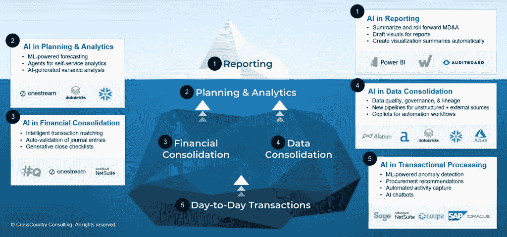

# AI Strategy & Transformation

> 来源：[https://gotoaiworld.feishu.cn/docx/Skt7dyJB7oxwqoxT5hJcuakEn3g](https://gotoaiworld.feishu.cn/docx/Skt7dyJB7oxwqoxT5hJcuakEn3g)

# AI Strategy & Transformation

https://www.crosscountry-consulting.com/solution/technology-enabled-transformation/ai-strategy-transformation/

## Accelerate AI innovation, mitigate risk, drive value creation

**The future is augmented by agents, powered** by data, and guided by human expertise. Navigate the complexities of AI adoption with tailored strategies that drive transformation, solve business challenges, and enable teams to thrive. Our comprehensive approach provides responsible AI deployment through innovative solutions, robust governance, and hands-on enablement programs. By balancing technology with human-centered design, we help businesses unlock new value and achieve a competitive advantage in an AI-powered world.

#### **Create an **AI-powered future. Here’s how.

# [**Strategic Transformation: Redesign yo**](https://www.crosscountry-consulting.com/solution/technology-enabled-transformation/ai-strategy-transformation/#)ur organization for an AI-powered future

Lead digital transformation by conducting human-centered design workshops to establish strategy and priorities. Our transformation programs include designing and implementing new operating models, innovation hubs, and business process redesigns. We can even create digital workers and integrate them into organizational charts while enabling enterprise-wide insights and value creation.

[**E**](https://www.crosscountry-consulting.com/solution/technology-enabled-transformation/reporting-and-analytics-framework/)xplore our proprietary CFO-led reporting and analytics framework

# [**A**](https://www.crosscountry-consulting.com/solution/technology-enabled-transformation/ai-strategy-transformation/#)I-Powered Solutions: Solve complex business process challenges with AI

Address business process challenges with AI by prioritizing use cases and selecting the right AI technologies. Our team develops and deploys intelligent AI agents that are embedded directly into complex workflows, such as controls testing and performance reporting. We also help you integrate AI tools to provide organizational insights, predictive modeling, and ROI quantification.

# [**A**](https://www.crosscountry-consulting.com/solution/technology-enabled-transformation/ai-strategy-transformation/#)I Enablement: Drive successful AI adoption across the organization

Optimize AI adoption with playbooks, starter packs, ROI templates, and tailored hands-on enablement programs based on your maturity level. We create upskilling programs, including certifications and capability development, and deliver comprehensive change management, training, and enablement to help your teams adapt and embrace AI.

# [**Governance, Security, and Risk: Manage e**](https://www.crosscountry-consulting.com/solution/technology-enabled-transformation/ai-strategy-transformation/#)nterprise risk and responsibly deploy AI

To help manage enterprise risks associated with AI adoption, we design and implement governance frameworks, conduct risk monitoring, and perform cybersecurity assessments from the beginning of engagement. We provide continuous oversight through monitoring agents to confirm compliance with ethical standards and maintain operational reliability in AI deployments.

https://www.crosscountry-consulting.com/solution/technology-enabled-transformation/ai-strategy-transformation/