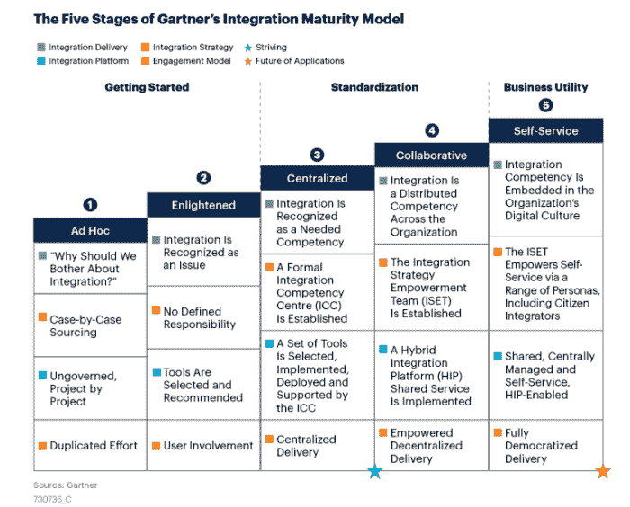
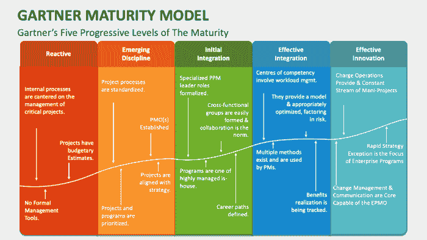

# Gartner AI Maturity Model 2025 A Roadmap

> 来源：[https://gotoaiworld.feishu.cn/docx/Fz7ydVMXPoOIvHx6lURc4sdonFe](https://gotoaiworld.feishu.cn/docx/Fz7ydVMXPoOIvHx6lURc4sdonFe)

`https://2025.aksi.co/gartner-ai-maturity-model-2025/`

`https://2025.aksi.co/gartner-ai-maturity-model-2025/`

## Gartner AI Maturity Model 2025: An Overview

Gartner Ai Maturity Model 2025 – The Gartner AI Maturity Model for 2025 provides a framework for organizations to assess their current AI capabilities and identify areas for improvement. It Artikels different levels of AI maturity, highlighting the key capabilities and characteristics at each stage. Understanding this model is crucial for organizations aiming to effectively leverage AI for competitive advantage.

## Contents

+ [Gartner AI Maturity Model 2025: An Overview](https://2025.aksi.co/gartner-ai-maturity-model-2025/#Gartner_AI_Maturity_Model_2025_An_Overview)
+ [Key Components of the Gartner AI Maturity Model 2025](https://2025.aksi.co/gartner-ai-maturity-model-2025/#Key_Components_of_the_Gartner_AI_Maturity_Model_2025)
+ Key Drivers of AI Maturity
+ Factors Influencing AI Maturity
+ [Assessing Your Organization’s AI Maturity: Gartner Ai Maturity Model 2025](https://2025.aksi.co/gartner-ai-maturity-model-2025/#Assessing_Your_Organizations_AI_Maturity_Gartner_Ai_Maturity_Model_2025)
+ [Steps in Conducting a Self-Assessment](https://2025.aksi.co/gartner-ai-maturity-model-2025/#Steps_in_Conducting_a_Self-Assessment)
+ Self-Assessment Checklist
+ [Strategies for Improving AI Maturity](https://2025.aksi.co/gartner-ai-maturity-model-2025/#Strategies_for_Improving_AI_Maturity)
+ [Strategies for Accelerating AI Adoption](https://2025.aksi.co/gartner-ai-maturity-model-2025/#Strategies_for_Accelerating_AI_Adoption)
+ The Future of AI Maturity
+ Emerging Trends and Predictions
+ [Gartner AI Maturity Model and Specific Industries](https://2025.aksi.co/gartner-ai-maturity-model-2025/#Gartner_AI_Maturity_Model_and_Specific_Industries)
+ Industry-Specific AI Maturity
+ Frequently Asked Questions
+ [The Gartner AI Maturity Model Explained](https://2025.aksi.co/gartner-ai-maturity-model-2025/#The_Gartner_AI_Maturity_Model_Explained)
+ [Using the Model to Assess AI Readiness](https://2025.aksi.co/gartner-ai-maturity-model-2025/#Using_the_Model_to_Assess_AI_Readiness)
+ [Benefits of Higher AI Maturity, Gartner Ai Maturity Model 2025](https://2025.aksi.co/gartner-ai-maturity-model-2025/#Benefits_of_Higher_AI_Maturity_Gartner_Ai_Maturity_Model_2025)
+ Common Challenges in the AI Journey
+ [Comparison with Other AI Maturity Frameworks](https://2025.aksi.co/gartner-ai-maturity-model-2025/#Comparison_with_Other_AI_Maturity_Frameworks)

## Key Components of the Gartner AI Maturity Model 2025

The model categorizes organizations into distinct maturity levels based on their AI adoption, implementation, and impact. These levels aren’t simply linear progressions; each involves unique challenges and opportunities. Key components include the definition of these maturity levels, the capabilities needed at each stage, the characteristics exhibited by organizations at each level, and illustrative examples of organizations representing each level.

Gartner’s AI Maturity Model 2025 provides a framework for organizations to assess their AI capabilities. Understanding the stages of AI adoption is crucial for strategic planning, and this is equally applicable to diverse sectors. For instance, even seemingly unrelated fields like automotive performance, such as the impressive acceleration of the 2025 Civic Si 0-60, highlight the need for data-driven insights and predictive modeling—key aspects of the Gartner AI Maturity Model.

Ultimately, the model’s principles underscore the importance of a phased approach to AI implementation, regardless of industry.

## Key Drivers of AI Maturity

Several factors significantly impact an organization’s AI maturity. These range from readily available resources to strategic decision-making and effective leadership. Understanding these drivers is crucial for accelerating AI adoption and achieving higher levels of maturity.

### Factors Influencing AI Maturity

## Assessing Your Organization’s AI Maturity: Gartner Ai Maturity Model 2025

A self-assessment using the Gartner model allows organizations to pinpoint their current AI standing and identify areas needing attention. This process involves a systematic evaluation of capabilities, resources, and strategic alignment.

Gartner’s AI Maturity Model 2025 assesses organizations’ AI capabilities across various stages. Understanding this model is crucial for businesses seeking to leverage AI effectively, particularly in sectors like insurance. For example, the increasing use of AI in pricing and risk assessment is driving the search for Cheap Insurance 2025, a trend directly influenced by advancements highlighted in the Gartner model.

Ultimately, the model helps companies strategically plan their AI adoption to achieve competitive advantage.

### Steps in Conducting a Self-Assessment

A structured self-assessment involves several key steps: First, gather data on existing AI capabilities, infrastructure, and talent. Second, analyze this data against the Gartner model’s maturity levels. Third, identify strengths and weaknesses. Finally, develop an action plan based on the assessment findings. A checklist can facilitate this process, ensuring thoroughness and consistency.

Gartner’s AI Maturity Model 2025 provides a framework for organizations to assess their AI capabilities. Understanding the stages of AI adoption is crucial for strategic planning, and this is equally applicable to diverse sectors. For instance, even seemingly unrelated fields like automotive performance, such as the impressive acceleration of the 2025 Civic Si 0-60, highlight the need for data-driven insights and predictive modeling—key aspects of the Gartner AI Maturity Model.

Ultimately, the model’s principles underscore the importance of a phased approach to AI implementation, regardless of industry.

### Self-Assessment Checklist

+ Data Assessment: Evaluate data quality, availability, and accessibility.
+ Technology Assessment: Review existing IT infrastructure and identify gaps.
+ Talent Assessment: Assess the skills and experience of your AI team.
+ Strategy Assessment: Evaluate your organization’s AI strategy and alignment with business goals.
+ Implementation Assessment: Review past AI projects and identify lessons learned.
+ Metrics and KPIs: Define key performance indicators (KPIs) to measure AI success.

## Strategies for Improving AI Maturity

Organizations can accelerate AI adoption and improve maturity levels through various strategies. These strategies focus on building a strong foundation, effective change management, and iterative improvement.

Gartner’s AI Maturity Model 2025 provides a framework for organizations to assess their AI capabilities. Understanding the stages of AI adoption is crucial for strategic planning, and this is equally applicable to diverse sectors. For instance, even seemingly unrelated fields like automotive performance, such as the impressive acceleration of the 2025 Civic Si 0-60, highlight the need for data-driven insights and predictive modeling—key aspects of the Gartner AI Maturity Model.

Ultimately, the model’s principles underscore the importance of a phased approach to AI implementation, regardless of industry.

### Strategies for Accelerating AI Adoption

+ Build a Strong AI Foundation: Invest in data infrastructure, talent acquisition, and robust AI governance.
+ Start with Pilot Projects: Demonstrate value and build momentum with small-scale, high-impact AI initiatives.
+ Iterative Development: Continuously improve AI models and solutions based on feedback and performance data.

+ Embrace Change Management: Address organizational resistance and foster a culture of continuous learning and innovation.

+ Foster Collaboration: Encourage collaboration between business units, IT, and data science teams.

+ Measure and Track Progress: Monitor key performance indicators (KPIs) to measure the success of AI initiatives.

# The Future of AI Maturity

The Gartner AI Maturity Model is expected to evolve beyond 2025, reflecting advancements in AI technologies and their impact on businesses. Emerging trends will shape future AI capabilities and present both opportunities and challenges.

Gartner’s AI Maturity Model 2025 provides a framework for organizations to assess their AI capabilities. Understanding the stages of AI adoption is crucial for strategic planning, and this is equally applicable to diverse sectors. For instance, even seemingly unrelated fields like automotive performance, such as the impressive acceleration of the 2025 Civic Si 0-60 , highlight the need for data-driven insights and predictive modeling—key aspects of the Gartner AI Maturity Model.

Ultimately, the model’s principles underscore the importance of a phased approach to AI implementation, regardless of industry.

## Emerging Trends and Predictions

The future of AI maturity will likely involve increased reliance on explainable AI (XAI), the rise of federated learning, and greater emphasis on AI ethics and responsible AI practices. We can anticipate a surge in AI-driven automation across various industries, leading to increased productivity and efficiency. However, challenges such as data bias, algorithmic fairness, and job displacement will require careful consideration and proactive mitigation strategies. A timeline illustrating key milestones and predictions for AI maturity in the coming years would require detailed research and forecasting beyond the scope of this current overview.

Gartner’s AI Maturity Model 2025 provides a framework for assessing an organization’s AI capabilities. Understanding AI adoption’s impact across various sectors is crucial; for example, consider the implications for pharmaceutical marketing, as seen in the projected strategies outlined by Vabysmo Commercial 2025. This case study highlights how AI-driven insights can shape commercial strategies, aligning with Gartner’s emphasis on data-driven decision-making within the AI maturity model.

## Gartner AI Maturity Model and Specific Industries

AI maturity levels vary significantly across industries due to factors such as data availability, regulatory environments, and the nature of business operations. The Gartner model can be adapted to suit the unique needs of various sectors.

Gartner’s AI Maturity Model 2025 provides a framework for organizations to assess their AI capabilities. Understanding the stages of AI adoption is crucial for strategic planning, and this is equally applicable to diverse sectors. For instance, even seemingly unrelated fields like automotive performance, such as the impressive acceleration of the 2025 Civic Si 0-60 , highlight the need for data-driven insights and predictive modeling—key aspects of the Gartner AI Maturity Model.

Ultimately, the model’s principles underscore the importance of a phased approach to AI implementation, regardless of industry.

### Industry-Specific AI Maturity

## Frequently Asked Questions

### The Gartner AI Maturity Model Explained

The Gartner AI Maturity Model provides a framework for organizations to assess their AI capabilities across five levels: AI-Naive, AI-Emerging, AI-Developing, AI-Advanced, and AI-Transformed. It helps organizations understand their current state, identify gaps, and develop strategies for improvement.

### Using the Model to Assess AI Readiness

Organizations can use the model by evaluating their capabilities against the characteristics of each maturity level. This involves self-assessment of data, technology, talent, strategy, and implementation. The results will pinpoint strengths and weaknesses, guiding the development of an action plan.

Gartner’s AI Maturity Model 2025 provides a framework for organizations to assess their AI capabilities. Understanding this model is crucial for strategic planning, especially when considering long-term investments, such as finding reliable coverage with a home warranty; for example, researching options like those listed on Best Home Warranty 2025 can inform budgeting decisions. Returning to the AI model, a mature AI strategy directly impacts an organization’s ability to leverage AI for improved operational efficiency and future innovation.

### Benefits of Higher AI Maturity, Gartner Ai Maturity Model 2025

Achieving higher AI maturity leads to improved operational efficiency, enhanced decision-making, increased innovation, and a competitive advantage. It enables organizations to leverage AI for business transformation and unlock new revenue streams.

### Common Challenges in the AI Journey

Common challenges include data quality issues, lack of skilled talent, resistance to change, integration with existing systems, and ethical concerns. Addressing these challenges requires strategic planning, investment in resources, and a focus on change management.

### Comparison with Other AI Maturity Frameworks

While specific comparisons to other frameworks would require a detailed analysis, the Gartner model distinguishes itself through its comprehensive approach, incorporating various aspects of AI adoption, from data and technology to strategy and talent. Other models may focus more narrowly on specific aspects of AI maturity.
