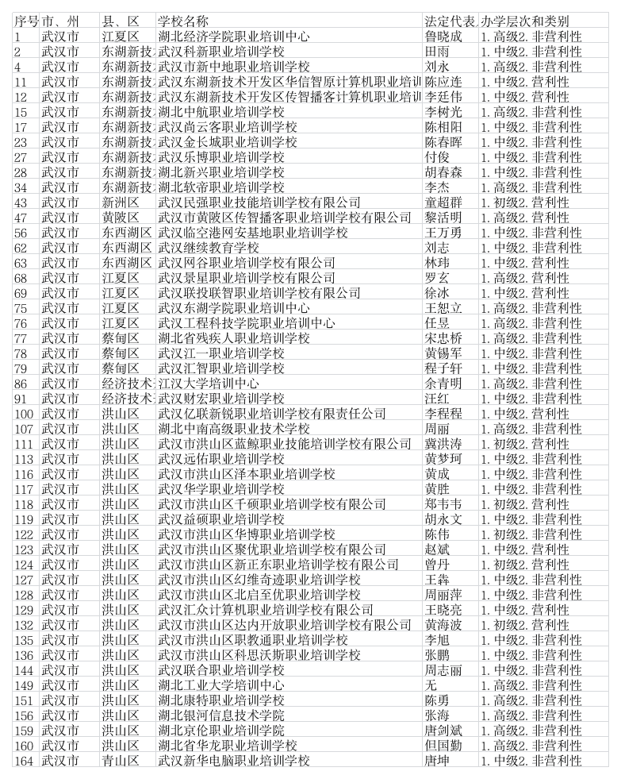

# 国内AI产业政策支持

> 来源：`https://gotoaiworld.feishu.cn/docx/BW58dUeHqoIfZmxyptucAb4zn2c`

## 一、国内AI产业政策

> 输入 @ 插入相关文档，介绍项目成立的背景

1.  ...

## 二、深圳

> 深圳计划在2025年内投资500亿产业基金到人工智能和机器人领域

### 深圳市加快推进人工智能终端产业发展行动计划（2025—2026年）

深圳市加快推进人工智能终端产业发展行动计划（2025—2026年）

`https://www.sz.gov.cn/szzt2010/wgkzl/jcgk/jcygk/zdzcjc/content/post_12052977.html`

为抢抓人工智能发展新机遇，支持人工智能技术赋能智能终端产品，推动智能终端产业高质量跨越式发展，加快建设国际国内领先的人工智能终端产业集聚区，按照《关于加快发展新质生产力进一步推进战略性新兴产业集群和未来产业高质量发展的实施方案》《深圳市加快打造人工智能先锋城市行动方案》等文件要求，结合我市实际，制定本行动计划。

#### 一、发展目标

到2026年，人工智能终端产业核心竞争力进一步增强，产品“含深度”进一步提升，产业生态持续丰富，全市人工智能终端产业规模达8000亿元以上、力争1万亿元，集聚不少于10家现象级人工智能终端企业，人工智能终端产品产量突破1.5亿台，在手机、计算机、大模型一体机、可穿戴设备等领域推出50款以上爆款人工智能终端产品，在智能制造、智慧金融、智慧城市、智慧养老、智慧政务等领域打造60个以上人工智能终端典型应用场景。

#### 二、重点品类

##### （一）人工智能手机

持续保持手机产品国际国内领先地位，构建“芯片—操作系统—模型/AI Agent—应用生态”全栈能力，推出各类创新形态的手机产品，提供以意图为核心的主动式服务，率先完成智能手机从“智能工具”向“智能助理”升级。

##### （二）人工智能计算机（含台式电脑、笔记本电脑）

实现计算机全球品牌力和先进制造力双提升，培育国际国内领先的人工智能计算机品牌，支持传统计算机代工厂商向人工智能计算机制造厂商转变，推动人工智能计算机发展成为由端侧大模型赋能加持的生产力工具和多平台协作的个人工作站。

##### （三）人工智能平板电脑

深化平板电脑生态扩展和场景拓展，构建“深圳制造”高端品牌矩阵，提升中端品牌及代工企业技术实力和市场竞争力，形成更多垂直领域特色产品。推动端侧大模型在平板电脑跨平台和轻量化适配，深度赋能个性化娱乐、学习、内容创作和轻度办公，推动平板电脑从“娱乐工具”转型升级为“生产力+智能交互中心”。

##### （四）大模型一体机

抢抓大模型开源化机遇，加快推出开箱即用训推一体机和推理一体机等产品，服务企业和政务领域定制化、轻量化需求。重点围绕智慧金融、智慧医疗、智能办公等场景，提供私有化部署、行业场景定制、高效安全合规的端到端解决方案。

##### （五）人工智能可穿戴设备

在智能眼镜、智能手表、智能耳机、AR/VR设备等细分赛道推出一系列人工智能标杆产品，专注特定场景和“一带一路”市场需求推出高性价比人工智能可穿戴设备。重点聚焦空间感知、实时翻译、健康监测等C端场景以及工业巡检、远程医疗、应急救援等B端场景，打造人工智能可穿戴设备产品发展集聚地。

##### （六）人工智能影像设备

利用人工智能技术重塑影像创作范式，提升专业级影像采集与智能处理能力，打造随身专业影像生成设备。提升人工智能影像设备的动态目标智能追焦、多设备协同拍摄、光影效果实时渲染等能力，拓展极限运动跟拍、影视级自动化剪辑、低光照无损成像等创意生产场景，打造端到端智能创作低功耗解决方案，强化在户外探索、商业拍摄等场景的应用。

##### （七）全屋智能产品

推动人工智能电视搭载端侧大模型，打造量身定制的娱乐体验。推动智能电视、智能音响、智能门锁、扫地机器人等家电家居产品全面接入AI能力，在家庭娱乐、家庭安防、家务自动化、健康管理等重点场景，实现智慧家电、智慧安防、节能管理的无感联动，推动家庭空间从“被动响应”向“主动认知”进化，打造具备环境感知、自主决策、情感交互能力的“数字家庭生命体”。

##### （八）工业级人工智能终端

推动多模态融合、计算机视觉、数字孪生等技术在智能生产、自动化控制、智能化检测、智能巡检与安防等工业领域的应用，开发具备人工智能算力和自主学习能力的工业级人工智能终端产品。通过人工智能技术动态调整生产线参数、实时监控和异常预警，协调多台设备工作流程，提高产线质量控制水平和生产效率，助推工业领域智能化高端化转型。

##### （九）其他新型人工智能终端

发挥深圳创新创意产业发达、软硬件研发制造能力强、供应链完善等核心优势，支持各类企业在时尚潮玩、文体旅游、个人助理、居家养老、健康监测、情感陪伴等领域，推出人工智能名片、人工智能玩具、人工智能生活助手等新型人工智能终端。

#### 三、重点任务

##### （一）加快发展端侧大模型

鼓励人工智能终端企业、端侧大模型企业通过模型压缩、蒸馏等轻量化和优化技术，减小模型体积与计算量，提高人工智能终端模型转换、优化和工程部署的效率和效能。鼓励企业建立大规模、多维度、高质量数据库，结合具体应用场景优化端侧大模型。积极招引大模型厂商来深发展。

##### （二）提升人工智能终端基础软硬件水平

鼓励企业优化操作系统功能架构。支持开展人工智能终端芯片核心技术攻关，提高端侧整体计算效率。鼓励发展下一代显示等技术，提升人工智能终端产品形态和内容交互体验。支持开展多模态智能传感器创新研究，丰富人工智能终端的多模态感知和交互能力，拓展人工智能终端的能力边界。

##### （三）推动形成人工智能终端产业强大企业梯队

持续优化营商环境，及时响应企业诉求。鼓励企业加大产品研发和技术创新投入，吸引生态伙伴来深发展。积极培育、精准发掘创新型新锐企业，充分挖掘中小微企业潜力，培育一批“隐形冠军”。积极吸引全球人工智能终端企业、创新创业团队在深设立创新应用总部、研发中心。

##### （四）营造多元繁荣的人工智能终端应用生态

大力推进AI智能体开发，支持形成更多AI原生应用，鼓励开发者在各操作系统平台上加强人工智能原生能力探索。加速各行业领域人工智能应用落地，深入推进人工智能全域全时全场景应用，支持企业打造垂类示范应用。孵化AI智能超级应用，支持软件开发商打造新场景、新业态、新应用。建设面向国际国内的人工智能开源平台。

##### （五）建立健全人工智能终端标准体系

支持我市企业积极参与人工智能终端领域标准化建设工作，积极推进人工智能终端领域基础软硬件技术、产品分级评级、安全合规认证、效能评测等标准制定工作。鼓励企业定义各类新型人工智能终端产品，搭建人工智能终端产业集群标准化需求对接平台，提出标准立项建议，构建标准化需求信息共享研判机制。鼓励编制人工智能终端标准体系建设指南。

##### （六）搭建产业开放创新平台

探索建设新品导入（NPI）创新平台，加快人工智能终端创新产品应用验证并实现规模化量产。鼓励建设人工智能终端评测平台，提供端侧人工智能模型评测、人工智能终端性能测试认证等服务。鼓励建设创新孵化平台，为创业团队提供创新资源服务，培育创新企业和创新生态。

##### （七）加强人工智能终端产品推广

制定人工智能终端创新产品目录和爆款产品清单，培育一批“热销单品”。用好展示推广平台，多渠道展示人工智能终端产品。在各类人工智能创新创业赛事活动设置人工智能终端方向。多元化宣传优质人工智能终端产品。鼓励优秀产品出海，支持企业针对海外特定市场需求推出人工智能终端产品，支持人工智能终端企业参加国外高端展会。

##### （八）积极拓展人工智能终端应用场景

滚动发布“城市+人工智能”应用场景清单，在政务服务、城市治理、智慧教育、智慧医疗、文化旅游等领域开放应用场景。支持人工智能终端在工业机器人、智能检测、智能物流等领域的应用，提升制造业的智能化水平。支持企业开发AI个性化学习终端，加强人工智能在个性化学习、智能评测、虚拟实验等领域的应用。

##### （九）加强隐私安全保护

支持人工智能终端在数据采集、存储、传输和使用的各个环节采用先进的加密算法和技术。鼓励企业和科研机构加大对隐私保护技术的研发投入。鼓励面向家庭用大容量高速存储器开展技术研发，降低消费者在地存储成本。建立人工智能终端安全漏洞快速响应机制，鼓励企业设立专门的安全团队。探索建立人工智能终端监管与治理机制，各职能部门联合依法依规包容审慎监管。

#### 四、保障措施

##### （一）加强工作统筹

在全市战略性新兴产业集群和未来产业体系框架下，市工业和信息化局加强统筹，市区各单位密切配合、协同联动，调集各方资源，全力服务和保障人工智能终端企业发展和重点项目建设。

##### （二）强化要素保障

用足用好大规模设备更新和消费品以旧换新政策，做好战略性新兴产业和未来产业专项资金保障，协同支持人工智能终端企业做大做强。用好20大先进制造园区，为人工智能终端企业提供优质优价空间。发放“训力券”“语料券”“模型券”，降低企业成本。协助企业加快端侧大模型备案，提供人工智能终端应用场景，为企业提供全链条服务和全周期支持。

##### （三）完善人才支撑体系

鼓励本地高等院校、科研院所加快人工智能领域学科和专业建设，支持校企联合共建实验室及人才实训基地。加强人工智能终端领域领军人才、高层次创新创业人才和高技术人才队伍建设，吸引国内外高端人才、创业团队来深发展。构建创新创业、人才安居和办公空间支持体系。

### 深圳市加快打造人工智能先锋城市行动计划（2025—2026年）

深工信〔2025〕43号

各有关单位：

《深圳市加快打造人工智能先锋城市行动计划（2025—2026年）》已经市政府同意，现印发实施，请认真组织贯彻落实。

深圳市工业和信息化局

2025年3月3日

`https://www.sz.gov.cn/cn/xxgk/zfxxgj/tzgg/content/post_12052799.html`

深圳市加快打造人工智能先锋城市行动计划（2025—2026年）

为深入学习贯彻习近平总书记对广东、深圳系列重要讲话和重要指示精神以及关于发展新一代人工智能的重要论述精神，抢抓通用人工智能发展战略机遇，积极建设国家新一代人工智能创新发展试验区和国家人工智能创新应用先导区，加快提升人工智能产业发展能级，全速打造人工智能先锋城市，加快形成新质生产力，现制定本行动计划。

#### 一、发展目标

把握人工智能前沿发展态势，发挥深圳产业链完备、机电一体化、应用场景丰富等优势，坚持场景牵引、创新驱动、软硬协同、生态赋能的原则，深入实施“人工智能+”行动，加速形成全域全时全场景应用深圳样板，打造具有国际竞争力的智能硬件产品集群，构筑富有吸引力的人工智能人才集聚地。到2026年，全市人工智能企业数量超3000家，独角兽企业超10家，产业规模年均增长超20%，推出10个以上产业集聚效应明显的人工智能和具身智能机器人创新孵化器，形成“场景应用最开放、算力供给最普惠、产业生态最健全、创新创业最便捷”的产业发展环境，建成具有国际影响力的人工智能先锋城市，加快打造具有全球重要影响力的产业科技创新中心。

#### 二、加速推进全域全时全场景应用

##### （一）扩大开放“城市+AI”应用场景

建设市、区两级应用场景开放中心，围绕五大政务领域每年开放100个以上应用场景，打造“一区一品牌”典型场景应用，推动全面提升超大规模城市治理水平。政务服务领域，探索构建政务应用创新实验室，推动“i深圳”聚焦“高效办成一件事”持续提升民生诉求办理效率，助力“深i企”平台优化资源配置提升企业诉求办理效率，提升政务办公效率。城市治理领域，支持机器人在公共安全、市政环卫、应急救援等场景中的应用，完善覆盖全市的AI应急响应体系，提高突发事件处置效率，推动城市治理从“被动响应”向“主动预防”转型。教育教学领域，推进人工智能在智能学习空间、智能课堂等场景的应用，实现课堂教学智能化覆盖，教师研训效率提升，助力教育公平与质量双提升。医疗服务领域，推动智能就医、智能诊疗、智能健康管理、智能公共卫生管理以及医用机器人等落地应用，加快打造人工智能示范医院，构建“预防-诊疗-康复”全链条智能服务体系。文化旅游领域，积极建设AI示范景区，推动AI赋能文创设计、导游导览、景区运营管理、展会赛事，推动人工智能翻译器的全域全时应用，打造“科技+文旅”融合发展新模式。[责任单位：市政务和数据局、市教育局、市公安局、市文化广电旅游体育局、市卫生健康委、市应急管理局、市城管和综合执法局、市外办、市中小企业服务局，各区政府（含大鹏新区管委会、深汕特别合作区管委会，下同）]

##### （二）深化AI赋能千行百业

聚焦五大产业领域，以垂类行业大模型与具身智能机器人为核心驱动力，推出一批具有引领作用的标杆应用、一批具有推广价值的示范应用。“AI+先进制造”，应用工业制造大模型、制药大模型等垂类模型，面向电子信息、新能源汽车、高端装备、生物医药、新材料、消费品工业等重点行业，以赋能“研产供销服管”全流程为目标，打造一批智能制造示范工厂、智能制造典型场景，推动制造业智能化水平跃升。“AI+科学研究”，依托数学、生物、材料、地球科学和空间科学等领域垂类大模型，重点围绕新药创制、基因研究、新材料研发、气候环境、深空深海等领域，推动人工智能模型算法和领域数据知识融合，辅助前沿领域探索。“AI+金融服务”，支持银行、保险、证券等企业开发应用金融决策、风险管理等垂类大模型，以风险管理、保险理赔、投资决策、客户服务为主攻方向，加快提升科技金融实力。“AI+商贸流通”，强化人工智能对精准营销、智能通关、仓储管理的服务支持，加速推进无人机、无人车、无人仓落地应用，为提振消费、企业出海提供有力保障。“AI+创意设计”，支持服装设计、建筑设计、广播电视、游戏动漫等领域应用大模型进行赋能，持续提升创意效果和设计效率。（责任单位：市工业和信息化局、市科技创新局、市地方金融管理局、市住房建设局、市商务局、市文化广电旅游体育局）

##### （三）大力培育智能产品矩阵

抢抓端侧智能爆发机遇，聚焦五大智能产品矩阵，推出100款以上热销智能产品，抢占“万物智联”新赛道。丰富发展人工智能终端产品，研发推出AI手机、AI平板、AI电脑、AI眼镜、智能可穿戴等爆款智能硬件产品。推动具身智能机器人商用，支持企业开展整机研发，积极拓展人形机器人在工业制造、应急作业、交通巡检、医疗康养、安保巡逻、文旅服务、教育科研等领域的商业化应用。丰富智能家居产品，推动智能家居产品互联互通发展，研发系列拳头产品，拓展全屋智能应用广度和深度，推进全屋智能融合化发展。培育发展大模型一体机，支持硬件企业与大模型企业合作开发开箱即用的训推一体机和推理一体机，重点开拓一体机在金融、政务、医疗等本地部署需求旺盛的应用市场。提速发展智能驾驶，推动技术突破、产品推广、场景应用和商业模式融合，加快L3级规模化应用，攻克L4级技术，抢占L5级制高点。（责任单位：市工业和信息化局、市科技创新局）

#### 三、不断强化产业要素供给

##### （四）大幅提升智能算力规模

聚焦企业智能算力需求，建设一批智能算力项目，打造超智协同、异构融合、训推一体、普惠泛在的可持续训力供给体系。加快建成国家级重大战略项目，推动鹏城云脑Ⅲ、国家超级计算深圳中心二期尽快点亮，打造国家智能算力的核心关键节点。建设多个10E级智能算力集群，推动现有智能算力中心倍增扩容，建设一批国产智能算力中心，打造南山、宝安、龙岗、龙华、前海、河套以及光明科学城等算力高地。实施“算力飞地”战略，构建1ms时延的城市算力网、3ms时延的韶关算力网以及10ms时延的贵安算力网，构建多点互联、高速无损的算力网络。到2026年，实时可用智能算力超过80E FLOPS。（责任单位：市发展改革委、市工业和信息化局、市科技创新局、深圳市通信管理局、前海管理局、河套发展署，各区政府）

##### （五）推动智能算力服务普惠泛在

通过发放算力补贴、加大优惠算力供给，持续降低算力成本。发放普惠“训力券”，依托重大项目和政策，扩容发放“训力券”，支持企业、高校、科研机构低成本使用智能算力。构建大规模的普惠算力保障体系，推动政府投资智算中心向初创企业、中小微企业提供一定规模的免费算力，鼓励社会投资智算中心向初创企业、中小微企业提供优惠算力。加快布局低成本边缘智算中心，提升对不同模型的适配能力，熟化边端智算资源配套服务，满足推理侧算力需求。（责任单位：市工业和信息化局、市科技创新局、市发展改革委）

##### （六）加快构建行业语料集

充分利用深圳产业丰富优势，持续构建行业语料集，支撑垂类模型训练。打造高价值垂类数据集，重点培育医疗、教育、交通等高价值垂类数据集，汇聚建成3PB中文语料数据。培育建设重点行业可信数据空间，鼓励行业企业、互联网平台企业联合研究机构和行业组织，试点建设医疗等行业可信数据空间，释放行业数据价值。推动深圳数据交易所打造国家级数据交易所，发放“语料券”，促进人工智能语料共享和交易。（责任单位：市政务和数据局、市教育局、市交通运输局、市卫生健康委）

##### （七）打造具身智能数据采集基地

着力提升具身智能数据供给能力，为具身智能研发提供高质量训练环境。建设具身智能数据集，依托机器人企业和省具身智能创新中心，在宝安、龙华等区建设具身智能数据采集基地，构建具身智能开源开放平台和多模态训练开源数据集，重点开发支持人形机器人训练的多模态环境感知和运动规划数据集。搭建城市级模拟应用场景，依托数字孪生先锋城市建设，推动建设城市级高保真仿真训练平台，加快赋能具身智能、自动驾驶等领域大模型实训。（责任单位：市工业和信息化局、市政务和数据局、宝安区政府、龙华区政府）

##### （八）探索数据跨境新模式

利用毗邻港澳优势，促进数据跨境有序流动。强化数据跨境制度建设，以跨境需求最迫切的典型场景为切入口，探索跨境数据流动分类分级管理。构建数据跨境便利化服务体系，支持前海、河套、罗湖口岸片区完善数据跨境基础设施建设和互联互通，试点出台重点领域数据跨境负面清单，指导企业开展数据出入境安全合规操作。支持深圳数据交易所建设跨境数据专区，扩大与数据企业的战略合作，批量上市跨境数据产品服务。（责任单位：市委网信办、市政务和数据局、罗湖区政府、前海管理局、河套发展署）

#### 四、持续增强源头创新能力

# （九）支持大模型关键核心技术攻关

加速布局人工智能和机器人科技重大专项，产出一批重大创新成果。加强关键技术研发，加快算法理论创新，支持企业加强智算芯片、具身智能、高阶智驾、端侧轻量化模型、超大参数模型、高效推理模型、全模态模型、空间智能模型等核心突破，提升大模型可信与可靠度。重点攻关具身智能，完善具身智能数据仿真、数据合成等技术工具链，持续研发具身智能多模态“大脑”和运动控制“小脑”，支持VLA（视觉语言动作）大模型研发应用，加速突破高功率密度伺服驱动器、仿人机械臂和灵巧手等“机器肢”关键技术，攻关高精度传感、高强度本体结构、高能量密度动力、轻量化骨骼等“机器体”关键技术。支持智算芯片企业加强研发，持续提升端侧和推理芯片的计算能力和模型适配能力，加快突破超大规模智算集群网络通信等关键技术问题。（责任单位：市科技创新局、市发展改革委、市工业和信息化局）

## （十）布局高水平科研载体

构建开放协同的人工智能创新体系。建设“1+2+N”人工智能实验室集群，发挥鹏城实验室引领作用，支持光明实验室和福田实验室加快研发进程，鼓励粤港澳大湾区数字经济研究院及各高校科研机构继续推进人工智能研究。打通创新链条，发挥具身智能机器人、工业边缘智能等省级制造业创新中心作用，鼓励企业新建一批人工智能领域创新中心、技术中心，打通技术开发到转移扩散再到商业化应用的创新链条。（责任单位：市科技创新局、市工业和信息化局）

## （十一）培育自主可控算力生态

发挥全栈国产算力技术优势，强化软硬件技术协同，持续打造活跃的算力生态。持续提升国产算力芯片性能，加快完善国产深度学习框架，实现软硬件技术的深度协同。研发全栈国产化大模型及工具链，构建自主可控人工智能的技术体系和产业生态。发挥人工智能生态源头创新中心的引领作用，到2026年适配模型和应用100个以上，培养人工智能开发者超2000人，开展20场以上产业链对接合作和有组织协同创新活动。（责任单位：市工业和信息化局、市发展改革委、市科技创新局）

## （十二）打造人工智能开源生态

发挥企业开源优势，构建繁荣的开源生态。打造开源社区，鼓励企业联合开发者社区、开源生态基金会，打造国内一流的人工智能开源社区，推动开源模型集、数据集和工具链开发。壮大开源生态，基于明星开源项目推动技术创新、产品研发、应用实践和成果转化；在大模型、具身智能、自动驾驶等领域培育一批基础性前瞻性的开源项目；聚焦中小企业需求，提供可复制易推广的训推框架、开发示例、测试工具和开源代码。构建开发者社群，扩大开发者关系网络，开展技术、标准、认证等系列培训。（责任单位：市工业和信息化局、市发展改革委、市科技创新局）

# 五、大力营造创新创业生态

## （十三）大力引育青年英才

发挥人才对技术创新的关键作用，持续招引培育青年人才，逐步打造人工智能人才集聚地。大力招引青年创新人才，面向国内外一流高校，加大青年创新人才招引力度，汇聚一大批具备颠覆式创新潜质的拔尖创新人才。加大人工智能人才政策支持力度，对人工智能人才进行分档支持，提供生活安居、创业辅导、空间支持、资本助力等全方位服务，支持人才创新创业，助力企业和科研机构引才留才。建设人工智能实训基地，联合科研机构、企业建设一批人工智能实训基地，开展产教融合课程及项目实战，为高校人工智能领域专业学生提供实习和研学场所，并给予临时住房保障。（责任单位：市人才工作局、市科技创新局、市工业和信息化局、市教育局、市人力资源保障局）

## （十四）建设一流人工智能学科

加快推进人工智能学科建设，大力培养本地人工智能人才。支持有条件的高校组建人工智能学院或研究院，汇聚算力、模型、软件等要素，集聚一批创新团队；推动各高校以人工智能赋能学科交叉融合。建设国内一流专业集群，支持高校增设人工智能领域特色专业，推动本硕博招生指标扩增，打造人工智能品牌专业和国家级一流本科专业。加强本地高层次人才培养，建设人工智能领域新型高等教育机构，培育一批高层次人工智能人才。（责任单位：市教育局）

## （十五）建设低成本产业孵化器

更大力度提供企业孵化空间支撑，加速企业孵化培育，提升产业集聚效应。打造一批创新孵化器，在福田、罗湖、南山、宝安、龙岗、龙华、坪山、光明等重点区，各打造1个以上超2万平方米的低成本创新孵化器，为初创企业提供免租空间、算力优惠和配套资源服务。持续推动产业集聚，鼓励各区打造区级人工智能特色产业园和人工智能产业楼宇，推动“楼宇园区+算力设施+科研机构+公共服务”一体化布局，吸引人工智能产业链上下游企业集聚发展。（责任单位：市工业和信息化局、前海管理局，各区政府）

## （十六）加强投融资支持

聚焦企业融资需求，构建层次鲜明、高度协同、耐心陪伴的基金服务体系，助力企业做大做强。构建活跃投资生态，充分发挥人工智能和具身机器人产业基金作用，统筹天使母基金、深创投、各区基金等国企基金，聚焦推理芯片、模型算法、端侧应用、具身智能等领域，投资一批高成长性企业。实施“投补贷”联动，构建“创业投资+财政补助+科技信贷”联动机制，对符合条件的人工智能企业给予贷款贴息、利率优惠、知识产权融资贴息等支持。发挥深港金融市场互联互通优势，“一对一”解决人工智能重点领域、核心企业的跨境金融服务诉求。（责任单位：市工业和信息化局、市科技创新局、市财政局、市地方金融管理局、市国资委、市市场监管局，各区政府）

## （十七）支持企业做大做强

抓住人工智能创业热潮，加大企业服务力度，持续推动企业做大做强。持续挖掘初创企业，借助中国深圳创新创业大赛等赛事活动，发掘优质初创企业，做好创业辅导、空间支持、资金扶持等服务。推进企业梯度培育，支持中小企业拓展市场、落地场景、站稳脚跟；支持独角兽企业提升核心技术能力，不断拓展应用市场；支持企业上市，联合深圳证券交易所对具备上市潜力企业开展上市辅导。推动大中小企业融通发展，鼓励领军企业面向中小企业开放场景，开展具身智能机器人等智能产品小规模试用。到2026年，全市人工智能企业数量超过3000家，其中独角兽企业超过10家。（责任单位：市工业和信息化局、市科技创新局、市地方金融管理局）

## （十八）提升产业交流合作水平

通过举办展会论坛赛事，强化产业交流合作，构建活跃的产业发展氛围。支持举办高水平展会论坛，吸引全球人工智能创新资源、高端人才在深交流合作。坚持“以赛聚才促产”，持续提升“兴智杯”全国人工智能创新应用大赛、全国人工智能大赛等赛事水平，孵化落地一批人工智能成果和企业。坚持“智能向善”，做好大模型备案指导与服务，依托相关平台引导企业、高校和科研机构树立合规发展意识。（责任单位：市工业和信息化局、市委网信办、市科技创新局、市商务局、市文化广电旅游体育局）

# 深圳市具身智能机器人技术创新与产业发展行动计划（2025-2027年）

各有关单位：

《深圳市具身智能机器人技术创新与产业发展行动计划（2025-2027年）》已经市政府同意，现予印发，请认真组织贯彻落实。

深圳市科技创新局

2025年3月3日

`https://stic.sz.gov.cn/xxgk/tzgg/content/post_12052515.html`

# 深圳市具身智能机器人技术创新与产业发展行动计划（2025-2027年）

为抢抓全球人工智能与机器人技术融合发展的战略机遇，加速构建具身智能机器人产业创新生态，推动具身智能机器人产业高质量跨越式发展，加快建设国际国内领先的具身智能机器人产业集聚区，加快打造具有全球重要影响力的产业科技创新中心，按照《关于加快发展新质生产力进一步推进战略性新兴产业集群和未来产业高质量发展的实施方案》《深圳市加快打造人工智能先锋城市行动方案》《深圳市培育发展未来产业行动计划（2024-2025年）》等文件要求，结合我市实际，制定本行动计划。

## 一、发展目标

到2027年，在机器人关键核心零部件、AI芯片、人工智能与机器人融合技术、多模态感知技术、高精度运动控制技术、灵巧操作技术等方面取得突破。新增培育估值过百亿企业10家以上、营收超十亿企业20家以上，实现十亿级应用场景落地50个以上，关联产业规模达到1000亿元以上，具身智能机器人产业集群相关企业超过1200家。打造公共服务平台矩阵，吸引更多上下游企业、科研机构、创新团队等加入，形成更完善的产业生态，具身智能机器人产业综合实力达到国际领先水平。

## 二、重点任务

### （一）引领核心技术攻坚突破

重点支持具身智能机器人核心零部件、AI芯片、仿生灵巧手、基座及垂直领域大模型、本体控制等关键核心技术攻关，以揭榜挂帅、项目经理人制、业主制等方式分阶段、分批次组织实施科技重大专项。

#### 1.开展核心零部件攻关。

攻关高能量密度的微小电机及驱动技术，研制高精密微型一体化关节模组。攻关六维力、电子皮肤、多维触觉感知技术，研制高精度视、触、力等多模态传感器。研制高性能、高集成度的类脑视觉传感器。研制高能量密度、轻量化电池。

#### 2.加大机器人AI芯片攻关。

研究集神经网络处理器指令集架构、存算一体计算架构、异构多核架构、低功耗模式及算法工具链于一体的新型AI芯片架构。研发支持Chiplet集成扩展、具身智能VLA/VTLA端到端大模型和多模态大模型推理加速、认知推理类脑芯片、低延时驱动接口、多传感接口、低功耗的机器人AI芯片。研制机器人端侧计算芯片及模组，推进国产化替代。

#### 3.研制高性能仿生多指灵巧手。

突破仿生精细化结构、轻量化高强度材料与类肌肉驱动技术，研制具备高载荷、高灵活性、精细操作能力的仿生多指灵巧手。研究灵巧手多自由度运动、多指协同、指关节动态柔顺等控制算法，攻关手-眼-脑协同的灵巧操作技术。

#### 4.构建具身智能基座及垂直领域大模型。

基于世界模型及视觉-触觉-语言-动作（VTLA）等多模态输入输出，构建具备交互、预测与决策能力的具身智能基座大模型及其训练、推理技术体系，形成长序列推理（COT）和自主学习能力，支持跨场景任务处理。围绕重点应用场景，研发垂直应用大模型。

#### 5.突破具身智能本体控制技术。

研究基于人体数据驱动的双臂、双腿、腰腹核心协同控制技术，突破基于人臂运动特性的协调作业轨迹规划技术与非线性实时下肢协同控制技术。

### （二）打造公共服务平台矩阵

#### 6.高标准推进重点实验室建设。

支持福田实验室突破具身智能感知、移动、决策、交互等关键核心技术，打造前沿开放的具身智能平台底座。支持光明实验室建设大湾区昇腾算力应用创新研究院，推动昇腾AI算子开发和开源社区生态建设。支持组建具身智能机器人领域市重点实验室。

#### 7.高能级打造创新服务平台。

支持国际先进技术应用推进中心（深圳）建设具身智能技术试验场，推动场景应用落地。支持深圳市人工智能与机器人研究院建设广东省具身智能机器人创新中心，带动产业上下游协同开展技术攻关和产业应用。面向具身智能领域建设开放创新平台、开源社区、评测适配中心、创新中心等公共技术服务平台，配置通用模型库等产业链上下游资源并开放共享。支持企业在国内人才聚集地建立研发中心。

#### 8.高水平布局检验检测平台与中小试基地。

开展具身智能机器人测试和评价关键技术研究，制定检验检测方法，加强关键检测设备及装置研发。制定具身智能机器人认证标准和流程，打造国家级检测认证机构，完善评测配套工具。布局概念验证中心、中小试基地等产业创新服务载体。

#### 9.构建跨本体多样性开源数据集。

研究具身数据采集解耦、遥操作与人类示教等方法，开展具身数据采集关键技术攻关。面向典型垂直应用领域，搭建技术试验场，基于视、触、力、位等多模态数据要素，开发真机数据采集平台和数据仿真平台。利用设备共享平台丰富数据来源，提升数据集的多样性和适用性。鼓励牵头和参与制定具身数据采集领域的地方、国家、国际标准，生成并发布开源数据集。

#### 10.强化具身智能模型训力支撑。

通过“训力券”加大力度支持企业、高校和科研机构租用市内外智能算力开展具身智能模型训练和应用。

#### 11.推进标准体系建设和知识产权保护。

围绕具身智能机器人软硬件接口、评价测试、场景应用、安全、伦理等领域制定一批标准。支持组建深圳市具身智能机器人标准化技术委员会。打造深圳市知识产权“一站式”协同保护平台。

### （三）营造最优科技创新生态

#### 12.提升规模化制造能力。

支持具身智能机器人企业建设制造工厂，将其实施的重点工业投资项目纳入《工业项目名录》。

#### 13.支持首台（套）应用和爆款产品培育。

重点支持具身智能机器人企业提升产品研发技术水平，推动新产品、新技术首次应用和产业化，积极培育具备竞争力的爆款产品。

#### 14.加快开放应用场景。

聚焦政务服务、工业制造、教育、医疗健康、交通、气象、经济运行、公共安全、生态环保等重点领域，滚动开放不少于50个应用场景。

#### 15.强化供应链协同创新。

成立具身智能机器人产业联盟，促进整机厂商与零部件供应商的合作。鼓励下游企业积极试用联盟成员企业研制的具身智能机器人产品。

#### 16.精准服务“链主”企业。

支持龙头企业自主创新，做大做强，精准服务在具身智能机器人产业链发挥引领性作用的企业，在资金、空间等方面加大支持力度。

#### 17.支持企业出海拓展。

建设服务全球的具身智能机器人核心零部件交易平台。为企业提供海外市场信息、法律法规咨询、人才招聘等服务。支持企业出海开拓国际市场，简化具身智能机器人产品出口通关流程，提高通关效率，降低企业成本。

#### 18.深化行业交流合作。

举办高交会、灵巧手大赛等具有国际影响力的论坛、展会、赛事等行业活动。鼓励企业、高校和科研机构开展国际交流合作。

## 三、保障措施

组建产业专班，统筹协调职能部门、重点承载区、高校院所及企业主体，建立产业发展动态监测、前沿技术研判和政策规划协同机制，深化产业顶层设计；实施顶尖人才引育工程与科技创新人才专项，完善校企联合培养体系，夯实产业发展人才支撑；聚焦具身智能机器人、灵巧手等细分领域建设专业化园区，以机器人剧场、未来街区等创新形式打造机器人友好示范园区，强化产业生态空间承载。

# 深圳市科技创新局关于发布《2025年度深圳市训力券申请指南》的通知

各有关单位：

2025年度深圳市训力券申请指南已发布，请各有关单位按照指南要求积极申报。有关事项通知如下:

## 一、网上填报受理时间：2025年3月25日-2025年4月25日（截至18:00）。

## 二、只需网络填报，无需提交纸质材料。

申请单位在网上填报受理时限内登录深圳市科技业务管理系统在线填报项目申请书并提交。提交后，点击申请书上的“签字盖章页打印”将打印文件签字盖章后扫描提交审核（系统受理状态为“待窗口受理”）。

## 三、联系电话

业务咨询：88102501，88100672，88103567，88102145

技术支持：86576087，86576088

特此通知。

## 附件：

1. 2025年度深圳市训力券申请指南

2. 2025年度深圳市训力券申请书填报指引

3. 科研诚信承诺书（模板）

4. 知识产权合规性证明（模板）

5. 训力审计同意书（模板）

6. 2025年度深圳市训力券形式审查要点

`https://stic.sz.gov.cn/xxgk/tzgg/content/post_12086189.html`

# 深圳市 2024 年训力券服务机构入库名单中的厂商

1. 深圳市智城翼云科技有限公司：中国电信 100% 持股的天翼资本控股有限公司对其持股比例为 49%，提供智能算力服务。

1. 中国移动通信集团广东有限公司深圳分公司：提供智能算力服务。

1. 深圳市前海大数据资源管理中心有限公司：负责前海深港人工智能算力中心的运营服务，提供智能算力服务。

1. 中国联合网络通信有限公司深圳市分公司：提供智能算力服务。

1. 英智创新（深圳）科技有限公司：锦鸡股份子公司，主营先进算力服务项目，包括算力供应、算力调度、场景化应用拓展等，提供智能算力服务。

1. 深圳华为云计算技术有限公司：提供智能算力和 AI 大模型服务。

1. 深圳市前海新型互联网交换中心有限公司：深圳首个国家级信息通信基础设施 —— 国家（深圳・前海）新型互联网交换中心的运营主体，提供智能算力服务。

1. 深圳市信息基础设施投资发展有限公司：提供智能算力服务。

1. 国家超级计算深圳中心（深圳云计算中心）：提供智能算力服务。

1. 鹏城实验室：提供智能算力服务。

1. 深圳云天励飞技术股份有限公司：提供 AI 大模型服务。

# 5.深圳市训力券、模型券、语料券补贴政策

通过训力券、模型券、语料券等多种形式降低企业算力使用成本。以下是 2025 年最新政策的核心内容与实操指南：

## 一、市级核心政策：训力券最高补贴 1000 万元

### 1. 政策依据与补贴范围

+ 政策文件：《深圳市加快打造人工智能先锋城市行动计划（2025-2026 年）》深圳市工业和信息化局

+ 补贴对象：在深注册的企业、高校、科研机构，年算力费用≥50 万元

+ 补贴标准：

+ 常规企业：单次抵扣不超过合同金额的 50%，年度累计最高 1000 万元广东省人民政府

+ 初创企业：补贴比例提升至 60%，同等条件下优先支持深圳市工业和信息化局

+ 资金规模：2025 年首批发放近 2 亿元，覆盖 40 余家企业（如元戎启行、云天励飞）

### 2. 申请流程与时间节点

+ 服务机构入库：算力供应商需在 4 月 7 日前通过深圳市科技业务管理系统提交申请，审核通过后纳入训力券服务清单广东省人民政府

+ 企业申领：3 月 25 日 - 4 月 25 日，企业提交服务合同（协议），经审核后获得额度，有效期至 2026 年底广东省人民政府

+ 兑现方式：服务完成后，供应商凭合同、发票等材料申请兑付，资金直接拨付至企业账户

### 3. 适用场景与技术要求

+ 支持领域：AI 大模型训练、推理，需基于国产算力基础设施（如深智城 3000P 智算中心）

+ 技术标准：算力服务需满足 FP16 精度≥2000P FLOPS，支持 `PyTorch`/`TensorFlow` 等主流框架深圳市工业和信息化局

## 二、区级配套政策：叠加补贴最高 1200 万元

### 1. 光明区：算力券 + 智算中心建设双支持

+ 算力采购补贴：按年度实际费用的 30% 给予补贴，连续 3 年，最高 600 万元深圳市司法局

+ 智算中心建设：对经认定的智能算力平台，按总投入的 5% 给予最高 1000 万元资助深圳市司法局

+ 数据要素支持：购买非关联方语料数据的企业，按合同金额的 30% 给予最高 100 万元资助深圳市司法局

### 2. 龙岗区：算力费用 + 数据开放双补贴

+ 算力采购补贴：年算力费用≥50 万元，按 30% 补贴，最高 600 万元，要求供应商具备 2000P 以上算力规模深圳市龙岗区政府

+ 数据开放奖励：开放大模型训练语料的企业，按语料生产费用的 20% 给予最高 30 万元奖励深圳市龙岗区政府

+ 具身智能支持：研发具身智能机器人的企业，按研发投入的 5% 或生产成本的 50% 给予补贴，最高 200 万元深圳市龙岗区政府

### 3. 其他区差异化政策

## 二、各区算力补贴政策

+ 南山区：对使用鹏城云脑 III 算力的企业，按实际费用的 40% 补贴，最高 800 万元

+ 宝安区：设立 1 亿元算力专项基金，对半导体设计企业额外增加 20% 补贴

+ 龙华区：联合华为云提供免费算力额度，企业可申请 500-2000 小时不等的 A100 GPU 资源

## 三、政策叠加与资源整合

### 1. 多券联动降低成本

+ 训力券 + 模型券 + 语料券：企业可同时申请三类补贴，综合降低算力、模型采购、数据获取成本。例如，某企业年算力费用 500 万元、模型采购 300 万元、语料购买 100 万元，可获得训力券 250 万元 + 模型券 90 万元 + 语料券 30 万元，总补贴 370 万元深圳市工业和信息化局

+ 市级 + 区级叠加：以光明区企业为例，若年算力费用 2000 万元，可获市级 1000 万元 + 区级 600 万元补贴，实际成本降低 80%深圳市司法局

### 2. 算力基础设施共享

+ 公共算力池：深圳建设了覆盖全市的算力网络，企业可通过 “深圳算力一张网” 平台按需调用，享受跨区补贴政策深圳市工业和信息化局

+ 国产化替代支持：使用华为昇腾、壁仞科技等国产算力的企业，在同等条件下优先获得补贴，并可申请额外 5% 的技术适配资助深圳市司法局

## 四、注意事项与风险提示

### 1. 合规性要求

+ 数据安全：算力服务需通过三级等保测评，涉及敏感数据的需签订保密协议深圳市龙岗区政府

+ 知识产权：使用训力券产生的模型成果，企业需确保不侵犯第三方知识产权，否则取消补贴资格深圳市工业和信息化局

### 2. 资金使用规范

+ 审计要求：补贴资金需单独核算，用于算力采购、技术研发等指定用途，不得挪用广东省人民政府

+ 信用管理：企业若存在虚假申报、套取资金等行为，将被列入失信名单，3 年内不得申请任何科技补贴深圳政府在线

### 3. 技术选型建议

+ 混合算力架构：建议采用 “国产算力为主（如昇腾 910B）+ 进口算力补充（如 A100）” 的模式，兼顾政策支持与性能需求深圳市工业和信息化局

+ 算力调度优化：通过 `vLLM`、`ColossalAI` 等工具实现算力动态分配，提升训力券使用效率深圳市工业和信息化局

## 五、典型案例与效益分析

### 1. 某 AI 初创企业案例

+ 基础情况：年算力费用 800 万元（用于 13B 模型训练），语料采购 150 万元，模型服务 200 万元

+ 补贴金额：训力券 400 万元（50%）+ 语料券 45 万元（30%）+ 模型券 60 万元（30%），合计 505 万元

+ 成本降低：实际支出从 1150 万元降至 645 万元，降幅 43.9%，节省资金用于人才引进和产品迭代深圳市工业和信息化局

### 2. 光明区智算中心建设案例

+ 项目投入：某企业建设 2000P 智算中心，总投资 2 亿元

+ 补贴金额：市级训力券服务机构入库资格 + 光明区 5% 建设补贴（1000 万元），同时享受设备采购增值税即征即退政策深圳市司法局

+ 社会效益：中心投产后，可支持 50 家中小企业同时进行大模型训练，预计带动产业链产值增长 10 亿元

## 六、申请策略与资源对接

### 1. 政策咨询渠道

+ 市级：深圳市科技创新局人工智能处（电话：0755-88101852）

+ 区级：光明区科技创新局（电话：0755-88211357）、龙岗区人工智能署（电话：0755-28949673）

+ 线上平台：`深 i 企` APP - 政策超市 - 人工智能专区，实时查询补贴动态深圳市司法局

### 2. 资源对接平台

+ 算力供需匹配：通过深圳人工智能产业协会（SZAIA）组织的算力对接会，直接与深智城、华为云等供应商签约

+ 技术培训：参加市科创局主办的 “训力券应用实战培训班”，学习算力优化、成本核算等实操技能广东省人民政府

### 3. 风险规避建议

+ 合同条款：明确约定算力服务的性能指标（如吞吐量、延迟）、违约责任及争议解决方式深圳市工业和信息化局

+ 技术验证：在大规模采购前，先申请免费算力额度（如华为云提供的 100 小时 A100 试用）进行压力测试深圳市工业和信息化局

## 七、总结与行动建议

深圳已形成 “市级普惠 + 区级特色” 的算力补贴体系，企业可通过以下路径最大化政策红利：

1. 优先级排序：先申请市级训力券，再叠加区级补贴，最后利用税收优惠（如研发费用加计扣除）

2. 技术选型：优先采用国产算力基础设施，确保符合政策导向并获得更高补贴比例

3. 长期规划：将训力券额度使用与企业技术路线图结合，预留 30% 额度用于应对突发算力需求

建议企业在 4 月 25 日前完成训力券申领，并同步与光明区、龙岗区等属地科技部门沟通，制定个性化补贴方案。通过政策杠杆，企业可将算力成本降低 50%-80%，显著提升 AI 研发投入产出比。

# 三、广州

科学城商业广场

广州市黄埔区高新技术开发区科学大道181-191号

蔡泽龙，联系方式：18922166985

# 四、上海

# 五、武汉

## 湖北省人社厅政策

湖北省人力资源和社会保障厅、湖北省财政厅发布关于实施失业保险技能提升差异化补贴政策的通知，指出要进一步加大失业保险技能提升补贴发放力度。其中，纳入年度全省重点产业急需紧缺技能人才职业（工种）指导目录的，补贴标准上浮30%，按初级（五级）1300元、中级（四级）1950元、高级（三级）2600元的标准发放补贴。

`https://rst.hubei.gov.cn/zfxxgk/zc/qtzdgkwj/202505/t20250512_5646795.shtml`

解读《湖北省岗位技能提升培训补贴管理办法（试行）》

`https://rst.hubei.gov.cn/zfxxgk/zc/zcjd/202301/t20230105_4476176.shtml`

此次政策将持续扩大覆盖面，把失业保险技能提升补贴作为落实 “投资于人” 政策导向的关键，通过加大失业保险技能提升补贴发放力度、加强供需对接与分类指导、调整补贴资金支出结构，让更多参保职工受益，充分发挥失业保险保生活、防失业、促就业的作用。

在补贴标准方面，实施差异化政策。

依照国家职业标准，对技能等级认定中理论考试和技能考试均采取试卷方式进行评价的工种，按初级（五级）500元、中级（四级）700元、高级（三级）1000元的标准发放补贴。

纳入年度全省重点产业急需紧缺技能人才职业（工种）指导目录的，补贴标准上浮30%，按初级（五级）1300元、中级（四级）1950元、高级（三级）2600元的标准发放补贴。

其他符合条件的技能类工种，继续按初级（五级）1000元、中级（四级）1500元、高级（三级）2000元的标准发放补贴。

## 湖北省技能人才需求职业（工种）参考目录

2024年湖北省技能人才需求职业（工种）参考目录

| **序号** | **职业代码** | **工种名称** | **月薪中位数参考值（元/月）** | **急需紧缺程度** |

| --- | --- | --- | --- | --- |

| 1 | 6-18-02-04 | 焊工 | 6000 | ★★★ |

| 2 | 4-04-05-05 | 人工智能训练师S | 7800 | ★★★ |

| 3 | 6-05-01-03 | 缝纫工 | 6000 | ★★★ |

| 4 | 6-31-01-03 | 电工 | 6000 | ★★★ |

| 5 | 6-18-01-01 | 车工 | 6000 | ★★★ |

| 6 | 6-18-01-02 | 铣工 | 6000 | ★★★ |

| 7 | 4-01-06-02 | 互联网营销师S | 6000 | ★★★ |

| 8 | 4-13-01-05 | 全媒体运营师S | 6000 | ★★★ |

| 9 | 6-25-04-08 | 电子设备装接工 | 6000 | ★★★ |

| 10 | 6-18-04-01 | 模具工 | 6000 | ★★★ |

| 11 | 6-20-01-01 | 装配钳工 | 5500 | ★★★ |

| 12 | 6-29-03-08 | 电力电气设备安装工 | 7000 | ★★ |

| 13 | 6-18-01-11 | 铆工 | 7500 | ★★ |

| 14 | 6-20-03-01 | 机床装调维修工 | 7000 | ★★ |

| 15 | 4-08-08-04 | 色彩搭配师 | 7000 | ★★ |

| 16 | 4-01-06-01 | 电子商务师S | 5000 | ★★ |

| 17 | 6-11-01-02 | 化工单元操作工 | 6200 | ★★ |

| 18 | 6-31-01-04 | 仪器仪表维修工 | 6000 | ★★ |

| 19 | 4-14-01-02 | 医疗护理员 | 6000 | ★★ |

| 20 | 6-12-03-00 | 药物制剂工 | 6500 | ★★ |

| 21 | 4-03-02-01 | 中式烹调师 | 6000 | ★★ |

| 22 | 4-10-01-01 | 育婴员 | 6000 | ★★ |

| 23 | 6-11-01-03 | 化工总控工S | 5500 | ★★ |

| 24 | 6-05-01-02 | 裁剪工 | 5500 | ★★ |

| 25 | 6-18-02-01 | 铸造工 | 6000 | ★★ |

| 26 | 6-31-03-01 | 化学检验员 | 6500 | ★★ |

| 27 | 4-10-03-01 | 美容师 | 5250 | ★★ |

| 28 | 4-10-01-05 | 养老护理员 | 4900 | ★★ |

| 29 | 6-28-01-11 | 锅炉操作工 | 6000 | ★★ |

| 30 | 6-30-05-01 | 起重装卸机械操作工 | 5500 | ★★ |

| 31 | 6-31-03-05 | 质检员 | 5500 | ★★ |

| 32 | 5-05-01-01 | 农业技术员 | 5000 | ★★ |

| 33 | 4-10-01-03 | 保育师 | 4750 | ★ |

| 34 | 6-31-05-00 | 包装工 | 4500 | ★ |

| 35 | 6-31-01-10 | 机电设备维修工 | 5500 | ★ |

| 36 | 4-03-02-08 | 咖啡师 | 5000 | ★ |

| 37 | 4-03-02-07 | 茶艺师 | 4200 | ★ |

| 38 | 4-04-05-01 | 计算机程序设计员S | 8000 | ★ |

| 39 | 6-28-03-03 | 工业废水处理工L | 5500 | ★ |

| 40 | 6-18-01-04 | 磨工 | 5500 | ★ |

| 41 | 6-30-01-00 | 专用车辆驾驶员 | 5500 | ★ |

| 42 | 6-29-03-01 | 机械设备安装工 | 5000 | ★ |

| 43 | 4-10-04-02 | 保健按摩师 | 4800 | ★ |

| 44 | 4-10-01-06 | 家政服务员 | 4000 | ★ |

| 45 | 4-12-01-01 | 汽车维修工 | 4800 | ★ |

| 46 | 6-18-03-01 | 镀层工 | 6500 | ★ |

| 47 | 6-04-02-01 | 纺纱工 | 5500 | ★ |

| 48 | 4-02-06-01 | 仓储管理员 | 4500 | ★ |

备注：1.工种名称及代码依据为《中华人民共和国职业分类大典（2022年版）》。

2. 职业（工种）名称后加“S”的为数字职业，职业（工种）名称后加“L”的为绿色职业。

3. 月薪中位数参考值为2024年10月省内各地企业招聘该工种时所提供薪酬的中位数。

4. 急需紧缺程度：★为一般急需紧缺，★★为比较急需紧缺，★★★为急需紧缺。

关于开展人工智能技术原理及应用 高级研修项目的函

`https://rst.hubei.gov.cn/bmdt/ztzl/ywzl/hbszyjsryzcpd_13325/jxjy/202506/P020250606338402019594.pdf`

**湖北省人力资源和社会保障厅关于印发**《**湖北省补贴性技能培训管理暂行办法**》的通知

`https://rst.hubei.gov.cn/zfxxgk/zc/gfxwj/202504/t20250415_5616223.shtml`

1 湖北省技能人才需求职业（工种）参考目录

`https://rst.hubei.gov.cn/bmdt/dtyw/tzgg/202411/t20241111_5408562.shtml`

2024年湖北省技能人才需求职业（工种）参考目录

`https://view.officeapps.live.com/op/view.aspx?src=https%3A%2F%2Frst.hubei.gov.cn%2Fbmdt%2Fdtyw%2Ftzgg%2F202411%2FP020241111690937491363.docx&wdOrigin=BROWSELINK`

2024年湖北省技能人才需求职业（工种）参考目录

| **序号** | **职业代码** | **工种名称** | **月薪中位数参考值（元/月）** | **急需紧缺程度** |

| --- | --- | --- | --- | --- |

| 1 | 6-18-02-04 | 焊工 | 6000 | ★★★ |

| 2 | 4-04-05-05 | 人工智能训练师S | 7800 | ★★★ |

| 3 | 6-05-01-03 | 缝纫工 | 6000 | ★★★ |

| 4 | 6-31-01-03 | 电工 | 6000 | ★★★ |

| 5 | 6-18-01-01 | 车工 | 6000 | ★★★ |

| 6 | 6-18-01-02 | 铣工 | 6000 | ★★★ |

| 7 | 4-01-06-02 | 互联网营销师S | 6000 | ★★★ |

| 8 | 4-13-01-05 | 全媒体运营师S | 6000 | ★★★ |

| 9 | 6-25-04-08 | 电子设备装接工 | 6000 | ★★★ |

| 10 | 6-18-04-01 | 模具工 | 6000 | ★★★ |

| 11 | 6-20-01-01 | 装配钳工 | 5500 | ★★★ |

| 12 | 6-29-03-08 | 电力电气设备安装工 | 7000 | ★★ |

| 13 | 6-18-01-11 | 铆工 | 7500 | ★★ |

| 14 | 6-20-03-01 | 机床装调维修工 | 7000 | ★★ |

| 15 | 4-08-08-04 | 色彩搭配师 | 7000 | ★★ |

| 16 | 4-01-06-01 | 电子商务师S | 5000 | ★★ |

| 17 | 6-11-01-02 | 化工单元操作工 | 6200 | ★★ |

| 18 | 6-31-01-04 | 仪器仪表维修工 | 6000 | ★★ |

| 19 | 4-14-01-02 | 医疗护理员 | 6000 | ★★ |

| 20 | 6-12-03-00 | 药物制剂工 | 6500 | ★★ |

| 21 | 4-03-02-01 | 中式烹调师 | 6000 | ★★ |

| 22 | 4-10-01-01 | 育婴员 | 6000 | ★★ |

| 23 | 6-11-01-03 | 化工总控工S | 5500 | ★★ |

| 24 | 6-05-01-02 | 裁剪工 | 5500 | ★★ |

| 25 | 6-18-02-01 | 铸造工 | 6000 | ★★ |

| 26 | 6-31-03-01 | 化学检验员 | 6500 | ★★ |

| 27 | 4-10-03-01 | 美容师 | 5250 | ★★ |

| 28 | 4-10-01-05 | 养老护理员 | 4900 | ★★ |

| 29 | 6-28-01-11 | 锅炉操作工 | 6000 | ★★ |

| 30 | 6-30-05-01 | 起重装卸机械操作工 | 5500 | ★★ |

| 31 | 6-31-03-05 | 质检员 | 5500 | ★★ |

| 32 | 5-05-01-01 | 农业技术员 | 5000 | ★★ |

| 33 | 4-10-01-03 | 保育师 | 4750 | ★ |

| 34 | 6-31-05-00 | 包装工 | 4500 | ★ |

| 35 | 6-31-01-10 | 机电设备维修工 | 5500 | ★ |

| 36 | 4-03-02-08 | 咖啡师 | 5000 | ★ |

| 37 | 4-03-02-07 | 茶艺师 | 4200 | ★ |

| 38 | 4-04-05-01 | 计算机程序设计员S | 8000 | ★ |

| 39 | 6-28-03-03 | 工业废水处理工L | 5500 | ★ |

| 40 | 6-18-01-04 | 磨工 | 5500 | ★ |

| 41 | 6-30-01-00 | 专用车辆驾驶员 | 5500 | ★ |

| 42 | 6-29-03-01 | 机械设备安装工 | 5000 | ★ |

| 43 | 4-10-04-02 | 保健按摩师 | 4800 | ★ |

| 44 | 4-10-01-06 | 家政服务员 | 4000 | ★ |

| 45 | 4-12-01-01 | 汽车维修工 | 4800 | ★ |

| 46 | 6-18-03-01 | 镀层工 | 6500 | ★ |

| 47 | 6-04-02-01 | 纺纱工 | 5500 | ★ |

| 48 | 4-02-06-01 | 仓储管理员 | 4500 | ★ |

| 49 | 6-25-02-03 | 液晶显示器件制造工 | 4300 | ★ |
| 50 | 6-09-03-17 | 民间工艺品制作工 | 3500 | ★ |

备注：1.工种名称及代码依据为《中华人民共和国职业分类大典（2022年版）》。

1. 职业（工种）名称后加“S”的为数字职业，职业（工种）名称后加“L”的为绿色职业。

1. 月薪中位数参考值为2024年10月省内各地企业招聘该工种时所提供薪酬的中位数。

1. 急需紧缺程度：★为一般急需紧缺，★★为比较急需紧缺，★★★为急需紧缺。

编辑

## 湖北省人力资源合作伙伴

湖北省人才发展集团有限公司

https://www.jobhb.com/

武昌区民主路782号洪广宝座第12,24层

## 湖北省民办培训机构名单

https://rst.hubei.gov.cn/sjkf_rst/newsjkf/sjj/qgmb/202301/t20230105_4742993.shtml?sj#sj

[湖北省民办培训机构-2025年4月更新.xlsx](https://internal-api-drive-stream.feishu.cn/space/api/box/stream/download/all/C6aEbKnHVoBVrNxcfvWcygAZnWe)

民办培训机构-湖北省人力资源和社会保障厅
