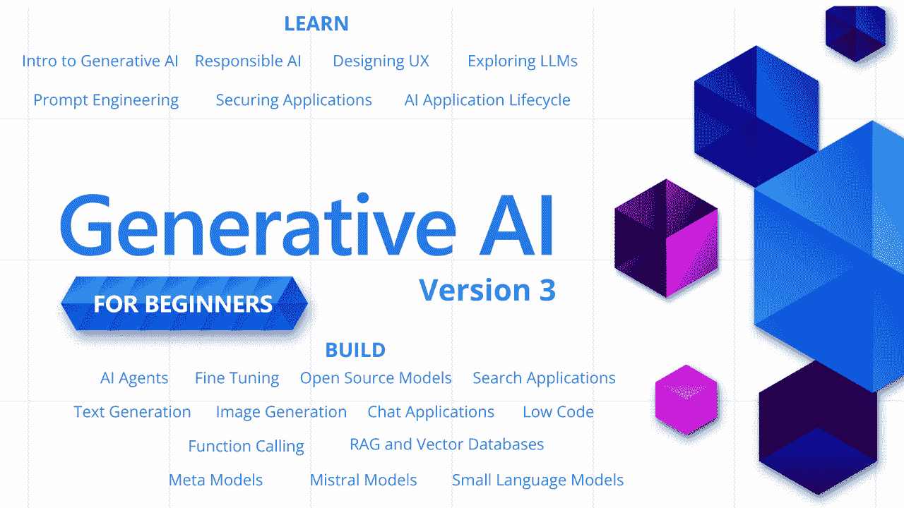

# AI大模型入门-生成式人工智能初学者指南

> 来源：[https://gotoaiworld.feishu.cn/docx/UsI6dO3lqoPzKQxMGSlcgb82n2c](https://gotoaiworld.feishu.cn/docx/UsI6dO3lqoPzKQxMGSlcgb82n2c)

# 一、概述

> 通过微软云倡导者团队的21节全面课程，学习构建生成式AI应用的基础知识。

https://github.com/microsoft/generative-ai-for-beginners

2[1](https://microsoft.github.io/generative-ai-for-beginners/) Lessons, Get Started Building with Generative AI 🔗 https://microsoft.github.io/generative-ai-for-beginners/

## 1.生成式AI入门（版本3）- 一门课程

通过微软云倡导者团队的21节全面课程，学习构建生成式AI应用的基础知识。

## 🌱 入门指南

本课程包含21节课。每节课涵盖一个主题，您可以从任何一节开始学习！

课程分为“Learn”课程，讲解生成式AI的概念；以及“Build”课程，讲解概念并提供Python和TypeScript的代码示例（如适用）。

[对于 .NET 开发者，请查看 Genera](https://github.com/microsoft/Generative-AI-for-beginners-dotnet?WT.mc_id=academic-105485-koreyst)tive AI for Beginners (.NET Edition)！

每节课还包含“Keep Learning”部分，提供额外的学习资源。

## 你需要准备的东西

### 运行本课程代码，你可以使用以下任意一种：

+   Azure OpenAI Service - 课程: "aoai-assignment"

+   GitHub Marketplace Model Catalog - 课程: "githubmodels"

+   [OpenAI API](https://aka.ms/genai-beginners/open-ai?WT.mc_id=academic-105485-koreyst) - 课程: "oai-assignment"

+   具备基础的 Python 或 TypeScript 知[识会更有帮助](https://aka.ms/genai-beginners/python?WT.mc_id=academic-105485-koreyst) [- *绝对初学者可参](https://aka.ms/genai-beginners/typescript?WT.mc_id=academic-105485-koreyst)考这些Python和TypeScript课程

+   一个 GitHub 账号，用于将整个仓库 fork 到你的账号

我们还准备了一个**[课程环境搭建](https://github.com/microsoft/generative-ai-for-beginners/blob/main/translations/zh/00-course-setup/README.md?WT.mc_id=academic-105485-koreyst)**章节，帮助你配置开发环境。

别忘了给本仓库[点星 (🌟)，](https://docs.github.com/en/get-started/exploring-projects-on-github/saving-repositories-with-stars?WT.mc_id=academic-105485-koreyst)方便以后快速找到。

## 🧠 准备好部署了吗？

[如果你想要更高级的代码](https://aka.ms/genai-beg-code?WT.mc_id=academic-105485-koreyst)示例，请查看我们提供的生成式AI代码示例合集，包含Python和TypeScript版本。

## 🗣️ 结识其他学习者，获取支持

加入我们的官方 Azure AI Foundry Discord 服务器，与其他学习本课程的学员交流并获得帮助。

在我们的Azure AI Foundry 开发者论坛（GitHub）提问或分享产品反馈。

## 🚀 创业中？

注册Microsoft for Startups Founders Hub，即可获得免费OpenAI额度和最高15万美元Azure额度，通过Azure OpenAI服务访问OpenAI模型。

## 🙏 想帮忙吗？

有建议或发现拼写、代码错误？请[提交问题](https://github.com/microsoft/generative-ai-for-beginners/issues?WT.mc_id=academic-105485-koreyst)或[创建拉取请求](https://github.com/microsoft/generative-ai-for-beginners/pulls?WT.mc_id=academic-105485-koreyst)。

## 📂 每节课包含：

+   主题的简短视频介绍

+   README 中的文字课程内容

+   支持 Azure OpenAI 和 OpenAI API 的 Python 和 TypeScript 代码示例

+   继续学习的额外资源链接

## 2 课程列表

## 3.其他课程

我们的团队还制作了其他课程！欢迎查看：

+   [新 初学者模型上下文协议](https://github.com/microsoft/mcp-for-beginners?WT.mc_id=academic-105485-koreyst)

+   [初学者 AI 代理](https://github.com/microsoft/ai-agents-for-beginners?WT.mc_id=academic-105485-koreyst)

+   使用 .NET 的生成式 AI 初学者课程

+   使用 JavaScript 的生成式 AI 初学者课程

+   [机器学习初学者](https://aka.ms/ml-beginners?WT.mc_id=academic-105485-koreyst)

+   [数据科学初学者](https://aka.ms/datascience-beginners?WT.mc_id=academic-105485-koreyst)

+   [AI 初学者](https://aka.ms/ai-beginners?WT.mc_id=academic-105485-koreyst)

+   [网络安全初学者](https://github.com/microsoft/Security-101??WT.mc_id=academic-96948-sayoung)

+   [网页开发初学者](https://aka.ms/webdev-beginners?WT.mc_id=academic-105485-koreyst)

+   [物联网初学者](https://aka.ms/iot-beginners?WT.mc_id=academic-105485-koreyst)

+   [XR 开发初学者](https://github.com/microsoft/xr-development-for-beginners?WT.mc_id=academic-105485-koreyst)

+   掌握 GitHub Copilot 进行 AI 配对编程

+   掌握 GitHub Copilot 面向 C#/.NET 开发者

+   选择你自己的 Copilot 冒险