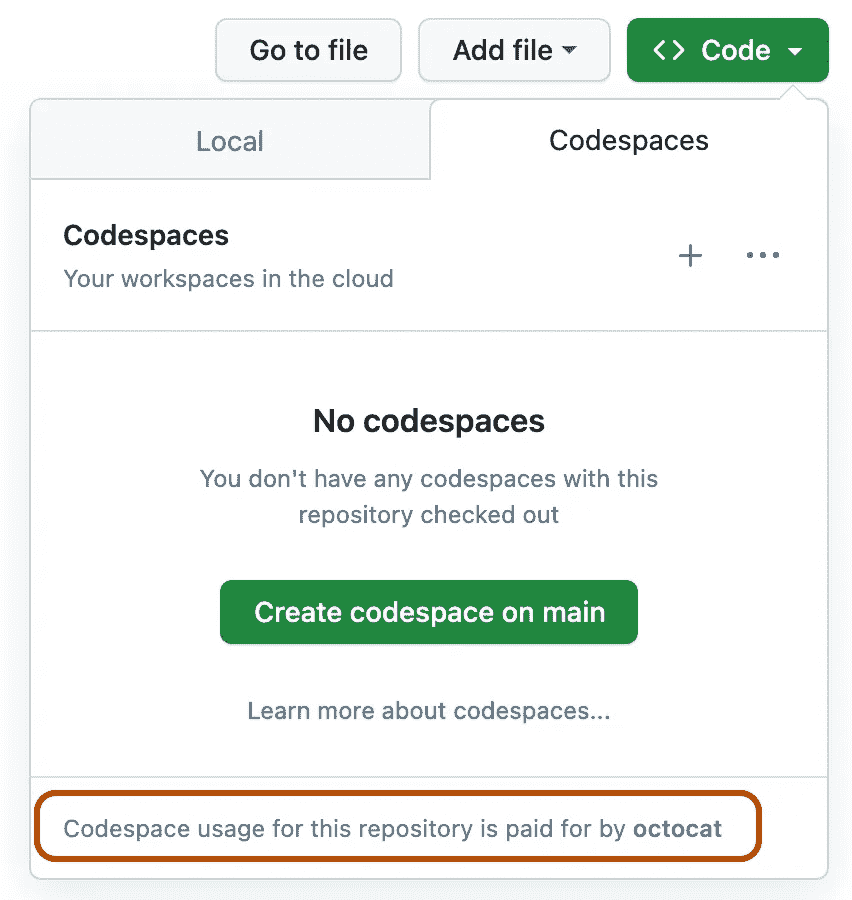

# 00.课程环境搭建

> 来源：[https://gotoaiworld.feishu.cn/docx/YVCZdlKw2oP9odxRoBechE5KnWc](https://gotoaiworld.feishu.cn/docx/YVCZdlKw2oP9odxRoBechE5KnWc)

## 设置步骤

开始学习本课程前，你需要完成以下步骤。

1.  Fork 这个仓库

将[整个仓库 Fork](https://github.com/microsoft/generative-ai-for-beginners/fork?WT.mc_id=academic-105485-koreyst)[到你自己的 GitHub ](https://docs.github.com/en/get-started/exploring-projects-on-github/saving-repositories-with-stars?WT.mc_id=academic-105485-koreyst)账号，这样你才能修改代码并完成挑战。你也可以给这个仓库加星标 (🌟)，方便以后找到它和相关仓库。

1.  创建 Codespace

为了避免运行代码时出现依赖问题，我们建议在GitHub Codespaces中运行本课程。

你可以在 Fork 后的仓库中选择 Code 选项，然后选择 Codespaces 来创建。



1.  存储你的 API 密钥

在构建任何应用时，保护好你的 API 密钥非常重要。我们建议不要将 API 密钥直接写入代码。将密钥提交到公共仓库可能导致安全风险，甚至被恶意使用产生不必要的费用。

以下是为 Python 创建 .env 文件并添加 GITHUB_TOKEN 的分步指南：

1.  进入项目目录：打开终端或命令行，切换到你想创建 .env 文件的项目根目录。

1.  cd path/to/your/project

1.  创建 .env 文件：用你喜欢的文本编辑器新建一个名为 .env 的文件。如果用命令行，可以使用 touch（Unix 系统）或 echo（Windows）：

1.  Unix 系统：

1.  touch .env

1.  Windows：

1.  echo . > .env

1.  编辑 .env 文件：用文本编辑器打开 .env 文件（如 VS Code、Notepad++ 等），添加以下内容，将 your_github_token_here 替换为你的真实 GitHub 令牌：

1.  GITHUB_TOKEN=your_github_token_here

1.  保存文件：保存并关闭编辑器。

1.  安装 python-dotenv：如果还没安装，需要用 pip 安装 python-dotenv，以便从 .env 文件加载环境变量：

1.  pip install python-dotenv

1.  在 Python 脚本中加载环境变量：在你的 Python 脚本中，使用 python-dotenv 加载 .env 文件中的环境变量：

1.  from dotenv import load_dotenvimport os# Load environment variables from .env fileload_dotenv()

# Access the GITHUB_TOKEN variablegithub_token = os.getenv("GITHUB_TOKEN")

print(github_token)

完成以上步骤后，你就成功创建了 .env 文件，添加了 GitHub 令牌，并在 Python 应用中加载了它。

## 如何在本地电脑运行

[要在本地运行](https://www.python.org/downloads/?WT.mc_id=academic-105485-koreyst)代码，你需要先安装某个版本的Python。

然后，克隆仓库：

git clone https://github.com/microsoft/generative-ai-for-beginners

cd generative-ai-for-beginners

确认所有内容都准备好后，就可以开始学习了！

## 可选步骤

### 安装 Miniconda

[Miniconda](https://conda.io/en/latest/miniconda.html?WT.mc_id=academic-105485-koreyst)[ 是一个轻](https://docs.conda.io/en/latest?WT.mc_id=academic-105485-koreyst)量级安装器，用于安装 Conda、Python 以及一[些包。C](https://docs.python.org/3/tutorial/venv.html?WT.mc_id=academic-105485-koreyst)onda 是一个包管理器，方便你设置和切换不同的 Python 虚拟环境和包。它也适合安装那些无法通过 pip 获取的包。

你可以参考[Miniconda 安装指南](https://docs.anaconda.com/free/miniconda/#quick-command-line-install?WT.mc_id=academic-105485-koreyst)进行安装。

[安装](https://github.com/microsoft/generative-ai-for-beginners/fork?WT.mc_id=academic-105485-koreyst)好 Miniconda 后，如果还没克隆仓库，请先克隆仓库。

接下来需要创建虚拟环境。使用 Conda，可以创建一个环境配置文件（environment.yml）。如果你使用 Codespaces，请在 .devcontainer 目录下创建，即 .devcontainer/environment.yml。

将下面的内容填入你的环境文件：

name: <environment-name>channels:

- defaults

- microsoftdependencies:

- python=<python-version>

- openai

- python-dotenv

- pip

- pip:

- azure-ai-ml

如果使用 Conda 时遇到错误，可以在终端手动安装 Microsoft AI 库，命令如下：

```
conda install -c microsoft azure-ai-ml
```

环境文件中指定了所需依赖。<environment-name> 是你想给 Conda 环境起的名字，<python-version> 是你想用的 Python 版本，比如 3 表示最新的主版本。

完成后，在命令行/终端运行以下命令创建 Conda 环境：

conda env create --name ai4beg --file .devcontainer/environment.yml # .devcontainer sub path applies to only Codespace setups

conda activate ai4beg

如果遇到问题，请参考[Conda 环境指南](https://docs.conda.io/projects/conda/en/latest/user-guide/tasks/manage-environments.html?WT.mc_id=academic-105485-koreyst)。

### 使用带 Python 支持扩展的 Visual Studio Code

我们推荐使用Visual [Studio Code](https://marketplace.visualstudio.com/items?itemName=ms-python.python&WT.mc_id=academic-105485-koreyst) (VS Code)编辑器，并安装Python 支持扩展来学习本课程。不过这只是建议，并非强制要求。

> 注意：在 VS Code 中打开课程仓库时，你可以选择在[容器中设](https://code.visualstudio.com/docs/devcontainers/containers?itemName=ms-python.python&WT.mc_id=academic-105485-koreyst)[置项目。这是因为课程仓库中](https://code.visualstudio.com/docs/devcontainers/containers?itemName=ms-python.python&WT.mc_id=academic-105485-koreyst)包含了特殊的 .devcontainer目录。后面会详细介绍。

> 注意：克隆并打开目录后，VS Code 会自动建议你安装 Python 支持扩展。

> 注意：如果 VS Code 提示你重新在容器中打开仓库，请拒绝此请求，以便使用本地安装的 Python 版本。

### 在浏览器中使用 Jupyter

你也可以直接在浏览器中使用[Jupyter 环境](https://jupyter.org/?WT.mc_id=academic-105485-koreyst)[进行项目开发。经典 J](https://jupyter.org/hub?WT.mc_id=academic-105485-koreyst)upyter 和Jupyter Hub都提供了自动补全、代码高亮等良好开发体验。

要在本地启动 Jupyter，打开终端/命令行，切换到课程目录，执行：

jupyter notebook

或者

jupyterhub

这会启动一个 Jupyter 实例，访问地址会显示在命令行窗口中。

访问该地址后，你会看到课程大纲，并能打开任何 *.ipynb 文件，例如 08-building-search-applications/python/oai-solution.ipynb。

### 在容器中运行

[除了](https://github.com/microsoft/generative-ai-for-beginners/blob/main/00-course-setup/%3Chttps:/en.wikipedia.org/wiki/Containerization_(computing)?WT.mc_id=academic-105485-koreyst%3E)在本地电脑或 Codespace 设置环境外，你还可以使用容器。课程仓库中的特殊 .devcontainer 文件夹使 VS Code 能够在容器中搭建项目。若不使用 Codespaces，则需要安装 Docker。说实话，这需要一定的操作经验，我们建议只有有容器使用经验的同学尝试。

使[用 GitHub Codesp](https://docs.github.com/en/codespaces/managing-your-codespaces/managing-secrets-for-your-codespaces?WT.mc_id=academic-105485-koreyst)aces 时，保护 API 密钥的最佳方式之一是使用 Codespace Secrets。请参考Codespaces 秘密管理指南了解详情。

## 课程内容与技术要求

本课程包含 6 个概念课和 6 个编程课。

编[程课使用](https://azure.microsoft.com/products/ai-services/openai-service?WT.mc_id=academic-105485-koreyst) Azure OpenAI 服务。你需要拥有 Azure OpenAI 服务的访问权限和 API 密钥才能运行代码。你可以通过填写申请来获取访问权限。

在等待申请审批期间，每个编程课也包含一个 README.md 文件，你可以查看代码和输出结果。

## 第一次使用 Azure OpenAI 服务

如果你是第一次使用 Azure OpenAI 服务，请参考本指南，了解如何创建和部署 Azure OpenAI 服务资源。

## 第一次使用 OpenAI API

[如果你是第一次](https://platform.openai.com/docs/quickstart?context=pythont&WT.mc_id=academic-105485-koreyst)使用 OpenAI API，请参考本指南，了解如何创建和使用接口。

## 认识其他学习者

我们在官方的AI Community Discord 服务器中创建了频道，方便你结识其他学习者。这是与志同道合的创业者、开发者、学生以及所有想提升生成式 AI 技能的人交流的好地方。

项目团队也会在该 Discord 服务器上帮助学习者。

## 贡献

[本课程是一个开源项目。如](https://github.com/microsoft/generative-ai-for-beginners/pulls?WT.mc_id=academic-105485-koreyst)果你发[现改进点或问题，请创建P](https://github.com/microsoft/generative-ai-for-beginners/issues?WT.mc_id=academic-105485-koreyst)ull Request或提交GitHub issue。

项目团队会跟踪所有贡献。参与开源是构建生成式 AI 职业生涯的绝佳方式。

大多数贡献需要你同意贡献者许可协议（CLA），声明你有权且[确实授予我们使用你贡献的权](https://cla.microsoft.com/?WT.mc_id=academic-105485-koreyst)利。详情请访问CLA，贡献者许可协议网站。

重要提示：翻译本仓库内容时，请确保不要使用机器翻译。我们会通过社区核实翻译质量，请仅在你熟练掌握该语言时自愿参与翻译。

提交 Pull Request 时，CLA 机器人会自动判断你是否需要提供 CLA，并相应标注（如标签、评论）。只需按照机器人提示操作即可。你只需在所有使用我们 CLA 的仓库中完成一次。

本项目采用了[微软开源行为准则](https://opensource.microsoft.com/codeofconduct/?WT.mc_id=academic-105485-koreyst)。更多信息请阅读行为准则常见问题，或通过邮箱 opencode@microsoft.com 联系我们，提出任何问题或建议。

## 让我们开始吧

[既然你已经完成了学习本课程所需](https://github.com/microsoft/generative-ai-for-beginners/blob/main/translations/zh/01-introduction-to-genai/README.md?WT.mc_id=academic-105485-koreyst)的准备步骤，接下来就从生成式 AI 和大语言模型简介开始吧。