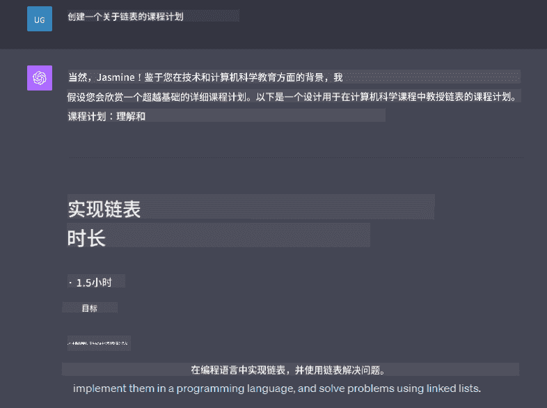

# 07.构建生成式 AI 驱动的聊天应用

> 来源：[https://gotoaiworld.feishu.cn/docx/LfGNdoWzvoZfhlx353RcILv6nWc](https://gotoaiworld.feishu.cn/docx/LfGNdoWzvoZfhlx353RcILv6nWc)

> (点击上方图片观看本课视频)

既然我们已经了解了如何构建文本生成应用，接下来让我们来看看聊天应用。

聊天应用已经融入我们的日常生活，不仅仅是简单的闲聊工具。它们是客户服务、技术支持，甚至复杂咨询系统的重要组成部分。很可能你不久前就通过聊天应用获得过帮助。随着我们将生成式 AI 等更先进的技术整合到这些平台中，系统的复杂性和挑战也随之增加。

我们需要回答的一些问题包括：

+   构建应用。如何高效构建并无缝集成这些 AI 驱动的应用以满足特定场景需求？

+   [监控。应用部署后，如何](https://www.microsoft.com/ai/responsible-ai?WT.mc_id=academic-105485-koreyst)监控并确保其在功能和遵守负责任 AI 六大原则方面都保持最高质量？

随着自动化和人机无缝交互时代的到来，理解生成式 AI 如何改变聊天应用的范围、深度和适应性变得至关重要。本课将探讨支持这些复杂系统的架构要素，深入研究针对特定领域任务的微调方法，并评估确保负责任 AI 部署的相关指标和考量。

## 介绍

本课内容包括：

+   高效构建和集成聊天应用的技术。

+   如何对应用进行定制和微调。

+   有效监控聊天应用的策略和注意事项。

## 学习目标

完成本课后，你将能够：

+   描述构建和集成聊天应用到现有系统时的考虑因素。

+   针对特定用例定制聊天应用。

+   识别关键指标和注意事项，有效监控和维护 AI 驱动聊天应用的质量。

+   确保聊天应用负责任地利用 AI 技术。

## 将生成式 AI 集成到聊天应用中

通过生成式 AI 提升聊天应用，不仅仅是让它们更智能，更是优化其架构、性能和用户界面，以提供优质的用户体验。这涉及到架构基础、API 集成和用户界面设计的探讨。本节旨在为你提供一条全面的路线图，帮助你在将聊天应用接入现有系统或构建独立平台时游刃有余。

本节结束时，你将掌握高效构建和集成聊天应用所需的专业知识。

### 聊天机器人还是聊天应用？

在深入构建聊天应用之前，我们先比较一下“聊天机器人”和“AI 驱动的聊天应用”，它们在角色和功能上有明显区别。聊天机器人的主要目的是自动化特定的对话任务，比如回答常见问题或跟踪包裹。它通常基于规则逻辑或复杂的 AI 算法。而 AI 驱动的聊天应用则是一个更广泛的环境，支持多种数字通信形式，如文本、语音和视频聊天。其核心特点是集成了生成式 AI 模型，能够模拟细腻、类人对话，根据多样的输入和上下文线索生成回复。生成式 AI 驱动的聊天应用可以进行开放领域的讨论，适应不断变化的对话上下文，甚至生成创造性或复杂的对话内容。

下表列出了两者的主要区别和相似点，帮助我们理解它们在数字通信中的独特角色。

### 利用 SDK 和 API 的预构建功能

构建聊天应用时，评估现有资源是一个很好的起点。使用 SDK 和 API 构建聊天应用有多方面优势。通过集成文档完善的 SDK 和 API，你的应用在长期发展中更具竞争力，同时解决了可扩展性和维护性的问题。

+   加快开发进度，降低负担：依赖预构建功能，避免了自行开发的高昂成本，让你能专注于应用中更重要的部分，比如业务逻辑。

+   性能更优：从零开始构建功能时，你会关心“它能扩展吗？能否应对用户激增？”而维护良好的 SDK 和 API 通常内置了这些解决方案。

+   维护更简便：大多数 API 和 SDK 只需更新库版本即可获得最新改进，管理更轻松。

+   接入前沿技术：利用经过微调和大规模数据训练的模型，为应用提供自然语言处理能力。

访问 SDK 或 API 功能通常需要获得使用权限，通常通过唯一密钥或认证令牌[实现。我们将使用 O](https://github.com/microsoft/generative-ai-for-beginners/blob/main/07-building-chat-applications/python/oai-assignment.ipynb)penAI Python 库来演示这一过程。你也可以在本课的OpenAI 笔记本或Azure OpenAI 服务笔记本中自行尝试。

import osfrom openai import OpenAIAPI_KEY = os.getenv("OPENAI_API_KEY","")

client = OpenAI(api_key=API_KEY

)

chat_completion = client.chat.completions.create(model="gpt-3.5-turbo", messages=[{"role": "user", "content": "Suggest two titles for an instructional lesson on chat applications for generative AI."}])

上例使用 GPT-3.5 Turbo 模型完成提示，但请注意，API 密钥必须先设置，否则会报错。

## 用户体验（UX）

聊天应用适用通用的用户体验原则，但由于涉及机器学习组件，以下几点尤为重要：

+   处理歧义的机制：生成式 AI 模型有时会产生模糊答案。提供用户请求澄清的功能能有效应对这一问题。

+   上下文保持：先进的生成式 AI 模型能记忆对话上下文，这对用户体验至关重要。允许用户控制和管理上下文能提升体验，但也带来敏感信息保留的风险。制定信息存储时长的策略（如保留政策）可以在上下文需求和隐私保护间取得平衡。

+   个性化：AI 模型具备学习和适应能力，能为用户提供个性化体验。通过用户档案等功能定制体验，不仅让用户感到被理解，还能帮助他们更高效地找到答案，提升互动满意度。

OpenAI ChatGPT 中的“自定义指令”设置就是个性化的典型例子。它允许你提供关于自己的信息，作为提示的重要上下文。以下是一个自定义指令示例。

该“档案”促使 ChatGPT 制定关于链表的课程计划。注意 ChatGPT 会根据用户经验，考虑提供更深入的课程内容。

### 微软的大型语言模型系统消息框架

[微软提供了指导](https://learn.microsoft.com/azure/ai-services/openai/concepts/system-message#define-the-models-output-format?WT.mc_id=academic-105485-koreyst)，帮助编写有效的系统消息以生成 LLM 响应，涵盖四个方面：

1.  定义模型的目标用户、能力和限制。

1.  定义模型的输出格式。

1.  提供展示模型预期行为的具体示例。

1.  设定额外的行为规范。

### 无障碍设计

无论用户有视觉、听觉、运动或认知障碍，设计良好的聊天应用都应确保所有人都能使用。以下列出了针对不同障碍的无障碍功能：

+   视觉障碍：高对比度主题、可调节字体大小、屏幕阅读器兼容。

+   听觉障碍：文本转语音和语音转文本功能、音频通知的视觉提示。

+   运动障碍：键盘导航支持、语音命令。

+   认知障碍：简化语言选项。

## 针对领域特定语言模型的定制与微调

想象一个聊天应用，能理解你公司的行话，并预测用户常见的具体问题。这里有几种值得关注的方法：

+   利用领域特定语言模型（DSL）。DSL 是指针对特定领域训练的语言模型，能理解该领域的概念和场景。

+   应用微调。微调是用特定数据对模型进行进一步训练的过程。

## 定制：使用领域特定语言模型（DSL）

利用领域特定语言模型（DSL 模型）可以通过提供专业且上下文相关的交互，提升用户参与度。DSL 模型是针对某一领域、行业或主题训练或微调的模型。使用 DSL 模型的方式多样，可以从零开始训练，也可以通过 SDK 和 API 使用现成模型。另一种选择是微调，即在已有预训练模型基础上，针对特定领域进行适配。

## 定制：应用微调

当预训练模型在某个专业领域或特定任务上表现不足时，通常会考虑微调。

例如，医疗问题复杂且需要大量上下文。医生诊断患者时，会考虑生活习惯、既往病史，甚至参考最新医学文献。在这种细致入微的场景下，通用 AI 聊天应用难以成为可靠来源。

### 场景示例：医疗应用

设想一个聊天应用，旨在帮助医疗人员快速查询治疗指南、药物相互作用或最新研究成果。

通用模型可能能回答基础医疗问题或提供一般建议，但在以下方面可能力不从心：

+   高度专业或复杂的病例。例如，神经科医生可能会问：“目前治疗儿童耐药性癫痫的最佳实践是什么？”

+   缺乏最新进展。通用模型可能无法提供涵盖神经学和药理学最新进展的答案。

在这些情况下，使用专业医疗数据集对模型进行微调，能显著提升其处理复杂医疗问题的准确性和可靠性。这需要获取大量且相关的领域数据，涵盖需解决的专业挑战和问题。

## 高质量 AI 驱动聊天体验的考量

本节概述“高质量”聊天应用的标准，包括可操作指标的采集和负责任利用 AI 技术的框架遵循。

### 关键指标

为了保持应用的高质量表现，必须持续跟踪关键指标和注意事项。这些指标不仅确保应用功能正常，还评估 AI 模型和用户体验的质量。以下列表涵盖了基础指标、AI 指标和用户体验指标。

### 在聊天应用中实施负责任的 AI 实践

微软的负责任 AI 方法确定了六项指导 AI 开发和使用的原则。以下是这些原则、它们的定义，以及聊天开发者应考虑的事项和重视它们的原因。

## 任务

请查看 [assignment](https://github.com/microsoft/generative-ai-for-beginners/blob/main/07-building-chat-applications/python)，它将带你完成一系列练习，从运行你的第一个聊天提示，到文本分类和摘要等。注意，任务支持多种编程语言！

## 干得好！继续前进

完成本课后，访问我们的 Generative AI Learning collection，继续提升你的生成式 AI 知识！

前往第 8 课，了解如何开始[构建搜索应用](https://github.com/microsoft/generative-ai-for-beginners/blob/main/translations/zh/08-building-search-applications/README.md?WT.mc_id=academic-105485-koreyst)！