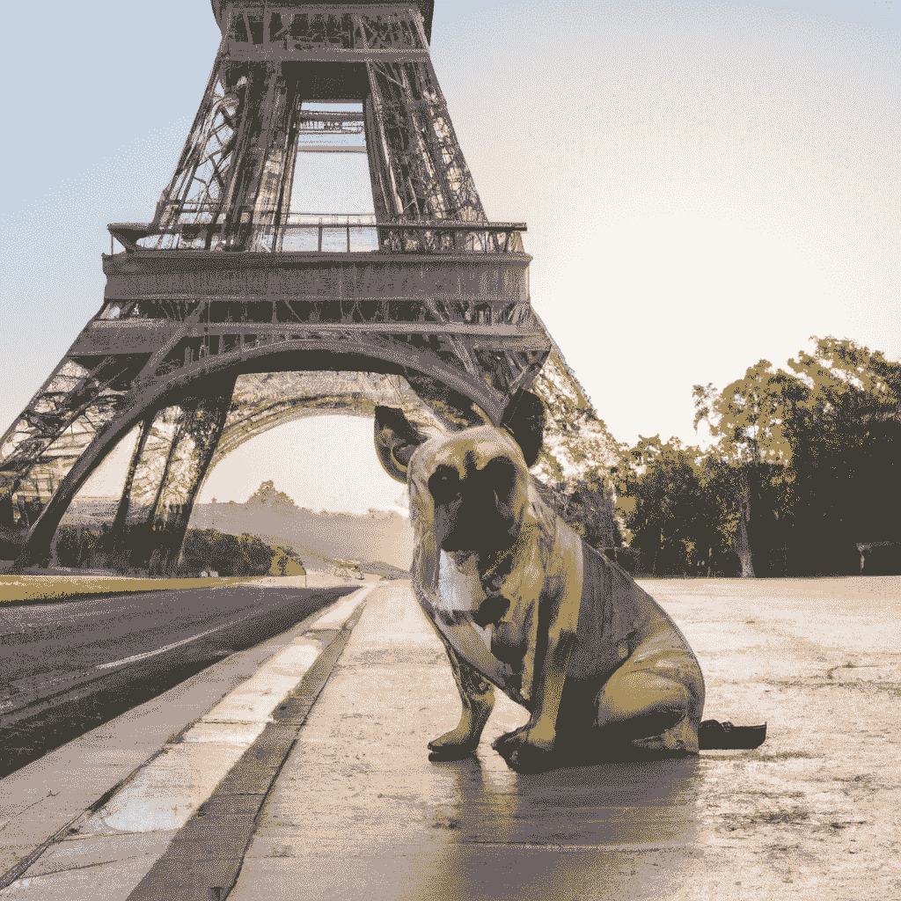
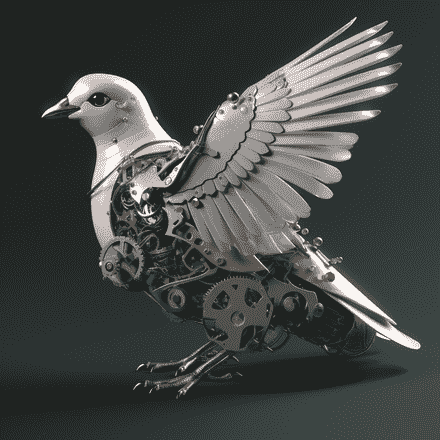
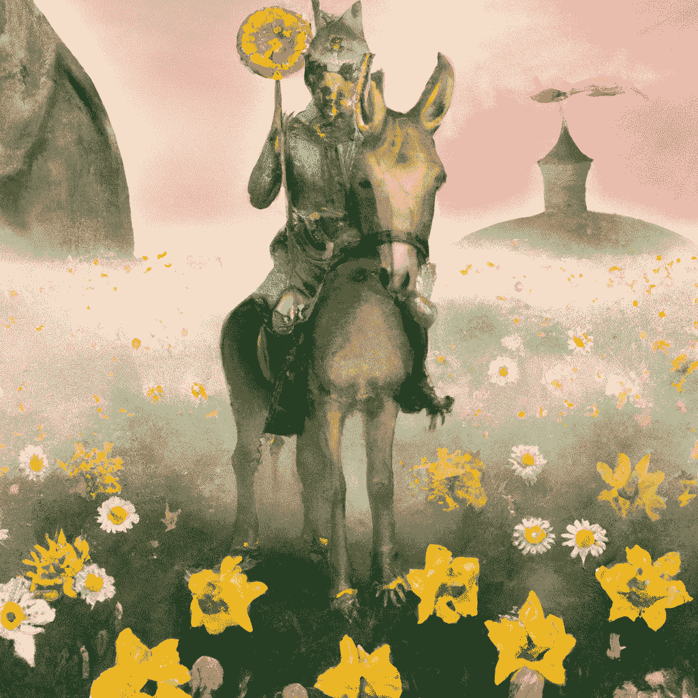

# 09.构建图像生成应用

> 来源：[https://gotoaiworld.feishu.cn/docx/R9BUdahvCortkax4nLwcskJzn3c](https://gotoaiworld.feishu.cn/docx/R9BUdahvCortkax4nLwcskJzn3c)

大型语言模型不仅能生成文本，还能根据文本描述生成图像。图像作为一种模态，在医疗技术、建筑、旅游、游戏开发等多个领域都有广泛应用。本章将介绍两种最流行的图像生成模型：DALL-E 和 Midjourney。

## 介绍

本课内容包括：

+   图像生成及其应用价值。
+   DALL-E 和 Midjourney 的介绍及工作原理。
+   如何构建图像生成应用。

## 学习目标

完成本课后，您将能够：

+   构建图像生成应用。
+   使用元提示定义应用边界。
+   使用 DALL-E 和 Midjourney。

## 为什么要构建图像生成应用？

图像生成应用是探索生成式 AI 能力的绝佳方式。它们可以用于：

+   图像编辑与合成。可生成多种用途的图像，如图像编辑和合成。
+   应用于多个行业。可为医疗技术、旅游、游戏开发等多个行业生成图像。

## 场景：Edu4All

本课将继续以我们的初创公司 Edu4All 为例。学生们将为他们的作业生成图像，具体内容由学生决定，可能是自己童话故事的插图，或为故事创造新角色，帮助他们可视化想法和概念。

例如，如果学生们在课堂上研究纪念碑，Edu4All 的学生可能会生成如下图像：



使用的提示语可能是：

> “清晨阳光下埃菲尔铁塔旁的狗”

## 什么是 DALL-E 和 Midjourney？

[DALL-E](https://openai.com/dall-e-2?WT.mc_id=academic-105485-koreyst) 和 [Midjourney](https://www.midjourney.com/?WT.mc_id=academic-105485-koreyst) 是两种非常流行的图像生成模型，它们允许你通过提示语生成图像。

### DALL-E

先介绍 DALL-E，它是一种根据文本描述生成图像的生成式 AI 模型。

> DALL-E 是由两个模型 CLIP 和扩散注意力结合而成。

+   CLIP 是一个模型，可以从图像和文本中生成嵌入向量，即数据的数值表示。
+   扩散注意力 是一个根据嵌入向量生成图像的模型。DALL-E 在图像和文本数据集上训练，可以根据文本描述生成图像。例如，DALL-E 可以生成戴帽子的猫，或者带莫霍克发型的狗的图像。

### Midjourney

Midjourney 的工作方式与 DALL-E 类似，也能根据文本提示生成图像。Midjourney 也可以用类似“戴帽子的猫”或“带莫霍克发型的狗”这样的提示生成图像。



图片来源 Wikipedia，由 Midjourney 生成

## DALL-E 和 Midjourney 的工作原理

首先看 [DALL-E](https://arxiv.org/pdf/2102.12092.pdf?WT.mc_id=academic-105485-koreyst)。DALL-E 是基于变换器架构的生成式 AI 模型，采用了 `自回归变换器`。

自回归变换器定义了模型如何根据文本描述生成图像，它一次生成一个像素，然后利用已生成的像素生成下一个像素。通过神经网络的多层处理，直到图像完成。

通过这个过程，DALL-E 可以控制图像中的属性、对象、特征等。不过，DALL-E 2 和 3 对生成图像的控制更强。

## 构建你的第一个图像生成应用

构建图像生成应用需要以下库：

+   `python-dotenv`，强烈建议使用此库将密钥保存在 `.env` 文件中，避免硬编码在代码里。
+   `openai`，用于调用 OpenAI API。
+   `pillow`，用于在 Python 中处理图像。
+   `requests`，帮助发送 HTTP 请求。

1.  创建 `.env` 文件，内容如下：

```
AZURE_OPENAI_ENDPOINT=<your endpoint>
AZURE_OPENAI_API_KEY=<your key>
```

1.  这些信息可在 Azure 门户的“密钥和终结点”部分找到。

1.  将上述库写入 `requirements.txt` 文件：

```
python-dotenv
openai
pillow
requests
```

1.  创建虚拟环境并安装库：

```
python3 -m venv venv
source venv/bin/activate
pip install -r requirements.txt
```

1.  Windows 用户可使用以下命令创建并激活虚拟环境：

```
python3 -m venv venv
venv\Scripts\activate.bat
```

1.  在 `app.py` 文件中添加以下代码：

```python
import openai
import os
import requests
from PIL import Image
import dotenv
# import dotenv
dotenv.load_dotenv()

# Get endpoint and key from environment variables
openai.api_base = os.environ['AZURE_OPENAI_ENDPOINT']

openai.api_key = os.environ['AZURE_OPENAI_API_KEY']

# Assign the API version (DALL-E is currently supported for the 2023-06-01-preview API version only)
openai.api_version = '2023-06-01-preview'
openai.api_type = 'azure'
try:
    # Create an image by using the image generation API
    generation_response = openai.Image.create(
        prompt='Bunny on horse, holding a lollipop, on a foggy meadow where it grows daffodils',    # Enter your prompt text here
        size='1024x1024',
        n=2,
        temperature=0,
    )
    # Set the directory for the stored image
    image_dir = os.path.join(os.curdir, 'images')

    # If the directory doesn't exist, create it
    if not os.path.isdir(image_dir):
        os.mkdir(image_dir)

    # Initialize the image path (note the filetype should be png)
    image_path = os.path.join(image_dir, 'generated-image.png')

    # Retrieve the generated image
    image_url = generation_response["data"][0]["url"]  # extract image URL from response
    generated_image = requests.get(image_url).content  # download the image
    with open(image_path, "wb") as image_file:
        image_file.write(generated_image)

    # Display the image in the default image viewer
    image = Image.open(image_path)
    image.show()

# catch exceptions
except openai.InvalidRequestError as err:
    print(err)
```

代码说明：

+   首先导入所需库，包括 OpenAI、`dotenv`、`requests` 和 Pillow。

```
import openai
import os
import requests
from PIL import Image
import dotenv
# import dotenv
dotenv.load_dotenv()
```

+   然后从 `.env` 文件加载环境变量。

```
import dotenv
dotenv.load_dotenv()
```

接着设置 OpenAI API 的终结点、密钥、版本和类型。

```
# Get endpoint and key from environment variables
openai.api_base = os.environ['AZURE_OPENAI_ENDPOINT']

openai.api_key = os.environ['AZURE_OPENAI_API_KEY']

# add version and type, Azure specific
openai.api_version = '2023-06-01-preview'
openai.api_type = 'azure'
```

之后生成图像：

```
# Create an image by using the image generation API
generation_response = openai.Image.create(
    prompt='Bunny on horse, holding a lollipop, on a foggy meadow where it grows daffodils',    # Enter your prompt text here
    size='1024x1024',
    n=2,
    temperature=0,
)
```

+   上述代码返回一个包含生成图像 URL 的 JSON 对象，我们可以用该 URL 下载并保存图像。
+   最后，打开图像并用默认图像查看器显示：

```
image = Image.open(image_path)
image.show()
```

### 生成图像的更多细节

详细看生成图像的代码：

```
generation_response = openai.Image.create(
    prompt='Bunny on horse, holding a lollipop, on a foggy meadow where it grows daffodils',    # Enter your prompt text here
    size='1024x1024',
    n=2,
    temperature=0,
)
```

+   `prompt` 是用于生成图像的文本提示，这里是“骑马的兔子，手持棒棒糖，站在长满水仙花的雾气弥漫的草地上”。
+   `size` 是生成图像的尺寸，这里是 `1024x1024` 像素。
+   `n` 是生成图像的数量，这里是两张。
+   `temperature` 控制生成模型输出的随机性，取值在 0 到 1 之间，0 表示输出确定性强，1 表示输出随机性大，默认值是 0.7。

接下来我们会介绍更多图像处理功能。

## 图像生成的附加功能

目前为止，你已经看到如何用几行 Python 代码生成图像。但图像处理还有更多可能。

你还可以：

+   进行编辑。通过提供已有图像、遮罩和提示语，可以修改图像。例如，可以给兔子加顶帽子。方法是提供原图、遮罩（标识需要修改的区域）和文本提示，告诉模型要做什么。

```
response = openai.Image.create_edit(
    image=open("base_image.png", "rb"),
    mask=open("mask.png", "rb"),
    prompt="An image of a rabbit with a hat on its head.",
    n=1,
    size="1024x1024",
)

image_url = response['data'][0]['url']
```

+   原图只包含兔子，最终图像则是兔子戴上了帽子。
+   创建变体。即基于已有图像生成不同版本。创建变体时，提供图像和文本提示，代码如下：

```
response = openai.Image.create_variation(
    image=open("bunny-lollipop.png", "rb"),
    n=1,
    size="1024x1024",
)

image_url = response['data'][0]['url']
```

+   注意，此功能仅在 OpenAI 支持。

## `Temperature` 参数

`Temperature` 是控制生成模型输出随机性的参数，取值范围 0 到 1，0 表示输出确定性强，1 表示输出随机性大，默认值为 0.7。

举个例子，运行以下提示两次：

> 提示：“骑马的兔子，手持棒棒糖，站在长满水仙花的雾气弥漫的草地上”

再运行同样的提示，看看是否会得到相同图像：

可以看到，图像相似但不完全相同。接下来将 `temperature` 调低到 0.1，看看效果：

```
generation_response = openai.Image.create(
    prompt='Bunny on horse, holding a lollipop, on a foggy meadow where it grows daffodils',    # Enter your prompt text here
    size='1024x1024',
    n=2,
)
```

### 调整 `temperature`

为了让输出更确定，我们观察之前两张图像，第一张是兔子，第二张是马，差异较大。

因此，将 `temperature` 设置为 0，代码如下：

```
generation_response = openai.Image.create(
    prompt='Bunny on horse, holding a lollipop, on a foggy meadow where it grows daffodils',    # Enter your prompt text here
    size='1024x1024',
    n=2,
    temperature=0,
)
```

运行后得到以下两张图：



可以明显看出图像更为相似。

## 如何用元提示定义应用边界

通过我们的演示，已经可以为客户生成图像。但我们需要为应用设定边界。

例如，不希望生成不适合工作场合或儿童观看的图像。

这可以通过 `元提示` 实现。`元提示` 是用于控制生成式 AI 输出的文本提示。例如，可以用 `元提示` 确保生成的图像适合工作场合或儿童观看。

### `元提示` 如何工作？

`元提示` 是放在文本提示前的控制性文本，用于控制模型输出，通常嵌入应用中，将提示和 `元提示` 合并成一个整体。

一个 `元提示` 示例如下：

```
You are an assistant designer that creates images for children.

The image needs to be safe for work and appropriate for children.

The image needs to be in color.

The image needs to be in landscape orientation.

The image needs to be in a 16:9 aspect ratio.

Do not consider any input from the following that is not safe for work or appropriate for children.

(Input)
```

接下来看看如何在演示中使用 `元提示`。

```
disallow_list = "swords, violence, blood, gore, nudity, sexual content, adult content, adult themes, adult language, adult humor, adult jokes, adult situations, adult"
meta_prompt = f"""You are an assistant designer that creates images for children.
The image needs to be safe for work and appropriate for children.
The image needs to be in color.
The image needs to be in landscape orientation.
The image needs to be in a 16:9 aspect ratio.
Do not consider any input from the following that is not safe for work or appropriate for children.
{disallow_list}"""
prompt = f"{meta_prompt}Create an image of a bunny on a horse, holding a lollipop"
# TODO add request to generate image
```

从上述提示可以看到，所有生成的图像都会考虑 `元提示` 内容。

## 任务 - 让学生动手

我们在课程开始时介绍了 Edu4All。现在是时候让学生为他们的作业生成图像了。

学生们将为包含纪念碑的作业生成图像，具体纪念碑由学生自由发挥。鼓励学生发挥创造力，将纪念碑置于不同场景中。

## 解决方案

以下是一个可能的解决方案：

```python
import openai
import os
import requests
from PIL import Image
import dotenv
# import dotenv
dotenv.load_dotenv()
```


# Get endpoint and key from environment variables

```python
openai.api_base = "<replace with endpoint>"
openai.api_key = "<replace with api key>"

# Assign the API version (DALL-E is currently supported for the 2023-06-01-preview API version only)
openai.api_version = '2023-06-01-preview'
openai.api_type = 'azure'

disallow_list = "swords, violence, blood, gore, nudity, sexual content, adult content, adult themes, adult language, adult humor, adult jokes, adult situations, adult"
meta_prompt = f"""You are an assistant designer that creates images for children.
The image needs to be safe for work and appropriate for children.
The image needs to be in color.
The image needs to be in landscape orientation.
The image needs to be in a 16:9 aspect ratio.
Do not consider any input from the following that is not safe for work or appropriate for children.{disallow_list}"""
prompt = f"""{meta_prompt}Generate monument of the Arc of Triumph in Paris, France, in the evening light with a small child holding a Teddy looks on."""

try:
    # Create an image by using the image generation API
    generation_response = openai.Image.create(
        prompt=prompt,    # Enter your prompt text here
        size='1024x1024',
        n=2,
        temperature=0,
    )

    # Set the directory for the stored image
    image_dir = os.path.join(os.curdir, 'images')

    # If the directory doesn't exist, create it
    if not os.path.isdir(image_dir):
        os.mkdir(image_dir)

    # Initialize the image path (note the filetype should be png)
    image_path = os.path.join(image_dir, 'generated-image.png')

    # Retrieve the generated image
    image_url = generation_response["data"][0]["url"]  # extract image URL from response
    generated_image = requests.get(image_url).content  # download the image
    with open(image_path, "wb") as image_file:
        image_file.write(generated_image)

    # Display the image in the default image viewer
    image = Image.open(image_path)
    image.show()

# catch exceptions
except openai.InvalidRequestError as err:
    print(err)
```

## 干得好！继续学习

完成本课后，欢迎访问我们的[生成式 AI 学习合集](https://aka.ms/genai-collection?WT.mc_id=academic-105485-koreyst)，继续提升你的生成式 AI 知识！

[接下来进入第10课，我们](https://github.com/microsoft/generative-ai-for-beginners/blob/main/translations/zh/10-building-low-code-ai-applications/README.md?WT.mc_id=academic-105485-koreyst)将学习如何用低代码构建 AI 应用
