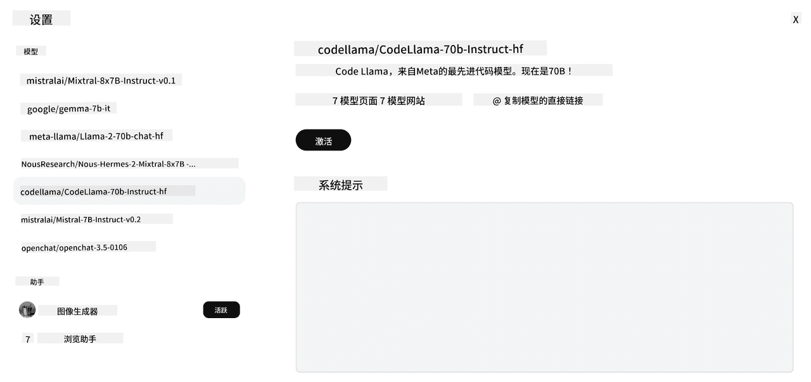

# 16.开源模型与 Hugging Face

> 来源：[https://gotoaiworld.feishu.cn/docx/I064dLYGUoRZvJxi3aCc2wn1nGf](https://gotoaiworld.feishu.cn/docx/I064dLYGUoRZvJxi3aCc2wn1nGf)

## 介绍

开[源大型语言模型（LLM）的世界](https://github.com/microsoft/generative-ai-for-beginners/blob/main/translations/zh/02-exploring-and-comparing-different-llms/README.md?WT.mc_id=academic-105485-koreyst)[令人兴奋且不断发展](https://github.com/microsoft/generative-ai-for-beginners/blob/main/translations/zh/18-fine-tuning/README.md?WT.mc_id=academic-105485-koreyst)。本课旨在深入介绍开源模型。如果你想了解专有模型与开源模型的比较，请查看“探索和比较不同的LLM”课程。本课还将涉及微调的主题，但更详细的讲解可以在“微调LLM”课程中找到。

## 学习目标

+   了解开源模型

+   理解使用开源模型的优势

+   探索Hugging Face和Azure AI Studio上可用的开源模型

## 什么是开源模型？

开源软件在推动各个领域技术发展中发挥[了关键作用。开源倡议](https://web.archive.org/web/20241126001143/https://opensource.org/osd?WT.mc_id=academic-105485-koreyst)组织（OSI）定义了软件开源的10条标准，要求源代码必须在OSI认可的许可证下公开共享。

虽然LLM的开发与软件开发有相似之处，但过程并不完全相同。这也引发了社区对LLM开源定义的广泛讨论。要符合传统开源定义，模型应公开以下信息：

+   用于训练的数据集

+   训练过程中完整的模型权重

+   评估代码

+   微调代码

+   完整的模型权重和训练指标

目前只有少数模型满足这些条件。由Allen人工智能研究所（AllenAI）创建的OLMo模型就是其中之一。

在本课中，我们将统一称这些模型为“开源模型”，因为它们在撰写时可能尚未完全符合上述标准。

## 开源模型的优势

高度可定制 - 由于开源模型附带详细的训练信息，研究人员和开发者可以修改模型内部结构，从而打造针对特定任务或领域的专业化模型。例如代码生成、数学运算和生物学等领域。

成本 - 使用和部署这些模型的每个token成本低于专有模型。在构建生成式AI应用时，应根据你的用例权衡性能与价格。

来源：Artificial Analysis

[灵活性 - 使用开源模型可](https://huggingface.co/chat?WT.mc_id=academic-105485-koreyst)以灵活选择或组合不同模型。例如，HuggingChat助理允许用户在界面中直接选择使用的模型：

## 探索不同的开源模型

### Llama 2

[LLama2](https://huggingface.co/meta-llama?WT.mc_id=academic-105485-koreyst)由Meta开发，是一个针对聊天应用优化的开源模型。这得益于其微调方法，包含大量对话数据和人类反馈，使模型输出更符合人类预期，提升用户体验。

[Llama的微调版本示例包括](https://huggingface.co/elyza/ELYZA-japanese-Llama-2-7b?WT.mc_id=academic-105485-koreyst)专注于日语[的Japanese](https://huggingface.co/TencentARC/LLaMA-Pro-8B?WT.mc_id=academic-105485-koreyst) Llama和增强版的Llama Pro。

### Mistral

[Mistral](https://huggingface.co/mistralai?WT.mc_id=academic-105485-koreyst)是一款注重高性能和高效性的开源模型。它采用专家混合（Mixture-of-Experts）方法，将多个专门模型组合成一个系统，根据输入选择相应模型处理，从而提高计算效率。

[Mistral的微调](https://huggingface.co/BioMistral/BioMistral-7B?text=Mon+nom+est+Thomas+et+mon+principal?WT.mc_id=academic-105485-koreyst)版本示例包括专注医疗领域的BioMistral和执行数学计算的OpenMath Mistral。

### Falcon

[Falcon](https://huggingface.co/tiiuae?WT.mc_id=academic-105485-koreyst)是由技术创新研究院（TII）开发的LLM。Falcon-40B拥有400亿参数，表现优于GPT-3且计算资源需求更低。这得益于其采用的FlashAttention算法和多查询注意力机制，显著降低推理时的内存需求。推理时间的缩短使Falcon-40B非常适合聊天应用。

[Falcon的微调版本示例](https://huggingface.co/OpenAssistant/falcon-40b-sft-top1-560?WT.mc_id=academic-105485-koreyst)包括基于开源模型构建[的OpenAs](https://huggingface.co/nomic-ai/gpt4all-falcon?WT.mc_id=academic-105485-koreyst)sistant和性能优于基础模型的GPT4ALL。

## 如何选择

选择开源模型没有唯一答案。一个好的起点是使用Azure AI Studio的按任务筛选功能，帮助你了解模型适合处理的任务类型。Hugging Face也维护了一个LLM排行榜，展示基于特定指标的最佳模型。

如果想跨类型比较LLM，Artificial Analysis是另一个很好的资源：

来源：Artificial Analysis

针对特定用例，寻找专注于该领域的微调版本通常更有效。尝试多个开源模型，观察它们在你和用户期望下的表现，也是不错的做法。

## 下一步

开源模型的最大优势是你可以很快开始使用它们。查看Azure AI Studio模型目录，这里收录了我们本课中讨论的Hugging Face模型合集。