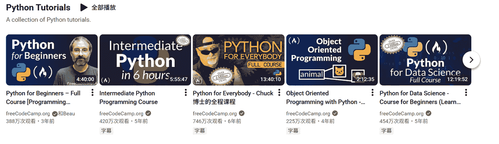
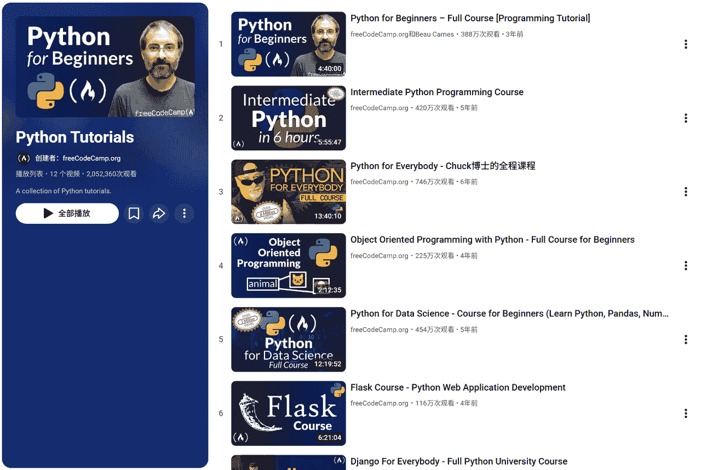

# freeCodeCamp - Python Tutorials

> 来源：[https://gotoaiworld.feishu.cn/docx/IzMfduFoLooPFLxSVhncZQyenEy](https://gotoaiworld.feishu.cn/docx/IzMfduFoLooPFLxSVhncZQyenEy)

Learn math, programming, and computer science for free. A 501(c)(3) tax-exempt charity. We also run a free learning interactive platform at freecodecamp.org

# 链接

SUPPORT OUR CHARITYdonate.freecodecamp.org

LEARN T[O CODE WITH OUR](https://www.youtube.com/redirect?event=channel_description&redir_token=QUFFLUhqbnVMT3pWV0pVUTZYdDI0VWhkWmkzb0ZzUVJsZ3xBQ3Jtc0ttd1dqT3hLZk8xajR5REpuRzkybzR6U2UxMUNaejA5YW53V0RrU1RfRm15UkE3RmpIOVNMc2JEb29CSExfUU5qS2FZeXdpd1VIWlRGdlFrWm8yeXl4OW9WZ3c4U2FOeDUzSWlFMzRpVDhDcm5DUTMtRQ&q=https%3A%2F%2Fscrimba.com%2Ffcc) FRIENDSscrimba.com/fcc

# 更多信息

https://www.youtube.com/playlist?list=PLWKjhJtqVAbnqBxcdjVGgT3uVR10bzTEB

