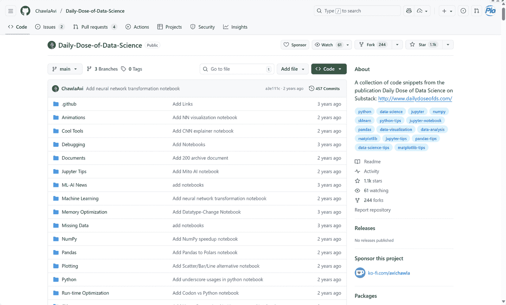
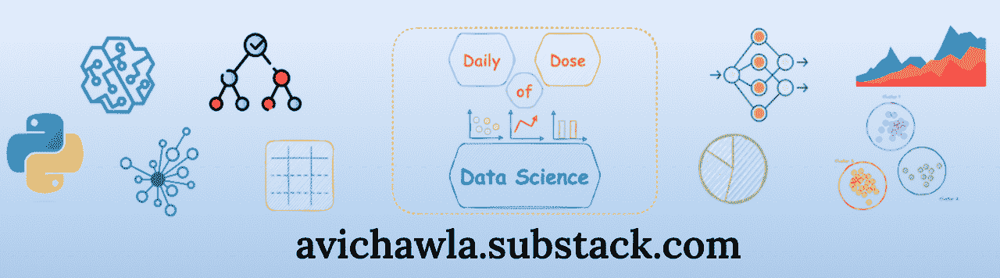

# Daily-Dose-of-Data-Science

> 来源：[https://gotoaiworld.feishu.cn/docx/DEXOdbwd1o4VrnxPshYcln98ngg](https://gotoaiworld.feishu.cn/docx/DEXOdbwd1o4VrnxPshYcln98ngg)

# Daily-Dose-of-Data-Science

**由 Avi Chawla 创**建并维护的综合性数据科学学习与分享平台，它同时以开源项目和电子通讯刊物的形式存在，面向从初学者到资深从业者的各类数据科学学习者，核心是为用户提供体系化、高频更新的数据科学知识与实践资源。以下是其核心特点和形态的详细介绍：

1.  **开源资源库**该平台在 GitHub 等代码托管平台上以开源项目的形式呈现，内容用 Markdown 格式编写，方便跨平台阅读和维护。资源涵盖 Python 编程基础、数据分析、机器学习、深度学习等多个核心主题，还包含大量可运行的代码片段、实战数据集和案例。同时内容会定期更新，且支持社区成员贡献内容，比如补充新教程或优化现有代码，保证了资源的新鲜度和多样性。

1.  **Substack 电子通讯刊物**dailydoseofds.com它还运营着 Substack 专栏，用户可订阅其电子通讯，每天收到数据科学相关的精选内容推送。专栏内容会同步整理成资源合集，比如 2024 年推出的完整版存档以 PDF 形式发布，该版本还对内容进行了主题分类，并加入 2 分钟自我评估模块，帮助用户快速定位适配自己水平的学习章节blog.dailydoseofds.com。

1.  **内容实用且针对性强**平台内容聚焦数据科学实操需求，不仅有基础知识点，还有很多提升效率的实用内容，例如 35 个小众但实用的 Python 库、40 个优化 Pandas 工作流的开源工具、10 个自动化探索性数据分析工具等。此外，还包含内存优化、运行效率优化、代码调试等实操技巧，能帮助从业者解决工作中的实际问题，也适合教师用于设计课程作业等教学场景。

# GitHub 资源

https://github.com/ChawlaAvi/Daily-Dose-of-Data-Science/tree/main

# Daily Dose of Data Science

Daily Dose of Data Science is a publication on Substack that brings together intriguing frameworks, libraries, technologies, and tips that make the life cycle of a Data Science project effortless.

This repository is a collection of all the code snippets presented in my publication. If you want to receive these tips in your mailbox daily, you can subscribe to my Substack newsletter.

## Star History

## Run These Code Snippets on Your Local Machine

To download the tips listed here, you can clone this repo.

git clone https://github.com/ChawlaAvi/Daily-Dose-of-Data-Science

# Table of Contents

1.  [Pandas](https://github.com/ChawlaAvi/Daily-Dose-of-Data-Science/tree/main#pandas)

1.  [Jupyter Tips](https://github.com/ChawlaAvi/Daily-Dose-of-Data-Science/tree/main#jupyter-tips)

1.  [Python](https://github.com/ChawlaAvi/Daily-Dose-of-Data-Science/tree/main#python)

1.  [Plotting](https://github.com/ChawlaAvi/Daily-Dose-of-Data-Science/tree/main#plotting)

1.  [NumPy](https://github.com/ChawlaAvi/Daily-Dose-of-Data-Science/tree/main#numpy)

1.  Memory Optimization

1.  [Cool Tools](https://github.com/ChawlaAvi/Daily-Dose-of-Data-Science/tree/main#cool-tools)

1.  Run-time Optimization

1.  [Sklearn](https://github.com/ChawlaAvi/Daily-Dose-of-Data-Science/tree/main#sklearn)

1.  [Debugging](https://github.com/ChawlaAvi/Daily-Dose-of-Data-Science/tree/main#debugging)

1.  [Missing Data](https://github.com/ChawlaAvi/Daily-Dose-of-Data-Science/tree/main#missing-data)

1.  [ML-AI News](https://github.com/ChawlaAvi/Daily-Dose-of-Data-Science/tree/main#ml-ai-news)

1.  Machine Learning

1.  [Statistics](https://github.com/ChawlaAvi/Daily-Dose-of-Data-Science/tree/main#statistics)

1.  [Testing](https://github.com/ChawlaAvi/Daily-Dose-of-Data-Science/tree/main#testing)

1.  [Terminal](https://github.com/ChawlaAvi/Daily-Dose-of-Data-Science/tree/main#terminal)

1.  [Documents](https://github.com/ChawlaAvi/Daily-Dose-of-Data-Science/tree/main#documents)

1.  [Animations](https://github.com/ChawlaAvi/Daily-Dose-of-Data-Science/tree/main#animations)

## Pandas

## Jupyter Tips

## Python

## Plotting

## NumPy

## Memory Optimization

## Cool Tools

## Run-time Optimization

## Sklearn

## Debugging

## Missing Data

## ML-AI News

## Machine Learning

## Statistics

## Testing

## Terminal

## Documents

## Animations