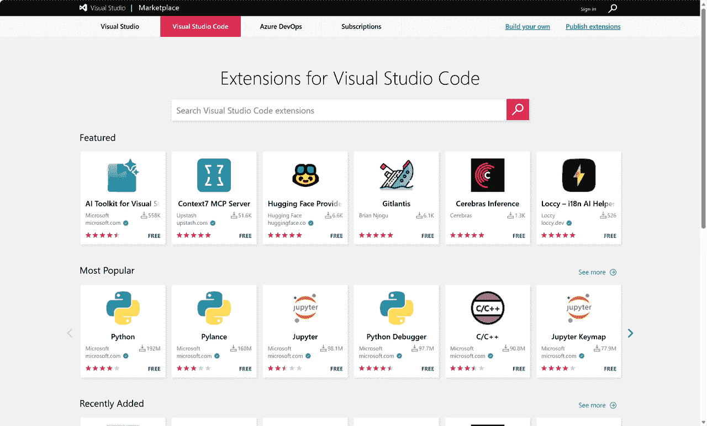

# Visual Studio Code (Microsoft)

> 来源：[https://gotoaiworld.feishu.cn/docx/CtrvdMSf3oXwahx8iztcIgV8nuc](https://gotoaiworld.feishu.cn/docx/CtrvdMSf3oXwahx8iztcIgV8nuc)

# The open source AI code editor

Visual Studio Code（简称 VS Code）是微软开发的轻量级开源 IDE，支持 Windows、macOS、Linux 跨平台运行。

它以轻量高效为特点，原生支持语法高亮、智能补全、调试等功能，通过丰富的插件生态可扩展至几乎所有主流编程语言（如 Python、Java、JavaScript 等），适配前端、后端、移动端等多种开发场景。

界面简洁可定制，集成 Git 版本控制，支持实时协作，兼顾了易用性与专业性，是目前全球开发者使用率极高的工具之一。

https://code.visualstudio.com/

# Visual Studio Code Docs

https://code.visualstudio.com/docs

# Visual Studio Code for MCP

https://github.com/mcp?utm_source=vscode-website&utm_campaign=mcp-registry-server-launch-2025

# Visual Studio Code API

https://code.visualstudio.com/api

# Visual Studio Code Extensions

https://marketplace.visualstudio.com/VSCode

# 学习资源

## **一、官方资源（权威入门）**

1.  **VS Code 官方文档**最权威的学习入口，涵盖安装、基础操作、插件配置、调试等核心内容，支持多语言：https://code.visualstudio.com/docs

1.  **官方入门视频教程**微软官方推出的短视频系列，快速掌握基本[操](https://code.visualstudio.com/learn/get-started/basics)作（如界面导航、文件管理、插件安装）：https://code.visualstudio.com/learn/get-started/basics

1.  **VS Code 博客**发布新功能解读、实用技巧，适合了解进阶特性：https://code.visualstudio.com/blogs

## 二、基础到进阶教程（图文 / 视频）

1.  菜鸟教程 - VS Code 篇适合零基础，[分步骤讲解安装、配置、常用插件及语言环境搭建（如 Python](https://www.runoob.com/w3cnote/vscode-tutorial.html)、前端）：https://www.runoob.com/w3cnote/vscode-tutorial.html

1.  **B 站实战教程**

+   「VS Code 零基础入门到精通」：侧重实操，涵盖界面设置、快捷键、Git 集成等（搜索对应标题即可）。

+   「VS Code 高效开发技巧」：适合有基础者，讲解多光标编辑、代码片段、终端集成等效率工具。

1.  **Medium 博客专栏**搜索「VS Code Tips and Tricks」，有大量开发者分享的实用技巧（如插件推荐、自定义配置）。

## **三、插件与个性化配置**

1.  **VS Code 插件市场**官[方插件库，可按语言 / 场景搜索（如「Pyth](https://marketplace.visualstudio.com/vscode)on」「ESLint」「GitLens」），每个插件附详细使用说明：https://marketplace.visualstudio.com/vscode

1.  **热门插件推荐清单**前端（Prettier、Live Server）、后端（Python、Java Extension Pack）、效率（Todo Tree、Settings Sync）等分类整理，可参考知乎 / 掘金文章（搜索「VS Code 必备插件」）。

## **四、进阶与效率技巧**

1.  **快捷键手册**[官方整理的全平台快捷键表，打印或收藏随时查阅](https://code.visualstudio.com/shortcuts/keyboard-shortcuts-windows.pdf)：https://code.visualstudio.com/shortcuts/keyboard-shortcuts-windows.pdf（Windows 版，macOS/Linux 可在官网切换）

1.  **工作区与多项目管理**学习 .vscode 文件夹配置（settings.json、launch.json），实现项目个性化环境，参考官方文档「Workspaces」章节。

1.  **远程开发**通[过](https://code.visualstudio.com/docs/remote/remote-overview)「Remote - SSH」「Dev Containers」插件实现远程服务器 / 容器开发，适合后端 / 运维场景，官方教程：https://code.visualstudio.com/docs/remote/remote-overview

## **五、社区与问题解决**

+   **Stack Overflow**：搜索「VS Code + 具体问题」（如调试报错、插件冲突），多为实战解决方案。

+   VS Code GitHub 仓库：查看 issue 了解常见问题，或参与功能讨论：https://github.com/microsoft/vscode

+   **知乎 / 掘金专题**：国内开发者分享的经验贴，更贴近中文用户场景。

从官方文档入门，结合实战教程熟悉操作，再通过插件和快捷键提升效率，是快速掌握 VS Code 的有效路径。