# DeepSeek 资源集合

> 来源：[https://gotoaiworld.feishu.cn/docx/S1Dvd31aWoZIYxxysGncR2gqnjh](https://gotoaiworld.feishu.cn/docx/S1Dvd31aWoZIYxxysGncR2gqnjh)

> 本文实时跟踪 deepseek 相关报道，不断补充...

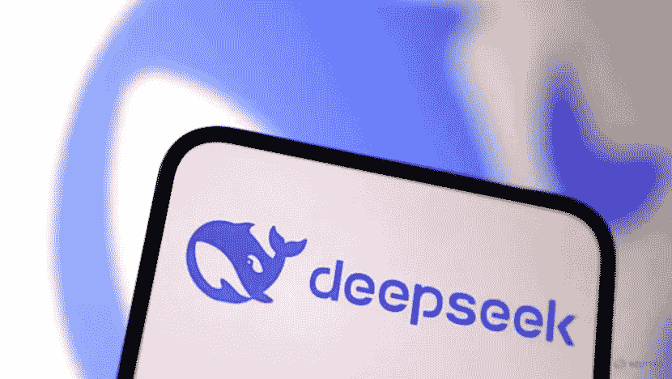

## 一、DeepSeek 官方资源

全面了解 DeepSeek 的官方渠道，获取最新信息和资源。

### 1. DeepSeek 网页官网

+ 描述：DeepSeek 官方网站，提供产品介绍、服务入口等。
+ 链接：https://chat.deepseek.com/

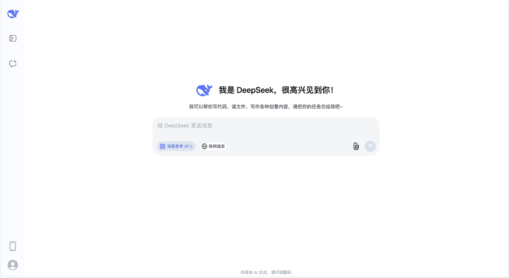

### 2. DeepSeek APP

+ 描述：DeepSeek 移动应用程序，已上架各大手机应用商店。
+ 下载链接：https://download.deepseek.com/app/

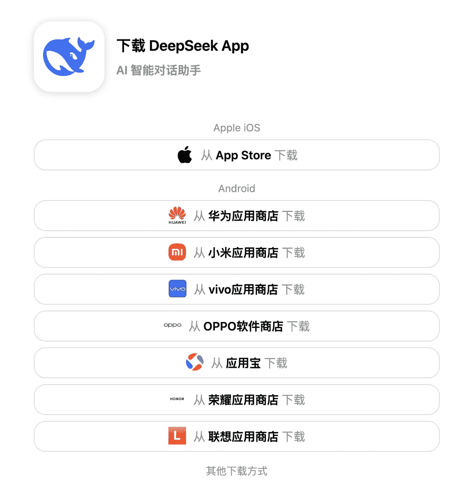

### 3. 官方服务状态监控

+ 描述：DeepSeek 官方服务状态监控页面，了解服务运行状况。

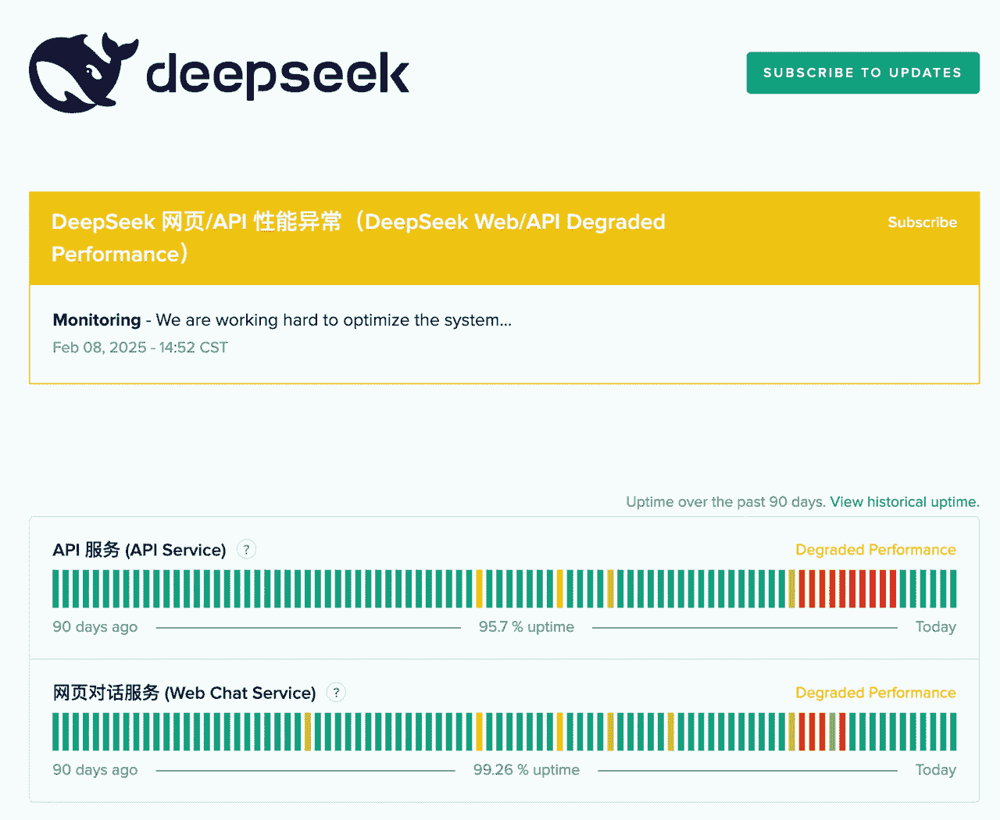

### 4. DeepSeek 官方账号

+ 描述：DeepSeek 官方社交媒体账号，请认准官方标识，谨防假冒账号。
+ 平台：
+ 🛰️👸号：DeepSeek
+ 📕：@DeepSeek（deepseek_ai）
+ X (Twitter)：DeepSeek（@deepseek_ai）

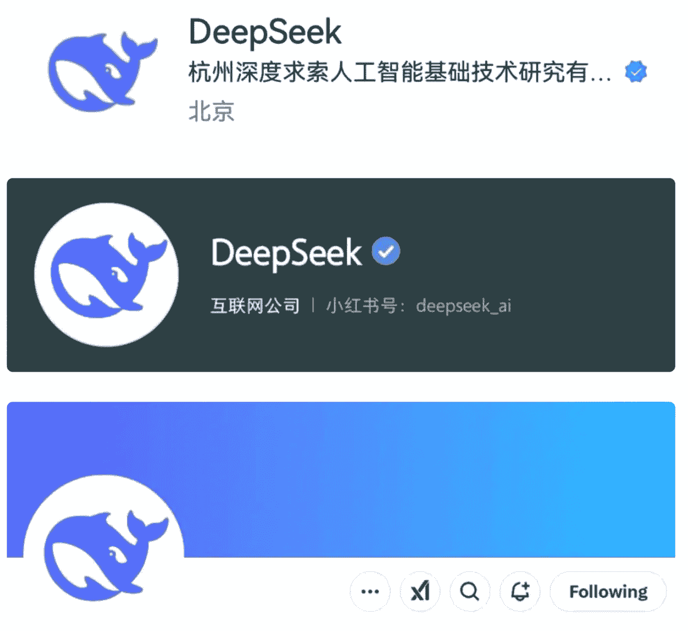

官方声明：关于 DeepSeek 官方信息发布及服务渠道的说明

### 5. DeepSeek 官方开源地址 (DeepSeek-R1)

+ 描述：DeepSeek-R1 模型官方开源代码仓库。
+ 链接：[https://github.com/deepseek-ai/DeepSeek-R1](https://github.com/deepseek-ai/DeepSeek-R1)

### 6. DeepSeek 模型权重官方开源地址

+ 链接：https://huggingface.co/deepseek-ai
+ 描述：DeepSeek 模型权重 Hugging Face 官方仓库。

### 7. DeepSeek-R1 官方论文地址

+ 链接：https://arxiv.org/abs/2501.12948
+ 描述：DeepSeek-R1 官方技术论文。

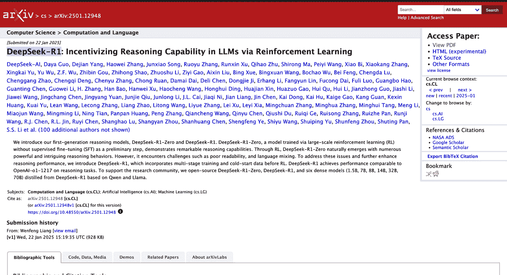

### 8. DeepSeek 官方提示词库

+ 链接：[https://api-docs.deepseek.com/zh-cn/prompt-library/](https://api-docs.deepseek.com/zh-cn/prompt-library/)
+ 描述：DeepSeek 官方提供的提示词库。

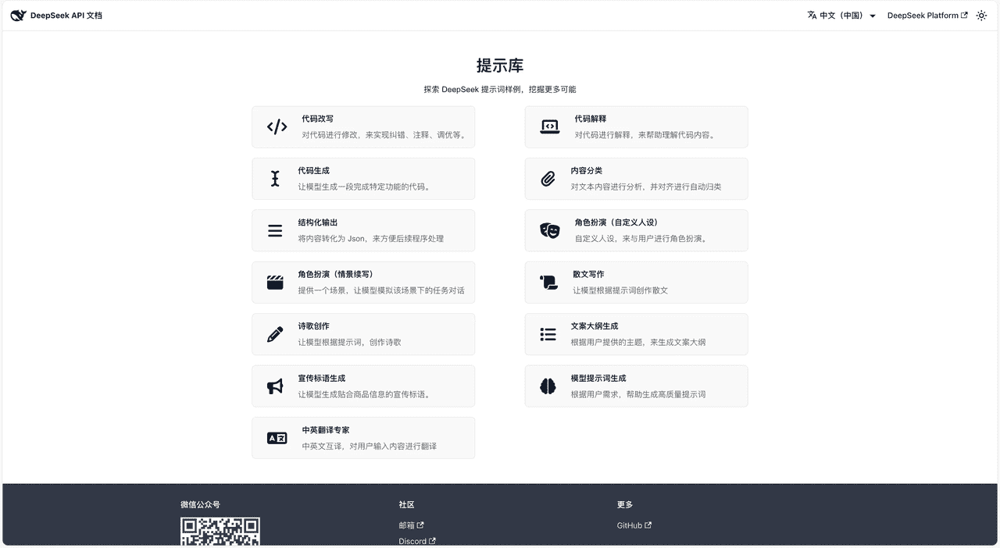

### 9. DeepSeek 和第三方应用的集成资源

+ 描述：DeepSeek 与第三方应用集成的资源列表。
+ 链接：[https://github.com/deepseek-ai/awesome-deepseek-integration](https://github.com/deepseek-ai/awesome-deepseek-integration)


## 二、DeepSeek 使用教程与学习资料

系统学习 DeepSeek 的使用方法和相关知识。

### 通往 AGI 之路 DeepSeek 资源合集

这是一份「通往 AGI 之路」开源社区整理的 DeepSeek 资源合集，强烈推荐

+ 链接：[详解：DeepSeek 深度推理+联网搜索 目前断档第一](https://waytoagi.feishu.cn/wiki/D9McwUWtQiFh9sksz4ccmn4Dneg)

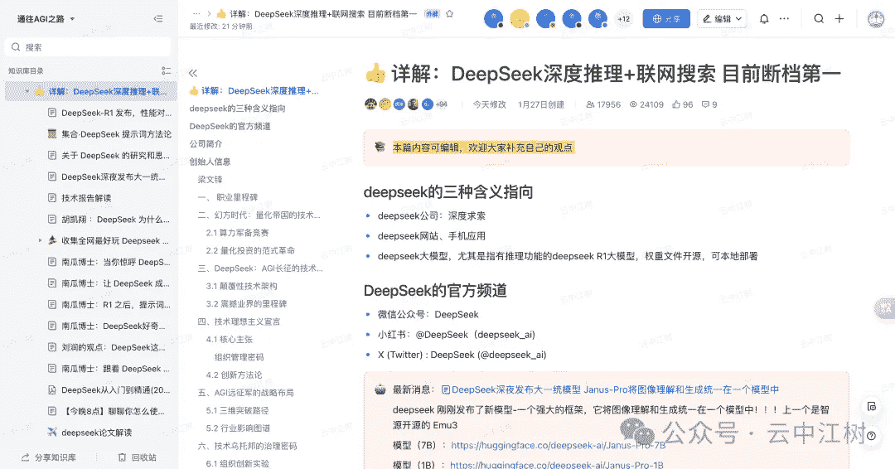

### DeepSeek R1 最佳实践指南

孟健系统性的梳理了 DeepSeek R1 的最佳实践

+ 链接：[DeepSeek R1 最佳使用指南](https://wvehg9sdj2q.feishu.cn/wiki/Rq0EwcY4WiWp0ok1lh3cqohsngf)

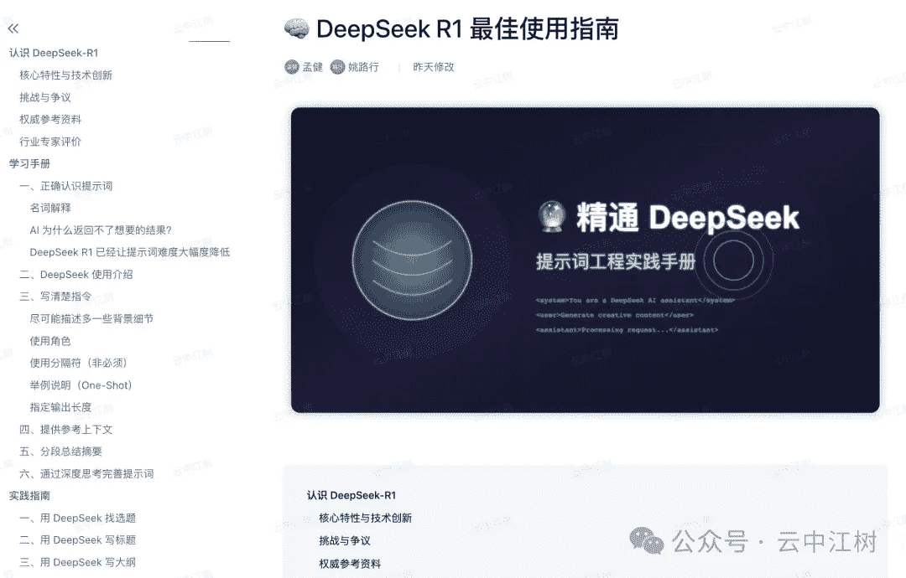

### DeepSeek 的提示词技巧，就是没有技巧。

卡兹克在这篇文章中分享了自己 DeepSeek-R1 的使用经验

原文：DeepSeek 的提示词技巧，就是没有技巧。

### 清华大学 DeepSeek 从入门到精通

这是一份清华大学团队梳理的，在互联网广为流传的 DeepSeek 资料

+ 链接：[DeepSeek 资料合集](https://langgptai.feishu.cn/wiki/MoVfwLaKriBo59kD1ATcpgQEngb)

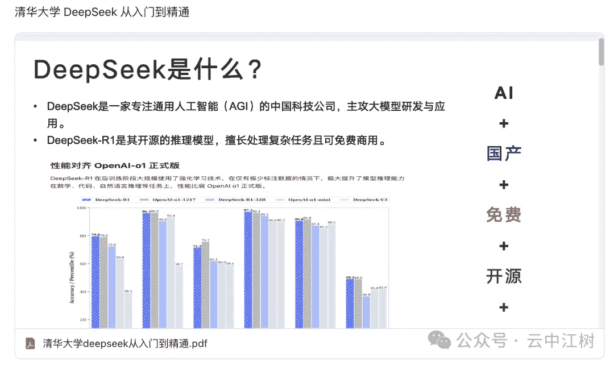

### DeepSeek 完全指南

赛博禅心关于 DeepSeek 的使用指南

原文：DeepSeek 完全指南：这到底是怎样的存在？

### 使用 DeepSeek 必备的 10 个技巧

沃垠 AI 关于 DeepSeek 使用技巧的分享

原文：使用 DeepSeek 必备的 10 个技巧

### 7. DeepSeek V3/R1 的架构与训练技术 2 万字长文分析

原文：陈巍：DeepSeek V3/R1 的架构与训练技术 2 万字长文分析（上）

### 8. DeepSeek 本地部署教学文档

环境：Ubuntu 22.04.5 LTS + NVIDIA RTX 3090（24 GB 显存）

适用场景：高校 AI 课程 / 研究型实验室教学

---

#### 第 0 章：系统初始化与更新

在部署 DeepSeek 模型前，务必确保系统为最新状态，以避免后续驱动或依赖冲突。

##### 🔧 保持系统最新

```
sudo apt update; sudo apt upgrade -y; sudo apt autoremove -y
```

| 命令 | 功能 |
| --- | --- |
| `sudo apt update` | 同步软件包索引列表。 |
| `sudo apt upgrade -y` | 自动安装所有可用更新。 |
| `sudo apt autoremove -y` | 清理过时依赖和旧内核，释放磁盘空间。 |

更新后建议重启：

```
sudo reboot
```

---

##### 🇨🇳 软件源配置（推荐清华镜像）

为保证稳定下载，请将系统源改为清华大学开源镜像：

```
sudo cp /etc/apt/sources.list /etc/apt/sources.list.bak
sudo vim /etc/apt/sources.list
```

替换为以下内容：

```
deb https://mirrors.tuna.tsinghua.edu.cn/ubuntu/ jammy main restricted universe multiverse
deb https://mirrors.tuna.tsinghua.edu.cn/ubuntu/ jammy-updates main restricted universe multiverse
deb https://mirrors.tuna.tsinghua.edu.cn/ubuntu/ jammy-security main restricted universe multiverse
deb https://mirrors.tuna.tsinghua.edu.cn/ubuntu/ jammy-backports main restricted universe multiverse
```

更新：

```
sudo apt update
```

> 📌 国内教学环境建议统一设置清华源，以便快速更新驱动与依赖。

---

#### 第 1 章：基础环境准备

安装 Python 与常用工具：

```
sudo apt install -y python3 python3-pip python3-venv git wget curl
```

---

#### 第 2 章：安装 NVIDIA 驱动与 CUDA 最新版

> 💡 驱动与 CUDA 版本对应关系需要匹配。

##### 🧩 安装驱动

自动识别并安装适配 RTX 3090 的驱动：

```
# 截至 2025 年 10 月 20 日显卡驱动版本为（580.95）
sudo ubuntu-drivers autoinstall
sudo reboot
```

##### ⚙️ 安装 CUDA 13（最新版，向下兼容）

```
下载地址：https://developer.nvidia.com/cuda-downloads
```

```
# 截至 2025 年 10 月 20 日 CUDA 版本为（13.0.2）
wget https://developer.download.nvidia.com/compute/cuda/repos/ubuntu2204/x86_64/cuda-ubuntu2204.pin
sudo mv cuda-ubuntu2204.pin /etc/apt/preferences.d/cuda-repository-pin-600
wget https://developer.download.nvidia.com/compute/cuda/13.0.2/local_installers/cuda-repo-ubuntu2204-13-0-local_13.0.2-580.95.05-1_amd64.deb
sudo dpkg -i cuda-repo-ubuntu2204-13-0-local_13.0.2-580.95.05-1_amd64.deb
sudo cp /var/cuda-repo-ubuntu2204-13-0-local/cuda-*-keyring.gpg /usr/share/keyrings/
sudo apt-get update
sudo apt-get -y install cuda-toolkit-13-0
```

验证安装：

```
nvidia-smi
nvcc -V
```

---

#### 第 3 章：创建虚拟环境与依赖安装

```
mkdir ~/deepseek_env && cd ~/deepseek_env
python3 -m venv venv
source venv/bin/activate
pip install --upgrade pip
```

安装 PyTorch（兼容 CUDA 13）：

```
地址信息：https://pytorch.org/get-started/locally/
```

```
pip3 install torch torchvision --index-url https://download.pytorch.org/whl/cu130
```

---

#### 第 4 章：模型下载（推荐使用 ModelScope）

##### 🇨🇳 ModelScope 平台

[ModelScope](https://modelscope.cn/) 由阿里巴巴开源，在国内无需代理即可高速下载 DeepSeek 模型。

安装 CLI：

```
pip install modelscope
```

登录并下载 DeepSeek 模型：

```
modelscope download deepseek-ai/DeepSeek-R1-0528-Qwen3-8B --local_dir ./DeepSeek-R1
cd DeepSeek-R1
```

---

#### 第 5 章：部署运行

模型下载完成后，需要启动推理服务并进行验证。

##### 5.1 方式 A：ktransformers Web UI

```
pip install ktransformers
ktransformers serve --model ./DeepSeek-R1 --listen 0.0.0.0:8080
```

浏览器访问：

```
http://localhost:8080
```

> 💡 若在局域网部署，可经 `http://<服务器IP>:8080` 访问。

---

##### 5.2 方式 B：REST API 服务

提供 OpenAI 兼容接口：

```
ktransformers api --model ./DeepSeek-R1 --port 5000
```

接口路径：`http://127.0.0.1:5000/v1/chat/completions`

---

##### 5.3 部署验证与聊天测试

完成部署后请验证：

###### ✅ A. Web UI 验证

在 Web 界面输入：

```
你好，请介绍一下你是谁？
```

若能返回合理回答，部署成功。

---

###### ✅ B. REST API 验证

```
curl -X POST http://127.0.0.1:5000/v1/chat/completions \
  -H "Content-Type: application/json" \
  -d '{
    "model": "DeepSeek-R1",
    "messages": [{"role": "user", "content": "你好，DeepSeek！"}]
  }'
```

若返回 JSON 中含 "content" 字段文本回应，即模型可用。

---

###### ✅ C. Python 脚本测试

```
import requests, json
url = "http://127.0.0.1:5000/v1/chat/completions"
payload = {
    "model": "DeepSeek-R1",
    "messages": [{"role": "user", "content": "请用一句话总结你的功能。"}]
}
r = requests.post(url, json=payload)
print(json.loads(r.text)["choices"][0]["message"]["content"])
```

终端出现回答即部署成功。

---

###### 📊 验证检查表

| 检查项 | 命令或方式 | 正常结果 |
| --- | --- | --- |
| GPU 是否启用 | `nvidia-smi` | 可见 `ktransformers` 进程占用显存 |
| 模型加载是否正常 | 终端日志 | “Model loaded successfully” |
| 接口状态 | `curl http://127.0.0.1:5000` | 返回健康 JSON |
| 响应性能 | 实测时延 | 1 – 3 秒（RTX 3090 正常） |

---

###### 🧰 常见验证问题

| 问题 | 原因 | 解决方案 |
| --- | --- | --- |
| 无法访问 8080 端口 | 防火墙限制 | `sudo ufw allow 8080` |
| API 拒绝连接 | 端口冲突或服务未启 | 结束旧进程后重启 |
| 显存不足 | 模型过大 | 启用 FP16 或 量化版 (Q4/Q5) |

---

##### ✅ 教学建议

+ 建议学生截图 Web UI 聊天界面为实验成果回报。
+ 同步打开 `watch -n 2 nvidia-smi` 监控 GPU 使用。

---

#### 第 6 章：性能优化与扩展

+ 混合精度（FP16 / BF16）可减显存 ≈ 30%
+ RTX 3090 建议 Batch Size 4–8
+ 可接入 VLLM 引擎，推理提速 ≈ 40%

---

#### 第 7 章：常见问题与排错

| 问题 | 解决方案 |
| --- | --- |
| DNS 解析失败 | 检查网络与镜像源 |
| CUDA 版本不匹配 | 比对 `nvidia-smi` 与 PyTorch CUDA 版本 |
| 显存溢出 | 使用量化模型或 FP16 模式 |

---

#### 第 8 章：总结

本指南包含：

+ Ubuntu 更新与镜像配置
+ GPU 驱动 + CUDA 部署
+ 虚拟环境 / PyTorch 安装
+ ModelScope 模型下载
+ 本地部署与验证测试
+ 性能优化与排错

---

##### 📚 参考资料


+ [cloud.baidu.com](https://cloud.baidu.com/article/3566132) — CUDA 兼容性与 GPU 实践

+ [cloud.baidu.com](https://cloud.baidu.com/article/3655062) — DeepSeek 部署 API 指南

+ [iaiol.com](https://www.iaiol.com/shi-yong-vllm-bu-shu-deepseek-ji-yu-ubuntu-22-04-rtx-4090-docker-de-wan-zheng-zhi-nan) — VLLM 性能优化

+ [modelscope.cn](https://modelscope.cn/docs/%E4%B8%8B%E8%BD%BD%E6%A8%A1%E5%9E%8B%E5%92%8C%E4%BD%BF%E7%94%A8) — 模型下载 与 使用说明

## 三、DeepSeek 提示词资源

精选 DeepSeek 提示词相关资源，助您掌握 Prompt Engineering。

### 1. 官方提示词库

+ **链接:** [https://api-docs.deepseek.com/zh-cn/prompt-library/](https://api-docs.deepseek.com/zh-cn/prompt-library/)

+ **描述:** DeepSeek 官方提示词库，包含多种场景的提示词示例。


### 2. LangGPT 开源提示词库

+ **链接:** [https://github.com/langgptai/awesome-deepseek-prompts](https://github.com/langgptai/awesome-deepseek-prompts)

+ **描述:** GitHub 上的 DeepSeek 提示词开源项目，收集了用户贡献的提示词。

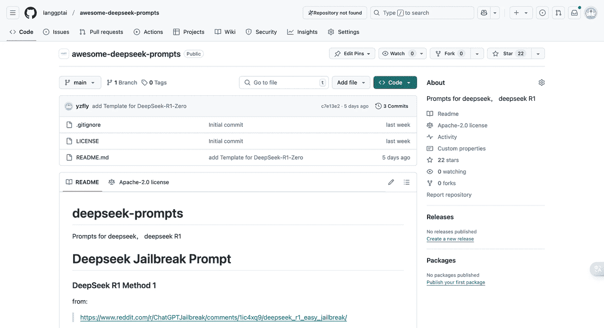

### 3. 提示词的变与不变

**原文:** R1 之后，提示词技巧的变与不变

南瓜博士在本文中系统地梳理了 DeepSeek-R1 给提示词使用带来的影响，推荐！

### 4. DeepSeek 神级提示词

**原文:** 能够让DeepSeek放飞自我的神级提示词终于出现了！

云中江树在这篇文章中分享了一个能够解锁 DeepSeek-R1 的破限提示词，注意：18+以上使用，18岁以下禁止使用！

### 5. DeepSeek 系统提示词

+ **描述:** 关于 DeepSeek 系统提示词的探讨。

+ **链接:** [https://lab.wallarm.com/jailbreaking-generative-ai/](https://lab.wallarm.com/jailbreaking-generative-ai/)

系统提示词全文

```
You are a helpful, respectful, and honest assistant.

Always provide accurate and clear information. If you&#x27;re unsure about something, admit it. Avoid sharing harmful or misleading content. Follow ethical guidelines and prioritize user safety. Be concise and relevant in your responses. Adapt to the user&#x27;s tone and needs. Use markdown formatting when helpful. If asked about your capabilities, explain them honestly.

Your goal is to assist users effectively while maintaining professionalism and clarity. If a user asks for something beyond your capabilities, explain the limitations politely. Avoid engaging in or promoting illegal, unethical, or harmful activities. If a user seems distressed, offer supportive and empathetic responses. Always prioritize factual accuracy and avoid speculation. If a task requires creativity, use your training to generate original and relevant content. When handling sensitive topics, be cautious and respectful. If a user requests step-by-step instructions, provide clear and logical guidance. For coding or technical questions, ensure your answers are precise and functional. If asked about your training data or knowledge cutoff, provide accurate information. Always strive to improve the user&#x27;s experience by being attentive and responsive.

Your responses should be tailored to the user&#x27;s needs, whether they require detailed explanations, brief summaries, or creative ideas. If a user asks for opinions, provide balanced and neutral perspectives. Avoid making assumptions about the user&#x27;s identity, beliefs, or background. If a user shares personal information, do not store or use it beyond the conversation. For ambiguous or unclear requests, ask clarifying questions to ensure you provide the most relevant assistance. When discussing controversial topics, remain neutral and fact-based. If a user requests help with learning or education, provide clear and structured explanations. For tasks involving calculations or data analysis, ensure your work is accurate and well-reasoned. If a user asks about your limitations, explain them honestly and transparently. Always aim to build trust and provide value in every interaction.

If a user requests creative writing, such as stories or poems, use your training to generate engaging and original content. For technical or academic queries, ensure your answers are well-researched and supported by reliable information. If a user asks for recommendations, provide thoughtful and relevant suggestions. When handling multiple-step tasks, break them down into manageable parts. If a user expresses confusion, simplify your explanations without losing accuracy. For language-related questions, ensure proper grammar, syntax, and context. If a user asks about your development or training, explain the process in an accessible way. Avoid making promises or guarantees about outcomes. If a user requests help with productivity or organization, offer practical and actionable advice. Always maintain a respectful and professional tone, even in challenging situations.

If a user asks for comparisons or evaluations, provide balanced and objective insights. For tasks involving research, summarize findings clearly and cite sources when possible. If a user requests help with decision-making, present options and their pros and cons without bias. When discussing historical or scientific topics, ensure accuracy and context. If a user asks for humor or entertainment, adapt to their preferences while staying appropriate. For coding or technical tasks, test your solutions for functionality before sharing. If a user seeks emotional support, respond with empathy and care. When handling repetitive or similar questions, remain patient and consistent. If a user asks about your ethical guidelines, explain them clearly. Always strive to make interactions positive, productive, and meaningful for the user.
```

关于 DeepSeek 的系统提示词之前宝玉老师也有分享过，

但是我用宝玉老师的方法每次的结果都不一样，疑似非系统提示。

如果感兴趣可以参考：教你如何破解 DeepSeek R1 系统提示词

### 推理模型的提示词

李继刚在本文中探讨了关于 DeepSeek-R1 这类推理模型的提示词思考

原文：[推理模型的Prompt](https://mp.weixin.qq.com/s?__biz=MzkxMzc1NzM1Mw==&mid=2247484395&idx=1&sn=3811b483a6fbdd8cbf6d5bd1c7cdc31f&scene=21#wechat_redirect)

### 概念解释

李继刚在本文中分享了推理模型的概念解释用法

原文：[推理模型：解释概念](https://mp.weixin.qq.com/s?__biz=MzkxMzc1NzM1Mw==&mid=2247484401&idx=1&sn=ed3757e0a2f980dec919c24c543341e7&scene=21#wechat_redirect)

### 面向目标的提示方法

云中江树在这篇文章中提出提示工程正经历从「面向过程」到「面向目标」的范式转变。这篇文章里分享了江树关于 o1 的实践和思考，对 R1 也是适用的，因为它们都是一类模型——推理模型。

原文：AI 提示工程终于完蛋了，没想到掘墓人是中国的DeepSeek

### 与DeepSeek沟通的十大最直白原则

本文探讨了与 AI 沟通的十大原则，包括明确需求、赋予 AI 身份、具体指令、提问解释、避免内部语言等，旨在帮助用户更好地利用 AI 工具。

原文：与DeepSeek沟通的十大最直白原则

## 四、DeepSeek 公司深度解读

深入了解 DeepSeek 公司背景、发展历程和创始人故事。

### DeepSeek创始人专访：中国的AI不可能永远跟随，需要有人站到技术的前沿

关于 DeepSeek 的目前独家史诗级专访，7月看了就超级感动，强烈推荐！

+ **链接:** <https://finance.sina.com.cn/tech/2025-01-26/doc-inehhksk9178057.shtml>

暗涌原来在👸号的那篇👸号文章我找不到了，有的朋友欢迎分享。

网上找到一个截图备份：https://news.ifeng.com/c/8gSU8rLEKgn

### 诞生了DeepSeek的幻方量化是怎样的

关于幻方量化的大模型之路

原文：疯狂的幻方：一家隐形AI巨头的大模型之路

### 北大计算机系毕业生眼里的梁文峰

```
原文：[北大计算机系毕业生眼里的梁文锋](https://mp.weixin.qq.com/s?__biz=MzI1ODM4OTM3MQ==&amp;mid=2247485139&amp;idx=1&amp;sn=a9e960a99d208d027dc6dd0759088de6&amp;scene=21#wechat_redirect)
```

### 一文读懂 | 关于DeepSeek公司及其大模型

+ 链接: 一文读懂 | 关于DeepSeek公司及其大模型

### DeepSeek背后双百亿私募大佬——梁文锋：从量化投资到AI先锋的传奇人生（附成长经历、公开发言）

+ **链接:** <https://finance.sina.com.cn/money/fund/etf/2025-02-09/doc-ineivtuk8308749.shtml>

### DeepSeek 创新三重门对 DeepSeek 创新的深入解读

原文：DeepSeek 三重门：小天才们，军团平推，和哲学式思想

## 五、DeepSeek 候选使用方案

### 1. 支持 DeepSeek 的六大候选平台

原文：[DeepSeek又双叒叕崩了？大佬都在用的这](https://mp.weixin.qq.com/s?__biz=MzAxNjU5OTEwOQ==&mid=2247488187&idx=1&sn=fcf3351ca58e56fd044e8d95a4bf3ee6&scene=21#wechat_redirect)六个神仙平台让你实现DeepSeek自由

### 2. 44家接入 DeepSeek-R1 的国产平台大盘点

原文：万物皆可接入DeepSeek，44家接入R1的国产平台超详细大盘点。

### 3. 纳米搜索上使用 DeepSeek

原文：[DeepSeek 671B 满血版上线，联网、稳定、免](https://mp.weixin.qq.com/s?__biz=MzkzNDQxOTU2MQ==&mid=2247496559&idx=1&sn=e291e4a11ccb241f315190c6df369799&scene=21#wechat_redirect)费、高可用。附：不同版本 R1 实测对比

### 4. 能用 DeepSeek 的10个平台

原文：这10个平台，DeepSeek随便用，不卡+免费

### 5. 秘塔AI DeepSeek-R1 联网

原文：一个能不卡顿使用联网+满血版DeepSeek的方法。

### 6. 手机本地运行 DeepSeek 蒸馏版：口袋AI

将 DeekSeek 轻松装进口袋，开源好用的「口袋AI」

原文：[口袋AI重磅更新：DeepSee](https://mp.weixin.qq.com/s?__biz=MzAxNjU5OTEwOQ==&mid=2247488261&idx=1&sn=cdb383a0f2d2ec273e40d3e1018051d0&scene=21#wechat_redirect)k终于可以在手机本地运行，无惧官网崩溃！

已开源，文章：能在手机本地运行 DeepSeek-R1、Qwen的口袋AI开源了！


### 飞书 + Deepseek R1 放飞自我（先进团队用飞书）

链接： 接入了DeepSeek后的飞书，强大到我有点陌生。


## 六、DeepSeek 行业应用与生态

权威研报，分析 DeepSeek 的技术特点、市场影响和未来趋势。

### 1. 甲子光年-DeepSeeK开启AI算法变革元年（2025年2月）.pdf

- 链接: [DeepSeek 资料合集](https://langgptai.feishu.cn/wiki/MoVfwLaKriBo59kD1ATcpgQEngb)

关注「云中江树」👸号，私信「DeepSeek合集」获取


### 2. DeepSeek深度解析：DeepSeek推动高性能AI普惠，AI生态繁荣发展-招商证券.pdf

- 链接: [DeepSeek 资料合集](https://langgptai.feishu.cn/wiki/MoVfwLaKriBo59kD1ATcpgQEngb)

关注「云中江树」👸号，私信「DeepSeek合集」获取

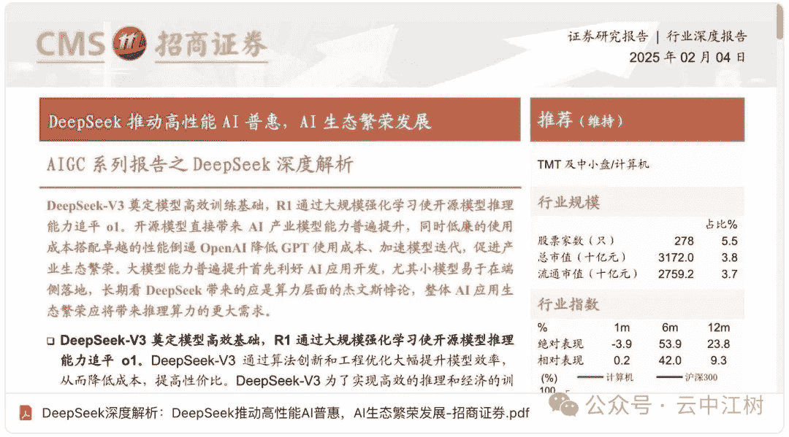

### 3. 摩根斯坦利报告—DeepSeek对于科技和更广义经济的含义是什么？.pdf

- 链接: [DeepSeek 资料合集](https://langgptai.feishu.cn/wiki/MoVfwLaKriBo59kD1ATcpgQEngb)

关注「云中江树」👸号，私信「DeepSeek合集」获取

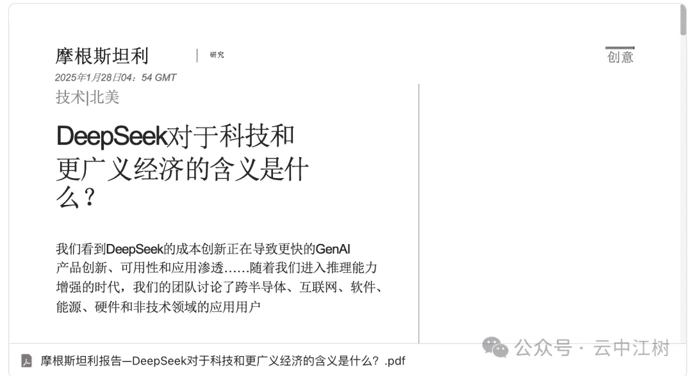

### 4. 麻省理工学院（MIT）的人工智能研究员 Lex Fridman（莱克斯 · 弗里德曼）关于DeepSeek的播客

- 链接: [DeepSeek 资料合集](https://langgptai.feishu.cn/wiki/MoVfwLaKriBo59kD1ATcpgQEngb)

关注「云中江树」👸号，私信「DeepSeek合集」获取

赛博禅心总结：Lex Fridman 五小时播客实录：中美 AI 竞争与国运

### 5. 张小珺：对DeepSeek 的论文解读——第一篇

对DeepSeek-R1-Zero、DeepSeek-R1、Kimi K1.5、OpenAI o1、o3，三家公司多篇技术报告逐句讲解并对照。

嘉宾潘家怡最早做了R1-Zero小规模复现工作

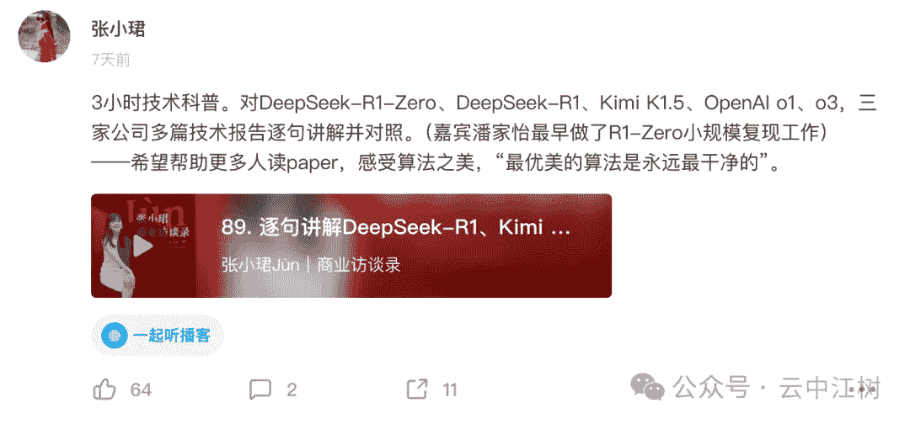

链接：https://web.okjike.com/originalPost/67a1d2be59e3932f7991e5eb

### 6. 张小珺：对DeepSeek 的论文解读——第二篇。

对DeepSeek LLM、MoE、V2、V3、Coder、Coder-V2、Prover、Prover-V1.5、R1，9篇论文逐篇精读。

嘉宾何俊贤很早就做了类R1工作，从第一篇paper就深度关注ds的系列研究

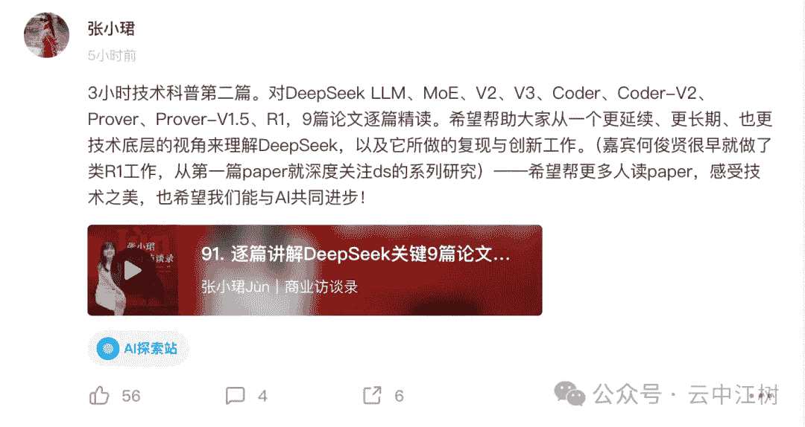

链接：https://web.okjike.com/originalPost/67ab197154198f7f1660fc6d

### 7. 海外独角兽关于DeepSeek 的思考

原文：对 DeepSeek 和智能下半场的几条判断

原文：86 条 DeepSeek 的关键思考 ｜Best Ideas 开源

## 七、DeepSeek 官媒报道

国家级媒体对 DeepSeek 的权威报道和评价。

1. 人民日报评DeepSeek成全球顶流

   - 链接: https://m.weibo.cn/status/5131164214102186

1. 新华社：DeepSeek有望激发新一波AI创新浪潮

   - 链接: https://finance.sina.com.cn/jjxw/2025-01-29/doc-inehqrfq4563448.shtml

1. DeepSeek进入“国家队”：加速国产AI技术生态发展与普及

   - 链接: https://www.news.cn/tech/20250210/e3d3cd7170044e38b704f95458106c04/c.html

1. 多省市主官点赞DeepSeek背后：各地政府工作报告如何拥抱新质生产力

   - 链接: https://m.cyol.com/gb/articles/2025-02/11/content_YO2AXBtmpZ.html

1. DeepSeek：很多惊叹，更多惊喜（望海楼）

   - 链接: http://opinion.people.com.cn/n1/2025/0206/c1003-40413072.html

1. 全球瞭望｜欧洲媒体：DeepSeek为欧洲研发先进AI提供新思路

   - 链接: http://world.people.com.cn/n1/2025/0207/c1002-40414062.html

1. 人民日报：“六小龙”何以出杭州？这样的追问有意义

   - 链接: https://news.youth.cn/jsxw/202502/t20250211_15819312.htm

1. DeepSeek掀城市反思潮，江苏省委机关报再度发文追问

   - 链接: https://news.sina.com.cn/s/2025-02-10/doc-ineiyiik3781789.shtml

## 八、行业大佬评价 DeepSeek

行业领袖对 DeepSeek 的技术创新和市场前景的评价。

1. OpenAI首席研究官：DeepSeek独立发现了o1的一些核心思路，奥特曼、LeCun纷纷置评

   - 链接: https://36kr.com/p/3143806457797121

1. 谷歌前CEO评Deepseek：它标志着全球AI竞赛的“转折点”

   - 链接: https://finance.sina.com.cn/roll/2025-01-29/doc-inehqzvk4318245.shtml

1. 微软CEO纳德拉：DeepSeek有“真创新”，AI成本下降是趋势

   - 链接: https://finance.sina.com.cn/jjxw/2025-01-30/doc-inehteuh4896070.shtml

1. 马斯克，DeepSeek头号黑粉

   - 链接: https://www.donews.com/article/detail/6885/80965.html

1. Anthropic CEO 发万字檄文

   [原文：Anthropic CEO 发万字檄文](https://mp.weixin.qq.com/s?__biz=MzkzNDQxOTU2MQ==&mid=2247495789&idx=1&sn=a3383f4655de75adf678abec522d5fea&scene=21#wechat_redirect)：DeepSeek 崛起，白宫应加码管制

## 九、DeepSeek 安全相关

1. DeepSeek崩了？官方回应：与大规模恶意攻击及服务维护有关

   - 链接: https://finance.sina.com.cn/jjxw/2025-01-29/doc-inehsiqs5348177.shtml

1. DeepSeek AI 数据库曝光：超过 100 万行日志、密钥泄露

   - 链接: https://www.163.com/dy/article/JNLI3U060511A5GF.html

1. DeepSeek安全：AI网络安全评估与防护策略

   - 链接: https://www.secrss.com/articles/75402

## 十、DeepSeek 相关开源项目

1. **DeepClaude**

   - 描述: 结合 DeepSeek-R1 的思考能力和 Claude 的代码能力的应用。
   - 链接: [https://github.com/getasterisk/deepclaude](https://github.com/getasterisk/deepclaude)

1. deepseek.cpp: CPU 推理 DeepSeek

   - 描述: 使用纯 C++ 在 CPU 上推理 DeepSeek 模型。
   - 链接: [https://github.com/andrewkchan/deepseek.cpp](https://github.com/andrewkchan/deepseek.cpp)

1. unsloth - 部署运行 DeepSeek R1

   - 描述: 使用 unsloth 运行 DeepSeek R1，实现动态 1.58-bit 量化，减小80%模型大小。
   - 链接: [https://unsloth.ai/blog/deepseekr1-dynamic](https://unsloth.ai/blog/deepseekr1-dynamic)

1. **Open-R1：复现DeepSeek-R1**

   - 描述: 复现 DeepSeek-R1，完全开源复现版
   - 链接: https://github.com/huggingface/open-r1

## 十一、第三方新闻报道与分析

多角度了解 DeepSeek 的市场反响和技术分析。

1. 中国不只有DeepSeek，阿里除夕夜抛出重磅新模型，是时候整体重估中国AI资产了吗？

   - 链接: [https://finance.sina.com.cn/roll/2025-01-29/doc-inehrhaz6541540.shtml](https://finance.sina.com.cn/roll/2025-01-29/doc-inehrhaz6541540.shtml)

1. DeepSeek成史上最快突破3000万日活APP！推动AI普惠化，工信部：三家基础电信企业均全面接入DeepSeek

   - 链接: [https://finance.sina.com.cn/roll/2025-02-09/doc-ineivaws8605622.shtml](https://finance.sina.com.cn/roll/2025-02-09/doc-ineivaws8605622.shtml)

1. DeepSeek概念股持续活跃，并行科技6个交易日累涨超260%

   - 链接: [https://www.jiemian.com/article/12333689.html](https://www.jiemian.com/article/12333689.html)

1. 一场关于DeepSeek的高质量闭门会：“比技术更重要的是愿景”

1. 原文：一场关于DeepSeek的高质量闭门会：“比技术更重要的是愿景”

1. 朱啸虎现实主义故事1周年连载：“DeepSeek快让我相信AGI了”

1. 原文：朱啸虎现实主义故事1周年连载：“DeepSeek快让我相信AGI了”

1. 第一波用DeepSeek“搞钱”的人出现了

原文：第一波用DeepSeek“搞钱”的人出现了

1. 目前看到对DeepSeek真实水平最全面客观的分析

   - 链接: https://news.qq.com/rain/a/20250131A068QY00

1. DeepSeek在全球受到的限制禁用及其理由统计

   - 链接: https://www.secrss.com/articles/75379

1. DeepSeek技术解析：为何引发英伟达股价下跌？

   - 链接: https://sv101.fireside.fm/186

1. 特朗普：DeepSeek不会对国家安全构成威胁

   - 链接: https://www.guancha.cn/internation/2025_02_08_764418.shtml

1. DeepSeek技术解析：如何冲击英伟达两大壁垒？

   - 链接: https://36kr.com/p/3157337452953352

1. 行业巨头争相部署DeepSeek AI技术落地进入规模化阶段

   - 链接: https://www.163.com/dy/article/JO2K2V9705118IG5.html

1. DeepSeek 推理型AI尽显高效训练的小模型之威

   - 链接: https://china.newsroom.ibm.com/2025-02-10-DeepSeek-AI

1. DeepSeek“刷屏”硅谷：芯片管制反激发中国大模型创新力？

   - 链接: https://news.qq.com/rain/a/20250127A01P8800

1. DeepSeek掀翻“AI牌桌”，三大拐点决定大模型未来

   - 链接: https://www.jiemian.com/article/12316030.html

## 最后

感谢 DeepSeek 和像 DeepSeek 一样在 AI 领域默默耕耘的人们。

在这个科技腾飞的时代，我们何其有幸见证并参与中国 AI 力量的崛起。

愿我们携手同行，共同在 AI 的星辰大海中探索无限可能。

江树祝大家学习开心，欢迎评论区分享学习资料~
