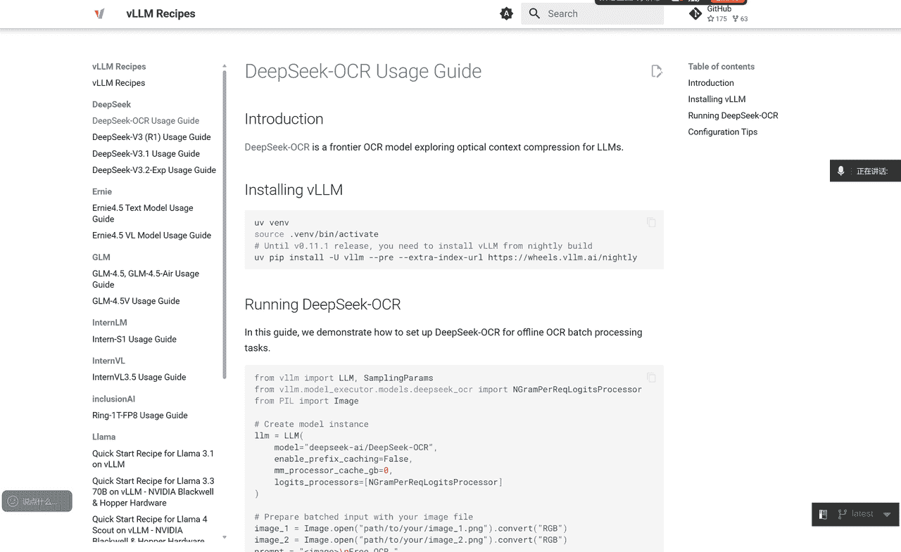

# DeepSeek Model Usage Guide -vLLM

> 来源：[https://gotoaiworld.feishu.cn/docx/V1okdkHp1oREYpxSxEScKHDRnMg](https://gotoaiworld.feishu.cn/docx/V1okdkHp1oREYpxSxEScKHDRnMg)

https://docs.vllm.ai/projects/recipes/en/latest/index.html



# [vLLM Recipes](https://docs.vllm.ai/projects/recipes)

Th**is repo intends to host co**mmunity maintained common recipes to run vLLM answering the question: How do I run model X on hardware Y for task Z?

## Guides

### DeepSeek


+   [DeepSeek-OCR](https://docs.vllm.ai/projects/recipes/en/latest/DeepSeek/DeepSeek-OCR.html)

+   DeepSeek-V3.2-Exp

+   [DeepSeek-V3.1](https://docs.vllm.ai/projects/recipes/en/latest/DeepSeek/DeepSeek-V3_1.html)

+   DeepSeek-V3, DeepSeek-R1

### Ernie


+   [Ernie4.5](https://docs.vllm.ai/projects/recipes/en/latest/Ernie/Ernie4.5.html)

+   [Ernie4.5-VL](https://docs.vllm.ai/projects/recipes/en/latest/Ernie/Ernie4.5-VL.html)

### GLM

+   GLM-4.5/GLM-4.6, GLM-4.5-Air

+   [GLM-4.5V](https://docs.vllm.ai/projects/recipes/en/latest/GLM/GLM-4.5V.html)

### InternVL

+   [InternVL3.5](https://docs.vllm.ai/projects/recipes/en/latest/InternVL/InternVL3_5.html)

### InternLM


+   [Intern-S1](https://docs.vllm.ai/projects/recipes/en/latest/InternLM/Intern-S1.html)

### Llama

+   [Llama4-Scout](https://docs.vllm.ai/projects/recipes/en/latest/Llama/Llama4-Scout.html)

+   [Llama3.3-70B](https://docs.vllm.ai/projects/recipes/en/latest/Llama/Llama3.3-70B.html)

+   [Llama3.1](https://docs.vllm.ai/projects/recipes/en/latest/Llama/Llama3.1.html)

### OpenAI

+   [gpt-oss](https://docs.vllm.ai/projects/recipes/en/latest/OpenAI/GPT-OSS.html)

### Qwen


+   [Qwen3](https://docs.vllm.ai/projects/recipes/en/latest/Qwen/Qwen3.html)

+   [Qwen3-VL](https://docs.vllm.ai/projects/recipes/en/latest/Qwen/Qwen3-VL.html)

+   [Qwen3-Next](https://docs.vllm.ai/projects/recipes/en/latest/Qwen/Qwen3-Next.html)

+   Qwen3-Coder-480B-A35B

+   [Qwen2.5-VL](https://docs.vllm.ai/projects/recipes/en/latest/Qwen/Qwen2.5-VL.html)

### Seed

+   [Seed-OSS-36B](https://docs.vllm.ai/projects/recipes/en/latest/Seed/Seed-OSS-36B.html)

### Moonshotai

+   [Kimi-K2](https://docs.vllm.ai/projects/recipes/en/latest/moonshotai/Kimi-K2.html)

### inclusionAI

+   [Ring-1T-FP8](https://docs.vllm.ai/projects/recipes/en/latest/inclusionAI/Ring-1T-FP8.html)

## Contributing

Please feel free to contribute by adding a new recipe or improving an existing one, just send us a PR!

While the repo is designed to be directly viewable in GitHub (Markdown files as first citizen), you can build the docs as web pages locally.

```
uv venv
source .venv/bin/activate
uv pip install -r requirements.txt
uv run mkdocs serve
```

## License

T[his pro](https://github.com/vllm-project/recipes/blob/main/LICENSE)ject is licensed under the Apache License 2.0 - see the LICENSE file for details.