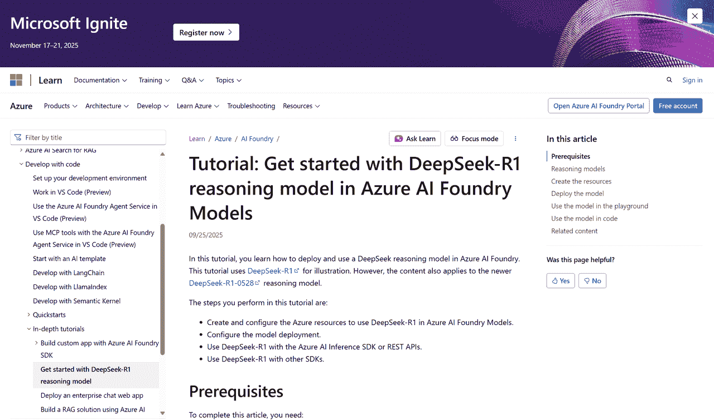
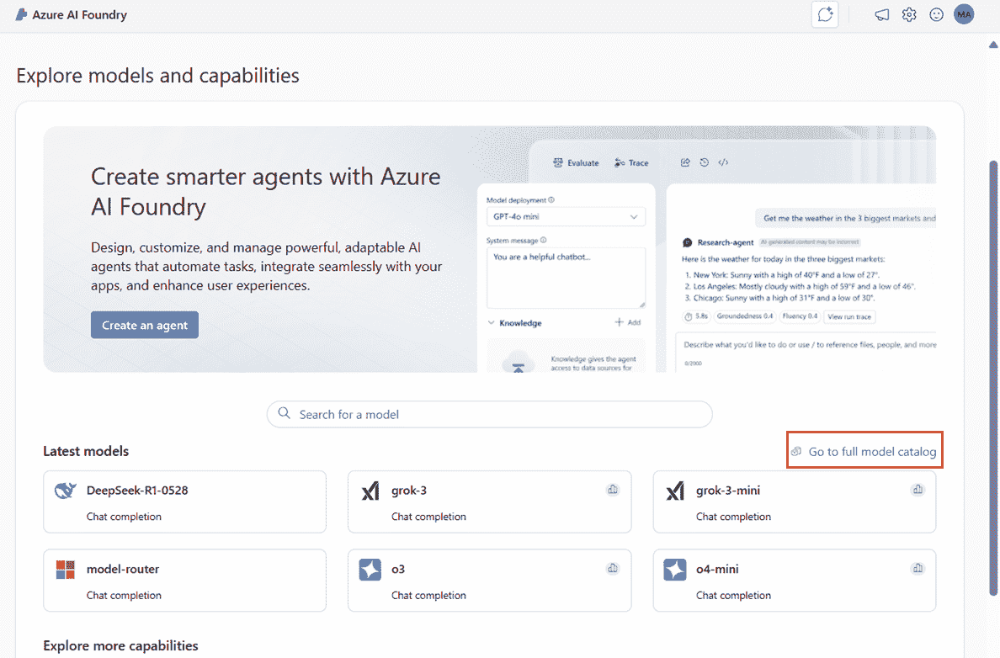
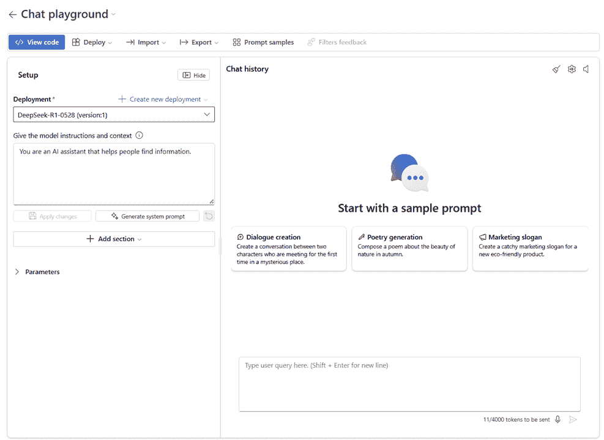
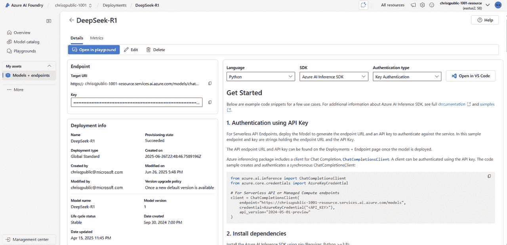

# Get started with DeepSeek-R1 reasoning model in Azure AI Foundry Models

> 来源：[https://gotoaiworld.feishu.cn/docx/MryvdevJEoQau8xmQrvcWIdLnKg](https://gotoaiworld.feishu.cn/docx/MryvdevJEoQau8xmQrvcWIdLnKg)



https://learn.microsoft.com/en-us/azure/ai-foundry/foundry-models/tutorials/get-started-deepseek-r1?context=%2Fazure%2Fai-foundry%2Fcontext%2Fcontext&tabs=python

In this tutorial, you learn how to deploy and use a DeepS[eek reasoni](https://ai.azure.com/explore/models/deepseek-r1/version/1/registry/azureml-deepseek?cid=learnDocs)ng model in Azure AI Foundry. This tutorial uses DeepSeek-R1 for illustration. However, the content also applies to the newer DeepSeek-R1-0528 reasoning model.

The steps you perform in this tutorial are:

+   Create and configure the Azure resources to use DeepSeek-R1 in Azure AI Foundry Models.

+   Configure the model deployment.

+   Use DeepSeek-R1 with the Azure AI Inference SDK or REST APIs.

+   Use DeepSeek-R1 with other SDKs.

## Prerequisites

To complete this article, you need:

+   An Azure subscripti[on. If you're](https://docs.github.com/en/github-models/) u[s](https://learn.microsoft.com/en-us/azure/ai-foundry/model-inference/how-to/quickstart-github-models)ing GitHub Models, you can upgrade your experience and create an Azure subscription in the process. Read Upgrade from GitHub Models to Azure AI Foundry Models, if that applies to you.

## Reasoning models

Reasoning models can reach higher levels of performance in domains like math, coding, science, strategy, and logistics. The way these models produce outputs is by explicitly using chain of thought to explore all possible paths before generating an answer. They verify their answers as they produce them, which helps to arrive at more accurate conclusions. As a result, reasoning models might require less context in prompting in order to produce effective results.

This way of scaling a model's performance is referred to as inference compute time as it trades performance against higher latency and cost. In contrast, other approaches might scale through training compute time.

Reasoning models produce two types of content as outputs:

+   Reasoning completions

+   Output completions

Both of these completions count towards content generated from the model. Therefore, they contribute to the token limits and costs associated with the model. Some models, like DeepSeek-R1, might respond with the reasoning content. Others, like o1, output only the completions.

## Create the resources

Foundry Models is a capability in Azure AI Foundry resources in Azure. You can create model deployments under the resource to consume their predictions. You can also connect the resource to Azure AI hubs and projects in Azure AI Foundry to create intelligent applications if needed.

To [create an](https://learn.microsoft.com/en-us/azure/ai-foundry/foundry-models/how-to/quickstart-create-resources?pivots=programming-language-cli) Azure AI project that supports deployment for DeepSeek-R1, follow these steps. You can also create the resources by using Azure CLI or infrastructure as code, with Bicep.

Tip

Because you can customize the left pane in the Azure AI Foundry portal, you might see different items than shown in these steps. If you don't see what you're looking for, select ... More at the bottom of the left pane.

1.  Sign in to Azure AI Foundry portal.

1.  On the landing page, go to the "Explore models and capabilities" section and select Go to full model catalog to open the model catalog.



1.  Search for the DeepSeek-R1 model and open its model card.

1.  Select Use this model. This action opens up a wizard to create an Azure AI Foundry project and resources that you'll work in. You can keep the default name for the project or change it.

1.   Tip

1.  Are you using Azure OpenAI in Azure AI Foundry Models? When you're connected to Azure AI Foundry portal using an Azure OpenAI resource, only Azure OpenAI models show up in the catalog. To view the full list of models, including DeepSeek-R1, use the top Announcements section and locate the card with the option Explore more models.

1.  A new window shows up with the full list of models. Select DeepSeek-R1 from the list and select Deploy. The wizard asks to create a new project.

1.  Select the dropdown in the "Advanced options" section of the wizard to see details about settings and other defaults created alongside the project. These defaults are selected for optimal functionality and include:

1.  Select Create to create the Foundry project alongside the other defaults. Wait until the project creation is complete. This process takes a few minutes.

## Deploy the model

1.  When you create the project and resources, a deployment wizard appears. DeepSeek-R1 is available as a Foun[dry Model sold d](https://azure.microsoft.com/pricing/details/phi-3/)irectly by Azure. You can review the pricing details for the model by selecting the DeepSeek tab on the Azure AI Foundry Models pricing page.

1.  Configure the deployment settings. By default, the deployment receives the name of the model you're deploying. The deployment name is used in the model parameter for requests to route to this particular model deployment. This setup allows you to configure specific names for your models when you attach specific configurations.

1.  Azure AI Foundry automatically selects the Foundry resource you created earlier with your project. Use the Customize option to change the connection based on your needs. DeepSeek-R1 is currently offered under the Global Standard deployment type, which offers higher throughput and performance.

1.  Select Deploy.

1.  When the deployment completes, the deployment Details page opens. Now the new model is ready for use.

## Use the model in the playground

You can get started by using the model in the playground to get an idea of the model's capabilities.

1.  On the deployment details page, select Open in playground in the top bar. This action opens the chat playground.

1.  In the Deployment drop down of the chat playground, the deployment you created is already automatically selected.

1.  Configure the system prompt as needed. In general, reasoning models don't use system messages in the same way as other types of models.



1.  Type your prompt and see the outputs.

1.  Use View code to see details about how to access the model deployment programmatically.

### Prompt reasoning models

When building prompts for reasoning models, take the following into consideration:

+   Use simple instructions and avoid using chain-of-thought techniques.

+   Built-in reasoning capabilities make simple zero-shot prompts as effective as more complex methods.

+   When providing additional context or documents, like in RAG scenarios, including only the most relevant information might help prevent the model from over-complicating its response.

+   Reasoning models may support the use of system messages. However, they might not follow them as strictly as other non-reasoning models.

+   When creating multi-turn applications, consider appending only the final answer from the model, without it's reasoning content, as explained in the Reasoning content section.

Notice that reasoning models can take longer times to generate responses. They use long reasoning chains of thought that enable deeper and more structured problem-solving. They also perform self-verification to cross-check their answers and correct their mistakes, thereby showcasing emergent self-reflective behaviors.

## Use the model in code

Use the Foundry Models endpoint and credentials to connect to the model:



Use the Azure AI Model Inference package to consume the model in your code:

+   [Python](https://learn.microsoft.com/en-us/azure/ai-foundry/foundry-models/tutorials/get-started-deepseek-r1?context=%2Fazure%2Fai-foundry%2Fcontext%2Fcontext&tabs=python#tabpanel_1_python)

+   [JavaScript](https://learn.microsoft.com/en-us/azure/ai-foundry/foundry-models/tutorials/get-started-deepseek-r1?context=%2Fazure%2Fai-foundry%2Fcontext%2Fcontext&tabs=python#tabpanel_1_javascript)

+   [C#](https://learn.microsoft.com/en-us/azure/ai-foundry/foundry-models/tutorials/get-started-deepseek-r1?context=%2Fazure%2Fai-foundry%2Fcontext%2Fcontext&tabs=python#tabpanel_1_csharp)

+   [Java](https://learn.microsoft.com/en-us/azure/ai-foundry/foundry-models/tutorials/get-started-deepseek-r1?context=%2Fazure%2Fai-foundry%2Fcontext%2Fcontext&tabs=python#tabpanel_1_java)

+   [REST](https://learn.microsoft.com/en-us/azure/ai-foundry/foundry-models/tutorials/get-started-deepseek-r1?context=%2Fazure%2Fai-foundry%2Fcontext%2Fcontext&tabs=python#tabpanel_1_rest)

Install the package azure-ai-inference using your package manager, like pip:

BashCopy

```
pip install azure-ai-inference
```

Then, you can use the package to consume the model. The following example shows how to create a client to consume chat completions:

PythonCopy

```
import os
from azure.ai.inference import ChatCompletionsClient
from azure.core.credentials import AzureKeyCredential

client = ChatCompletionsClient(
    endpoint=&quot;https://&lt;resource&gt;.services.ai.azure.com/models&quot;,
    credential=AzureKeyCredential(os.environ[&quot;AZURE_INFERENCE_CREDENTIAL&quot;]),
)
```

Explore our [samples](https://github.com/Azure/azure-sdk-for-python/tree/main/sdk/ai/azure-ai-inference/samples) and read the API reference documentation to get yourself started.

+   [Python](https://learn.microsoft.com/en-us/azure/ai-foundry/foundry-models/tutorials/get-started-deepseek-r1?context=%2Fazure%2Fai-foundry%2Fcontext%2Fcontext&tabs=python#tabpanel_1_python)

+   [JavaScript](https://learn.microsoft.com/en-us/azure/ai-foundry/foundry-models/tutorials/get-started-deepseek-r1?context=%2Fazure%2Fai-foundry%2Fcontext%2Fcontext&tabs=python#tabpanel_1_javascript)

+   [C#](https://learn.microsoft.com/en-us/azure/ai-foundry/foundry-models/tutorials/get-started-deepseek-r1?context=%2Fazure%2Fai-foundry%2Fcontext%2Fcontext&tabs=python#tabpanel_1_csharp)

+   [Java](https://learn.microsoft.com/en-us/azure/ai-foundry/foundry-models/tutorials/get-started-deepseek-r1?context=%2Fazure%2Fai-foundry%2Fcontext%2Fcontext&tabs=python#tabpanel_1_java)

+   [REST](https://learn.microsoft.com/en-us/azure/ai-foundry/foundry-models/tutorials/get-started-deepseek-r1?context=%2Fazure%2Fai-foundry%2Fcontext%2Fcontext&tabs=python#tabpanel_1_rest)

PythonCopy

```
from azure.ai.inference.models import SystemMessage, UserMessage

response = client.complete(
    messages=[
        UserMessage(content=&quot;How many languages are in the world?&quot;),
    ],
    model=&quot;DeepSeek-R1&quot;
)

print(response.choices[0].message.content)
```

Re[asoning mig](https://learn.microsoft.com/en-us/azure/ai-foundry/model-inference/quotas-limits)ht[ generate longer re](https://learn.microsoft.com/en-us/azure/ai-foundry/foundry-models/quotas-limits#request-increases-to-the-default-limits)sponses and consume a larger number of tokens. You can see the rate limits that apply to DeepSeek-R1 models. Consider having a retry strategy to handle rate limits. You can also request increases to the default limits.

### Reasoning content

Some reasoning models, like DeepSeek-R1, generate completions and include the reasoning behind them. The reasoning associated with the completion is included in the response's content within the tags <think> and </think>. The model might select the scenarios for which to generate reasoning content. The following example shows how to generate the reasoning content, using Python:

PythonCopy

```
import re

match = re.match(r&quot;&lt;think&gt;(.*?)&lt;/think&gt;(.*)&quot;, response.choices[0].message.content, re.DOTALL)

print(&quot;Response:&quot;, )
if match:
    print(&quot;\tThinking:&quot;, match.group(1))
    print(&quot;\tAnswer:&quot;, match.group(2))
else:
    print(&quot;\tAnswer:&quot;, response.choices[0].message.content)
print(&quot;Model:&quot;, response.model)
print(&quot;Usage:&quot;)
print(&quot;\tPrompt tokens:&quot;, response.usage.prompt_tokens)
print(&quot;\tTotal tokens:&quot;, response.usage.total_tokens)
print(&quot;\tCompletion tokens:&quot;, response.usage.completion_tokens)
```

ConsoleCopy

```
Thinking: Okay, the user is asking how many languages exist in the world. I need to provide a clear and accurate answer. Let&#x27;s start by recalling the general consensus from linguistic sources. I remember that the number often cited is around 7,000, but maybe I should check some reputable organizations.\n\nEthnologue is a well-known resource for language data, and I think they list about 7,000 languages. But wait, do they update their numbers? It might be around 7,100 or so. Also, the exact count can vary because some sources might categorize dialects differently or have more recent data. \n\nAnother thing to consider is language endangerment. Many languages are endangered, with some having only a few speakers left. Organizations like UNESCO track endangered languages, so mentioning that adds context. Also, the distribution isn&#x27;t even. Some countries have hundreds of languages, like Papua New Guinea with over 800, while others have just a few. \n\nA user might also wonder why the exact number is hard to pin down. It&#x27;s because the distinction between a language and a dialect can be political or cultural. For example, Mandarin and Cantonese are considered dialects of Chinese by some, but they&#x27;re mutually unintelligible, so others classify them as separate languages. Also, some regions are under-researched, making it hard to document all languages. \n\nI should also touch on language families. The 7,000 languages are grouped into families like Indo-European, Sino-Tibetan, Niger-Congo, etc. Maybe mention a few of the largest families. But wait, the question is just about the count, not the families. Still, it&#x27;s good to provide a bit more context. \n\nI need to make sure the information is up-to-date. Let me think – recent estimates still hover around 7,000. However, languages are dying out rapidly, so the number decreases over time. Including that note about endangerment and language extinction rates could be helpful. For instance, it&#x27;s often stated that a language dies every few weeks. \n\nAnother point is sign languages. Does the count include them? Ethnologue includes some, but not all sources might. If the user is including sign languages, that adds more to the count, but I think the 7,000 figure typically refers to spoken languages. For thoroughness, maybe mention that there are also over 300 sign languages. \n\nSummarizing, the answer should state around 7,000, mention Ethnologue&#x27;s figure, explain why the exact number varies, touch on endangerment, and possibly note sign languages as a separate category. Also, a brief mention of Papua New Guinea as the most linguistically diverse country. \n\nWait, let me verify Ethnologue&#x27;s current number. As of their latest edition (25th, 2022), they list 7,168 living languages. But I should check if that&#x27;s the case. Some sources might round to 7,000. Also, SIL International publishes Ethnologue, so citing them as reference makes sense. \n\nOther sources, like Glottolog, might have a different count because they use different criteria. Glottolog might list around 7,000 as well, but exact numbers vary. It&#x27;s important to highlight that the count isn&#x27;t exact because of differing definitions and ongoing research. \n\nIn conclusion, the approximate number is 7,000, with Ethnologue being a key source, considerations of endangerment, and the challenges in counting due to dialect vs. language distinctions. I should make sure the answer is clear, acknowledges the variability, and provides key points succinctly.

Answer: The exact number of languages in the world is challenging to determine due to differences in definitions (e.g., distinguishing languages from dialects) and ongoing documentation efforts. However, widely cited estimates suggest there are approximately **7,000 languages** globally.
Model: DeepSeek-R1
Usage: 
  Prompt tokens: 11
  Total tokens: 897
  Completion tokens: 886
```

### Parameters

In general, reasoning models don't support the following parameters that you can find in chat completion models:

+   Temperature

+   Presence penalty

+   Repetition penalty

+   Parameter top_p

## Related content

+   Use chat reasoning models

+   Use image embedding models

+   Model Inference API

---

## Additional resources

Documentation

+   [Azure OpenAI Response](https://learn.microsoft.com/en-us/azure/ai-foundry/openai/how-to/responses?source=recommendations)s API - Azure OpenAI

+   Learn how to use Azure OpenAI's new stateful Responses API.

+   [F](https://learn.microsoft.com/en-us/azure/ai-foundry/foundry-models/concepts/models-sold-directly-by-azure?source=recommendations)oundry Models sold directly by Azure - Azure AI Foundry

+   Learn about Azure AI Foundry Models sold directly by Azure, their capabilities, deployment types, and regional availability for AI applications.

+   [A](https://learn.microsoft.com/en-us/azure/ai-foundry/openai/api-version-lifecycle?source=recommendations)zure OpenAI in Azure AI Foundry Models API version lifecycle

+   Learn more about API version retirement in Azure OpenAI.

+   [Azure OpenAI in Azure AI Foundry ](https://learn.microsoft.com/en-us/azure/ai-foundry/openai/reference?source=recommendations)Models REST API reference - Azure OpenAI

+   Learn how to use Azure OpenAI's REST API. In this article, you learn about authorization options, how to structure a request and receive a response.