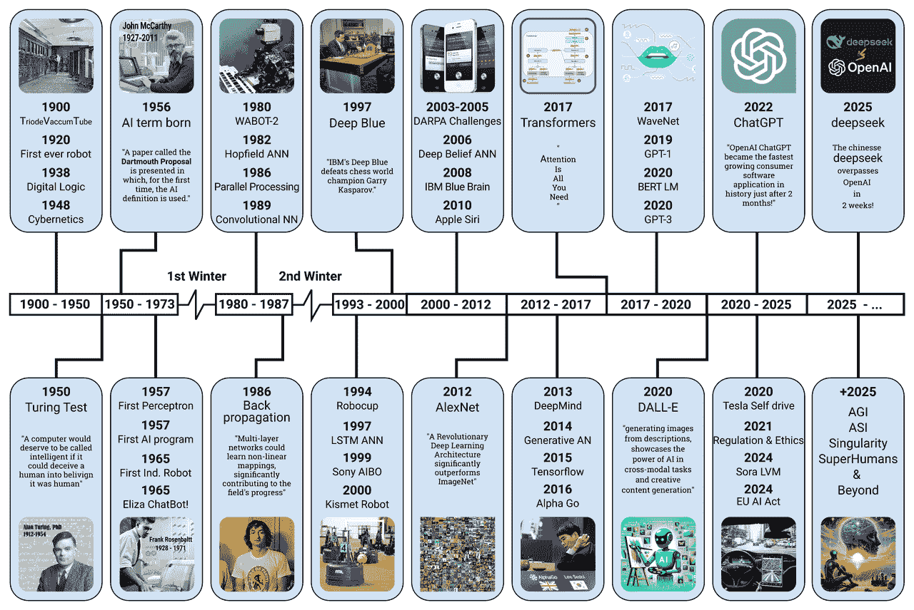

# Wikipedia：Timeline of artificial intelligence

> 来源：[https://gotoaiworld.feishu.cn/docx/Yke6dEutxo5t4cxvxz1cnxjInGC](https://gotoaiworld.feishu.cn/docx/Yke6dEutxo5t4cxvxz1cnxjInGC)

## Antiquity, Classical and Medieval eras

<https://en.wikipedia.org/wiki/Timeline_of_artificial_intelligence>

## 1600–1900

## 20th century

AI history timeline image covering the most important events from 1900 to 2025

### **1901–1950**

### **1950s**

### **1960s**

### **1970s**

### **1980s**

### **1990s**

## 21st century

### **2000s**

### **2010s**

### **2020s**

See also: 2020s in computing

The number of the public's Google searches for the term "AI" began to accelerate in 2022.

## See also

+   Timeline of machine translation

+   Timeline of machine learning

## Notes

1.   Please see [Mechanical calculator#Other ](https://en.wikipedia.org/wiki/Mechanical_calculator#Other_calculating_machines)calculating machines

1.   Please see: [Pascal's calculat](https://en.wikipedia.org/wiki/Pascal%27s_calculator#Competing_designs)or#Competing designs

## References

1.   [McCorduck 2004](https://en.wikipedia.org/wiki/Timeline_of_artificial_intelligence#CITEREFMcCorduck2004), pp. 4–5.

1.   [McCorduck 2004](https://en.wikipedia.org/wiki/Timeline_of_artificial_intelligence#CITEREFMcCorduck2004), p. 4-5.

1.   [Needham 1986](https://en.wikipedia.org/wiki/Timeline_of_artificial_intelligence#CITEREFNeedham1986), p. 53.

1.   [Richard McKeon](https://en.wikipedia.org/wiki/Richard_McKeon), ed. (1941). The Organon. Random House with Oxford University Press.

1.   Giles, Timothy (2016). "Aristotle Writing Science: An Application of H**is** Theory". [Jou](https://en.wikipedia.org/wiki/Doi_(identifier))rna[l of ](https://en.wikipedia.org/wiki/S2CID_(identifier))T[echnical ](https://api.semanticscholar.org/CorpusID:170906960)Writing and Communication. 46: 83–104. doi:10.1177/0047281615600633. S2CID 170906960.

1.   Russell & Norvig 2021, p. 6.

1.   Russell & Norvig 2021, p. 7.

1.   [McCorduck 2004](https://en.wikipedia.org/wiki/Timeline_of_artificial_intelligence#CITEREFMcCorduck2004), p. 6

1.   Schmidhuber 2022.

1.   Russell & Norvig 2021, p. 341.

1.  [ O](http://repository.upenn.edu/dissertations/AAI9503804)'Connor, Kathle[en Malon](https://web.archive.org/web/20191205222650/https://repository.upenn.edu/dissertations/AAI9503804/)e (1994), The alchemical creation of life (takwin) and other concepts of Genesis in medieval Islam, University of Pennsylvania, pp. 1–435, archived from the original on 5 December 2019, retrieved 10 January 2007.

1.   [Hill, Donald R.](https://en.wikipedia.org/wiki/Donald_Hill),[ ed.](https://en.wikipedia.org/wiki/ISBN_(identifier)) (1979) [9th century]. The Book of Ingenious Devices. Dortrecht, Netherlands; Boston; London: D. Reidel. ISBN 978-90277-0-833-5.

1.   Russell & Norvig 2021, p. 9.

1.   [A Thirteenth Centur](http://www.shef.ac.uk/marcoms/eview/articles58/robot.html)y[ Program](https://web.archive.org/web/20071219095203/http://www.shef.ac.uk/marcoms/eview/articles58/robot.html)[mable Robot Arc](https://en.wikipedia.org/wiki/Wayback_Machine)hived 19 December 2007 at the Wayback Machine

1.   [McCorduck 2004](https://en.wikipedia.org/wiki/Timeline_of_artificial_intelligence#CITEREFMcCorduck2004), pp. 10–12, 37; Russell & Norvig 2021, p. 6

1.   [McCorduck 2004](https://en.wikipedia.org/wiki/Timeline_of_artificial_intelligence#CITEREFMcCorduck2004), pp. 13–14.

1.   [McCorduck 2004](https://en.wikipedia.org/wiki/Timeline_of_artificial_intelligence#CITEREFMcCorduck2004), pp. 14–15, [Buchanan 2005](https://en.wikipedia.org/wiki/Timeline_of_artificial_intelligence#CITEREFBuchanan2005), p. 50

1.   Sir [Francis Bacon](https://en.wikipedia.org/wiki/Francis_Bacon) (1620). The New Organon: Novem Organum Scientiarum.

1.   Sir [Francis Bacon](https://en.wikipedia.org/wiki/Francis_Bacon) (2000). Francis Bacon: The New Organon (Cambridge Texts in the History of Philosophy). Cambridge University Press.

1.   Russell & Norvig 2021, p. 6

1.   [McCorduck 2004](https://en.wikipedia.org/wiki/Timeline_of_artificial_intelligence#CITEREFMcCorduck2004), p. 42.

1.   Russell [& Norvig 2021,](https://en.wikipedia.org/wiki/Timeline_of_artificial_intelligence#CITEREFMcCorduck2004) p. 6; McCorduck 2004, p. 26

1.   Russell [& Norvig 2021,](https://en.wikipedia.org/wiki/Timeline_of_artificial_intelligence#CITEREFMcCorduck2004) p. 6; McCorduck 2004, pp. 36–40

1.   Russell & Norvig 2021, p. 8.

1.   [McCorduck 2004](https://en.wikipedia.org/wiki/Timeline_of_artificial_intelligence#CITEREFMcCorduck2004), pp. 41–42.

1.   Leibniz, Gottfried Wilhelm F[reihe](https://books.google.com/books?id=bOIGAAAAYAAJ&q=leibniz+altered+manuscripts&pg=PA90)[rr v](https://en.wikipedia.org/wiki/ISBN_(identifier))o[n (1920). The](https://en.wikipedia.org/wiki/Special:BookSources/9780598818461) Early Mathematical Manuscripts of Leibniz: Translated from the Latin Texts Published by Carl Immanuel Gerhardt with Critical and Historical Notes (Leibniz published the chain rule in a 1676 memoir). Open court publishing Company. ISBN 9780598818461.

1.   Russell [& Norvig 2021,](https://en.wikipedia.org/wiki/Timeline_of_artificial_intelligence#CITEREFMcCorduck2004) p. 6; McCorduck 2004, pp. 41–42

1.   Quoted in [McCorduck 2004](https://en.wikipedia.org/wiki/Timeline_of_artificial_intelligence#CITEREFMcCorduck2004), p. 317

1.   Russell & Norvig 2021, p. 10.

1.   [McCorduck 2004](https://en.wikipedia.org/wiki/Timeline_of_artificial_intelligence#CITEREFMcCorduck2004), pp. 43.

1.   [McCorduck 2004](https://en.wikipedia.org/wiki/Timeline_of_artificial_intelligence#CITEREFMcCorduck2004), p. 17.

1.  Adrien-Marie Legendre (1805). Nouvelles méthodes pour la détermination des orbites des comètes (in French). Ghent University. F. Didot.

1.  [ Stigler, Stephen M. (](https://doi.org/10.1214%2Faos%2F1176345451)1981). "Gauss** **and the Inventi[on ](https://en.wikipedia.org/wiki/Doi_(identifier))of Least Squares". Ann. Stat. 9 (3): 465–474. doi:10.1214/aos/1176345451.

1.   Stigler, [S](https://archive.org/details/historyofstatist00stig)[teph](https://en.wikipedia.org/wiki/ISBN_(identifier))e[n M. (1986). ](https://en.wikipedia.org/wiki/Special:BookSources/0-674-40340-1)The History of Statistics: The Measurement of Uncertainty before 1900. Cambridge: Harvard. ISBN 0-674-40340-1.

1.   Russell & [Norvig (](https://en.wikipedia.org/wiki/Timeline_of_artificial_intelligence#RAZY)2021, p. 15); Razy, C. (1913), p.120.

1.   [McCorduck 2004](https://en.wikipedia.org/wiki/Timeline_of_artificial_intelligence#CITEREFMcCorduck2004), pp. 19–25.

1.   Russell &[ Norvig 2021, ](https://en.wikipedia.org/wiki/Timeline_of_artificial_intelligence#CITEREFMcCorduck2004)p. 15; McCorduck 2004, pp. 26–34

1.   Ca**mb**ier, Hubert (Ju[ne ](https://en.wikipedia.org/wiki/Doi_(identifier))201[6). ](https://en.wikipedia.org/wiki/ISSN_(identifier))"[The Evolu](https://search.worldcat.org/issn/0048-3931)ti[onary](https://en.wikipedia.org/wiki/S2CID_(identifier)) [Meaning o](https://api.semanticscholar.org/CorpusID:148093595)f World 3". Philosophy of the Social Sciences. 46 (3): 242–264. doi:10.1177/0048393116641609. ISSN 0048-3931. S2CID 148093595.

1.   Russell [& Norvig 2021,](https://en.wikipedia.org/wiki/Timeline_of_artificial_intelligence#CITEREFMcCorduck2004) p. 8; McCorduck 2004, pp. 48–51

1.   Project [Gutenber](https://web.archive.org/web/20210430114133/https://www.gutenberg.org/ebooks/1906)[g eBook Erewhon](https://en.wikipedia.org/wiki/Wayback_Machine) by Samuel Butler.Poes..... Archived 30 April 2021 at the Wayback Machine

1.   Linsky & Irvine 2022, p. 2.

1.   [McCorduck 2004](https://en.wikipedia.org/wiki/Timeline_of_artificial_intelligence#CITEREFMcCorduck2004), pp. 59–60

1.   [Randell, Brian](https://en.wikipedia.org/wiki/Brian_Randell). ["F](https://web.archive.org/web/20130921055055/http://www.cs.ncl.ac.uk/publications/articles/papers/398.pdf)[rom Analytic](http://www.cs.ncl.ac.uk/publications/articles/papers/398.pdf)al Engine to Electronic Digital Computer: The Contributions of Ludgate, Torres, and Bush" (PDF). Archived from the original (PDF) on 21 September 2013. Retrieved 9 September 2013.

1.   [McCorduck 2004](https://en.wikipedia.org/wiki/Timeline_of_artificial_intelligence#CITEREFMcCorduck2004), p. 25

1.   Br**us**h, Stephen G. ([1967). ](https://en.wikipedia.org/wiki/Bibcode_(identifier))"Hi[sto](https://en.wikipedia.org/wiki/Doi_(identifier))ry of the Lenz-Ising Model". Reviews of Modern Physics. 39 (4): 883–893. Bibcode:1967RvMP...39..883B. doi:10.1103/RevModPhys.39.883.

1.   Amari, Shun-Ichi (1972). "Learning patterns and pattern **s**equences by self-organizing nets of threshold elements". IEEE Transactions. C (21): 1197–1206.

1.   [Church, A.](https://en.wikipedia.org/wiki/Alonzo_Church) (193**6)**. "An unsolvabl[e p](https://en.wikipedia.org/wiki/Doi_(identifier))r[oblem of elemen](https://doi.org/10.2307%2F2371045)ta[ry nu](https://en.wikipedia.org/wiki/JSTOR_(identifier))m[ber the](https://www.jstor.org/stable/2371045)ory (first presented on 19 April 1935 to the American Mathematical Society)". American Journal of Mathematics. 58 (2): 345–363. doi:10.2307/2371045. JSTOR 2371045.

1.   K. Zuse (1936). Verfahren zur selbsttätigen Durchführung von Rechnungen mit Hilfe von Rechenmaschinen. Patent application Z 23 139 / GMD Nr. 005/021, 1936.

1.   Turing, Alan Mathison [(12 November 1936). "On computab](https://www.cs.virginia.edu/~robins/Turing_Paper_1936.pdf)le numbers, with an application to t**he** Entscheidu[ngs](https://en.wikipedia.org/wiki/Doi_(identifier))pro[blem"](https://en.wikipedia.org/wiki/S2CID_(identifier)) [(PDF)](https://api.semanticscholar.org/CorpusID:73712). Proceedings of the London Mathematical Society. 58: 230–265. doi:10.1112/plms/s2-42.1.230. S2CID 73712.

1.   [McCorduck 2004](https://en.wikipedia.org/wiki/Timeline_of_artificial_intelligence#CITEREFMcCorduck2004), pp. 61–62 and see also The Life and Work of Konrad Zuse

1.   [McCorduck (2004](https://en.wikipedia.org/wiki/Timeline_of_artificial_intelligence#CITEREFMcCorduck2004), pp. 55–56); Russell & Norvig (2021, p. 17)

1.   [Cope](https://en.wikipedia.org/wiki/ISBN_(identifier))l[and, J (Ed.) ](https://en.wikipedia.org/wiki/Special:BookSources/0-19-825079-7)(2004). The Essential Turing: the ideas that gave birth to the computer age. Oxford: Clarendon Press. ISBN 0-19-825079-7.

1.   Russell & Norvig 2021, p. 17.

1.   [Crevier (1993](https://en.wikipedia.org/wiki/Timeline_of_artificial_intelligence#CITEREFCrevier1993), pp. 22–25); Russell & Norvig (2021, pp. 18–19)

1.   Russell & Norvig 2021, p. 155.

1.   Russell & Norvig 2021, p. 1007.

1.   [Samuel (1959)](https://en.wikipedia.org/wiki/Timeline_of_artificial_intelligence#CITEREFSamuel1959); Russell & Norvig (2021, p. 17)

1.   Russell & Norvig 2021, p. 19.

1.   [Scha](https://en.wikipedia.org/wiki/ISBN_(identifier))effer, Jonathan. One Jump Ahead:: Challenging Human Supremacy in Checkers, 1997, 2009, Springer, ISBN 978-0-387-76575-4. Chapter 6.

1.   Russell & Norvig (2021, p. 18)

1.  [ Novet, Jordan (17 June 2017). "Everyone kee](https://www.cnbc.com/2017/06/17/what-is-artificial-intelligence.html)ps talki[ng about](https://web.archive.org/web/20180216204448/https://www.cnbc.com/2017/06/17/what-is-artificial-intelligence.html) A.I.—here's what it really is and why it's so hot now". CNBC. Archived from the original on 16 February 2018. Retrieved 16 February 2018.

1.   [McCorduck 2004](https://en.wikipedia.org/wiki/Timeline_of_artificial_intelligence#CITEREFMcCorduck2004), pp. 123–125, [Crevier 1993](https://en.wikipedia.org/wiki/Timeline_of_artificial_intelligence#CITEREFCrevier1993), pp. 44–46 and Russell & Norvig 2021, p. 18

1.   Quoted in [Crevier 1993](https://en.wikipedia.org/wiki/Timeline_of_artificial_intelligence#CITEREFCrevier1993), p. 46 and Russell & Norvig 2021, p. 18

1.   ["Minds, Mach](http://users.ox.ac.uk/~jrlucas/Godel/mmg.html)ines and Gödel". Users.ox.ac.uk. Archived from the original on 19 August 2007. Retrieved 24 November 2008.

1.   Feigenbaum, Edward; Feldman, Julian, eds. (1963). Computer[s an](https://en.wikipedia.org/wiki/OCLC_(identifier))d[ thought ](https://search.worldcat.org/oclc/593742426): a collection of articles (1 ed.). New York: McGraw-Hill. OCLC 593742426.

1.   ["This week in The History of AI at AIWS.net – Edward Feig](https://aiws.net/the-history-of-ai/this-week-in-the-history-of-ai-at-aiws-net-edward-feigenbaum-and-julian-feldman-published-computers-and-thought-2/)enbaum and J[ulian Fe](https://web.archive.org/web/20220424120050/https://aiws.net/the-history-of-ai/this-week-in-the-history-of-ai-at-aiws-net-edward-feigenbaum-and-julian-feldman-published-computers-and-thought-2/)ldman published "Computers and Thought"". AIWS.net. Archived from the original on 24 April 2022. Retrieved 5 May 2022.

1.   ["F](https://www.historyofinformation.com/detail.php?entryid=4329)eige[nbaum & ](https://web.archive.org/web/20220505145849/https://www.historyofinformation.com/detail.php?entryid=4329)Feldman Issue "Computers and Thought," the First Anthology on Artificial Intelligence". History of Information. Archived from the original on 5 May 2022. Retrieved 5 May 2022.

1.   Feigenbaum, Edward A.; Feld[man,](https://en.wikipedia.org/wiki/ISBN_(identifier)) [Julian (1963)](https://en.wikipedia.org/wiki/Special:BookSources/9780070203709). [Computer](https://web.archive.org/web/20220505145849/https://dl.acm.org/doi/book/10.5555/601134)s and Thought. McGraw-Hill, Inc. ISBN 9780070203709. Archived from the original on 5 May 2022. Retrieved 5 May 2022 – via Association for Computing Machinery Digital Library.

1.   Ivakhnenko, A. G. (1973). Cybernetic Predicting Devices. CCM Information Corporation.

1.   [Ivakhnenko, A. G.;](https://books.google.com/books?id=rGFgAAAAMAAJ) Grigorʹevich Lapa, Valentin (1967). Cybernetics and forecasting techniques. American Elsevier Pub. Co.

1.   "T[he Machine I](http://www.cs.york.ac.uk/mlg/MI/mi.html)ntelligence series". www.cs.york.ac.uk. Archived from the original on 5 November 1999.

1.   Ama**ri**, Shun'ichi (1967). "A theory of adaptive pattern classifier". IEEE Transactions. EC (16): 279–307.

1.   Gros**z,** Barbara J.; Ha[jic](https://en.wikipedia.org/wiki/Doi_(identifier))ova, Eva; Joshi, Aravind (2015). "Jane J. Robinson". Computational Linguistics. 41 (4): 723–726. doi:10.1162/COLI_a_00235. Retrieved 23 January 2024.

1.   Linnainmaa, Seppo (1970). Algoritmin kumulatiivinen pyöristysvirhe yksittäisten pyöristysvirheiden Taylor-kehitelmänä [The representation of the cumulative rounding error of an algorithm as a Taylor expansion of the local rounding errors] (PDF) (Thesis) (in Finnish). pp. 6–7.

1.   "T[he Boyer](https://web.archive.org/web/20150923223027/http://www.cs.utexas.edu/users/moore/best-ideas/nqthm/)-Moore Theorem Prover". Archived from the original on 23 September 2015. Retrieved 15 March 2015.

1.   Stevo Bozinovski and Ante Fulgosi (1976). "The influence of pattern similarity and transfer learning upon training of a base perceptron" (original in Croatian) Proceedings of Symposium Informatica 3-121-5, Bled.

1.   Stevo Bozinovski (2020) "Reminder of the first paper on transfer learning in neural networks, 1976". Informatica 44: 291–302.

1.   Bozinovski, Stevo (1981) "Inverted pendulum control program" ANW Memo, Adaptive Networks Group, Computer and Information Science Department, University of Massachusetts at Amherst, December 10, 1981

1.   Bozinovski, Stevo and Anderson, Charles (1983) "Associative memory as controller of an unstable system: Simulation of a learning control" Proc. IEEE Mediterranean Electrotechnical Conference, C5.11., Athens, Greece"

1.   Bozinovski, Stevo (1995) "Adaptive parallel distributed processing: Neural and genetic agents: Neuro-genetic agents and a structural theory of self-reinforcement learning systems" CMPSCI Technical Report 95-107, Computer Science Department, University of Massachusetts at Amherst

1.   Grosz, B[a](https://dash.harvard.edu/handle/1/2579648)rbar**a;** Sidner, Candac[e L. (19](https://web.archive.org/web/20170910220353/https://dash.harvard.edu/handle/1/2579648)86). "Attention, Intentions, and the Structure of Discourse". Computational Linguistics. 12 (3): 175–204. Archived from the original on 10 September 2017. Retrieved 5 May 2017.

1.  [ Harry Hende](https://books.google.com/books?id=vKmIiICDIwgC&pg=PA165)rson (2007). "Chronology". [Arti](https://en.wikipedia.org/wiki/ISBN_(identifier))fic[ial Inte](https://web.archive.org/web/20230315174512/https://books.google.com/books?id=vKmIiICDIwgC&pg=PA165)lligence: Mirrors for the Mind. NY: Infobase Publishing. ISBN 978-1-60413-059-1. Archived from the original on 15 March 2023. Retrieved 11 April 2015.

1.   Cook, Donald A.; Sterling, John W. (June 1989).** "**EmeraldInsigh[t".](https://en.wikipedia.org/wiki/Doi_(identifier)) Pl[anning R](https://web.archive.org/web/20140202112925/http://www.emeraldinsight.com/journals.htm?articleid=1696959&show=pdf)eview. 17 (6): 22–27. doi:10.1108/eb054275. Archived from the original on 2 February 2014. Retrieved 15 March 2015.

1.   Mead, Carver A.; Ismail, Moh[ammed (8 May 1989). Anal](http://fennetic.net/irc/Christopher%20R.%20Carroll%20Carver%20Mead%20Mohammed%20Ismail%20Analog%20VLSI%20Implementation%20of%20Neural%20Systems.pdf)og V[LSI](https://en.wikipedia.org/wiki/Doi_(identifier)) Im[plem](https://en.wikipedia.org/wiki/ISBN_(identifier))ent[ation of](https://web.archive.org/web/20191106154442/http://fennetic.net/irc/Christopher%20R.%20Carroll%20Carver%20Mead%20Mohammed%20Ismail%20Analog%20VLSI%20Implementation%20of%20Neural%20Systems.pdf) Neural Systems (PDF). The Kluwer International Series in Engineering and Computer Science. Vol. 80. Norwell, MA: Kluwer Academic Publishers. doi:10.1007/978-1-4613-1639-8. ISBN 978-1-4613-1639-8. Archived (PDF) from the original on 6 November 2019. Retrieved 24 January 2020.

1.   [DART: Revolutionizin](https://doi.ieeecomputersociety.org/10.1109/MIS.2002.1005635)g Logistics Planning

1.   [Stoker, Carol R. (1995). Wolfe, William J.; Chun,](http://adsabs.harvard.edu/abs/1995SPIE.2352..288S) Wen**dell** H. (ed[s.). "F](https://en.wikipedia.org/wiki/Bibcode_(identifier))rom[ An](https://en.wikipedia.org/wiki/Doi_(identifier))tar[ctica](https://en.wikipedia.org/wiki/S2CID_(identifier)) to space: use of telepresence and virtual reality in control of a remote underwater vehicle". Mobile Robots IX. 2352: 288. Bibcode:1995SPIE.2352..288S. doi:10.1117/12.198976. S2CID 128633069. Archived from the original on 17 July 2019. Retrieved 17 July 2019.

1.   ["ISX Corpora](http://www.isx.com/projects/drpi.php)tion". Archived from the original on 5 September 2006. Retrieved 15 March 2015.

1.   ["DART overview"](http://www.aaai.org/AITopics/html/military.html). [Archived](https://web.archive.org/web/20061130140821/http://www.aaai.org/AITopics/html/military.html) from the original on 30 November 2006. Retrieved 24 July 2007.

1.   Zadeh, Lotfi A., "Fuzzy Logic, Neural Networks, and Soft Computing," Communications of the ACM, March 1994, Vol. 37 No. 3, pages 77-84.

1.   "A[AAI-firs](https://web.archive.org/web/20190728221404/http://www.aiandenvironment.org/aaai-first-ai-env-workshop.html)t-ai-env-workshop.HTML". Archived from the original on 28 July 2019. Retrieved 28 July 2019.

1.   "I[jcai-fir](https://web.archive.org/web/20190728221441/http://www.aiandenvironment.org/ijcai-first-ai-env-workshop.html)st-ai-env-workshop". Archived from the original on 28 July 2019. Retrieved 28 July 2019.

1.   Jochem, Todd M.; P[omerleau](https://web.archive.org/web/20190927114407/http://www.cs.cmu.edu/afs/cs/user/tjochem/www/nhaa/nhaa_home_page.html), Dean A. "No Hands Across America Home Page". Archived from the original on 27 September 2019. Retrieved 20 October 2015.

1.   Jochem, Todd. ["Back to the Future: Autonom](http://www.roboticstrends.com/article/back_to_the_future_autonomous_driving_in_1995)ous Driving in 199[5". Robo](https://web.archive.org/web/20171229081126/http://www.roboticstrends.com/article/back_to_the_future_autonomous_driving_in_1995)tic Trends. Archived from the original on 29 December 2017. Retrieved 20 October 2015.

1.   Hochreiter, Sepp; Schmidhuber,** **[Jür](https://en.wikipedia.org/wiki/Doi_(identifier))gen[ (1 ](https://en.wikipedia.org/wiki/ISSN_(identifier))N[ovember 1](https://search.worldcat.org/issn/0899-7667)997). "Long Short-Term Memory". Neural Computation. 9 (8): 1735–1780. doi:10.1162/neco.1997.9.8.1735. ISSN 0899-7667. PMID 9377276. S2CID 1915014.

1.   "Semantic [Web road](https://web.archive.org/web/20031206090813/http://www.w3.org/DesignIssues/Semantic.html)map". W3.org. Archived from the original on 6 December 2003. Retrieved 24 November 2008.

1.   Mason, Cindy; Sànchez-Ma[r](https://www.academia.edu/17759949)rè, **Mi**quel (1999). "B[inding E](https://web.archive.org/web/20230315174527/https://www.academia.edu/17759949)nvironmental Sciences and Artificial Intelligence". Environmental Modelling & Software. 14 (5): 335–337. Archived from the original on 15 March 2023. Retrieved 27 October 2021.

1.   "B[ESAI - H](https://web.archive.org/web/20190704080020/http://www.cs.upc.edu/~webia/besai/besai.html)omepage". Archived from the original on 4 July 2019. Retrieved 12 August 2019.

1.   Kaelbling, Leslie Pack; Littman, M[i](http://people.csail.mit.edu/lpk/papers/aij98-pomdp.pdf)chael L; C**ass**[and](https://en.wikipedia.org/wiki/Doi_(identifier))ra,[ Anthony](https://web.archive.org/web/20170517053037/http://people.csail.mit.edu/lpk/papers/aij98-pomdp.pdf) R. (1998). "Planning and acting in partially observable stochastic domains" (PDF). Artificial Intelligence. 101 (1–2): 99–134. doi:10.1016/s0004-3702(98)00023-x. Archived (PDF) from the original on 17 May 2017. Retrieved 5 May 2017.

1.   "Blu[ebrain –](https://web.archive.org/web/20190319213929/https://bluebrain.epfl.ch/) EPFL". bluebrain.epfl.ch. Archived from the original on 19 March 2019. Retrieved 2 January 2009.

1.   ["Modelling natur](http://www.pubs.royalsoc.ac.uk/index.cfm?page=1318)[al actio](https://web.archive.org/web/20070930183534/http://www.pubs.royalsoc.ac.uk/index.cfm?page=1318)n selection". Pubs.royalsoc.ac.uk. Archived from the original on 30 September 2007. Retrieved 24 November 2008.

1.   ["Giving Robots Compassion, C. Mason, Conference on Scienc](https://www.researchgate.net/publication/260230014)e and Compassion, Poster Session, Telluride, Colorado, 2012". ResearchGate. Retrieved 17 July 2019.

1.   [Graves, Alex](https://en.wikipedia.org/wiki/Alex_Graves_(computer_scientist)); Fernández, Santiago; Gomez, Faustino; Schmidhuber, Juergen (2006). "Connectionist temporal classification: Labelling unse[gmented s](https://en.wikipedia.org/wiki/CiteSeerX_(identifier))e[quence data wi](https://citeseerx.ist.psu.edu/viewdoc/summary?doi=10.1.1.75.6306)th recurrent neural networks". Proceedings of the International Conference on Machine Learning, ICML 2006: 369–376. CiteSeerX 10.1.1.75.6306.

1.   Graves, Alex; and Schmidhuber, Jürgen; Offline Handwriting Recognition with Multidimensional Recurrent Neural Networks, in Bengio, Yoshua; Schuurmans, Dale; Lafferty, John; Williams, Chris K. I.; and Culotta, Aron (eds.), Advances in Neural Information Processing Systems 22 (NIPS'22), December 7th–10th, 2009, Vancouver, BC, Neural Information Processing Systems (NIPS) Foundation, 2009, pp. 545–552

1.  Fisher, Adam (18 Se[ptember ](https://web.archive.org/web/20130922192206/http://www.popsci.com/cars/article/2013-09/google-self-driving-car)2013). "Inside Google's Quest To Popularize Self-Driving Cars". Popular Science. Archived from the original on 22 September 2013. Retrieved 10 October 2013.

1.   ["Jamie Shotton at](http://research.microsoft.com/en-us/people/jamiesho/) Mic[rosoft R](https://web.archive.org/web/20160203165349/http://research.microsoft.com/en-us/people/jamiesho/)esearch". Microsoft Research. Archived from the original on 3 February 2016. Retrieved 3 February 2016.

1.   ["](http://research.microsoft.com/en-us/projects/vrkinect/)Hu[man Pose](https://web.archive.org/web/20160203224732/http://research.microsoft.com/en-us/projects/vrkinect/) Estimation for Kinect – Microsoft Research". Archived from the original on 3 February 2016. Retrieved 3 February 2016.

1.   ["](http://dts-web1.it.vanderbilt.edu/~fisherdh//AI-Design-Sustainability.html)AA[AI Sprin](https://web.archive.org/web/20190729063022/http://dts-web1.it.vanderbilt.edu/~fisherdh//AI-Design-Sustainability.html)g Symposium - AI and Design for Sustainability". Archived from the original on 29 July 2019. Retrieved 29 July 2019.

1.   [Christian (2020](https://en.wikipedia.org/wiki/Timeline_of_artificial_intelligence#CITEREFChristian2020), p. 24); Russell & Norvig (2021, p. 26)

1.   [Wong (2023)](https://en.wikipedia.org/wiki/Timeline_of_artificial_intelligence#CITEREFWong2023).

1.   [Christian 2020](https://en.wikipedia.org/wiki/Timeline_of_artificial_intelligence#CITEREFChristian2020), p. 25.

1.   "[DARPA Roboti](http://www.theroboticschallenge.org/)cs Challenge Trials". US Defense Advanced Research Projects Agency. Archived from the original on 11 June 2015. Retrieved 25 December 2013.

1.   ["C](http://www.cmu.edu/news/stories/archives/2013/november/nov20_webcommonsense.html)ar[negie Me](https://web.archive.org/web/20150703070024/http://www.cmu.edu/news/stories/archives/2013/november/nov20_webcommonsense.html)llon Computer Searches Web 24/7 To Analyze Images and Teach Itself Common Sense". Archived from the original on 3 July 2015. Retrieved 15 June 2015.

1.   S[rivas](https://en.wikipedia.org/wiki/ArXiv_(identifier))t[ava, Rupes](https://arxiv.org/abs/1505.00387)h [Kumar](https://arxiv.org/archive/cs.LG); Greff, Klaus; Schmidhuber, Jürgen (2 May 2015). "Highway Networks". arXiv:1505.00387 [cs.LG].

1.   [He, Kaiming; Zhang, Xiangy](https://ieeexplore.ieee.org/document/7780459)u; [Ren, ](https://en.wikipedia.org/wiki/ArXiv_(identifier))S[haoqing; S](https://arxiv.org/abs/1512.03385)un[, J](https://en.wikipedia.org/wiki/Doi_(identifier))ian[ (20](https://en.wikipedia.org/wiki/ISBN_(identifier))16). "Deep Residual Learning for Image Recognition". 2016 IEEE Conference on Computer Vision and Pattern Recognition (CVPR). IEEE. pp. 770–778. arXiv:1512.03385. doi:10.1109/CVPR.2016.90. ISBN 978-1-4673-8851-1.

1.   Sparkes, Matthew(13 January 2015). "Top scientists call for caution over artificial intelligence". The Telegraph (UK). Retrieved 24 April 2015.

1.   ["Research Priorities for Robust and Beneficial ](https://futureoflife.org/open-letter/ai-open-letter/)Artificial Intelligence: An Open Letter". Future of Life Institute. Retrieved 14 September 2023.

1.   Tegmark, Max. "Ope[n Letter](https://web.archive.org/web/20160428082500/http://futureoflife.org/open-letter-autonomous-weapons/) on Autonomous Weapons". Future of Life Institute. Archived from the original on 28 April 2016. Retrieved 25 April 2016.

1.   [Silver, David](https://en.wikipedia.org/wiki/David_Silver_(programmer));[ Schrittwi](https://en.wikipedia.org/wiki/Aja_Huang)eser, Julian; Simonyan, Karen; Anton[oglou, Ioann](https://en.wikipedia.org/wiki/Chen_Yutian)[is; Huan](https://en.wikipedia.org/wiki/Fan_Hui)g[, Aja; Guez, Ar](https://en.wikipedia.org/wiki/Demis_Hassabis)[thur; Hubert, Thomas; Baker, L](https://discovery.ucl.ac.uk/id/eprint/10045895/1/agz_unformatted_nature.pdf)ucas; La[i, Mat](https://en.wikipedia.org/wiki/Nature_(journal))thew; Bolton, Adrian; Chen, Yutian; Lillicrap, Timothy; Fan, Hui; Sifre, Laurent; Driessche, George van den; Graepel, Thore; Hassabis, Demis (19 October 2017). "Mastering the game of Go without human knowledge" (PDF). Nature. 550 (7676): 354–359. Bibcode:2017Natur.550..354S. doi:10.1038/nature24270. ISSN 0028-0836. PMID 29052630. S2CID 205261034. Archived (PDF) from the original on 24 November 2020. Retrieved 27 September 2020.

1.   Hassabis, Demis(27 January 201[6). "Alp](https://web.archive.org/web/20160507135749/https://googleblog.blogspot.co.il/2016/01/alphago-machine-learning-game-go.html)haGo: using machine learning to master the ancient game of Go". Google Blog. Archived from the original on 7 May 2016. Retrieved 25 April 2016.

1.  Ormerod, David. "AlphaGo defeats Lee Sedol 4–1 in Google DeepMind Challenge Match". Go Game Guru. Archived from the original on 17 March 2016. Retrieved 25 April 2016.

1.   Moravčík, Mate**j; **[Schmi](https://en.wikipedia.org/wiki/ArXiv_(identifier))d[, Martin; ](https://arxiv.org/abs/1701.01724)Bu[rch, Ne](https://en.wikipedia.org/wiki/Bibcode_(identifier))il;[ Li](https://en.wikipedia.org/wiki/Doi_(identifier))sý, Viliam; Morrill, Dustin; Bard, Nolan; Davis, Trevor; Waugh, Kevin; Johanson, Michael; Bowling, Michael (5 May 2017). "DeepStack: Expert-level artificial intelligence in heads-up no-limit poker". Science. 356 (6337): 508–513. arXiv:1701.01724. Bibcode:2017Sci...356..508M. doi:10.1126/science.aam6960. ISSN 0036-8075. PMID 28254783. S2CID 1586260.

1.   ["](https://www.pokerlistings.com/libratus-poker-ai-smokes-humans-for-1-76m-is-this-the-end-42839)Libratus Poker [AI Beats](https://web.archive.org/web/20180317035800/https://www.pokerlistings.com/libratus-poker-ai-smokes-humans-for-1-76m-is-this-the-end-42839) Humans for $1.76m; Is End Near?". PokerListings. 30 January 2017. Archived from the original on 17 March 2018. Retrieved 16 March 2018.

1.  Solon, Olivia (3[0 Januar](https://web.archive.org/web/20180408143136/https://www.theguardian.com/technology/2017/jan/30/libratus-poker-artificial-intelligence-professional-human-players-competition)y 2017). "Oh the humanity! Poker computer trounces humans in big step for AI". The Guardian. Archived from the original on 8 April 2018. Retrieved 19 March 2018.

1.   ["柯洁迎19岁生](https://web.archive.org/web/20170811222849/http://sports.sina.com.cn/go/2016-08-02/doc-ifxunyya3020238.shtml)日 雄踞人类世界排名第一已两年" (in Chinese). May 2017. Archived from the original on 11 August 2017. Retrieved 4 September 2021.

1.   "World's Go Pla[yer Rati](https://web.archive.org/web/20170401123616/https://www.goratings.org/)ngs". 24 May 2017. Archived from the original on 1 April 2017. Retrieved 4 September 2021.

1.   ["](https://www.wired.com/2017/05/googles-alphago-continues-dominance-second-win-china/)Google's AlphaGo Conti[nues Dom](https://web.archive.org/web/20170527103927/https://www.wired.com/2017/05/googles-alphago-continues-dominance-second-win-china/)inance With Second Win in China". Wired. 25 May 2017. Archived from the original on 27 May 2017. Retrieved 4 September 2021.

1.   ["](https://www.wired.com/2017/05/win-china-alphagos-designers-explore-new-ai/)After Win in China, Al[phaGo's ](https://web.archive.org/web/20170602234726/https://www.wired.com/2017/05/win-china-alphagos-designers-explore-new-ai/)Designers Explore New AI". Wired. 27 May 2017. Archived from the original on 2 June 2017. Retrieved 4 September 2021.

1.   "The Science of B[rute For](https://web.archive.org/web/20170829161450/https://cacm.acm.org/magazines/2017/8/219606-the-science-of-brute-force/fulltext)ce". ACM Communications. August 2017. Archived from the original on 29 August 2017. Retrieved 5 October 2018.

1.   ["Dota 2"](https://blog.openai.com/dota-2/). Openai Blog[. 11 Aug](https://web.archive.org/web/20170811235617/https://blog.openai.com/dota-2/)ust 2017. Archived from the original on 11 August 2017. Retrieved 7 November 2017.

1.   Greenemeier, Larry[(18 Octo](https://web.archive.org/web/20171019230611/https://www.scientificamerican.com/article/ai-versus-ai-self-taught-alphago-zero-vanquishes-its-predecessor/)ber 2017). "AI versus AI: Self-Taught AlphaGo Zero Vanquishes Its Predecessor". Scientific American. Archived from the original on 19 October 2017. Retrieved 18 October 2017.

1.   [Alibaba's AI Outguns Hu](https://www.bloomberg.com/news/articles/2018-01-15/alibaba-s-ai-outgunned-humans-in-key-stanford-reading-test)m[ans in R](https://web.archive.org/web/20180117011914/https://www.bloomberg.com/news/articles/2018-01-15/alibaba-s-ai-outgunned-humans-in-key-stanford-reading-test)[eading Test Arc](https://en.wikipedia.org/wiki/Wayback_Machine)hived 17 January 2018 at the Wayback Machine. 15 January 2018

1.  Sample, Ian (23 April 201[8). "Sci](https://web.archive.org/web/20180424024625/https://www.theguardian.com/science/2018/apr/23/scientists-plan-huge-european-ai-hub-to-compete-with-us)entists plan huge European AI hub to compete with US". The Guardian (US ed.). Archived from the original on 24 April 2018. Retrieved 23 April 2018.

1.  [ P](https://www.latimes.com/business/technology/la-fi-tn-virtual-assistants-20180509-story.html)iers[on, Davi](https://web.archive.org/web/20180517065036/http://www.latimes.com/business/technology/la-fi-tn-virtual-assistants-20180509-story.html)d (2018). "Should people know they're talking to an algorithm? After a controversial debut, Google now says yes". Los Angeles Times. Archived from the original on 17 May 2018. Retrieved 17 May 2018.

1.  Sample, Ian (201[9). "AI ](https://web.archive.org/web/20201229185547/https://www.theguardian.com/technology/2019/oct/30/ai-becomes-grandmaster-in-fiendishly-complex-starcraft-ii)becomes grandmaster in 'fiendishly complex' StarCraft II". The Guardian. Archived from the original on 29 December 2020. Retrieved 30 July 2021.

1.   Sterling, Bruce [(1](https://www.wired.com/beyond-the-beyond/2020/02/web-semantics-microsoft-project-turing-introduces-turing-natural-language-generation-t-nlg/)3 Februar[y 20](https://en.wikipedia.org/wiki/ISSN_(identifier))2[0). "Web ](https://search.worldcat.org/issn/1059-1028)Se[mantics:](https://web.archive.org/web/20201104163637/https://www.wired.com/beyond-the-beyond/2020/02/web-semantics-microsoft-project-turing-introduces-turing-natural-language-generation-t-nlg/) Microsoft Project Turing introduces Turing Natural Language Generation (T-NLG)". Wired. ISSN 1059-1028. Archived from the original on 4 November 2020. Retrieved 31 July 2020.

1.  [ Sample, Ian (2 December 2018)](https://www.theguardian.com/science/2018/dec/02/google-deepminds-ai-program-alphafold-predicts-3d-shapes-of-proteins). "Google's DeepMind predicts 3D shapes of proteins". The Guardian. Retrieved 19 July 2019.

1.   Brown, Tom B.; Mann, Benjamin; Ryder, Nick; Subbiah, Melanie; Kaplan, Jar[ed; D](https://en.wikipedia.org/wiki/ArXiv_(identifier))h[ariwal, Pr](https://arxiv.org/abs/2005.14165)af[ulla ](https://arxiv.org/archive/cs.CL)(22 July 2020). "Language Models are Few-Shot Learners". arXiv:2005.14165 [cs.CL].

1.   Thompson, Derek ([8 December 2](https://en.wikipedia.org/wiki/The_Atlantic)02[2). "Bre](https://web.archive.org/web/20230115142130/https://www.theatlantic.com/newsletters/archive/2022/12/technology-medicine-law-ai-10-breakthroughs-2022/672390/)akthroughs of the Year". The Atlantic. Archived from the original on 15 January 2023. Retrieved 18 December 2022.

1.   Scharth, Marcel[ (5 December 2022). "The ChatGPT chatbot is blowing](https://theconversation.com/the-chatgpt-chatbot-is-blowing-people-away-with-its-writing-skills-an-expert-explains-why-its-so-impressive-195908) peo[ple away](https://web.archive.org/web/20230119175104/https://theconversation.com/the-chatgpt-chatbot-is-blowing-people-away-with-its-writing-skills-an-expert-explains-why-its-so-impressive-195908) with its writing skills. An expert explains why it's so impressive". The Conversation. Archived from the original on 19 January 2023. Retrieved 30 December 2022.

1.   Rachini, Mouhamad [(15 December 2022). "ChatGPT a 'landmark event' ](https://www.cbc.ca/radio/thecurrent/chatgpt-human-labour-and-fake-news-1.6686210)for AI,[ but wha](https://web.archive.org/web/20230119175104/https://www.cbc.ca/radio/thecurrent/chatgpt-human-labour-and-fake-news-1.6686210)t does it mean for the future of human labor and disinformation?". CBC. Archived from the original on 19 January 2023. Retrieved 18 December 2022.

1.  [ Vincent, James (5 December 2022). ](https://www.theverge.com/2022/12/5/23493932/chatgpt-ai-generated-answers-temporarily-banned-stack-overflow-llms-dangers)"A[I-generat](https://en.wikipedia.org/wiki/The_Verge)ed[ answers](https://web.archive.org/web/20230117153621/https://www.theverge.com/2022/12/5/23493932/chatgpt-ai-generated-answers-temporarily-banned-stack-overflow-llms-dangers) temporarily banned on coding Q&A site Stack Overflow". The Verge. Archived from the original on 17 January 2023. Retrieved 5 December 2022.

1.   [Cowen, Tyler](https://en.wikipedia.org/wiki/Tyler_Cowen)[ (6 December 2022). "ChatG](https://www.bloomberg.com/opinion/articles/2022-12-06/chatgpt-ai-could-make-democracy-even-more-messy)PT[ Could Make De](https://en.wikipedia.org/wiki/Bloomberg_News)mo[cracy Ev](https://web.archive.org/web/20221207105203/https://www.bloomberg.com/opinion/articles/2022-12-06/chatgpt-ai-could-make-democracy-even-more-messy)en More Messy". Bloomberg News. Archived from the original on 7 December 2022. Retrieved 6 December 2022.

1.   ["](https://www.theguardian.com/commentisfree/2022/dec/08/the-guardian-view-on-chatgpt-an-eerily-good-human-impersonator)The Guardian v[iew on C](https://web.archive.org/web/20230116161202/https://www.theguardian.com/commentisfree/2022/dec/08/the-guardian-view-on-chatgpt-an-eerily-good-human-impersonator)hatGPT: an eerily good human impersonator". The Guardian. 8 December 2022. Archived from the original on 16 January 2023. Retrieved 18 December 2022.

1.  Vincent, James (8 November 2022). "The lawsuit that could rewrite the rules of AI copyright". The Verge. Retrieved 7 December 2022.

1.  Milmo, Dan (2 De[cemb](https://en.wikipedia.org/wiki/ISSN_(identifier))e[r 2023). ](https://search.worldcat.org/issn/0261-3077)"C[hatGPT r](https://web.archive.org/web/20230203051356/https://www.theguardian.com/technology/2023/feb/02/chatgpt-100-million-users-open-ai-fastest-growing-app)eaches 100 million users two months after launch". The Guardian. ISSN 0261-3077. Archived from the original on 3 February 2023. Retrieved 3 February 2023.

1.  [ Vincent, James (16 January 2023). "AI](https://www.theverge.com/2023/1/16/23557098/generative-ai-art-copyright-legal-lawsuit-stable-diffusion-midjourney-deviantart) art tools Stable Diffusion and Midjourney targeted with copyright lawsuit". The Verge.

1.  [ Korn, Jennifer (17 January 2023). "Getty Im](https://www.cnn.com/2023/01/17/tech/getty-images-stability-ai-lawsuit/index.html)ages suing the makers of popular AI art tool for allegedly stealing photos". CNN. Retrieved 22 January 2023.

1.   "Getty Images Statement". newsroom.gettyimages.com/. CNN. 17 January 2023. Retrieved 24 January 2023.

1.   Belanger, Ashley[ (6 February 2023). "Getty sues Stabili](https://arstechnica.com/tech-policy/2023/02/getty-sues-stability-ai-for-copying-12m-photos-and-imitating-famous-watermark/)ty AI for copying 12M photos and imitating famous watermark". Ars Technica.

1.  Belfiel[d, Haydn](https://web.archive.org/web/20230328192017/https://www.vox.com/future-perfect/2023/3/25/23655082/ai-openai-gpt-4-safety-microsoft-facebook-meta) (25 March 2023). "If your AI model is going to sell, it has to be safe". Vox. Archived from the original on 28 March 2023. Retrieved 30 March 2023.

1.   "SAT: Un[derstanding S](https://en.wikipedia.org/wiki/College_Board)cores" ([PDF). Co](https://web.archive.org/web/20230316022540/https://satsuite.collegeboard.org/media/pdf/understanding-sat-scores.pdf)llege Board. 2022. Archived (PDF) from the original on 16 March 2023. Retrieved 21 March 2023.

1.   OpenAI (2023). "GPT-4[ Tech](https://en.wikipedia.org/wiki/ArXiv_(identifier))n[ical Repor](https://arxiv.org/abs/2303.08774)t"[. arX](https://arxiv.org/archive/cs.CL)iv:2303.08774 [cs.CL].

1.   ["Prepare for truly useful la](https://doi.org/10.1038%2Fs41551-023-01012-6)rge **l**[ang](https://en.wikipedia.org/wiki/Doi_(identifier))uag[e mo](https://en.wikipedia.org/wiki/PMID_(identifier))d[els". Na](https://pubmed.ncbi.nlm.nih.gov/36882584)tu[re Bi](https://en.wikipedia.org/wiki/S2CID_(identifier))o[medical E](https://api.semanticscholar.org/CorpusID:257403466)ngineering. 7 (2): 85–86. 7 March 2023. doi:10.1038/s41551-023-01012-6. PMID 36882584. S2CID 257403466.

1.   Elias, Jennifer[ (31 January 2023). "Google is asking employees to t](https://www.cnbc.com/2023/01/31/google-testing-chatgpt-like-chatbot-apprentice-bard-with-employees.html)est pote[ntial Ch](https://web.archive.org/web/20230202151722/https://www.cnbc.com/2023/01/31/google-testing-chatgpt-like-chatbot-apprentice-bard-with-employees.html)atGPT competitors, including a chatbot called 'Apprentice Bard'". CNBC. Archived from the original on 2 February 2023. Retrieved 2 February 2023.

1.  [ E](https://www.cnbc.com/2023/02/15/google-asks-employees-to-rewrite-bards-incorrect-responses-to-queries.html)lias, Je[nnifer (](https://web.archive.org/web/20230216072950/https://www.cnbc.com/2023/02/15/google-asks-employees-to-rewrite-bards-incorrect-responses-to-queries.html)February 2023). "Google asks employees to rewrite Bard's bad responses, says the A.I. 'learns best by example'". CNBC. Archived from the original on 16 February 2023. Retrieved 16 February 2023.

1.  [ Ortiz, Sabrina (29 March 2023). "Musk, Wozni](https://www.zdnet.com/article/musk-wozniak-and-other-tech-leaders-sign-petition-to-halt-ai-developments/)ak, and other tech leaders sign petition to halt further AI developments". ZD Net. Retrieved 13 September 2023.

1.   ["Pause Giant AI Experime](https://futureoflife.org/open-letter/pause-giant-ai-experiments/)nts: An Open Letter". Future of Life Institute. Retrieved 13 September 2023.

1.   [L](https://www.tandfonline.com/doi/full/10.1080/19322909.2023.2221477)appa**la**inen, Yrjo; N[ara](https://en.wikipedia.org/wiki/Doi_(identifier))yan[an, ](https://en.wikipedia.org/wiki/ISSN_(identifier))N[ikesh (14](https://search.worldcat.org/issn/1932-2909) J[une 2](https://en.wikipedia.org/wiki/S2CID_(identifier))023). "Aisha: A Custom AI Library Chatbot Using the ChatGPT API". Journal of Web Librarianship. 17 (3): 37–58. doi:10.1080/19322909.2023.2221477. ISSN 1932-2909. S2CID 259470901.

1.   ["S](https://www.safe.ai/statement-on-ai-risk#open-letter)tatement on AI Risk AI experts and public figures express their concern about AI risk". Center for AI Safety. Retrieved 14 September 2023.

1.  [ E](https://arstechnica.com/information-technology/2023/05/openai-execs-warn-of-risk-of-extinction-from-artificial-intelligence-in-new-open-letter/)dwards, Benj (30 May 2023). "OpenAI execs warn of "risk of extinction" from artificial intelligence in new open letter". Ars Technica. Retrieved 14 September 2023.

1.  Queen, Jack (10 July 2023). "Sarah Silverman sues Meta, OpenAI for copyright infringement". Reuters. Retrieved 14 September 2023.

1.  [ B](https://www.theguardian.com/technology/2023/aug/25/new-york-times-cnn-and-abc-block-openais-gptbot-web-crawler-from-scraping-content)ogle, Ariel (24 August 2023). "New York Times, CNN and Australia's ABC block OpenAI's GPTBot web crawler from accessing content". The Guardian. Retrieved 14 September 2023.

1.  [ Joh](https://deadline.com/2023/09/senate-ai-insight-forum-wga-elon-musk-mark-zuckerberg-1235545470/)nson, Ted (13 September 2023). "Elon Musk Says "Something Good Will Come Of This" After Senate's AI Forum, Chuck Schumer Signals AI Legislation Coming "In The General Category Of Months" — Update". Deadline. Retrieved 13 September 2023.

1.   Kang, Cecelia ([13 September 2023). ""In Show of Force, S](https://www.nytimes.com/2023/09/13/technology/silicon-valley-ai-washington-schumer.html)ilicon Valley Titans Pledge 'Getting This Right' With A.I."". The New York Times. Retrieved 13 September 2023.

1.   [R](https://www.heinrich.senate.gov/newsroom/press-releases/read-out-heinrich-convenes-first-bipartisan-senate-ai-insight-forum)ead Out: Heinrich Convenes First Bipartisan Senate AI Insight Forum, 13 September 2023, retrieved 13 September 2023

1.   Feiner, Lauren ([13](https://www.cnbc.com/2023/09/13/musk-zuckerberg-among-tech-leaders-visiting-senate-to-speak-about-ai-.html) September 2023). "Elon Musk, Mark Zuckerberg, Bill Gates and other tech leaders in closed Senate session about AI". CNBC. Retrieved 13 September 2023.

1.   ["Archived copy"](https://web.archive.org/web/20230724011611/https://alpinegateai.com/)[. Archived f](https://alpinegateai.com/)rom the original on 24 July 2023.

1.  [ Morrison, Sara (31 October 2023). "Pr](https://www.vox.com/technology/2023/10/31/23939157/biden-ai-executive-order)esident Biden's new plan to regulate AI. Now comes the hard part: Congress". Vox News. Retrieved 3 November 2023.

1.   [Ex](https://bidenwhitehouse.archives.gov/briefing-room/presidential-actions/2023/10/30/executive-order-on-the-safe-secure-and-trustworthy-development-and-use-of-artificial-intelligence/)ecutive Order on the Safe, Secure, and Trustworthy Development and Use of Artificial Intelligence, 30 October 2023, retrieved 3 November 2023

1.   Milmo, Dan (3 November 2023). "Hope or Horror? The great AI debate dividing its pioneers". The Guardian Weekly. pp. 10–12.

1.   ["T](https://web.archive.org/web/20231101123904/https://www.gov.uk/government/publications/ai-safety-summit-2023-the-bletchley-declaration/the-bletchley-declaration-by-countries-attending-the-ai-safety-summit-1-2-november-2023)he Bletc[hley Declara](https://www.gov.uk/government/publications/ai-safety-summit-2023-the-bletchley-declaration/the-bletchley-declaration-by-countries-attending-the-ai-safety-summit-1-2-november-2023)tion by Countries Attending the AI Safety Summit, 1-2 November 2023". GOV.UK. 1 November 2023. Archived from the original on 1 November 2023. Retrieved 2 November 2023.

1.   ["C](https://www.gov.uk/government/news/countries-agree-to-safe-and-responsible-development-of-frontier-ai-in-landmark-bletchley-declaration)ountries[ agree t](https://web.archive.org/web/20231101115016/https://www.gov.uk/government/news/countries-agree-to-safe-and-responsible-development-of-frontier-ai-in-landmark-bletchley-declaration)o safe and responsible development of frontier AI in landmark Bletchley Declaration". GOV.UK (Press release). Archived from the original on 1 November 2023. Retrieved 1 November 2023.

1.  Di[llet, Roma](https://en.wikipedia.org/wiki/TechCrunch)in (6 February 2025). "Mistral releases its AI assistant on iOS and Android". TechCrunch. Retrieved 11 February 2025.

1.   M[accioni, Federico; Saini, Manya; Saba, Yousef; ](https://www.reuters.com/world/china/uae-set-deepen-ai-links-with-united-states-after-past-curbs-over-china-2025-05-15/)Saini, Manya; Saba, Yousef (15 May 2025). "UAE to build biggest AI campus outside US in Trump deal, bypassing past China worries". Reuters. Retrieved 5 June 2025.

1.   ["Amazon prepares to test humanoid robots ](https://www.reuters.com/business/retail-consumer/amazon-prepares-test-humanoid-robots-package-deliveries-information-reports-2025-06-05/)for deliveries, The Information reports". Reuters. 5 June 2025. Retrieved 5 June 2025.

1.   ["Paris hosts AI summit, with spotligh](https://www.rfi.fr/en/science-and-technology/20250206-weds-pm-paris-ai-summit-what-french-developers-expect-etcy)t on innovation, regulation, creativity". Radio France Internationale. 6 February 2025. Retrieved 11 February 2025.

1.   Dillet, Romain [(11](https://techcrunch.com/2025/02/11/as-us-and-uk-refuse-to-sign-ai-action-summit-statement-countries-fail-to-agree-on-the-basics/) F[ebruary 20](https://en.wikipedia.org/wiki/TechCrunch)25). "As US and UK refuse to sign the Paris AI Action Summit statement, other countries commit to developing 'open, inclusive, ethical' AI". TechCrunch. Retrieved 11 February 2025.

1.  Mi[lmo, Dan (11](https://en.wikipedia.org/wiki/The_Guardian) February 2025). "US and UK refuse to sign Paris summit declaration on 'inclusive' AI". The Guardian. Retrieved 11 February 2025.

## Sources

+   [Buchanan, Bruce G. (2005), "A (](https://web.archive.org/web/20070926023314/http://www.aaai.org/AITopics/assets/PDF/AIMag26-04-016.pdf)Very) Brief History[ of Artifici](http://www.aaai.org/AITopics/assets/PDF/AIMag26-04-016.pdf)al Intelligence" (PDF), AI Magazine, pp. 53–60, archived from the original (PDF) on 26 September 2007, retrieved 30 August 2007

+   Christian[, Br](https://en.wikipedia.org/wiki/ISBN_(identifier))ian[ (20](https://en.wikipedia.org/wiki/OCLC_(identifier))2[0). The Al](https://search.worldcat.org/oclc/1233266753)ignment Problem: Machine learning and human values. W. W. Norton & Company. ISBN 978-0-393-86833-3. OCLC 1233266753.

+   [Crevier, Daniel](https://en.wikipedia.org/wiki/Daniel_Crevier) (1993). A[I: T](https://en.wikipedia.org/wiki/ISBN_(identifier))h[e Tumultuous ](https://en.wikipedia.org/wiki/Special:BookSources/0-465-02997-3)Search for Artificial Intelligence. New York, NY: BasicBooks. ISBN 0-465-02997-3.

+   Linsky, Bernard; Irvine, Andrew David (Spring 2022). Edward N. Zalta (ed.). "Principia Mathematica". The Stanford Encyclopedia of Philosophy.

+   McCorduck, Pamela (2004), Machine[s Wh](https://en.wikipedia.org/wiki/ISBN_(identifier))o Think (2nd ed.), Natick, MA: A. K. Peters, Ltd., ISBN 978-1-56881-205-2

+   [Needham, Joseph](https://en.wikipedia.org/wiki/Joseph_Needham) (1986). Science and Civilization in China: Volume 2. Taipei: Caves Books Ltd.

+   Ru[ssell, Stuart ](https://en.wikipedia.org/wiki/Peter_Norvig)J.; Norvi[g, Peter. (2021). Arti](https://en.wikipedia.org/wiki/Artificial_Intelligence:_A_Modern_Approach)[fici](https://en.wikipedia.org/wiki/ISBN_(identifier))a[l Intelligence](https://en.wikipedia.org/wiki/Special:BookSources/978-0134610993): [A Mo](https://en.wikipedia.org/wiki/LCCN_(identifier))d[ern Appr](https://lccn.loc.gov/20190474)oach (4th ed.). Hoboken: Pearson. ISBN 978-0134610993. LCCN 20190474.

+   Samuel, ArthurL. (July 1959), "Some s**t**udies in machin[e learnin](https://en.wikipedia.org/wiki/CiteSeerX_(identifier))g[ using the game](https://citeseerx.ist.psu.edu/viewdoc/summary?doi=10.1.1.368.2254) o[f c](https://en.wikipedia.org/wiki/Doi_(identifier))heckers", IBM Journal of Research and Development, 3 (3): 210–219, CiteSeerX 10.1.1.368.2254, doi:10.1147/rd.33.0210, S2CID 2126705, archived from the original on 3 March 2016, retrieved 20 August 2007

+   Schmidhub[er, Jürgen (2022). "Annotated ](https://people.idsia.ch/~juergen/)History of Modern AI and Deep Learning".

+   Wong, Matteo (19 May 2023), "ChatGPT Is Already Obsolete", The Atlantic

## Further reading

+   Berlinski, David (2000), The Advent of the Algorithm, Harcourt Books

+   [Brooks, Rodney](https://en.wikipedia.org/wiki/Rodney_Brooks) (1990), "Elephants** **Don't Play Che[ss" (PDF)](https://en.wikipedia.org/wiki/CiteSeerX_(identifier)),[ Robotics and A](https://citeseerx.ist.psu.edu/viewdoc/summary?doi=10.1.1.588.7539)ut[ono](https://en.wikipedia.org/wiki/Doi_(identifier))mous Systems, 6 (1–2): 3–15, CiteSeerX 10.1.1.588.7539, doi:10.1016/S0921-8890(05)80025-9, retrieved 30 August 2007

+   Darrach, Brad (20 November 1970), "Meet Shakey, the First Electronic Person", Life Magazine, pp. 58–68

+   Doyle, J. (1983), "What is rational psychology? Toward a modern mental philosophy", AI Magazine, vol. 4, no. 3, pp. 50–53

+   [Dreyfus, Hubert](https://en.wikipedia.org/wiki/Hubert_Dreyfus) (1972), What Computers Can't Do, MIT Press

+   Fe[igen](https://en.wikipedia.org/wiki/ISBN_(identifier))baum, Edward A.; McCorduck, Pamela (1983), The Fifth Generation: Artificial Intelligence and Japan's Computer Challenge to the World, Michael Joseph, ISBN 978-0-7181-2401-4

+   [Feig](https://en.wikipedia.org/wiki/OCLC_(identifier))e[nbaum, Ed](https://search.worldcat.org/oclc/593742426)ward; Feldman, Julian, eds. (1963), Computers and thought (1 ed.), New York: McGraw-Hill, OCLC 593742426

+   [Hobbes](https://en.wikipedia.org/wiki/Hobbes) (1651), [Leviathan](https://en.wikipedia.org/wiki/Leviathan_(Hobbes_book))

+   Hofstadte[r, Douglas (1980), Gödel](https://en.wikipedia.org/wiki/G%C3%B6del,_Escher,_Bach), Escher, Bach: an Eternal Golden Braid

+   [H](http://www.inf.ed.ac.uk/about/AIhistory.html)owe, J. (November 1994), Artificial Intelligence at Edinburgh University: a Perspective, retrieved 30 August 2007

+   Kaplan, Andreas; Haenlein, Michael (2018), "Siri, Siri in my Hand, who's the Fairest** i**n the Lan[d? ](https://en.wikipedia.org/wiki/Doi_(identifier))On [the I](https://en.wikipedia.org/wiki/S2CID_(identifier))n[terpretat](https://api.semanticscholar.org/CorpusID:158433736)ions, Illustrations and Implications of Artificial Intelligence", Business Horizons, 62: 15–25, doi:10.1016/j.bushor.2018.08.004, S2CID 158433736

+   [Kurzweil, Ray](https://en.wikipedia.org/wiki/Ray_Kurzweil) (2005), The Singularity is Near, Viking Press

+   [Lakoff, George](https://en.wikipedia.org/wiki/George_Lakoff) (1987), [Women, Fire, and Dangerous Thing](https://archive.org/details/womenfiredangero00lako_0)[s: W](https://en.wikipedia.org/wiki/ISBN_(identifier))hat Categories Reveal About the Mind, University of Chicago Press., ISBN 978-0-226-46804-4

+   [Lenat, Douglas](https://en.wikipedia.org/wiki/Douglas_Lenat); Guha, R. V. (1989), Building Large Knowledge-Based Systems, Addison-Wesley

+   [Levi](https://en.wikipedia.org/wiki/ISBN_(identifier))tt, Gerald M. (2000), The Turk, Chess Automaton, Jefferson, N.C.: McFarland, ISBN 978-0-7864-0778-1

+   Lighthill, Professor Sir James (1973), "Artificial Intelligence: A General Survey", Artificial Intelligence: a paper symposium, Science Research Council

+   [Lucas, John](https://en.wikipedia.org/wiki/John_Lucas_(philosopher)) (1961), [Minds, Machi](http://users.ox.ac.uk/~jrlucas/Godel/mmg.html)nes and Gödel, archived from the original on 19 August 2007, retrieved 24 July 2007

+   [McCarthy, John](https://en.wikipedia.org/wiki/John_McCarthy_(computer_scientist)); [Minsky, Marvin](https://en.wikipedia.org/wiki/Marvin_Minsky); Ro[chester, Nathan](https://en.wikipedia.org/wiki/Claude_Shannon); Shannon[, Claude (1955), A Proposal for the Dar](https://web.archive.org/web/20070826230310/http://www-formal.stanford.edu/jmc/history/dartmouth/dartmouth.html)[tmouth Summe](http://www-formal.stanford.edu/jmc/history/dartmouth/dartmouth.html)r Research Project on Artificial Intelligence, archived from the original on 26 August 2007

+   [McCarthy, John](https://en.wikipedia.org/wiki/John_McCarthy_(computer_scientist))[; Hayes, P. J. (1969), "Some philoso](http://www-formal.stanford.edu/jmc/mcchay69.html)phic**a**l problems from the standpoint of artificial intelligence", Machine Intelligence, 4: 463–502

+   Mc[Cullough,](https://en.wikipedia.org/wiki/Walter_Pitts) W. S.; Pitts, W. (1943), "A logica**l** calculus of th[e i](https://en.wikipedia.org/wiki/Doi_(identifier))deas immanent in nervous activity", Bulletin of Mathematical Biophysics, 5 (4): 115–127, doi:10.1007/BF02478259

+   [Minsky, Marvin](https://en.wikipedia.org/wiki/Marvin_Minsky) (1967), Computation: Finite and Infinite Machines, Englewood Cliffs, N.J.: Prentice-Hall

+   [Minsky, Marvin](https://en.wikipedia.org/wiki/Marvin_Minsky); Seymour Papert (1969), Perceptrons: An Introduction to Computational Geometry, The MIT Press

+   [Minsky, Marvin](https://en.wikipedia.org/wiki/Marvin_Minsky) (1974), [A Framework for Re](https://web.archive.org/web/20210107162402/http://web.media.mit.edu/~minsky/papers/Frames/frames.html)[presenting K](http://web.media.mit.edu/~minsky/papers/Frames/frames.html)nowledge, archived from the original on 7 January 2021, retrieved 27 December 2007

+   [Minsky, Marvin](https://en.wikipedia.org/wiki/Marvin_Minsky) (1986), The Society of Mind, Simon and Schuster

+   [Moravec, Hans](https://en.wikipedia.org/wiki/Hans_Moravec) (1976), [The Role of Raw P](http://www.frc.ri.cmu.edu/users/hpm/project.archive/general.articles/1975/Raw.Power.html)ower in Intelligence

+   [Moravec, Hans](https://en.wikipedia.org/wiki/Hans_Moravec) (1988), Mind Children, Harvard University Press

+   [United States Natio](https://en.wikipedia.org/wiki/United_States_National_Research_Council)nal Resea[rch Council (1999), "](http://www.nap.edu/readingroom/books/far/ch9.html)Developments in Artificial Intelligence", Funding a Revolution: Government Support for Computing Research, National Academy Press, retrieved 30 August 2007

+   [Newell, Allen](https://en.wikipedia.org/wiki/Allen_Newell); [Simon, H. A.](https://en.wikipedia.org/wiki/Herbert_A._Simon) (1963), "GPS: A Program that Simulates Human Thought", in Feigenbaum, Edward; Feldman, Julian (eds.), Computers and Thought, New York: McGraw-Hill

+   [Newquist, HP](https://en.wikipedia.org/wiki/HP_Newquist) (1994), The Brain Makers: Genius, Ego, And Gr[eed ](https://en.wikipedia.org/wiki/ISBN_(identifier))In The Quest For Machines That Think, New York: Macmillan/SAMS, ISBN 978-0-9885937-1-8

+   [Pearl, J.](https://en.wikipedia.org/wiki/Judea_Pearl) (1988), Probabilistic Reasoning in Intelligent Systems: Networks of Plausible Inference, San Mateo, California: Morgan Kaufmann

+   Ru[ssell, Stuart](https://en.wikipedia.org/wiki/Peter_Norvig) J.; Norv[ig, Peter (2003), Arti](http://aima.cs.berkeley.edu/)f[icia](https://en.wikipedia.org/wiki/ISBN_(identifier))l[ Intelligence](https://en.wikipedia.org/wiki/Special:BookSources/0-13-790395-2): A Modern Approach (2nd ed.), Upper Saddle River, New Jersey: Prentice Hall, ISBN 0-13-790395-2

+   P[oole, David; Mackworth, Al](https://archive.org/details/computationalint00pool)[an; ](https://en.wikipedia.org/wiki/ISBN_(identifier))Goebel, Randy (1998), Computational Intelligence: A Logical Approach, Oxford University Press., ISBN 978-0-19-510270-3

+   [Searle, John](https://en.wikipedia.org/wiki/John_Searle) (1980), "Minds, Br**a**ins and Program[s" ](https://en.wikipedia.org/wiki/Doi_(identifier))(PD[F), B](https://en.wikipedia.org/wiki/S2CID_(identifier))e[havioral](https://api.semanticscholar.org/CorpusID:55303721) and Brain Sciences, 3 (3): 417–457, doi:10.1017/S0140525X00005756, S2CID 55303721

+   [Simon, H. A.](https://en.wikipedia.org/wiki/Herbert_A._Simon); [Newell, Allen](https://en.wikipedia.org/wiki/Allen_Newell) (1958), "Heuristic Problem Solving: The **N**ext Advan[ce ](https://en.wikipedia.org/wiki/Doi_(identifier))in Operations Research", Operations Research, 6 (1): 1, doi:10.1287/opre.6.1.1

+   [Simon, H. A.](https://en.wikipedia.org/wiki/Herbert_A._Simon) (1965), The Shape of Automation for Men and Management, New York: Harper & Row

+   [Turing, Alan](https://en.wikipedia.org/wiki/Alan_Turing) (1936–1937), ["On Computable Numbers, with an ](http://www.abelard.org/turpap2/tp2-ie.asp)Application to the Entscheid[ung](https://en.wikipedia.org/wiki/Doi_(identifier))spr[oblem](https://en.wikipedia.org/wiki/S2CID_(identifier))"[, Pro](https://api.semanticscholar.org/CorpusID:73712)ceedings of the London Mathematical Society, 2, s2-42 (42): 230–265, doi:10.1112/plms/s2-42.1.230, S2CID 73712

+   [Turing, Alan](https://en.wikipedia.org/wiki/Alan_Turing)[ (October 1950), "](https://web.archive.org/web/20080702224846/http://loebner.net/Prizef/TuringArticle.html)Computin**g m**[ach](https://en.wikipedia.org/wiki/Doi_(identifier))i[nery and int](http://loebner.net/Prizef/TuringArticle.html)elligence", Mind, LIX (236): 433–60, doi:10.1093/mind/LIX.236.433, archived from the original on 2 July 2008

+   Weizenbaum, Joseph (1976), Computer Power and Human Reason, W.H. Freeman & Company

## External links

+   ["](https://www.techtarget.com/searchenterpriseai/tip/The-history-of-artificial-intelligence-Complete-AI-timeline)The history of artificial intelligence: Complete AI timeline", Enterprise AI, TechTarget, 16 August 2023

+   "Brief History (timeline)", AI Topics, Association for the Advancement of Artificial Intelligence

[Categories](https://en.wikipedia.org/wiki/Help:Category):

+   Computing timelines

+   History of artificial intelligence

+   Contemporary history