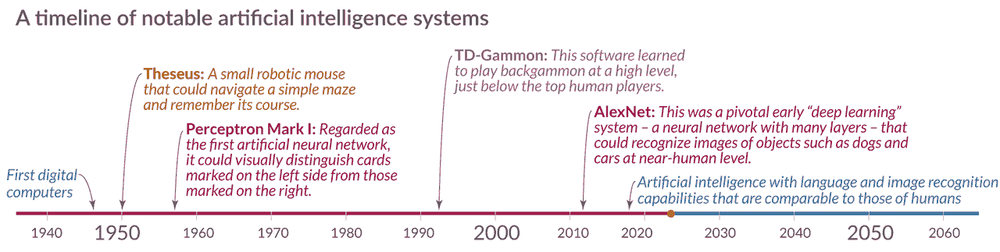
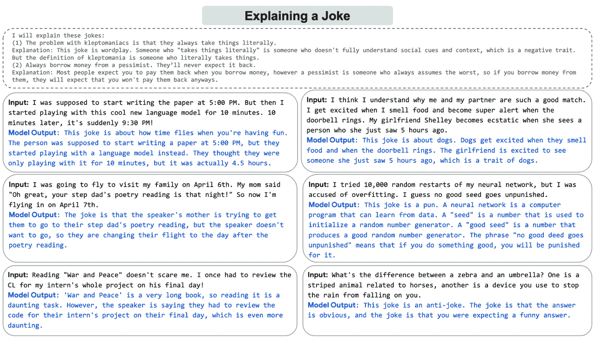
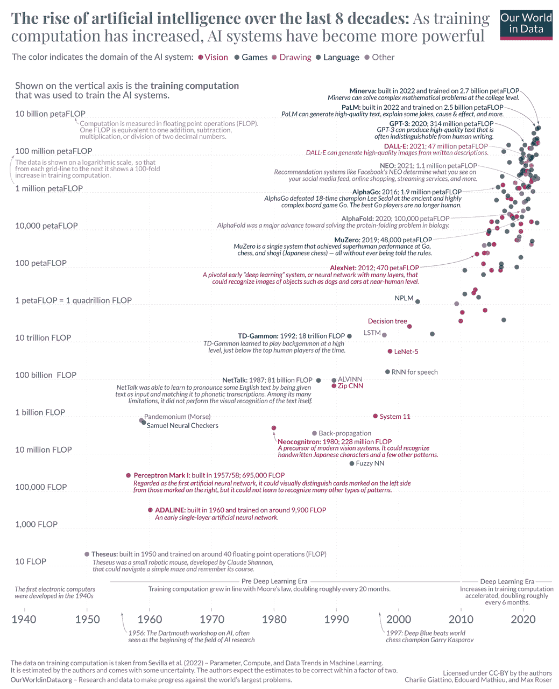

# Our World in Data: The brief history of artificial intelligence

> 来源：[https://gotoaiworld.feishu.cn/docx/RKgOdWBwcowxQAx8G6kcVq4DnKb](https://gotoaiworld.feishu.cn/docx/RKgOdWBwcowxQAx8G6kcVq4DnKb)

<https://ourworldindata.org/brief-history-of-ai>

`https://ourworldindata.org/brief-history-of-ai`

The brief history of artificial intelligence: the world has changed fast — what might be next?

Despite their brief history, computers and AI have fundamentally changed what we see, what we know, and what we do. Little is as important for the world’s future and our own lives as how this history continues.

By: [Max Roser](https://ourworldindata.org/team/max-roser)

December 6, 2022

Cite this articleReuse our work freely

To see what the future might look like, it is often helpful to study our history. This is what I will do in this article. I retrace the brief history of computers and artificial intelligence to see what we can expect for the future.

## How did we get here?

How rapidly the world has changed becomes clear by how even quite recent computer technology feels ancient today. Mobile phones in the ‘90s were big bricks with tiny green displays. Two decades before that, the main storage for computers was punch cards.

In a short period, computers evolved so quickly and became such an integral part of our daily lives that it is easy to forget how recent this technology is. The first digital computers were only invented about eight decades ago, as the timeline shows.

Download image

Since the early days of this history, some computer scientists have strived to make machines as intelligent as humans. The next timeline shows some of the notable artificial intelligence (AI) systems and describes what they were capable of.

The first system I mention is the Theseus. It was built by Claude Shannon in 1950 and was a [remote](https://ourworldindata.org/brief-history-of-ai#note-1)-controlled mouse that was able to find its way out of a labyrinth and could remember its course.(1) In seven decades, the abilities of artificial intelligence have come a long way.

Download image

### The language and image recognition capabilities of AI systems have developed very rapidly

The chart shows how we got here by zooming into the last two decades of AI development. The plotted data stems from a number of tests in which human and AI performance were evaluated in different domains, from handwriting recognition to language understanding.

Within [each](https://ourworldindata.org/brief-history-of-ai#note-2) domain, the AI system's initial performance is set to –100, and human performance in these tests is used as a baseline set to zero. This means that when the model’s performance crosses the zero line, the AI system scored more points in the relevant test than the humans who did the same test.(2)

Just 10 [years](https://ourworldindata.org/brief-history-of-ai#note-3) ago, no machine could reliably provide language or image recognition at a human level. But, as the chart shows, AI systems have become steadily more capable and are now beating humans in tests in all these domains.(3)

Outside of these standardized tests, the performance of these AIs is mixed. In some real-world cases, these systems are still performing much worse than humans. On the other hand, some implementations of such AI systems are already so cheap that they are available on the phone in your pocket: image recognition categorizes your photos, and speech recognition transcribes what you dictate.

### [Test scores of AI systems on various capabilities relative to human performance](https://ourworldindata.org/grapher/test-scores-ai-capabilities-relative-human-performance)

Within each domain, the initial performance of the AI is set to –100. Human performance is used as a baseline, set to zero. When the AI’s performance crosses the zero line, it scored more points than humans.

Edit capabilities

**Data source:** Kiela et al. (2023) – Learn more about this data

[OurWorldinData.org/artificial-intelligence](https://ourworldindata.org/artificial-intelligence) | [CC BY](https://creativecommons.org/licenses/by/4.0/)

**Note:** For each capability, the first year always shows a baseline of –100, even if better performance was recorded later that year.

### From image recognition to image generation

The previous chart showed the rapid advances in the perceptive abilities of artificial intelligence. AI systems have also become much more capable of generating images.

This series of nine images shows the development over the last nine years. None of the people in these images exist; all were generated by an AI system.

The series begins with an image from 2014 in the top left, a primitive image of a pixelated face in black and white. As the first image in the second row shows, just three years later, AI systems were already able to generate images that were hard to differentiate from photographs.

In recent years, the capability of AI systems has become much more impressive still. While the early systems focused on generating images of faces, these newer models broadened their capabilities to text-to-image [generation](https://ourworldindata.org/brief-history-of-ai#note-5) based on almost any prompt. The image in the bottom right shows that even the most challenging prompts — such as “A Pomeranian is sitting on the King’s throne wearing a crown. Two tiger soldiers are standing next to the throne” — are turned into photorealistic images within seconds.(5)

**[Timeline](https://ourworldindata.org/brief-history-of-ai#note-4)** of images generated by artificial intelligence(4)

Download image

### Language recognition and production is developing fast

Just as striking as the advances of image-generating AIs is the rapid development of systems that parse and respond to human language.

The image shows examples of an AI system developed by Google called PaLM. In these six examples, the system was asked to explain six different jokes. I find the explanation in the bottom right particularly remarkable: the AI explains an anti-joke specifically meant to confuse the listener.

AIs that [produce](https://en.wikipedia.org/wiki/Automated_journalism) language have entered our world in many ways over the last few years. Emails get auto-completed, massive amounts of online texts get translated, videos get automatically transcribed, school children use language models to do their homework, reports get auto-generated, and media outlets publish AI-generated journalism.

AI systems are not yet able to produce long, coherent texts. In the future, we will see whether the recent developments will slow down — or even end — or whether we will one day read a bestselling novel written by an AI.

**[Output of the AI system PaLM after being asked to interpret six different jokes](https://ourworldindata.org/brief-history-of-ai#note-6)**(6)

Download image

---

## Where we are now: AI is here

These rapid advances in AI capabilities have made it possible to use machines in a wide range of new domains:

[When you ](https://www.bloomberg.com/news/articles/2022-10-20/artificial-intelligence-helps-airlines-find-the-right-prices-for-flight-tickets)[book a fl](https://www.sourcesecurity.com/news/co-2166-ga.132.html)[ght, it](https://www.airbus.com/en/innovation/industry-4-0/artificial-intelligence) is often an artificial intelligence, no longer a human, that decides what you pay. When you get to the airport, it is an AI system that monitors what you do at the airport. And once you are on the plane, an AI system assists the pilot in flying you to your destination.

AI systems also increasingly [determine whether](https://www.brookings.edu/research/reducing-bias-in-ai-based-financial-services/) [you get](https://theconversation.com/ai-algorithms-intended-to-root-out-welfare-fraud-often-end-up-punishing-the-poor-instead-131625) [a loan](https://www.reuters.com/article/us-amazon-com-jobs-automation-insight-idUSKCN1MK08G), are eligible for welfare or get hired for a particular job. Increasingly, they help determine who is released from jail.

Several governments have purchased autonomous weapons systems for warfare, and some use AI systems for surveillance and oppression.

AI systems [help](https://en.wikipedia.org/wiki/GitHub_Copilot) to program the [software you](https://en.wikipedia.org/wiki/Machine_translation) use and translate the texts you read. Virtual assistants, operated by speech recognition, have entered many households over the last decade. Now self-driving cars are becoming a reality.

In the last few years, AI systems have helped to make progress on some of the hardest problems in science.

Large [AIs called](https://www.nature.com/articles/d41586-021-00530-0) recommender systems determine what you see on social media, which products are shown to you in online shops, and what gets recommended to you on YouTube. Increasingly they are not just recommending the media we consume, but based on their capacity to generate images and texts, they are also creating the media we consume.

Artificial intelligence is no longer a technology of the future; AI is here, and much of what is reality now would have looked like sci-fi just recently. It is a technology that already impacts all of us, and the list above includes just a few of its many applications.

The wide range of listed applications makes clear that this is a very general technology that can be used by people for some extremely good goals — and some extraordinarily bad ones, too. For such “dual-use technologies”, it is important that all of us develop an understanding of what is happening and how we want the technology to be used.

Just two decades ago, the world was very different. What might AI technology be capable of in the future?

---

# What is next?

The AI systems that we just considered are the result of decades of steady advances in AI technology.

The big chart below brings this history over the last eight decades into [perspective](https://ourworldindata.org/brief-history-of-ai#note-7). It is based on the dataset produced by Jaime Sevilla and colleagues.(7)

**The** [rise](https://ourworldindata.org/brief-history-of-ai#note-8) of artificial intelligence over the last 8 decades: As training computation has increased, AI systems have become more powerful(8)

Download image

Each small circle in this chart represents one AI system. The circle’s position on the horizontal axis indicates when the AI system was built, and its position on the vertical axis shows the amount of computation used to train the particular AI system.

Training computation is measured in floating point operations, or FLOP for short. One FLOP is equivalent to one addition, subtraction, multiplication, or division of two decimal numbers.

All AI systems that rely on machine learning need to be trained, and in these systems, training computation is one of the three fundamental factors that are driving the capabilities of the system. The other two factors are the algorithms and the input data used for the training. The visualization shows that as training computation has increased, AI systems have become more and more powerful.

The timeline goes back to the 1940s when electronic computers were first invented. The first shown AI system is ‘Theseus’, Claude Shannon’s robotic mouse from 1950 that I mentioned at the beginning. Towards the other end of the timeline, you find AI systems like DALL-E and PaLM; we just discussed their abilities to produce photorealistic images and interpret and generate language. They are among the AI systems that used the largest amount of training computation to date.

The training computation is plotted on a logarithmic scale so that from each grid line to the next, it shows a 100-fold [increase](https://ourworldindata.org/technological-change#moore-s-law-the-exponential-increase-of-the-number-of-transistors-on-integrated-circuits). This long-run perspective shows a continuous increase. For the first six decades, training [computation](https://ourworldindata.org/brief-history-of-ai#note-9) increased in line with Moore’s Law, doubling roughly every 20 months. Since about 2010, this exponential growth has sped up further, to a doubling time of just about six months. That is an astonishingly fast rate of growth.(9)

The fast doubling times have accrued to large increases. PaLM’s training computation was 2.5 billion peta [FLOP](https://ourworldindata.org/brief-history-of-ai#note-10), more than 5 million times larger than AlexNet, the AI with the largest training computation just 10 years earlier.(10)

Scale-up was already exponential and has sped up substantially over the past decade. What can we learn from this historical development for the future of AI?

## Studying the long-run trends to predict the future of AI

AI researchers study these long-term [trends to](https://ourworldindata.org/brief-history-of-ai#note-11) see what is possible in the future.(11)

Perhaps the [most](https://ourworldindata.org/brief-history-of-ai#note-12) widely discussed study of this kind was published by AI researcher Ajeya Cotra. She studied the increase in training computation to ask at what point the computation to train an AI system could match that of the human brain. The idea is that, at this point, the AI system would match the capabilities of a human brain. In her latest update, Cotra estimated a 50% probability that such “transformative AI” will be developed by the year 2040, less than two decades from now.(12)

In a related article, I discuss what transformative AI would mean for the world. In short, the idea is that such an AI system would be powerful enough to bring the world into a ‘qualitatively different future’. It could lead to a change at the scale of the two earlier major transformations in human history, the agricultural and industrial revolutions. It would certainly represent the most important global change in our lifetimes.

Cotra’s work is particularly relevant in this context as she based her forecast on the kind of historical long-run trend of training computation that we just studied. But it is worth noting that other forecasters who rely on different considerations arrive at broadly similar conclusions. As I show in my article on AI timelines, many AI experts believe that there is a real chance that human-level artificial intelligence will be developed within the next decades, and some believe that it will exist much sooner.

## Building a public resource to enable the necessary public conversation

Computers and artificial intelligence have changed our world immensely, but we are still in the early stages of this history. Because this technology feels so familiar it is easy to forget that all of these technologies we interact with are very recent innovations and that the most profound changes are yet to come.

Artificial intelligence has already changed what we see, what we know, and what we do. This is despite the fact that this technology has had only a brief history.

There are no signs that these trends are hitting any limits anytime soon. On the contrary, particularly over the course of the last decade, the fundamental trends have accelerated: investments in AI technology have rapidly increased, and the doubling time of training computation has shortened to just six months.

All major technological innovations lead to a range of positive and negative consequences. This is already true of artificial intelligence. As this technology becomes more and more powerful, we should expect its impact to still increase.

Because of the importance of AI, we should all be able to form an opinion on where this technology is heading and understand how this development is changing our world. For this purpose, we are building a repository of AI-related metrics, which you can find on `OurWorldinData.org/artificial-intelligence`.

We are still in the early stages of this history, and much of what will become possible is yet to come. A technological development as powerful as this should be at the center of our attention. Little might be as important for how the future of our world — and the future of our lives — will play out.

## Acknowledgments

I would like to thank my colleagues Natasha Ahuja, Daniel Bachler, Julia Broden, Charlie Giattino, Bastian Herre, Edouard Mathieu, and Ike Saunders for their helpful comments on drafts of this essay and their contributions in preparing the visualizations.

This article was first published on December 6, 2022. In October 2024, I made a few adjustments to improve grammar and layout.
